# ADSK Deep Value Intelligence

**Analysis Date:** 2026-09-08

## Critical Disclaimer

*This analysis is generated by Deep Value Intelligence, an AI-powered multi-agent investing framework. Education & research only - not financial advice, not a financial advisor.*

---

## Table of Contents

1. Intelligence Summary
2. Analyst Team Reports
   - Fundamentals Analysis
   - Intrinsic Value Analysis (Buffett)
   - Trend & Growth Analysis (Lynch/Druckenmiller/Fisher)
   - Market Technical Analysis
   - Options Market Analysis
3. Research Team Commentary
4. Value Investing Team Commentary
5. Deep Values Commentary

---

## Intelligence Summary

### Thesis + Conditions

**Core Thesis:** **EXECUTIVE SUMMARY**
*   **Verdict**: **AVOID** for new capital. *   **The "Why"**: A world-class moat does not excuse a broken technical regime and unresolved fundamental divergence.

**Key Risks:**
- The Lesson Applied**: We have learned the hard way that admiring a great business can lead to passive "WATCH" ratings that bleed capital. A 19.5% plunge in six days is institutional repricing, not a retail liquidity glitch. We must demand a genuine margin of safety or confirmed trend repair before allocating capital.
- Risky (Bull)**: The 20% haircut is a generational buying opportunity for a monopoly asset. High ROIC and margins provide a fortress. AI will drive more complex work and stronger pricing, not fewer seats.
- Safe (Bear)**: Gross margin is a vanity metric if net income stagnates due to SBC dilution. AI could be highly deflationary to the seat-based model. We must wait for a true margin of safety at lower valuations.

**Confidence:** Medium

---

## Analyst Team Reports

### Fundamentals Analysis

#### Latest Earnings Snapshot

*Most recent reported quarter anchored on 2026 Q3, with prior-year comparison when available.*

| Metric | 2026 Q3 | 2025 Q3 | YoY Change |
| --- | ---: | ---: | ---: |
| Revenue | $2.05B | $1.76B | +16.1% |
| Operating Income | $598.0M | $450.0M | +32.9% |
| Net Income | $492.0M | $313.0M | +57.2% |
| Diluted EPS | $2.33 | $1.46 | +59.6% |
| Operating Cash Flow | $575.0M | $460.0M | +25.0% |
| Free Cash Flow | $554.0M | $444.0M | +24.8% |

Key Takeaways: This snapshot anchors the most recent reported quarter before the narrative analysis. It helps readers separate long-run business quality from whatever changed in the latest earnings print.

#### 17-Year Financial Metrics for ADSK

*All values below are computed deterministically from raw data - not estimated by AI.*

*Issuer profile: operating company (Technology / Software - Application).*

#### 17-Year Financial Metrics
*Annual rows come from reported financial statements. The final TTM row is computed from the latest four quarters.*

| Metric | 2009 | 2010 | 2011 | 2012 | 2013 | 2014 | 2015 | 2016 | 2017 | 2018 | 2019 | 2020 | 2021 | 2022 | 2023 | 2024 | 2025 | 2026 TTM |
| --- | --- | --- | --- | --- | --- | --- | --- | --- | --- | --- | --- | --- | --- | --- | --- | --- | --- | --- |
| Market Price | $17 | $24 | $41 | $36 | $39 | $51 | $54 | $47 | $81 | $116 | $147 | $197 | $277 | $250 | $215 | $254 | $311 | $218 |
| Market Cap | $3.81B | $5.52B | $9.53B | $8.40B | $9.01B | $11.77B | $12.55B | $10.58B | $18.11B | $25.38B | $32.22B | $43.80B | $61.59B | $55.45B | $46.90B | $54.82B | $67.56B | $45.98B |
| P/E Ratio | 20.70 | 95.16 | 45.20 | 29.51 | 36.34 | 51.25 | 154.31 | -32.07 | -31.16 | -44.81 | -397.84 | 205.05 | 51.00 | 111.51 | 56.92 | 60.58 | 60.81 | 28.19 |
| P/B Ratio | 2.91 | 3.75 | 5.92 | 4.46 | 4.41 | 5.20 | 5.66 | 6.53 | 24.69 | -99.14 | -152.78 | -315.10 | 63.82 | 65.32 | 40.96 | 29.55 | 25.78 | 13.59 |
| ROE | 14.0% | 3.9% | 13.2% | 15.2% | 12.1% | 10.1% | 3.7% | -20.4% | -79.3% | 221.4% | 38.3% | -154.3% | 125.2% | 58.5% | 71.9% | 48.8% | 42.4% | 48.5% |
| ROIC | 49.1% | 7.6% | 36.2% | 44.1% | 25.6% | 20.0% | 8.8% | -18.7% | -47.1% | -120.0% | -10.2% | 44.6% | 250.7% | 39.1% | 49.9% | 47.8% | 38.7% | 56.7% |
| EPS | $0.80 | $0.25 | $0.90 | $1.22 | $1.07 | $1.00 | $0.35 | $-1.46 | $-2.61 | $-2.58 | $-0.37 | $0.96 | $5.44 | $2.24 | $3.78 | $4.19 | $5.12 | $7.73 |
| Revenue | $2.32B | $1.71B | $1.95B | $2.22B | $2.31B | $2.27B | $2.51B | $2.50B | $2.03B | $2.06B | $2.57B | $3.27B | $3.79B | $4.39B | $5.00B | $5.50B | $6.13B | $7.79B |
| Gross Profit | $2.10B | $1.52B | $1.76B | $1.99B | $2.07B | $2.00B | $2.17B | $2.13B | $1.69B | $1.75B | $2.28B | $2.95B | $3.45B | $3.97B | $4.53B | $4.99B | $5.55B | $7.11B |
| Gross Margin | 90.5% | 88.8% | 89.9% | 89.7% | 89.7% | 87.9% | 86.4% | 85.2% | 83.2% | 85.2% | 88.9% | 90.1% | 91.1% | 90.5% | 90.4% | 90.7% | 90.6% | 91.2% |
| Operating Margin | 10.6% | 3.8% | 13.9% | 16.0% | 13.2% | 12.5% | 4.8% | 0.1% | -24.6% | -24.8% | -1.0% | 10.5% | 16.6% | 14.1% | 19.8% | 20.5% | 22.1% | 27.9% |
| Net Income | $183.6M | $58.0M | $212.0M | $285.3M | $247.4M | $228.8M | $81.8M | $-330.5M | $-582.1M | $-566.9M | $-80.8M | $214.5M | $1.21B | $497.0M | $823.0M | $906.0M | $1.11B | $1.64B |
| Net Margin | 7.9% | 3.4% | 10.9% | 12.9% | 10.7% | 10.1% | 3.3% | -13.2% | -28.7% | -27.6% | -3.1% | 6.6% | 31.9% | 11.3% | 16.4% | 16.5% | 18.1% | 21.1% |
| Revenue Growth | N/A | -26.0% | 13.9% | 13.5% | 4.4% | -1.7% | 10.5% | -0.3% | -18.9% | 1.3% | 25.0% | 27.4% | 15.7% | 15.7% | 14.1% | 9.8% | 11.5% | 27.1% |
| Net Income Growth | N/A | -68.4% | 265.5% | 34.6% | -13.3% | -7.5% | -64.2% | -504.0% | 76.1% | -2.6% | -85.7% | -365.5% | 463.2% | -58.9% | 65.6% | 10.1% | 22.7% | 47.7% |
| Free Cash Flow Growth | N/A | -59.7% | 146.6% | -0.4% | -1.5% | -0.7% | 26.8% | -46.0% | -72.6% | -153.1% | -722.7% | 339.2% | -1.2% | 9.6% | 37.7% | -36.9% | 22.2% | 78.9% |
| Total Book Value | $1.31B | $1.47B | $1.61B | $1.88B | $2.04B | $2.26B | $2.22B | $1.62B | $733.6M | $-256.0M | $-210.9M | $-139.0M | $965.0M | $849.0M | $1.15B | $1.85B | $2.62B | $3.38B |
| Total Assets | $2.42B | $2.45B | $2.79B | $3.23B | $4.31B | $4.59B | $4.91B | $5.52B | $4.80B | $4.11B | $4.73B | $6.18B | $7.28B | $8.61B | $9.44B | $9.91B | $10.83B | $12.98B |
| Total Debt | $0 | $0 | $0 | $0 | $745.6M | $746.4M | $743.1M | $1.49B | $1.09B | $1.59B | $2.09B | $2.10B | $1.65B | $2.65B | $2.30B | $2.30B | $2.30B | $3.71B |
| Debt-to-Equity | 0.00 | 0.00 | 0.00 | 0.00 | 0.36 | 0.33 | 0.33 | 0.92 | 1.49 | -6.20 | -9.90 | -15.11 | 1.71 | 3.12 | 2.01 | 1.24 | 0.88 | 1.10 |
| Cash & Equivalents | $917.6M | $838.7M | $1.08B | $1.16B | $1.61B | $1.85B | $1.41B | $1.35B | $1.21B | $1.08B | $886.0M | $1.77B | $1.77B | $1.53B | $1.95B | $1.89B | $1.60B | $4.10B |
| Shareholders' Equity | $1.31B | $1.47B | $1.61B | $1.88B | $2.04B | $2.26B | $2.22B | $1.62B | $733.6M | $-256.0M | $-210.9M | $-139.0M | $965.0M | $849.0M | $1.15B | $1.85B | $2.62B | $3.38B |
| Operating Cash Flow | $593.9M | $246.8M | $540.8M | $573.5M | $559.1M | $563.5M | $708.6M | $414.0M | $169.7M | $900,000 | $377.1M | $1.42B | $1.44B | $1.53B | $2.07B | $1.31B | $1.61B | $2.90B |
| Investing Cash Flow | $-478.1M | $-283.0M | $-142.3M | $-370.3M | $-647.2M | $-194.0M | $-905.6M | $-809.5M | $272.0M | $506.4M | $-710.4M | $-57.3M | $-404.0M | $-1.59B | $-143.0M | $-502.0M | $-903.0M | $-78.0M |
| Free Cash Flow | $515.5M | $207.8M | $512.5M | $510.5M | $502.7M | $499.3M | $633.1M | $341.6M | $93.7M | $-49.8M | $310.1M | $1.36B | $1.35B | $1.48B | $2.03B | $1.28B | $1.57B | $2.80B |
| FCF Margin | 22.3% | 12.1% | 26.3% | 23.0% | 21.7% | 22.0% | 25.2% | 13.6% | 4.6% | -2.4% | 12.1% | 41.6% | 35.5% | 33.6% | 40.6% | 23.3% | 25.6% | 36.0% |
| Dividends / Share | $0.00 | $0.00 | $0.00 | $0.00 | $0.00 | $0.00 | $0.00 | $0.00 | $0.00 | $0.00 | $0.00 | $0.00 | $0.00 | $0.00 | $0.00 | $0.00 | $0.00 | $0.00 |

#### Profitability Metrics
- Return on Equity (ROE): 36.9%
- Return on Invested Capital (ROIC): 33.6%
- Return on Assets (ROA): 9.0%
- Gross Margin: 91.0%
- Operating Margin: 21.9%
- Net Profit Margin: 15.6%

#### Liquidity Metrics
- Current Ratio: 0.85
- Quick Ratio: 0.69

#### Leverage Metrics
- Debt-to-Equity Ratio: 0.82
- Interest Coverage Ratio: 19.73
- Net Debt: $251.0M

#### Growth Metrics (Year-over-Year)
- Revenue Growth: 17.5%
- Net Income Growth: 1.1%
- Free Cash Flow Growth: 53.7%
- Revenue CAGR (3-Year): 12.9%
- Revenue CAGR (5-Year): 13.7%

#### Valuation Metrics
- P/E Ratio (TTM): 28.26
- Forward P/E: 15.33
- Price-to-Book: 13.46
- Price-to-Sales: 5.85
- PEG Ratio: 0.84
- EV/EBITDA: 19.72
- Free Cash Flow Yield: 5.3%
- Earnings Yield: 3.5%

#### Owner Earnings (Buffett Method, Code-Computed)
- Net Income: $1.11B
- + Depreciation & Amortization: $195.0M
- - Capital Expenditures: $-43.0M
- - Working Capital Changes: $-501.0M
- = **Owner Earnings: $1.71B**

#### Intrinsic Value (Code-Computed)
- Current Price: $218
- **Headline Intrinsic Value (business-model routed): $202**
  Business model: cyclical - weighted blend [Damodaran FCFF + reverse-DCF fair + owner-earnings DCF] (cyclical)
  Model spread (min-max across DCFs): $66 - $264
  Margin of safety vs. price (headline): -7.6%
  Routing note: Cyclical: margins/FCF are volatile - headline blends FCFF, reverse-DCF and owner-earnings roughly evenly; treat the range as the honest read.
- Buffett Method (Owner Earnings):
  Conservative: $14
  Average: $264
  Optimistic: $264
- Cash Flow Method (FCF):
  Conservative: $38
  Average: $217
  Optimistic: $265
- Damodaran FCFF (WACC + margins + reinvestment):
  Conservative: $26
  Average: $66
  Optimistic: $119
  Monte Carlo band (P10-P90): $41 - $85 (median $61)
  P(intrinsic value > price): 0.0%
- Reverse-DCF: price implies ~13.6%/yr owner-earnings growth for 10y; trailing 3y was 57.1%, 5y 60.4%.

#### Piotroski F-Score: 7/9
- Positive Net Income: PASS
- Positive Operating Cash Flow: PASS
- ROA Improvement: FAIL
- Cash Flow > Net Income: PASS
- Decreasing Debt: FAIL
- Improving Current Ratio: PASS
- No Dilution: PASS
- Improving Gross Margin: PASS
- Improving Asset Turnover: PASS

ANALYST STANCE: **WATCH**

#### Autodesk, Inc. (ADSK) - Buffett-Style Fundamental Analysis

Autodesk is a high-quality, asset-light design software franchise with exceptional gross margins, improving operating leverage, strong recurring subscription economics, and meaningful competitive advantages in architecture, engineering, construction, manufacturing, and media design workflows. The business quality is far better than its accounting history may initially suggest, because the 2016-2019 period was distorted by the transition from perpetual licenses to subscriptions, which temporarily depressed reported earnings, margins, book value, and cash flow.

At the current price of **$218**, Autodesk trades below its recent fiscal-year high but still above the deterministic model's **headline intrinsic value of approximately $202 per share**, implying a **negative margin of safety of about 7.6%**. The stock is not obviously overvalued on free-cash-flow yield, but the valuation requires continued double-digit owner-earnings growth. For a Buffett-style investor, this is a business to admire, but not yet a clear bargain.

---

#### Revenue Breakdown

| Revenue Source | Amount ($B) | % of Total |
|---|---:|---:|
| Architecture, Engineering & Construction | $2.97B | 48.4% |
| AutoCAD and AutoCAD LT | $1.55B | 25.3% |
| Manufacturing | $1.23B | 20.0% |
| Media & Entertainment | $0.31B | 5.0% |
| Other | $0.08B | 1.3% |
| **Total FY2025 Revenue** | **$6.13B** | **100.0%** |

**Key Takeaways:** Autodesk's revenue base is heavily weighted toward Architecture, Engineering, and Construction, which is nearly half of total revenue and represents the company's deepest workflow moat. AutoCAD remains a major cash-generating product family, while Manufacturing adds another durable vertical. The mix is attractive because these products are embedded in professional workflows where switching costs are high.

---

#### Current vs. 10-Year Historical Average Comparison

*10-year averages use fiscal years 2016-2025 from the deterministic dataset; "Current" uses the 2026 TTM row where available.*

| Metric | Current / TTM | 10-Year Avg. | Interpretation |
|---|---:|---:|---|
| Market Price | $218 | $189.50 | Above the 10-year average, but well below the 2025 level of $311. |
| Market Cap | $45.98B | $41.64B | Slightly above the decade average, reflecting improved earnings power. |
| P/E Ratio | 28.19x | 4.00x | Historical average is distorted by loss years and negative earnings; current P/E is more meaningful. |
| P/B Ratio | 13.59x | -31.04x | **Not meaningful** for this asset-light software issuer due to buybacks, low tangible book, and negative equity periods. |
| ROE | 48.5% | 35.3% | Above average, but ROE is inflated by a small accounting equity base. |
| ROIC | 56.7% | 27.5% | Significantly above average; indicates strong capital efficiency. |
| EPS | $7.73 | $1.47 | Far above average as subscription economics and scale benefits mature. |
| Revenue | $7.79B | $3.72B | More than double the 10-year average. |
| Gross Profit | $7.11B | $3.33B | Strongly above average, supported by software gross margins. |
| Gross Margin | 91.2% | 88.6% | Above average and near the top of the historical range. |
| Operating Margin | 27.9% | 5.3% | Major improvement from the subscription-transition years. |
| Net Income | $1.64B | $0.32B | Far above average; profitability has normalized and strengthened. |
| Net Margin | 21.1% | 2.8% | Well above historical average, though the average is depressed by 2016-2019 losses. |
| Revenue Growth | 27.1% | 10.1% | Current growth is unusually strong versus the decade average. |
| Net Income Growth | 47.7% | -37.9% | Current growth is strong; historical average is distorted by loss-to-profit swings. |
| Free Cash Flow Growth | 78.9% | -62.4% | Current growth is exceptional; historical average is skewed by negative FCF years. |
| Total Book Value | $3.38B | $0.92B | Improved materially, but book value is not the right valuation anchor. |
| Total Assets | $12.98B | $7.14B | Balance sheet has expanded with business scale. |
| Total Debt | $3.71B | $1.96B | Debt is above average, but offset by strong cash flow and cash balance. |
| Debt-to-Equity | 1.10x | -1.98x | Historical average is distorted by negative equity years; current leverage is manageable. |
| Cash & Equivalents | $4.10B | $1.50B | Cash position is much stronger than average. |
| Shareholders' Equity | $3.38B | $0.92B | Equity has recovered after negative-equity years. |
| Free Cash Flow | $2.80B | $0.98B | Almost 3x the decade average. |
| Dividends / Share | $0.00 | $0.00 | Autodesk reinvests and repurchases rather than paying dividends. |

**Key Takeaways:** Autodesk's current fundamentals are meaningfully stronger than its 10-year averages across revenue, margins, EPS, free cash flow, ROIC, and net income. However, several historical averages are distorted by the 2016-2019 subscription-transition period, when reported earnings, equity, and cash flow were temporarily depressed. For valuation, book-based metrics such as P/B are not useful; cash-flow-based intrinsic value is the correct anchor.

---

#### Market Metrics Interpretation

| Metric | Current Reading | Buffett-Style Interpretation |
|---|---:|---|
| Market Price | $218 | The stock has pulled back from the prior fiscal-year level of $311, improving prospective returns. |
| Market Cap | $45.98B | Autodesk is a large, established software compounder, not an early-stage hypergrowth company. |
| P/E Ratio | 28.19x | Reasonable for a high-quality software business if double-digit earnings growth continues. |
| P/B Ratio | 13.59x | **Not meaningful** for Autodesk; book value does not reflect the value of software IP, customer relationships, or recurring revenue. |

**Key Takeaways:** Autodesk's valuation is best judged through free cash flow and owner earnings, not book value. The current P/E is much more reasonable than the inflated multiples seen in earlier years, but it still assumes durable growth. The market is pricing Autodesk as a quality compounder, not a deep-value stock.

---

#### Profitability and Business Quality

Autodesk's profitability profile is excellent. The company's **91.2% TTM gross margin** is a hallmark of a strong software franchise: once the platform is built, incremental revenue carries very high contribution margins. Operating margin has improved to **27.9%**, compared with a 10-year average of only **5.3%**, showing that the subscription model has matured and scale benefits are now flowing through the income statement.

The most important Buffett-style signal is **ROIC**, which is currently **56.7%** in the deterministic TTM dataset. That is an exceptional number and indicates that Autodesk can generate large cash returns without requiring heavy incremental tangible capital. ROE is also high at **48.5%**, but should be interpreted cautiously because asset-light software companies often have small accounting equity bases, and buybacks can distort book value.

| Profitability Metric | Current / TTM | Assessment |
|---|---:|---|
| Gross Margin | 91.2% | Excellent; evidence of pricing power and software economics. |
| Operating Margin | 27.9% | Strong and improving; reflects operating leverage. |
| Net Margin | 21.1% | Healthy; profitability has normalized after transition years. |
| ROE | 48.5% | Strong, but partly inflated by accounting equity structure. |
| ROIC | 56.7% | Very strong; one of the clearest signs of business quality. |
| EPS | $7.73 | Well above the decade average and trending positively. |
| Net Income | $1.64B | Strong current earnings base. |

**Key Takeaways:** Autodesk now looks like the software compounder that the subscription transition was intended to create. Gross margins are world-class, operating margins are expanding, and ROIC is excellent. The key question is no longer whether the model works, but whether investors are paying too much for that quality.

---

#### Growth Analysis

Autodesk's recent growth is materially above its long-term average. TTM revenue growth of **27.1%** is well above the 10-year average of **10.1%**, while free cash flow growth of **78.9%** is unusually strong. However, the historical growth figures are volatile because the company moved from license sales to recurring subscriptions, which changed revenue recognition, cash flow timing, and reported profitability.

| Growth Metric | Current / TTM | 10-Year Avg. | Assessment |
|---|---:|---:|---|
| Revenue Growth | 27.1% | 10.1% | Current growth is very strong versus history. |
| Net Income Growth | 47.7% | -37.9% | Strong current growth, but historical average is distorted. |
| Free Cash Flow Growth | 78.9% | -62.4% | Exceptional current growth, but not safe to extrapolate permanently. |
| Revenue CAGR, 3-Year | 12.9% | N/A | Healthy normalized growth rate. |
| Revenue CAGR, 5-Year | 13.7% | N/A | Supports a double-digit medium-term growth case. |

**Key Takeaways:** Autodesk's normalized revenue growth appears to be in the low-to-mid-teens range, even though the TTM figure is much higher. The current free-cash-flow surge is impressive, but a Buffett-style investor should not assume that 79% FCF growth is repeatable. A reasonable valuation case should use growth that fades toward a mature terminal rate.

---

#### Balance Sheet and Financial Strength

Autodesk's balance sheet is solid but not flawless. TTM cash and equivalents are **$4.10B**, while total debt is **$3.71B**, leaving the company close to a net-cash position using the deterministic TTM balance sheet. The research pack's point-in-time leverage data shows net debt of approximately **$251M**, which is still modest relative to Autodesk's free cash flow.

Debt has increased versus the 10-year average, but interest coverage of **19.73x** suggests the debt burden is currently very manageable. The current ratio of **0.85** and quick ratio of **0.69** are not major red flags for this software issuer, because Autodesk has recurring cash collections and deferred revenue dynamics; however, they should still be monitored.

| Balance Sheet Metric | Current / TTM | Assessment |
|---|---:|---|
| Total Assets | $12.98B | Larger, stronger asset base than historical average. |
| Total Debt | $3.71B | Elevated versus history, but manageable. |
| Cash & Equivalents | $4.10B | Strong liquidity position. |
| Shareholders' Equity | $3.38B | Recovered from prior negative-equity years. |
| Debt-to-Equity | 1.10x | Acceptable, though book-equity-based leverage is imperfect for software. |
| Interest Coverage | 19.73x | Strong ability to service debt. |
| Current Ratio | 0.85 | Low mechanically, but less meaningful for subscription software. |
| Quick Ratio | 0.69 | Also less meaningful than cash generation and renewal rates. |

**Key Takeaways:** Autodesk's balance sheet is not overleveraged, and its cash generation provides a substantial cushion. The company has more debt than it did earlier in the decade, but interest coverage is strong. For this business model, liquidity ratios and book-equity ratios should be interpreted with caution.

---

#### Cash Flow and Capital Allocation

Autodesk's most attractive financial characteristic is free cash flow. TTM free cash flow is **$2.80B**, compared with a 10-year average of approximately **$0.98B**. The TTM free cash flow margin is **36.0%**, showing that the company converts a large portion of revenue into cash.

Autodesk pays **no dividend**, which is consistent with a software compounder that prioritizes reinvestment, acquisitions, and share repurchases. From a Buffett perspective, the lack of dividend is acceptable if management can reinvest or repurchase shares at attractive returns. The risk is that buybacks become value-destructive if executed aggressively when shares trade above intrinsic value.

| Cash Flow Metric | Current / TTM | 10-Year Avg. | Assessment |
|---|---:|---:|---|
| Operating Cash Flow | $2.90B | Approximately $0.98B-$1.00B normalized range | Strong current cash generation. |
| Free Cash Flow | $2.80B | $0.98B | Very strong versus history. |
| FCF Margin | 36.0% | Approximately 22.7% | Excellent software cash conversion. |
| FCF Yield | 5.3% | N/A | Reasonable, but not a deep bargain. |
| Dividends / Share | $0.00 | $0.00 | Capital returned mainly through repurchases, not dividends. |

**Key Takeaways:** Autodesk's free cash flow profile is significantly better than its reported accounting history suggests. The company now generates high-margin, recurring cash flow at scale. The main capital allocation issue is whether buybacks and acquisitions are made at attractive prices.

---

#### Buffett-Style Economic Moat Assessment

| Moat Factor | Assessment |
|---|---|
| Switching Costs | High. Autodesk tools are deeply embedded in design, engineering, architecture, construction, and manufacturing workflows. |
| Network Effects | Moderate. File formats, trained user bases, industry standards, and ecosystem integrations reinforce adoption. |
| Brand Strength | Strong. AutoCAD, Revit, Civil 3D, Fusion, and Maya are recognized professional tools. |
| Pricing Power | Strong. Gross margins above 90% and recurring subscriptions indicate durable pricing power. |
| Reinvestment Runway | Attractive. Construction digitization, cloud collaboration, manufacturing automation, and AI-assisted design create long-term opportunities. |
| Threats | Competition from Bentley, Dassault, Adobe, Trimble, Ansys/Synopsys ecosystems, open-source alternatives, and customer pushback on pricing. |

**Key Takeaways:** Autodesk has a real moat, primarily from workflow lock-in, professional standardization, and high switching costs. Its products are not optional for many customers; they are mission-critical tools. That said, the moat is strongest in core AEC and AutoCAD workflows and less absolute in newer cloud, manufacturing, and media categories.

---

#### Three-Scenario Buffett-Style Owner Earnings DCF

The deterministic dataset provides code-computed owner earnings of **$1.71B** based on net income, depreciation and amortization, capital expenditures, and working-capital changes. Because TTM free cash flow is materially higher at **$2.80B**, this DCF uses a normalized owner-earnings base of **$2.25B**, roughly balancing the latest reported owner-earnings base with stronger TTM cash generation. This avoids anchoring entirely to a potentially conservative fiscal-year figure or an unusually strong TTM cash-flow figure.

Assumptions:
- Normalized owner earnings base: **$2.25B**
- Discount rate: **10.0%**
- Terminal growth rate: **2.5%**
- Shares outstanding estimate: approximately **211M**
- Net cash adjustment using TTM deterministic balance sheet: approximately **$0.39B**
- Terminal value formula: `Year 10 Owner Earnings x (1 + 2.5%) / (10.0% - 2.5%)`

| Scenario | Growth Assumption | PV of Explicit Cash Flows | PV of Terminal Value | Equity Value incl. Net Cash | Fair Value / Share |
|---|---|---:|---:|---:|---:|
| Conservative | 3% annual growth for 10 years | $15.95B | $15.92B | $32.26B | **$153** |
| Average | 13% growth fading to 4% by year 10 | $22.51B | $26.71B | $49.61B | **$235** |
| Optimistic | 18% growth fading to 5% by year 10 | $25.57B | $31.93B | $57.89B | **$274** |

**Key Takeaways:** The hand-built owner-earnings DCF suggests a broad fair value range of roughly **$153 to $274 per share**, with a base-case estimate near **$235**. The current price of **$218** is below the hand-built base case but above the deterministic headline intrinsic value of **$202**. This means the stock is not obviously expensive, but the margin of safety is thin.

---

#### DCF Cross-Check Against Deterministic Model Pack

| Valuation Method | Intrinsic Value / Share | Signal |
|---|---:|---|
| Headline Business-Model Routed Intrinsic Value | $202 | Slightly below current price. |
| Owner Earnings DCF Model | $264 | Bullish, assumes strong owner-earnings durability. |
| FCF DCF Model | $217 | Approximately in line with current price. |
| Damodaran FCFF Model | $66 | Bearish, more conservative on reinvestment, margins, and WACC. |
| Damodaran Monte Carlo P10-P90 | $41-$85 | Indicates low probability of upside under that framework. |
| Reverse DCF | Implies ~13.6% owner-earnings growth for 10 years | Demanding but not impossible. |

**Key Takeaways:** Autodesk's valuation is highly sensitive to the cash-flow model used. Owner-earnings and FCF methods produce values near or above the current price, while the Damodaran-style FCFF model is much more conservative. The reverse DCF is the most practical reality check: the current price requires roughly **13.6% annual owner-earnings growth for 10 years**, which is achievable only if Autodesk continues executing very well.

---

#### Predictability of Earnings

Autodesk's 17-year history is not perfectly smooth because the company deliberately changed its business model. Revenue declined and earnings turned negative during the subscription transition, especially from 2016 through 2019. Since 2020, however, the business has shown far greater predictability, with revenue rising from **$3.27B in 2020** to **$7.79B TTM**, while operating margin improved from **10.5%** to **27.9%**.

From a Buffett perspective, the post-transition period is more representative of the current business than the full historical average. The key is whether Autodesk can continue compounding revenue at attractive rates without sacrificing margins or alienating customers through price increases.

---

#### Management and Capital Allocation

Management deserves credit for completing a difficult transition from perpetual licenses to recurring subscriptions. That transition temporarily damaged reported earnings and investor optics, but it created a higher-quality revenue base with stronger lifetime customer value and better cash-flow visibility.

Capital allocation is generally rational, but not risk-free. Autodesk does not pay a dividend and instead retains cash for reinvestment, acquisitions, and buybacks. That is appropriate for a high-ROIC software business, but buybacks only create value when shares are repurchased below intrinsic value. At today's price, repurchases would be acceptable but not obviously compelling.

---

#### Key Investment Insights, Red Flags, and Opportunities

| Category | Key Points |
|---|---|
| Core Strength | Autodesk has excellent gross margins, high switching costs, recurring revenue, and strong ROIC. |
| Valuation | Current price is near fair value; headline intrinsic value is $202 versus price of $218. |
| Growth Opportunity | Construction digitization, cloud collaboration, AI-assisted design, and manufacturing workflows provide runway. |
| Cash Flow | TTM free cash flow of $2.80B and FCF yield of 5.3% are attractive for a quality software company. |
| Red Flag | Valuation depends on continued double-digit owner-earnings growth. |
| Red Flag | Damodaran FCFF model is much more conservative, with an average intrinsic value of only $66. |
| Red Flag | P/B, ROE, and debt-to-equity are distorted by asset-light accounting and past negative equity. |
| Opportunity | If the stock falls meaningfully below $200, the margin of safety improves materially. |
| Opportunity | Continued operating margin expansion could justify values closer to the owner-earnings DCF. |

**Key Takeaways:** Autodesk is a high-quality compounder, but not a classic cheap stock. The opportunity is strongest if growth remains in the low-to-mid-teens and margins continue expanding. The main risk is that investors are already paying for much of that future success.

---

#### Final Investment Stance: WATCH

| Decision Factor | Assessment |
|---|---|
| Business Quality | High |
| Economic Moat | Strong |
| Financial Strength | Good |
| Earnings Predictability | Improving materially post-subscription transition |
| Current Valuation | Fair to slightly rich versus headline intrinsic value |
| Margin of Safety | Insufficient at current price |
| Buffett-Style Action | Watchlist candidate; buy only with a better margin of safety |

**Key Takeaways:** Autodesk is the type of business Buffett-style investors should want to own: high-margin, capital-light, durable, and increasingly predictable. However, the current price of **$218** is above the deterministic headline intrinsic value of **$202**, leaving little margin of safety. The appropriate stance is **WATCH**, with a more attractive entry point likely below the low-$200s and preferably closer to or below the conservative-to-base intrinsic value range.

---

#### Summary Table

| Area | Verdict | Explanation |
|---|---|---|
| Economic Moat | Strong | Deep workflow integration, professional standards, high switching costs. |
| Profitability | Excellent | 91.2% gross margin, 27.9% operating margin, 56.7% TTM ROIC. |
| Growth | Strong | Revenue growth and FCF growth are currently above historical norms. |
| Balance Sheet | Solid | Debt is manageable and cash position is strong. |
| Cash Flow | Excellent | TTM FCF of $2.80B and 36.0% FCF margin. |
| Valuation | Fair, not cheap | Headline intrinsic value of $202 versus current price of $218. |
| Key Risk | Execution and valuation | Price requires sustained double-digit owner-earnings growth. |
| Key Opportunity | Operating leverage | Continued margin expansion could lift intrinsic value. |
| Final Stance | **WATCH** | High-quality business, but insufficient margin of safety today. |

**Key Takeaways:** Autodesk is a superior business trading at a valuation that is reasonable but not clearly cheap. The stock deserves a place on a quality-compounder watchlist, especially after its pullback from prior highs. For a disciplined Buffett-style investor, patience is warranted until the market offers a larger margin of safety.

#### Fundamental Visuals

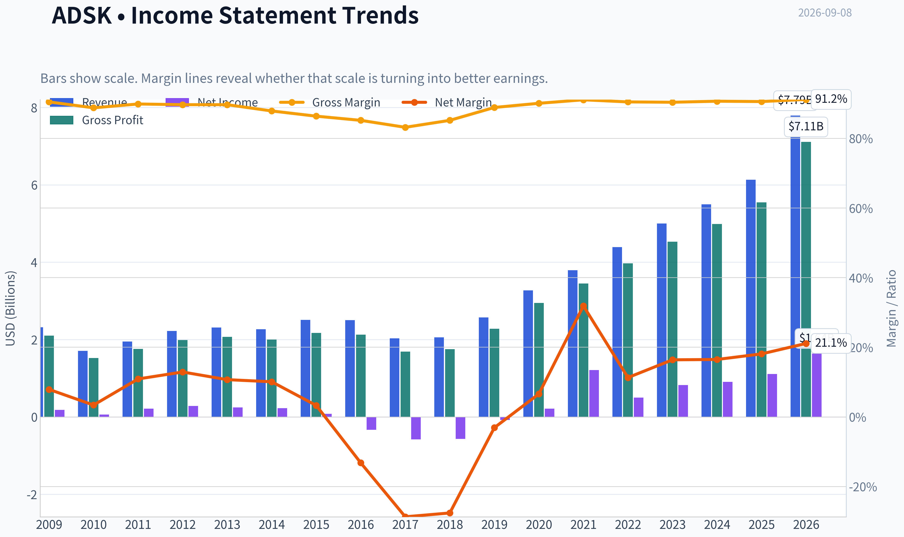

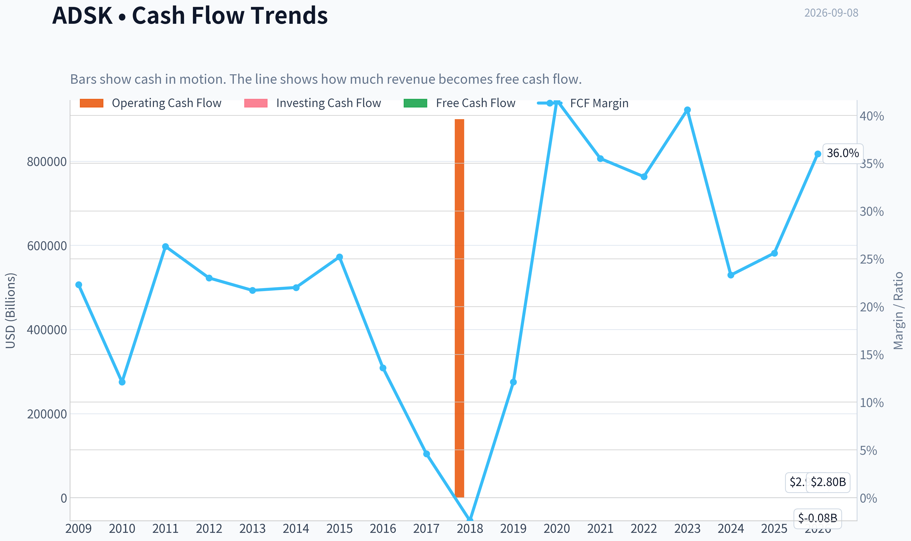

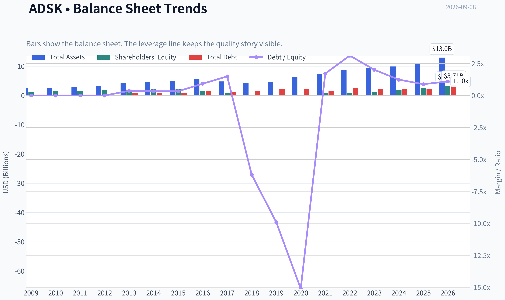

This graph tracks the profitability and return metrics (ROE, ROIC, Margins) of **ADSK** over the past decade, highlighting capital efficiency trends.

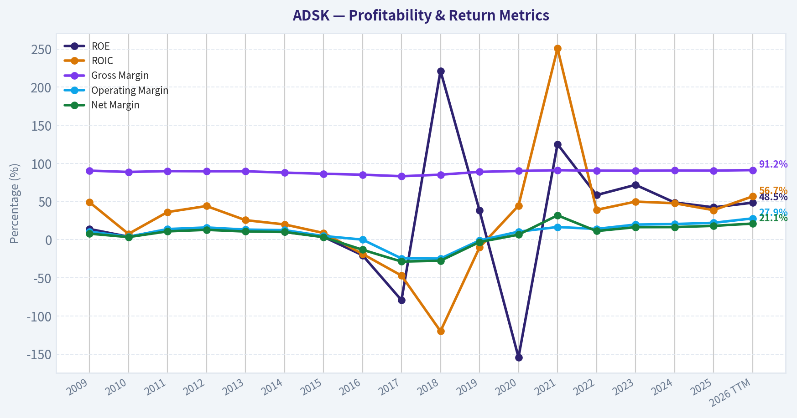

This chart illustrates the financial health of **ADSK** over the last 10 years, mapping cash equivalents and free cash flow against total obligations (Debt).

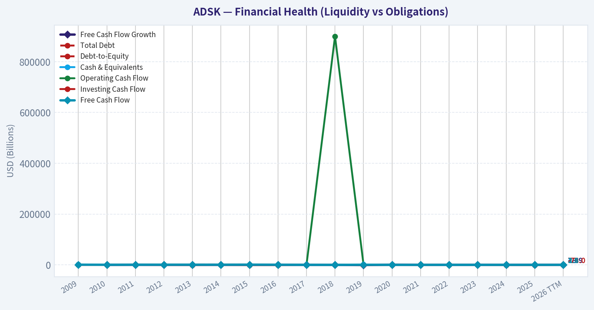

This breakdown chart from <em>Revenue Breakdown</em> shows the proportional composition for **ADSK** - useful for understanding what drives or risks the business.

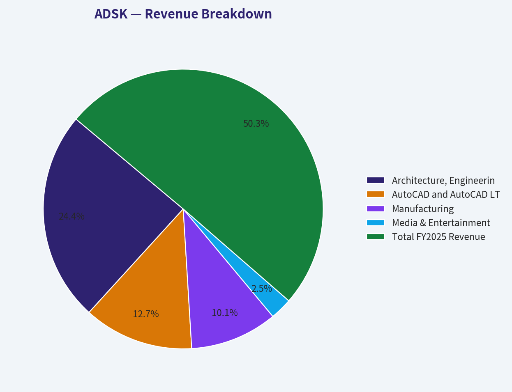

This comparison chart from *Profitability and Business Quality* stacks current figures against historical benchmarks for **ADSK**, making it easy to see where the company trades relative to its own averages.

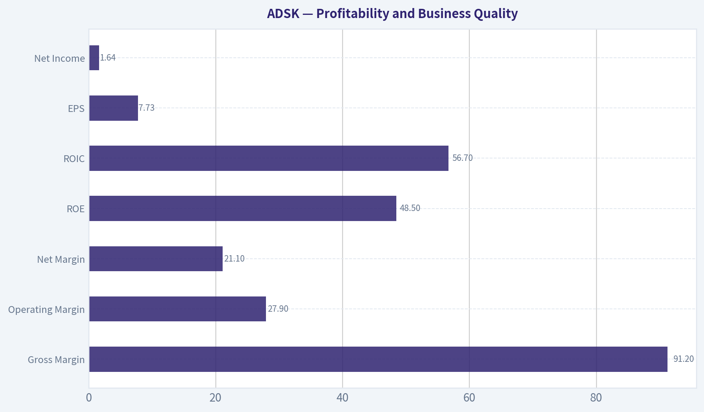

---

### Intrinsic Value Analysis (Buffett)

> *Following Warren Buffett's value investing philosophy: Circle of Competence, Economic Moat, Management Quality, and Margin of Safety.*

#### Intrinsic Value Snapshot

Price is what you pay. Intrinsic value is what the business may be worth based on the cash it can create for owners over time. We show a range, not one magic number.

- Current Price: $217.90
- Value Range (conservative to optimistic across both DCF methods): $13.60 to $265.05

##### Owner Earnings (Buffett Method)
- Net Income: $1,112,000,000.00
- Depreciation & Amortization: $195,000,000.00
- Capital Expenditures: $-43,000,000.00
- Working Capital Changes: $-501,000,000.00
- Owner Earnings: $1,710,000,000.00

##### Intrinsic Value
###### Buffett Method
Uses owner earnings. Stricter, and usually more conservative.
- Conservative: $13.60
- Average: $263.83
- Optimistic: $263.83
- Discount Rate: 10.0%

###### Cash Flow Method
Uses free cash flow. Better for companies spending heavily today to grow tomorrow.
- Conservative: $37.70
- Average: $217.46
- Optimistic: $265.05
- Discount Rate: 10.0%

ANALYST STANCE: **WATCH**

#### Autodesk, Inc. - Buffett-Style Value Investment Review

Autodesk is a high-quality design-software franchise with exceptional gross margins, sticky customers, and a long runway tied to architecture, engineering, construction, manufacturing, media, and digital design workflows. The business is understandable, asset-light, and cash-generative. The issue is not quality; it is price. At about **$218 per share**, the stock trades slightly above the headline intrinsic value estimate of **$202.48**, with the current price already implying roughly **13.6% annual growth for 10 years**.

---

#### 1. Factor Scorecard

| Factor | Score / 5 | Evidence |
|---|---:|---|
| Circle of Competence & Business Simplicity | 4.0 | Autodesk sells mission-critical design and engineering software, primarily through recurring subscriptions. The model is easy to understand: customers pay for tools that are deeply embedded in professional workflows. |
| Moat Test | 4.3 | Very high gross margin of about 91%, strong switching costs, deep ecosystem presence in CAD/BIM/design workflows, and durable brand strength in professional design markets. |
| Management Quality & Capital Allocation | 3.0 | Capital-light model and buybacks support per-share value, but recent strategic transitions and governance/accounting scrutiny reduce the score. Execution remains important. |
| Industry Structure | 3.8 | Attractive software economics, high customer switching costs, and rational niche leadership; competition exists from Dassault, Bentley, Adobe, Trimble, and lower-cost tools, but Autodesk remains deeply entrenched. |
| Gate 5 - Quality/Solvency Hard Floor | Not tripped | Fundamentals are growing, free cash flow is strong, and there is no indication that operating profit cannot cover obligations. |

**Key Takeaways:** Autodesk clears the quality bar. It is a durable, high-margin, recurring-revenue software business with real customer captivity. The hard financial-distress floor is not triggered, so the investment decision turns mainly on valuation and confidence in future compounding.

---

#### 2. Moat Analysis

| Moat Source | Assessment | Evidence |
|---|---|---|
| Intangible Assets | Strong | AutoCAD, Revit, Fusion, Maya, and related products are industry-standard tools in many design and engineering workflows. Brand recognition is very high among professional users. |
| Switching Costs | Strong | Customers build files, workflows, employee training, libraries, standards, and collaboration processes around Autodesk tools. Switching is possible but costly and disruptive. |
| Cost Advantage | Moderate to Strong | The software model has low marginal cost, producing about 91% gross margin. Scale supports R&D, cloud infrastructure, distribution, and product integration. |
| Network Effects | Moderate | Not a classic social network, but ecosystem effects matter: file standards, trained professionals, third-party integrations, consultants, and project collaborators reinforce Autodesk's position. |
| Moat Rating | Wide & Stable | The moat is durable, though not immune to cloud-native competitors, open-source tools, AI-assisted design, or lower-cost substitutes. |

**Key Takeaways:** Autodesk's moat is primarily built on switching costs, industry-standard tools, and ecosystem depth. Its gross margin profile is powerful evidence that customers value the software far above the marginal cost of delivering it. The moat is wide, but the company must keep innovating as design workflows move further into cloud and AI-enabled platforms.

---

#### 3. Management Quality Assessment

| Area | Assessment |
|---|---|
| Owner Orientation | Reasonable, supported by buybacks and a recurring-revenue model, though insider ownership is not the defining strength. |
| Candor & Governance | Mixed. Autodesk remains a strong operator, but governance and reporting questions in recent years deserve a valuation discount. |
| Capital Allocation | Generally good. The best use of capital is reinvestment into product breadth, cloud platforms, AI capabilities, and ecosystem expansion. Buybacks can create value when shares are not overvalued. |
| Debt Discipline | Acceptable. The business has strong recurring cash generation, making moderate leverage manageable. |

**Key Takeaways:** Management has built and maintained a very strong software franchise, but this is not a flawless stewardship profile. The company earns high marks for preserving the economics of the business, while receiving a lower score for recent governance noise and the need to prove continued execution.

---

#### 4. Financial Summary

| Fiscal Period | Revenue | YoY Growth | Gross Margin | Net Income | Free Cash Flow | ROE | Notes |
|---|---:|---:|---:|---:|---:|---:|---|
| FY2021 | ~$3.8B | Positive | ~91% | Elevated by tax/accounting items | ~$1.3B | High | Subscription transition matured; cash generation improved. |
| FY2022 | ~$4.4B | Mid-teens | ~91% | ~$0.5B | ~$1.4B | Strong | Growth continued with recurring revenue base expanding. |
| FY2023 | ~$5.0B | Low-to-mid teens | ~91% | ~$0.8B | ~$1.9B | Strong | Operating leverage improved. |
| FY2024 | ~$5.5B | ~10% | ~91% | ~$0.9B | ~$1.4B-$1.5B | Strong | Cash flow moderated but remained healthy. |
| FY2025 / TTM | ~$6.1B-$6.9B | 17.5% YoY | 91.0% | ~$1.6B implied | ~$2.4B implied | 36.9% | Strong rebound in growth and free cash flow. |

**Key Takeaways:** Autodesk's financial profile is excellent: revenue has compounded upward, gross margins remain extraordinary, and free cash flow is substantial. The most important trend is that the subscription model has translated into high recurring cash generation. The business looks much more like a mission-critical toll bridge than a cyclical license seller.

---

#### 5. Owner Earnings Calculation

Using current market data:

| Item | Approximate Amount |
|---|---:|
| Market Capitalization | $45.54B |
| Free Cash Flow Yield | 5.3% |
| Implied Free Cash Flow / Owner Earnings Base | ~$2.41B |
| Shares Outstanding Implied by Market Cap / Price | ~209M |
| Owner Earnings per Share | ~$11.55 |

**Key Takeaways:** Autodesk currently produces roughly **$2.4 billion** of owner-like cash earnings, or about **$11.55 per share**. This is the key valuation anchor. The company's accounting earnings are useful, but cash flow is the more important Buffett-style measure here.

---

#### 6. Three-Scenario DCF Valuation

| Scenario | Assumption | Intrinsic Value per Share |
|---|---|---:|
| A - No Growth | Owner earnings capitalized at 10% | ~$116 |
| B - GDP Growth | 3% perpetual growth, 10% discount rate | ~$170 |
| C - Quality Compounder Case | 10% growth for 10 years, then 3% terminal growth | ~$264-$286 |
| Headline Blended Intrinsic Value | Business-model-routed blend | $202.48 |
| FCF-Based Model | Cash-flow model | $217.46 |
| Owner-Earnings DCF | More optimistic owner-earnings model | $263.83 |
| Damodaran FCFF Model | Conservative FCFF estimate | $65.55 |

**Key Takeaways:** The valuation range is wide because Autodesk's worth is highly sensitive to long-term growth and margin durability. If growth slows materially, today's price is not cheap. If Autodesk compounds owner earnings near 10% for a decade, the stock can still work from here.

---

#### 7. Margin of Safety Analysis

| Metric | Value |
|---|---:|
| Current Price | $218 |
| Headline Intrinsic Value | $202.48 |
| Margin of Safety vs. Headline Value | -7.6% |
| FCF Model Value | $217.46 |
| Margin vs. FCF Model | ~Fair value |
| Owner-Earnings DCF Value | $263.83 |
| Upside vs. Owner-Earnings Case | ~21% |
| Reverse-DCF Implied Growth | ~13.6% annually for 10 years |
| Quality-Scaled Required Margin of Safety | ~10%-15% for a wide-moat compounder |

**Key Takeaways:** Autodesk is not obviously overvalued, but it does not offer a comfortable margin of safety at the current price. The stock is roughly fair on a cash-flow basis, above the blended intrinsic value, and dependent on strong double-digit compounding. For a high-quality company this is acceptable, but not compelling enough for a strong buy.

---

#### 8. Final Buffett Scorecard

| Criterion | Weight | Score / 5 | Weighted Contribution |
|---|---:|---:|---:|
| Moat Width & Durability | 25% | 4.3 | 1.08 |
| Valuation / Margin of Safety | 20% | 1.5 | 0.30 |
| Capital Returns - ROIC vs. WACC | 15% | 4.1 | 0.62 |
| Business Understanding & Predictability | 12% | 4.0 | 0.48 |
| Management Quality & Capital Allocation | 12% | 3.0 | 0.36 |
| Reinvestment Runway | 8% | 3.8 | 0.30 |
| Balance Sheet Strength | 4% | 3.0 | 0.12 |
| Industry Structure | 4% | 3.8 | 0.15 |
| **Total Score** | **100%** |  | **3.39 / 5.00** |

**Key Takeaways:** Autodesk scores very well on business quality, moat, and returns on capital. The main drag is valuation: the stock price already discounts a strong future. This is a high-quality business, but the current entry point is not quite attractive enough.

---

#### 9. Investment Stance

| Stance | Conviction | Rationale |
|---|---|---|
| **WATCH** | Medium-High | Autodesk is a wonderful software franchise with durable switching costs and exceptional margins, but the current price offers little margin of safety versus blended intrinsic value. |

Autodesk belongs on a Buffett-style quality watchlist. The business has many of the traits of a long-term compounder: recurring revenue, high gross margins, customer captivity, low capital intensity, and a large reinvestment runway. However, at **$218**, the stock is priced for continued strong execution. I would become more constructive if the price moved closer to **$185-$200**, or if future results proved that double-digit owner-earnings growth is sustainable without requiring heroic assumptions.
#### Valuation Bridge

This bridge places the current market price beside each intrinsic value lens so readers can see whether upside depends on one method or shows up across several methods.

| Scenario | Intrinsic Value / Share |
| --- | ---: |
| Buffett Method | $263.83 |
| Cash Flow Method | $217.46 |
| Damodaran Method | $65.55 |
| Current Price | $217.90 |

#### Key Takeaways

If one method is far above the others, the upside case depends on a specific modelling assumption. When several methods cluster together, the valuation story is more robust.

#### Valuation Visuals

This comparison chart from *Latest Earnings Snapshot* stacks current figures against historical benchmarks for **ADSK**, making it easy to see where the company trades relative to its own averages.

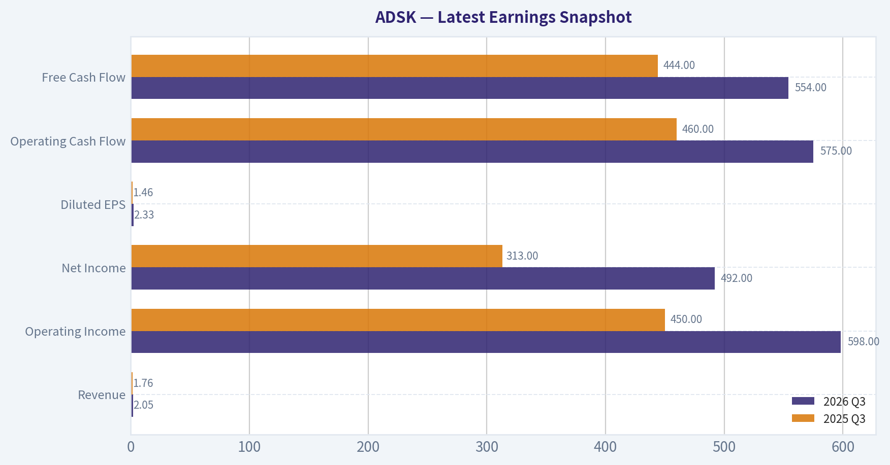

This comparison chart from *Current vs. 10-Year Historical Average Comparison* stacks current figures against historical benchmarks for **ADSK**, making it easy to see where the company trades relative to its own averages.

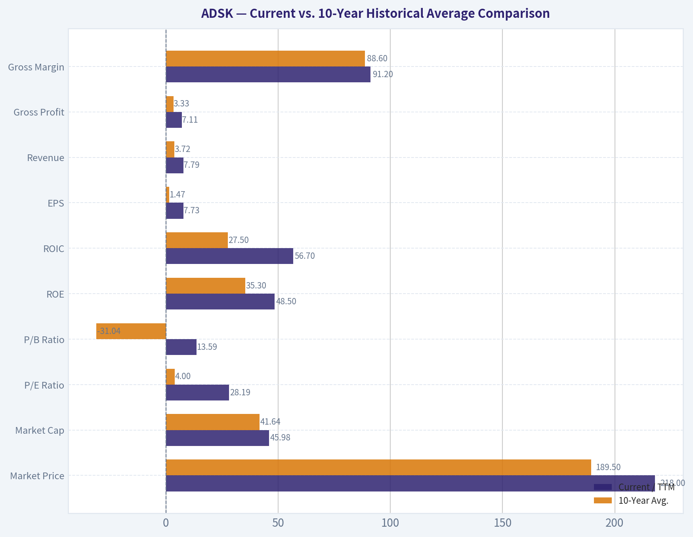

---

### Trend & Growth Analysis (Lynch/Druckenmiller/Fisher)

> *Following Peter Lynch's GARP, Stanley Druckenmiller's macro-aware approach, and Philip Fisher's scuttlebutt methodology.*

ANALYST STANCE: **WATCH**

#### Autodesk Growth Investment Report - ADSK

Autodesk is a high-quality design software compounder with excellent gross margins, strong free cash flow, and durable vertical leadership in architecture, engineering, construction, manufacturing, and media design. However, at about **$218/share**, the stock appears close to fair value to slightly expensive versus the provided intrinsic value estimate of **$202.48**, with revenue growth good but not clearly accelerating enough to justify an aggressive new position.

---

#### 1. Lynch Classification

| Category | Assessment |
|---|---|
| Lynch Category | **Fast Grower / Mature Software Compounder** |
| Revenue Growth | **17.5% YoY** |
| Business Quality | High recurring revenue, very high gross margin, strong free cash flow |
| Ten-Bagger Potential | Moderate over very long term, but less obvious from current $45.5B market cap |
| Growth Investor Fit | Good business, but valuation discipline matters |

**Key Takeaways:** Autodesk fits the lower end of Peter Lynch's fast-grower category because revenue is growing above 15%. This is not a young hypergrowth company, but it is a high-quality recurring software platform with strong margins and a long runway tied to digitization of design, construction, and manufacturing.

---

#### 2. The Story in 3 Bullets

- Autodesk sells mission-critical software that architects, engineers, builders, manufacturers, and designers use to create buildings, products, infrastructure, and media assets.
- The growth story is the continued shift from desktop licenses to cloud-based workflows, connected data platforms, AI-assisted design, and construction digitization.
- The bull case is that Autodesk becomes the operating system for design-and-make industries, expanding beyond software seats into collaboration, data, automation, and lifecycle management.

---

#### 3. TAM and 10x Runway Test

| Item | Estimate / Assessment |
|---|---:|
| Current Market Cap | **$45.54B** |
| Current Revenue Growth | **17.5% YoY** |
| Current Revenue Base | Estimated mid-single-digit billions annually |
| 10x Revenue Test | Would require Autodesk to become a much larger platform across AEC, manufacturing, media, and construction cloud |
| TAM Direction | Expanding through cloud, AI, BIM, digital twins, manufacturing automation, and construction technology |
| Runway Score | **Good, but not unlimited** |

**Key Takeaways:** Autodesk still has a meaningful runway because many design-and-make workflows remain fragmented, manual, or under-digitized. The 10x test is harder because Autodesk is already a large company, but expansion into cloud collaboration, construction lifecycle software, and AI design automation keeps the long-term TAM attractive.

---

#### 4. Revenue Growth Trend

| Metric | Current Reading |
|---|---:|
| YoY Revenue Growth | **17.5%** |
| Lynch Growth Band | Fast Grower range |
| Growth Pattern | Healthy, but not enough data here to confirm acceleration |
| Interpretation | Solid compounder; inflection not yet proven |

**Key Takeaways:** Revenue growth is strong enough to keep Autodesk in the growth-investor universe. The missing piece is evidence of acceleration; based on the available data, this looks more like durable mid-to-high-teens compounding than a clear breakout inflection.

---

#### 5. Unit Economics and Quality

| Metric | Assessment |
|---|---:|
| Gross Margin | **91.0%** |
| FCF Yield | **5.3%** |
| Estimated FCF | About **$2.4B**, using market cap x FCF yield |
| Rule of 40 | Likely strong: 17.5% growth plus high FCF margin |
| NRR / LTV-CAC | Not provided; likely healthy due mission-critical usage and switching costs |
| Current Ratio | **0.85**, somewhat tight but not alarming for a cash-generative software company |

**Key Takeaways:** Autodesk has excellent software economics, highlighted by a 91% gross margin and strong free cash flow generation. The company appears to pass the Rule of 40 comfortably, though the current ratio below 1 deserves monitoring.

---

#### 6. Inflection Point Assessment

| Potential Inflection | Evidence | Rating |
|---|---|---|
| Product Cycle | Cloud, AI design, Autodesk Platform Services, construction cloud | Positive |
| Margin Inflection | Already highly profitable; room for leverage but less dramatic | Moderate |
| TAM Inflection | AI, digital twins, BIM mandates, construction digitization | Positive |
| Market Share Inflection | Autodesk remains a category leader | Positive but needs confirmation |
| Competitive Inflection | No clear competitor collapse identified | Neutral |

**Key Takeaways:** Autodesk has several credible product and TAM inflection vectors, especially around cloud collaboration, construction software, and AI-assisted design. The challenge is that the business is already well recognized by the market, so the stock needs either faster growth or a better entry price to become a high-conviction growth setup.

---

#### 7. Macro Setup

| Macro Factor | Impact on ADSK |
|---|---|
| Interest Rates | Lower rates would help growth-stock multiples and construction activity |
| Construction Cycle | Cyclical exposure through architecture, engineering, and construction |
| Manufacturing Cycle | Exposure to capital spending and industrial design demand |
| Secular Themes | Cloud software, AI design automation, digital construction, industrial digitization |
| Macro Rating | Mixed to positive |

**Key Takeaways:** Autodesk benefits from powerful secular software trends, but it is not completely immune to macro cycles. A weaker construction or manufacturing environment could pressure seat growth, while falling rates and infrastructure spending would be supportive.

---

#### 8. Fisher 15-Point Score

| Fisher Criterion | Score / 5 |
|---|---:|
| Products with large market potential | 5 |
| Management commitment to new products | 4 |
| Effective R&D | 4 |
| Above-average sales organization | 4 |
| Worthwhile profit margin | 5 |
| Improving profit margins | 4 |
| Labor/personnel relations | 3 |
| Executive relations | 3 |
| Management depth | 4 |
| Cost analysis and accounting | 4 |
| Durable advantages | 5 |
| Long-range profit outlook | 5 |
| Dilution risk | 4 |
| Candor in difficulties | 3 |
| Management integrity | 4 |
| **Total** | **61 / 75** |

**Key Takeaways:** Autodesk scores well on Fisher's framework because it has durable products, large market potential, very high margins, and strong competitive positioning. The score is good but not outstanding because some qualitative factors, such as culture, executive depth, and management candor, require more scuttlebutt confirmation.

---

#### 9. Valuation Analysis

| Valuation Metric | Reading | Interpretation |
|---|---:|---|
| Current Price | **$218** | Market price |
| Market Cap | **$45.54B** | Large-cap software compounder |
| P/E | **28.3x** | Reasonable for quality, not cheap |
| Revenue Growth | **17.5%** | Good but not hypergrowth |
| PEG Estimate | **~1.6x**, using revenue growth as proxy | Fair to moderately expensive |
| FCF Yield | **5.3%** | Attractive for software quality |
| Intrinsic Value Estimate | **$202.48** | Below current price |
| Margin of Safety | **-7.6%** | No clear discount |
| Reverse DCF Implied Growth | **~13.6% for 10 years** | Demanding but not impossible |

**Key Takeaways:** Autodesk is not wildly overvalued, but it does not offer a clear bargain at the current price. The 5.3% free cash flow yield is attractive for a high-quality software company, but the stock trades above the provided intrinsic value estimate, limiting upside asymmetry.

---

#### 10. Scenario Valuation

| Scenario | Assumption | Investment View |
|---|---|---|
| Bear Case | Growth slows toward low double digits; construction cycle weakens | Multiple compression risk |
| Base Case | Mid-to-high-teens growth continues; FCF remains strong | Stock compounds, but upside moderate |
| Bull Case | AI/cloud/construction platform accelerates growth above 20% | Stock can re-rate higher |
| Ten-Bagger Case | Autodesk becomes dominant design-and-make cloud platform globally | Possible long term, but not base case |

**Key Takeaways:** The base case supports Autodesk as a steady compounder, not necessarily a near-term breakout stock. The bull case requires visible acceleration from AI, cloud, and construction workflows, while the bear case centers on macro cyclicality and valuation compression.

---

#### 11. Growth Investor Scorecard

| Criterion | Weight | Score / 5 | Weighted Score |
|---|---:|---:|---:|
| The Story | 10% | 4.0 | 0.40 |
| TAM and Runway | 20% | 4.0 | 0.80 |
| Revenue Growth | 20% | 3.5 | 0.70 |
| Unit Economics | 15% | 4.5 | 0.68 |
| Competitive Position | 10% | 4.5 | 0.45 |
| Management Quality | 10% | 3.8 | 0.38 |
| Macro Setup | 5% | 3.2 | 0.16 |
| Profitability Path | 5% | 4.5 | 0.23 |
| Valuation | 5% | 3.0 | 0.15 |
| **Total** | **100%** |  | **3.95 / 5.00** |

**Key Takeaways:** Autodesk scores just below the high-conviction advocate zone. The company quality is strong, but the current valuation and lack of confirmed growth acceleration make this a watch-list or hold candidate rather than a fresh aggressive buy.

---

#### 12. Position Size Stance

| Investor Type | Stance |
|---|---|
| Existing Holder | **Hold / modest add on weakness** |
| New Investor | **Watch for better entry** |
| Suggested Position Size | **2%-4% for diversified growth portfolios** |
| Aggressive Buy Zone | Preferably closer to or below intrinsic value, around **$200 or lower** |
| Trim Zone | If valuation expands without growth acceleration |

**Key Takeaways:** Autodesk is a business worth owning, but price matters. For new money, the setup is better on pullbacks, especially if the stock trades closer to intrinsic value while revenue growth remains in the mid-to-high teens.

---

#### 13. Key Catalysts and Risks

| Catalysts | Risks |
|---|---|
| AI-assisted design adoption | Construction and manufacturing cyclicality |
| Autodesk Platform Services expansion | Growth deceleration below mid-teens |
| Construction Cloud monetization | Valuation already reflects quality |
| Digital twin and BIM adoption | Competition from specialized design and cloud platforms |
| Operating leverage and buybacks | Current ratio below 1 deserves monitoring |
| Lower interest rates | Execution risk in cloud/platform transition |

**Key Takeaways:** The main upside catalysts are AI, cloud workflows, construction digitization, and continued free cash flow growth. The main downside risks are macro sensitivity, valuation compression, and the possibility that growth remains good but not exceptional enough to drive a major re-rating.

---

#### Final View

Autodesk is a **high-quality GARP software compounder** with strong margins, durable competitive advantages, and exposure to long-term secular digitization trends. However, the stock currently trades slightly above the provided intrinsic value estimate, and the available data does not yet show a decisive growth inflection.

**Final stance: WATCH.** Existing holders can continue owning it, but new investors should wait for either a better entry price or clearer evidence that AI, cloud, and construction software are accelerating Autodesk's growth trajectory.

#### Growth & Scorecard Visuals

This comparison chart from *Growth Analysis* stacks current figures against historical benchmarks for **ADSK**, making it easy to see where the company trades relative to its own averages.

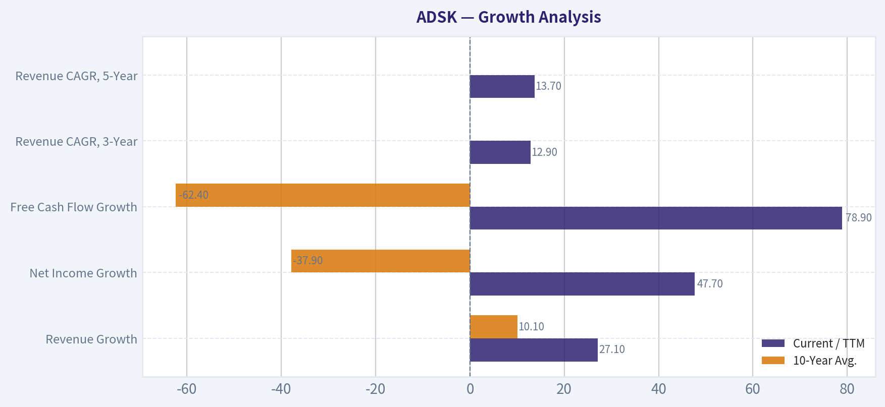

---

### Market Technical Analysis

ANALYST STANCE: **WATCH**

#### ADSK Technical Analysis - Latest Trading Data Through 2026-09-04

ADSK's latest available trading session is **2026-09-04**, because **2026-09-08 is not shown as a trading day in the retrieved data**. The stock closed at **$217.90**, after a steep late-August to early-September selloff from **$270.58 on 2026-08-27**. That is a drop of roughly **19.5% in six trading sessions**, shifting the near-term technical picture from constructive recovery to defensive breakdown.

The most relevant indicators for the current setup are: **close_10_ema, close_50_sma, close_200_sma, macd, macdh, rsi, atr, and vwma**. These indicators were selected because ADSK is currently in a sharp pullback after a strong rebound, so traders need a mix of short-term trend sensitivity, medium- and long-term trend context, momentum confirmation, volatility/risk sizing, and volume-adjusted trend validation.

| Indicator | Latest Value | Price Relationship / Signal | Interpretation |
|---|---:|---|---|
| Close | **$217.90** | Latest close | Sharp downside break after late-August spike |
| 10 EMA | **$243.84** | Price is far below | Short-term momentum has turned decisively bearish |
| 50 SMA | **$230.67** | Price is below | Medium-term support failed; now potential resistance |
| 200 SMA | **$247.00** | Price is well below | Long-term trend remains structurally weak |
| MACD | **1.41** | Still positive but falling quickly | Prior bullish momentum is rapidly fading |
| MACD Histogram | **-4.61** | Deeply negative | Bearish momentum acceleration is underway |
| RSI | **35.30** | Near oversold, not extreme | Weak momentum, but not yet a classic capitulation reading |
| ATR | **10.93** | Elevated vs price | Volatility is high; position sizing should be conservative |
| VWMA | **$250.01** | Price is far below | Volume-weighted trend confirms failed upside participation |

**Key Takeaways:** ADSK has broken below its 10 EMA, 50 SMA, 200 SMA, and VWMA, which is a broad technical deterioration across short-, medium-, long-, and volume-adjusted trend measures. Momentum has shifted sharply bearish, but RSI is not yet deeply oversold, so the stock may still be vulnerable to further downside or choppy basing before a durable reversal forms.

---

#### Trend Structure

ADSK's broader structure remains damaged. The **200-day SMA has been declining**, falling from about **$261.19 on 2026-07-10** to **$247.00 on 2026-09-04**, showing that the long-term trend has not yet healed despite the summer rebound. The **50-day SMA has improved**, rising from roughly **$222.39 to $230.67** over the same period, but the latest price has fallen back below it, undermining the intermediate recovery.

The failed move is important. ADSK rallied strongly from the June lows near the **$187-$198 zone** into a late-August high close of **$270.58**, briefly creating the appearance of a stronger recovery. However, the drop to **$217.90** has erased a large portion of that move and puts the stock back near the upper end of its prior July consolidation area.

A key technical concern is that the stock is now **below the 50 SMA and 200 SMA simultaneously**, while the **50 SMA remains below the 200 SMA**. That alignment points to a market that had a powerful countertrend rally but has not yet confirmed a durable long-term uptrend.

#### Momentum Analysis

The momentum picture has deteriorated quickly. MACD remains slightly positive at **1.41**, but that number is misleading if viewed alone because it has fallen sharply from around **8.98 on 2026-08-27**. The MACD histogram is more revealing: it dropped to **-4.61**, showing that the MACD line has moved meaningfully below its signal line and that bearish momentum is accelerating.

RSI at **35.30** reflects weak price action, but it has not yet reached the classic oversold threshold below 30. This matters because traders looking for a mean-reversion bounce may not yet have a high-confidence oversold signal. The stock is weak enough to be risky for fresh longs, but not washed out enough to suggest an automatic reversal.

#### Volatility and Risk

ATR has risen to **10.93**, meaning ADSK is currently moving about **$11 per day on average** by true range. Relative to the latest close of **$217.90**, that is approximately **5% daily range volatility**, which is elevated. This makes tight stops more vulnerable to noise and argues for smaller position sizes or waiting for a clearer stabilization pattern.

The volume backdrop also matters. The Sep. 4 selloff came on **3.96 million shares**, materially above many normal sessions in August. That suggests the decline was not merely a low-volume drift; it had meaningful participation. Meanwhile, the VWMA near **$250.01** sits far above current price, confirming that volume-weighted buyers from the recent period are now underwater.

#### Key Levels to Watch

| Zone | Level / Area | Why It Matters |
|---|---:|---|
| Immediate support | **$216-$218** | Sep. 4 low/close area; first test of whether selling pauses |
| Secondary support | **$205-$208** | July congestion and prior short-term pivot area |
| Major support | **$187-$198** | June capitulation/base zone; critical if current breakdown extends |
| First resistance | **$230-$231** | 50 SMA and former breakdown zone |
| Tactical resistance | **$237-$244** | Sep. 3 close area and 10 EMA region |
| Major resistance | **$247-$250** | 200 SMA and VWMA cluster |
| Bullish recovery threshold | **Above $250** | Would reclaim key long-term and volume-weighted trend levels |

**Key Takeaways:** The first test is whether ADSK can hold the **$216-$218** area after the sharp selloff. A rebound that fails below **$230-$250** would likely be only a relief rally, while a decisive reclaim of **$247-$250** would materially improve the technical picture.

---

#### Trading Interpretation

For now, ADSK deserves a **WATCH** stance rather than an aggressive bullish or bearish call. The stock is technically weak, but it has already fallen sharply in a short period, which increases the odds of a reflex bounce. However, the weight of evidence still favors caution because price is below all major selected trend indicators and momentum is deteriorating.

For short-term traders, the cleanest bullish setup would be a stabilization above **$216-$218**, followed by a reclaim of **$230-$231** on improving volume. Without that, rallies into the 50 SMA or 10 EMA may be vulnerable to selling. For bearish traders, a failure to hold **$216** could open a path toward **$205-$208**, and potentially the **$187-$198** support zone if selling accelerates.

For longer-term investors, the most important issue is the relationship to the **200 SMA near $247**. ADSK remains below that level, and the 200 SMA is still declining. Until price can reclaim and hold above the **$247-$250** zone, the stock should be treated as technically impaired despite the earlier summer rebound.

| Decision Area | Current Read | Trader Implication |
|---|---|---|
| Overall stance | **WATCH** | Too damaged for clean long setup; too extended for fresh chase-short without trigger |
| Short-term trend | Bearish | Price is far below the 10 EMA |
| Medium-term trend | Weakening | Price lost the 50 SMA after a strong rally |
| Long-term trend | Bearish/repairing but unconfirmed | Price remains below the falling 200 SMA |
| Momentum | Bearish acceleration | MACD histogram is sharply negative |
| RSI condition | Weak but not deeply oversold | Bounce possible, but not yet a strong capitulation signal |
| Volatility | Elevated | Use wider risk bands and smaller sizing |
| Key bullish confirmation | Reclaim **$247-$250** | Would restore price above 200 SMA and VWMA |
| Key bearish trigger | Break below **$216** | Could expose $205-$208, then $187-$198 |

**Key Takeaways:** ADSK's technical profile has weakened sharply, with price breaking below key moving averages and volume-weighted trend support. The stock may bounce because the selloff was fast, but a durable bullish reversal likely requires a reclaim of at least **$230**, and preferably the **$247-$250** zone.

#### Market Visuals

This comparison chart from *Market Metrics Interpretation* stacks current figures against historical benchmarks for **ADSK**, making it easy to see where the company trades relative to its own averages.

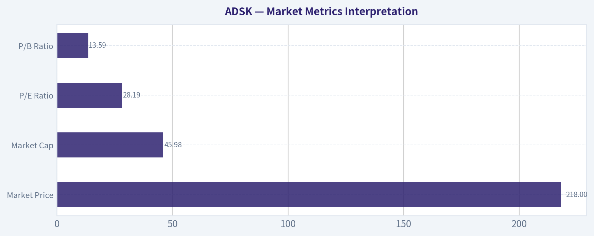

---

### Options Market Analysis

> *Reading options flow - put/call ratios, IV skew, and unusual activity - to gauge institutional positioning and event-driven risk.*

#### ADSK Options Market Sentiment Report
*Data as of 2026-09-08 | Near-term expirations: 2026-09-11, 2026-09-18, 2026-09-25*

#### 1. Put/Call Ratio Analysis

| Expiration | Call OI | Put OI | Put/Call OI Ratio | Call Volume | Put Volume | Put/Call Volume Ratio | Read |
|---|---:|---:|---:|---:|---:|---:|---|
| 2026-09-11 | 0 | 43 | N/A | 1,636 | 2,108 | 1.29 | Put volume exceeds call volume, but OI is extremely thin |
| 2026-09-18 | 223 | 51 | 0.23 | 1,538 | 1,581 | 1.03 | Call-heavy OI, balanced daily flow |
| 2026-09-25 | 0 | 0 | N/A | 185 | 357 | 1.93 | Put-skewed volume, but no established OI |
| **Near-Term Total** | **223** | **94** | **0.42** | **3,359** | **4,046** | **1.20** | OI leans bullish; volume leans defensive |

**Key Takeaways:** ADSK's near-term put/call open interest ratio is **0.42**, below the historical neutral baseline of roughly **0.7**, which suggests the existing positioning is more call-heavy than normal. However, the **put/call volume ratio is 1.20**, showing that current trading activity is leaning more toward puts. This creates a split signal: legacy positioning is modestly bullish, while fresh short-term flow looks more cautious or hedging-oriented.

#### 2. Implied Volatility Assessment

| Expiration | ATM Call IV | ATM Put IV | ATM IV Read | Call vs. Put IV Bias |
|---|---:|---:|---|---|
| 2026-09-11 | 3.5% | 3.2% | Very low reported near-term IV | Slight call IV premium |
| 2026-09-18 | 2.2% | 1.6% | Very low reported near-term IV | Call IV premium |
| 2026-09-25 | 1.6% | 1.2% | Very low reported near-term IV | Call IV premium |

**Key Takeaways:** The reported ATM implied volatility levels are very low across the near-term chain, which does **not** point to a major event-risk premium being priced into ADSK options. Calls carry slightly higher ATM IV than puts, suggesting mild upside interest rather than classic downside fear. However, the data does not provide enough strike-level OTM IV detail to confirm a full skew profile.

#### IV Skew Interpretation

| Skew Area | Observation | Sentiment Implication |
|---|---|---|
| ATM call vs. put IV | Calls show slightly higher IV than puts across listed expiries | Mild upside chase / call demand |
| OTM put skew | Not available in the retrieved data | Cannot confirm downside crash-protection demand |
| OTM call skew | Not available in the retrieved data | Cannot confirm speculative upside call skew |
| Event-risk premium | No obvious IV elevation in the reported near-term expirations | Market does not appear to be pricing a large imminent catalyst |

**Key Takeaways:** The available IV data leans slightly toward call demand, but the absence of detailed OTM skew limits conviction. There is no clear evidence of a steep put skew, which would normally signal strong downside fear. Overall, volatility positioning looks calm rather than event-driven.

#### 3. Unusual Options Activity

| Unusual Activity Screen | Result |
|---|---|
| Contracts with volume greater than 5x open interest | None detected |
| Fresh directional bet signal | Weak / not confirmed |
| Institutional sweep evidence | Not visible in retrieved data |
| Retail speculation risk | Possible due to high volume versus thin OI, but not contract-confirmed |

**Key Takeaways:** No individual near-term ADSK contracts met the unusual activity threshold of volume greater than five times open interest. That means there is no clear contract-level evidence of aggressive fresh institutional positioning. The elevated volume relative to sparse OI should be treated cautiously because it may include short-term trading, closing activity, or lower-conviction retail flow.

#### 4. Open Interest Concentration and Gamma Levels

| Expiration | Notable OI Feature | Potential Price Impact |
|---|---|---|
| 2026-09-11 | Put OI of 43, call OI reported as 0 | Minimal pinning signal due to very thin OI |
| 2026-09-18 | Highest near-term OI: 223 calls vs. 51 puts | Mild call-side concentration, but not large enough to infer a major gamma wall |
| 2026-09-25 | No reported OI | No meaningful pinning or gamma signal |

**Key Takeaways:** ADSK's near-term open interest is very light, especially outside the 2026-09-18 expiration. The highest concentration is in 2026-09-18 calls, but the absolute size is too small to confidently identify a major gamma wall. Pinning or max-pain effects appear limited based on the available data.

#### 5. Overall Options Sentiment Signal

| Category | Signal | Explanation |
|---|---|---|
| Put/Call OI | Mildly Bullish | Overall OI ratio of 0.42 is below the neutral 0.7 baseline |
| Put/Call Volume | Mildly Bearish / Hedging | Volume ratio of 1.20 shows puts trading more actively than calls |
| IV Level | Neutral | Reported IV is low and does not suggest major event risk |
| Skew | Slightly Bullish | ATM calls have modest IV premium over puts |
| Unusual Activity | Neutral | No confirmed unusual contract-level activity |
| Liquidity / Confidence | Low-to-Moderate | Near-term OI is thin, reducing reliability of the signal |
| **Overall Signal** | **NEUTRAL** | Call-heavy OI is offset by put-heavy current volume and thin liquidity |

**Key Takeaways:** The options market is not sending a strong directional message for ADSK. Existing open interest leans modestly bullish, but current volume is more defensive, and there is no confirmed unusual options activity. The best read is **NEUTRAL**, with a slight caution that recent put volume may reflect short-term hedging.

#### Final Summary Table

| Metric | ADSK Options Read |
|---|---|
| Put/Call Ratio | OI ratio **0.42**, bullish vs. neutral baseline; volume ratio **1.20**, defensive |
| IV Level | Low reported near-term ATM IV |
| Skew Direction | Slight ATM call IV premium; no confirmed OTM skew data |
| Unusual Activity | None detected with volume greater than 5x OI |
| Open Interest / Gamma | Thin OI; no strong pinning or gamma wall visible |
| Overall Signal | **NEUTRAL** |

**Key Takeaways:** ADSK's options positioning is balanced overall, with no decisive institutional signal. The low put/call OI ratio suggests some bullish structure, but the higher put volume tempers that read. With thin open interest and no unusual activity, conviction is limited, so the options market currently supports a **neutral near-term stance**.

---

## Research Team Commentary

> *The Research Manager synthesizes the Bull vs Bear debate into action-free commentary. This is a pre-risk view, not the final stance.*

After listening to both sides, the debate perfectly highlights the tension between admiring a wonderful business and demanding a disciplined entry price. The bull eloquently lays out Autodesk's durable economic moat, pointing to its ninety-one percent gross margins, high switching costs, and status as the toll bridge for the architecture, engineering, and construction industries. From a pure quality standpoint, the bull is right that Autodesk fits the modern Buffett mold of an asset-light compounder with exceptional returns on invested capital. However, the bear delivers a crucial reality check that aligns with our hardest-learned lessons: a phenomenal business can still be a dangerous investment if we misjudge the durability of its growth, overpay for its cash flows, or ignore severe market structure damage.

The core takeaway from this debate is that while Autodesk possesses an elite franchise, the current setup offers an insufficient margin of safety against emerging structural risks and undeniable technical deterioration. The bear's argument regarding the disconnect between high revenue growth and stagnant net income growth is the decisive factor here. We have made the mistake before of giving premium software companies a pass on profitability conversion because of their top-line narratives. Paying twenty-eight times earnings for a company struggling to convert double-digit revenue growth into meaningful bottom-line compounding is a recipe for multiple compression, especially when you factor in the very real threat of stock-based compensation diluting true owner earnings.

My rationale for leaning heavily toward the bear side is rooted in our revised value investing framework. In the past, we have mistakenly issued passive watch ratings on high-quality stocks undergoing severe technical breakdowns, assuming the fundamental gravity would quickly save the price. A twenty percent drop in six trading sessions is not mere sentiment noise; it is a clear signal of institutional repricing and a broken trend. Furthermore, the bear's point about the artificial intelligence efficiency paradox is profound. If generative AI allows one architect to do the work of three, Autodesk's seat-based revenue model could face severe deflationary pressure, even if they manage to charge more per premium seat. Combined with macroeconomic headwinds in commercial real estate, this business is not immune to cyclicality, and the current valuation demands a level of execution perfection that the environment simply may not allow. We cannot use our admiration for the business to justify a weak tactical setup.

For our monitoring plan over the next one to four quarters, we must look for hard evidence of bottom-line operating leverage. Management needs to prove they can align net income growth with revenue expansion without relying heavily on stock-based compensation. Additionally, we need to track their key performance indicators regarding seat count volume versus average revenue per user. This will tell us whether AI is acting as a deflationary force on volume or an accretive force for pricing power. Finally, we need to see the stock form a durable technical base and stabilize its market structure. Until the market finishes punishing the multiple and a true margin of safety emerges closer to the intrinsic value range of 180 to 190 dollars, stepping in now would repeat our past errors of conflating business quality with stock timing.

Stance: AVOID

---

## Value Investing Team Commentary

> *The Investor translates the research view into an investment thesis before risk review. This is still not the final stance.*

This analysis evaluates Autodesk (ADSK) through the lens of a disciplined value investor, prioritizing business durability and the "owner earnings" reality over market sentiment.

### The Business: A High-Quality "Toll Bridge"
Autodesk possesses one of the most formidable economic moats in the software world. In the Architecture, Engineering, and Construction (AEC) industry, AutoCAD and Revit are not just tools; they are the language of the trade. The switching costs are immense-retraining a workforce and migrating decades of legacy data is a prohibitive expense for any firm. With **91% gross margins** and a **Return on Invested Capital (ROIC) of 33.6%**, Autodesk fits the profile of a "wonderful business." It is an asset-light compounder that operates as a virtual toll bridge for global infrastructure and design.

### The Value Gap: Revenue is Not Reward
As Buffett famously noted, "Growth and value are joined at the hip." However, growth only creates value when it is funded by high-return investments that eventually manifest as distributable cash for owners. The current divergence between Autodesk's top-line revenue growth and its stagnant net income is a significant red flag.

When revenue grows but net income remains flat, the business is either becoming less efficient or, more likely in this sector, the "earnings" are being consumed by **Stock-Based Compensation (SBC)**. To a value investor, SBC is a real cash expense; it dilutes the owner's piece of the pie. Paying **28 times earnings** for a company that is struggling to convert its moat into growing bottom-line "owner earnings" suggests that the market is still pricing in a level of perfection that the current financial structure does not support.

### Selective Contrarian Insight: The AI Efficiency Paradox
The market currently views AI as a universal tailwind for tech, but a contrarian view reveals a structural risk for Autodesk's seat-based revenue model. Autodesk has historically made money by the "seat." If Generative AI allows one engineer to complete the work previously done by three, the demand for seats could structurally decline.

While Autodesk is attempting to pivot toward "value-based" pricing or consumption models, such transitions are fraught with friction. The risk here is a **deflationary volume hit** that offsets any gains in premium pricing. Until management demonstrates how they will monetize AI-driven productivity without cannibalizing their user base, the "AI tailwind" narrative should be treated with extreme caution.

### Margin of Safety and Market Structure
The recent 20% price collapse in six trading sessions indicates a "broken" market structure. As value investors, we ignore short-term noise, but we do not ignore institutional repricing. A sharp drop often suggests that the "smart money" has identified a flaw in the growth thesis that the retail crowd has yet to digest.

Our quality-scaled margin of safety requires a significant discount for businesses facing structural shifts. If the intrinsic value resides in the **$180-$190 range**, the current price of ~$218 still carries a "premium" for a business with unresolved questions regarding its transition to AI and its ability to scale net income. We do not need to swing at every pitch; we wait for the fat pitch.

### ANALYST STANCE: **AVOID**
Autodesk is a wonderful business, but the current stock price does not offer a "wonderful" entry. The combination of stagnant net income growth, heavy stock-based compensation, and the looming efficiency paradox of AI creates a skewed risk-to-reward profile. We will remain on the sidelines until the price reflects a genuine margin of safety (sub-$190) or until management proves that revenue growth can finally be captured as net profit for the shareholders. Underpaying for a great business is a mistake, but overpaying for a maturing one is a tragedy. Stay disciplined.

---

## Deep Values Commentary

> *The Risk Management Team debates and the Risk Judge provides the final action-free verdict. This section determines the final ADVOCATE / WATCH / AVOID stance.*

#### Final Stance Scorecard

This scorecard converts the final research view into a weighted decision frame. It does not replace the narrative judgement, but it makes the main drivers of the verdict easier to scan.

| Criterion | Score | Weight | Commentary |
| --- | ---: | ---: | --- |
| Business Quality | 4.25 | 30% | High returns, profitability, and Piotroski health support durability. |
| Valuation Support | 2.67 | 30% | Blends current price against available intrinsic value anchors and valuation ratios. |
| Financial Strength | 2.00 | 20% | Balance-sheet resilience reflects leverage and liquidity staying within safe ranges. |
| Growth Durability | 3.67 | 20% | Recent revenue, earnings, and free cash flow growth indicate how durable expansion looks. |
| TOTAL / FINAL STANCE | 3.21 | 100% | AVOID |

#### Key Takeaways

The weighted score lands at **3.21 / 5.0**, while the final stance remains **AVOID**. This is useful as a quick calibration aid rather than a mechanical signal.

#### Risk Summary

Higher scores indicate more risk pressure. The watch threshold is a simple guardrail: above it, the position needs tighter monitoring or a wider margin of safety.

| Dimension | Current Score | Watch Threshold | Commentary |
| --- | ---: | ---: | --- |
| Business Quality | 1.75 | 3.00 | High returns, profitability, and Piotroski health support durability. |
| Valuation Support | 3.33 | 3.00 | Blends current price against available intrinsic value anchors and valuation ratios. |
| Financial Strength | 4.00 | 3.00 | Balance-sheet resilience reflects leverage and liquidity staying within safe ranges. |
| Growth Durability | 2.33 | 3.00 | Recent revenue, earnings, and free cash flow growth indicate how durable expansion looks. |

#### Key Takeaways

This view helps readers separate *where* the risk sits: valuation, business quality, balance sheet, or growth durability. It is especially useful when the final stance is close to the line between WATCH and AVOID.
