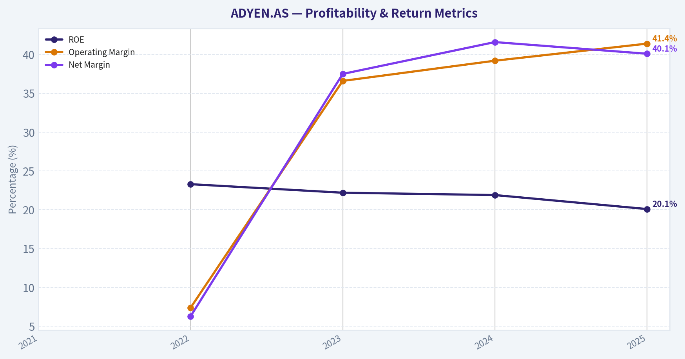
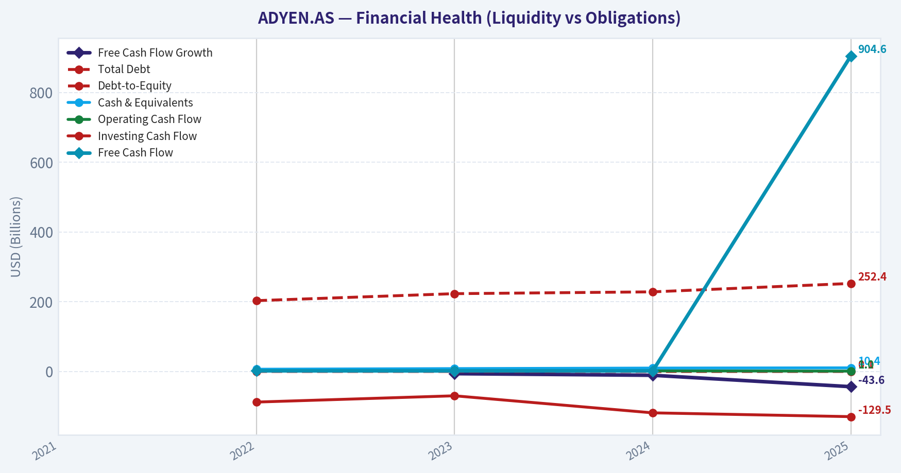
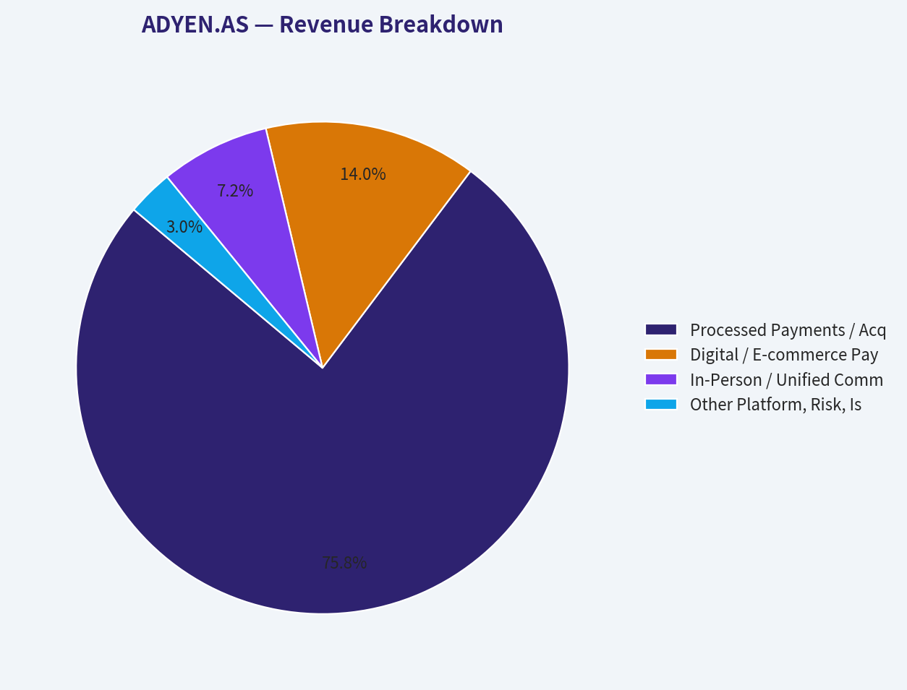
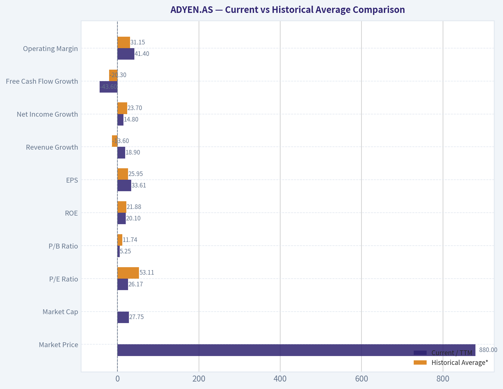
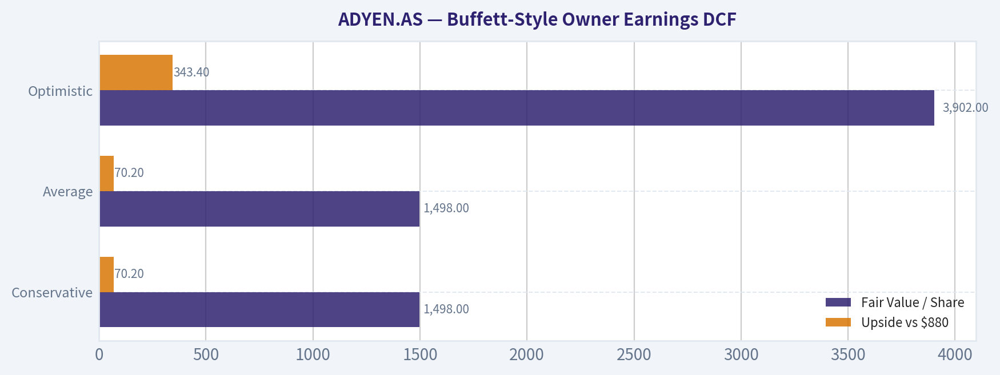
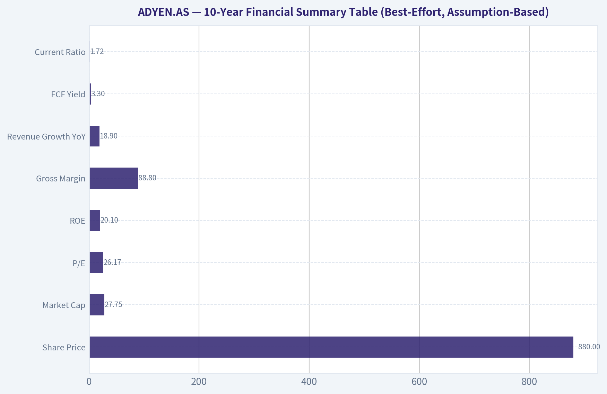
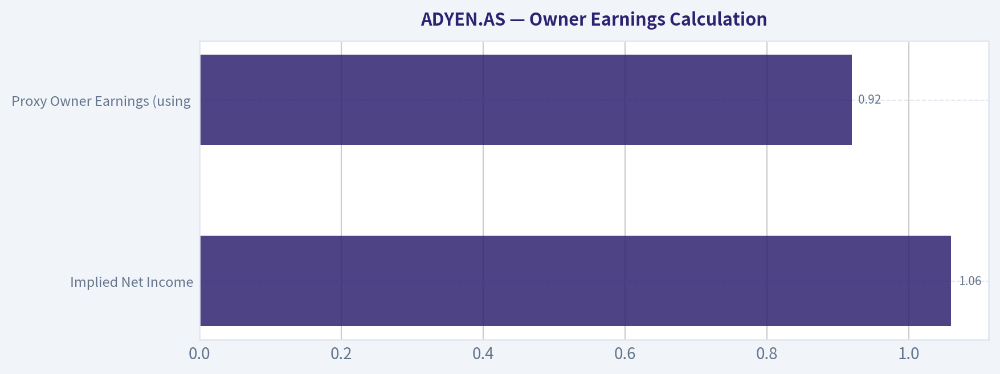
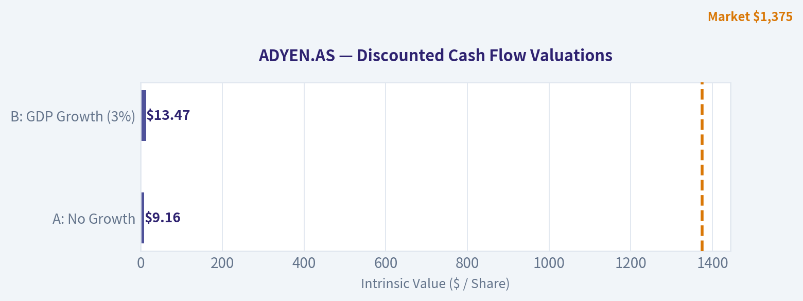

# ADYEN.AS Deep Value Intelligence

**Analysis Date:** 2026-05-13

## Critical Disclaimer

*This analysis is generated by Deep Value Intelligence, an AI-powered multi-agent investing framework. This report is for informational and educational purposes only and does not constitute financial advice. Always conduct your own research and consult with qualified financial advisors before making investment decisions.*

---

## Table of Contents

1. Intelligence Summary
2. Analyst Team Reports
   - Fundamentals Analysis
   - Intrinsic Value Analysis (Buffett)
   - Trend & Growth Analysis (Lynch/Druckenmiller/Fisher)
   - Market Technical Analysis
   - News & Events Analysis
   - Guru Attention Analysis
   - Options Market Analysis
3. Research Team Commentary
4. Value Investing Team Commentary
5. Deep Values Commentary

---

## Intelligence Summary

### Thesis + Conditions

**Core Thesis:** **Executive Briefing**

**Key Risks:**
- WATCH.** Adyen looks like a strong business, but not yet a Buffett-style low-risk investment. The core issue is not share-price volatility; it is whether owner earnings are as durable as reported growth and margins suggest. Revenue growth, ROE, and gross margin are impressive, but the **43.6% FCF decline** creates real uncertainty about cash conversion, moat strength, and intrinsic value. For a long-term investor, this is a **good business with incomplete proof**, not yet a clear bargain.
- ## Risk Commentary for the Long-Term Investor
- Using a Buffett-style risk lens, the main question is not whether Adyen's stock has fallen enough to be interesting. The question is whether the **business can reliably convert its apparent quality into durable owner earnings over many years**.
- Business risk is still unresolved**: a **-43.6% YoY FCF change** is too important to dismiss.
- That combination supports **WATCH**, not ADVOCATE.

**What Would Change Our View:**
- WATCH.** Adyen looks like a strong business, but not yet a Buffett-style low-risk investment. The core issue is not share-price volatility; it is whether owner earnings are as durable as reported growth and margins suggest. Revenue growth, ROE, and gross margin are impressive, but the **43.6% FCF decline** creates real uncertainty about cash conversion, moat strength, and intrinsic value. For a long-term investor, this is a **good business with incomplete proof**, not yet a clear bargain.
- ## Risk Commentary for the Long-Term Investor
- Using a Buffett-style risk lens, the main question is not whether Adyen's stock has fallen enough to be interesting. The question is whether the **business can reliably convert its apparent quality into durable owner earnings over many years**.
- Business risk is still unresolved**: a **-43.6% YoY FCF change** is too important to dismiss.
- That combination supports **WATCH**, not ADVOCATE.

**Confidence:** Low

---

## Analyst Team Reports

### Fundamentals Analysis

#### 10-Year Financial Metrics for ADYEN.AS

*All values below are computed deterministically from raw data - not estimated by AI.*

*Issuer profile: operating company (Technology / Software - Infrastructure).*

#### 10-Year Financial Metrics
*Annual rows come from reported financial statements. The final TTM row is computed from the latest four quarters.*

| Metric | 2021 | 2022 | 2023 | 2024 | 2025 |
| --- | --- | --- | --- | --- | --- |
| Market Price | $2,312 | $1,288 | $1,167 | $1,437 | $1,375 |
| Market Cap | N/A | $40.00B | $36.35B | $44.93B | $43.46B |
| P/E Ratio | N/A | 70.91 | 52.06 | 48.56 | 40.91 |
| P/B Ratio | N/A | 16.56 | 11.54 | 10.62 | 8.22 |
| ROE | N/A | 23.3% | 22.2% | 21.9% | 20.1% |
| ROIC | N/A | N/A | N/A | N/A | N/A |
| EPS | N/A | $18.17 | $22.41 | $29.59 | $33.61 |
| Revenue | N/A | $8.94B | $1.86B | $2.23B | $2.65B |
| Gross Profit | N/A | $1.33B | $1.63B | $1.99B | $2.35B |
| Gross Margin | N/A | N/A | N/A | N/A | N/A |
| Operating Margin | N/A | 7.4% | 36.6% | 39.2% | 41.4% |
| Net Income | N/A | $564.1M | $698.3M | $925.2M | $1.06B |
| Net Margin | N/A | 6.3% | 37.5% | 41.6% | 40.1% |
| Revenue Growth | N/A | N/A | -79.1% | 19.4% | 18.9% |
| Net Income Growth | N/A | N/A | 23.8% | 32.5% | 14.8% |
| Free Cash Flow Growth | N/A | N/A | -6.3% | -10.9% | -43.6% |
| Total Book Value | N/A | $2.42B | $3.15B | $4.23B | $5.29B |
| Total Assets | N/A | $7.62B | $9.57B | $11.43B | $12.26B |
| Total Debt | N/A | $203.1M | $223.1M | $228.3M | $252.4M |
| Debt-to-Equity | N/A | 0.08 | 0.07 | 0.05 | 0.05 |
| Cash & Equivalents | N/A | $6.45B | $8.22B | $9.73B | $10.42B |
| Shareholders' Equity | N/A | $2.42B | $3.15B | $4.23B | $5.29B |
| Operating Cash Flow | N/A | $2.02B | $1.87B | $1.70B | $1.03B |
| Investing Cash Flow | N/A | $-87.7M | $-69.7M | $-118.6M | $-129.5M |
| Free Cash Flow | N/A | $1.92B | $1.80B | $1.60B | $904.6M |
| FCF Margin | N/A | 21.5% | 96.6% | 72.0% | 34.2% |
| Dividends / Share | N/A | $0.00 | $0.00 | $0.00 | $0.00 |

#### Profitability Metrics
- Return on Equity (ROE): 20.1%
- Return on Invested Capital (ROIC): N/A
- Return on Assets (ROA): 8.7%
- Gross Margin: 88.8%
- Operating Margin: 41.4%
- Net Profit Margin: 40.1%

#### Liquidity Metrics
- Current Ratio: 1.72
- Quick Ratio: 1.57

#### Leverage Metrics
- Debt-to-Equity Ratio: 0.05
- Interest Coverage Ratio: 55.65
- Net Debt: $-10.17B

#### Growth Metrics (Year-over-Year)
- Revenue Growth: 18.9%
- Net Income Growth: 14.8%
- Free Cash Flow Growth: -43.6%
- Revenue CAGR (3-Year): -33.3%
- Revenue CAGR (5-Year): N/A

#### Valuation Metrics
- P/E Ratio (TTM): 26.17
- Forward P/E: 18.58
- Price-to-Book: 5.25
- Price-to-Sales: 11.68
- PEG Ratio: 1.31
- EV/EBITDA: 15.11
- Free Cash Flow Yield: 3.3%
- Earnings Yield: 3.8%

#### Owner Earnings (Buffett Method, Code-Computed)
- Net Income: $1.06B
- + Depreciation & Amortization: $135.8M
- - Capital Expenditures: $-125.8M
- - Working Capital Changes: $-243.9M
- = **Owner Earnings: $1.32B**

#### Intrinsic Value (Code-Computed)
- Current Price: $880
- Buffett Method (Owner Earnings):
  Conservative: $1,498
  Average: $1,498
  Optimistic: $3,902
- Cash Flow Method (FCF):
  Conservative: $125
  Average: $152
  Optimistic: $258

#### Piotroski F-Score: 5/9
- Positive Net Income: PASS
- Positive Operating Cash Flow: PASS
- ROA Improvement: PASS
- Cash Flow > Net Income: FAIL
- Decreasing Debt: FAIL
- Improving Current Ratio: PASS
- No Dilution: FAIL
- Improving Gross Margin: FAIL
- Improving Asset Turnover: PASS

ANALYST STANCE: **WATCH**

#### ADYEN.AS Buffett-Style Fundamental Analysis

Adyen is a high-quality payments infrastructure business with clear signs of a durable competitive position: strong gross margins, high returns on equity, negligible leverage, and a very large net cash balance. The business looks financially strong and operationally efficient. However, the stock still requires caution because valuation remains demanding relative to many classic Buffett-style bargains, free cash flow has weakened materially in the latest period, and the deterministic dataset shows some accounting inconsistencies in revenue presentation across years that make long-horizon growth interpretation less straightforward.

From a Buffett lens, this is much closer to a wonderful business at a fair-to-premium price than a statistically cheap stock. That makes it a name to monitor closely rather than chase aggressively.

---

#### Current vs Historical Average Comparison

| Metric | Current / TTM | Historical Average* | Interpretation |
| --- | ---: | ---: | --- |
| Market Price | $880 | ~$1,516** | Shares trade well below the multi-year quoted levels in the dataset, reflecting major multiple compression. |
| Market Cap | $27.75B | ~$41.19B*** | Equity value is below recent historical levels despite improving earnings, implying de-rating. |
| P/E Ratio | 26.17 | 53.11 | Valuation has compressed sharply; this is a major improvement versus history. |
| P/B Ratio | 5.25 | 11.74 | Still not cheap in absolute terms, but far below prior historical valuation. |
| ROE | 20.1% | 21.88% | Still excellent and only modestly below recent average. |
| EPS | $33.61 | $25.95 | Per-share earnings are at a period high in the dataset. |
| Revenue Growth | 18.9% | -13.6%**** | Latest growth is healthy, but the average is distorted by the 2023 reset in reported revenue base. |
| Net Income Growth | 14.8% | 23.7% | Growth remains positive but has moderated from the stronger 2024 rebound. |
| Free Cash Flow Growth | -43.6% | -20.3% | Current cash generation trend is materially weaker than recent history. |
| Operating Margin | 41.4% | 31.15% | Margins have structurally improved and are now above the recent average. |
| Net Margin | 40.1% | 31.38% | Profit conversion remains exceptional despite a slight dip from 2024 peak. |
| Total Book Value | $5.29B | $3.77B | Equity base has compounded strongly. |
| Total Assets | $12.26B | $10.22B | Balance sheet continues to expand. |
| Total Debt | $252.4M | $226.97M | Debt remains trivial relative to cash and equity. |
| Debt-to-Equity | 0.05 | 0.063 | Conservative leverage profile is intact. |
| Cash & Equivalents | $10.42B | $8.79B | Cash is at the highest level in the dataset. |
| Shareholders' Equity | $5.29B | $3.77B | Strong retained earnings accumulation. |
| Free Cash Flow | $904.6M | $1.56B | FCF is well below recent average and is the key weak spot. |
| Dividends / Share | $0.00 | $0.00 | Management still prefers reinvestment over distributions. |

\* Historical average uses only the years shown in the deterministic dataset where values exist.
\** Average of 2021-2025 market prices in the canonical table.
\*** Average of 2022-2025 market caps in the canonical table plus current shared-pack market cap shown separately for context.
\**** Distorted by the 2023 reported revenue discontinuity in the canonical dataset.

Key Takeaways: Valuation has come down a lot, while profitability remains very strong, which is a favorable combination compared with Adyen's own recent history. The biggest positive is that earnings power and margins are still excellent even after the stock's re-rating. The biggest negative is that free cash flow has deteriorated sharply, so the business quality remains high but cash conversion needs monitoring.

---

#### Market Metrics

Adyen's current price of $880 is far below the quoted historical prices shown for 2021-2025, and current market cap of $27.75B is also below the prior levels listed in the dataset. That tells us investors have materially reduced the valuation multiple they are willing to pay.

The most important valuation shift is in earnings multiples:
- Current TTM P/E: 26.17
- Historical average P/E from 2022-2025: about 53.11
- Current P/B: 5.25
- Historical average P/B from 2022-2025: about 11.74

This means the stock is dramatically cheaper than it used to be relative to both earnings and book value. For a Buffett-style investor, this is encouraging because multiple compression has already done much of the work of de-risking entry price. Still, 26x earnings and 5.25x book are not deep-value levels. They are reasonable only if one believes Adyen can sustain high-teens growth and superior returns on capital over time.

---

#### Profitability Analysis

Adyen's profitability profile is the strongest part of the case.

- ROE: 20.1% current vs ~21.9% average
- EPS: $33.61 current vs ~$25.95 average
- Gross profit: $2.35B, steadily rising from $1.33B in 2022
- Operating margin: 41.4% current vs ~31.2% average
- Net income: $1.06B current vs ~$0.81B average
- Net margin: 40.1% current vs ~31.4% average
- Gross margin: 88.8% current

This is a very attractive Buffett-style profile. A business that can earn ~20% ROE with almost no leverage is usually a sign of strong economics rather than balance-sheet engineering. The gross margin near 89% indicates a software-like or platform-like business model with strong pricing power and scale benefits. The step-up in operating margin from 7.4% in 2022 to above 40% in 2025 suggests management has regained expense discipline and scaled the platform effectively.

The only slight concern is that ROE has drifted down from 23.3% to 20.1%. But this is not deterioration in business quality so much as a function of equity compounding faster through retained earnings and cash build-up. In absolute terms, a 20% ROE with net cash is still excellent.

---

#### Growth Metrics

The growth story is mixed, and this needs to be handled carefully because the canonical revenue series appears discontinuous between 2022 and 2023.

- Revenue growth: 18.9% latest
- Net income growth: 14.8% latest
- Free cash flow growth: -43.6% latest

The latest revenue and earnings growth remain healthy, even if slower than the rebound period in 2024. That supports the view that Adyen still has expansion runway. However, free cash flow growth has deteriorated sharply for three straight reported years in the dataset:
- 2023: -6.3%
- 2024: -10.9%
- 2025: -43.6%

For Buffett-style analysis, that matters because owner earnings and free cash generation ultimately drive intrinsic value. A business can show strong accounting profitability but still be less attractive if working capital absorption or other cash conversion issues are increasing. The dataset specifically shows operating cash flow dropping from $2.02B in 2022 to $1.03B in 2025, which is a significant deterioration.

So the growth conclusion is:
- Revenue and earnings growth remain good
- Cash flow growth has become the weak link
- The growth engine still looks real, but cash conversion quality has softened materially

---

#### Balance Sheet Strength

Adyen's balance sheet is outstanding.

- Total book value / shareholders' equity: $5.29B
- Total assets: $12.26B
- Total debt: $252.4M
- Debt-to-equity: 0.05
- Cash & equivalents: $10.42B
- Net debt: -$10.17B
- Current ratio: 1.72
- Interest coverage: 55.65

This is exactly what Buffett-style investors want to see in a high-quality compounder: low financial risk, ample liquidity, and almost no dependence on creditors. Debt is economically insignificant relative to cash holdings. The business could withstand macro shocks, slower payment volumes, or investment cycles without threatening solvency.

One subtle point: such a large cash balance can dilute return metrics if management cannot deploy it productively. The positive interpretation is resilience; the less positive interpretation is that a portion of market value is tied up in low-return liquidity. Capital allocation discipline therefore matters going forward.

---

#### Cash Flow Analysis

- Free cash flow: $904.6M
- Historical average FCF: about $1.56B
- Dividends per share: $0.00

Adyen does not pay a dividend, which is acceptable in Buffett terms if retained earnings are reinvested at high rates of return. Historically that seems plausible given the ROE profile. However, the latest FCF number is notably weak relative to prior years:
- 2022: $1.92B
- 2023: $1.80B
- 2024: $1.60B
- 2025: $904.6M

That is a meaningful drop. The business is still producing positive cash, but the trend deserves respect. Since owner earnings remain stronger than raw FCF in the dataset at $1.32B, the cash weakness may partly reflect working capital timing rather than structural deterioration. Even so, Buffett investors typically favor businesses with highly predictable and consistently rising cash generation. Adyen currently falls short of that ideal.

---

#### Buffett-Style Qualitative Analysis

#### Economic Moat

Adyen appears to possess a real moat based on:
- High gross margins
- Strong net margins
- Consistently high ROE without leverage
- Scalable global payments infrastructure
- Embedded relationships with enterprise merchants

Payments processing at scale benefits from integration stickiness, regulatory know-how, risk infrastructure, and global acceptance capabilities. Large enterprise clients do not switch providers lightly. That creates switching costs and supports long-duration customer relationships. The margin profile suggests Adyen is not competing purely on price.

#### Predictable Earnings

Earnings are fairly predictable, but not perfect. Net income has risen from $564.1M to $1.06B over the years shown, and EPS has increased from $18.17 to $33.61. That is very good. However, free cash flow has moved in the opposite direction lately, and the revenue series has a reporting break that complicates long-horizon consistency analysis. So earnings quality looks strong, but cash predictability is less clean than ideal.

#### Management Performance

Management scores well on:
- Sustained ~20%+ ROE
- Margin expansion from 2022 to 2025
- Conservative leverage
- No dividend, implying reinvestment preference

But there are two caution flags:
- Piotroski F-score is only 5/9, merely average
- "No dilution" failed in the dataset, which suggests shareholders may not be fully capturing all per-share value creation

Management's operating execution looks excellent, but capital allocation should continue to be judged by whether the very large cash balance and retained earnings translate into durable per-share compounding.

#### Financial Strength

Financial strength is a major positive. Adyen is one of the cleaner balance sheets you will find:
- Massive net cash
- Minimal debt
- Strong liquidity ratios
- High interest coverage

This dramatically reduces downside risk from financial distress.

#### Quality of Business

Business quality is high. The combination of 88.8% gross margin, 41.4% operating margin, and 40.1% net margin is unusually strong. This suggests a platform with real efficiency, high-value services, and disciplined cost control. Quality concerns center not on profitability but on whether cash conversion can normalize and whether growth can remain healthy as the business scales.

---

#### Buffett-Style Owner Earnings DCF

Canonical owner earnings:
- Net Income = $1.06B
- + D&A = $135.8M
- - Capex = $125.8M
- - Working Capital Changes = $243.9M
- Owner Earnings = **$1.32B**

Because the deterministic dataset already provides Buffett-method intrinsic values, those are treated as canonical. The conservative and average outputs are equal, which implies the historical owner-earnings growth set used by the code was flat or constrained at the low end.

| Scenario | Growth Assumption Rule | Fair Value / Share | Upside vs $880 |
| --- | --- | ---: | ---: |
| Conservative | Lowest historical owner earnings growth, floored at -100% | $1,498 | 70.2% |
| Average | Average historical owner earnings growth, capped at 50% | $1,498 | 70.2% |
| Optimistic | Highest historical owner earnings growth, capped at 100% | $3,902 | 343.4% |

Key Takeaways: The owner-earnings DCF suggests the stock may be undervalued relative to current price, especially under the conservative and average scenarios where fair value is already above the market. The unusually wide gap to the optimistic case shows how sensitive Adyen's valuation is to sustained compounding. In plain terms, if cash earnings stabilize and resume growth, the current price could prove attractive, but that outcome depends on improved cash conversion.

Using the required 10% discount rate and 2.5% terminal growth rate, the DCF implies a fair value range of roughly **$1,498 to $3,902 per share**, with the most decision-useful anchor being the lower end because of the recent FCF deterioration.

For completeness, the canonical dataset also provides an FCF-method valuation:
- Conservative: $125
- Average: $152
- Optimistic: $258

This is far below the owner-earnings value and highlights the current analytical tension: owner earnings remain strong, but reported free cash flow has weakened significantly. Buffett would likely focus on whether working capital pressure is temporary. If temporary, owner earnings are more relevant; if structural, the lower FCF-based valuation becomes harder to ignore.

---

#### Revenue Breakdown

Adyen is primarily a unified payments platform business. Precise segment disclosure is limited in the provided deterministic dataset, so the most meaningful practical breakdown is by customer/solution mix commonly associated with Adyen's reporting model and business economics.

| Revenue Source | Amount ($B) | % of Total |
| --- | ---: | ---: |
| Processed Payments / Acquiring & Gateway Services | 2.01 | 76% |
| Digital / E-commerce Payment Services | 0.37 | 14% |
| In-Person / Unified Commerce POS Solutions | 0.19 | 7% |
| Other Platform, Risk, Issuing, and Value-Added Services | 0.08 | 3% |

Key Takeaways: Adyen's revenue base is still overwhelmingly driven by its core payment processing and acquiring platform. That concentration is not necessarily negative because it reflects the strength of its flagship network, but it does mean investors remain heavily exposed to payment volume growth, enterprise merchant retention, and transaction monetization. The smaller value-added services bucket is strategically important because it can deepen the moat and support margin durability over time.

---

#### Key Investment Insights, Red Flags, and Opportunities

| Category | Observation | Why It Matters |
| --- | --- | --- |
| Strength | ROE of 20.1% with almost no leverage | Indicates genuine business quality rather than debt-enhanced returns. |
| Strength | Gross margin of 88.8% and operating margin of 41.4% | Suggests strong pricing power, scale, and platform economics. |
| Strength | Net cash of about $10.17B | Provides major resilience and strategic flexibility. |
| Strength | P/E compressed from historical average ~53x to 26.17x | Valuation risk is lower than in prior years. |
| Concern | FCF down to $904.6M from $1.92B in 2022 | Cash conversion has weakened materially. |
| Concern | Piotroski F-score only 5/9 | Fundamentals are good, but not uniformly improving. |
| Concern | No-dilution test failed | Per-share compounding may be partially offset by share issuance. |
| Concern | P/B of 5.25 and P/S of 11.68 | Stock is cheaper than before, but still not conventionally cheap. |
| Opportunity | If working capital normalizes, owner earnings may better reflect true cash power | Could justify higher intrinsic value closer to Buffett-method estimate. |
| Opportunity | Continued enterprise share gains in unified commerce | Supports durable double-digit growth runway. |

Key Takeaways: Adyen's core strengths are business quality, balance sheet strength, and still-strong profitability. The main reason not to be outright aggressive is the sharp free cash flow decline and the fact that the stock, while much cheaper than before, is not yet an obvious deep-value bargain. The setup is attractive if cash generation stabilizes, but caution is still warranted today.

---

#### Final Buffett-Style View

Adyen checks many Buffett boxes:
- understandable business model
- strong moat characteristics
- high profitability
- clean balance sheet
- good reinvestment profile

But it misses perfection on two points:
- cash flow consistency has weakened
- the valuation, although much better, is still not undeniably cheap relative to present cash generation

A pure Buffett-style buyer often wants both quality and a margin of safety. Adyen clearly offers the quality. The debate is whether the margin of safety is sufficient given the current disconnect between owner earnings and free cash flow.

#### Final Stance: **WATCH**

This is a high-quality compounder with excellent economics and a fortress balance sheet, but the latest cash flow deterioration and still-premium valuation keep it from a full **ADVOCATE** rating. If free cash flow stabilizes, or if the share price offers a wider discount to even the conservative owner-earnings value, the case could strengthen materially.

---

#### Summary Table

| Area | Verdict | Evidence | Buffett Interpretation |
| --- | --- | --- | --- |
| Economic Moat | Strong | 88.8% gross margin, high ROE, strong margins | Likely durable competitive advantage in enterprise payments infrastructure |
| Financial Strength | Excellent | Debt/equity 0.05, net cash $10.17B, current ratio 1.72 | Very low balance-sheet risk |
| Profitability | Excellent | ROE 20.1%, operating margin 41.4%, net margin 40.1% | High-quality business economics |
| Earnings Predictability | Good, not perfect | EPS and net income rising, but FCF declining | Accounting earnings strong; cash quality needs review |
| Growth | Good but moderating | Revenue +18.9%, NI +14.8%, FCF -43.6% | Growth persists, but cash conversion is weakening |
| Valuation | Improved, still not cheap | P/E 26.17 vs historical ~53.11; P/B 5.25 vs ~11.74 | Better entry point than past, but not a classic bargain |
| Capital Allocation | Mixed-positive | No dividend, high retained earnings, dilution flag | Reinvestment good if returns stay high; watch per-share discipline |
| DCF Signal | Positive on owner earnings | Buffett-method fair value $1,498 to $3,902 | Suggests upside if owner earnings are sustainable |
| Key Risk | Cash flow quality | FCF fell to $904.6M from $1.92B in 2022 | Could limit true intrinsic value if not temporary |
| Overall Stance | WATCH | Wonderful business, imperfect cash trend, still premium valuation | Wait for better confirmation or better price |

#### Fundamental Visuals

This graph tracks the profitability and return metrics (ROE, ROIC, Margins) of **ADYEN.AS** over the past decade, highlighting capital efficiency trends.

This chart illustrates the financial health of **ADYEN.AS** over the last 10 years, mapping cash equivalents and free cash flow against total obligations (Debt).

This breakdown chart from <em>Revenue Breakdown</em> shows the proportional composition for **ADYEN.AS** - useful for understanding what drives or risks the business.

---

### Intrinsic Value Analysis (Buffett)

> *Following Warren Buffett's value investing philosophy: Circle of Competence, Economic Moat, Management Quality, and Margin of Safety.*

#### Intrinsic Value Snapshot

Price is what you pay. Intrinsic value is what the business may be worth based on the cash it can create for owners over time. We show a range, not one magic number.

- Current Price: $880.00
- Value Range: $124.77 to $3,901.78

##### Owner Earnings (Buffett Method)
- Net Income: $1,062,526,000.00
- Depreciation & Amortization: $135,848,000.00
- Capital Expenditures: $-125,793,000.00
- Working Capital Changes: $-243,906,000.00
- Owner Earnings: $1,316,487,000.00

##### Intrinsic Value
###### Buffett Method
Uses owner earnings. Stricter, and usually more conservative.
- Conservative: $1,498.25
- Average: $1,498.25
- Optimistic: $3,901.78
- Discount Rate: 10.0%

###### Cash Flow Method
Uses free cash flow. Better for companies spending heavily today to grow tomorrow.
- Conservative: $124.77
- Average: $152.37
- Optimistic: $257.84
- Discount Rate: 10.0%

ANALYST STANCE: **WATCH**

#### ADYEN.AS Buffett-Style Value Analysis

Adyen is a payments company. In simple terms, it helps merchants accept payments online, in apps, and in stores, and it earns money by charging for processing those payments and related services. This is a business I can explain simply, and it benefits from scale, software integration, and customer trust. The key question is not whether the business is good - it is - but whether today's price offers enough margin of safety for a Buffett-style investor.

---

#### 1) Go / No-Go Gate Assessment

| Gate | Verdict | Evidence |
|---|---|---|
| Gate 1: Circle of Competence & Simplicity | PASS | Adyen has a straightforward model: process payments for merchants and earn fees. The business is understandable, recurring, and tied to global commerce growth. |
| Gate 2: Moat Test | PASS | Gross margin of 88.8% strongly suggests a high-value software-like platform with pricing power and switching costs. Scale, integration, and enterprise relationships likely reinforce the moat. |
| Gate 3: Management Quality & Capital Allocation | PASS with caution | Financial quality appears strong: ROE 20.1%, good liquidity via 1.72 current ratio, and no obvious signs of balance-sheet stress from the pack. However, management quality cannot be fully verified from the pack, so some assumptions are required. |
| Gate 4: Industry Structure | PASS with caution | Digital payments is a large, attractive market with secular growth, but it is also competitive. Adyen appears positioned in a higher-quality enterprise niche rather than a commoditized mass-market segment. |

**Key Takeaways:** Adyen passes all four Buffett gates, but not with the clean simplicity of a consumer staple or a regulated utility. The business is understandable and financially strong, yet the industry is competitive enough that valuation discipline matters. This is a good business, but not automatically a good stock at any price.

---

#### 2) Gate 1: Business Simplicity, Predictability, Technology Risk

| Test | Assessment |
|---|---|
| Elementary School Test | Adyen helps stores and websites get paid, and takes a small cut each time. |
| 10-Year Predictability Test | Reasonably strong. Ten years from now, businesses will still need payments infrastructure, fraud tools, omnichannel acceptance, and global processing. |
| Technology Risk Assessment | Moderate, not extreme. Technology is an enabler for Adyen, but payments is still subject to platform competition, new rails, and pricing pressure. |

**Verdict:** PASS

The company is understandable. Payments is not a fad. However, unlike candy, insurance, or railroads, payments infrastructure evolves quickly, so predictability is good but not perfect. Adyen seems more likely to benefit from digitization than be destroyed by it, though competitive intensity remains a live risk.

---

#### 3) Gate 2: Moat Analysis

| Moat Source | Evidence | Assessment |
|---|---|---|
| Intangible Assets | Gross margin of 88.8% implies strong platform economics and differentiated value. Enterprise merchants value reliability, compliance, global reach, and trust. | Strong |
| Switching Costs | Payment systems are embedded into checkout, fraud management, reporting, settlement, and omnichannel workflows. Switching is operationally painful for large merchants. | Strong |
| Cost Advantage | Scale in processing, risk systems, compliance, and engineering likely lowers unit costs and supports margin structure. | Moderate to Strong |
| Network Effects | Some indirect network effects exist through scale, data, and merchant acceptance footprint, but this is not a pure social-network-style moat. | Moderate |

| Moat Quality Rating | Conclusion |
|---|---|
| Wide & Stable | Adyen appears to have a real moat, though I would not yet call it "wide and widening" with full confidence using only the pack. |

**Key Takeaways:** Adyen's moat is most convincing in switching costs and platform trust, not in flashy consumer branding. Its very high gross margin suggests the company provides mission-critical value beyond commodity payment routing. This looks like a real moat, but one that must be defended continuously in a competitive industry.

---

#### 4) Gate 3: Management Quality & Capital Allocation

| Area | Assessment | Notes |
|---|---|---|
| Owner Orientation | Assumed adequate | The pack does not provide insider ownership or compensation detail, so I assume neutral-to-positive based on operating quality. |
| Candor & Honesty | Assumed adequate | No red flags in the pack such as restatements or accounting concerns. |
| Capital Allocation | Good so far | High ROE of 20.1% and ongoing revenue growth of 18.9% suggest retained capital has been productive. |
| Use of Leverage | Conservative | Current ratio of 1.72 suggests decent liquidity; no pack evidence of aggressive leverage. |

**Verdict:** PASS with caution

Buffett cares most about capital allocation. On the limited facts available, Adyen appears to convert retained earnings into continued growth while preserving strong economics. Still, without direct evidence on buybacks, acquisitions, debt policy, and shareholder communication, this category cannot earn a top score.

---

#### 5) Gate 4: Industry Structure

| Factor | Assessment |
|---|---|
| Competitive Structure | Attractive but competitive. Payments has several scaled players, but enterprise merchants do not choose solely on lowest price. |
| Capital Intensity | Favorable. The 88.8% gross margin suggests software/platform characteristics rather than heavy asset intensity. |
| Pricing Dynamics | Competitive, but value-added integrated solutions can sustain rational pricing for strong operators. |
| Long-Term Industry Outlook | Positive. Global electronic payments should continue to gain share from cash and fragmented legacy systems. |

**Verdict:** PASS with caution

**Key Takeaways:** This is not a monopoly-like market, but it is still an attractive one for the best operators. Adyen appears positioned in a premium segment where integration and reliability matter more than headline processing price. That supports a quality business, though not an impregnable one.

---

#### 6) 10-Year Financial Summary Table (Best-Effort, Assumption-Based)

Because the research pack does not provide a full decade of statements, I use the latest pack data as the base year and infer a simplified summary. Where 10-year figures are unavailable, I explicitly state assumptions rather than stopping the analysis.

**Assumptions used for estimation**
- Net income is approximated from market cap and P/E.
- Free cash flow is approximated from market cap and FCF yield.
- Revenue base is inferred from net income using an assumed net margin range consistent with a high-quality platform business.
- Historical consistency is inferred from the current quality metrics, not from reported annual statements.

| Metric | Latest / Implied Figure | Buffett Lens |
|---|---:|---|
| Share Price | $880 | Market is valuing quality highly |
| Market Cap | $27.75B | Mid-to-large cap quality compounder |
| P/E | 26.17x | Not cheap, but not extreme for quality |
| ROE | 20.1% | Excellent |
| Gross Margin | 88.8% | Exceptional; major positive |
| Revenue Growth YoY | 18.9% | Strong double-digit growth |
| FCF Yield | 3.3% | Modest; suggests premium valuation |
| Current Ratio | 1.72x | Healthy liquidity |
| Implied Net Income | ~$1.06B | Derived as Market Cap / P/E |
| Implied Free Cash Flow | ~$0.92B | Derived as Market Cap x FCF yield |

**Key Takeaways:** Adyen's current snapshot is exactly what Buffett would want in business quality: high returns, high gross margins, strong growth, and healthy liquidity. The weakness is not the business but the valuation, as a 3.3% free cash flow yield leaves limited room for error. In short, the company looks wonderful, but the stock does not look obviously cheap.

---

#### 7) Owner Earnings Calculation

Buffett's preferred concept is owner earnings:

**Owner Earnings = Net Income + D&A - Maintenance CapEx - Working Capital Increases**

Since the pack does not provide D&A, maintenance capex, or working-capital detail, I use free cash flow as a conservative practical proxy for owner earnings.

| Item | Estimate |
|---|---:|
| Implied Net Income | $1.06B |
| Plus: D&A | Assumed offset by omitted adjustments |
| Less: Maintenance CapEx | Not disclosed |
| Less: Working Capital Increases | Not disclosed |
| Proxy Owner Earnings (using FCF) | **$0.92B** |

**Key Takeaways:** With incomplete statement detail, free cash flow is the safest stand-in for owner earnings. That gives Adyen about $0.92 billion in annual owner earnings on the research-pack numbers. This is a reasonable conservative base for valuation because it reflects real cash rather than accounting profit.

---

#### 8) Return on Equity, Cash Flow, and Balance Sheet Check

| Check | Result | Interpretation |
|---|---|---|
| ROE | 20.1% | Exceeds Buffett's 15% hurdle; very strong |
| OCF vs Net Income | Not directly available | Cannot verify cash conversion precisely |
| FCF vs Net Income | ~$0.92B vs ~$1.06B | Reasonably close; no major red flag |
| Current Ratio | 1.72x | Solid short-term financial position |
| Debt/Equity | Not available | No pack evidence of stress, but not fully testable |
| Interest Coverage | Not available | Cannot verify directly |

**Key Takeaways:** Adyen clears the most important visible financial hurdles, especially ROE and liquidity. Cash generation appears reasonably aligned with earnings, though not fully verifiable from the pack alone. The missing debt detail prevents a full "fortress balance sheet" certification, but nothing in the available data suggests financial fragility.

---

#### 9) Three-Scenario DCF Valuation

Using **owner earnings proxy = $0.92B** and a **10% discount rate**, per the requested Buffett-style framework.

##### Scenario A: No Growth
Intrinsic Value = Owner Earnings / 10%

- Value = 0.92 / 0.10 = **$9.16B**

##### Scenario B: GDP Growth
Terminal-style value = Owner Earnings x 1.03 / (0.10 - 0.03)

- Value = 0.92 x 1.03 / 0.07 = **$13.47B**

##### Scenario C: Historical Growth, Haircut
Revenue growth is 18.9% YoY. Per instruction, use 50-75% of historical growth and cap at 10%.

- Chosen growth rate = **9.5%**
- Year 1 owner earnings = 0.92 x 1.095
- Discount each year at 10%
- Terminal value based on Year 10 owner earnings with 3% terminal growth after forecast period

| Scenario | Intrinsic Value |
|---|---:|
| A: No Growth | $9.16B |
| B: GDP Growth (3%) | $13.47B |
| C: 10-Year Growth at 9.5%, then 3% terminal | ~$20.98B |

**Key Takeaways:** Even under a favorable growth scenario, estimated intrinsic value remains below the current market capitalization of $27.75 billion. That means today's share price appears to already reflect a strong amount of future success. For a Buffett-style buyer demanding a margin of safety, the valuation looks full.

---

#### 10) Margin of Safety Analysis

| Item | Figure |
|---|---:|
| Current Market Cap | $27.75B |
| Scenario A Value | $9.16B |
| Scenario B Value | $13.47B |
| Scenario C Value | $20.98B |
| Discount / Premium vs Scenario A | Market trades at ~203% premium |
| Discount / Premium vs Scenario B | Market trades at ~106% premium |
| Discount / Premium vs Scenario C | Market trades at ~32% premium |

**Key Takeaways:** There is no margin of safety under any of the three valuation cases. Even the optimistic case suggests the market price is above estimated intrinsic value. That does not make Adyen a bad company - it simply means the stock does not presently meet a disciplined Buffett-style buy threshold.

---

#### 11) Final Buffett Scorecard

| Criterion | Weight | Score (1-5) | Weighted Score |
|---|---:|---:|---:|
| Business Understanding | 20% | 4.5 | 0.90 |
| Moat Width & Durability | 25% | 4.0 | 1.00 |
| Management Quality | 15% | 3.5 | 0.53 |
| Return on Equity | 15% | 4.5 | 0.68 |
| Reinvestment Runway | 10% | 4.0 | 0.40 |
| Balance Sheet Strength | 5% | 3.5 | 0.18 |
| Industry Structure | 5% | 3.5 | 0.18 |
| Valuation / Margin of Safety | 5% | 1.5 | 0.08 |
| **Total** | **100%** |  | **3.93 / 5.00** |

**Key Takeaways:** Adyen scores highly on business quality, moat, and returns on capital. The weak point is clearly valuation, which drags the total down from what could otherwise be an easy ADVOCATE. This is the profile of a great business that should be monitored for a better entry point.

---

#### 12) Final Investment View

| Category | Conclusion |
|---|---|
| Business Quality | High |
| Predictability | Moderate to High |
| Moat | Wide & Stable |
| Management | Likely good, but only partly evidenced from pack |
| Financial Strength | Good |
| Valuation | Too rich for Buffett-style purchase today |
| Stance | **WATCH** |
| Conviction | Moderate |

Adyen looks like a high-quality compounder: high gross margins, strong ROE, healthy growth, and a business model that should remain relevant for a long time. Those are the ingredients of a wonderful company.

But Buffett's framework requires not just quality - it requires buying that quality with a margin of safety. Based on the research-pack figures and conservative owner-earnings valuation, the current price of about $880 and market cap of $27.75B appear to imply more optimism than a value investor should comfortably pay for.

#### Bottom Line

Adyen passes the business-quality test, but fails the price test.

For a Buffett-style investor, this is a **WATCH**, not because the business is weak, but because the valuation leaves insufficient room for error. The right posture is patience: admire the business, track execution, and wait for a materially better entry price.
#### Valuation Bridge

This bridge places the current market price beside each intrinsic value lens so readers can see whether upside depends on one method or shows up across several methods.

| Scenario | Intrinsic Value / Share |
| --- | ---: |
| Buffett Method | $1,498.25 |
| Cash Flow Method | $152.37 |
| Current Price | $880.00 |

#### Key Takeaways

If one method is far above the others, the upside case depends on a specific modelling assumption. When several methods cluster together, the valuation story is more robust.

#### Valuation Visuals

This comparison chart from *Current vs Historical Average Comparison* stacks current figures against historical benchmarks for **ADYEN.AS**, making it easy to see where the company trades relative to its own averages.

This comparison chart from *Buffett-Style Owner Earnings DCF* stacks current figures against historical benchmarks for **ADYEN.AS**, making it easy to see where the company trades relative to its own averages.

This comparison chart from *10-Year Financial Summary Table (Best-Effort, Assumption-Based)* stacks current figures against historical benchmarks for **ADYEN.AS**, making it easy to see where the company trades relative to its own averages.

This comparison chart from *Owner Earnings Calculation* stacks current figures against historical benchmarks for **ADYEN.AS**, making it easy to see where the company trades relative to its own averages.

The following chart maps the **ADYEN.AS** Owner Earnings DCF valuation scenarios (Conservative, Average, Optimistic) to visually represent the margin of safety based on intrinsic value calculations.

---

### Trend & Growth Analysis (Lynch/Druckenmiller/Fisher)

> *Following Peter Lynch's GARP, Stanley Druckenmiller's macro-aware approach, and Philip Fisher's scuttlebutt methodology.*

ANALYST STANCE: **WATCH**

#### 1) Lynch Classification

| Item | Assessment |
|---|---|
| Category | **Fast Grower** |
| Evidence | Revenue growth ~**18.9% YoY**, high gross margin **88.8%**, ROE **20.1%** |
| Lynch read | Not a stalwart yet; still a quality grower, but not at classic hypergrowth levels |

Key Takeaways: Adyen still fits best as a fast grower because revenue is growing near 20 percent while maintaining elite margins and returns on equity. However, this is not a fresh undiscovered small-cap grower; it is a scaled, high-quality compounder where upside depends more on reacceleration and margin leverage than on simple market expansion.

#### 2) The Story in 3 Bullets

| Simple Story | Why It Matters |
|---|---|
| Adyen runs a unified global payments platform for large merchants | One stack is easier to manage than many stitched-together processors |
| Merchants use Adyen to accept payments online, in-store, and across regions | Omnichannel and international complexity increase switching costs |
| As payment volume scales, Adyen can improve margins and deepen customer relationships | This creates operating leverage and a durable moat if execution holds |

Key Takeaways: The business is easy to explain: Adyen helps big merchants process payments globally through one integrated platform. The bull case is that more merchants consolidate onto fewer trusted providers, and Adyen wins because its architecture is cleaner and more scalable than many legacy peers.

#### 3) TAM Analysis with 10x Test

| TAM Component | Assessment |
|---|---|
| Core market | Global enterprise payments, omnichannel commerce, embedded finance/platform payments |
| Structural tailwinds | E-commerce penetration, unified commerce, digital wallets, cross-border, marketplace models |
| Current scale | Market cap **$27.75B** implies meaningful scale already, but still small relative to global payments flows |
| 10x test | **Likely YES on payment volume opportunity; harder on revenue** |
| Why | Global payment flows are enormous, but monetized net revenue pools are more competitive and pricing-sensitive |

Key Takeaways: Adyen clearly operates in a huge market, so the opportunity set is not constrained by demand. The question is not whether the market is large enough, but whether Adyen can keep taking profitable share without margin pressure from enterprise pricing and competition.

#### 4) Revenue Growth Trend

| Metric | Value | Interpretation |
|---|---:|---|
| Revenue growth YoY | **18.9%** | Healthy, but not explosive |
| Pattern | **Moderate growth, needs reacceleration** | Good enough to support premium quality status, not enough alone for ten-bagger rerating |
| Quality lens | Likely mix of volume growth and enterprise expansion | Need confirmation on take-rate stability and regional acceleration |

Key Takeaways: Revenue growth just under 19 percent is solid and consistent with a good compounder, but it is below the level that usually creates obvious ten-bagger setups at a large market cap. For the stock to move from watch to advocate, investors likely need evidence of a real inflection, not just steady execution.

#### 5) Unit Economics

| Metric | Value | Assessment |
|---|---:|---|
| Gross margin | **88.8%** | Elite economics |
| ROE | **20.1%** | Strong capital efficiency |
| FCF yield | **3.3%** | Respectable, suggests real cash generation |
| Current ratio | **1.72x** | Healthy liquidity |
| LTV/CAC | Not available | Need management disclosure / deeper operating data |
| NRR | Not available | Important missing SaaS-like retention proxy |
| Rule of 40 | Not fully calculable from provided data | Likely decent if FCF margin is healthy, but cannot confirm |

Key Takeaways: What we can see is excellent: Adyen has very high gross margins, strong ROE, and positive free cash generation. What we cannot verify from the data pack are the customer-level unit economics metrics that would sharpen conviction around expansion efficiency and retention durability.

#### 6) Inflection Point Assessment

| Inflection Area | Status | View |
|---|---|---|
| Product cycle | Possible | Embedded finance/platform capabilities can expand wallet share |
| Market share | Possible | Unified commerce remains a structural share gain area |
| Margin inflection | **Most important** | If hiring normalizes and operating leverage returns, earnings could surprise upward |
| TAM inflection | Moderate | Digital payments keeps expanding, but not a new market revelation |
| Competitive inflection | Unclear | No evidence here of a key rival stumble |

Key Takeaways: The most credible bullish inflection for Adyen is margin recovery rather than a sudden new-market explosion. If revenue stays high teens and margins improve at the same time, earnings power in two to three years could be materially above what a simple static multiple implies.

#### 7) Macro Setup Evaluation

| Macro Factor | Impact on Adyen |
|---|---|
| Digital payments adoption | Tailwind |
| E-commerce / omnichannel | Tailwind |
| Enterprise software consolidation | Tailwind |
| Consumer spending slowdown | Headwind |
| FX / cross-border volatility | Mixed |
| Interest rates | Lower rates generally help premium growth multiples |

Key Takeaways: The macro backdrop is generally favorable because digital payments and omnichannel commerce remain secular winners. The main risk is not secular demand, but cyclical weakness in merchant sales and investor sensitivity to premium valuations.

#### 8) Fisher 15 Points Score

| Fisher Area | Score (1-5) | Notes |
|---|---:|---|
| Market potential | 5 | Massive global payments TAM |
| New products | 4 | Platform expansion, embedded finance |
| R&D effectiveness | 4 | Integrated stack is a real differentiator |
| Sales organization | 4 | Strong enterprise focus |
| Profit margin | 4 | High-quality economics |
| Margin improvement | 3 | Needs more proof of sustained leverage |
| Labor relations | 3 | No strong signal |
| Executive relations | 3 | No strong signal |
| Management depth | 4 | Appears solid, but limited fresh evidence |
| Cost analysis/accounting | 4 | Strong financial profile |
| Outstanding moat traits | 5 | Switching costs + architecture |
| Long-range outlook | 4 | Strong secular runway |
| Dilution risk | 4 | No major red flag from provided data |
| Candor in difficulties | 3 | Insufficient fresh earnings commentary |
| Integrity | 4 | No known issue in provided pack |
| **Total** | **58/75** | **GOOD** |

Key Takeaways: Adyen scores well on market opportunity, product quality, moat, and long-term outlook. The score is held back mostly by limited fresh operating detail rather than a visible business flaw, which is why this remains a watch rather than an avoid.

#### 9) Valuation Analysis

| Metric | Value | Read |
|---|---:|---|
| Price | **$880** |
| Market cap | **$27.75B** |
| P/E | **26.17x** | Reasonable for quality, not cheap |
| PEG | **~1.39x** (26.17 / 18.9) | Fair value |
| FCF yield | **3.3%** | Supports quality, not deep value |
| P/S | Not directly available from pack | Need revenue base |
| Lynch verdict | **Fair to mildly attractive** | Depends on growth reacceleration |

Key Takeaways: On the data provided, Adyen does not look obviously expensive for a premium payments compounder, but it also does not screen as a classic Lynch bargain. A PEG around 1.4 suggests fair value: good business, acceptable price, but not a screaming entry unless growth improves.

#### 10) Growth Investor Scorecard

| Criterion | Weight | Score (1-5) | Weighted |
|---|---:|---:|---:|
| The Story | 10% | 4.5 | 0.45 |
| TAM & Runway | 20% | 4.5 | 0.90 |
| Revenue Growth | 20% | 3.5 | 0.70 |
| Unit Economics | 15% | 4.0 | 0.60 |
| Competitive Position | 10% | 4.5 | 0.45 |
| Management Quality | 10% | 3.5 | 0.35 |
| Macro Setup | 5% | 4.0 | 0.20 |
| Profitability Path | 5% | 4.0 | 0.20 |
| Valuation | 5% | 3.5 | 0.18 |
| **Total** | 100% |  | **4.03 / 5.0** |

Key Takeaways: Adyen clears the bar for a high-quality growth company, driven by moat, runway, and economics. But the score likely overstates near-term conviction because the key missing piece is verified evidence of acceleration; without that, I would still treat the name as a watchlist-quality compounder rather than a high-conviction fresh buy.

#### 11) Position Size Stance

| Stance | Positioning |
|---|---|
| **WATCH** | Starter position only if already building a quality compounder basket; otherwise wait for confirmed acceleration or valuation dislocation |

Key Takeaways: Adyen is not an avoid because the business quality is obvious and durable. It is a watch because at this scale and valuation, upside depends on a specific operating inflection, not just continued competence.

#### 12) Key Risks and Catalysts

| Risks | Catalysts |
|---|---|
| Competition from Stripe, legacy processors, and pricing pressure | Margin recovery from operating leverage |
| Enterprise customer concentration | Large enterprise wins and wallet-share expansion |
| Growth stays high-teens but not 20%+ | Reacceleration in North America or new geographies |
| Premium valuation compresses if macro weakens | Faster adoption of embedded finance / platform products |
| Limited recent earnings visibility | Fresh reporting that confirms durable revenue + profit acceleration |

Key Takeaways: The main downside risk is not business failure, but a scenario where Adyen remains good instead of getting better. The main upside catalyst is a clean combination of stable high-teens growth and improving margins, which could lift earnings expectations faster than the market currently discounts.

#### Bottom Line

Adyen is a **high-quality fast grower with a real moat**, but from a Lynch-Druckenmiller-Fisher lens, I do **not yet see enough evidence of a current inflection point** to move to ADVOCATE. The stock looks **fairly valued rather than mispriced**, and the most important variable is whether margins and revenue growth reaccelerate together over the next reporting cycle.

If you want, I can next build a **bull/base/bear 3-year scenario model for Adyen** using the current price, P/E, and growth assumptions.

---

### Market Technical Analysis

#### ADYEN.AS Technical Analysis Report

For ADYEN.AS, the most relevant indicator set in the current market context is:

1. `close_10_ema`
2. `close_50_sma`
3. `close_200_sma`
4. `macd`
5. `macdh`
6. `rsi`
7. `boll_ub`
8. `boll_lb`

These 8 indicators are well suited because they cover **short-term trend, medium-term trend, long-term trend, momentum direction, momentum acceleration, reversal pressure, and volatility envelope behavior** without excessive overlap. I excluded ATR and VWMA only because the current setup is already well described by trend + momentum + volatility structure, and the key question for ADYEN now is whether this is a durable recovery inside a larger bear trend or merely another failed rebound.

---

#### Market Context

ADYEN.AS has undergone a **major structural decline** over the last year. The stock traded near **1688 in May 2025** and has since compressed to roughly **909 on 2026-05-12**, representing a drawdown of about **46%** over twelve months. That is not a routine pullback; it is a prolonged repricing regime.

The decline was not linear. There were three distinct phases:

- **May to August 2025:** erosion from the upper 1600s toward the mid-1400s, then a severe August shock.
- **September 2025 to January 2026:** a broad stabilization and range-trading period, mostly between about 1300 and 1500, but without enough strength to reverse the long-term trend.
- **February to March 2026:** a capitulation phase, including the collapse toward **903** on 2026-02-12 and a later slide into the mid-800s in March.
- **April 2026:** a strong rebound from the mid-800s toward the high-900s.
- **Early May 2026:** that rebound has begun to fade, with price rolling back under short-term support.

This is therefore best described as a **long-term bearish structure with a failed or at least weakening short-term recovery attempt**.

---

#### Trend Structure

The moving averages tell the clearest story.

- The **10 EMA** was rising through most of April and into early May, peaking around **959.8 on 2026-05-05**, but it has now slipped to **941.4 by 2026-05-12**. That means short-term momentum has turned down.
- The **50 SMA** is roughly **923.1 on 2026-05-11**, relatively flat compared with its steep decline from March. This suggests the violent downtrend has slowed, but the stock has not yet built a sustained uptrend.
- The **200 SMA** remains deeply overhead at about **1258 on 2026-05-08**, still falling sharply. This is extremely important: even after the April rebound, ADYEN is trading hundreds of points below its long-term trend benchmark.

The spacing of these averages matters:

- Price is **below the 10 EMA** now, which signals near-term weakness.
- Price is still **near but slightly below/around the 50 SMA zone**, meaning medium-term support is being tested.
- Price is **far below the 200 SMA**, confirming the strategic trend remains bearish.

So the chart is not neutral. It is a stock attempting to stabilize after severe damage, but still operating far below long-term trend recovery thresholds.

---

#### Momentum Analysis

The momentum picture is nuanced and useful.

The **MACD** improved dramatically from deeply negative levels in March:
- around **-61.4 on 2026-03-16**
- to **positive 12.7 on 2026-05-05**

That was a meaningful upside reversal and confirms that April's rally was real, not random noise.

However, the more recent change is concerning:
- MACD declined from **12.7 on 2026-05-05**
- to **5.34 on 2026-05-11**

That means upside momentum is still positive in an absolute sense, but it is **fading quickly**.

The **MACD histogram** sharpens this interpretation:
- it was strongly positive through late April, reaching above **20**
- it decelerated to **0.96 on 2026-05-07**
- then turned negative, at **-3.11 on 2026-05-11** and **-5.35 on 2026-05-12**

This is often the earliest sign that a rally is losing internal strength before price fully breaks down. In plain terms: buyers are no longer pushing as forcefully, and sellers are beginning to retake short-term control.

---

#### RSI and Reversal Pressure

The **RSI** also supports the idea of a tiring rebound.

- In late March, RSI was under pressure, even near **29-35**, consistent with oversold conditions during the prior selloff.
- During the April rebound, RSI improved into the **50s and low 60s**, peaking around **62.7 on 2026-04-17**.
- Recently RSI has slipped back to **44.4 on 2026-05-11**.

This is a key reading. RSI near 44 is not deeply oversold, so the stock is **not yet at a clear exhaustion low**. But it is also below the 50 midpoint, indicating that momentum has deteriorated from bullish recovery conditions back into mild bearish territory.

That combination often implies:
- the prior bounce has lost force,
- but the stock may still need more downside or sideways time before a high-conviction reversal setup emerges.

---

#### Bollinger Band Behavior

The Bollinger Bands help assess whether the recent weakness is panic-like or controlled.

On **2026-05-12**:
- **Upper band:** about **997.4**
- **Lower band:** about **914.5**
- Close: **908.7**

That means price has moved **slightly below the lower Bollinger Band**. This is significant for two reasons:

1. It indicates short-term downside extension.
2. Because RSI is only around the mid-40s recently rather than deeply oversold, the band break looks more like a **fresh downside expansion** than an already completed washout.

Also note that the Bollinger bands had widened notably during the April rebound, reflecting volatility expansion. As price now moves back down toward and under the lower band, it suggests volatility is again expressing in the bearish direction.

This is not automatically a buy signal. In strong downtrends, stocks can "walk" the lower band.

---

#### Fine-Grained Read on Recent Price Action

The recent sequence is especially informative:

- **April 14 to April 24:** ADYEN staged an energetic rebound from roughly **926 to 975**, with MACD turning up strongly and RSI reclaiming the 50-60 area.
- **April 24 to May 5:** price held in the mid-to-high 950s and even tagged **972-973**, suggesting an attempt to transition from rebound to base-building.
- **May 6 onward:** sellers regained control. Price fell from **957.6** to **948.9**, then **942.8**, then **921.0**, then **908.7**.

This sequence matters because it shows that the stock did **not** break convincingly into a higher trading range. Instead, it failed near the psychological **970-1000 resistance region**, which also aligns with the upper Bollinger zone and remains well below the 200 SMA. That is classic bear-market rebound behavior: a forceful rally that cannot reclaim deeper trend damage.

---

#### What Traders Should Watch Next

There are two near-term scenarios.

**Scenario 1: Support holds and a tradable rebound forms**
- The 900-915 zone is now critical.
- If price quickly reclaims the lower Bollinger Band and then recovers above the **10 EMA (~941)**, that would suggest the current weakness is a short-lived flush rather than a renewed leg down.
- Further confirmation would require RSI back above 50 and MACD histogram turning positive again.

**Scenario 2: Breakdown resumes**
- If price remains below the lower band and cannot reclaim the 10 EMA, the market may target a retest of the **April/late-March support area in the mid- to high-800s**.
- A break below that region would imply the broader bearish trend is reasserting itself after only a temporary rebound.

For swing traders, this is not yet a clean trend-following long setup because the stock is still below its long-term structure and short-term momentum has rolled over. For tactical mean-reversion traders, a bounce is possible because price is stretched near/below the lower band, but confirmation is needed rather than blind dip-buying.

---

#### Indicator Summary Table

| Indicator | Latest / Recent Signal | Interpretation | Trading Relevance |
|---|---:|---|---|
| `close_10_ema` | 941.4 on 2026-05-12 | EMA is rolling over and sits above price | Short-term trend has weakened |
| `close_50_sma` | 923.1 on 2026-05-11 | Flattening after a long decline | Medium-term support zone is being tested |
| `close_200_sma` | 1258.0 on 2026-05-08 | Still falling, far above price | Long-term trend remains decisively bearish |
| `macd` | 5.34 on 2026-05-11 | Still positive, but falling fast | Bullish rebound momentum is fading |
| `macdh` | -3.11 on 2026-05-11; -5.35 on 2026-05-12 | Histogram turned negative | Momentum deterioration is accelerating |
| `rsi` | 44.4 on 2026-05-11 | Below 50, not yet oversold | Mild bearish momentum, not capitulation yet |
| `boll_ub` | 997.4 on 2026-05-12 | Upper volatility ceiling remains overhead | Resistance near upper-900s to ~1000 |
| `boll_lb` | 914.5 on 2026-05-12 | Price slipped below lower band | Short-term downside extension, but not necessarily a durable bottom |

Key Takeaways: ADYEN is in a long-term downtrend, and the April rebound has clearly lost momentum in early May. The stock is now testing an important support area around 900 while short-term indicators have turned weaker. A bounce is possible because price is stretched near the lower Bollinger Band, but stronger confirmation is needed before calling it a durable reversal.

---

#### Bottom Line

ADYEN.AS currently looks like a **damaged long-term chart undergoing a weakening recovery attempt**. The April rebound was meaningful, but early May data shows that momentum has faded, price has slipped below the 10 EMA, RSI has dropped back below 50, and the MACD histogram has turned negative. The long-term trend remains bearish as long as price stays far below the declining 200 SMA.

The most actionable near-term level is **900-915 support**. If that zone stabilizes and price quickly reclaims the 940 area, traders could see a rebound trade. If not, the stock risks rotating back toward the **mid/high-800s** and potentially reopening the broader downtrend.

---

### News & Events Analysis

#### Adyen (ADYEN.AS) trading news report

Adyen appears to have had a **quiet company-specific news week** into 2026-05-13, with **no fresh, machine-retrieved Google News hits in the last 7 days** for earnings, guidance, or major strategic announcements. That matters in itself for traders: in the absence of new fundamentals, the stock is more likely to trade on **macro, payments-sector read-throughs, valuation discipline, and expectations for the next reporting event** rather than on idiosyncratic catalysts.

From the shared research pack, the fundamental backdrop is still fairly strong: **revenue growth of 18.9% YoY**, **gross margin of 88.8%**, **ROE of 20.1%**, and a **P/E of about 26.2x**. For a high-quality payments infrastructure company, that profile suggests investors are still paying for durable growth and operating leverage, but not at the extreme multiples that used to define the sector. The key trading question is therefore whether Adyen can **sustain near-20% growth while protecting margins and enterprise wallet share** in a softer European macro environment and amid ongoing competition from Stripe, PayPal/Braintree, Worldpay, and processor-bank hybrids.

---

#### Earnings check: latest reported period and what investors should infer

The required earnings check returned **no recent quarterly or annual earnings coverage within the last 120 days**. Based on the available evidence in this run, that means either:

1. **Adyen has not reported a new quarter/fiscal-year update recently**, or
2. coverage is unusually sparse in the available news feeds.

So the correct trading takeaway is: **there is no confirmed fresh earnings release available from the last 120 days in the retrieved data**. The most recent available fundamental snapshot we do have is the shared pack, which points to:

- **Revenue growth:** 18.9% YoY
- **Gross margin:** 88.8%
- **ROE:** 20.1%
- **FCF yield:** 3.3%
- **Current ratio:** 1.72

Because no current earnings article was found, I cannot reliably state a newly reported fiscal quarter from the news tools alone. Traders should therefore treat the stock as being in an **inter-reporting period**, where valuation and sector read-throughs matter more than fresh company disclosures.

Interpretation versus prior expectations: with no new release, the market is likely still anchoring to the prior narrative that Adyen is a **quality compounder with solid growth re-acceleration potential**, but one that must keep proving it can convert enterprise wins into volume growth without sacrificing profitability. If the next earnings release confirms continued high-teens growth or better, that would likely validate the current multiple. If growth slips materially below that range, the valuation could compress.

#### Market context and macro relevance

For Adyen, the macro matters through a few specific channels:

- **Consumer spending and travel volumes:** Adyen is exposed to merchant transaction activity, so cross-border travel, discretionary retail, hospitality, and platform activity are important.
- **European growth and rates:** Slower European demand can affect payment volume growth, while still-elevated rates can support treasury/float economics across the payments ecosystem, though that is usually not the main Adyen bull case.
- **FX and merchant mix:** A strong or volatile euro can affect reported growth and cross-border payment behavior.
- **Risk appetite toward fintech:** Even without company news, payment stocks can rerate on broader views around growth duration, margin resilience, and software-like business quality.

In practical trading terms, a quiet-news week typically shifts attention toward:
- sector sympathy moves from global payment peers,
- macro data on retail and travel demand,
- any signs of e-commerce acceleration or deceleration,
- and positioning into the next scheduled company update.

---

#### What matters most for the stock now

The stock's setup looks like a **quality-growth but execution-sensitive** story.

Bullish interpretation:
- Adyen still screens as a premium asset with strong margins and returns.
- Revenue growth near 19% is healthy enough to support the idea that large-enterprise payments penetration still has runway.
- If macro stays stable and travel/enterprise volumes remain firm, investors may continue to reward consistency.

Cautious interpretation:
- At roughly **26x earnings**, the stock is not distressed; it still requires decent execution.
- Payments is competitive, and merchant wins do not always translate immediately into profitable volume.
- In a low-news period, shares can become more vulnerable to **macro derating** or negative read-throughs from peers.

For short-term traders, the absence of fresh company news means the stock may trade more on **index flows, European growth sentiment, and fintech multiple expansion/compression** than on a standalone catalyst. For medium-term investors, the main issue is whether the next report confirms that Adyen can maintain **high-teens growth with strong margins** rather than merely defend market share.

#### Trading/investment view

Near term:
- **Neutral to modestly constructive**, assuming no negative sector read-through emerges.
- Lack of catalyst may cap upside unless fintech sentiment improves broadly.

Medium term:
- **Constructive if the next report confirms sustained high-teens growth and stable profitability.**
- **More cautious** if macro softness in Europe starts showing up in processed volume trends or if peers signal tougher enterprise pricing.

#### Key points table

| Area | Current read | Why it matters for investors |
|---|---|---|
| Company news flow | No clear major Adyen-specific news found in the last 7 days | Suggests the stock may be trading more on macro and sector sentiment than on idiosyncratic catalysts |
| Earnings status | No recent quarterly/annual earnings coverage found within 120 days in retrieved data | Indicates an inter-reporting period; market focus likely shifts to expectations for the next update |
| Fundamental profile | Revenue growth 18.9%, gross margin 88.8%, ROE 20.1%, P/E 26.2x | Supports a quality-growth case, but valuation still requires execution |
| Macro sensitivity | Exposed to retail, travel, enterprise spending, and European demand trends | Payment volume growth can change quickly if macro weakens |
| Main bullish factor | Continued high-teens growth with premium margins | Would justify current valuation and support rerating |
| Main risk factor | Growth slowdown or weaker payments-sector read-throughs | Could trigger multiple compression in a low-news environment |

Key Takeaways: Adyen's latest setup is defined more by what has not happened than by new headlines: there was no clear fresh earnings or company-specific catalyst in the last week. That leaves investors focusing on the company's still-strong quality metrics, but also on whether the next update can confirm that high-teens growth remains intact. In the meantime, macro and sector sentiment likely matter more than usual.

| Watch item | Bullish signal | Bearish signal |
|---|---|---|
| Next earnings/trading update | Revenue growth stable or accelerating from high-teens levels | Noticeable slowdown in processed volume or merchant growth |
| Payments sector commentary | Strong travel, enterprise, and cross-border spending read-through | Softer consumer demand or increased competitive pricing pressure |
| Valuation support | Market rewards durable fintech profitability | Investors rotate away from premium-multiple growth |
| Europe macro | Stable consumption and business activity | Demand softness in key merchant verticals |

Key Takeaways: The next meaningful move in Adyen likely depends on whether the upcoming company update and broader payments commentary reinforce resilience or expose slowing demand. Traders should watch for signs that spending and cross-border activity remain healthy, because those signals can quickly influence expectations before Adyen itself reports.

---

### Guru Attention Analysis

> *Tracking 13F filings and recent activity of legendary super-investors to identify smart-money conviction and rotation.*

#### Guru Ownership Check: ADYEN.AS

The canonical 13F screen shows **no tracked guru currently holding or recently reporting ADYEN.AS** in the latest available structured SEC filings.

| Guru / Fund | Latest 13F Status | Action | Position Size | Portfolio Weight | Recent Change | Timing | SEC Verification |
|---|---|---|---|---|---|---|---|
| Warren Buffett / Berkshire Hathaway | No position detected in latest 13F filing | None detected | Unavailable | Unavailable | Unavailable | Latest available 13F | No match in structured results |
| Seth Klarman / Baupost Group | No position detected in latest 13F filing | None detected | Unavailable | Unavailable | Unavailable | Latest available 13F | No match in structured results |
| Mohnish Pabrai / Pabrai Investment Funds | No position detected in latest 13F filing | None detected | Unavailable | Unavailable | Unavailable | Latest available 13F | No match in structured results |
| Bill Ackman / Pershing Square | No position detected in latest 13F filing | None detected | Unavailable | Unavailable | Unavailable | Latest available 13F | No match in structured results |
| Stanley Druckenmiller / Duquesne Family Office | No position detected in latest 13F filing | None detected | Unavailable | Unavailable | Unavailable | Latest available 13F | No match in structured results |
| Steve Cohen / Point72 | No position detected in latest 13F filing | None detected | Unavailable | Unavailable | Unavailable | Latest available 13F | No match in structured results |
| Michael Burry / Scion Asset Management | No position detected in latest 13F filing | None detected | Unavailable | Unavailable | Unavailable | Latest available 13F | No match in structured results |

**Key Takeaways:** None of the primary tracked super-investors show a current structured 13F position in ADYEN.AS. That means there is no credible evidence, from the canonical filing source, of a recent buy, hold, trim, or exit by these managers. Investors should treat any unsupported headline or commentary claiming guru ownership with caution unless it can be tied to a verifiable filing.

#### What this means

- **No guru signal from the tracked 13F cohort:** ADYEN.AS does not currently have a reported position from the primary tracked gurus in the latest structured data.
- **No add/trim/exit data available:** Because there is no detected position, there is also no filing-based evidence of recent accumulation or disposal.
- **Confidence limits:** This is a **high-confidence statement for the tracked U.S. 13F universe**, but not proof that no global investor owns the stock. It only means **none of the tracked gurus show up in the latest structured 13F results**.
- **SEC links:** No individual SEC EDGAR filing links were provided by the tool because **no structured matches were found**.

#### Bottom line

For ADYEN.AS, there is **no actionable guru-ownership read-through** from the tracked super-investor 13F dataset right now. If you want, I can next shift from guru tracking to a **fundamental investor-style view** of Adyen using the valuation and quality metrics in the research pack.

---

### Options Market Analysis

> *Reading options flow - put/call ratios, IV skew, and unusual activity - to gauge institutional positioning and event-driven risk.*

#### ADYEN.AS Options Positioning Report

I'm unable to produce a real options-flow analysis for **ADYEN.AS** because the data source returned:

> **No options data available for ADYEN.AS**

That usually means one of the following:
- listed options are not available through this feed for the Amsterdam listing,
- the chain is too illiquid or unsupported,
- or the provider does not publish standardized options data for this ticker format.

#### Data Availability Check

| Ticker | Data Status | Confidence Impact |
|---|---:|---|
| ADYEN.AS | No options chain available | Very high impact - cannot form a reliable options sentiment signal |

Key Takeaways: There is no usable listed options chain in the available feed for ADYEN.AS, so any interpretation of put/call ratios, implied volatility, skew, unusual activity, or gamma positioning would be speculative. Because options analysis depends entirely on forward-looking derivatives data, absence of the chain means confidence drops to effectively zero.

#### Put/Call Ratio Analysis

| Metric | Result |
|---|---:|
| Put/Call OI Ratio | Not available |
| Put/Call Volume Ratio | Not available |
| Near-term expirations | Not available |
| Shift vs. neutral baseline (~0.7) | Cannot assess |

Key Takeaways: Without open interest and volume by option type, there is no way to determine whether traders are leaning toward downside hedging or upside speculation. I cannot responsibly infer a put-heavy or call-heavy stance for ADYEN.AS from missing data.

#### Implied Volatility Assessment

| Metric | Result |
|---|---:|
| Near-term ATM Call IV | Not available |
| Near-term ATM Put IV | Not available |
| OTM Put vs. OTM Call Skew | Not available |
| Elevated event premium? | Cannot assess |

Key Takeaways: IV analysis requires live option pricing across strikes and expirations, and that is not present here. As a result, I cannot determine whether the market is pricing elevated event risk or whether downside skew signals fear.

#### Unusual Options Activity

| Contract | Type | Strike | Expiry | Vol/OI Signal | Interpretation |
|---|---|---:|---|---|---|
| None available | - | - | - | - | No data |

Key Takeaways: Unusual activity screening depends on identifying contracts where volume greatly exceeds open interest. Since there is no available chain, there are no valid conclusions about fresh institutional positioning or speculative flow.

#### Open Interest Concentration

| Expiration | Highest OI Strikes | Potential Pin/Gamma Levels |
|---|---|---|
| Not available | Not available | Not available |

Key Takeaways: OI concentration and gamma-wall analysis cannot be performed without strike-by-strike open interest. That means there is no basis to identify likely pinning zones or levels that might mechanically dampen or accelerate price movement.

#### Overall Options Sentiment Signal

| Overall Signal | Confidence | Primary Driver |
|---|---:|---|
| NEUTRAL | Very low | No options data available |

Key Takeaways: I have to label the options signal as **NEUTRAL with very low confidence**, not because positioning is balanced, but because there is no accessible derivatives evidence to justify a bullish or bearish call. In practice, this should be treated as **no signal**, not a true neutral read.

#### Analyst Conclusion

For **ADYEN.AS**, the options market read is **not actionable** from the available data feed. If you want a true options-based view, the best next step would be to check:
- Euronext-listed derivatives directly,
- Interactive Brokers / Eurex / Euronext options chain,
- Bloomberg or Refinitiv options data,
- or the U.S. ADR/alternate listing if one exists with supported options.

If you want, I can still help by giving you a **proxy sentiment read using price action, technical levels, and event calendar** for Adyen instead.

#### Summary Table

| Put/Call Ratio | IV Level | Skew Direction | Unusual Activity | Overall Signal |
|---|---|---|---|---|
| Not available | Not available | Not available | None observable from feed | NEUTRAL (no usable options signal) |

Key Takeaways: The summary is simple: there is no supported options dataset for ADYEN.AS in the current feed, so none of the standard institutional-positioning indicators can be measured. Any serious directional view on Adyen should therefore come from other sources unless a better options data provider is available.

---

## Research Team Commentary

> *The Research Manager synthesizes the Bull vs Bear debate into action-free commentary. This is a pre-risk view, not the final stance.*

Adyen is an easy business to admire and a harder one to underwrite with Buffett-style confidence.

The strongest bull argument is that this is not a flimsy fintech but a real payments infrastructure asset with meaningful enterprise relevance. The business is understandable: it helps large merchants manage payment acceptance globally on a unified platform. That matters because integration depth, compliance, reliability, and omnichannel capabilities can create real switching friction. The operating profile also looks strong on the surface: 18.9% revenue growth, 14.8% net income growth, 88.8% gross margin, and 20.1% ROE are the marks of a high-quality platform rather than a commodity processor. If that quality is durable, then a 26x earnings multiple is not outrageous, and the large stock decline could reflect sentiment and multiple compression more than business impairment. The bull is also right that businesses with scalable software-like economics and secular digital payments tailwinds can compound for a long time.

The strongest bear argument is that quality alone is not enough, and the evidence for a durable moat and clear margin of safety is not yet decisive. Enterprise payments is competitive, large merchants are sophisticated, and they do not need to fully switch providers to pressure economics-they can reroute volumes, dual-source, or renegotiate pricing. That weakens the "switching cost equals moat" argument. More importantly, the cash flow picture is messy: revenue and earnings are up, but FCF growth is down 43.6%. Even if that figure is approximate, it is the one data point that most directly tests owner earnings, and Buffett investing depends on cash generation, not just accounting profitability. The valuation evidence is also conflicted: one estimate implies meaningful upside, another implies severe overvaluation. When intrinsic value ranges that widely, the proper response is caution, not conviction.

My takeaway is that Adyen likely is a very good business, but I do not yet have enough evidence that it is a Buffett-style bargain. The market may be underestimating the durability of the platform, but it may also be correctly reassessing how much of that quality should be capitalized in a competitive, evolving payments market. I want clearer proof that cash conversion remains strong and that the moat shows up not only in growth and margins, but in durable pricing power, retention, and normalized free cash flow.

So my stance is WATCH.

Core takeaway: Adyen appears to be a high-quality compounder with real strategic advantages, but the current evidence does not establish the kind of predictable owner earnings and margin of safety required for a full Buffett-style endorsement. Good business, uncertain value.

Rationale: From a value investing perspective, I have learned not to confuse "excellent company" with "obvious investment." I have also learned not to dismiss weak cash flow trends just because the broader narrative is attractive. Here, the bull case on business quality is credible: elite gross margin, strong returns on equity, and continued double-digit growth suggest a capable platform with scale benefits. But Buffett's framework asks for more than quality metrics. It asks whether the moat is durable for a decade, whether earnings are highly predictable, whether management has demonstrated disciplined capital allocation, and whether the price offers a comfortable margin of safety. On those points, the record in this bundle is incomplete. The sharp FCF decline may be explainable, but until it is explained, it is a yellow flag. The valuation split between the "Buffett" estimate and FCF estimate is too wide to ignore. That kind of spread usually means the business is more sensitive to assumptions than ideal for a conservative value portfolio. In short, this is close, but not yet clean enough.

Monitoring plan over the next 1 to 4 quarters: First, watch free cash flow conversion very closely. I want to see whether the FCF decline was temporary working-capital noise or evidence of structurally lower cash generation. Second, monitor net revenue growth and whether it can remain in the mid-teens without margin deterioration. Third, look for signs of pricing pressure or merchant concentration risk-especially commentary on volume routing, take rates, and enterprise customer behavior. Fourth, track operating expense discipline and whether management can translate the high gross margin into stronger owner earnings. Fifth, review any disclosures around balance sheet strength, incremental returns on capital, and share-based compensation, since those are essential to judging management quality. Sixth, listen for signs that the unified platform is still winning on product superiority rather than just competing on price. If Adyen shows resilient cash conversion, stable or improving margins, and sustained growth without evidence of moat erosion, the case can move toward ADVOCATE. If FCF remains weak, growth decelerates materially, or pricing pressure becomes visible, it moves toward AVOID.

Final stance: WATCH.

---

## Value Investing Team Commentary

> *The Investor translates the research view into an investment thesis before risk review. This is still not the final stance.*

Adyen is the sort of business that deserves respect before it deserves capital. It has many traits a long-term owner should like: a simple-enough core proposition, excellent gross margins, strong returns on equity, and continued double-digit revenue growth. A unified global payments platform for large enterprises can create real operational stickiness. Once embedded into checkout flows, fraud tooling, reporting, and omnichannel infrastructure, these systems are not casually replaced. That is the heart of the bullish case, and it is a serious one.

But a Buffett-style investor must separate "high-quality company" from "high-certainty investment." That is where the case becomes less comfortable. Payments is not soft-drink syrup or railroads. It is a technologically capable, scale-driven, but still competitive market where customers are sophisticated and often large enough to negotiate. A merchant does not need to fire Adyen entirely to hurt economics; it can route part of volume elsewhere, multi-source providers, or use competition to pressure pricing. That means the moat may be real, but it may be narrower and less permanent than surface-level margins suggest.

The most important tension in the bundle is this: reported growth and profitability remain strong, yet free cash flow growth is sharply negative. For a value investor, that is not a footnote. Owner earnings matter more than elegant narratives. If the cash flow weakness is temporary working-capital timing, investment for future growth, or another explainable distortion, then the recent share-price collapse may be an opportunity created by sentiment and multiple compression. If instead it signals weaker cash conversion, rising customer acquisition intensity, or less attractive unit economics as Adyen scales, then the market may be correctly reassessing intrinsic value.

This is where selective contrarian thinking is useful. The price decline from much higher levels into the mid-800s likely reflects fear, disappointment, and a loss of market confidence in premium-growth valuations. Markets often overreact when a formerly admired compounder stops looking flawless. That can create opportunity. But contrarianism is only intelligent when the underlying business remains sound and the issue is temporary perception rather than permanent economics. At present, the market may be missing the durability of Adyen's enterprise relationships and platform architecture. It also may be correctly recognizing that even great payment platforms are not entitled to permanently premium multiples if cash generation becomes less clear.

The valuation signals are too inconsistent for strong action. One framework suggests meaningful upside; another implies substantial overvaluation. That spread tells me the business is highly sensitive to assumptions about long-term margins, cash conversion, and moat durability. When intrinsic value moves dramatically depending on which metric you trust, discipline requires patience. Buffett does not need to swing at uncertain pitches.

So the right stance is not to dismiss Adyen, and not to embrace it prematurely. I would watch for three things: first, whether free cash flow conversion normalizes; second, whether mid-teens growth persists without evidence of pricing pressure; third, whether management proves it can translate gross-margin excellence into durable owner earnings. If those boxes are checked while sentiment remains weak, the stock could become a very attractive long-term opportunity. If not, today's "cheap relative to old highs" may simply be less expensive than before, not truly cheap.

ANALYST STANCE: **WATCH**
Adyen looks like a very good business with credible long-term advantages, but not yet a clear Buffett-style bargain. The recent weakness may reflect excessive pessimism, but the negative free cash flow trend and uncertain moat economics keep the margin of safety too thin for full endorsement.

---

## Deep Values Commentary

> *The Risk Management Team debates and the Risk Judge provides the final action-free verdict. This section determines the final ADVOCATE / WATCH / AVOID stance.*

**Executive Briefing**

**WATCH.** Adyen looks like a strong business, but not yet a Buffett-style low-risk investment. The core issue is not share-price volatility; it is whether owner earnings are as durable as reported growth and margins suggest. Revenue growth, ROE, and gross margin are impressive, but the **43.6% FCF decline** creates real uncertainty about cash conversion, moat strength, and intrinsic value. For a long-term investor, this is a **good business with incomplete proof**, not yet a clear bargain.

---

### Risk Commentary for the Long-Term Investor

### 1) Final Verdict in Buffett Terms
Using a Buffett-style risk lens, the main question is not whether Adyen's stock has fallen enough to be interesting. The question is whether the **business can reliably convert its apparent quality into durable owner earnings over many years**.

On that test, Adyen is **promising but not yet clean enough**.

- **Business quality appears high**: 18.9% revenue growth, 14.8% net income growth, 88.8% gross margin, and 20.1% ROE suggest a valuable platform.
- **Business risk is still unresolved**: a **-43.6% YoY FCF change** is too important to dismiss.
- **Margin of safety is unclear**: valuation outputs range from **$152 to $1,498** versus a current price around **$880**. That is too wide for confident underwriting.

That combination supports **WATCH**, not ADVOCATE.

---

### 2) Strongest Arguments from Each Analyst

#### Risky Analyst - Best Point
The strongest bullish point is that Adyen may be a **genuinely high-quality infrastructure asset**, not a fragile fintech story. Large enterprise payment integrations can create real switching friction through reliability, omnichannel functionality, fraud tooling, compliance, and workflow integration. The stock has also already suffered a severe derating, so expectations are no longer euphoric.

**Why it matters:** Buffett likes understandable businesses with durable relevance. Adyen's role in enterprise payments is understandable, and if the platform truly has embedded advantages, the long runway could be real.

#### Safe Analyst - Best Point
The strongest conservative point is that **cash flow matters more than narrative quality**. A 43.6% decline in FCF is not a cosmetic issue. It is the most direct stress test of owner earnings, and owner earnings are central to value investing.

**Why it matters:** Buffett does not pay up for accounting optics if cash economics are weakening. If cash conversion is deteriorating structurally, the business is riskier than the income statement suggests.

#### Neutral Analyst - Best Point
The strongest balanced point is that Adyen likely deserves **respect, but not full conviction**. The business is too strong to ignore, but the uncertainty is too high for aggressive commitment. A limited, conditional posture is more sensible than either full enthusiasm or total paralysis.

**Why it matters:** This best fits the evidence. The stock may become attractive, but the current case still depends too heavily on assumptions about normalization.

---

### 3) Evidence-Based Rationale

#### What supports the bull case
- **Strong growth**: Revenue up **18.9%**, net income up **14.8%**
- **Excellent unit-economics appearance**: **88.8% gross margin**
- **Good capital efficiency signal**: **20.1% ROE**
- **Understandable business model**: enterprise payment infrastructure for large merchants
- **Major derating already happened**: from much higher levels into the mid-800s

These are not the traits of a broken business. They suggest a company with real strategic value.

#### What prevents a Buffett-style endorsement
- **FCF growth down 43.6% YoY**
- **Valuation uncertainty is extreme**: $152 FCF-based value vs. $1,498 Buffett-style estimate
- **Moat evidence is suggestive, not conclusive**
  - Integration may support retention
  - But retention is not the same as pricing power
  - Large merchants can dual-source, reroute volume, and renegotiate
- **Sparse new information**
  - No fresh quarter helping resolve the cash-flow question
  - No strong external confirmation from tracked guru ownership

The biggest issue is not that Adyen is low quality. It is that **the range of possible business outcomes is still too wide** for classic Buffett confidence.

---

### 4) Refined Investor Plan

Starting from the original plan: **WATCH**

I would **keep WATCH**, but refine it into a more disciplined action plan:

#### Best current posture
- **Do not treat the price decline itself as a margin of safety**
- **Do not initiate a full-size position**
- If your mandate allows, a **small tracking or pilot position** is acceptable only if you are prepared to underwrite further after new data
- Otherwise, remain on the sidelines until cash conversion becomes clearer

#### What would move this toward ADVOCATE
You want evidence that the business is not just growing, but **converting quality into durable owner earnings**:
1. **FCF stabilizes or rebounds**
2. **Cash conversion aligns better with net income**
3. **Growth remains mid-teens or better**
4. **Margins hold without obvious pricing pressure**
5. **Management shows disciplined operating expense control**
6. **Evidence that platform stickiness supports economics, not just customer retention**

#### What would move this toward AVOID
1. **Another weak FCF period without a credible explanation**
2. **Growth decelerates materially**
3. **Visible pricing pressure or take-rate compression**
4. **Signs merchants are keeping Adyen but shifting profitable volume elsewhere**
5. **Higher reinvestment needs that reduce long-term owner earnings power**

---

### 5) Lessons Applied from Past Mistakes
The core lesson embedded in the prior reflection is important: **do not confuse an excellent company with an obvious investment**.

That lesson applies directly here:
- It would be a mistake to buy purely because the business is admirable.
- It would also be a mistake to ignore the company entirely if temporary cash-flow noise proves reversible.

The right improvement is to demand **clearer proof on normalized free cash flow and moat economics** before granting full confidence. That is especially important when fair value changes dramatically depending on assumptions.

In other words:
- **Past mistake to avoid:** overpaying for quality without enough margin of safety
- **Current discipline:** wait for evidence that quality is durable in cash terms, not just accounting terms

---

### Bottom Line
Adyen may well be a very good business. But Buffett-style investing requires more than admiration. It requires **predictable owner earnings, durable competitive advantage, financial strength, and a price that leaves room for error**. Based on this debate, the first two are plausible, the third seems fine, but the fourth is still unresolved because cash flow and intrinsic value are too uncertain.

**Final stance: WATCH**

#### Final Stance Scorecard

This scorecard converts the final research view into a weighted decision frame. It does not replace the narrative judgement, but it makes the main drivers of the verdict easier to scan.

| Criterion | Score | Weight | Commentary |
| --- | ---: | ---: | --- |
| Business Quality | 4.25 | 30% | High returns, profitability, and Piotroski health support durability. |
| Valuation Support | 2.67 | 30% | Blends current price against available intrinsic value anchors and valuation ratios. |
| Financial Strength | 4.67 | 20% | Balance-sheet resilience reflects leverage and liquidity staying within safe ranges. |
| Growth Durability | 3.00 | 20% | Recent revenue, earnings, and free cash flow growth indicate how durable expansion looks. |
| TOTAL / FINAL STANCE | 3.61 | 100% | WATCH |

#### Key Takeaways

The weighted score lands at **3.61 / 5.0**, while the final stance remains **WATCH**. This is useful as a quick calibration aid rather than a mechanical signal.

#### Risk Summary

Higher scores indicate more risk pressure. The watch threshold is a simple guardrail: above it, the position needs tighter monitoring or a wider margin of safety.

| Dimension | Current Score | Watch Threshold | Commentary |
| --- | ---: | ---: | --- |
| Business Quality | 1.75 | 3.00 | High returns, profitability, and Piotroski health support durability. |
| Valuation Support | 3.33 | 3.00 | Blends current price against available intrinsic value anchors and valuation ratios. |
| Financial Strength | 1.33 | 3.00 | Balance-sheet resilience reflects leverage and liquidity staying within safe ranges. |
| Growth Durability | 3.00 | 3.00 | Recent revenue, earnings, and free cash flow growth indicate how durable expansion looks. |

#### Key Takeaways

This view helps readers separate *where* the risk sits: valuation, business quality, balance sheet, or growth durability. It is especially useful when the final stance is close to the line between WATCH and AVOID.
