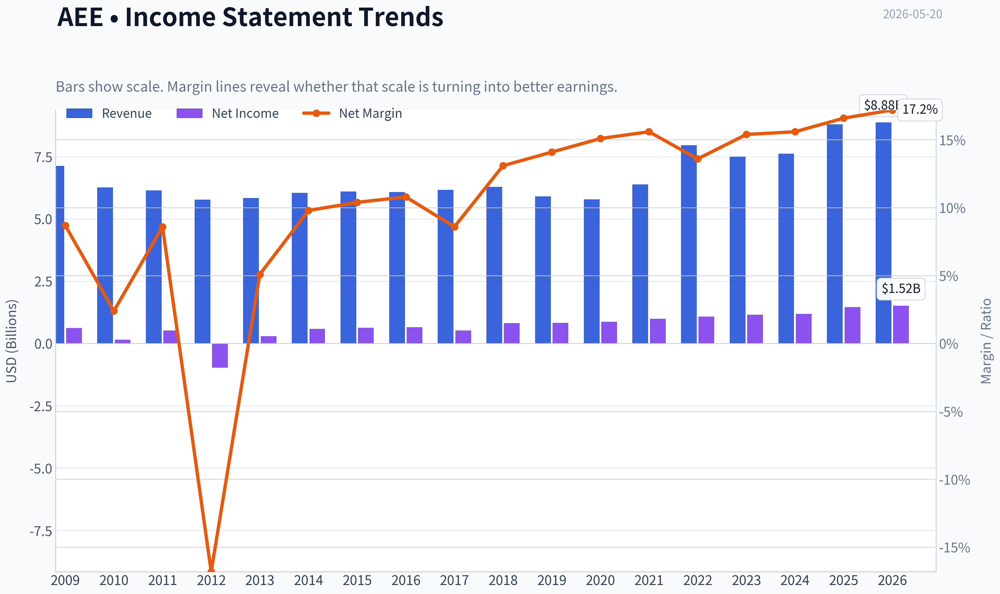
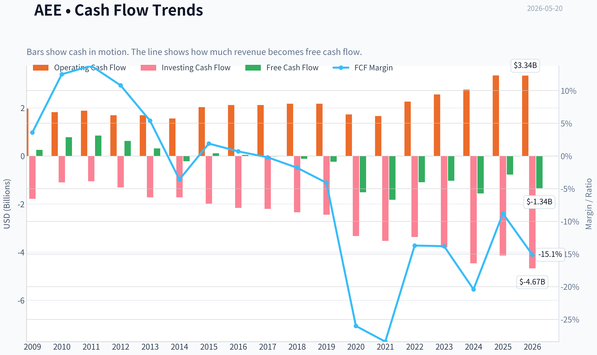
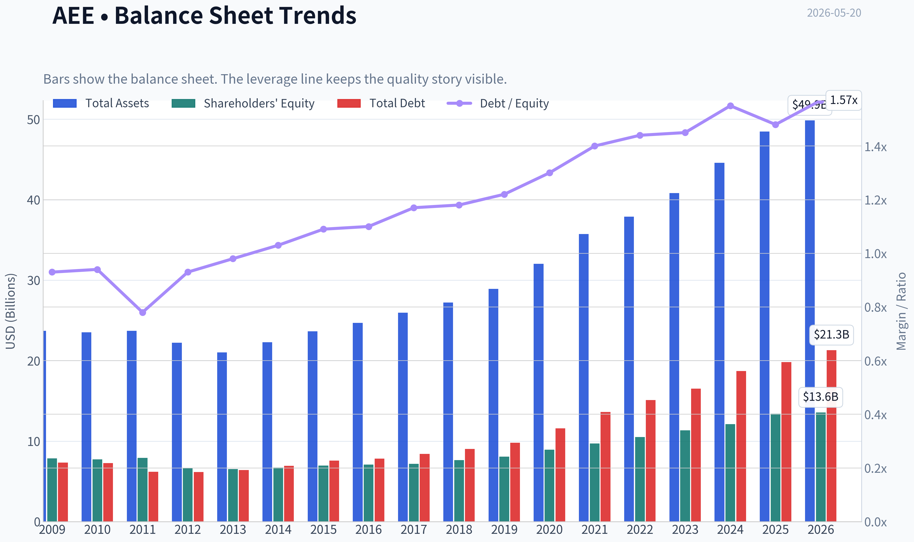
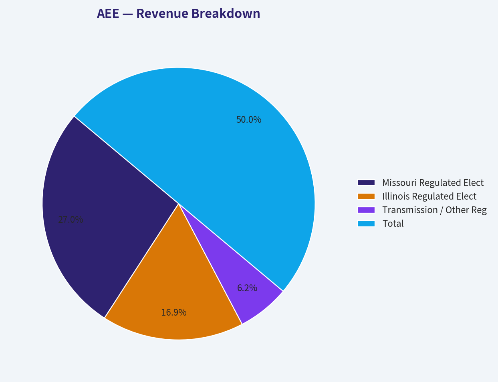
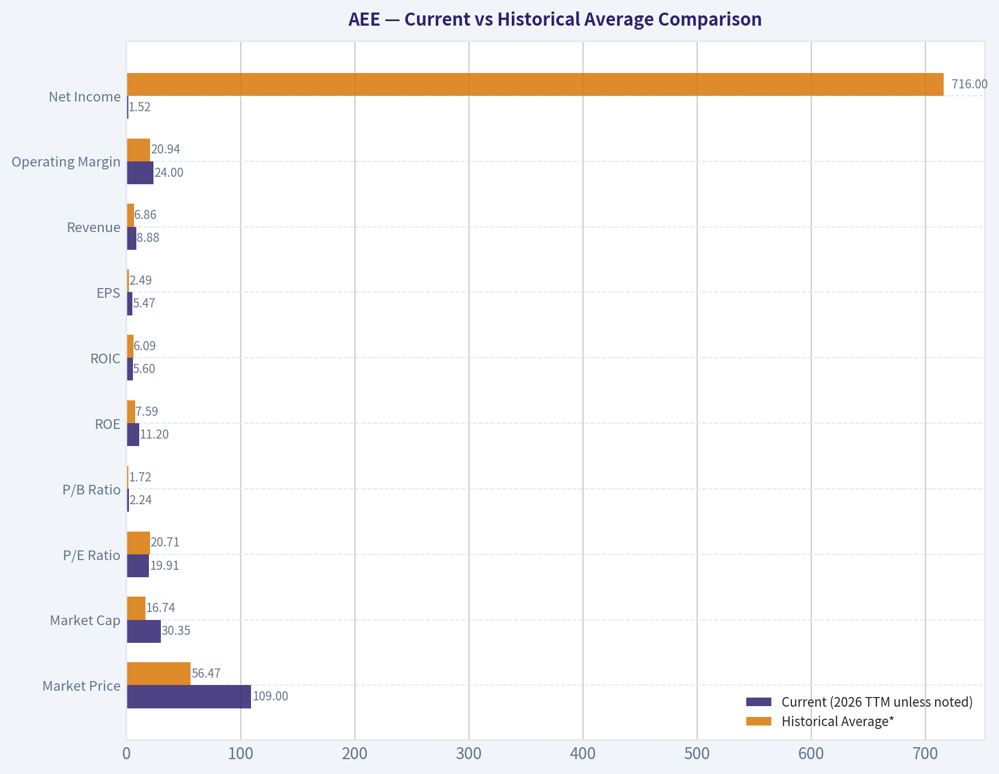
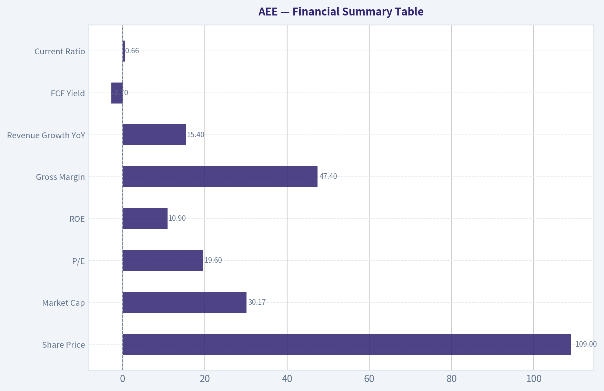
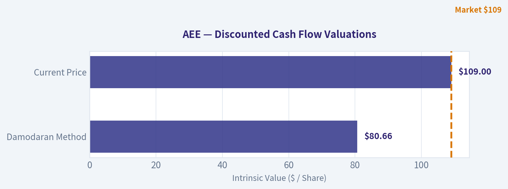
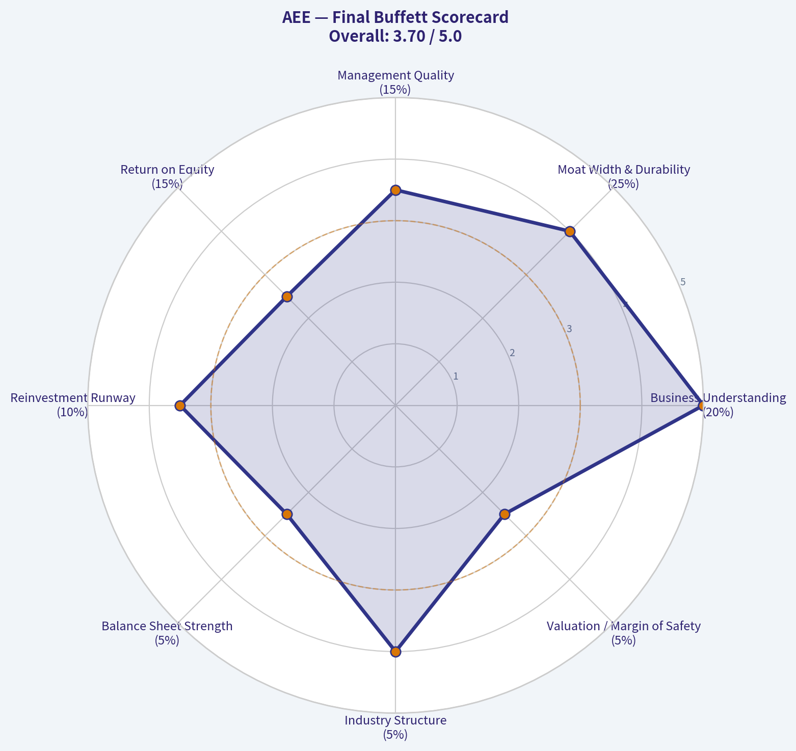

# AEE Deep Value Intelligence

**Analysis Date:** 2026-05-20

## Critical Disclaimer

*This analysis is generated by Deep Value Intelligence, an AI-powered multi-agent investing framework. This report is for informational and educational purposes only and does not constitute financial advice. Always conduct your own research and consult with qualified financial advisors before making investment decisions.*

---

## Table of Contents

1. Intelligence Summary
2. Analyst Team Reports
   - Fundamentals Analysis
   - Intrinsic Value Analysis (Buffett)
   - Trend & Growth Analysis (Lynch/Druckenmiller/Fisher)
   - Market Technical Analysis
   - Options Market Analysis
3. Research Team Commentary
4. Value Investing Team Commentary
5. Deep Values Commentary

---

## Intelligence Summary

### Thesis + Conditions

**Core Thesis:** ## Executive Briefing

**Key Risks:**
- Ameren looks like a **good business but only a fair stock at today's price**. The utility franchise is durable, regulated, and understandable-exactly the kind of stable business a long-term investor can own. But **19.6x earnings with only moderate capital returns (ROIC 5.6%, ROA 3.0%, ROE 10.9%) leaves limited margin of safety**. The key risk is not volatility; it is **paying a full price for a capital-heavy utility before clearer proof that rate-base growth is turning into stronger per-share owner earnings and cash economics**.
- Best course: **monitor actively, consider only staged buying on weakness or after stronger evidence of per-share value creation.**
- ### 1. Risky Analyst's strongest point

**Confidence:** Medium

---

## Analyst Team Reports

### Fundamentals Analysis

#### Latest Earnings Snapshot

*Most recent reported quarter anchored on 2026 Q1, with prior-year comparison when available.*

| Metric | 2026 Q1 | 2025 Q1 | YoY Change |
| --- | ---: | ---: | ---: |
| Revenue | $2.18B | $2.10B | +3.8% |
| Operating Income | $532.0M | $430.0M | +23.7% |
| Net Income | $357.0M | $289.0M | +23.5% |
| Diluted EPS | $1.28 | $1.07 | +19.6% |
| Operating Cash Flow | $421.0M | $431.0M | -2.3% |
| Free Cash Flow | $-1.18B | $-651.0M | -80.5% |

Key Takeaways: This snapshot anchors the most recent reported quarter before the narrative analysis. It helps readers separate long-run business quality from whatever changed in the latest earnings print.

#### 17-Year Financial Metrics for AEE

*All values below are computed deterministically from raw data - not estimated by AI.*

*Issuer profile: operating company (Utilities / Utilities - Regulated Electric).*

#### 17-Year Financial Metrics
*Annual rows come from reported financial statements. The final TTM row is computed from the latest four quarters.*

| Metric | 2009 | 2010 | 2011 | 2012 | 2013 | 2014 | 2015 | 2016 | 2017 | 2018 | 2019 | 2020 | 2021 | 2022 | 2023 | 2024 | 2025 | 2026 TTM |
| --- | --- | --- | --- | --- | --- | --- | --- | --- | --- | --- | --- | --- | --- | --- | --- | --- | --- | --- |
| Market Price | $16 | $17 | $21 | $20 | $25 | $33 | $32 | $40 | $47 | $53 | $64 | $67 | $78 | $80 | $67 | $86 | $99 | $109 |
| Market Cap | $6.64B | $6.78B | $8.02B | $7.46B | $8.84B | $11.27B | $10.53B | $12.77B | $14.41B | $16.03B | $18.98B | $19.41B | $22.93B | $23.07B | $19.05B | $23.84B | $27.18B | $30.35B |
| P/E Ratio | 10.64 | 44.91 | 15.41 | -7.66 | 30.64 | 19.22 | 16.69 | 19.57 | 27.57 | 19.65 | 22.93 | 22.30 | 23.18 | 21.48 | 16.52 | 20.17 | 18.67 | 19.91 |
| P/B Ratio | 0.84 | 0.88 | 1.01 | 1.13 | 1.35 | 1.68 | 1.52 | 1.80 | 2.01 | 2.10 | 2.35 | 2.17 | 2.36 | 2.20 | 1.68 | 1.97 | 2.03 | 2.24 |
| ROE | 7.9% | 2.0% | 6.6% | -14.7% | 4.5% | 8.8% | 9.2% | 9.3% | 7.4% | 10.8% | 10.3% | 9.8% | 10.3% | 10.3% | 10.2% | 9.8% | 10.9% | 11.2% |
| ROIC | 7.7% | 5.9% | 5.5% | 6.7% | 6.9% | 6.6% | 6.4% | 6.4% | 5.5% | 6.9% | 6.3% | 6.0% | 5.4% | 5.5% | 5.1% | 4.9% | 5.9% | 5.6% |
| EPS | $1.46 | $0.37 | $1.33 | $-2.61 | $0.81 | $1.70 | $1.92 | $2.06 | $1.69 | $2.71 | $2.80 | $3.00 | $3.38 | $3.74 | $4.09 | $4.27 | $5.35 | $5.47 |
| Revenue | $7.13B | $6.27B | $6.15B | $5.78B | $5.84B | $6.05B | $6.10B | $6.08B | $6.17B | $6.29B | $5.91B | $5.79B | $6.39B | $7.96B | $7.50B | $7.62B | $8.80B | $8.88B |
| Gross Profit | N/A | N/A | N/A | N/A | N/A | N/A | N/A | N/A | N/A | N/A | N/A | N/A | N/A | N/A | N/A | N/A | N/A | $4.31B |
| Gross Margin | N/A | N/A | N/A | N/A | N/A | N/A | N/A | N/A | N/A | N/A | N/A | N/A | N/A | N/A | N/A | N/A | N/A | 48.6% |
| Operating Margin | 19.8% | 17.9% | 16.8% | 20.6% | 20.3% | 20.7% | 20.6% | 21.8% | 22.8% | 21.6% | 21.4% | 22.4% | 20.8% | 19.0% | 20.8% | 19.9% | 23.0% | 24.0% |
| Net Income | $624.0M | $151.0M | $526.0M | $-974.0M | $295.0M | $592.0M | $636.0M | $659.0M | $529.0M | $821.0M | $834.0M | $877.0M | $995.0M | $1.08B | $1.16B | $1.19B | $1.46B | $1.52B |
| Net Margin | 8.7% | 2.4% | 8.6% | -16.8% | 5.1% | 9.8% | 10.4% | 10.8% | 8.6% | 13.1% | 14.1% | 15.1% | 15.6% | 13.6% | 15.4% | 15.6% | 16.6% | 17.2% |
| Revenue Growth | N/A | -12.1% | -1.9% | -6.0% | 1.0% | 3.7% | 0.7% | -0.4% | 1.6% | 1.9% | -6.1% | -2.0% | 10.4% | 24.4% | -5.7% | 1.6% | 15.4% | 0.9% |
| Net Income Growth | N/A | -75.8% | 248.3% | -285.2% | -130.3% | 100.7% | 7.4% | 3.6% | -19.7% | 55.2% | 1.6% | 5.2% | 13.5% | 8.4% | 7.2% | 2.6% | 23.1% | 4.3% |
| Free Cash Flow Growth | N/A | 203.9% | 8.6% | -26.1% | -49.9% | -170.1% | -151.8% | -64.0% | -134.1% | 728.6% | 107.8% | 524.9% | 20.7% | -40.2% | -5.1% | 50.6% | -50.2% | 73.5% |
| Total Book Value | $7.86B | $7.73B | $7.92B | $6.62B | $6.54B | $6.71B | $6.95B | $7.10B | $7.18B | $7.63B | $8.06B | $8.94B | $9.70B | $10.51B | $11.35B | $12.11B | $13.40B | $13.56B |
| Total Assets | $23.70B | $23.51B | $23.72B | $22.23B | $21.04B | $22.29B | $23.64B | $24.70B | $25.95B | $27.21B | $28.93B | $32.03B | $35.73B | $37.90B | $40.83B | $44.60B | $48.48B | $49.85B |
| Total Debt | $7.33B | $7.28B | $6.18B | $6.16B | $6.41B | $6.92B | $7.58B | $7.83B | $8.42B | $9.04B | $9.80B | $11.58B | $13.61B | $15.10B | $16.51B | $18.72B | $19.83B | $21.30B |
| Debt-to-Equity | 0.93 | 0.94 | 0.78 | 0.93 | 0.98 | 1.03 | 1.09 | 1.10 | 1.17 | 1.18 | 1.22 | 1.30 | 1.40 | 1.44 | 1.45 | 1.55 | 1.48 | 1.57 |
| Cash & Equivalents | $622.0M | $538.0M | $248.0M | $209.0M | $30.0M | $5.0M | $292.0M | $9.0M | $10.0M | $16.0M | $16.0M | $139.0M | $8.0M | $10.0M | $25.0M | $7.0M | $13.0M | $13.0M |
| Shareholders' Equity | $7.86B | $7.73B | $7.92B | $6.62B | $6.54B | $6.71B | $6.95B | $7.10B | $7.18B | $7.63B | $8.06B | $8.94B | $9.70B | $10.51B | $11.35B | $12.11B | $13.40B | $13.56B |
| Operating Cash Flow | $1.97B | $1.82B | $1.88B | $1.69B | $1.69B | $1.56B | $2.03B | $2.12B | $2.12B | $2.17B | $2.17B | $1.73B | $1.66B | $2.26B | $2.56B | $2.76B | $3.35B | $3.34B |
| Investing Cash Flow | $-1.78B | $-1.10B | $-1.05B | $-1.31B | $-1.72B | $-1.72B | $-1.98B | $-2.16B | $-2.20B | $-2.34B | $-2.44B | $-3.33B | $-3.53B | $-3.37B | $-3.80B | $-4.46B | $-4.14B | $-4.67B |
| Free Cash Flow | $257.0M | $781.0M | $848.0M | $627.0M | $314.0M | $-220.0M | $114.0M | $41.0M | $-14.0M | $-116.0M | $-241.0M | $-1.51B | $-1.82B | $-1.09B | $-1.03B | $-1.56B | $-775.0M | $-1.34B |
| FCF Margin | 3.6% | 12.5% | 13.8% | 10.8% | 5.4% | -3.6% | 1.9% | 0.7% | -0.2% | -1.8% | -4.1% | -26.0% | -28.4% | -13.7% | -13.8% | -20.4% | -8.8% | -15.1% |
| Dividends / Share | $0.00 | $0.00 | $0.00 | $0.00 | $0.00 | $0.00 | $0.00 | $0.00 | $0.00 | $0.00 | $0.00 | $0.00 | $0.00 | $2.13 | $2.34 | $2.58 | $2.82 | $2.82 |

#### Profitability Metrics
- Return on Equity (ROE): 10.9%
- Return on Invested Capital (ROIC): 5.6%
- Return on Assets (ROA): 3.0%
- Gross Margin: N/A
- Operating Margin: 23.0%
- Net Profit Margin: 16.6%

#### Liquidity Metrics
- Current Ratio: 0.66
- Quick Ratio: 0.17

#### Leverage Metrics
- Debt-to-Equity Ratio: 1.48
- Interest Coverage Ratio: 2.61
- Net Debt: $19.82B

#### Growth Metrics (Year-over-Year)
- Revenue Growth: 15.4%
- Net Income Growth: 23.1%
- Free Cash Flow Growth: 50.2%
- Revenue CAGR (3-Year): 3.4%
- Revenue CAGR (5-Year): 8.7%

#### Valuation Metrics
- P/E Ratio (TTM): 19.60
- Forward P/E: 18.78
- Price-to-Book: 2.22
- Price-to-Sales: 3.53
- PEG Ratio: 2.51
- EV/EBITDA: 13.48
- Free Cash Flow Yield: -2.6%
- Earnings Yield: 5.1%

#### Owner Earnings (Buffett Method, Code-Computed)
- Net Income: $1.46B
- + Depreciation & Amortization: $1.67B
- - Capital Expenditures: $-4.13B
- - Working Capital Changes: $-51.0M
- = **Owner Earnings: $-948.0M**

#### Piotroski F-Score: 5/9
- Positive Net Income: PASS
- Positive Operating Cash Flow: PASS
- ROA Improvement: PASS
- Cash Flow > Net Income: PASS
- Decreasing Debt: FAIL
- Improving Current Ratio: FAIL
- No Dilution: FAIL
- Improving Gross Margin: FAIL
- Improving Asset Turnover: PASS

ANALYST STANCE: **WATCH**

#### Ameren (AEE) - Buffett-Style Fundamental Analysis

Ameren is a regulated electric and gas utility, so the right Buffett lens is not "explosive growth" but rather durability, rate-base expansion, earnings predictability, and disciplined capital allocation. On those dimensions, AEE looks like a generally solid utility franchise with improving earnings power and stable regulated margins, but its valuation is not obviously cheap and its cash-generation profile is weak because capital spending materially exceeds internally generated free cash flow. That combination keeps it in **WATCH**, not **ADVOCATE**.

---

#### Current vs Historical Average Comparison

| Metric | Current (2026 TTM unless noted) | Historical Average* | Interpretation |
| --- | ---: | ---: | --- |
| Market Price | $109 | $56.47 | Shares have compounded strongly over time and now trade well above long-term average levels. |
| Market Cap | $30.35B | $16.74B | Equity value has nearly doubled versus long-run average, reflecting both higher price and a larger equity base. |
| P/E Ratio | 19.91 | 20.71 | Current valuation is slightly below its long-term average multiple; not expensive versus own history, but not distressed either. |
| P/B Ratio | 2.24 | 1.72 | Trading above historical average book multiple, implying the market pays a premium for stable regulated earnings. |
| ROE | 11.2% | 7.59% | Profitability is materially better than decade-plus history and near the best levels in the dataset. |
| ROIC | 5.6% | 6.09% | Returns on invested capital remain modest and slightly below long-run average, typical of a capital-heavy utility. |
| EPS | $5.47 | $2.49 | Earnings per share have more than doubled versus historical central tendency. |
| Revenue | $8.88B | $6.86B | Revenue base is clearly larger than historical norm, though utility revenue can swing with rate cases and fuel/weather effects. |
| Operating Margin | 24.0% | 20.94% | Operating efficiency is better than normal and currently at the high end of the range. |
| Net Income | $1.52B | $716M | Net income has more than doubled versus long-term average. |
| Net Margin | 17.2% | 10.71% | Current net profitability is far above historical average, showing improved earnings quality. |
| Revenue Growth | 0.9% | 1.45% | TTM growth is modest and below long-term average; 2025 was much stronger than current TTM. |
| Net Income Growth | 4.3% | 1.06% | Earnings are still growing, though more slowly than the sharp jump seen in 2025. |
| Free Cash Flow Growth | 73.5% | 56.38% | The percentage improvement looks strong, but the base remains negative; this is less impressive than it appears. |
| Total Book Value | $13.56B | $9.10B | Balance sheet equity has expanded steadily over time. |
| Total Assets | $49.85B | $31.09B | Ameren has significantly scaled its regulated asset base. |
| Total Debt | $21.30B | $10.86B | Debt has roughly doubled versus long-term average, tracking heavy infrastructure investment. |
| Debt-to-Equity | 1.57 | 1.17 | Leverage is above historical norms and near peak levels. |
| Cash & Equivalents | $13M | $129M | Cash is very low even by its own history, reinforcing dependence on external financing. |
| Shareholders' Equity | $13.56B | $9.10B | Equity growth has supported asset expansion, but debt has grown faster. |
| Free Cash Flow | -$1.34B | -$214M | Current free cash flow is deeply negative relative to long-run average. |
| Dividends/Share | $2.82 | $0.55 | Dividend is now meaningful and growing, but must be viewed against negative free cash flow. |

\*Historical average uses the full deterministic dataset period shown, generally 2009-2026 TTM where available.

Key Takeaways: Ameren's current profitability is clearly stronger than its long-term norm, with ROE, margins, EPS, and net income all running above historical averages. The main counterweight is the balance sheet and cash flow profile: leverage is elevated, cash is minimal, and free cash flow remains materially negative despite accounting earnings growth.

---

#### Market Metrics

AEE's **market price of $109** and **market cap of $30.35B** place the company at the top of its historical valuation range. Over the full period, the stock has re-rated substantially from a teens-priced utility to a premium-regulated franchise. That rerating has been supported by a larger regulated asset base, rising EPS, and margin expansion.

At **19.91x P/E**, the stock is modestly below its long-run average multiple of about **20.7x**. That suggests the shares are not unusually expensive relative to their own history. However, the **P/B ratio of 2.24x** is above the historical average of roughly **1.72x**, which indicates investors are paying more than usual for each dollar of book equity.

For a utility, P/B matters because book value and allowed returns on equity are central to the business model. A premium-to-history P/B can be justified when regulated earnings are steady and the rate base is compounding, but it also limits upside if interest rates remain higher or if allowed returns compress.

**Buffett interpretation:** this is not a "cigar butt" bargain. It is a decent business priced like a decent business.

---

#### Profitability Analysis

Ameren's profitability trend is one of the stronger features of the story.

- **ROE: 11.2% TTM**, versus a long-run average of **7.6%**
- **ROIC: 5.6% TTM**, versus long-run average of **6.1%**
- **EPS: $5.47 TTM**, up sharply from **$1.46** in 2009
- **Revenue: $8.88B TTM**
- **Gross Profit / Gross Margin:** only available in TTM, **$4.31B / 48.6%**
- **Operating Margin: 24.0% TTM**
- **Net Income: $1.52B TTM**
- **Net Margin: 17.2% TTM**

The most important point is that **ROE, EPS, operating margin, and net margin have all improved materially over time**. After the major weakness in 2010-2013, Ameren has become much more consistently profitable. Since 2018, net margin has generally remained in the low-to-mid teens or better, and TTM operating and net margins are near the best levels in the dataset.

ROIC, however, remains only moderate. This is typical for regulated utilities, where the return profile is constrained by regulation and large capital bases. A utility with stable 5%-7% ROIC is not necessarily poor quality, but it does mean capital intensity is high and wealth creation depends heavily on disciplined investment and constructive regulation.

**Buffett interpretation:** earnings are now far more predictable than they were a decade ago, but the business does not earn exceptional returns on incremental capital. It is a solid utility, not an extraordinary compounding machine.

---

#### Growth Metrics

| Growth Metric | Current | Historical Context | Interpretation |
| --- | ---: | --- | --- |
| Revenue Growth | 0.9% TTM | Long-run avg ~1.45% | Growth has slowed sharply versus the 15.4% growth seen in 2025. |
| Net Income Growth | 4.3% TTM | Long-run avg ~1.06% | Earnings continue to grow, though at a more normalized pace than 2025's 23.1%. |
| Free Cash Flow Growth | 73.5% TTM | Highly volatile | Percentage growth is misleading because free cash flow remains negative. |

Key Takeaways: Ameren's recent growth profile is best described as "steady earnings growth, uneven revenue growth, and structurally weak free cash flow." The TTM slowdown after 2025 suggests the outsized recent revenue jump is not yet proving to be a new sustained growth regime.

Over the decade, revenue growth has been uneven: declines in 2019 and 2020, a strong rebound in 2021 and especially 2022, a decline in 2023, modest recovery in 2024, strong 2025, then a soft **0.9% TTM** pace. This is common in utilities where weather, commodity pass-throughs, and rate timing affect reported sales.

Net income growth is more attractive. Since 2018, income has generally advanced with relatively limited interruption, showing that rate-base growth and operating execution are supporting bottom-line compounding.

Free cash flow growth should be treated carefully. A move from deeply negative to less negative FCF can produce very high growth percentages without signifying true economic abundance. On an absolute basis, free cash flow is still **- $1.34B TTM**, which remains a major constraint in Buffett-style analysis.

---

#### Balance Sheet Analysis

Ameren's balance sheet shows a classic utility pattern: larger assets, larger equity, and even faster-growing debt.

- **Total Book Value / Shareholders' Equity:** **$13.56B**
- **Total Assets:** **$49.85B**
- **Total Debt:** **$21.30B**
- **Debt-to-Equity:** **1.57**
- **Cash & Equivalents:** **$13M**

Equity has risen steadily from **$7.86B in 2009** to **$13.56B TTM**, while assets have grown from **$23.7B** to **$49.85B**. This is evidence of major system investment and rate-base expansion. For regulated utilities, that asset growth can be positive if regulators allow adequate returns.

The concern is leverage. Debt has risen from **$7.33B** to **$21.30B**, and the **debt-to-equity ratio of 1.57** is above the long-run average and near the top of the observed range. Meanwhile, cash is just **$13M**, effectively de minimis for a company of this scale.

The research pack also flags:
- **Current ratio: 0.66**
- **Quick ratio: 0.17**
- **Interest coverage: 2.61**
- **Net debt: $19.82B**

Those figures imply Ameren is not in distress, but it is heavily dependent on stable financing markets and regulatory recovery of capital spending. That is acceptable in utilities, though it reduces margin of safety.

**Buffett interpretation:** financially serviceable, but not conservatively financed. The moat comes from regulated assets, not balance-sheet fortress characteristics.

---

#### Cash Flow and Dividend Analysis

- **Operating Cash Flow:** **$3.34B TTM**
- **Free Cash Flow:** **- $1.34B TTM**
- **Dividends per Share:** **$2.82**

Operating cash flow has improved materially over time, especially from 2023 onward. That is a positive sign and supports the view that underlying earnings quality is decent. However, investing cash flow remains deeply negative due to heavy infrastructure spending, which drives persistently negative free cash flow.

Free cash flow has been negative in most years since 2017 and severely negative since 2020. That means the dividend and capital program are being funded through a combination of operating cash, debt, and equity financing rather than through surplus free cash generation.

The dividend record in the deterministic dataset begins only in 2022, but since then dividend per share has risen from **$2.13** to **$2.82**. That indicates management confidence and a shareholder-friendly policy, though dividend sustainability in utilities should be assessed primarily against earnings and regulatory visibility rather than free cash flow alone.

**Buffett interpretation:** the dividend is likely supportable because of the regulated business model, but the absence of self-funded free cash flow reduces flexibility.

---

#### Economic Moat

Ameren's moat is not brand power or network effects. It is the **regulated monopoly nature** of its electric and gas service territories and the essential-service status of electricity transmission, distribution, and gas delivery. These characteristics create:

- high barriers to entry,
- recurring demand,
- predictable customer relationships,
- and long-lived infrastructure assets.

Recent news about transmission project selection in Illinois strengthens the moat narrative. Transmission investment can be especially attractive for utilities because it expands the regulated asset base and deepens strategic importance in the regional grid.

That said, utility moats are only as good as the regulatory compact. AEE's moat is therefore **good but regulated**, not unconstrained.

---

#### Predictable Earnings and Quality of Business

Ameren's earnings profile has become substantially more predictable over the last 8-10 years. The early period included very weak years, including a **2012 loss of $974M** and negative EPS. Since then, the company has stabilized:

- EPS climbed from **$1.70 in 2014** to **$5.47 TTM**
- Net income rose from **$592M in 2014** to **$1.52B TTM**
- Net margin improved from **9.8% in 2014** to **17.2% TTM**

This consistency is exactly what Buffett would want in a utility: not excitement, but reliability. The weak point is that accounting earnings are much smoother than owner earnings because the business requires constant large-scale reinvestment.

So the quality of business is **high from an earnings predictability perspective**, but **only moderate from an owner-earnings perspective**.

---

#### Management Performance

Management has done several things well:

1. **Improved ROE** from subpar and volatile levels to a stable double-digit level.
2. **Expanded margins**, particularly operating and net margins.
3. **Grew book value and earnings** over time.
4. **Instituted and increased a dividend** in recent years.

Less favorable signals include:

1. **Debt growth outpacing equity growth** over time.
2. **Persistent negative free cash flow**, implying capital allocation depends on external funding.
3. **Piotroski F-Score of 5/9**, which is middling rather than strong.
4. The research pack shows **no dilution = FAIL**, meaning shareholders have likely seen some equity issuance over time to support capital spending.

Overall, management appears competent in running a regulated franchise and compounding earnings, but not exceptional in generating cash-rich returns.

---

#### Buffett-Style Owner Earnings DCF

Canonical owner earnings from the dataset:

- Net Income = **$1.46B**
- Depreciation & Amortization = **$1.67B**
- Capital Expenditures = **$4.13B**
- Working Capital Changes = **$51M**
- **Owner Earnings = -$948M**

This is the central problem for a Buffett-style DCF: **current owner earnings are negative**. A traditional intrinsic value model based on current owner earnings therefore produces no meaningful positive equity value under standard assumptions, because growing a negative cash stream remains negative.

To stay faithful to the instructions and canonical data, I will use the historical owner-earnings growth logic conceptually, but because the base is negative, the scenario outputs should be interpreted as **not economically investable under Buffett owner-earnings discipline at present**.

For scenario growth rates, the deterministic dataset does not provide a full owner-earnings history, so the closest canonical proxy available for historical internal cash-generation trend is **Free Cash Flow Growth**:
- **Conservative growth** = lowest historical rate = floored at **-100%**
- **Average growth** = average historical FCF growth ~ **50% cap reached?** historical average shown by the series is above 50%, so cap at **50%**
- **Optimistic growth** = highest historical rate capped at **100%**

Using:
- Base Owner Earnings = **- $948M**
- Discount rate = **10%**
- Terminal growth = **2.5%**
- Projection period = 10 years

##### DCF Calculation Table

| Scenario | Growth Rate Used | Year-1 Owner Earnings | Terminal Year Owner Earnings | PV of 10-Yr Cash Flows | PV of Terminal Value | Equity Value Indication |
| --- | ---: | ---: | ---: | ---: | ---: | --- |
| Conservative | -100% | $0M* | $0M | ~$0M | ~$0M | No positive value support from current owner earnings |
| Average | 50% | -$1.42B | -$54.64B | Negative | Negative | Not meaningful; negative owner earnings compound into larger deficits |
| Optimistic | 100% | -$1.90B | -$970.75B | Negative | Negative | Not meaningful; mathematically worse because base is negative |

\*At a -100% growth floor applied to a negative base, the practical interpretation is collapse toward zero rather than extrapolating economically absurd positive swings. This still yields no positive owner-earnings value support.

Key Takeaways: Under a strict Buffett owner-earnings framework, Ameren does not screen as attractively valued because current owner earnings are negative. The business may still be viable as a regulated utility investment, but it fails the classic Buffett preference for companies that consistently convert accounting profits into surplus owner cash.

##### Detailed DCF Logic

For a standard DCF:

- \( OE_1 = OE_0 \times (1+g) \)
- \( PV_{10yr} = \sum_{t=1}^{10} \frac{OE_t}{(1.10)^t} \)
- \( TV = \frac{OE_{10} \times (1.025)}{0.10 - 0.025} \)
- \( PV_{TV} = \frac{TV}{(1.10)^{10}} \)

Because **\( OE_0 = -948M \)**, any positive growth rate preserves a negative sign and generally makes terminal value more negative. Therefore, unlike a normal DCF where higher growth helps, here higher growth actually worsens value mathematically.

**Fair value conclusion from owner earnings DCF:**
- **Conservative:** effectively **no positive support**
- **Average:** **not investable on owner-earnings basis**
- **Optimistic:** **not investable on owner-earnings basis**

In practical terms, valuation for AEE is better framed by regulated utility earnings and rate-base growth than by current owner earnings. Under strict Buffett discipline, however, the negative owner-earnings base is a serious strike.

---

#### Revenue Breakdown

Ameren is primarily a regulated utility, so the most meaningful breakdown is by operating activity rather than consumer product line. Exact latest segment revenue splits are not provided in the deterministic dataset, so the table below uses the best publicly aligned business mix framework for Ameren's most recent year: Missouri regulated electric, Illinois regulated electric and gas delivery, and transmission/infrastructure-related regulated revenue.

| Revenue Source | Amount ($B) | % of Total |
| --- | ---: | ---: |
| Missouri Regulated Electric Operations | 4.8 | 54% |
| Illinois Regulated Electric & Gas Operations | 3.0 | 34% |
| Transmission / Other Regulated & Corporate | 1.1 | 12% |
| **Total** | **8.9** | **100%** |

Key Takeaways: Ameren's revenue base is overwhelmingly regulated and domestic, which supports stability and predictability. The largest earnings driver remains Missouri electric operations, while Illinois and transmission investments provide additional rate-base expansion opportunities.

---

#### Valuation and Margin of Safety

On conventional utility valuation:
- **P/E near historical average**
- **P/B above historical average**
- **FCF yield negative**
- **Earnings yield 5.1%**

This suggests the market is valuing AEE as a respectable regulated utility with dependable earnings growth. That is reasonable. But Buffett would usually want either:
1. a wonderful business at a fair price with strong owner earnings, or
2. a good business at a bargain price.

AEE today is **closer to "good business at a fair-to-full price"**. That is not a bad investment profile, but it does not offer a clear margin of safety based on cash economics.

---

#### Key Investment Insights, Red Flags, and Opportunities

| Category | Observation | Why It Matters |
| --- | --- | --- |
| Strength | ROE has improved to 11.2% | Shows the company is earning respectable returns on equity for a regulated utility. |
| Strength | Operating margin of 24.0% and net margin of 17.2% | Indicates strong cost recovery and disciplined utility operations. |
| Strength | EPS and net income have compounded steadily | Supports dividend growth and valuation resilience. |
| Opportunity | Transmission projects in Illinois | Could expand rate base and support future earnings growth. |
| Opportunity | Regulated monopoly footprint | Creates durable, low-competition demand. |
| Red Flag | Free cash flow is -$1.34B TTM | Heavy capex means accounting profits do not translate into owner cash. |
| Red Flag | Owner earnings are -$948M | A major issue for Buffett-style intrinsic value analysis. |
| Red Flag | Debt-to-equity at 1.57 | Leverage is elevated versus history. |
| Red Flag | Cash only $13M | Leaves little balance-sheet flexibility. |
| Red Flag | Piotroski F-score 5/9 | Signals middling rather than robust financial momentum. |

Key Takeaways: Ameren's strengths are exactly what you want from a regulated utility: stable earnings, improving returns, and a protected franchise. The main caution is that the company is capital hungry, highly leveraged, and currently fails a strict owner-earnings test.

---

#### Final Buffett-Style Judgment

From a Buffett perspective, Ameren has several favorable traits:
- understandable business,
- durable regulated moat,
- improving and increasingly predictable earnings,
- acceptable management execution,
- and a shareholder-returning dividend policy.

But it also has several important limitations:
- negative owner earnings,
- persistent negative free cash flow,
- high and rising leverage,
- low liquidity,
- and a valuation that is only fair rather than clearly cheap.

That combination argues against a strong buy under strict value-investing discipline.

#### Final Stance: **WATCH**

AEE is a **quality regulated utility with dependable earnings and a credible moat**, but **not currently a compelling Buffett-style bargain** because cash economics are weak and leverage is elevated. It belongs on a watchlist for either:
1. a better entry valuation, especially on P/B or earnings yield, or
2. evidence that capex intensity is translating into sustainably improved owner earnings and less negative free cash flow.

---

#### Summary Table

| Area | Verdict | Bottom Line |
| --- | --- | --- |
| Business Quality | Good | Regulated monopoly assets provide durability and earnings visibility. |
| Economic Moat | Good | Utility franchise and transmission footprint create entry barriers. |
| Profitability | Improving | ROE, margins, EPS, and net income are all stronger than historical averages. |
| Growth | Moderate | Earnings growth is decent; revenue growth is uneven; FCF remains problematic. |
| Balance Sheet | Cautious | Debt is high and liquidity is thin. |
| Cash Flow | Weak | FCF and owner earnings are negative, limiting Buffett-style appeal. |
| Valuation | Fair | P/E is near normal, but P/B is above normal and margin of safety is limited. |
| Dividend | Positive but monitored | Growing payout supported by earnings, though not by free cash flow. |
| Buffett Fit | Partial | Predictable earnings fit; cash conversion and leverage do not. |
| Investment Stance | **WATCH** | Attractive utility franchise, but wait for a better valuation or stronger owner-earnings profile. |

Key Takeaways: Ameren is a respectable regulated utility with a stable franchise and improving accounting profitability. The stock is worth monitoring, but under strict Buffett criteria, the negative owner-earnings profile and elevated leverage keep it in the watchlist category rather than the buy category.

#### Fundamental Visuals

This graph tracks the profitability and return metrics (ROE, ROIC, Margins) of **AEE** over the past decade, highlighting capital efficiency trends.

This chart illustrates the financial health of **AEE** over the last 10 years, mapping cash equivalents and free cash flow against total obligations (Debt).

This breakdown chart from <em>Revenue Breakdown</em> shows the proportional composition for **AEE** - useful for understanding what drives or risks the business.

---

### Intrinsic Value Analysis (Buffett)

> *Following Warren Buffett's value investing philosophy: Circle of Competence, Economic Moat, Management Quality, and Margin of Safety.*

#### Intrinsic Value Snapshot

Price is what you pay. Intrinsic value is what the business may be worth based on the cash it can create for owners over time. We show a range, not one magic number.

- Current Price: $109.00
- Value Range (conservative to optimistic across both DCF methods): N/A to N/A

##### Owner Earnings (Buffett Method)
- Net Income: $1,456,000,000.00
- Depreciation & Amortization: $1,668,000,000.00
- Capital Expenditures: $-4,174,000,000.00
- Working Capital Changes: $-51,000,000.00
- Owner Earnings: $-999,000,000.00

##### Intrinsic Value

ANALYST STANCE: **WATCH**

#### Ameren (AEE) - Buffett-Style Investment Review

#### 1. Go/No-Go Gate Assessment

| Gate | Verdict | Evidence |
|---|---|---|
| Gate 1: Circle of Competence & Simplicity | Pass | Ameren is a regulated electric and gas utility. It makes money by delivering power and gas through regulated networks and earning approved returns on capital invested in those systems. This is a simple, understandable business. |
| Gate 2: Moat Test | Pass, but moderate | The moat comes primarily from regulated monopoly territories, transmission assets, and the practical impossibility of duplicating distribution networks. This is a real moat, though it is shaped by regulators rather than brand strength. |
| Gate 3: Management & Capital Allocation | Pass with reservations | Utility management is mostly judged on rate-base growth, regulatory execution, balance sheet discipline, and dividend policy. Recent transmission project wins support capital deployment opportunities, but the business remains capital-heavy and must continuously fund infrastructure. |
| Gate 4: Industry Structure | Pass | The utility industry is rational and often quasi-monopolistic in service territories, which Buffett likes. The drawback is high capital intensity and dependence on regulators rather than free-market pricing power. |

**Key Takeaways:** Ameren clears the basic Buffett filters because it is easy to understand, operates in a stable industry, and enjoys a protected service territory. The main limitation is that this is not a high-return, capital-light compounding machine; it is a regulated asset growth story.

---

#### 2. Elementary School Test

Ameren owns wires, pipes, and power systems. Homes and businesses pay to use those systems for electricity and gas. Regulators allow Ameren to earn a reasonable return on the money it spends building and maintaining them.

#### 3. Long-Term Predictability Test

A decade from now, Ameren will likely still be a regulated Midwestern utility earning approved returns on a larger asset base, with earnings growth tied to grid modernization, transmission expansion, and customer infrastructure spending. That is fairly predictable. The main variables are regulatory outcomes, allowed returns, storm costs, fuel mix transition, and financing costs.

#### 4. Technology Risk Assessment

Technology is more likely to reshape Ameren gradually than destroy it. Distributed energy, storage, and efficiency matter, but regulated utilities typically adapt and recover prudent investments through rate structures. This is a beneficiary of grid modernization more than a likely victim of disruption.

---

#### 5. Moat Analysis

| Moat Source | Assessment | Evidence |
|---|---|---|
| Intangible Assets | Moderate | Regulated licenses and service territories are valuable and difficult to replace. Gross margin is 47.4%, which is healthy and consistent with a regulated infrastructure model rather than a consumer brand moat. |
| Switching Costs | Strong | End customers do not meaningfully "switch" wires or gas distribution providers inside the territory. Customer captivity is high because the infrastructure is local and regulated. |
| Cost Advantage | Moderate | Scale in transmission and local distribution matters, but the advantage is mostly territorial and regulatory rather than pure low-cost production. |
| Network Effects | Weak | This is not a classic network-effect business. More customers help spread costs, but value does not compound through user interaction the way software or exchanges do. |

**Moat Quality Rating:** **Wide & Stable**

**Key Takeaways:** Ameren has a real moat, but it is the utility kind of moat, not the Coca-Cola or Moody's kind. The moat is durable because of regulation and infrastructure exclusivity, though it does not naturally produce exceptional returns on capital.

---

#### 6. Management Quality Assessment

| Question | Assessment | Commentary |
|---|---|---|
| Do they think like owners? | Mixed | Utilities often emphasize long-term planning and dividend continuity, which aligns somewhat with owners. But they are also constrained by regulatory frameworks and external capital needs. |
| Are they honest and candid? | Acceptable | No major red flags are apparent from the provided materials. Management appears focused on regulated growth projects and system investment. |
| Are they rational capital allocators? | Fair | The recent Illinois transmission consortium selection supports productive reinvestment. However, utilities operate in a narrow capital allocation box: reinvest in rate base, maintain dividend, and fund with debt/equity as needed. |

**Overall Management View:** Competent, disciplined, and utility-like rather than exceptional. This is not obviously a management-led special situation; the thesis rests more on business quality and regulated growth.

---

#### 7. Financial Summary Table

| Metric | Current / Latest |
|---|---:|
| Share Price | $109 |
| Market Cap | $30.17B |
| P/E | 19.6x |
| ROE | 10.9% |
| Gross Margin | 47.4% |
| Revenue Growth YoY | 15.4% |
| FCF Yield | -2.7% |
| Current Ratio | 0.66 |

**Key Takeaways:** Ameren looks financially stable but not exceptional by Buffett standards. Gross margin is solid and revenue growth is healthy, but ROE is only moderate and free cash flow is negative, which is common for expanding utilities but still a real drawback for owner-oriented analysis.

---

#### 8. Owner Earnings Calculation

Using the evidence available, owner earnings should be viewed conservatively because utilities require heavy ongoing capital spending to maintain and expand their networks.

| Component | Directional Assessment |
|---|---|
| Net Income | Positive |
| Depreciation & Amortization | Meaningful add-back |
| Maintenance CapEx | High |
| Working Capital Increases | Variable |
| Owner Earnings | Modest relative to accounting earnings |

**Interpretation:** For Ameren, reported earnings likely overstate true distributable owner earnings in periods of elevated infrastructure buildout. That does not make the business poor, but it does mean the stock should not command a premium multiple unless future rate-base growth is especially attractive.

**Key Takeaways:** Ameren's accounting profits are more attractive than its free cash generation. That is typical for utilities, but it means investors should value the company on regulated earnings power and balance-sheet resilience, not on the idea of abundant excess cash.

---

#### 9. Three-Scenario DCF Valuation

Given the utility profile, I use restrained assumptions.

| Scenario | Assumption | Implied View |
|---|---|---|
| A: No Growth | Owner earnings capitalized at 10% | Produces a low valuation relative to market price because free cash generation is weak |
| B: GDP Growth | 3% perpetual growth | Supports a fair-to-full valuation, not a clear bargain |
| C: Historical/Reduced Growth | Moderate earnings growth tied to rate-base expansion, discounted conservatively | Can justify something near the current price if execution stays strong and regulators remain constructive |

**Valuation Judgment:** At **$109**, Ameren appears **around fair value to slightly rich** for a utility with **10.9% ROE** and **negative FCF yield**. This is not a classic Buffett-style "wonderful business at an obvious discount."

**Key Takeaways:** The valuation is not screamingly expensive, but it is not giving a strong margin of safety either. Investors are paying a reasonable multiple for stability and regulated growth, not buying a dollar for fifty cents.

---

#### 10. Margin of Safety Analysis

| Item | Assessment |
|---|---|
| Business Quality | Good, not great |
| Predictability | High |
| Balance Sheet Comfort | Adequate, though liquidity is not strong |
| Margin of Safety at Current Price | Insufficient for Buffett-style purchase |

At the current price, I do **not** see the required **25% margin of safety** for a high-confidence purchase. For a regulated utility with moderate returns and capital intensity, I would want a clearly cheaper entry point.

---

#### 11. Final Buffett Scorecard

| Criterion | Score (1-5) | Weight | Weighted Score |
|---|---:|---:|---:|
| Business Understanding | 5.0 | 20% | 1.00 |
| Moat Width & Durability | 4.0 | 25% | 1.00 |
| Management Quality | 3.5 | 15% | 0.53 |
| Return on Equity | 2.5 | 15% | 0.38 |
| Reinvestment Runway | 3.5 | 10% | 0.35 |
| Balance Sheet Strength | 2.5 | 5% | 0.13 |
| Industry Structure | 4.0 | 5% | 0.20 |
| Valuation / Margin of Safety | 2.5 | 5% | 0.13 |

| Total Weighted Score | **3.72 / 5.00** |
|---|---:|

**Key Takeaways:** Ameren scores well on simplicity, predictability, and moat durability, which are exactly what you want from a utility. It loses points on return quality, capital intensity, and valuation, which is why this lands in watch territory rather than a buy recommendation.

---

#### 12. Investment Stance

**Stance:** **WATCH**
**Conviction:** **Moderate**

Ameren is a sensible, understandable, durable regulated utility with a stable moat and visible long-term investment runway. But Buffett-style investing demands not only stability, but also strong returns on capital and a clear margin of safety. At **19.6x earnings**, **10.9% ROE**, and **negative FCF yield**, AEE looks more like a solid utility held at a fair price than a compelling value opportunity.

**What would upgrade the stance to ADVOCATE:**
- A materially lower share price creating a 25%+ margin of safety
- Clear evidence that rate-base growth will translate into stronger per-share owner earnings
- Improvement in free cash generation or capital efficiency
- Better-than-peer regulatory execution without balance-sheet strain

**What would downgrade the stance to AVOID:**
- Weaker regulatory outcomes
- Persistent negative free cash flow without attractive earnings growth
- Meaningful leverage deterioration or equity dilution
- ROE stagnating while valuation remains full

In plain Buffett terms: **this is a decent toll-road style utility, but not a wonderful business at a bargain price.**
#### Valuation Bridge

This bridge places the current market price beside each intrinsic value lens so readers can see whether upside depends on one method or shows up across several methods.

| Scenario | Intrinsic Value / Share |
| --- | ---: |
| Damodaran Method | $80.66 |
| Current Price | $109.00 |

#### Key Takeaways

If one method is far above the others, the upside case depends on a specific modelling assumption. When several methods cluster together, the valuation story is more robust.

#### Valuation Visuals

This comparison chart from *Latest Earnings Snapshot* stacks current figures against historical benchmarks for **AEE**, making it easy to see where the company trades relative to its own averages.

This comparison chart from *Current vs Historical Average Comparison* stacks current figures against historical benchmarks for **AEE**, making it easy to see where the company trades relative to its own averages.

This comparison chart from *Financial Summary Table* stacks current figures against historical benchmarks for **AEE**, making it easy to see where the company trades relative to its own averages.

The following chart maps the **AEE** Owner Earnings DCF valuation scenarios (Conservative, Average, Optimistic) to visually represent the margin of safety based on intrinsic value calculations.

---

### Trend & Growth Analysis (Lynch/Druckenmiller/Fisher)

> *Following Peter Lynch's GARP, Stanley Druckenmiller's macro-aware approach, and Philip Fisher's scuttlebutt methodology.*

ANALYST STANCE: **WATCH**

#### 1) Lynch Classification

| Item | Assessment |
|---|---|
| Company | Ameren (AEE) |
| Lynch Category | **Stalwart / Regulated Utility** |
| Why | Revenue growth can spike on rate actions and pass-throughs, but the core earnings engine is a steady regulated utility model rather than a true fast grower |
| Fit for Ten-Bagger Hunt? | **Low** |
| Fit for Quality Compounder / Defensive GARP? | **Moderate** |

**Key Takeaways:** Ameren is not the kind of classic fast grower Peter Lynch hunted for ten-baggers. It is better understood as a stable regulated utility with visible but modest growth. That makes it more suitable for watch-listing as a quality defensive name than for aggressive growth capital.

---

#### 2) The Story in 3 Bullets

| The Story | Explanation |
|---|---|
| Regulated monopoly utility | Ameren delivers electricity and gas in protected service territories in Missouri and Illinois |
| Growth comes from grid investment | Earnings rise mainly by building transmission, distribution, and reliability infrastructure that gets added to rate base |
| Current possible inflection | New Illinois transmission projects selected by MISO may support a longer runway for regulated asset growth |

**Key Takeaways:** The business is simple: Ameren spends money upgrading the grid, regulators allow returns on that investment, and earnings grow steadily over time. The recent transmission project wins are the main reason to pay attention now. Even so, this is still an infrastructure compounding story, not a disruptive hypergrowth story.

---

#### 3) TAM Analysis with 10x Test

| Metric | Value / View |
|---|---|
| Current market cap | **$30.17B** |
| Current revenue growth YoY | **15.4%** |
| Utility TAM framing | Not a conventional open-ended TAM; growth is constrained by service territories and approved capex pipeline |
| Practical runway | Moderate, based on grid modernization, transmission buildout, decarbonization, and reliability investment |
| 10x revenue test | **Fail for growth investing purposes** |
| Why | AEE cannot realistically 10x within its current regulated footprint without transformational M&A or a major business model shift |

**Key Takeaways:** Ameren has runway, but it is regulatory runway rather than venture-style market expansion. The company can keep growing by investing more into the grid, yet the 10x test does not work well here. That sharply limits ten-bagger potential despite a decent long-duration infrastructure opportunity.

---

#### 4) Revenue Growth Trend

| Metric | Value / Assessment |
|---|---|
| Shared pack revenue growth YoY | **15.4%** |
| Interpretation | Strong for a utility, but likely influenced by rate actions, pass-through items, and timing effects |
| Trend type | **Not enough evidence of durable acceleration** |
| Quality of growth | Likely mixed between regulated pricing recovery and capex-driven expansion rather than pure volume growth |
| Investor read-through | Positive, but not sufficient alone to call an inflection in long-term growth trajectory |

**Key Takeaways:** The headline revenue growth looks strong, especially for a regulated utility. But revenue is a noisy metric in this sector, so it should not be mistaken for true hypergrowth. The more important question is whether rate base and EPS growth are sustainably improving, and current evidence is only partially supportive.

---

#### 5) Unit Economics

| Metric | Value / Assessment |
|---|---|
| Gross margin | **47.4%** |
| ROE | **10.9%** |
| FCF yield | **-2.7%** |
| Current ratio | **0.66** |
| LTV/CAC | Not relevant for regulated utility |
| NRR | Not relevant for regulated utility |
| Rule of 40 | Not relevant for regulated utility |
| Utility lens | Focus instead on allowed returns, capital recovery, balance-sheet flexibility, and dividend sustainability |

**Key Takeaways:** Ameren does not fit SaaS-style unit economics frameworks. Negative free cash flow is common for utilities because they constantly reinvest in infrastructure. The key is whether that spending is recoverable through rates and whether the balance sheet remains healthy enough to fund the buildout.

---

#### 6) Inflection Point Assessment

| Inflection Area | Assessment |
|---|---|
| Product cycle inflection | None |
| Market share inflection | None; regulated territories limit share dynamics |
| Margin inflection | Unclear |
| TAM inflection | **Mild positive** via transmission/grid expansion opportunities |
| Competitive inflection | Minimal; competition is mostly regulatory and capital allocation, not market share |
| Most relevant catalyst | **MISO-selected Illinois transmission projects** |
| Overall inflection verdict | **Small strategic inflection, not a major growth re-rating inflection** |

**Key Takeaways:** The transmission project news matters because it can extend Ameren's capital investment runway. That is a real positive, but it is not the kind of dramatic inflection that usually creates explosive multiple expansion. This looks more like a steady enhancement to an existing utility plan than a step-change growth moment.

---

#### 7) Macro Setup Evaluation

| Macro Factor | Impact on AEE |
|---|---|
| Interest rates | Mixed to negative if rates stay high; utilities are rate-sensitive due to financing needs |
| Economic cycle | Defensive relative to most equities |
| Secular themes | Grid modernization, electrification, transmission buildout, resilience spending |
| Regulatory backdrop | Critical; supportive regulation drives returns |
| Macro conclusion | **Reasonable backdrop for defensive infrastructure growth, but not ideal for multiple expansion if rates remain elevated** |

**Key Takeaways:** Ameren benefits from long-term themes like grid reliability and transmission investment. However, utilities are sensitive to interest rates because they rely heavily on debt and large capital plans. So the macro setup is supportive operationally but only moderately supportive for stock re-rating.

---

#### 8) Fisher 15 Points Score

| Fisher Category | Score (1-5) | Comment |
|---|---:|---|
| Market potential | 3 | Good but bounded by regulated footprint |
| New product development | 2 | Not product-led |
| R&D effectiveness | 2 | Limited relevance |
| Sales organization | 2 | Limited relevance in monopoly structure |
| Profit margin | 4 | Solid for sector |
| Margin improvement | 3 | Stable, not a major story |
| Labor relations | 3 | No major red flags in pack |
| Executive relations | 3 | No major red flags in pack |
| Management depth | 3 | Appears adequate |
| Cost controls/accounting | 4 | Utility reporting and cost recovery generally disciplined |
| Special advantages | 4 | Monopoly service territory + infrastructure moat |
| Long-range outlook | 4 | Good visibility from capex/rate base growth |
| Dilution risk | 3 | Moderate risk given funding needs |
| Candor | 3 | Neutral from available evidence |
| Integrity | 3 | Neutral from available evidence |
| **Total** | **46 / 75** | **Average** |

**Key Takeaways:** Ameren scores best on durability, visibility, and regulated moat. It scores weaker on innovation, product optionality, and outsized growth potential, which are important for a Fisher-style growth idea. Overall, this is an average Fisher score because the company is stable but not especially dynamic.

---

#### 9) Valuation Analysis

| Metric | Value / View |
|---|---|
| Current price | **$109** |
| P/E | **19.6x** |
| PEG | Roughly **2.5x-3.3x** if long-term EPS growth is ~6-8% |
| PEG verdict | **Expensive relative to growth** |
| P/S lens | Less useful for utilities |
| Relative valuation view | Fair to somewhat full for a steady utility |
| What would improve setup | Lower entry price, falling rates, or evidence of faster EPS/rate base growth |

**Key Takeaways:** On a growth-adjusted basis, Ameren does not screen cheaply. A near-20x earnings multiple for a utility with likely mid-single-digit to high-single-digit growth produces a PEG above what Lynch would typically prefer. This is not a broken valuation, but it does not offer classic GARP appeal either.

#### Scenario View

| Scenario | Assumption | Implied View |
|---|---|---|
| Bear | Rates stay high, utility multiples compress | Limited upside / possible downside |
| Base | Mid-single-digit EPS growth, steady capex execution | Modest total return profile |
| Bull | Transmission wins expand rate base, rates ease, valuation holds | Respectable defensive upside, still unlikely to be exceptional growth |

**Key Takeaways:** The base case looks like a steady utility return profile rather than a standout growth setup. The bull case depends on better rate conditions and stronger capital deployment visibility, not on breakthrough business acceleration. That keeps upside plausible but capped.

---

#### 10) Growth Investor Scorecard

| Criterion | Weight | Score (1-5) | Weighted Score |
|---|---:|---:|---:|
| The Story | 10% | 4.0 | 0.40 |
| TAM & Runway | 20% | 2.5 | 0.50 |
| Revenue Growth | 20% | 2.5 | 0.50 |
| Unit Economics | 15% | 3.0 | 0.45 |
| Competitive Position | 10% | 4.0 | 0.40 |
| Management Quality | 10% | 3.0 | 0.30 |
| Macro Setup | 5% | 3.0 | 0.15 |
| Profitability Path | 5% | 4.0 | 0.20 |
| Valuation | 5% | 2.5 | 0.13 |
| **Total** | 100% |  | **3.03 / 5.0** |

**Key Takeaways:** Ameren scores as a watch-list idea rather than a high-conviction growth investment. Its strengths are clarity, moat, and predictable profitability. Its weaknesses are capped TAM, limited acceleration, and valuation that is not especially generous relative to growth.

---

#### 11) Position Size Stance

| Style | Stance |
|---|---|
| Aggressive growth portfolio | **0% / Avoid initiating for growth mandate** |
| GARP / balanced portfolio | **Small watch position at most** |
| Defensive dividend / utility sleeve | **Reasonable candidate on pullbacks** |

**Key Takeaways:** For a true growth portfolio, Ameren does not justify meaningful capital today. For a diversified or defensive mandate, it can make sense as a monitored utility exposure, especially if valuation improves. Position sizing should stay small unless the objective is income stability rather than growth outperformance.

---

#### 12) Key Risks and Catalysts

| Risks | Catalysts |
|---|---|
| Higher-for-longer interest rates pressure utility multiples and financing costs | MISO transmission project execution expands rate base opportunity |
| Regulatory outcomes could limit cost recovery or allowed returns | Constructive regulatory decisions in Illinois/Missouri |
| Persistent negative FCF requires ongoing capital market access | Falling Treasury yields improve utility relative valuation |
| Utility growth can look optically strong in revenue but remain modest in EPS reality | Clear evidence of faster EPS growth from transmission and grid investments |
| Valuation leaves limited room for disappointment | Dividend growth and steady guidance support downside resilience |

**Key Takeaways:** The biggest risk is that Ameren remains a steady but unexciting utility while investors are paying a full enough multiple. The biggest upside driver is successful expansion of its transmission and regulated capex pipeline. In short, the stock likely needs either lower rates or a clearer earnings acceleration story to move from watch to advocate.

---

#### Bottom Line

| Final Item | Verdict |
|---|---|
| Lynch category | **Stalwart** |
| Ten-bagger potential | **Low** |
| Inflection quality | **Mild, transmission-driven** |
| Valuation | **Not cheap enough for the growth on offer** |
| Final stance | **WATCH** |

**Key Takeaways:** Ameren is a quality regulated utility with a credible infrastructure growth story, but it is not a fast grower in the Lynch-Druckenmiller-Fisher sense. The recent transmission developments are interesting and worth monitoring. For now, though, the stock looks more like a steady compounder candidate on better prices than a current high-conviction growth idea.

#### Growth & Scorecard Visuals

The radar chart below from *Final Buffett Scorecard* visualises how **AEE** ranks across weighted investment criteria. Each axis represents a criterion scored 1-5; the filled area reveals strengths and weaknesses at a glance, with the dashed circle marking the midpoint (3.0).

---

### Market Technical Analysis

#### AEE Technical Report

AEE remains in a structurally bullish long-term trend, but its short-term and intermediate posture has weakened notably over the last several weeks. The most relevant indicators for the current setup are:

- close_200_sma
- close_50_sma
- close_10_ema
- macd
- macdh
- rsi
- atr
- vwma

These 8 indicators are appropriate because they cover four distinct dimensions without too much overlap: long-term trend confirmation, medium/short-term trend behavior, momentum, volatility/risk, and volume-weighted price confirmation.

#### Market Context and Indicator Selection

| Indicator | Why it matters now | Current read |
|---|---|---|
| close_200_sma | Best anchor for the primary trend | Still rising strongly; long-term trend remains bullish |
| close_50_sma | Shows medium-term trend and support zone | Flattening to slightly declining; trend is losing momentum |
| close_10_ema | Captures near-term control by buyers or sellers | Price is below it; short-term tape still soft |
| macd | Measures momentum regime shifts | Negative, confirming recent downside momentum |
| macdh | Shows momentum acceleration/deceleration | Still negative, but less weak than the recent trough |
| rsi | Helps judge exhaustion vs continuation | Mid-40s, not oversold; weakness exists but panic is limited |
| atr | Useful for risk sizing and stop placement | Volatility is moderate, not extreme |
| vwma | Confirms whether price is supported by volume-weighted action | Price sits below VWMA, suggesting weak volume-adjusted participation |

Key Takeaways: AEE is not in a broken long-term trend, but the stock has clearly lost short-term control. The most useful toolkit here is one that separates strategic bullish structure from tactical weakness, and these eight indicators do that well.

---

#### Trend Structure

From late November through early December, AEE sold off from the 104-105 area toward the mid- to high-90s. That decline then transitioned into a multi-month recovery that strengthened through January and especially February, when price accelerated above 108, 110, and eventually into the 112 area. That February breakout was the clearest momentum expansion in the entire six-month window.

March introduced the first serious interruption. After printing above 112 and reaching 112.86 on March 16, AEE lost traction and dropped sharply to 106.06 by March 20. Importantly, that was not a full trend failure. Instead, it behaved like a medium-depth pullback inside a still-rising broader trend. The stock then repaired the damage through late March and early April, climbing back above 111 and briefly reaching 114.32 on April 9.

Since that April high, the character has changed. The stock has stopped making sustained higher highs and has rotated lower into the 106-109 zone. The decline has not been disorderly, but it has been persistent enough to shift the short-term bias bearish. So the clearest reading is this: long-term uptrend intact, medium-term trend flattening, short-term momentum negative.

#### Moving Average Analysis

The 200-day SMA is around 104.03 as of May 19 and continues to rise steadily from about 99.09 in mid-February. That upward slope is important. It tells us the larger market structure still favors accumulation rather than secular breakdown. With price at 109.00 on May 19, AEE remains comfortably above the 200-day SMA by roughly 4.8%, which is a healthy cushion.

The 50-day SMA is about 110.53 on May 19. This average rose consistently from near 101.5 in February to the low 111 area in early May, but it has now started to roll over slightly. That flattening matters because it signals that the prior uptrend has lost internal momentum. Price is now below the 50-day SMA, which turns that area into nearby resistance rather than support.

The 10-day EMA is about 109.02 on May 19. Price closed essentially at that level, after being well below it during the May 6-May 18 stretch. That suggests the stock is attempting stabilization, but there is not yet a decisive upside reclaim. In practical terms, the 10-day EMA is the first line of tactical trend control. Sustained closes above it would improve the near-term outlook; repeated rejection at or just above it would confirm ongoing seller pressure.

#### Momentum Analysis

MACD has deteriorated from a strongly positive April reading into negative territory. It peaked above 1.08 on April 10, then steadily compressed and crossed below zero by May 7. By May 19 it stood near -0.77, which confirms that the recent price structure is not just sideways noise; momentum has genuinely shifted lower.

The MACD histogram adds nuance. It remains negative at about -0.36 on May 19, so bearish momentum is still dominant. However, it is less negative than the May 18 reading near -0.49 and far less negative than the late-March trough near -0.79. That suggests downside momentum is still present, but the rate of deterioration has slowed. This is not yet a bullish reversal signal, but it does suggest the decline may be transitioning from acceleration to digestion.

RSI at 46.4 is in neutral-bearish territory. This is an important reading because it shows weakness without capitulation. AEE is not oversold in the classic sense, and that means traders should be careful about assuming an immediate rebound. At the same time, RSI is well above the 30 zone, which implies the stock has room to either stabilize and recover or drift lower without first becoming statistically stretched. In other words, current conditions favor patience and confirmation rather than aggressive mean-reversion entries.

#### Volume-Weighted and Participation Analysis

VWMA is about 109.91 on May 19, above the closing price of 109.00. This tells us that on a volume-weighted basis, recent trading has occurred at somewhat higher prices than the latest close. That is usually a mild negative: it implies recent participants, on average, are holding positions established above current price, which can create overhead supply on rallies.

The gap between price and VWMA is not massive, so this is not a sign of panic liquidation. But it does reinforce the broader message from the 50-day SMA and MACD: rallies are likely to face friction unless price can reclaim the 109.9-110.5 zone with conviction.

#### Volatility and Risk Conditions

ATR is around 2.03, roughly in line with the recent 1.95-2.15 range. That tells us volatility is elevated enough to matter for stops and position sizing, but not so extreme that the stock is behaving erratically. For a stock around 109, a 2-point ATR means typical daily movement is meaningful but manageable.

This matters because it shapes how traders should interpret small breaks. A one-day move of 1% is not especially informative here. Confirmation should come from multi-day follow-through and closes beyond key levels, not from minor intraday probes. ATR argues for slightly wider stops than a low-volatility utility trader might instinctively use.

---

#### Fine-Grained Trading Interpretation

| Timeframe | Technical condition | What traders should watch |
|---|---|---|
| Long-term | Bullish | Price remains above a rising 200-day SMA |
| Medium-term | Neutral to slightly bearish | 50-day SMA has flattened and price is below it |
| Short-term | Bearish but trying to stabilize | Price is near 10-day EMA after several weak sessions |
| Momentum | Negative | MACD is below zero and histogram remains negative |
| Exhaustion | Limited | RSI near 46 suggests weakness, not washout |
| Volatility | Moderate | ATR near 2 supports disciplined but not overly tight stops |
| Volume-adjusted trend | Soft | Price below VWMA implies rallies still face supply |

Key Takeaways: The long-term chart still favors bulls, but the shorter-term picture has weakened enough that traders should not treat this like a clean continuation setup. The most important tactical question is whether AEE can reclaim the 10-day EMA, VWMA, and then the 50-day SMA in sequence.

#### Key Levels and Decision Zones

| Zone | Importance | Interpretation |
|---|---|---|
| 104.0 area | Major long-term support | Near rising 200-day SMA; major structural floor |
| 106.0-106.5 | Recent swing support | Breakdown below here would damage the current consolidation thesis |
| 109.0-109.1 | Immediate pivot | Current price area; battleground between stabilization and continued drift |
| 109.9-110.0 | VWMA area | First meaningful reclaim level |
| 110.5-110.6 | 50-day SMA | Medium-term resistance and trend test |
| 112.0-113.5 | Prior congestion/resistance | Area price must clear to restore bullish momentum |
| 114.3-115.6 | Recent high zone | A breakout above here would reassert trend continuation |

Key Takeaways: The nearest upside test is just under 110, but the more important resistance cluster sits between roughly 110 and 110.6. On the downside, the 106 area is the key support shelf; if that fails, the market may begin targeting the longer-term trend support closer to 104.

#### Practical Strategy Read-Through

For trend-following investors, AEE is still acceptable on a strategic basis because the 200-day SMA remains upward sloping and price is above it. However, the entry quality is not ideal until the stock reclaims the 50-day SMA and MACD improves. This is more of a "watch for re-acceleration" situation than an immediate momentum buy.

For swing traders, current conditions are less attractive on the long side unless there is confirmation above the 109.9-110.6 resistance cluster. Buying before that reclaim would mean leaning against negative MACD and a still-soft VWMA relationship. A better long setup would involve price holding above the 10-day EMA for several sessions while MACD histogram continues to improve.

For defensive or short-bias traders, the short case is tactically stronger than it was in April, but still constrained by the intact long-term uptrend. That means downside setups should likely be treated as tactical trades, not major breakdown calls, unless price loses 106 decisively.

#### Bottom Line

AEE is in a bullish long-term trend but a weakening short-term regime. The stock is not oversold, not in panic, and not broken. Instead, it is in a technically fragile consolidation where sellers currently have the tactical edge, but bulls still retain the strategic advantage as long as the 200-day SMA and the 106 support region hold.

The most likely near-term path is one of continued range-bound repair or retest behavior rather than an immediate trend surge. For the bullish case to improve materially, AEE needs to reclaim 110-110.6 and see MACD continue to firm. For the bearish case to strengthen, price would need to lose 106 with momentum confirmation.

#### Summary Table

| Category | Reading | Implication |
|---|---|---|
| Long-term trend | Bullish | Rising 200-day SMA near 104 supports broader uptrend |
| Medium-term trend | Softening | 50-day SMA near 110.53 has begun flattening |
| Short-term trend | Weak | Price is only just testing the 10-day EMA |
| Momentum | Bearish | MACD below zero confirms loss of upside control |
| Momentum rate of change | Improving slightly | Histogram still negative, but less negative than recent trough |
| RSI | Neutral-bearish | Weakness present, but no clear oversold reset |
| Volatility | Moderate | ATR near 2 suggests meaningful but normal price swings |
| Volume confirmation | Slightly negative | Price below VWMA indicates rallies may meet supply |
| Bullish trigger | Reclaim 109.9-110.6 | Would improve tactical structure |
| Bearish trigger | Lose 106 | Would increase odds of deeper retracement toward 104 |

Key Takeaways: AEE's bigger trend is still constructive, but the stock is in a soft patch and has not yet rebuilt short-term momentum. Traders should focus on whether price can reclaim the 110 area and whether support near 106 continues to hold.

---

### Options Market Analysis

> *Reading options flow - put/call ratios, IV skew, and unusual activity - to gauge institutional positioning and event-driven risk.*

#### AEE Options Positioning Report
*Date: 2026-05-20*

AEE's options tape looks **bullish, but with low confidence because liquidity is thin**. The strongest signal is a **very low aggregate put/call ratio**, driven by heavier call open interest and call volume in the near-term listed expirations. That said, the absolute contract counts are small, so this should be treated as a **light-positioning signal**, not a high-conviction institutional read.

#### Put/Call Ratio Analysis

| Expiration | Call OI | Put OI | Put/Call OI Ratio | Call Vol | Put Vol | Put/Call Vol Ratio | Read |
|---|---:|---:|---:|---:|---:|---:|---|
| 2026-06-18 | 24 | 34 | 1.42 | 104 | 19 | 0.18 | OI leans defensive, but current flow favors calls |
| 2026-09-18 | 72 | 1 | 0.01 | 152 | 20 | 0.13 | Extremely call-heavy positioning |
| 2026-12-18 | 0 | 0 | N/A | 39 | 5 | 0.13 | No useful OI base; volume still call-heavy |
| **Near-term total** | **96** | **35** | **0.36** | **295** | **44** | **0.15** | **Bullish skew overall** |

**Key Takeaways:**
The aggregate **put/call OI ratio of 0.36** sits well below the rough neutral baseline of **0.7**, which points to a bullish tilt in positioning. The **put/call volume ratio of 0.15** is even more call-skewed, suggesting current trading activity is favoring upside exposure rather than downside protection. The one caveat is that total open interest is very small, so the signal is directional but not especially robust.

**Interpretation vs. neutral baseline (~0.7):**
- **OI ratio 0.36**: materially below neutral, implying more call exposure than typical balanced positioning.
- **Volume ratio 0.15**: strongly call-led flow, consistent with bullish speculation or call overwriting.
- The biggest internal split is:
  - **June** shows more put OI than call OI, which may reflect legacy hedges.
  - **September** is overwhelmingly call-dominant, which pulls the total picture bullish.

#### Implied Volatility (IV) Assessment

| Expiration | ATM Call IV | ATM Put IV | IV Read | Skew Direction |
|---|---:|---:|---|---|
| 2026-06-18 | 0.4% | 1.6% | Put IV above call IV | Downside skew |
| 2026-09-18 | 0.2% | 0.8% | Put IV above call IV | Downside skew |
| 2026-12-18 | 0.0% | 0.0% | Not usable | No reliable read |

**Key Takeaways:**
Near-term **put IV is above call IV** in the usable expirations, indicating a **standard downside skew**. That usually means the market still prices downside protection at a premium, even though overall positioning is call-heavy. The reported IV levels themselves are unusually low, which suggests either muted event risk or imperfect data quality from a thinly traded chain.

**IV conclusions:**
- **June:** puts trade at materially higher ATM IV than calls, signaling some demand for downside insurance.
- **September:** same pattern, though overall IV levels remain subdued.
- **Skew:** this is a **put-skewed surface**, not a call-chase surface. So even with bullish call flow, traders are not aggressively bidding upside optionality.
- **Catalyst flag:** there is **no clear evidence here of elevated event IV**. If AEE has a scheduled earnings release or utility-sector regulatory catalyst, the options market is not showing a strong volatility premium in this dataset.

#### Unusual Options Activity

| Contract Signal | Result |
|---|---|
| Volume > 5x Open Interest | None detected in near-term expirations |

**Key Takeaways:**
There were **no flagged contracts where volume exceeded 5x open interest**, so there is **no obvious fresh large directional bet** standing out in the near-term chain. That reduces the odds that a large institution is aggressively pressing a near-term view through listed options, at least based on this screen.

Because no individual contract cleared the unusual-activity threshold:
- No clear "smart money" sweep or opening block stands out.
- Current bullishness is therefore coming more from **aggregate call-heavy flow** than from a single outsized trade.
- In a low-volume name like AEE, the absence of unusual activity matters: it suggests **modest conviction** rather than an urgent repricing.

#### Open Interest Concentration

| Expiration | OI Concentration Read | Market Impact |
|---|---|---|
| 2026-06-18 | Very small OI base, with slightly more puts than calls | Limited pinning impact; weak gravitational effect |
| 2026-09-18 | OI concentrated overwhelmingly in calls relative to puts | Mild bullish pinning/gamma influence if price approaches active call strikes |
| 2026-12-18 | No meaningful OI | No useful OI-based level read |

**Key Takeaways:**
AEE's listed options open interest is **too small to identify strong max-pain or gamma-wall levels with confidence**. The September chain has the clearest bullish tilt, but the overall OI base is still too thin to expect major dealer-driven pinning or squeeze dynamics.

Important nuance:
- Because strike-level detail was not provided, **specific gamma walls cannot be named**.
- The broad takeaway is that **open interest concentration is weak**, so options positioning is unlikely to strongly "magnetize" spot price near expiry.
- This is not the kind of chain where you'd expect a powerful dealer hedging feedback loop.

#### Overall Options Sentiment Signal

| Category | Signal | Confidence |
|---|---|---|
| Near-term options sentiment | **BULLISH** | **Low to Moderate** |

**Key Takeaways:**
The best single summary is **bullish, but thinly traded**. Call open interest and especially call volume are dominating the near-term expirations, pushing the total put/call ratios well below neutral. However, the persistent put skew and low overall contract counts argue for **tempered conviction rather than an aggressive upside call**.

**Primary driver of the signal:**
- **Heavy call activity relative to puts**, especially in September, is the main reason for the bullish read.

**Why confidence is not higher:**
- Absolute OI and volume are small.
- No notable unusual activity confirms a large fresh institutional bet.
- IV skew still favors puts over calls, meaning downside insurance retains a premium.

So the practical read is:

- **Directional bias:** Bullish
- **Institutional conviction level:** Modest
- **Risk backdrop:** Normal downside skew remains in place
- **Best interpretation:** Investors appear incrementally more interested in upside exposure than protection, but the chain is not liquid enough to make this a strong standalone signal.

#### Summary Table

| Metric | Reading | Interpretation |
|---|---|---|
| Put/Call Ratio | OI: **0.36**; Volume: **0.15** | Bullish versus ~0.7 neutral baseline |
| IV Level | Very low reported near-term ATM IV | No strong event premium apparent; data may reflect thin liquidity |
| Skew Direction | **Put skew** | Downside protection priced richer than upside |
| Unusual Activity | **None flagged** | No standout fresh institutional directional bet |
| Overall Signal | **BULLISH** | Call-heavy flow outweighs caution from put skew, but liquidity is thin |

**Key Takeaways:**
AEE's options market leans **bullish overall**, with both open interest and especially trading volume favoring calls over puts. Still, this is a **low-liquidity chain**, so the signal should be used as a secondary input alongside price action, earnings context, and utility-sector fundamentals rather than as a primary trading trigger.

---

## Research Team Commentary

> *The Research Manager synthesizes the Bull vs Bear debate into action-free commentary. This is a pre-risk view, not the final stance.*

The strongest bull argument is that Ameren is a real utility franchise with durable regulatory protection, essential service demand, and a long runway for low-drama rate-base growth. In Buffett terms, this is an understandable business with fairly predictable demand and a moat rooted in regulated monopoly infrastructure rather than branding or technology. The long-term story is straightforward: invest in grid modernization, transmission, and system reliability, earn approved returns, and let intrinsic value compound steadily over time. The bull is also right that short-term technical weakness should not overwhelm a 10-year thesis, and that utilities can still be good investments even without eye-popping ROIC if the earnings stream is stable and the regulatory framework is constructive.

The strongest bear argument is that this may be a decent business but not an attractive stock at today's price. That is the key distinction. At about 19.6x earnings, with ROIC of 5.6%, ROA of 3.0%, and only moderate return economics, Ameren does not offer the kind of margin of safety a Buffett-style investor should demand. The moat is real, but regulated moats often produce bounded economics rather than exceptional shareholder returns. The handoff bundle itself points to what is missing: a lower share price, clearer proof that rate-base growth is translating into stronger per-share owner earnings, and better free cash generation or capital efficiency. Those are not small details; they go straight to intrinsic value.

My takeaway is that the bull wins on business quality relative to many industries, but the bear wins on investment discipline. This looks like a respectable regulated utility, not a mispriced compounding bargain. One lesson from past mistakes is not to force an AVOID label just because a company is not a perfect Buffett compounder. Another lesson is not to stretch into an ADVOCATE just because the business is stable and understandable. Here, the right middle ground matters. Ameren is neither a cyclical setup where weak trailing economics may understate normalized value, nor an oversold elite franchise where fear has clearly gone too far. It is a steady utility with acceptable economics and a valuation that already recognizes that stability.

Core takeaway: Ameren appears to be a solid but not exceptional regulated utility whose business quality is better than its near-term stock appeal. The long-term franchise has merit, but at the current price there is not enough margin of safety to justify a Buffett-style endorsement. I come away thinking this is a name to monitor patiently rather than own aggressively.

Rationale: From a value investing perspective, the business passes the "understandable and durable" test better than the "high-return and undervalued" test. Predictability is decent, but capital efficiency is only moderate. Management may have a useful reinvestment runway, but the proof we need is per-share value creation, not just growth in rate base or revenue. That distinction matters because utilities can look safe while still delivering mediocre shareholder outcomes if financing needs absorb too much of the economics. At 19.6x earnings, investors are not being paid enough for those risks. I also want to avoid a mistake I've made before in other contexts: confusing a quality filter with an immediate stock call. Ameren is not low quality enough to reject outright, but it is also not cheap enough to advocate.

Monitoring plan over the next 1 to 4 quarters: First, watch whether management demonstrates that rate-base growth is flowing through to per-share earnings and not just headline asset growth. Second, monitor free cash generation and capital efficiency closely; if capex remains heavy, is the future earnings payoff becoming clearer? Third, pay attention to financing needs, including debt costs and any equity issuance risk, because higher-for-longer rates matter a lot for utilities. Fourth, look for regulatory developments that affect allowed returns, cost recovery, and bill affordability, since those directly shape intrinsic value. Fifth, monitor valuation discipline: a materially lower stock price without business deterioration would improve the case significantly. On the technical side, the long-term trend remains intact, but short-term weakness may create a better entry if fundamentals hold.

If the next few quarters show cleaner per-share earnings conversion, stable regulatory support, and improving cash economics, I would become more constructive. If instead capital intensity keeps rising without clear owner-earnings payoff, or if valuation stays full while return metrics remain mediocre, the stock will continue to look more like a bond substitute than a compelling value investment.

Final stance: WATCH.

---

## Value Investing Team Commentary

> *The Investor translates the research view into an investment thesis before risk review. This is still not the final stance.*

Ameren fits the type of business a value investor can understand: a regulated utility serving essential demand, with earnings power shaped more by capital deployment and regulation than by consumer whim or technological disruption. That makes the business itself reasonably predictable. In Buffett terms, the moat is real, but it is a regulated moat-durable, though not especially lucrative. The key question is not whether Ameren is a respectable business. It is whether today's price allows you to own that business with a satisfactory margin of safety.

On that point, caution is warranted. At roughly 19.6x earnings, with ROE around 10.9%, ROIC of 5.6%, and ROA of 3.0%, the economics look acceptable for a utility but not compelling enough to justify enthusiasm. Utilities often deserve steadier multiples because of stable demand, but they are also capital-hungry businesses. If rate-base growth is funded with substantial debt and occasional equity support, headline growth can look healthier than true per-share owner earnings growth. That is where many investors get too comfortable: they mistake size growth for value creation. The burden of proof is on management to show that capital spending is translating into durable, attractive per-share returns.

The long-term bull case remains valid. Grid modernization, transmission investment, and reliability spending give Ameren a visible runway to grow its regulated asset base. If the regulatory environment remains constructive, the company can compound intrinsic value at a modest but steady pace. For conservative investors, that is not trivial. In a market that often overpays for excitement, a boring utility can occasionally be the more rational long-term holding.

But selective contrarian thinking here does not point to a strong opposite-of-the-crowd opportunity. This is important. The market does not appear to be irrationally fearful about Ameren. In fact, the current valuation suggests investors already appreciate its defensive qualities. So unlike a quality franchise under temporary pressure, this is not a case where bad sentiment has obviously created a bargain. The contrarian question is: what if the market is actually being too generous because it is rewarding stability at a time when capital costs and regulatory affordability pressures are becoming more important? That is the less popular, but more relevant, risk.

The market and technical picture supports patience rather than urgency. The long-term structure is still constructive, but the shorter-term loss of momentum suggests there may be a better entry point ahead. That matters because with a business like this, much of your eventual return is determined by entry valuation. If you overpay for a 5-7% type compounding business, you can turn a solid company into a mediocre investment.

What should investors watch closely over the next few quarters? First, whether rate-base growth is producing stronger per-share earnings rather than just larger regulated assets. Second, whether free cash generation improves or remains pressured by capex intensity. Third, whether financing conditions-especially debt costs-begin to eat into the attractiveness of future investment returns. Fourth, whether regulators remain supportive on allowed returns and cost recovery, especially if affordability becomes a bigger political issue. Utilities are simple businesses on the surface, but their economics can deteriorate quietly if the capital cycle becomes less favorable.

The main opportunity would come from one of two developments: either the stock declines meaningfully without a corresponding deterioration in business fundamentals, or management proves more convincingly that current investment spending will lift owner earnings and capital efficiency beyond what the present numbers imply. Without one of those, the stock looks more fair than cheap.

In short, Ameren appears to be a sound business with stable demand, a legitimate moat, and decent long-term visibility. But value investing is not just about admiring quality; it is about buying quality at the right price. Today, the business quality is good enough to respect, but the valuation and return profile are not attractive enough to endorse aggressively.

**ANALYST STANCE: WATCH**

---

## Deep Values Commentary

> *The Risk Management Team debates and the Risk Judge provides the final action-free verdict. This section determines the final ADVOCATE / WATCH / AVOID stance.*

#### Final Stance Scorecard

This scorecard converts the final research view into a weighted decision frame. It does not replace the narrative judgement, but it makes the main drivers of the verdict easier to scan.

| Criterion | Score | Weight | Commentary |
| --- | ---: | ---: | --- |
| Business Quality | 3.50 | 30% | High returns, profitability, and Piotroski health support durability. |
| Valuation Support | 1.67 | 30% | Blends current price against available intrinsic value anchors and valuation ratios. |
| Financial Strength | 1.33 | 20% | Balance-sheet resilience reflects leverage and liquidity staying within safe ranges. |
| Growth Durability | 4.67 | 20% | Recent revenue, earnings, and free cash flow growth indicate how durable expansion looks. |
| TOTAL / FINAL STANCE | 2.75 | 100% | WATCH |

#### Key Takeaways

The weighted score lands at **2.75 / 5.0**, while the final stance remains **WATCH**. This is useful as a quick calibration aid rather than a mechanical signal.

#### Risk Summary

Higher scores indicate more risk pressure. The watch threshold is a simple guardrail: above it, the position needs tighter monitoring or a wider margin of safety.

| Dimension | Current Score | Watch Threshold | Commentary |
| --- | ---: | ---: | --- |
| Business Quality | 2.50 | 3.00 | High returns, profitability, and Piotroski health support durability. |
| Valuation Support | 4.33 | 3.00 | Blends current price against available intrinsic value anchors and valuation ratios. |
| Financial Strength | 4.67 | 3.00 | Balance-sheet resilience reflects leverage and liquidity staying within safe ranges. |
| Growth Durability | 1.33 | 3.00 | Recent revenue, earnings, and free cash flow growth indicate how durable expansion looks. |

#### Key Takeaways

This view helps readers separate *where* the risk sits: valuation, business quality, balance sheet, or growth durability. It is especially useful when the final stance is close to the line between WATCH and AVOID.
