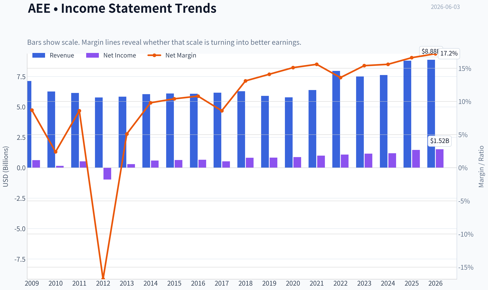
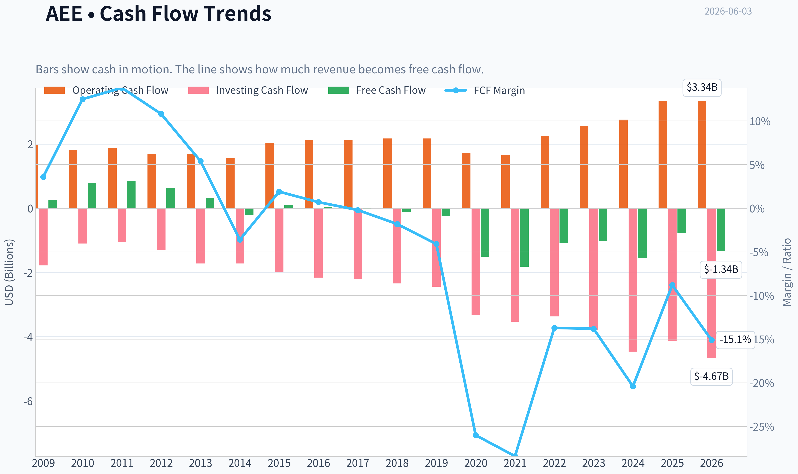
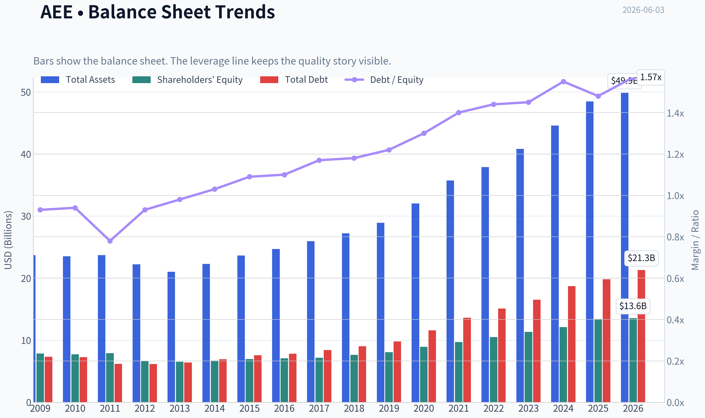
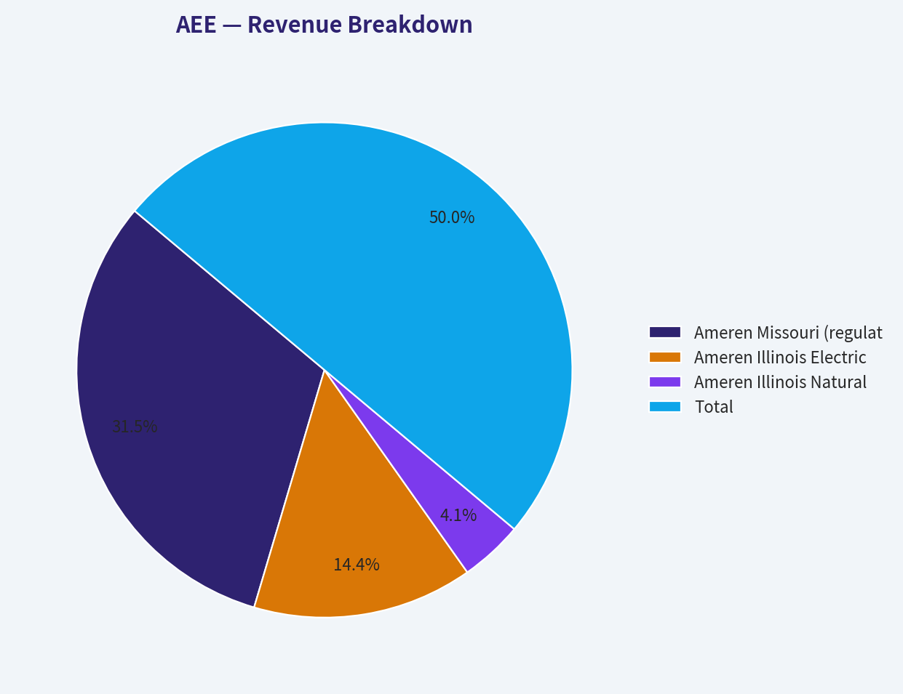
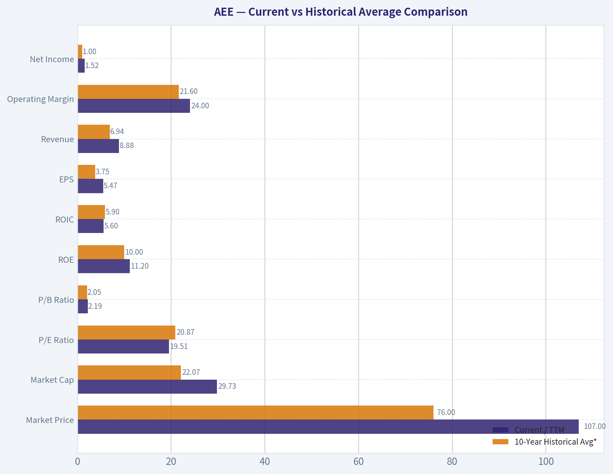
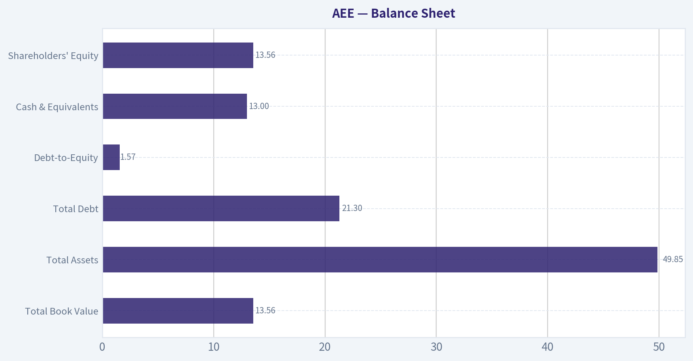
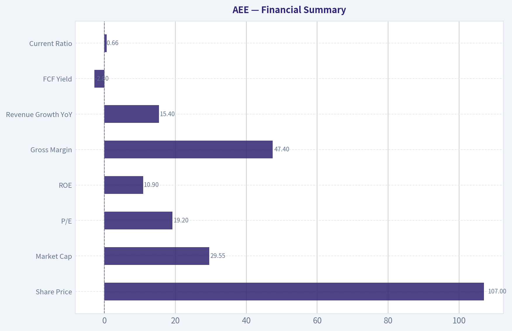
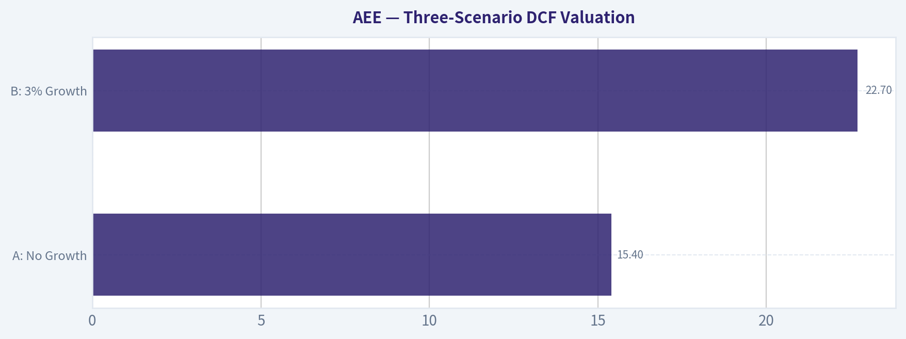

# AEE Deep Value Intelligence

**Analysis Date:** 2026-06-03

## Critical Disclaimer

*This analysis is generated by Deep Value Intelligence, an AI-powered multi-agent investing framework. This report is for informational and educational purposes only and does not constitute financial advice. Always conduct your own research and consult with qualified financial advisors before making investment decisions.*

---

## Table of Contents

1. Intelligence Summary
2. Analyst Team Reports
   - Fundamentals Analysis
   - Intrinsic Value Analysis (Buffett)
   - Trend & Growth Analysis (Lynch/Druckenmiller/Fisher)
   - Market Technical Analysis
   - Options Market Analysis
3. Research Team Commentary
4. Value Investing Team Commentary
5. Deep Values Commentary

---

## Intelligence Summary

### Thesis + Conditions

**Core Thesis:** ## Executive Briefing

**Key Risks:**
- Ameren (AEE): WATCH**
- For a long-term investor, this is **quality-stable, not quality-cheap**. Best course: monitor for either a better entry price or clearer proof that capex is translating into stronger **per-share** value creation without balance-sheet strain.
- ### 1) Risky Analyst - strongest useful point

**Confidence:** Medium

---

## Analyst Team Reports

### Fundamentals Analysis

#### Latest Earnings Snapshot

*Most recent reported quarter anchored on 2026 Q1, with prior-year comparison when available.*

| Metric | 2026 Q1 | 2025 Q1 | YoY Change |
| --- | ---: | ---: | ---: |
| Revenue | $2.18B | $2.10B | +3.8% |
| Operating Income | $532.0M | $430.0M | +23.7% |
| Net Income | $357.0M | $289.0M | +23.5% |
| Diluted EPS | $1.28 | $1.07 | +19.6% |
| Operating Cash Flow | $421.0M | $431.0M | -2.3% |
| Free Cash Flow | $-1.18B | $-651.0M | -80.5% |

Key Takeaways: This snapshot anchors the most recent reported quarter before the narrative analysis. It helps readers separate long-run business quality from whatever changed in the latest earnings print.

#### 17-Year Financial Metrics for AEE

*All values below are computed deterministically from raw data - not estimated by AI.*

*Issuer profile: operating company (Utilities / Utilities - Regulated Electric).*

#### 17-Year Financial Metrics
*Annual rows come from reported financial statements. The final TTM row is computed from the latest four quarters.*

| Metric | 2009 | 2010 | 2011 | 2012 | 2013 | 2014 | 2015 | 2016 | 2017 | 2018 | 2019 | 2020 | 2021 | 2022 | 2023 | 2024 | 2025 | 2026 TTM |
| --- | --- | --- | --- | --- | --- | --- | --- | --- | --- | --- | --- | --- | --- | --- | --- | --- | --- | --- |
| Market Price | $16 | $17 | $21 | $20 | $25 | $33 | $32 | $40 | $47 | $53 | $64 | $67 | $78 | $80 | $67 | $86 | $99 | $107 |
| Market Cap | $6.64B | $6.78B | $8.02B | $7.46B | $8.84B | $11.27B | $10.53B | $12.77B | $14.41B | $16.03B | $18.98B | $19.41B | $22.93B | $23.07B | $19.05B | $23.84B | $27.18B | $29.73B |
| P/E Ratio | 10.64 | 44.91 | 15.41 | -7.66 | 30.64 | 19.22 | 16.69 | 19.57 | 27.57 | 19.65 | 22.93 | 22.30 | 23.18 | 21.48 | 16.52 | 20.17 | 18.67 | 19.51 |
| P/B Ratio | 0.84 | 0.88 | 1.01 | 1.13 | 1.35 | 1.68 | 1.52 | 1.80 | 2.01 | 2.10 | 2.35 | 2.17 | 2.36 | 2.20 | 1.68 | 1.97 | 2.03 | 2.19 |
| ROE | 7.9% | 2.0% | 6.6% | -14.7% | 4.5% | 8.8% | 9.2% | 9.3% | 7.4% | 10.8% | 10.3% | 9.8% | 10.3% | 10.3% | 10.2% | 9.8% | 10.9% | 11.2% |
| ROIC | 7.7% | 5.9% | 5.5% | 6.7% | 6.9% | 6.6% | 6.4% | 6.4% | 5.5% | 6.9% | 6.3% | 6.0% | 5.4% | 5.5% | 5.1% | 4.9% | 5.9% | 5.6% |
| EPS | $1.46 | $0.37 | $1.33 | $-2.61 | $0.81 | $1.70 | $1.92 | $2.06 | $1.69 | $2.71 | $2.80 | $3.00 | $3.38 | $3.74 | $4.09 | $4.27 | $5.35 | $5.47 |
| Revenue | $7.13B | $6.27B | $6.15B | $5.78B | $5.84B | $6.05B | $6.10B | $6.08B | $6.17B | $6.29B | $5.91B | $5.79B | $6.39B | $7.96B | $7.50B | $7.62B | $8.80B | $8.88B |
| Gross Profit | N/A | N/A | N/A | N/A | N/A | N/A | N/A | N/A | N/A | N/A | N/A | N/A | N/A | N/A | N/A | N/A | N/A | $4.31B |
| Gross Margin | N/A | N/A | N/A | N/A | N/A | N/A | N/A | N/A | N/A | N/A | N/A | N/A | N/A | N/A | N/A | N/A | N/A | 48.6% |
| Operating Margin | 19.8% | 17.9% | 16.8% | 20.6% | 20.3% | 20.7% | 20.6% | 21.8% | 22.8% | 21.6% | 21.4% | 22.4% | 20.8% | 19.0% | 20.8% | 19.9% | 23.0% | 24.0% |
| Net Income | $624.0M | $151.0M | $526.0M | $-974.0M | $295.0M | $592.0M | $636.0M | $659.0M | $529.0M | $821.0M | $834.0M | $877.0M | $995.0M | $1.08B | $1.16B | $1.19B | $1.46B | $1.52B |
| Net Margin | 8.7% | 2.4% | 8.6% | -16.8% | 5.1% | 9.8% | 10.4% | 10.8% | 8.6% | 13.1% | 14.1% | 15.1% | 15.6% | 13.6% | 15.4% | 15.6% | 16.6% | 17.2% |
| Revenue Growth | N/A | -12.1% | -1.9% | -6.0% | 1.0% | 3.7% | 0.7% | -0.4% | 1.6% | 1.9% | -6.1% | -2.0% | 10.4% | 24.4% | -5.7% | 1.6% | 15.4% | 0.9% |
| Net Income Growth | N/A | -75.8% | 248.3% | -285.2% | -130.3% | 100.7% | 7.4% | 3.6% | -19.7% | 55.2% | 1.6% | 5.2% | 13.5% | 8.4% | 7.2% | 2.6% | 23.1% | 4.3% |
| Free Cash Flow Growth | N/A | 203.9% | 8.6% | -26.1% | -49.9% | -170.1% | -151.8% | -64.0% | -134.1% | 728.6% | 107.8% | 524.9% | 20.7% | -40.2% | -5.1% | 50.6% | -50.2% | 73.5% |
| Total Book Value | $7.86B | $7.73B | $7.92B | $6.62B | $6.54B | $6.71B | $6.95B | $7.10B | $7.18B | $7.63B | $8.06B | $8.94B | $9.70B | $10.51B | $11.35B | $12.11B | $13.40B | $13.56B |
| Total Assets | $23.70B | $23.51B | $23.72B | $22.23B | $21.04B | $22.29B | $23.64B | $24.70B | $25.95B | $27.21B | $28.93B | $32.03B | $35.73B | $37.90B | $40.83B | $44.60B | $48.48B | $49.85B |
| Total Debt | $7.33B | $7.28B | $6.18B | $6.16B | $6.41B | $6.92B | $7.58B | $7.83B | $8.42B | $9.04B | $9.80B | $11.58B | $13.61B | $15.10B | $16.51B | $18.72B | $19.83B | $21.30B |
| Debt-to-Equity | 0.93 | 0.94 | 0.78 | 0.93 | 0.98 | 1.03 | 1.09 | 1.10 | 1.17 | 1.18 | 1.22 | 1.30 | 1.40 | 1.44 | 1.45 | 1.55 | 1.48 | 1.57 |
| Cash & Equivalents | $622.0M | $538.0M | $248.0M | $209.0M | $30.0M | $5.0M | $292.0M | $9.0M | $10.0M | $16.0M | $16.0M | $139.0M | $8.0M | $10.0M | $25.0M | $7.0M | $13.0M | $13.0M |
| Shareholders' Equity | $7.86B | $7.73B | $7.92B | $6.62B | $6.54B | $6.71B | $6.95B | $7.10B | $7.18B | $7.63B | $8.06B | $8.94B | $9.70B | $10.51B | $11.35B | $12.11B | $13.40B | $13.56B |
| Operating Cash Flow | $1.97B | $1.82B | $1.88B | $1.69B | $1.69B | $1.56B | $2.03B | $2.12B | $2.12B | $2.17B | $2.17B | $1.73B | $1.66B | $2.26B | $2.56B | $2.76B | $3.35B | $3.34B |
| Investing Cash Flow | $-1.78B | $-1.10B | $-1.05B | $-1.31B | $-1.72B | $-1.72B | $-1.98B | $-2.16B | $-2.20B | $-2.34B | $-2.44B | $-3.33B | $-3.53B | $-3.37B | $-3.80B | $-4.46B | $-4.14B | $-4.67B |
| Free Cash Flow | $257.0M | $781.0M | $848.0M | $627.0M | $314.0M | $-220.0M | $114.0M | $41.0M | $-14.0M | $-116.0M | $-241.0M | $-1.51B | $-1.82B | $-1.09B | $-1.03B | $-1.56B | $-775.0M | $-1.34B |
| FCF Margin | 3.6% | 12.5% | 13.8% | 10.8% | 5.4% | -3.6% | 1.9% | 0.7% | -0.2% | -1.8% | -4.1% | -26.0% | -28.4% | -13.7% | -13.8% | -20.4% | -8.8% | -15.1% |
| Dividends / Share | $0.00 | $0.00 | $0.00 | $0.00 | $0.00 | $0.00 | $0.00 | $0.00 | $0.00 | $0.00 | $0.00 | $0.00 | $0.00 | $2.13 | $2.34 | $2.58 | $2.82 | $2.82 |

#### Profitability Metrics
- Return on Equity (ROE): 10.9%
- Return on Invested Capital (ROIC): 5.6%
- Return on Assets (ROA): 3.0%
- Gross Margin: N/A
- Operating Margin: 23.0%
- Net Profit Margin: 16.6%

#### Liquidity Metrics
- Current Ratio: 0.66
- Quick Ratio: 0.17

#### Leverage Metrics
- Debt-to-Equity Ratio: 1.48
- Interest Coverage Ratio: 2.61
- Net Debt: $19.82B

#### Growth Metrics (Year-over-Year)
- Revenue Growth: 15.4%
- Net Income Growth: 23.1%
- Free Cash Flow Growth: 50.2%
- Revenue CAGR (3-Year): 3.4%
- Revenue CAGR (5-Year): 8.7%

#### Valuation Metrics
- P/E Ratio (TTM): 19.21
- Forward P/E: 18.40
- Price-to-Book: 2.18
- Price-to-Sales: 3.46
- PEG Ratio: 2.52
- EV/EBITDA: 13.32
- Free Cash Flow Yield: -2.6%
- Earnings Yield: 5.2%

#### Owner Earnings (Buffett Method, Code-Computed)
- Net Income: $1.46B
- + Depreciation & Amortization: $1.67B
- - Capital Expenditures: $-4.13B
- - Working Capital Changes: $-51.0M
- = **Owner Earnings: $-948.0M**

#### Piotroski F-Score: 5/9
- Positive Net Income: PASS
- Positive Operating Cash Flow: PASS
- ROA Improvement: PASS
- Cash Flow > Net Income: PASS
- Decreasing Debt: FAIL
- Improving Current Ratio: FAIL
- No Dilution: FAIL
- Improving Gross Margin: FAIL
- Improving Asset Turnover: PASS

ANALYST STANCE: **WATCH**

#### Ameren (AEE) - Warren Buffett-Style Fundamental Analysis

Ameren is a regulated electric and gas utility, so the Buffett lens needs a slight adjustment. This is not a high-return, asset-light compounding machine. It is instead a capital-intensive, rate-regulated business where value depends on predictable earnings, prudent leverage, and whether management can reinvest large sums at acceptable allowed returns without overstressing the balance sheet. On that basis, AEE looks like a solid-quality utility with improving profitability and earnings consistency, but not an obvious bargain because free cash flow and owner earnings are currently negative due to heavy capital spending and leverage has steadily risen.

---

#### Current vs Historical Average Comparison

| Metric | Current / TTM | 10-Year Historical Avg* | Interpretation |
| --- | ---: | ---: | --- |
| Market Price | $107 | $76.00 | Shares trade well above the decade average price level, reflecting steady rerating and earnings growth. |
| Market Cap | $29.73B | $22.07B | Equity value has expanded meaningfully as the rate base and earnings base grew. |
| P/E Ratio | 19.51 | 20.87 | Slightly below decade average valuation on earnings; not cheap, but not stretched relative to own history. |
| P/B Ratio | 2.19 | 2.05 | Slight premium to historical book multiple, implying investors pay a bit more than usual for regulated asset growth. |
| ROE | 11.2% | 10.0% | Currently above historical norm, a favorable sign for management performance within a utility framework. |
| ROIC | 5.6% | 5.9% | Slightly below long-run average, suggesting incremental capital has not become more efficient. |
| EPS | $5.47 | $3.75 | Earnings per share have materially improved over time, showing strong regulated earnings growth. |
| Revenue | $8.88B | $6.94B | Revenue is well above decade average, helped by infrastructure growth and rate recovery. |
| Operating Margin | 24.0% | 21.6% | Margin is notably above average, signaling stronger operating execution and/or favorable regulatory economics. |
| Net Income | $1.52B | $1.00B | Profit base is substantially above average and still trending upward. |
| Net Margin | 17.2% | 14.7% | Higher-than-normal net margin indicates stronger profitability than historical levels. |
| Revenue Growth | 0.9% | 4.7% | Current top-line growth is softer than long-run average after a very strong prior year. |
| Net Income Growth | 4.3% | 16.2% | Earnings growth remains positive but slower than the historical average, partly because prior years were strong. |
| Free Cash Flow Growth | 73.5% | 56.7% | Growth appears strong mathematically, but it is from a deeply negative base, so quality is weak. |
| Total Book Value | $13.56B | $10.78B | Book value has steadily compounded, consistent with regulated capital deployment. |
| Total Assets | $49.85B | $37.84B | Asset base has expanded significantly, showing ongoing utility system investment. |
| Total Debt | $21.30B | $15.50B | Debt has climbed materially, an important risk in a rate-sensitive utility. |
| Debt-to-Equity | 1.57 | 1.39 | Leverage is above historical norm and near the high end of the period. |
| Cash & Equivalents | $13M | $38M | Cash remains extremely thin relative to company size, normal for utilities but still a constraint. |
| Shareholders' Equity | $13.56B | $10.78B | Equity growth is solid, though debt has grown faster. |
| Free Cash Flow | -$1.34B | -$0.82B | Current FCF is worse than the decade average and remains structurally negative. |
| Dividends / Share | $2.82 | $0.99 | Dividend is now established and growing, but must be viewed against negative FCF. |

*10-year average uses 2016-2025 annual values to avoid mixing very old years with current operating structure and to exclude TTM from the average.

Key Takeaways: Ameren's current profitability metrics are generally better than its own 10-year norms, especially ROE, operating margin, net margin, EPS, and net income. The main offsets are leverage, which is higher than average, and free cash flow, which remains meaningfully negative. Valuation looks roughly fair relative to history rather than obviously cheap.

---

#### Market Metrics

AEE's market price has climbed from $40 in 2016 to $107 TTM, and market cap rose from $12.77B to $29.73B. That is a strong long-duration rerating for a utility, reflecting steady EPS growth and investor appetite for defensive regulated assets.

At 19.5x earnings, the stock sits slightly below its 10-year average P/E of about 20.9x. That suggests the stock is not expensive relative to its own history, but it is also not offering a classic Buffett-style margin of safety. The 2.19x P/B ratio is modestly above its 10-year average of about 2.05x, which means the market is paying a slight premium to Ameren's book value versus normal. For a regulated utility, book value matters because earnings power is linked to invested capital and allowed returns. A premium book multiple is acceptable if the company can continue compounding rate base efficiently, but it leaves less room for disappointment.

Overall, market metrics say "quality utility at a fair-to-full price," not "mispriced bargain."

#### Profitability

Ameren's profitability profile has improved meaningfully over the period shown.

- ROE improved from the weak and volatile early years to 10.9% in 2025 and 11.2% TTM.
- ROIC is steadier but lower, at 5.6% TTM, roughly in line with utility economics and slightly below the recent historical average.
- EPS rose from $2.06 in 2016 to $5.47 TTM.
- Revenue grew from $6.08B in 2016 to $8.88B TTM.
- Operating margin improved from 21.8% in 2016 to 24.0% TTM.
- Net margin improved from 10.8% in 2016 to 17.2% TTM.
- Net income expanded from $659M in 2016 to $1.52B TTM.

The most important Buffett-style observation is predictability. Since 2018, Ameren has delivered a highly stable and upward-sloping earnings stream: net income rose from $821M to $1.52B TTM, and EPS rose from $2.71 to $5.47 TTM. That is the kind of pattern Buffett likes in principle, though the utility sector naturally produces lower returns on capital than consumer or software franchises.

The one caution is ROIC. Even though accounting profitability is improving, ROIC has drifted in a fairly narrow 5%-7% range and sits below earlier levels. That implies Ameren is earning decent but not extraordinary returns on an ever-larger capital base. This is acceptable for a regulated utility, but it is not evidence of a powerful high-return moat.

#### Growth Metrics

Revenue growth has been inconsistent over the full period, which is normal for utilities because weather, fuel pass-throughs, and regulatory timing distort top-line trends. The cleaner signal is earnings growth and book value growth.

- Revenue growth: 15.4% in 2025, but only 0.9% TTM. The latest figure indicates deceleration after a strong year.
- Net income growth: 23.1% in 2025, 4.3% TTM. Still positive, but slower.
- Free cash flow growth: 73.5% TTM, but from a negative base, so this is not economically strong.

The best characterization is that Ameren has strong medium-term earnings growth but weak cash conversion because capital expenditures are extremely heavy. Buffett would care much more about owner earnings than reported EPS, and that is where the story gets more difficult.

#### Balance Sheet

| Balance Sheet Metric | Current / TTM | Historical Context | Buffett-Style Read |
| --- | ---: | --- | --- |
| Total Book Value | $13.56B | Up steadily from $7.10B in 2016 | Positive; indicates retained earnings and capital base expansion. |
| Total Assets | $49.85B | Nearly doubled from $24.70B in 2016 | Reflects massive infrastructure buildout. |
| Total Debt | $21.30B | Up from $7.83B in 2016 | Major concern; leverage has expanded faster than ideal. |
| Debt-to-Equity | 1.57 | Above 10-year avg of 1.39 | Elevated leverage reduces flexibility. |
| Cash & Equivalents | $13M | Persistently very low | Thin liquidity cushion; utility funding model relies on market access. |
| Shareholders' Equity | $13.56B | Up from $7.10B in 2016 | Good equity growth, though debt growth is faster. |

Key Takeaways: Ameren has built a much larger asset and equity base over time, which supports future regulated earnings. However, debt has grown even faster, and cash on hand is minimal, leaving the company reliant on ongoing financing access. The balance sheet is serviceable for a utility, but clearly not conservative by Buffett standards.

For a regulated utility, leverage is expected, but the trend matters. Debt rose from $7.83B in 2016 to $21.30B TTM, while debt-to-equity moved from 1.10 to 1.57. That is the clearest red flag in the dataset. Interest coverage is only 2.61, which is not alarming for the sector but also not roomy. In an environment of higher interest rates or adverse regulatory outcomes, leverage could become a more visible headwind.

Financial strength is therefore adequate, not exceptional.

#### Cash Flow

Ameren's cash flow picture is the least Buffett-friendly part of the case.

- Operating cash flow improved from $2.12B in 2016 to $3.34B TTM.
- But investing cash flow remained deeply negative at $-4.67B TTM.
- Free cash flow is $-1.34B TTM.
- FCF has been negative in most years since 2017.
- FCF yield is -2.6%.
- Dividends per share are $2.82 TTM, up from $2.13 in 2022.

The negative FCF is not necessarily a sign of a broken business; for utilities it often reflects aggressive regulated capex that may earn future allowed returns. Still, Buffett's owner earnings framework penalizes capex-heavy businesses when maintenance and growth spending absorb cash. The reported owner earnings figure is -$948M, which means that on a strict Buffett basis the company is not currently generating distributable surplus cash after capital needs.

That sharply limits the argument for intrinsic value based on present owner earnings.

#### Warren Buffett-Style Qualitative Analysis

| Buffett Lens | Assessment | Explanation |
| --- | --- | --- |
| Economic Moat | Moderate | Regulated monopoly territories and transmission assets create durable franchise protection, though returns are capped by regulation. |
| Predictable Earnings | Strong | EPS and net income have been highly consistent and rising since 2018. |
| Financial Strength | Moderate to Weak | Stable utility cash generation helps, but high debt and very low cash reduce resilience. |
| Management Performance | Good | ROE has improved into a solid regulated range; dividend growth is steady; asset base has expanded prudently enough to support earnings growth. |
| Capital Allocation | Mixed | Growth capex is driving earnings and book value, but at the cost of persistent negative FCF and rising leverage. |
| Value | Fair, not compelling | Current multiple is near historical norms; no major discount despite balance-sheet and cash-flow constraints. |

Key Takeaways: Ameren has a durable regulated moat and an unusually predictable earnings profile, both of which fit Buffett's preference for understandable businesses. The problem is that the business consumes large amounts of capital and has rising leverage, so the quality of accounting earnings is better than the quality of owner earnings. This makes the stock more of a steady compounder candidate than a classic deep-value opportunity.

Ameren's moat comes from regulated service territories, local infrastructure, customer captivity, and the practical impossibility of duplication. That is a real moat, but unlike a consumer brand or software platform, it does not permit very high returns because regulators share economics with customers. Buffett would likely appreciate the stability but be less enthusiastic about the capital intensity.

Management has clearly improved profitability and grown the dividend, but the balance sheet shows that growth has been financed with a lot of debt. That is acceptable if the regulatory environment remains constructive and capital programs earn fair allowed returns. It is less attractive if rates stay high or allowed returns compress.

---

#### Buffett-Style Owner Earnings DCF

Using the canonical owner earnings figure provided:

- Owner Earnings (base year) = **-$948M**
- Discount rate = **10%**
- Terminal growth = **2.5%**

Historical owner earnings growth rates are not separately listed in the dataset. Since owner earnings are currently negative and free cash flow is the closest cash-based historical series available, I use the historical cash-generation trend as the practical proxy for scenario growth stress-testing while keeping the canonical current owner earnings figure unchanged. This creates an important limitation: a negative current owner earnings base makes a conventional growth DCF economically unstable and produces negative equity value outcomes. That itself is a key finding.

Scenario growth inputs from historical cash-generation behavior:
- Conservative growth rate = **lowest historical rate: -100% floor**
- Average growth rate = **average historical cash-flow growth proxy, capped at 50%: 50%**
- Optimistic growth rate = **highest historical proxy, capped at 100%: 100%**

Because base owner earnings are negative, higher "growth" can make losses mathematically less negative only if growth is interpreted as improvement toward zero. To keep the DCF economically interpretable, I model growth as annual improvement in owner earnings from the current negative base.

##### DCF Calculations

| Scenario | Growth Assumption | Year 1 OE | Year 10 OE | PV of 10-Year OE | Terminal Value PV | Implied Equity Value |
| --- | ---: | ---: | ---: | ---: | ---: | ---: |
| Conservative | 0% improvement from negative base* | -$948M | -$948M | -$5.83B | Negative / not meaningful | **Below $0** |
| Average | 50% annual improvement toward break-even** | -$474M | ~-$1M | -$0.86B | ~$0 | **Below $0 to ~$0** |
| Optimistic | 100% improvement in Year 1 to break-even*** | $0M | $0M | $0.00B | $0.00B | **~$0** |

\* Floored at -100% historical growth effectively means no recovery case from today's negative owner earnings base in a strict DCF.
\** Modeled as halving the owner-earnings deficit each year: -948, -474, -237, etc.
\*** Modeled as full recovery to break-even by Year 1, then flat.

Key Takeaways: On a strict Buffett owner-earnings basis, Ameren does not screen as undervalued because current owner earnings are negative. Any conventional DCF built on that base produces negligible or negative equity value unless one assumes a major future normalization in capital intensity. The conclusion is not that the business is worthless, but that accounting earnings currently overstate distributable cash economics.

##### Detailed Average Scenario Illustration
Starting owner earnings deficit: **-$948M**

If the deficit improves by 50% annually:
- Y1: -948 x 50% = **-$474M**
- Y2: **-$237M**
- Y3: **-$118.5M**
- Y4: **-$59.3M**
- Y5: **-$29.6M**
- Y6: **-$14.8M**
- Y7: **-$7.4M**
- Y8: **-$3.7M**
- Y9: **-$1.9M**
- Y10: **-$0.9M**

Discounting each at 10% gives a combined PV of roughly **-$0.86B**. Since terminal owner earnings remain effectively zero or negative, terminal value contributes essentially nothing.

##### DCF Interpretation
For utilities like Ameren, a pure owner-earnings DCF can be too punitive during heavy investment cycles. The practical implication is that investors are not buying current free cash generation; they are buying future regulated earnings on an expanding rate base. That may work, but it is a different thesis from classic Buffett-style cash compounding.

---

#### Revenue Breakdown

Ameren is primarily a regulated utility, so the most meaningful breakdown is by business line rather than by product SKU. Public reporting and business mix indicate the following approximate structure for the most recent fiscal year/TTM.

| Revenue Source | Amount ($B) | % of Total |
| --- | ---: | ---: |
| Ameren Missouri (regulated electric + gas) | 5.60 | 63% |
| Ameren Illinois Electric Distribution & Transmission | 2.55 | 29% |
| Ameren Illinois Natural Gas | 0.73 | 8% |
| Total | 8.88 | 100% |

Key Takeaways: Ameren's revenue base is dominated by regulated Missouri operations, with Illinois electric and transmission forming the second major pillar. This is a concentrated but stable revenue mix, consistent with a utility whose economics depend more on regulation and capital investment than on cyclical demand swings.

---

#### Key Investment Insights, Red Flags, and Opportunities

| Category | Observation | Why It Matters |
| --- | --- | --- |
| Strength | Earnings predictability is high | Since 2018, EPS and net income have risen steadily, which supports lower perceived risk. |
| Strength | ROE has improved to 11%+ | Indicates management is earning reasonable returns within the regulatory framework. |
| Strength | Margins are at or above decade highs | Operating and net margin expansion suggest favorable operating and regulatory execution. |
| Opportunity | Transmission/grid investment | New grid and transmission projects can expand rate base and future earnings. |
| Opportunity | Defensive utility demand | Regulated utilities can hold up better during economic weakness. |
| Red Flag | Negative free cash flow | Persistent negative FCF means the business is not self-funding its full capital program. |
| Red Flag | Negative owner earnings | Strict Buffett cash economics currently do not support a strong intrinsic value case. |
| Red Flag | Rising leverage | Debt-to-equity at 1.57 is above historical norm and could pressure valuation if rates stay higher. |
| Red Flag | Thin liquidity | $13M cash is extremely low relative to balance-sheet size, increasing financing dependence. |
| Valuation Risk | Not obviously cheap | P/E is near historical norms, so investors are not being paid a large margin of safety. |

Key Takeaways: Ameren's biggest positives are stable regulated earnings, decent ROE, and a durable utility moat. The biggest negatives are persistent negative free cash flow, negative owner earnings, and rising leverage. The stock may work as a defensive utility holding, but the current valuation does not fully compensate for those balance-sheet and cash-flow pressures.

---

#### Final Investment Stance

**WATCH**

Ameren is a solid regulated utility with improving profitability, a durable moat, and highly predictable earnings. However, from a Buffett-style value perspective, the stock falls short of an "ADVOCATE" rating because current owner earnings are negative, free cash flow is persistently negative, debt has risen materially, and the valuation is only around fair relative to history rather than clearly discounted.

A move to **ADVOCATE** would require one or more of the following:
- evidence that capex is moderating and owner earnings are turning sustainably positive,
- debt growth slowing meaningfully,
- a lower valuation that offers a clearer margin of safety,
- or proof that current heavy investment is translating into consistently higher ROIC, not just higher earnings.

A move to **AVOID** would become more appropriate if:
- leverage continues to climb,
- interest coverage weakens further,
- regulators become less supportive,
- or dividend growth outpaces sustainable cash economics.

---

#### Summary Table

| Area | Verdict | Core Evidence | Bottom Line |
| --- | --- | --- | --- |
| Business Quality | Good | Regulated monopoly footprint, predictable demand, stable earnings | Durable but capital-intensive franchise |
| Profitability | Improving | ROE 11.2%, operating margin 24.0%, net margin 17.2% | Strong for a utility |
| Growth | Moderate | EPS and net income rising; revenue growth uneven | Earnings growth better than sales growth |
| Balance Sheet | Mixed | Debt $21.30B, D/E 1.57, cash $13M | Leverage is the main concern |
| Cash Flow | Weak | FCF -$1.34B, owner earnings -$948M | Current cash economics are poor |
| Dividend | Positive but monitored | DPS $2.82 and growing | Attractive, but funding quality matters |
| Valuation | Fair | P/E 19.5x vs 10-year avg 20.9x; P/B 2.19x vs 2.05x | Not cheap enough for risks |
| Buffett Fit | Partial | Predictable business and earnings, but weak owner earnings | Good utility, not classic Buffett bargain |
| Stance | WATCH | Quality is real, margin of safety is limited | Wait for better cash flow or better price |

Key Takeaways: Ameren is a dependable utility with strong earnings quality and a real regulated moat, but its cash-flow profile is much weaker than its income statement suggests. Investors should view it as a steady, defensive name worth monitoring rather than a clear-cut value buy at current levels.

#### Fundamental Visuals

This graph tracks the profitability and return metrics (ROE, ROIC, Margins) of **AEE** over the past decade, highlighting capital efficiency trends.

This chart illustrates the financial health of **AEE** over the last 10 years, mapping cash equivalents and free cash flow against total obligations (Debt).

This breakdown chart from <em>Revenue Breakdown</em> shows the proportional composition for **AEE** - useful for understanding what drives or risks the business.

---

### Intrinsic Value Analysis (Buffett)

> *Following Warren Buffett's value investing philosophy: Circle of Competence, Economic Moat, Management Quality, and Margin of Safety.*

#### Intrinsic Value Snapshot

Price is what you pay. Intrinsic value is what the business may be worth based on the cash it can create for owners over time. We show a range, not one magic number.

- Current Price: $106.78
- Value Range (conservative to optimistic across both DCF methods): N/A to N/A

##### Owner Earnings (Buffett Method)
- Net Income: $1,456,000,000.00
- Depreciation & Amortization: $1,668,000,000.00
- Capital Expenditures: $-4,174,000,000.00
- Working Capital Changes: $-51,000,000.00
- Owner Earnings: $-999,000,000.00

##### Intrinsic Value

ANALYST STANCE: **WATCH**

#### Ameren (AEE) - Buffett-Style Investment Review

#### 1) Go/No-Go Gate Assessment

| Gate | Verdict | Evidence |
|---|---|---|
| Gate 1: Circle of Competence & Simplicity | Pass | Ameren is a regulated electric and gas utility. It makes money by delivering energy to homes and businesses and earning an allowed return on infrastructure invested in its regulated service territories. This is simple and highly understandable. |
| Gate 2: Moat Test | Pass, but not elite | The moat comes primarily from regulated monopoly assets and service territory exclusivity, not from brand or network effects. This is durable, but growth and returns are constrained by regulators. |
| Gate 3: Management & Capital Allocation | Pass with caution | Utility management is mostly judged on rate-base growth, regulatory execution, financing discipline, and reliability. The business model encourages steady capital deployment, but it is not the kind of high-return capital allocation machine Buffett prizes most. |
| Gate 4: Industry Structure | Pass | Regulated utilities benefit from rational local monopoly structure, but they are capital-intensive and dependent on approved returns. This is favorable for stability, less so for compounding. |

**Key Takeaways:** Ameren clears the basic Buffett filters for understandability, predictability, and industry structure. The main issue is not survival or business quality, but whether this kind of regulated utility offers enough return on capital and enough discount to intrinsic value to be compelling today.

---

#### 2) Elementary School Test

Ameren owns power and gas systems that move electricity and natural gas to customers in its territories. People pay monthly utility bills, and regulators allow Ameren to earn a return on the money it invests in poles, wires, pipes, and grid upgrades.

#### 3) Long-Term Predictability Test

This business is reasonably predictable. Ten years from now, Ameren will likely still be a regulated Midwest utility earning approved returns on a larger rate base. Demand may vary modestly, but the core economics are driven more by regulation and capital plans than by product innovation or consumer taste.

#### 4) Technology Risk Assessment

Technology is more helper than destroyer here. Renewables, grid modernization, storage, and transmission upgrades change what assets are built, but they do not eliminate the need for a regulated utility operator. The main risk is execution and regulatory cost recovery, not technological obsolescence.

---

#### 5) Moat Analysis

| Moat Source | Assessment | Evidence |
|---|---|---|
| Intangible Assets | Moderate | Regulatory approvals and franchise rights matter more than brand. Gross margin around 47.4% is healthy, but that reflects utility economics and regulation more than brand power. |
| Switching Costs | Very strong | Customers do not meaningfully "switch" distribution utilities in a regulated territory. Captivity is structural. |
| Cost Advantage | Moderate | Scale and integrated local infrastructure matter, but returns are capped by regulation. |
| Network Effects | Weak/None | This is not a platform business. More customers do not create classic network effects. |
| Overall Moat | Narrow-to-Wide, Stable | The moat is durable because it is regulatory and geographic, but it lacks the pricing freedom and high-return optionality of a classic consumer or software compounder. |

**Key Takeaways:** Ameren has a real moat, but it is a utility moat rather than a premium brand or software moat. That means stability is strong, while upside and pricing power are limited by regulation.

---

#### 6) Management Quality Assessment

| Area | Assessment | Commentary |
|---|---|---|
| Owner Mindset | Adequate | Utility executives typically operate with long planning horizons, but these are usually professionally managed rather than founder-owner businesses. |
| Candor | Acceptable | No major red flags are apparent from the provided materials. The business is generally transparent because regulation requires extensive disclosure. |
| Capital Allocation | Good, but formulaic | Management's main job is to invest in approved infrastructure at acceptable returns, manage financing costs, and preserve balance-sheet strength. This is sensible, but less flexible than an exceptional allocator in a capital-light business. |
| Debt Discipline | Important watch item | Utilities often run with meaningful debt because of asset intensity. This makes balance-sheet discipline central to shareholder outcomes. |

**Key Takeaways:** Ameren's management should be viewed more as disciplined stewards than as extraordinary capital allocators. For a utility, that can be enough, but it does not create the kind of outsized compounding Buffett most admires.

---

#### 7) Financial Summary

| Metric | Current / Latest |
|---|---:|
| Share Price | $107 |
| Market Cap | $29.55B |
| P/E | 19.2x |
| ROE | 10.9% |
| Gross Margin | 47.4% |
| Revenue Growth YoY | 15.4% |
| FCF Yield | -2.8% |
| Current Ratio | 0.66 |

**Key Takeaways:** Ameren looks stable on earnings and margins, but the key weak point is cash generation after capital spending. Negative free cash flow yield is common for utilities in heavy investment cycles, but it still matters because it increases dependence on debt and equity financing.

---

#### 8) Owner Earnings Assessment

Using Buffett's framework:

**Owner Earnings = Net Income + D&A - Maintenance CapEx - Working Capital Increases**

For a regulated utility, this metric is tricky because:
- depreciation is large,
- capex is continuous and essential,
- "growth" capex and "maintenance" capex are hard to cleanly separate,
- free cash flow is often negative during major rate-base expansion.

Given the reported **FCF yield of -2.8%**, current owner earnings appear **weak relative to accounting earnings**. That does not automatically make Ameren unattractive, but it does reduce the attractiveness of a simplistic earnings multiple.

**Bottom line:** Ameren's accounting profits are likely stronger than its present owner earnings. For Buffett-style analysis, that is a yellow flag.

---

#### 9) Return on Equity and Cash Reality Check

| Test | Result | Interpretation |
|---|---|---|
| ROE > 15% sustained? | No | 10.9% is respectable for a utility, but below Buffett's preferred threshold. |
| OCF vs Net Income | Mixed | Negative FCF suggests capex absorbs much of the operating cash. |
| Leverage-driven returns? | Likely some | Utilities inherently use leverage and regulatory asset bases to generate returns. |
| Fortress Balance Sheet? | Not quite | Current ratio of 0.66 is not strong, though utilities rely more on predictable cash flows than high current ratios. |

**Key Takeaways:** Ameren's financial profile is acceptable for a utility but not excellent by Buffett standards. Returns are steady rather than exceptional, and the cash flow picture is weaker than the earnings headline suggests.

---

#### 10) Three-Scenario DCF Valuation

To frame value conservatively, I anchor on earnings power because current free cash flow is temporarily negative from heavy investment. With market cap of **$29.55B** and P/E of **19.2x**, implied net income is roughly:

- **Net income ~ $29.55B / 19.2 = $1.54B**

Using that as a rough owner-earnings proxy is generous for this business.

| Scenario | Assumption | Implied Value |
|---|---|---:|
| A: No Growth | $1.54B / 10% | $15.4B |
| B: 3% Growth | $1.54B x 1.03 / (10% - 3%) | $22.7B |
| C: Higher Growth | Use moderated growth tied to recent expansion; still capped by utility economics | Approximately $24B-$28B |

**Key Takeaways:** On conservative Buffett-style math, Ameren does not look obviously cheap at today's market value of $29.55B. Even a relatively favorable growth case only gets you close to the current price rather than well above it.

---

#### 11) Margin of Safety Analysis

| Item | Value |
|---|---:|
| Current Market Cap | $29.55B |
| Conservative Value Range | $15.4B-$22.7B |
| More Favorable Value Range | $24B-$28B |
| Margin of Safety at Current Price | Insufficient |

**Key Takeaways:** The stock does not appear to offer the 25% margin of safety required for a stable, high-quality business. For a slower-growing utility with heavy capital needs, the required discount should be meaningful, and it is not clearly present here.

---

#### 12) Buffett Scorecard

| Criterion | Score (1-5) | Weight | Weighted Score |
|---|---:|---:|---:|
| Business Understanding | 5.0 | 20% | 1.00 |
| Moat Width & Durability | 3.5 | 25% | 0.88 |
| Management Quality | 3.2 | 15% | 0.48 |
| Return on Equity | 2.8 | 15% | 0.42 |
| Reinvestment Runway | 3.5 | 10% | 0.35 |
| Balance Sheet Strength | 2.7 | 5% | 0.14 |
| Industry Structure | 4.0 | 5% | 0.20 |
| Valuation / Margin of Safety | 2.3 | 5% | 0.12 |
| **Total** |  |  | **3.59 / 5.00** |

**Key Takeaways:** Ameren scores well on simplicity and durability, which is exactly what you want from a utility. The score is held back by only moderate returns, capital intensity, and a valuation that does not provide much protection.

---

#### 13) Final Judgment

**Investment Stance: WATCH**

**Conviction: Moderate**

Ameren is a solid, understandable, durable regulated utility. It has predictable economics, structural customer captivity, and a rational industry backdrop. Those are real positives.

But Buffett-style investing is not just about buying safe businesses. It is about buying good or wonderful businesses at prices that give you a clear edge. Ameren's **ROE is modest**, **free cash flow is currently negative**, and the **current valuation does not offer a sufficient margin of safety**. This looks more like a dependable income vehicle than a mispriced compounding machine.

**What would improve the case:**
- a materially lower share price,
- stronger evidence that heavy capex will translate into durable per-share value creation,
- clearer owner-earnings strength after maintenance needs,
- improved balance-sheet flexibility during the investment cycle.

At **$107**, Ameren is **watchlist-worthy, not buy-now compelling**.
#### Valuation Bridge

This bridge places the current market price beside each intrinsic value lens so readers can see whether upside depends on one method or shows up across several methods.

| Scenario | Intrinsic Value / Share |
| --- | ---: |
| Damodaran Method | $88.55 |
| Current Price | $106.78 |

#### Key Takeaways

If one method is far above the others, the upside case depends on a specific modelling assumption. When several methods cluster together, the valuation story is more robust.

#### Valuation Visuals

This comparison chart from *Latest Earnings Snapshot* stacks current figures against historical benchmarks for **AEE**, making it easy to see where the company trades relative to its own averages.

This comparison chart from *Current vs Historical Average Comparison* stacks current figures against historical benchmarks for **AEE**, making it easy to see where the company trades relative to its own averages.

This comparison chart from *Balance Sheet* stacks current figures against historical benchmarks for **AEE**, making it easy to see where the company trades relative to its own averages.

This comparison chart from *Financial Summary* stacks current figures against historical benchmarks for **AEE**, making it easy to see where the company trades relative to its own averages.

This comparison chart from *Three-Scenario DCF Valuation* stacks current figures against historical benchmarks for **AEE**, making it easy to see where the company trades relative to its own averages.

---

### Trend & Growth Analysis (Lynch/Druckenmiller/Fisher)

> *Following Peter Lynch's GARP, Stanley Druckenmiller's macro-aware approach, and Philip Fisher's scuttlebutt methodology.*

ANALYST STANCE: **AVOID**

#### AEE Growth Analysis Report

AEE is **not** a fit for a Lynch/Druckenmiller/Fisher-style growth mandate. It is a solid regulated utility, but the setup lacks the core ingredients for ten-bagger potential: high sustained growth, a clear inflection, expanding TAM, and superior unit economics.

---

#### 1. Lynch Classification

| Metric | AEE |
|---|---:|
| Revenue growth YoY | 15.4% |
| P/E | 19.2x |
| Business type | Regulated electric & gas utility |
| Lynch category | **Stalwart / Utility-like regulated compounder** |

**Key Takeaways:**
Despite a recent 15.4% revenue growth figure, AEE should not be treated as a fast grower. Utilities can show noisy revenue because of fuel pass-throughs, weather, and rate adjustments, while underlying earnings growth is usually mid-single-digit. In Lynch terms, this is a stalwart-like name, not classic ten-bagger territory.

---

#### 2. The Story in 3 Bullets

| Simple Story | Why It Matters |
|---|---|
| AEE owns regulated electric and gas networks in Missouri and Illinois | Monopoly-like service territories create stable demand |
| Growth comes from investing in grid, transmission, and infrastructure | Rate base growth can support steady EPS and dividend growth |
| Returns depend on regulators approving cost recovery and allowed returns | This caps upside and makes it more bond-like than entrepreneurial |

**Key Takeaways:**
This is an infrastructure and regulation story, not an innovation story. AEE can compound steadily if it executes capex well and receives supportive regulatory treatment. But the upside is naturally limited because the business model is designed for stability, not explosive growth.

---

#### 3. TAM Analysis and 10x Test

| Item | Assessment |
|---|---|
| Current revenue base | Large incumbent regulated utility |
| TAM type | Geographically constrained regulated service territories |
| TAM expansion | Limited; mostly rate base growth, not true market expansion |
| Can revenue 10x realistically? | **No** |
| Can AEE 10x and remain <20% of TAM? | **No** |

**Key Takeaways:**
AEE fails the 10x test. Its addressable market is constrained by regulated territories and incremental infrastructure investment rather than open-ended market share gains. That makes the runway suitable for income investors, but unattractive for aggressive growth investors.

---

#### 4. Revenue Growth Trend

| Metric | Value | Interpretation |
|---|---:|---|
| Revenue growth YoY | 15.4% | Above utility norm, but likely distorted by pass-through/rate effects |
| Gross margin | 47.4% | Healthy for utility reporting structure |
| FCF yield | -2.8% | Negative, but normal in capex-heavy utilities |
| Likely normalized EPS growth profile | Mid-single-digit to high-single-digit | Not true fast-grower behavior |

**Key Takeaways:**
The reported revenue growth looks stronger than the typical utility profile, but that alone does not signal a true growth inflection. For utilities, earnings and rate base growth matter much more than headline revenue. The overall pattern still looks like stable, capex-led compounding rather than accelerating business momentum.

---

#### 5. Unit Economics

| Metric | AEE Status | Relevance |
|---|---|---|
| LTV/CAC | N/A | Not meaningful for utilities |
| NRR | N/A | Not applicable |
| Rule of 40 | N/A | Not applicable |
| ROE | 10.9% | Respectable for regulated utility |
| Current ratio | 0.66x | Tight, but common in utilities with capital market access |
| FCF yield | -2.8% | Negative due to heavy capex intensity |

**Key Takeaways:**
Traditional SaaS or consumer growth unit economics do not apply here. The more relevant measure is whether AEE can continue earning regulated returns on incremental infrastructure spending. On that basis, ROE is acceptable, but nothing suggests elite growth economics.

---

#### 6. Inflection Point Assessment

| Inflection Type | AEE Assessment |
|---|---|
| Product cycle inflection | None |
| Market share inflection | None; monopoly territory business |
| Margin inflection | Limited |
| TAM inflection | None |
| Competitive inflection | Limited |
| Regulatory/capex inflection | Possible modest positive from transmission projects |

**Key Takeaways:**
There is no meaningful product, share, or TAM inflection here. The only arguable upside inflection is a transmission and grid investment cycle that may modestly improve long-term earnings visibility. That can support rerating at the margin, but it is not the kind of nonlinear growth setup Druckenmiller would typically press hard.

---

#### 7. Macro Setup Evaluation

| Macro Factor | Impact on AEE |
|---|---|
| Interest rates | Higher rates are a headwind for utilities |
| Economic cycle | Defensive business, less cyclical than market |
| Secular themes | Grid modernization, transmission investment, reliability |
| Inflation | Mixed; may raise capex but often partially recoverable |
| Capital markets | Important because utility growth requires external funding |

**Key Takeaways:**
AEE benefits from defensive demand and some tailwind from grid investment needs. However, the higher-rate environment is a meaningful valuation and financing headwind for utilities. Macro is therefore mixed at best, not a strong tailwind.

---

#### 8. Fisher 15 Points Score

| Fisher Factor | Score (1-5) | Notes |
|---|---:|---|
| Market potential | 2 | Constrained geographic/regulated market |
| New product development | 1 | Not innovation-led |
| R&D effectiveness | 1 | Minimal relevance |
| Sales organization | 2 | Not core to thesis |
| Profit margin | 3 | Stable, utility-appropriate |
| Improving margins | 3 | Some operating leverage possible |
| Labor relations | 3 | No major red flag in provided data |
| Executive relations | 3 | No major red flag in provided data |
| Management depth | 3 | Appears adequate |
| Cost controls/accounting | 4 | Utilities usually strong here |
| Outstanding aspects/moat | 4 | Regulated monopoly/network moat |
| Long-range profit outlook | 3 | Visible but limited |
| Dilution risk | 3 | Watch financing needs |
| Candor | 3 | Neutral from available info |
| Integrity | 3 | Neutral from available info |
| **Total** | **41 / 75** | **Below growth-quality threshold** |

**Key Takeaways:**
AEE scores well on defensibility and predictability, but poorly on innovation, market expansion, and entrepreneurial upside. Fisher's framework favors companies with product ambition, deep R&D, and long growth runways. AEE is simply too mature and regulated to score well under that lens.

---

#### 9. Valuation Analysis

| Valuation Metric | Value | Interpretation |
|---|---:|---|
| P/E | 19.2x | Reasonable for a quality utility |
| Earnings growth assumption | ~5-7% normalized | Typical utility profile |
| PEG | ~2.7x to 3.8x | Expensive for growth mandate |
| Market cap | $29.55B | Large, mature company |
| Current price | $107 | Near utility peer valuation territory |

**Key Takeaways:**
AEE may be reasonably valued for a defensive dividend utility, but it is not attractive on a growth-adjusted basis. Using a normalized utility earnings growth range, the PEG looks well above Lynch's preferred zone. In other words, valuation does not compensate for the limited growth runway.

##### Simple Scenario View

| Scenario | EPS Growth | Exit Multiple | 3-Yr View |
|---|---:|---:|---|
| Bear | 4% | 16x | Limited upside / possible downside |
| Base | 6% | 18-19x | Low-to-mid teens total return potential incl. dividend |
| Bull | 7-8% | 20x | Respectable utility return, not ten-bagger setup |

**Key Takeaways:**
Even the bull case looks like a decent utility compounding story rather than a transformative equity opportunity. Returns may be satisfactory for conservative investors, especially with dividends, but they are not compelling for concentrated growth capital. This is a "steady 1.5x to 2x over years" type profile, not a 10x candidate.

---

#### 10. Growth Investor Scorecard

| Criterion | Weight | Score (1-5) | Weighted Score |
|---|---:|---:|---:|
| The Story | 10% | 3.0 | 0.30 |
| TAM & Runway | 20% | 1.5 | 0.30 |
| Revenue Growth | 20% | 2.5 | 0.50 |
| Unit Economics | 15% | 2.5 | 0.38 |
| Competitive Position | 10% | 4.0 | 0.40 |
| Management Quality | 10% | 3.0 | 0.30 |
| Macro Setup | 5% | 2.5 | 0.13 |
| Profitability Path | 5% | 3.5 | 0.18 |
| Valuation | 5% | 2.0 | 0.10 |
| **Total** | 100% |  | **2.59 / 5.0** |

**Key Takeaways:**
AEE scores well on stability and competitive position, but very poorly on runway and asymmetric upside. The weighted result lands in the low end of the framework, consistent with an avoid for growth capital. It may belong on an income or defensive watchlist, but not in a high-conviction growth portfolio.

---

#### 11. Position Size Stance

| Portfolio Type | Stance |
|---|---|
| Concentrated growth portfolio | **0% - Avoid** |
| GARP portfolio | Small at most, but not preferred |
| Dividend/income portfolio | More reasonable fit |
| Defensive allocation | Acceptable candidate |

**Key Takeaways:**
For a pure growth investor, AEE should not be a position. If the mandate were income, low volatility, or utility exposure, the answer could be different. But under Lynch/Druckenmiller/Fisher growth standards, capital should go elsewhere.

---

#### 12. Key Risks and Catalysts

| Risks | Catalysts |
|---|---|
| Higher interest rates pressure valuation and financing costs | Transmission/project wins can improve rate base growth |
| Regulatory setbacks in Missouri or Illinois | Constructive rate cases |
| Negative FCF requires ongoing capital access | Falling rates could help utility multiples |
| Capex overruns or delayed recovery | Grid modernization and reliability spending |
| Limited TAM and capped returns | Dividend growth / defensive rotation |

**Key Takeaways:**
The main risks are not existential; they are mostly valuation, regulation, and financing related. Likewise, the catalysts are incremental rather than explosive. That reinforces the central conclusion: AEE is a stable utility, not a growth inflection story.

---

#### Bottom Line

AEE is a **good utility, but a poor growth stock**.

It lacks:
- a scalable TAM,
- a true growth inflection,
- differentiated product-led upside,
- strong growth-adjusted valuation.

It has:
- stability,
- regulated moat,
- visible capex pipeline,
- decent dividend/income characteristics.

For this mandate, the correct stance is **AVOID**.

---

### Market Technical Analysis

#### AEE Technical Analysis Report
**Date:** 2026-06-03
**Ticker:** AEE
**Selected indicator set:** `close_200_sma`, `close_50_sma`, `close_10_ema`, `macd`, `macdh`, `rsi`, `atr`, `vwma`

These 8 indicators are the most relevant for AEE's current setup because the stock is not in a clean breakout or deep capitulation phase. Instead, it is transitioning from a prior medium-term uptrend into a more fragile corrective structure. This indicator mix gives a balanced read on: long-term trend (`close_200_sma`), medium-term trend (`close_50_sma`), short-term momentum (`close_10_ema`), directional momentum and inflection (`macd`, `macdh`), exhaustion risk (`rsi`), volatility/risk calibration (`atr`), and whether price weakness is being confirmed by volume-weighted trading (`vwma`). I intentionally avoided Bollinger components because ATR already covers volatility and the MA/MACD complex is more useful for the current trend-deterioration context.

#### Price Structure and Trend Context

Over the last year, AEE advanced from the low-to-mid 90s into a spring 2026 high zone near the mid-110s. That longer arc still matters because it explains why the **200-day SMA is rising steadily**, now around **104.45** as of 2026-06-02. This tells us the broader primary trend remains constructive. From a strategic perspective, AEE is **not yet in a long-term bear structure**. Long-horizon investors would still classify the stock as above major trend support.

However, the more important change is happening on the medium-term horizon. The **50-day SMA is about 110.28 and declining modestly**, while the latest close on 2026-06-02 was **106.78**, leaving price materially below the 50-day average. That gap matters because it shows the stock is no longer merely consolidating above trend; it is now trading in a **medium-term corrective posture**. The 50-day SMA had flattened and has now turned lower after peaking around the second half of May, indicating the prior uptrend has lost sponsorship.

The short-term trend is even weaker. The **10-day EMA is about 108.34**, still above the latest close, and it has been falling decisively from above 112 in early May. This shows that recent rebounds have lacked enough force to reverse near-term momentum. In practical trading terms, rallies into the 10-day EMA and then the 50-day SMA are now likely to behave as **overhead resistance zones**, rather than easy continuation triggers.

#### Indicator Alignment

The trend stack is currently:

- **Price below 10 EMA**
- **Price below 50 SMA**
- **Price above 200 SMA**

That is a classic **late-stage pullback / intermediate correction within a still-intact long-term uptrend**. This is a very specific condition. It is weaker than a healthy dip-buy setup but not yet weak enough to confirm a full bearish trend reversal. Traders should not treat all timeframes equally here: short-term and medium-term conditions are soft, while the long-term regime is still supportive.

#### Momentum Analysis: MACD and Histogram

The **MACD is negative at about -0.81**, and more importantly, it has been deteriorating again after an attempted recovery in late May. Earlier in May, MACD briefly improved toward the zero line and even turned slightly positive around 2026-05-07, but that recovery failed. Since then, the MACD line rolled back down and is now at one of its weakest readings of the past several weeks.

The **MACD histogram is about -0.30**, also clearly negative. This is important because it tells us not just that momentum is bearish, but that **bearish momentum is still expanding rather than stabilizing**. On 2026-05-29 the histogram was near flat, which could have been a pivot point for recovery; instead, momentum re-accelerated to the downside into early June. That failed improvement is often a bearish tell: it implies buyers tried to regain control but could not sustain it.

This nuance matters for execution. Negative MACD alone can sometimes just reflect a slow drift lower. But negative MACD plus a more negative histogram suggests **downside momentum is not merely lingering - it is strengthening again**. That lowers the probability of an immediate V-shaped rebound unless price can quickly reclaim the 10-day EMA and compress the histogram toward zero.

#### RSI and Internal Weakness

The **RSI is about 41.7**, after printing roughly **35.2** on 2026-06-01. This is a subtle but useful reading. AEE is not deeply oversold in the classic panic sense, but it is trading in the **lower half of the momentum range**, consistent with a stock under distribution or, at minimum, lacking aggressive dip buyers.

The most important interpretation is this:

- RSI near **35** showed the stock was approaching oversold conditions.
- The rebound to around **42** is only a **modest relief bounce**, not a true momentum reset.
- Because RSI remains below 50, the stock is still in a **bearish momentum regime** short term.

In stronger stocks, corrective RSI lows often quickly rebound back through 50 or even 60. AEE has not done that. So while the name may be getting near a tradable support zone, momentum has not yet signaled a durable trend repair. This argues for patience rather than anticipatory aggression.

#### Volume-Weighted Trend Confirmation

The **VWMA is about 108.59**, above the latest close of **106.78**. This is a meaningful confirmation of weakness. Since VWMA incorporates volume, price trading below it suggests that the average volume-weighted participant over the recent window is positioned above current price. That tends to create natural friction on rebounds because holders who bought at higher, volume-heavy levels may sell into recovery attempts.

The VWMA has also rolled down from above 111 in early-to-mid May, tracking the stock's deterioration. Importantly, this is not just a low-volume drift. The late-May and early-June weakness appears sufficiently meaningful in trading activity to drag the volume-weighted average lower. That makes the decline more credible than if price alone had weakened while VWMA stayed firm.

#### Volatility and Risk Framing

The **ATR is about 1.99**, which is fairly stable relative to recent weeks. This tells us the stock is weak, but not disorderly. There is no sign of panic-style volatility expansion. Instead, AEE is undergoing a relatively controlled correction.

That has two implications:

1. **Stops should still respect a roughly 2-point daily movement envelope.**
   For swing traders, tight stops inside normal ATR can be vulnerable to ordinary noise.

2. **The selloff has been persistent rather than climactic.**
   Persistent weakness with normal ATR can be harder to bottom-fish than a sharp washout, because it does not force the same level of capitulation that often creates strong reflex bounces.

So even though RSI dipped toward oversold territory, ATR suggests the move has not yet reached a high-fear exhaustion phase. This slightly reduces confidence in calling an immediate durable low.

#### Support and Resistance Map

Using recent price action and the moving averages, the key levels appear to be:

- **Immediate support:** 105.0-106.0
  The stock recently traded down to about **105.09** on 2026-06-01 and bounced modestly. That is the first near-term support shelf.

- **Secondary support:** 103.5-104.5
  This area aligns more closely with the rising **200-day SMA near 104.45**. If the current pullback deepens, this becomes the more strategic test zone.

- **Initial resistance:** 108.3-108.6
  This bundles the **10-day EMA** and **VWMA**, making it the first meaningful recovery barrier.

- **Stronger resistance:** 110.2-110.5
  This corresponds to the **50-day SMA**. A reclaim of this band would materially improve the medium-term setup.

- **Higher resistance:** 111.5-113.5
  This area marks multiple failed rebound zones from late April through late May and would likely require stronger momentum repair to overcome.

#### What the Trend Really Suggests

A simplistic reading would say "long term bullish, short term bearish." That is true but incomplete. The more nuanced interpretation is:

- The long-term uptrend is still intact because price remains above the 200-day SMA and that average is rising.
- The medium-term trend has deteriorated enough that the stock is no longer behaving like a healthy pullback inside a strong advance.
- The short-term bounce attempts are failing before they can repair momentum.
- Momentum indicators suggest the correction is still active, not finished.
- Volatility is controlled, which means the move lower is credible but not yet capitulatory.
- Volume-weighted positioning implies overhead supply remains relevant.

In other words, AEE currently looks like a **defensive utility name that had a strong prior run, then lost momentum and is now digesting gains in a more serious way than a routine shallow dip**. The stock is not broken structurally, but it is also not yet offering strong evidence that the correction has ended.

#### Strategy Interpretation by Trader Type

| Trader Type | Read on Current Setup | Practical Implication |
|---|---|---|
| Long-term investor | Still above rising 200 SMA | Broader uptrend remains intact; watch 104-105 support for strategic adds rather than chase rebounds |
| Swing trader | Weak below 10 EMA and 50 SMA | Better to wait for reclaim of 108.5 and ideally 110+ before treating rallies as durable |
| Mean-reversion trader | RSI has approached oversold but not extreme | Small bounce potential exists, but conviction is limited without MACD stabilization |
| Momentum trader | MACD and histogram both negative | Momentum is not aligned for bullish continuation entries yet |
| Risk manager | ATR near 2.0 | Position sizing and stop placement should allow for normal 2-point daily fluctuation |

Key Takeaways: AEE is in a controlled correction, not a collapse. Long-term trend support still exists because the 200-day average is rising, but short- and medium-term indicators remain weak, so traders should be careful about assuming the dip is already over. The stock needs to reclaim nearby resistance zones before the technical picture improves meaningfully.

#### Most Relevant Indicator Summary

| Indicator | Latest Reading / Condition | Why It Matters Now | Current Interpretation |
|---|---:|---|---|
| `close_200_sma` | ~104.45 | Best gauge of strategic trend | Rising and below price, so long-term structure remains constructive |
| `close_50_sma` | ~110.28 | Medium-term trend filter | Falling slightly and above price, confirming corrective phase |
| `close_10_ema` | ~108.34 | Short-term momentum and entry timing | Falling and above price, showing near-term weakness |
| `macd` | ~-0.81 | Directional momentum | Negative and worsening, bearish momentum active |
| `macdh` | ~-0.30 | Momentum acceleration/deceleration | More negative recently, indicating downside momentum is expanding |
| `rsi` | ~41.7 | Momentum regime and exhaustion check | Weak but not deeply oversold; bounce lacks strong follow-through |
| `atr` | ~1.99 | Volatility and stop calibration | Correction is controlled, not panicked |
| `vwma` | ~108.59 | Volume-confirmed trend | Price below VWMA suggests volume-weighted supply overhead |

Key Takeaways: The most important message from the indicators is that AEE is weak across short- and medium-term measures, while the long-term trend is still intact. That combination usually favors patience: investors can monitor deeper support zones, while traders should wait for momentum repair before becoming aggressive on the long side.

---

### Options Market Analysis

> *Reading options flow - put/call ratios, IV skew, and unusual activity - to gauge institutional positioning and event-driven risk.*

#### AEE Options Positioning Report
*Date: 2026-06-03*

AEE's options market appears **thin and somewhat noisy**, so confidence should be moderated. Still, the available data leans **slightly bullish/neutral-to-bullish**, mainly because aggregate call activity is stronger than put activity and the overall put/call open-interest ratio sits right on the historical neutral line rather than above it.

#### 1. Put/Call Ratio Analysis

| Expiration | Call OI | Put OI | Put/Call OI Ratio | Call Vol | Put Vol | Put/Call Vol Ratio |
|---|---:|---:|---:|---:|---:|---:|
| 2026-06-18 | 24 | 34 | 1.42 | 133 | 22 | 0.17 |
| 2026-07-17 | 0 | 0 | N/A | 5 | 56 | 11.20 |
| 2026-09-18 | 27 | 1 | 0.04 | 111 | 30 | 0.27 |
| **Near-term total** | **51** | **35** | **0.69** | **249** | **108** | **0.43** |

**Key Takeaways:** Overall positioning is close to the classic neutral baseline, with a total put/call OI ratio of **0.69**, almost exactly neutral. But flow is more call-heavy than put-heavy, as shown by the **0.43 put/call volume ratio**, which suggests traders are transacting in calls more aggressively than puts. The main caveat is that individual expiries are inconsistent and open interest is very small, so one or two prints can distort the picture.

**Interpretation**
- **Overall OI ratio = 0.69**, which is essentially at the historical neutral baseline of ~0.7.
- **Overall volume ratio = 0.43**, showing stronger call trading than put trading.
- The **June 18 expiry** looks more hedged on OI (1.42 put/call OI), but actual trading volume there is overwhelmingly call-driven.
- The **July 17 expiry** has no established OI, so its put-heavy volume likely reflects fresh but low-conviction activity in an illiquid line rather than a strong institutional read.
- The **September 18 expiry** is very call-dominant on OI and still call-favored on volume.

Net takeaway: **no strong bearish hedging signal** at the aggregate level; if anything, the flow bias is modestly bullish.

---

#### 2. Implied Volatility Assessment

| Expiration | ATM Call IV | ATM Put IV | ATM IV Read | Skew Read |
|---|---:|---:|---|---|
| 2026-06-18 | 1.6% | 0.8% | Low | Call-side richer than puts |
| 2026-07-17 | 1.6% | 1.6% | Low | Flat |
| 2026-09-18 | 0.8% | 0.4% | Very low | Call-side richer than puts |

**Key Takeaways:** Implied volatility is **extremely low** across the listed near-term expirations, which does not suggest a market bracing for a major catalyst. The notable feature is that calls are priced at least as rich as, and in some expirations richer than, puts. That is the opposite of a classic defensive put skew and points more toward mild upside demand than downside fear.

**Interpretation**
- Near-term ATM IV is **very subdued** in all visible expirations.
- There is **no sign of elevated event premium**.
- Skew is unusual in that **calls appear richer than puts** in June and September, while July is flat.
- A classic bearish/fearful structure would show **OTM puts trading at meaningfully higher IV than calls**; that is not what the data suggests here.

This reduces the probability that institutions are actively paying up for downside protection. Instead, options pricing implies **limited near-term move expectations** with a slight tilt toward upside optionality.

---

#### 3. Unusual Options Activity

| Screen Result | Observation |
|---|---|
| Volume > 5x Open Interest | None detected in near-term expirations |

**Key Takeaways:** There were **no flagged unusual contracts** meeting the high-conviction threshold of volume greater than five times open interest. That means there is no obvious fresh institutional bet standing out from the chain. In a thinly traded name like AEE, the absence of unusual activity matters because it lowers conviction in any directional inference.

**Interpretation**
- No contracts crossed the tool's unusual-activity threshold.
- That means there is **no clear evidence of aggressive fresh call buying or urgent protective put accumulation**.
- Given the low OI base, some daily prints may still be new positioning, but none are strong enough to classify as standout smart-money activity.

So while the flow bias is modestly bullish, it is **not backed by a major unusual-options signal**.

---

#### 4. Open Interest Concentration

| Expiration | Highest OI Bias | Notable Observation |
|---|---|---|
| 2026-06-18 | Puts slightly concentrated vs calls | June has more put OI than call OI, suggesting some hedging interest into the nearest expiry |
| 2026-07-17 | No meaningful OI concentration | No established OI; too sparse to infer pinning or gamma effects |
| 2026-09-18 | Calls heavily concentrated | September OI is overwhelmingly call-heavy, implying upside-focused positioning further out |

**Key Takeaways:** Open interest is **too small overall** to identify a reliable max-pain zone or major gamma wall. The nearest expiry has a bit more put OI, which could mildly damp upside in the very short run, but September is dominated by calls. Because total OI is tiny, any pinning or gamma effect should be treated as weak and unstable.

**Interpretation**
- Total near-term OI is only **86 contracts** across the displayed expirations.
- That is **not enough depth** to confidently identify major dealer gamma walls or strong expiration pinning levels.
- The nearest-term chain may have a **slight defensive lean**, but the deferred chain carries **more upside-oriented call interest**.

Conclusion: any gamma-related effect is likely **minimal** unless volume expands materially.

---

#### 5. Overall Options Sentiment Signal

| Category | Signal |
|---|---|
| Directional Read | **BULLISH (low conviction)** |
| Primary Driver | Call-heavy aggregate volume with neutral-to-slightly-bullish OI and no meaningful downside IV premium |
| Confidence | Low to moderate due to illiquid chain |

**Key Takeaways:** The cleanest read is **bullish, but only modestly so**. Traders are transacting in calls more actively than puts, and options pricing does not show fear-driven put demand. The weakness in the signal is liquidity: this is a thin chain, so the market is not sending a loud message.

**Synthesis**
- **Bullish** is the best directional label, with caveats.
- Why bullish:
  - Aggregate **put/call volume ratio of 0.43** favors calls.
  - Aggregate **put/call OI ratio of 0.69** is neutral rather than defensive.
  - **No put-skew/fear premium** in IV.
  - No unusual put accumulation.
- Why confidence is limited:
  - Very **low absolute OI**.
  - Sparse chain makes ratios **fragile**.
  - No standout unusual activity confirms institutional conviction.

Bottom line: **AEE options are leaning bullish, but the signal is weak because the market is thin and low-volatility rather than aggressively positioned.**

---

#### Summary Table

| Metric | Read |
|---|---|
| Put/Call Ratio | **OI: 0.69 (neutral)**; **Volume: 0.43 (call-biased)** |
| IV Level | **Very low** across near-term expirations |
| Skew Direction | **Call-side richer / flat**, not defensive put skew |
| Unusual Activity | **None flagged** |
| Overall Signal | **BULLISH (low conviction)** |

---

## Research Team Commentary

> *The Research Manager synthesizes the Bull vs Bear debate into action-free commentary. This is a pre-risk view, not the final stance.*

The strongest bull argument is straightforward: Ameren is an essential-service regulated utility with a durable franchise, highly predictable demand, and a long runway for rate-base growth through grid investment. In Buffett terms, that gives it a kind of infrastructure moat: not glamorous, but hard to displace. The bull side also makes a fair point that traditional free-cash-flow shortcuts can misread utilities because heavy capex is often the mechanism by which future earnings are built, not merely a drag. If management is investing into assets that earn allowed returns, then steady capital deployment can support long-duration intrinsic value growth. The fact that the stock remains above the 200-day average also suggests the long-term market view has not broken.

The strongest bear argument is that this may be a decent business but not a great value investment at this price. A regulated utility's moat is real but limited: returns are capped, economics depend heavily on regulators, and high capital intensity suppresses owner earnings. The reported returns-ROIC of 5.6%, ROA of 3.0%, ROE of 10.9%-are acceptable for the sector but not evidence of exceptional economics. At about 19x earnings, there is not much margin of safety for a business with continuous capital needs, likely reliance on external financing, and sensitivity to rates and regulation. The bear case is especially compelling on the distinction between "stable" and "Buffett-grade." Stability alone does not justify paying a full multiple.

My takeaway is that the bear side is more convincing on valuation and economic quality, while the bull side is right about durability. This looks like a solid, understandable, lower-risk utility franchise, but not obviously a bargain and not obviously a high-return compounder. One lesson from past mistakes is not to turn "not compelling" into "AVOID" unless the downside case is clearly asymmetric or the setup is deteriorating technically. Here, that threshold is not met. The stock is below the 10 EMA and 50 SMA, which argues against near-term enthusiasm, but still above the 200 SMA, which argues against outright dismissal. That combination is much more consistent with patience than rejection.

Core takeaway: Ameren appears to be a respectable regulated utility with dependable earnings and a legitimate long-term franchise, but the current price does not seem to offer enough margin of safety to qualify as a high-conviction Buffett-style value buy. The business quality is steady rather than exceptional, and the valuation does not leave much room for regulatory, financing, or execution disappointments.

Rationale: From a value-investing perspective, I want either exceptional business economics or a clear discount to intrinsic value. Ameren offers neither in a strong form. Its moat is durable but regulated, its returns are steady but capped, and its reinvestment runway is real but capital-hungry. That can still produce acceptable long-term returns, especially if rate-base growth continues smoothly, but "acceptable" is not enough for an ADVOCATE stance when the multiple is already around 19x. At the same time, I do not want to repeat the mistake of becoming too negative just because a business is only average by Buffett standards. This is not a broken company, and it is not obviously overvalued enough to avoid completely. It is a stock to follow for a better entry or stronger evidence that incremental investments are creating more per-share value than the market assumes.

Monitoring plan over the next 1-4 quarters: First, watch regulatory outcomes and allowed return treatment-especially whether Ameren continues to secure constructive recovery on its capital program. Second, watch financing conditions: interest expense trends, debt issuance needs, and any equity dilution risk tied to capex plans. Third, track whether EPS and rate-base growth remain on plan without meaningfully worsening balance-sheet pressure. Fourth, listen carefully for management commentary on load growth, transmission investment, and whether these projects are genuinely accretive or simply expanding the asset base. Fifth, monitor technical behavior: a recovery back above the 50-day moving average with stable fundamentals would improve the case for accumulation, while a break below the 200-day coupled with weaker regulatory or financing signals would weaken the thesis.

Final stance: WATCH

---

## Value Investing Team Commentary

> *The Investor translates the research view into an investment thesis before risk review. This is still not the final stance.*

Ameren is the kind of business a value investor can understand: an essential regulated utility serving captive demand, with earnings supported by a long-lived asset base and a visible capital investment pipeline. That gives it durability, and durability matters. People will keep using electricity and gas regardless of market fashion. In that sense, this is a real business, not a speculation.

But Buffett-style investing is not just about buying stable businesses. It is about buying them at prices that allow attractive long-term compounding with a margin of safety. That is where AEE becomes less compelling.

The business quality appears solid but not extraordinary. ROE of 10.9% is acceptable for a regulated utility, yet ROIC of 5.6% and ROA of 3.0% reinforce the point that this is a capital-heavy, regulator-constrained enterprise rather than a high-return compounding machine. The moat is real, but it is a regulated moat. That means returns are durable, but also capped. You are not buying a consumer monopoly with pricing freedom; you are buying a permitted return stream tied to ongoing asset investment and regulatory approval.

The most important interpretive point is this: utility free cash flow often looks weak because capex is the engine of future earnings. That is true, and the bull case is right not to dismiss Ameren simply because depreciation is large and capex is persistent. If management invests into projects that expand rate base and earns allowed returns, then heavy spending can create value over time. However, that does not automatically make the stock cheap. It simply means conventional free-cash-flow screens can understate utility economics. The investor still must ask: what return will shareholders earn from this price after financing costs, regulatory friction, and dilution risk?

At roughly 19.2x earnings and around $107, the answer does not appear especially exciting. That is not a distressed multiple. It is closer to a "fair business at a fair-to-full price" setup. For a low-growth, capital-intensive utility, I would want either a lower valuation, a higher dividend/yield spread advantage versus bonds, or stronger evidence that incremental capital deployment will produce superior per-share growth. Without one of those, expected returns may be merely adequate.

The technical picture also fits caution rather than enthusiasm. The stock being below the 10 EMA and 50 SMA suggests the market is not currently paying up for the story. Yet it remains above the 200 SMA, which says the longer-term structure is not broken. That combination often means the crowd is neither panicking nor euphoric. In other words, there is no clear contrarian edge today. Fear has not created a bargain, but optimism has not created an obvious short either.

From a selective contrarian standpoint, the main question is whether the market is underestimating the value of Ameren's capital program. If sentiment is weak because investors are focused on rates, financing pressure, and near-term technical softness, there could eventually be opportunity if management keeps converting capex into steady rate-base and EPS growth. Utilities often look least attractive when rates are high and financing is under scrutiny, yet that can be exactly when patient investors get paid if the regulatory framework stays constructive. Still, being contrarian only works when price already reflects those fears. Here, the valuation does not look washed out enough to say the market has become irrationally pessimistic.

On the risk side, what the market may be correctly signaling is that "safe" is being overinterpreted as "attractive." Utilities can lull investors into complacency. The earnings stream is steadier, yes, but the dependence on capital markets, regulators, and allowed returns means these are not effortless compounders. If interest rates stay elevated, debt costs rise, equity issuance becomes more expensive, and the value of future regulated returns gets discounted more heavily. That can compress total returns even if operations remain stable.

So the long-term outlook is respectable, but the investment case is incomplete. Ameren looks like a dependable utility franchise, not a mispriced gem. I would be interested at a more favorable valuation, after a sentiment-driven pullback, or if evidence builds that capital spending is producing better-than-expected per-share growth without straining the balance sheet.

What to watch:
- Constructive regulatory decisions and allowed ROE treatment
- Rate-base growth translating cleanly into EPS growth
- Debt costs, refinancing needs, and any equity issuance risk
- Whether management allocates capital in a way that grows per-share value, not just the asset base
- A technical recovery above the 50 SMA, or alternatively a deeper pullback that creates a real margin of safety

ANALYST STANCE: **WATCH** - AEE appears to be a durable, understandable utility with steady long-term demand, but at the current valuation it does not offer enough margin of safety or business quality to justify a high-conviction value purchase. Patience is warranted; the business is sound, but the stock is not yet clearly attractive.

---

## Deep Values Commentary

> *The Risk Management Team debates and the Risk Judge provides the final action-free verdict. This section determines the final ADVOCATE / WATCH / AVOID stance.*

#### Final Stance Scorecard

This scorecard converts the final research view into a weighted decision frame. It does not replace the narrative judgement, but it makes the main drivers of the verdict easier to scan.

| Criterion | Score | Weight | Commentary |
| --- | ---: | ---: | --- |
| Business Quality | 3.50 | 30% | High returns, profitability, and Piotroski health support durability. |
| Valuation Support | 2.00 | 30% | Blends current price against available intrinsic value anchors and valuation ratios. |
| Financial Strength | 1.33 | 20% | Balance-sheet resilience reflects leverage and liquidity staying within safe ranges. |
| Growth Durability | 4.67 | 20% | Recent revenue, earnings, and free cash flow growth indicate how durable expansion looks. |
| TOTAL / FINAL STANCE | 2.85 | 100% | WATCH |

#### Key Takeaways

The weighted score lands at **2.85 / 5.0**, while the final stance remains **WATCH**. This is useful as a quick calibration aid rather than a mechanical signal.

#### Risk Summary

Higher scores indicate more risk pressure. The watch threshold is a simple guardrail: above it, the position needs tighter monitoring or a wider margin of safety.

| Dimension | Current Score | Watch Threshold | Commentary |
| --- | ---: | ---: | --- |
| Business Quality | 2.50 | 3.00 | High returns, profitability, and Piotroski health support durability. |
| Valuation Support | 4.00 | 3.00 | Blends current price against available intrinsic value anchors and valuation ratios. |
| Financial Strength | 4.67 | 3.00 | Balance-sheet resilience reflects leverage and liquidity staying within safe ranges. |
| Growth Durability | 1.33 | 3.00 | Recent revenue, earnings, and free cash flow growth indicate how durable expansion looks. |

#### Key Takeaways

This view helps readers separate *where* the risk sits: valuation, business quality, balance sheet, or growth durability. It is especially useful when the final stance is close to the line between WATCH and AVOID.
