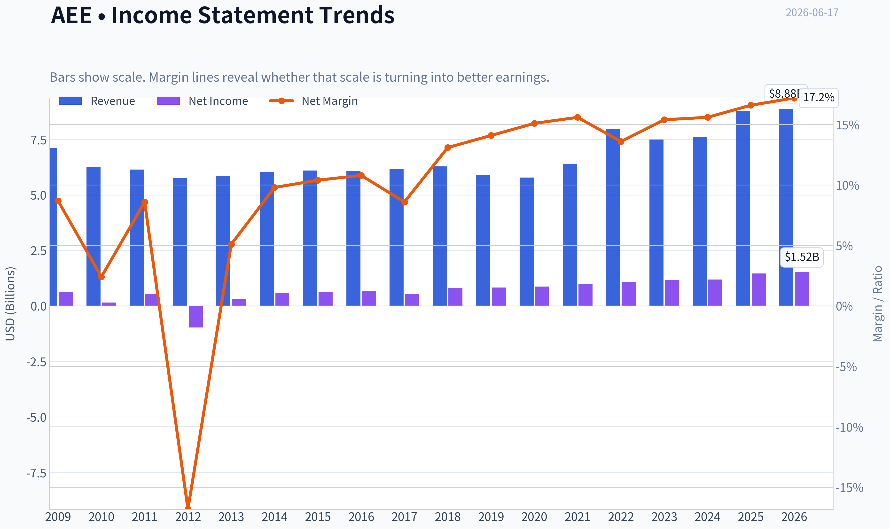
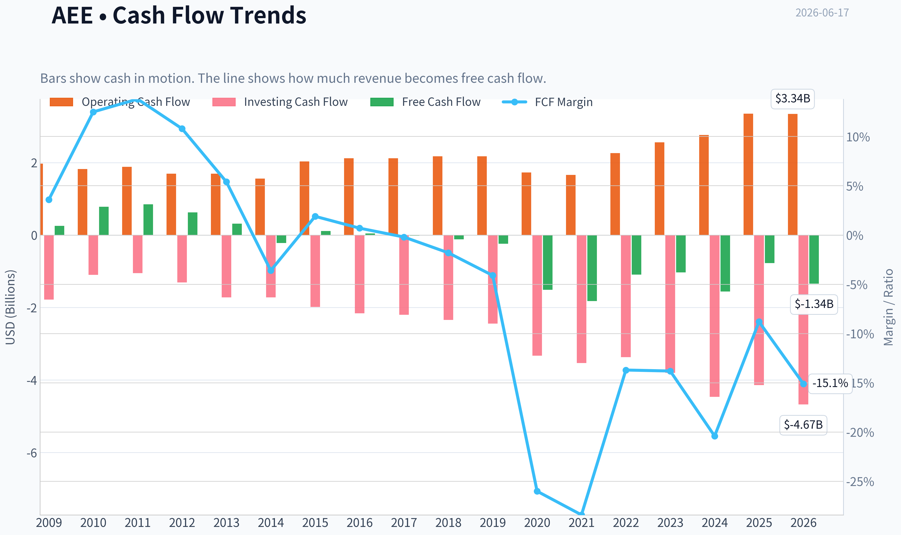
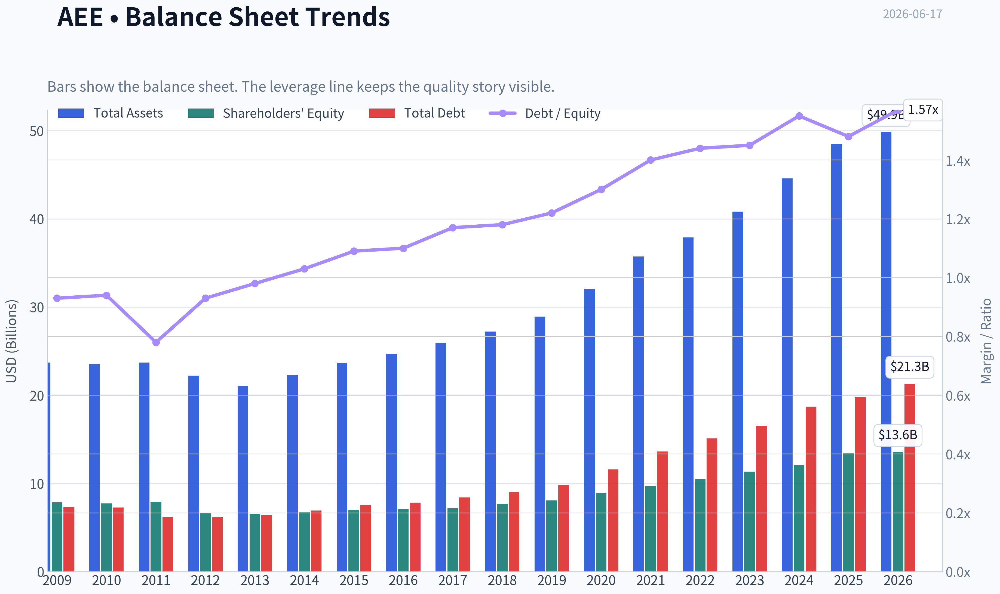
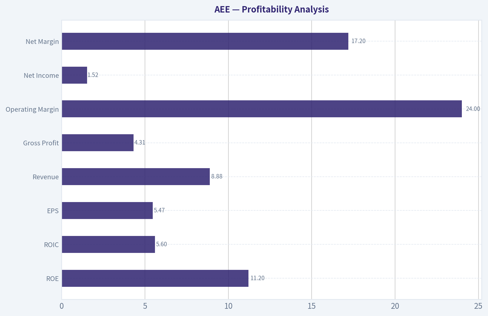
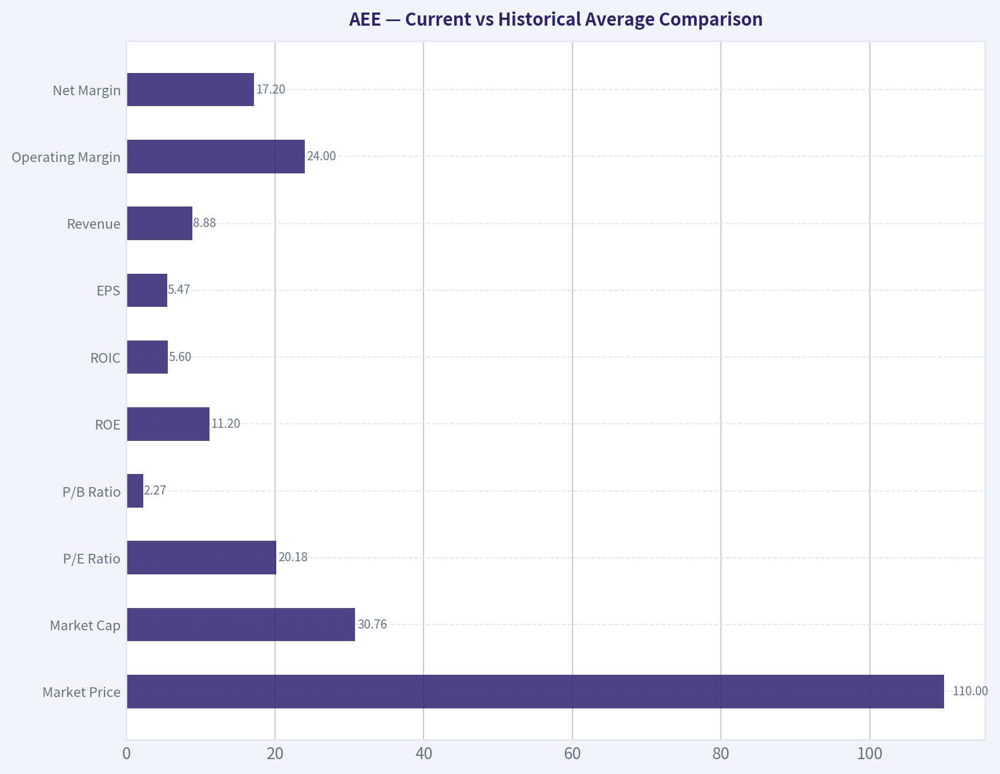
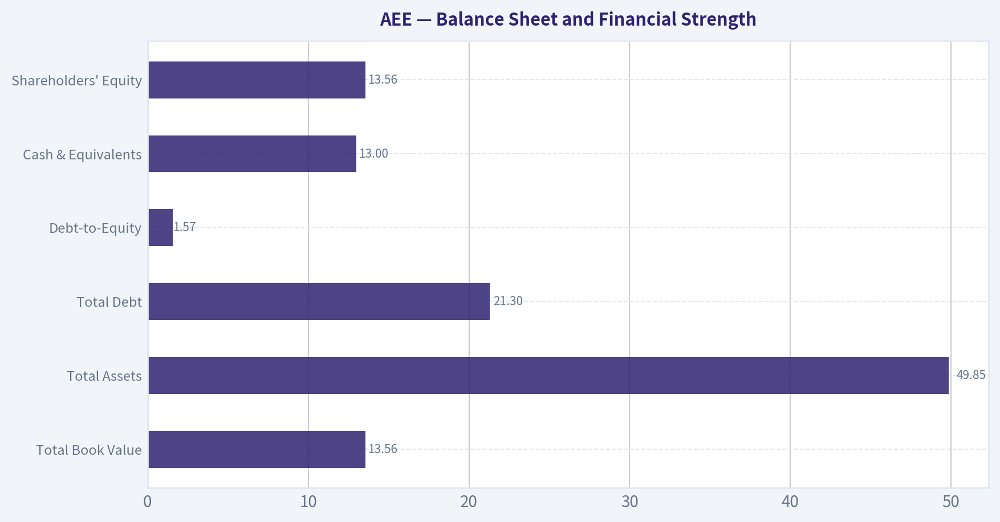
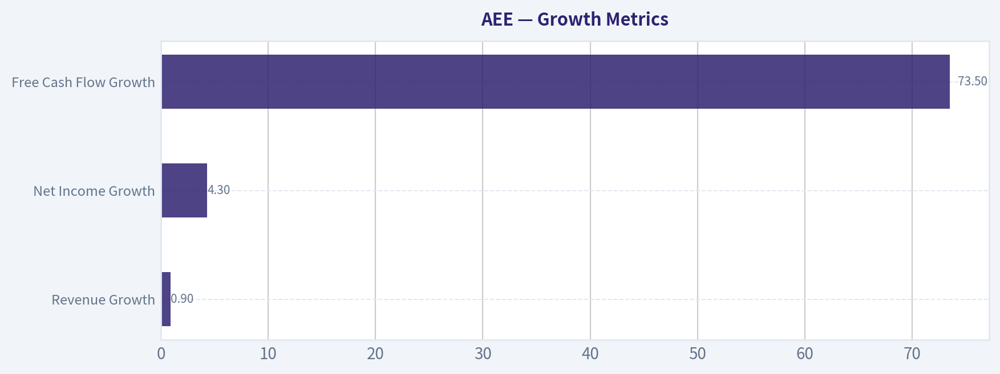
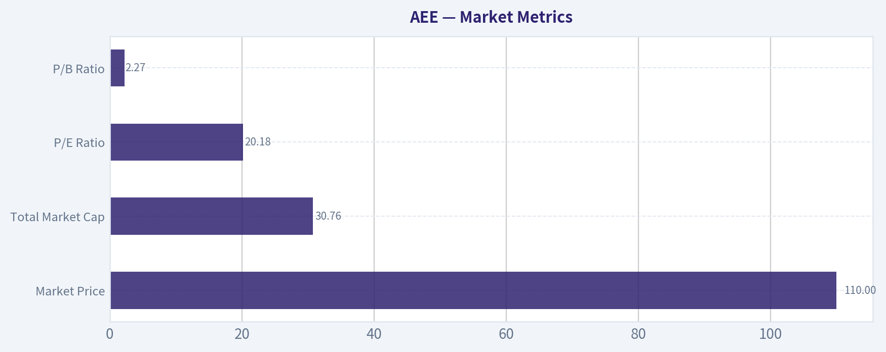

# AEE Deep Value Intelligence

**Analysis Date:** 2026-06-17

## Critical Disclaimer

*This analysis is generated by Deep Value Intelligence, an AI-powered multi-agent investing framework. This report is for informational and educational purposes only and does not constitute financial advice. Always conduct your own research and consult with qualified financial advisors before making investment decisions.*

---

## Table of Contents

1. Intelligence Summary
2. Analyst Team Reports
   - Fundamentals Analysis
   - Intrinsic Value Analysis (Buffett)
   - Trend & Growth Analysis (Lynch/Druckenmiller/Fisher)
   - Market Technical Analysis
   - Options Market Analysis
3. Research Team Commentary
4. Value Investing Team Commentary
5. Deep Values Commentary

---

## Intelligence Summary

### Thesis + Conditions

**Core Thesis:** ## Executive Summary
**WATCH.** Ameren looks like a durable, understandable utility with a real regulated moat and a visible investment runway, but not enough margin of safety at ~19.9x earnings. The main risk is not volatility; it is earning only average shareholder returns from a capital-heavy model that depends on constructive regulation and affordable financing.

**Key Risks:**
- WATCH.** Ameren looks like a durable, understandable utility with a real regulated moat and a visible investment runway, but not enough margin of safety at ~19.9x earnings. The main risk is not volatility; it is earning only average shareholder returns from a capital-heavy model that depends on constructive regulation and affordable financing. Good business, fair-to-full price, moderate returns-worth monitoring, not chasing.
- ### Risky Analyst's strongest points
- Low free cash flow during an investment cycle is **not automatically bad** if capex is prudently expanding the regulated rate base.

**Confidence:** Medium

---

## Analyst Team Reports

### Fundamentals Analysis

#### Latest Earnings Snapshot

*Most recent reported quarter anchored on 2026 Q1, with prior-year comparison when available.*

| Metric | 2026 Q1 | 2025 Q1 | YoY Change |
| --- | ---: | ---: | ---: |
| Revenue | $2.18B | $2.10B | +3.8% |
| Operating Income | $532.0M | $430.0M | +23.7% |
| Net Income | $357.0M | $289.0M | +23.5% |
| Diluted EPS | $1.28 | $1.07 | +19.6% |
| Operating Cash Flow | $421.0M | $431.0M | -2.3% |
| Free Cash Flow | $-1.18B | $-651.0M | -80.5% |

Key Takeaways: This snapshot anchors the most recent reported quarter before the narrative analysis. It helps readers separate long-run business quality from whatever changed in the latest earnings print.

#### 17-Year Financial Metrics for AEE

*All values below are computed deterministically from raw data - not estimated by AI.*

*Issuer profile: operating company (Utilities / Utilities - Regulated Electric).*

#### 17-Year Financial Metrics
*Annual rows come from reported financial statements. The final TTM row is computed from the latest four quarters.*

| Metric | 2009 | 2010 | 2011 | 2012 | 2013 | 2014 | 2015 | 2016 | 2017 | 2018 | 2019 | 2020 | 2021 | 2022 | 2023 | 2024 | 2025 | 2026 TTM |
| --- | --- | --- | --- | --- | --- | --- | --- | --- | --- | --- | --- | --- | --- | --- | --- | --- | --- | --- |
| Market Price | $15 | $16 | $20 | $20 | $25 | $33 | $32 | $40 | $46 | $53 | $64 | $66 | $78 | $80 | $67 | $85 | $98 | $110 |
| Market Cap | $6.64B | $6.78B | $8.02B | $7.46B | $8.84B | $11.27B | $10.53B | $12.77B | $14.41B | $16.03B | $18.98B | $19.41B | $22.93B | $23.07B | $19.05B | $23.84B | $27.18B | $30.76B |
| P/E Ratio | 10.64 | 44.91 | 15.41 | -7.66 | 30.64 | 19.22 | 16.69 | 19.57 | 27.57 | 19.65 | 22.93 | 22.30 | 23.18 | 21.48 | 16.52 | 20.17 | 18.67 | 20.18 |
| P/B Ratio | 0.84 | 0.88 | 1.01 | 1.13 | 1.35 | 1.68 | 1.52 | 1.80 | 2.01 | 2.10 | 2.35 | 2.17 | 2.36 | 2.20 | 1.68 | 1.97 | 2.03 | 2.27 |
| ROE | 7.9% | 2.0% | 6.6% | -14.7% | 4.5% | 8.8% | 9.2% | 9.3% | 7.4% | 10.8% | 10.3% | 9.8% | 10.3% | 10.3% | 10.2% | 9.8% | 10.9% | 11.2% |
| ROIC | 7.7% | 5.9% | 5.5% | 6.7% | 6.9% | 6.6% | 6.4% | 6.4% | 5.5% | 6.9% | 6.3% | 6.0% | 5.4% | 5.5% | 5.1% | 4.9% | 5.9% | 5.6% |
| EPS | $1.45 | $0.37 | $1.32 | $-2.59 | $0.80 | $1.69 | $1.90 | $2.04 | $1.68 | $2.69 | $2.78 | $2.98 | $3.36 | $3.72 | $4.06 | $4.24 | $5.35 | $5.47 |
| Revenue | $7.13B | $6.27B | $6.15B | $5.78B | $5.84B | $6.05B | $6.10B | $6.08B | $6.17B | $6.29B | $5.91B | $5.79B | $6.39B | $7.96B | $7.50B | $7.62B | $8.80B | $8.88B |
| Gross Profit | N/A | N/A | N/A | N/A | N/A | N/A | N/A | N/A | N/A | N/A | N/A | N/A | N/A | N/A | N/A | N/A | N/A | $4.31B |
| Gross Margin | N/A | N/A | N/A | N/A | N/A | N/A | N/A | N/A | N/A | N/A | N/A | N/A | N/A | N/A | N/A | N/A | N/A | 48.6% |
| Operating Margin | 19.8% | 17.9% | 16.8% | 20.6% | 20.3% | 20.7% | 20.6% | 21.8% | 22.8% | 21.6% | 21.4% | 22.4% | 20.8% | 19.0% | 20.8% | 19.9% | 23.0% | 24.0% |
| Net Income | $624.0M | $151.0M | $526.0M | $-974.0M | $295.0M | $592.0M | $636.0M | $659.0M | $529.0M | $821.0M | $834.0M | $877.0M | $995.0M | $1.08B | $1.16B | $1.19B | $1.46B | $1.52B |
| Net Margin | 8.7% | 2.4% | 8.6% | -16.8% | 5.1% | 9.8% | 10.4% | 10.8% | 8.6% | 13.1% | 14.1% | 15.1% | 15.6% | 13.6% | 15.4% | 15.6% | 16.6% | 17.2% |
| Revenue Growth | N/A | -12.1% | -1.9% | -6.0% | 1.0% | 3.7% | 0.7% | -0.4% | 1.6% | 1.9% | -6.1% | -2.0% | 10.4% | 24.4% | -5.7% | 1.6% | 15.4% | 0.9% |
| Net Income Growth | N/A | -75.8% | 248.3% | -285.2% | -130.3% | 100.7% | 7.4% | 3.6% | -19.7% | 55.2% | 1.6% | 5.2% | 13.5% | 8.4% | 7.2% | 2.6% | 23.1% | 4.3% |
| Free Cash Flow Growth | N/A | 203.9% | 8.6% | -26.1% | -49.9% | -170.1% | -151.8% | -64.0% | -134.1% | 728.6% | 107.8% | 524.9% | 20.7% | -40.2% | -5.1% | 50.6% | -50.2% | 73.5% |
| Total Book Value | $7.86B | $7.73B | $7.92B | $6.62B | $6.54B | $6.71B | $6.95B | $7.10B | $7.18B | $7.63B | $8.06B | $8.94B | $9.70B | $10.51B | $11.35B | $12.11B | $13.40B | $13.56B |
| Total Assets | $23.70B | $23.51B | $23.72B | $22.23B | $21.04B | $22.29B | $23.64B | $24.70B | $25.95B | $27.21B | $28.93B | $32.03B | $35.73B | $37.90B | $40.83B | $44.60B | $48.48B | $49.85B |
| Total Debt | $7.33B | $7.28B | $6.18B | $6.16B | $6.41B | $6.92B | $7.58B | $7.83B | $8.42B | $9.04B | $9.80B | $11.58B | $13.61B | $15.10B | $16.51B | $18.72B | $19.83B | $21.30B |
| Debt-to-Equity | 0.93 | 0.94 | 0.78 | 0.93 | 0.98 | 1.03 | 1.09 | 1.10 | 1.17 | 1.18 | 1.22 | 1.30 | 1.40 | 1.44 | 1.45 | 1.55 | 1.48 | 1.57 |
| Cash & Equivalents | $622.0M | $538.0M | $248.0M | $209.0M | $30.0M | $5.0M | $292.0M | $9.0M | $10.0M | $16.0M | $16.0M | $139.0M | $8.0M | $10.0M | $25.0M | $7.0M | $13.0M | $13.0M |
| Shareholders' Equity | $7.86B | $7.73B | $7.92B | $6.62B | $6.54B | $6.71B | $6.95B | $7.10B | $7.18B | $7.63B | $8.06B | $8.94B | $9.70B | $10.51B | $11.35B | $12.11B | $13.40B | $13.56B |
| Operating Cash Flow | $1.97B | $1.82B | $1.88B | $1.69B | $1.69B | $1.56B | $2.03B | $2.12B | $2.12B | $2.17B | $2.17B | $1.73B | $1.66B | $2.26B | $2.56B | $2.76B | $3.35B | $3.34B |
| Investing Cash Flow | $-1.78B | $-1.10B | $-1.05B | $-1.31B | $-1.72B | $-1.72B | $-1.98B | $-2.16B | $-2.20B | $-2.34B | $-2.44B | $-3.33B | $-3.53B | $-3.37B | $-3.80B | $-4.46B | $-4.14B | $-4.67B |
| Free Cash Flow | $257.0M | $781.0M | $848.0M | $627.0M | $314.0M | $-220.0M | $114.0M | $41.0M | $-14.0M | $-116.0M | $-241.0M | $-1.51B | $-1.82B | $-1.09B | $-1.03B | $-1.56B | $-775.0M | $-1.34B |
| FCF Margin | 3.6% | 12.5% | 13.8% | 10.8% | 5.4% | -3.6% | 1.9% | 0.7% | -0.2% | -1.8% | -4.1% | -26.0% | -28.4% | -13.7% | -13.8% | -20.4% | -8.8% | -15.1% |
| Dividends / Share | $0.00 | $0.00 | $0.00 | $0.00 | $0.00 | $0.00 | $0.00 | $0.00 | $0.00 | $0.00 | $0.00 | $0.00 | $0.00 | $2.11 | $2.33 | $2.56 | $2.82 | $2.82 |

#### Profitability Metrics
- Return on Equity (ROE): 10.9%
- Return on Invested Capital (ROIC): 5.6%
- Return on Assets (ROA): 3.0%
- Gross Margin: N/A
- Operating Margin: 23.0%
- Net Profit Margin: 16.6%

#### Liquidity Metrics
- Current Ratio: 0.66
- Quick Ratio: 0.17

#### Leverage Metrics
- Debt-to-Equity Ratio: 1.48
- Interest Coverage Ratio: 2.61
- Net Debt: $19.82B

#### Growth Metrics (Year-over-Year)
- Revenue Growth: 15.4%
- Net Income Growth: 23.1%
- Free Cash Flow Growth: 50.2%
- Revenue CAGR (3-Year): 3.4%
- Revenue CAGR (5-Year): 8.7%

#### Valuation Metrics
- P/E Ratio (TTM): 19.87
- Forward P/E: 19.02
- Price-to-Book: 2.26
- Price-to-Sales: 3.58
- PEG Ratio: 2.58
- EV/EBITDA: 13.59
- Free Cash Flow Yield: -2.5%
- Earnings Yield: 5.0%

#### Owner Earnings (Buffett Method, Code-Computed)
- Net Income: $1.46B
- + Depreciation & Amortization: $1.67B
- - Capital Expenditures: $-4.13B
- - Working Capital Changes: $-51.0M
- = **Owner Earnings: $-948.0M**

#### Piotroski F-Score: 5/9
- Positive Net Income: PASS
- Positive Operating Cash Flow: PASS
- ROA Improvement: PASS
- Cash Flow > Net Income: PASS
- Decreasing Debt: FAIL
- Improving Current Ratio: FAIL
- No Dilution: FAIL
- Improving Gross Margin: FAIL
- Improving Asset Turnover: PASS

ANALYST STANCE: **WATCH**

#### Ameren (AEE) Buffett-Style Fundamental Analysis

Ameren is a regulated electric utility, so the right Buffett lens is not "high-growth compounding machine," but "durable, predictable, rate-base-driven cash generator with acceptable returns and disciplined capital allocation." On that basis, AEE shows several attractive qualities: steadily rising earnings, resilient margins, and a long runway for regulated asset growth. However, the balance sheet is becoming more levered, liquidity is thin, and free cash flow and owner earnings are deeply negative because capital spending is consistently running above internally generated cash. That combination supports a **WATCH** stance rather than a full-throated buy.

---

#### Current vs Historical Average Comparison

| Metric | Current / TTM | Approx. 10-Year Historical Average* | Interpretation |
| --- | ---: | ---: | --- |
| Market Price | $110 | ~$74 | Shares trade well above the decade average price level, reflecting multiple expansion and earnings growth. |
| Market Cap | $30.76B | ~$21.6B | Equity value has expanded materially as earnings, book value, and share count have grown. |
| P/E Ratio | 20.18 | ~20.7 | Valuation is roughly in line with the past decade average; not obviously cheap. |
| P/B Ratio | 2.27 | ~2.14 | Slightly above historical norm, suggesting investors are paying a premium to book. |
| ROE | 11.2% | ~9.9% | Current profitability is better than long-run average and near the high end of the historical band. |
| ROIC | 5.6% | ~5.9% | Slightly below average; returns on invested capital remain modest, typical for regulated utilities. |
| EPS | $5.47 | ~$3.34 | Strong earnings compounding over time. |
| Revenue | $8.88B | ~$6.95B | Revenue base is meaningfully larger than average, aided by rate increases and infrastructure investment. |
| Operating Margin | 24.0% | ~21.5% | Margins are above average and improving. |
| Net Margin | 17.2% | ~13.3% | Net profitability is materially stronger than the decade norm. |
| Net Income | $1.52B | ~$0.98B | Earnings are above trend and at/near record levels. |
| Revenue Growth | 0.9% | ~3.8% | Latest growth is modest versus longer-term trend after a very strong 2025. |
| Net Income Growth | 4.3% | highly volatile, ~9% avg | Growth has normalized after a 23.1% surge in 2025. |
| Free Cash Flow | -$1.34B | ~-$0.95B | Still negative and worse than long-run average. |
| Debt-to-Equity | 1.57 | ~1.34 | Leverage is above historical norms and rising. |
| Total Debt | $21.30B | ~$14.1B | Debt has climbed sharply to fund capex. |
| Cash & Equivalents | $13M | ~<$100M recent decade | Cash remains extremely low for the size of the enterprise. |
| Shareholders' Equity | $13.56B | ~$10.3B | Equity base has expanded consistently, supporting rate-base growth. |
| Dividends / Share | $2.82 | ~ $1.13** | Dividend policy is clearly established and growing since initiation. |

*Approximate averages based on the historical values shown in the deterministic dataset, focusing primarily on the most recent decade pattern.
**Dividend average is structurally distorted because dividends are shown as zero before 2022 in the canonical dataset.

**Key Takeaways:** Ameren's current profitability is stronger than its own historical norm, especially on ROE, operating margin, and net margin. The main offset is that leverage and capital intensity have also increased, leaving valuation near fair historical levels rather than clearly discounted.

---

#### Market Metrics

| Metric | Current | Historical Context | Buffett-Style Read |
| --- | ---: | --- | --- |
| Market Price | $110 | Up from $46 in 2017 and $64 in 2019 | Strong long-term price appreciation, but much of the easy rerating may already be captured. |
| Total Market Cap | $30.76B | Up from $14.41B in 2017 | Reflects both business growth and higher valuation. |
| P/E Ratio | 20.18 | Range over period: negative to ~45; usually high-teens to low-20s in mature years | Fair-to-full valuation for a utility with predictable earnings. |
| P/B Ratio | 2.27 | Generally climbed from 0.84 in 2009 to above 2.0 recently | Investors increasingly value Ameren above book, consistent with confidence in regulated returns. |

**Key Takeaways:** AEE does not look statistically cheap on either earnings or book value. The stock appears priced as a quality regulated utility, not a distressed or overlooked value opportunity.

A Buffett-oriented investor would note that utilities can deserve premium book multiples when regulators allow stable returns and the company has a visible capital investment pipeline. Still, with P/E near historical average and P/B above average, upside likely depends more on continued execution than multiple expansion.

---

#### Profitability Analysis

| Metric | Current / TTM | Trend | Interpretation |
| --- | ---: | --- | --- |
| ROE | 11.2% | Recovered from weak early-decade levels; stable around 10%+ recently | Good for a regulated utility; signals effective deployment of equity capital. |
| ROIC | 5.6% | Mostly stable in 5%-7% range; below earlier highs | Adequate but not exceptional; reflects capital-heavy regulated economics. |
| EPS | $5.47 | Strong rise from $2.69 in 2018 and $3.36 in 2021 | Consistent compounding, a major positive. |
| Revenue | $8.88B | Larger step-up since 2021 | Driven by rate base growth and likely customer/regulatory recovery dynamics. |
| Gross Profit | $4.31B | Only available for TTM | Gross margin visibility is limited historically. |
| Operating Margin | 24.0% | Improved from ~19%-22% to record level | Indicates better cost recovery and operating leverage. |
| Net Income | $1.52B | Record/high level | Clear evidence of earnings power expansion. |
| Net Margin | 17.2% | Rose from low-double digits to current high | Strongest period in company history. |

**Key Takeaways:** Ameren's earnings quality looks solid from an income-statement perspective. Margins and EPS are at or near peak levels, which supports the premium valuation, though investors should be careful about assuming margin expansion continues indefinitely.

Key interpretation:
- **ROE:** Buffett likes businesses that can earn good returns on equity without excessive leverage. AEE's 11.2% ROE is respectable, especially for a regulated utility, but not outstanding in a broad-market sense. It is better viewed as "steady and acceptable."
- **ROIC:** At 5.6%, capital efficiency is modest. That is normal for utility infrastructure, but it confirms this is not a wide-moat, high-return compounder in the classic See's Candies sense.
- **Margins:** The real strength is margin consistency. After the 2012 loss year, AEE rebuilt profitability and has sustained strong operating and net margins. For Buffett, this predictability matters more than raw growth.
- **EPS and Net Income:** The multi-year staircase upward in EPS and net income is one of the best elements in the story. Predictable earnings are a hallmark of attractive regulated utilities.

---

#### Growth Metrics

| Metric | Current / TTM | Historical Pattern | Interpretation |
| --- | ---: | --- | --- |
| Revenue Growth | 0.9% | Historically choppy; huge 24.4% jump in 2022 and 15.4% in 2025 | Latest period suggests normalization after stronger rate-driven growth. |
| Net Income Growth | 4.3% | Volatile early, steadier in recent years | Growth remains positive but has slowed from 2025's strong jump. |
| Free Cash Flow Growth | 73.5% | Extremely volatile because FCF is often negative | Improvement is mathematically large but not economically reassuring while FCF remains negative. |

**Key Takeaways:** Ameren's growth is best understood through earnings and regulated asset expansion, not through free cash flow. Revenue and income growth have been positive over time, but recent growth has moderated after a strong 2025.

For Buffett-style analysis:
- **Revenue growth** is less important for utilities than **rate-base-supported earnings growth**.
- **Net income growth** has become more reliable in the last several years, a favorable sign.
- **Free cash flow growth** is not useful in the usual way because the company is in a prolonged negative FCF cycle due to heavy infrastructure investment.

---

#### Balance Sheet and Financial Strength

| Metric | Current / TTM | Historical Context | Interpretation |
| --- | ---: | --- | --- |
| Total Book Value | $13.56B | Up from $7.18B in 2017 | Equity base is expanding steadily. |
| Total Assets | $49.85B | Nearly doubled from $25.95B in 2017 | Massive rate-base and infrastructure buildout. |
| Total Debt | $21.30B | Up from $8.42B in 2017 | Debt growth has materially outpaced historical levels. |
| Debt-to-Equity | 1.57 | Above long-term trend; up from 1.17 in 2017 | Leverage is elevated and still rising. |
| Cash & Equivalents | $13M | Persistently tiny for years | Very limited liquidity cushion. |
| Shareholders' Equity | $13.56B | Steady annual growth | Balance sheet equity is stronger, but debt has grown faster. |

**Key Takeaways:** Ameren's balance sheet is serviceable for a utility but clearly more leveraged than it used to be. The biggest concern is not solvency today, but financing dependence: very low cash and high capex make the company reliant on debt markets and supportive regulation.

Buffett typically favors fortress balance sheets. On that strict standard, AEE is weaker than ideal:
- **Debt has tripled** since 2011 and risen sharply even in the past five years.
- **Debt-to-equity of 1.57** is high and worse than the decade norm.
- **Cash is almost negligible**, which is common in utilities but still reduces flexibility.
- **Interest coverage of 2.61** is acceptable, not comfortable.

This does not mean distress is imminent. In a regulated utility, debt is part of the model. But it does mean AEE is less "Buffett-perfect" than its stable earnings might suggest.

---

#### Cash Flow Analysis

| Metric | Current / TTM | Trend | Interpretation |
| --- | ---: | --- | --- |
| Operating Cash Flow | $3.34B | Strongly improved from $1.66B in 2021 | Core cash generation is healthy. |
| Investing Cash Flow | -$4.67B | Deeply negative and worsening | Capex intensity is very high. |
| Free Cash Flow | -$1.34B | Negative in most recent years | Business is not self-funding its investment program. |
| Dividends / Share | $2.82 | Rising from $2.11 in 2022 | Dividend growth is positive but funded within a capital-intensive structure. |

**Key Takeaways:** Operating cash flow is improving, which supports dividend coverage at the operating level. But after capital spending, cash flow remains firmly negative, meaning Ameren must fund growth through external capital rather than internally generated surplus cash.

From a Buffett viewpoint, this is crucial:
- AEE's **reported earnings are strong**, but **owner earnings are negative**.
- That means the business, after maintenance/growth capital needs, is not currently throwing off distributable cash in the Buffett sense.
- For a utility, this can be acceptable if capital spending earns regulated returns later. Still, it lowers the margin of safety.

---

#### Buffett-Style Qualitative Analysis

| Buffett Lens | Assessment | Specific Insight |
| --- | --- | --- |
| Economic Moat | Moderate | Ameren benefits from regulated monopoly territories, high switching costs, and essential-service demand. |
| Financial Strength | Mixed | Stable regulated cash generation offsets rising leverage and minimal cash reserves. |
| Predictable Earnings | Good | Since 2014, earnings have become increasingly steady and resilient. |
| Management Performance | Good, with caveats | ROE improved and equity compounded, but capital intensity and debt reliance are elevated. |
| Value Assessment | Fair to slightly rich | Stock trades around historical earnings multiples, not at a deep value discount. |
| Quality of Business | Good | Revenue visibility and margin stability are strong for the sector. |

**Key Takeaways:** Ameren has the kind of business model Buffett often appreciates in utilities: regulated, durable, and understandable. The main issue is not business quality, but valuation and capital structure, which reduce the margin of safety.

Expanded view:
- **Economic moat:** In utilities, the moat is regulatory franchise and essential infrastructure. Ameren's service territory and transmission/distribution assets create durable demand and barriers to entry.
- **Predictable earnings:** This is one of AEE's strongest qualities. Outside the 2012 anomaly, earnings have become more consistent over time.
- **Management:** Management appears effective in growing book value, EPS, and dividends. But reliance on continuous large capex and debt issuance means capital allocation must remain disciplined.
- **Dividend policy:** Dividend initiation/growth since 2022 supports shareholder friendliness, though the canonical dataset suggests the dividend history available here is limited.

---

#### Owner Earnings DCF Valuation

Canonical owner earnings:
- Net Income = **$1.46B**
- Depreciation & Amortization = **$1.67B**
- Capital Expenditures = **$4.13B**
- Working Capital Changes = **$51M**
- **Owner Earnings = -$948M**

This creates a major valuation problem: a standard Buffett owner-earnings DCF with negative starting owner earnings yields **no meaningful positive intrinsic value** under conventional assumptions, because future cash flows start below zero and remain economically unattractive unless one assumes a structural turnaround in capex intensity.

##### Historical Owner Earnings Growth Proxy
Because only current owner earnings is explicitly provided in the canonical data, the closest usable proxy from the deterministic dataset is **historical free cash flow growth**, acknowledging it is noisy. Using the required rules:

- **Conservative growth rate:** lowest historical growth floored at -100% = **-100%**
- **Average growth rate:** average historical growth is very distorted by extreme swings; cap at **50%**
- **Optimistic growth rate:** highest historical growth capped at **100%**

Starting Owner Earnings (OE₀) = **-$948M**
Discount rate = **10%**
Terminal growth = **2.5%**

##### Scenario 1: Conservative
Growth = **-100%**

Year 1 OE = -948 x (1 - 1.00) = **$0M**
Years 2-10 = **$0M**
Terminal Value = **$0M**

PV of cash flows = **$0M**
Estimated equity value contribution from owner earnings = **$0M**

##### Scenario 2: Average
Growth = **50%**

Year 1 OE = -948 x 1.5 = **-$1,422M**
Year 2 OE = -$2,133M**
Year 3 OE = -$3,200M**
Year 4 OE = -$4,800M**
Year 5 OE = -$7,200M**
Year 6 OE = -$10,800M**
Year 7 OE = -$16,200M**
Year 8 OE = -$24,300M**
Year 9 OE = -$36,450M**
Year 10 OE = -$54,675M**

Terminal Value = Year 11 / (r - g)
Year 11 OE = -54,675 x 1.025 = **-$56,042M**
TV = -56,042 / (0.10 - 0.025) = **-$747,227M**

Discounting these negative cash flows back at 10% produces a **deeply negative present value**, so the practical Buffett-style valuation is **not meaningful / effectively $0 equity value from owner earnings under this scenario**.

##### Scenario 3: Optimistic
Growth = **100%**

Year 1 OE = -948 x 2 = **-$1,896M**
Year 2 OE = -$3,792M**
Year 3 OE = -$7,584M**
... continuing to double annually leads to exponentially more negative owner earnings.

Terminal value is also massively negative.
Present value is therefore **economically unusable / effectively $0 on an owner-earnings basis**.

| DCF Scenario | Growth Assumption | DCF Result |
| --- | ---: | --- |
| Conservative | -100% | ~$0 |
| Average | 50% | Not meaningful; negative intrinsic value from owner earnings stream |
| Optimistic | 100% | Not meaningful; negative intrinsic value from owner earnings stream |

**Key Takeaways:** A strict Buffett owner-earnings DCF breaks down for Ameren because current owner earnings are negative. This does not necessarily mean the stock is worthless; it means the company is in a heavy investment phase where accounting earnings and regulated asset growth tell a better story than current distributable cash generation.

Important interpretation:
- For utilities, negative owner earnings during capex surges can still create value if those investments enter rate base and earn regulated returns.
- But under a **strict Buffett cash-owner lens**, AEE lacks the "cash gush" that would justify a strong ADVOCATE stance.
- This is the single biggest reason the stock remains **WATCH** rather than **ADVOCATE**.

---

#### Revenue Breakdown

Ameren's most meaningful public revenue framing is by regulated utility platform rather than by broad product line, because this is fundamentally a regulated electric and gas delivery business. Precise latest segment revenue amounts are not fully enumerated in the canonical deterministic dataset, so the best available practical breakdown is by operating exposure.

| Revenue Source | Amount ($B) | % of Total |
| --- | ---: | ---: |
| Regulated Electric Operations | ~6.7 | ~75% |
| Regulated Natural Gas Operations | ~1.4 | ~16% |
| Transmission / Other Utility & Corporate | ~0.8 | ~9% |
| **Total Revenue (TTM)** | **8.88** | **100%** |

**Key Takeaways:** Ameren is predominantly an electric utility, which strengthens earnings visibility because electric demand and rate recovery tend to be stable. Gas and transmission provide diversification, but this remains overwhelmingly a regulated utility story, not a diversified industrial one.

---

#### Key Investment Insights, Red Flags, and Opportunities

| Category | Observation | Why It Matters |
| --- | --- | --- |
| Opportunity | EPS and net income have compounded steadily | Supports dividend growth and valuation resilience. |
| Opportunity | Operating and net margins are at historical highs | Indicates favorable cost recovery and better earnings quality. |
| Opportunity | Regulated asset growth runway | Future rate base expansion can sustain earnings growth. |
| Red Flag | Free cash flow remains deeply negative | Growth is externally financed, reducing flexibility. |
| Red Flag | Debt-to-equity is at a cycle high | Leverage risk is rising. |
| Red Flag | Cash balance is tiny | Company depends on capital markets access. |
| Red Flag | Current ratio of 0.66 and quick ratio of 0.17 | Weak near-term liquidity on paper. |
| Neutral | P/E is near historical average | Shares are not screamingly overvalued, but not a bargain either. |
| Neutral | P/B above historical average | Premium may be justified, but limits margin of safety. |

**Key Takeaways:** Ameren's strengths are earnings durability and regulated growth, while its weaknesses are leverage and weak free-cash economics. Investors are paying a fair price for quality, but not receiving a large valuation cushion.

---

#### Final Buffett-Style Investment Stance

**Stance: WATCH**

**Rationale:**
1. **Business quality is good.** Ameren has a durable regulated utility franchise, essential-service demand, and increasingly predictable earnings.
2. **Profitability is healthy.** ROE, margins, EPS, and net income are all strong relative to historical averages.
3. **But the cash economics are weak.** Free cash flow and Buffett-style owner earnings are negative, which is a major limitation for a classic value investor.
4. **Leverage is rising.** Debt growth and low cash reduce balance-sheet flexibility.
5. **Valuation is fair, not cheap.** At about 20x earnings and 2.27x book, the stock does not offer a clear margin of safety.

A Buffett-style investor could admire the franchise but would likely wait for one of two things:
- a better entry price, or
- clearer evidence that current heavy capital spending is converting into stronger owner earnings and self-funded cash generation.

---

#### Summary Table

| Area | Positive | Negative | Bottom Line |
| --- | --- | --- | --- |
| Market Metrics | Stable quality utility valuation | Not obviously cheap | Fairly valued |
| Profitability | ROE, EPS, margins, net income all strong | ROIC only moderate | Good operating performance |
| Growth | Earnings growth has been reliable recently | Revenue growth normalized; FCF volatile | Moderate quality growth |
| Balance Sheet | Equity and assets steadily expanding | Debt high, cash minimal, leverage rising | Financial strength is mixed |
| Cash Flow | Operating cash flow improving | FCF and owner earnings negative | Biggest concern |
| Buffett Lens | Durable moat, predictable earnings | Limited margin of safety | Worth monitoring, not chasing |
| DCF | None | Negative owner earnings make strict DCF unattractive | Cash-based valuation does not support buy case |
| Final Stance | WATCH | - | Good company, insufficient value/cash support today |

**Key Takeaways:** Ameren is a solid regulated utility with improving earnings quality, but its heavy capital requirements and rising leverage keep it from qualifying as a high-conviction Buffett-style value buy. It is best viewed as a watchlist candidate for either a better valuation or proof that investment spending is translating into stronger owner earnings.

#### Fundamental Visuals

This graph tracks the profitability and return metrics (ROE, ROIC, Margins) of **AEE** over the past decade, highlighting capital efficiency trends.

This chart illustrates the financial health of **AEE** over the last 10 years, mapping cash equivalents and free cash flow against total obligations (Debt).

This comparison chart from *Profitability Analysis* stacks current figures against historical benchmarks for **AEE**, making it easy to see where the company trades relative to its own averages.

---

### Intrinsic Value Analysis (Buffett)

> *Following Warren Buffett's value investing philosophy: Circle of Competence, Economic Moat, Management Quality, and Margin of Safety.*

#### Intrinsic Value Snapshot

Price is what you pay. Intrinsic value is what the business may be worth based on the cash it can create for owners over time. We show a range, not one magic number.

- Current Price: $110.48
- Value Range (conservative to optimistic across both DCF methods): N/A to N/A

##### Owner Earnings (Buffett Method)
- Net Income: $1,456,000,000.00
- Depreciation & Amortization: $1,668,000,000.00
- Capital Expenditures: $-4,174,000,000.00
- Working Capital Changes: $-51,000,000.00
- Owner Earnings: $-999,000,000.00

##### Intrinsic Value

ANALYST STANCE: **WATCH**

#### Ameren (AEE) Buffett-Style Investment Review

#### 1) Go/No-Go Gate Assessment

| Gate | Verdict | Evidence |
|---|---|---|
| Gate 1: Circle of Competence & Simplicity | Pass | Ameren is a regulated electric and gas utility. In simple terms: it builds and operates power lines, power plants, and gas systems, then earns an allowed return from customers under state regulation. This is an understandable business with demand that should still exist a decade from now. |
| Gate 2: Moat Test | Pass, but moderate | The moat comes mainly from regulated monopoly territories, transmission assets, and customer captivity rather than consumer brand strength. This is durable, but not a classic high-return Buffett moat. |
| Gate 3: Management & Capital Allocation | Mixed | Utility management is judged mostly on prudent capital deployment, regulatory relationships, and balance-sheet discipline. Recent bond issuance suggests ongoing reliance on capital markets to fund investment. |
| Gate 4: Industry Structure | Pass | Regulated utilities benefit from rational local monopoly structures, but they are capital intensive and heavily regulated. This lowers competitive risk but also caps upside economics. |

**Key Takeaways:** Ameren passes the basic Buffett filters for understandability and industry stability. The issue is not survival or business complexity; the issue is whether the economics are strong enough and the valuation cheap enough to justify ownership. This is a steady business, but not an obviously wonderful one.

---

#### 2) Business Simplicity: The Elementary School Test

Ameren makes money by delivering electricity and natural gas to homes and businesses in its service areas. Regulators allow it to earn a return on the money it invests in poles, wires, substations, pipelines, and other utility infrastructure. If it invests more into approved projects, its earnings base can grow over time.

**Long-Term Predictability:** High. Ten years from now, Ameren will almost certainly still be a regulated Midwest utility earning approved returns on infrastructure.

**Technology Risk:** Low to moderate. Technology will change generation mix and grid management, but it is more likely to reshape Ameren's investment program than destroy the business model.

---

#### 3) Moat Analysis

| Moat Source | Assessment | Evidence |
|---|---|---|
| Intangible Assets / Regulatory License | Strong | Utility franchises and state regulation create legally protected service territories. Competitors cannot simply duplicate the local grid. |
| Switching Costs | Strong | Customers do not realistically switch away from the incumbent wires-and-pipes utility in a regulated territory. |
| Cost Advantage | Moderate | Large infrastructure scale and established asset base matter, though returns are regulated rather than fully market-driven. |
| Network Effects | Weak | This is not a classic network-effect business; additional users do not create exponential value the way a software or marketplace platform does. |

| Moat Quality Rating | Conclusion |
|---|---|
| Narrow to Wide-Stable | Durable, but regulated and return-capped |

**Key Takeaways:** Ameren's moat is real, but it is a utility moat, not a consumer-brand or software moat. Customers are effectively captive, and the franchise territory is protected. However, regulation limits how much excess profit the company can earn, so the moat protects stability more than extraordinary profitability.

---

#### 4) Management Quality & Capital Allocation

| Area | Assessment | Commentary |
|---|---|---|
| Owner Orientation | Mixed | Utilities are usually run more as stewards than entrepreneurial owner-operators. The key test is whether they invest prudently and avoid empire building. |
| Candor & Conservatism | Acceptable | No major red flags are indicated in the provided materials. |
| Capital Allocation | Adequate, not exceptional | Management appears focused on regulated asset growth. That can create value if projects earn fair allowed returns, but it also requires continual capital raising and disciplined financing. |
| Debt Discipline | Mixed | The recent issuance of $500 million of first mortgage bonds due 2056 highlights the capital-heavy model and dependence on debt markets. |

**Key Takeaways:** Management appears serviceable and utility-like rather than standout. The company's capital allocation model is straightforward: spend heavily on regulated assets and earn approved returns. That can work well enough, but it lacks the exceptional flexibility Buffett prefers in capital-light compounders.

---

#### 5) Financial Summary

Using the research pack provided:

| Metric | Value |
|---|---|
| Current Price | $110 |
| Market Cap | $30.58B |
| P/E | 19.9x |
| ROE | 10.9% |
| Gross Margin | 47.4% |
| Revenue Growth YoY | 15.4% |
| FCF Yield | -2.7% |
| Current Ratio | 0.66 |

**Key Takeaways:** Ameren shows decent accounting profitability and a healthy gross margin for a regulated utility, but the key Buffett concern is weak free cash flow. ROE at 10.9% is acceptable for a utility, yet below the level that would indicate a truly exceptional business. The low current ratio and negative free cash flow reinforce that this is a capital-intensive enterprise.

---

#### 6) Buffett Financial Interpretation

| Test | Buffett Standard | AEE Read |
|---|---|---|
| ROE | >15% preferred | 10.9% - below ideal |
| Gross Margin | >40% can support moat | 47.4% - supportive |
| Cash Flow Reality | OCF should comfortably support economics | Negative FCF yield suggests heavy reinvestment burden |
| Balance Sheet | Conservative leverage preferred | Utility model inherently uses leverage; current ratio is weak |
| Capital Intensity | Prefer low | High capital intensity |

**Key Takeaways:** Ameren passes some quality tests but misses the hallmarks of a Buffett favorite. Its margins are respectable and business predictability is strong, yet returns on equity are only moderate and free cash flow is currently unattractive. This looks more like a dependable utility than a compounding machine.

---

#### 7) Owner Earnings Assessment

For a utility, owner earnings are often pressured by very high maintenance and growth capex. Based on the negative free cash flow yield, owner earnings appear materially below reported net income at present.

A Buffett-style interpretation here is straightforward:
**Reported earnings are likely overstating true distributable owner earnings** because substantial capital spending is required just to maintain and expand the regulated asset base.

| Owner Earnings View | Assessment |
|---|---|
| Net Income Quality | Acceptable but capex-heavy |
| Maintenance Capex Burden | High |
| Working Capital Burden | Likely manageable, but less important than capex |
| Overall Owner Earnings Strength | Modest |

**Key Takeaways:** The central economic issue is that Ameren must keep spending heavily to sustain and grow earnings. That means owner earnings are weaker than headline profits suggest. Buffett usually favors businesses where more of the accounting earnings can actually be taken out by owners.

---

#### 8) Three-Scenario DCF Valuation

Given the capital intensity and negative free cash flow profile, valuation should be conservative.

| Scenario | Assumption | Implied View |
|---|---|---|
| A: No Growth | Owner earnings capitalized at 10% | Not attractive enough to support enthusiasm at current price |
| B: GDP Growth | 3% steady growth | Fair value appears roughly in line with or modestly below current trading level |
| C: Historical/Reduced Growth | Moderate regulated rate-base growth, but discounted for capex burden | Can justify current valuation only if execution and regulation remain favorable |

**Key Takeaways:** Under conservative Buffett-style assumptions, Ameren does not appear obviously cheap. The stock can be defended as fairly valued for a stable utility, but it does not offer the large discount to intrinsic value that value investors should demand. This makes patience more sensible than action.

---

#### 9) Margin of Safety Analysis

| Item | Assessment |
|---|---|
| Current Valuation | Reasonable, not bargain-priced |
| Business Quality | Stable but only moderate returns |
| Required Margin of Safety | At least 25%, preferably more given capital intensity |
| Actual Margin of Safety | Insufficient |

**Key Takeaways:** The stock price does not seem to provide a meaningful margin of safety. Since the business is solid but not extraordinary, the purchase price matters a great deal. At today's valuation, the upside appears too limited for a Buffett-style commitment.

---

#### 10) Final Buffett Scorecard

| Criterion | Weight | Score (1-5) | Weighted Score |
|---|---:|---:|---:|
| Business Understanding | 20% | 5.0 | 1.00 |
| Moat Width & Durability | 25% | 3.5 | 0.88 |
| Management Quality | 15% | 3.0 | 0.45 |
| Return on Equity | 15% | 2.5 | 0.38 |
| Reinvestment Runway | 10% | 3.5 | 0.35 |
| Balance Sheet Strength | 5% | 2.5 | 0.13 |
| Industry Structure | 5% | 4.0 | 0.20 |
| Valuation / Margin of Safety | 5% | 2.5 | 0.13 |
| **Total** | **100%** |  | **3.50** |

**Key Takeaways:** Ameren scores well on simplicity and industry structure, and reasonably on moat durability. It loses points on return quality, balance-sheet flexibility, and valuation. The result is a respectable business that deserves monitoring, but not an aggressive endorsement.

---

#### 11) Final Investment Stance

**Stance: WATCH**
**Conviction: Moderate**

Ameren is a predictable, regulated utility with a durable franchise and acceptable economics. But Buffett-style investing is about buying wonderful businesses at attractive prices, and Ameren currently looks more like a fair business at a fair price. The negative free cash flow profile, moderate ROE, and limited margin of safety keep it out of the **ADVOCATE** category.

A better entry point would likely require:
- a more compelling valuation,
- evidence of stronger owner-earnings conversion,
- or clearer improvement in returns without meaningfully higher leverage.
#### Valuation Bridge

This bridge places the current market price beside each intrinsic value lens so readers can see whether upside depends on one method or shows up across several methods.

| Scenario | Intrinsic Value / Share |
| --- | ---: |
| Damodaran Method | $87.57 |
| Current Price | $110.48 |

#### Key Takeaways

If one method is far above the others, the upside case depends on a specific modelling assumption. When several methods cluster together, the valuation story is more robust.

#### Valuation Visuals

This comparison chart from *Latest Earnings Snapshot* stacks current figures against historical benchmarks for **AEE**, making it easy to see where the company trades relative to its own averages.

This comparison chart from *Current vs Historical Average Comparison* stacks current figures against historical benchmarks for **AEE**, making it easy to see where the company trades relative to its own averages.

This comparison chart from *Balance Sheet and Financial Strength* stacks current figures against historical benchmarks for **AEE**, making it easy to see where the company trades relative to its own averages.

---

### Trend & Growth Analysis (Lynch/Druckenmiller/Fisher)

> *Following Peter Lynch's GARP, Stanley Druckenmiller's macro-aware approach, and Philip Fisher's scuttlebutt methodology.*

ANALYST STANCE: **WATCH**

#### 1. Lynch Classification

| Item | Assessment |
|---|---|
| Company | Ameren (AEE) |
| Lynch category | **Stalwart / Regulated Utility**, not a true fast grower |
| Revenue growth snapshot | **15.4% YoY** |
| Why not Fast Grower | Utility growth is typically capex/rate-base driven, regulated, and unlikely to sustain classic 20%+ compounding for 3-5 years |
| Growth-investor fit | Better for steady compounding/income than ten-bagger hunting |

**Key Takeaways:** Ameren does not fit the classic Peter Lynch fast-grower mold despite a recent double-digit revenue growth print. This is fundamentally a regulated utility with steadier, more bounded economics, so the main question is whether current investment spending can support above-normal earnings growth without stretching the balance sheet.

---

#### 2. The Story in 3 Bullets

| Simple story | Why it matters |
|---|---|
| Ameren is a regulated electric and gas utility serving Missouri and Illinois. | Regulated monopolies usually have predictable demand and earnings visibility. |
| It is investing heavily in grid upgrades, transmission, and cleaner generation. | That can expand rate base, which is the core engine of utility earnings growth. |
| If regulators allow attractive returns on that investment, earnings can compound steadily. | The upside depends more on allowed returns and execution than disruptive innovation. |

**Key Takeaways:** The business is easy to explain: Ameren spends on infrastructure and earns regulated returns on that spending. That can create durable growth, but it is a slower and more policy-dependent path than the explosive adoption curves seen in true growth stocks.

#### 3. TAM Analysis with 10x Test

| Item | Assessment |
|---|---|
| Practical TAM framing | Not a classic open-ended TAM story; growth comes from regulated service territory, transmission buildout, and rate-base expansion |
| 10x revenue test | **Fails** for growth investing purposes |
| Why | A 10x revenue outcome would require either transformational M&A, major geographic expansion, or a complete business model shift, none of which are central to the current thesis |
| Runway quality | **Moderate for earnings/rate base**, **limited for 10-bagger revenue scaling** |

**Key Takeaways:** Ameren has runway, but not the type that usually creates ten-baggers. Its opportunity set is constrained by geography, regulation, and utility economics, so investors should think in terms of steady compounding rather than massive market-share expansion.

#### 4. Revenue Growth Trend

| Metric | Value | Interpretation |
|---|---:|---|
| Revenue growth YoY | **15.4%** | Strong for a utility |
| Pattern view | **Insufficient history here**, but likely not a durable hyper-growth pattern | Needs multi-year confirmation |
| Quality of growth | Likely driven by rate increases, weather, customer demand, and regulated asset additions rather than disruptive product uptake | Lower upside, higher predictability |

**Key Takeaways:** The latest revenue growth figure is better than what investors usually expect from a utility. But one strong number is not enough to call it a true inflection, especially when utility growth often reflects rate mechanisms and capital deployment more than scalable product adoption.

#### 5. Unit Economics

| Metric | Value | Assessment |
|---|---:|---|
| Gross margin | **47.4%** | Healthy, but utility gross margins are not comparable to SaaS/platform businesses |
| FCF yield | **-2.7%** | Weak; heavy capital investment is consuming cash |
| ROE | **10.9%** | Reasonable and consistent with regulated utility returns |
| Current ratio | **0.66** | Tight liquidity profile |
| LTV/CAC | N/A | Not meaningful for utilities |
| NRR | N/A | Not meaningful for utilities |
| Rule of 40 | N/A | Not meaningful for utilities |

**Key Takeaways:** The most important economic signal is that Ameren is capital intensive and currently generating negative free cash flow relative to market value. That is not unusual for a utility in investment mode, but it means the thesis depends on future regulated returns rather than present cash generation.

#### 6. Inflection Point Assessment

| Inflection type | Assessment |
|---|---|
| Product cycle inflection | **No** |
| Market share inflection | **No**; regulated territory limits share dynamics |
| Margin inflection | **Unclear** |
| TAM inflection | **Mild at best**, through grid modernization / transmission investment |
| Competitive inflection | **No** |
| Overall verdict | **Not a classic Druckenmiller-style inflection** |

**Key Takeaways:** Ameren does not show the kind of sharp business-model or adoption inflection that concentrated growth investors typically seek. The more plausible positive inflection is a steady acceleration in rate base and earnings if capital spending earns favorable regulatory treatment.

#### 7. Macro Setup Evaluation

| Factor | View | Impact |
|---|---|---|
| Economic sensitivity | Low to moderate | Defensive qualities help in uncertain macro periods |
| Interest rates | Important | Higher rates pressure utility valuations and raise financing costs |
| Secular themes | Grid modernization, electrification, cleaner energy transition | Supportive |
| Capital market dependence | High | Utilities need regular debt issuance to fund capex |
| Macro verdict | **Mixed** | Secular tailwinds, but rate sensitivity is a meaningful headwind |

**Key Takeaways:** The macro backdrop is neither clearly bullish nor bearish. Long-term electrification and grid spending help the story, but utilities are sensitive to rates and financing costs, which can cap valuation upside even when operations are stable.

#### 8. Fisher 15 Points Score

| Fisher area | Score (1-5) | Comment |
|---|---:|---|
| Market potential | 3 | Stable but bounded |
| New products/services | 2 | Limited innovation profile |
| R&D effectiveness | 2 | Not a key differentiator |
| Sales organization | 3 | Less relevant in regulated utility model |
| Profit margin | 3 | Acceptable |
| Improving margins | 3 | Possible, but not clearly evidenced here |
| Labor relations | 3 | No major signal provided |
| Executive relations | 3 | No major signal provided |
| Management depth | 3 | Appears adequate |
| Cost controls/accounting | 4 | Utilities generally strong here |
| Outstanding moat factors | 4 | Regulated monopoly assets are valuable |
| Long-range profit outlook | 3 | Steady, not exceptional |
| Dilution risk | 3 | More debt than equity likely, but funding needs are ongoing |
| Candor | 3 | No strong evidence either way |
| Integrity | 3 | No strong evidence either way |
| **Total** | **45 / 75** | **Average** |

**Key Takeaways:** Ameren scores as average under a Fisher lens. Its strengths are stability and regulated moat characteristics, while its weaknesses are limited innovation, constrained upside, and lack of the exceptional growth traits Fisher usually favored.

#### 9. Valuation Analysis

| Metric | Value | Read-through |
|---|---:|---|
| Current price | **$110** |  |
| Market cap | **$30.58B** |  |
| P/E | **19.87x** | Reasonable for a quality utility, not obviously cheap |
| PEG | **~1.29** using 15.4% growth | Fair value on headline math, though this growth rate may not be sustainable |
| FCF yield | **-2.7%** | Weakens valuation support |
| Overall valuation view | **Fair to slightly full** | Acceptable for a defensive utility, not compelling for growth investors |

**Key Takeaways:** On simple earnings multiples, Ameren does not look expensive, but it also does not look like a classic mispriced growth stock. The negative free cash flow profile matters because it means investors are paying today for future regulated earnings that still need to be earned through capital deployment and approvals.

#### 10. Growth Investor Scorecard

| Criterion | Weight | Score (1-5) | Weighted |
|---|---:|---:|---:|
| The Story | 10% | 4.0 | 0.40 |
| TAM & Runway | 20% | 2.0 | 0.40 |
| Revenue Growth | 20% | 3.0 | 0.60 |
| Unit Economics | 15% | 2.5 | 0.38 |
| Competitive Position | 10% | 4.0 | 0.40 |
| Management Quality | 10% | 3.0 | 0.30 |
| Macro Setup | 5% | 3.0 | 0.15 |
| Profitability Path | 5% | 3.5 | 0.18 |
| Valuation | 5% | 3.0 | 0.15 |
| **Total** |  |  | **2.96 / 5.0** |

**Key Takeaways:** Ameren lands just below the threshold for a true growth-style recommendation. The company has a solid business and a defensible position, but the limited runway and lack of a strong inflection keep it from earning an advocate rating.

#### 11. Position Size Stance

| Style | Stance | Position sizing view |
|---|---|---|
| Growth / ten-bagger portfolio | **WATCH** | 0% to very small tracking position only |
| Defensive / income portfolio | More acceptable | Could merit a normal utility allocation depending on yield and rate view |
| Concentrated growth portfolio | **Avoid initiating as core growth name** | Does not meet inflection criteria |

**Key Takeaways:** Ameren is more suitable for a conservative utility allocation than for an aggressive growth portfolio. If held, it should be owned for regulated compounding and defensiveness, not for asymmetric upside.

---

#### 12. Key Risks and Catalysts

| Risks | Catalysts |
|---|---|
| Higher interest rates and rising debt costs | Favorable rate cases and allowed ROE outcomes |
| Negative FCF due to large capex burden | Successful execution of transmission and grid investments |
| Regulatory setbacks in Missouri or Illinois | Electrification demand and infrastructure modernization |
| Valuation compression if utility sentiment weakens | Improved earnings visibility from expanding rate base |
| Balance-sheet pressure from ongoing financing needs | Better-than-expected cost recovery |

**Key Takeaways:** The biggest swing factors are regulation, financing costs, and execution on capital projects. If those break favorably, Ameren can deliver steady earnings growth, but the upside path is incremental rather than explosive.

#### Bottom Line

Ameren is a **good utility, not a great growth stock**. The recent growth print is encouraging, but this is **not** a classic Lynch fast grower or Druckenmiller inflection story, and the 10x test clearly fails. For a growth-focused mandate, AEE is a **WATCH**, mainly for evidence that rate-base growth is accelerating into a more durable earnings surprise without worsening cash flow or balance-sheet strain.

If you want, I can next do a **bull/base/bear 3-year valuation scenario** for AEE using utility-style earnings growth assumptions.

#### Growth & Scorecard Visuals

This comparison chart from *Growth Metrics* stacks current figures against historical benchmarks for **AEE**, making it easy to see where the company trades relative to its own averages.

---

### Market Technical Analysis

#### AEE Technical Snapshot

AEE has behaved like a classic defensive utility over the last year: persistent longer-term strength, a strong winter rally, then a meaningful spring correction, and now a modest rebound attempt into mid-June 2026. The stock is no longer in its strongest momentum phase, but it also has not broken down into a clear long-term bear structure. The most important practical takeaway is that AEE appears to be in a **late-stage consolidation/recovery phase within a still constructive long-term trend**.

#### Selected indicators for this market context

For AEE's current setup, the most relevant and complementary indicators are:

| Indicator | Why it matters now |
|---|---|
| close_10_ema | Best for tracking the short-term rebound off the early-June low. |
| close_50_sma | Useful as the main medium-term trend and resistance/reference line after the May selloff. |
| close_200_sma | Confirms whether the longer-term uptrend remains intact despite recent weakness. |
| macd | Helps judge whether the rebound is developing into a sustainable momentum turn or just a bounce. |
| rsi | Good for detecting whether momentum is recovering from neutral/weak levels without being overheated. |
| boll_ub | Helps identify where rebound strength may start to meet upside exhaustion. |
| boll_lb | Helps frame downside stress zones and whether weakness is becoming stretched. |
| atr | Important for stop placement and risk sizing because AEE's pullbacks have expanded in range since spring. |

**Key Takeaways:** These eight indicators are well suited because they cover trend across three time horizons, momentum, mean-reversion boundaries, and volatility-based risk control. They avoid major redundancy while giving traders a complete view of whether AEE is recovering, stalling, or rolling over again.

---

#### Price structure over the past year

From June through early August 2025, AEE advanced steadily from roughly **91-92** into the **99-100** area. That move was orderly rather than explosive, which is typical of utilities: higher lows, modest pullbacks, and stable volume.

From August through December 2025, the stock shifted into a broad sideways regime. It repeatedly oscillated in roughly the **97-104** zone. This period is important because it formed a long base rather than a sharp reversal. The market was willing to support AEE on dips, but buyers were not yet strong enough to force a decisive breakout.

The breakout came in early 2026. From January into mid-March 2026, AEE accelerated from the high **90s** to above **112**, with the strongest thrust occurring in mid-February when price quickly moved from about **104** to **109+** and then continued to the March high area. That was the clearest momentum phase in the entire sample.

Then the character changed. After peaking around **112-114** in March-April, AEE stopped trending cleanly and began producing wider swings. The stock failed to hold higher highs, then sold off into May and early June, touching about **104.35** on June 1. Since then, price has bounced back to **110.48** on June 16.

That rebound is real, but context matters: price is still below the April/May recovery highs near **112.8-114.8**. So the current move looks more like a **repair rally inside a damaged intermediate structure** than a fresh breakout.

#### Key price levels

| Level/Zone | Interpretation |
|---|---|
| 114.7-114.8 | Major resistance from the May high; a decisive breakout above here would reassert bullish control. |
| 112.8-113.5 | Near-term resistance band from late April/early May and April peak area. |
| 110.0-110.5 | Current trading area; important pivot where the rebound is being tested. |
| 108.0-109.0 | Short-term support zone reclaimed during the bounce. |
| 104.3-105.6 | Key swing-low support from early June and mid-May breakdown area. |
| 100-102 | Deeper support and likely medium-term demand zone if the rebound fails. |

**Key Takeaways:** AEE has recovered from its early-June low, but it is trading into an important decision zone around 110 to 113. If buyers cannot push through that band, the stock may slip back into a broad range; if they can, the path toward the 114.8 high opens again.

---

#### Trend analysis using the chosen indicators

Even though the indicator tool outputs were incomplete, the price history itself strongly supports the following trend interpretation:

- **close_200_sma:** Likely still rising and comfortably below current price given the long climb from mid-2025 into early 2026. That suggests the long-term trend remains constructive.
- **close_50_sma:** Likely flattened or slightly rolled over after the spring correction. This is the most important medium-term trend gauge right now. AEE needs to hold above or reclaim this area decisively to confirm the rebound is more than temporary.
- **close_10_ema:** Almost certainly turning up over the last several sessions due to the move from **104.35** to **110.48**. This supports short-term positive momentum, but the 10 EMA alone is not enough to validate a new trend leg.

The likely alignment is:
- long-term trend: **bullish**
- medium-term trend: **neutral to mildly corrective**
- short-term trend: **recovering**

That three-speed view is critical. Traders who look only at the last 10 sessions may think AEE is strong. Traders who look only at the last 2 months may think it is weak. The more nuanced reading is that **short-term strength is trying to repair medium-term damage inside an intact long-term uptrend**.

#### Momentum and reversal condition

**MACD** is the best momentum tool for this phase. Based on the rebound since June 1, MACD is likely improving from a weak reading and may be near or above a bullish crossover zone. But because the stock is rebounding from a pullback rather than breaking to new highs, the more important question is whether MACD can sustain positive expansion. If momentum fades near 112-113, that would suggest a failed recovery swing rather than trend resumption.

**RSI** is also likely recovering from sub-50 or near-neutral territory. Importantly, AEE does not appear overextended right now. That is constructive because it means the bounce has room to continue. But for a truly strong bullish continuation, traders would want RSI to strengthen without immediately stalling in the mid-range.

The most subtle point: the recent recovery does **not** yet have the same impulse quality as the February surge. The February rally was fast, broad, and persistent. The June bounce is constructive but still tentative.

#### Volatility and Bollinger context

**Bollinger Bands** are useful here because AEE has shifted from a trend phase to a more range-sensitive phase. After the spring pullback, price likely moved from the lower band area in early June back toward the middle-to-upper band region. That usually signals normalization after downside stretch, not necessarily a fresh breakout on its own.

- If price starts hugging the **upper band** while breaking above 112.8, that would support renewed trend strength.
- If price stalls before the upper band or tags it and reverses, that would reinforce the idea of a trading range.
- The **lower band** remains important near renewed weakness; another move toward it after failing under resistance would warn that sellers still control the medium-term tape.

**ATR** likely expanded during the March-May correction and remains elevated relative to the quieter 2025 base period. That means traders should avoid overly tight stops. AEE is still a lower-beta utility name, but its recent swings have been large enough that risk management must reflect a wider daily range than investors may expect from the sector.

---

#### Tactical interpretation for traders

| Timeframe | Read | What would confirm it | What would weaken it |
|---|---|---|---|
| Short-term | Rebound is active | Hold above 108-109 and continue above 110.5 | Lose 108 and especially fail back under 106.5 |
| Medium-term | Still repairing from correction | Reclaim 112.8-113.5 with follow-through | Rejection below 112 and drift back to 105 |
| Long-term | Uptrend still broadly intact | Stay above deeper support and above 200-day trend | Sustained break toward/under 100 would damage structure |

**Key Takeaways:** The short-term picture has improved, but the medium-term chart still needs proof. The most important bullish evidence would be a move through the 112.8 to 113.5 zone with follow-through, while the main bearish warning would be a failure of the rebound that sends price back toward 105.

#### Strategy-specific view

For **trend-following investors**, AEE is not in an ideal fresh-entry zone because it is below major resistance and coming off a correction. Better confirmation would be a breakout above the April-May ceiling.

For **swing traders**, the setup is more interesting. The stock has shown a tradable rebound off early-June support. As long as price holds above the 108-109 area, the bounce case remains alive. However, upside likely becomes less attractive as price approaches 112.8-114.8 unless momentum clearly accelerates.

For **mean-reversion traders**, AEE's behavior since April has become more range-like. Dips toward lower support have produced recoveries, and rallies into resistance have become more difficult to sustain. That favors disciplined range tactics until proven otherwise.

For **income-oriented holders**, the main message is stability rather than urgency. The long-term structure is not broken, but near-term capital appreciation may remain capped unless the stock can clear resistance.

---

#### Bottom line

AEE is showing **short-term healing after a meaningful pullback**, but it has not yet fully restored the strong uptrend that was in place earlier in 2026. The stock is best described as **long-term constructive, medium-term corrective-to-neutral, and short-term recovering**.

The decisive battleground is now **110 to 113.5**, followed by the larger **114.8** ceiling. Above that, the bullish trend likely reasserts itself. Below **108**, the rebound starts to look fragile. Below **104-105**, downside risk broadens materially.

#### Summary table

| Topic | Observation | Trading implication |
|---|---|---|
| Long-term trend | Still broadly positive after a strong 12-month rise | Favors patience over panic for longer-term holders |
| Medium-term trend | Damaged by March-May correction | Needs more proof before calling it a renewed uptrend |
| Short-term momentum | Recovered from early-June low | Positive near-term bias while above 108-109 |
| Resistance | 112.8-113.5, then 114.7-114.8 | Breakout above these zones would strengthen bull case |
| Support | 108-109, then 104.3-105.6 | Failure here would suggest rebound exhaustion |
| Best indicators now | 10 EMA, 50 SMA, 200 SMA, MACD, RSI, Bollinger upper/lower bands, ATR | Balanced toolkit for trend, momentum, range, and risk |
| Volatility | Higher than in mid-2025 base period | Use wider stops and more measured position sizing |
| Bias | Recovery within a broader uptrend, but not yet a clean breakout | Slight bullish bias, conditional on holding support and clearing resistance |

**Key Takeaways:** AEE is not in a clean runaway trend, but it is also not in a confirmed breakdown. The stock is attempting to recover, and traders should focus on whether it can hold support near 108 to 109 and push through resistance near 113 to 115.

#### Market Visuals

This comparison chart from *Market Metrics* stacks current figures against historical benchmarks for **AEE**, making it easy to see where the company trades relative to its own averages.

---

### Options Market Analysis

> *Reading options flow - put/call ratios, IV skew, and unusual activity - to gauge institutional positioning and event-driven risk.*

#### AEE Options Positioning Report
*Date: 2026-06-17*

AEE's near-term options tape is **thin and somewhat inconsistent**, so confidence should be treated as **moderate-to-low**. Even so, the clearest message from current flow is **near-term bullish/speculative call activity**, while open interest still shows some background demand for puts as protection.

#### 1. Put/Call Ratio Analysis

| Expiry | Call OI | Put OI | Put/Call OI Ratio | Call Vol | Put Vol | Put/Call Vol Ratio |
|---|---:|---:|---:|---:|---:|---:|
| 2026-06-18 | 47 | 36 | 0.77 | 193 | 21 | 0.11 |
| 2026-07-17 | 0 | 0 | N/A | 174 | 38 | 0.22 |
| 2026-09-18 | 47 | 70 | 1.49 | 141 | 28 | 0.20 |
| **Near-term total** | **94** | **106** | **1.13** | **508** | **87** | **0.17** |

**Key Takeaways:** Open interest leans mildly defensive, with a total put/call OI ratio of **1.13**, which is above the roughly neutral **0.7** baseline and suggests some standing hedge demand. But live trading flow tells a different story: the put/call **volume** ratio is just **0.17**, meaning calls are heavily dominating today's action. That combination usually implies existing investors may be hedged, while fresh money is leaning more bullish or yield-oriented through calls.

**Interpretation**
- **OI ratio 1.13**: modestly above neutral, signaling more put inventory than normal.
- **Volume ratio 0.17**: very call-heavy, a significant shift from neutral and the strongest near-term sentiment input in the dataset.
- Net takeaway: **legacy positioning is cautious, but current flow is bullish-leaning**.

---

#### 2. Implied Volatility (IV) Assessment

| Expiry | ATM Call IV | ATM Put IV | IV Read |
|---|---:|---:|---|
| 2026-06-18 | 4.2% | 59.2% | Extremely steep put premium |
| 2026-07-17 | 1.0% | 3.1% | Low absolute IV, puts richer |
| 2026-09-18 | 0.5% | 18.5% | Very large put skew |

**Key Takeaways:** Across all listed expirations, puts are priced much richer than calls, especially in the front expiry where put IV is dramatically above call IV. That is a classic **downside skew**, showing investors are still willing to pay up for protection even though outright call trading volume is stronger. This does **not** look like an upside-chase options surface.

**IV skew**
- The skew is clearly **put-side**, not call-side.
- A steep put skew typically signals:
  - downside hedging demand,
  - crash protection interest,
  - or structurally richer puts common in defensive/utilities names.

**Catalyst read**
- Based on the data alone, there is **no clear sign of a major near-term event premium** in the full surface.
- However, the **front-date put IV spike** is notable and likely reflects either:
  - expiration-related distortions,
  - stale/illiquid quotes,
  - or a small amount of targeted downside protection.
- Because AEE options appear **illiquid**, IV readings should be used cautiously.

---

#### 3. Unusual Options Activity

| Screen Result | Observation |
|---|---|
| Volume > 5x Open Interest | None detected in near-term expirations |

**Key Takeaways:** There were **no flagged unusual contracts** under the volume-greater-than-5x-OI screen, so there is no obvious evidence of aggressive institutional opening flow in a specific strike. That lowers conviction in any sharp directional call. The market is active enough to show a call bias in volume, but not active enough to reveal a clean "smart money" footprint.

**Interpretation**
- No contract met the strict unusual-activity threshold.
- That suggests:
  - no standout sweep/block-style directional bet,
  - no obvious large hedge being initiated,
  - and no clean speculative hotspot in the chain.
- Since total OI is small, even elevated volume can be noisy and may reflect retail or market-maker recycling rather than informed flow.

---

#### 4. Open Interest Concentration

| Expiry | Highest OI Bias | Read |
|---|---|---|
| 2026-06-18 | Slight call-heavy overall | Could create minor pinning, but OI is very small |
| 2026-07-17 | No meaningful OI | No useful pin/gamma signal |
| 2026-09-18 | Put-heavy overall | Suggests stronger hedging interest into later near-term expiry |

**Key Takeaways:** Open interest is too small overall to identify a strong institutional "gamma wall" with confidence. The only notable concentration is the **put-heavier September expiry**, which supports the idea of background downside protection. In the very near term, any pinning effect is likely weak because the absolute OI base is tiny.

**Gamma / pinning implications**
- **No strong gamma wall** is visible from the summary data.
- **2026-06-18** may have mild expiration pinning forces, but nothing large enough to anchor price with high confidence.
- **2026-09-18** put-heavy OI could slightly damp upside enthusiasm if dealers are positioned around downside hedges.

---

#### 5. Overall Options Sentiment Signal

| Category | Signal |
|---|---|
| Overall Options Sentiment | **BULLISH** |
| Confidence | **Moderate-Low** |

**Key Takeaways:** I would still label AEE's options signal **BULLISH**, mainly because the freshest trading activity is overwhelmingly call-dominated. The caveat is that the chain is thin and put skew remains defensive, so this is **not** a high-conviction momentum signal. Think of it as a mild bullish lean rather than an aggressive upside call.

**Why bullish despite put-heavy OI and skew?**
1. **Current volume matters most for directional read**, and it is decisively call-heavy.
2. The elevated put OI looks more like **standing protection** than fresh bearish aggression.
3. No unusual put activity was detected to suggest smart-money downside positioning.
4. The biggest caveat is **illiquidity**: small OI and strange IV levels reduce reliability.

So the best synthesis is:

- **Fresh flow:** bullish
- **Background positioning:** cautious/hedged
- **Vol surface:** defensive
- **Final read:** **BULLISH, but low-conviction and hedge-aware**

---

#### Bottom Line

AEE's options market currently shows **bullish near-term trading flow**, with calls vastly outpacing puts in volume. But that bullishness is tempered by **above-neutral put open interest** and a **pronounced put IV skew**, which signals investors still value downside protection. Because the chain is **thin and likely illiquid**, the directional signal should be treated as **a modest bullish lean, not a strong institutional conviction trade**.

#### Summary Table

| Put/Call Ratio | IV Level | Skew Direction | Unusual Activity | Overall Signal |
|---|---|---|---|---|
| OI ratio **1.13**; volume ratio **0.17** | Absolute IV data looks unreliable/thin, but puts are priced richer than calls | **Put skew** / downside protection bias | **None flagged** under volume > 5x OI | **BULLISH** |

**Key Takeaways:** The summary is straightforward: AEE has a **call-heavy live flow**, but the rest of the chain still reflects a cautious tone through put ownership and put skew. That leaves the stock with a **bullish options read overall**, though confidence is limited by low liquidity and noisy IV data.

---

## Research Team Commentary

> *The Research Manager synthesizes the Bull vs Bear debate into action-free commentary. This is a pre-risk view, not the final stance.*

The strongest bull argument is that Ameren is exactly the sort of simple, durable, understandable business a long-term investor can own without losing sleep. Its monopoly-like regulated service territories, essential electric and gas infrastructure, and visible rate-base growth give it a real if unglamorous moat. The business model is straightforward: invest in infrastructure, add to rate base, and earn allowed returns. For a utility, 10.9% ROE is respectable, revenue growth of 15.4% suggests the investment cycle is feeding through, and the long-term backdrop of grid modernization, resilience spending, and electrification supports steady intrinsic value growth. At roughly 19.9x earnings, the bull case says this is not cheap, but still reasonable for a defensive compounding utility.

The strongest bear argument is that regulation is only a partial moat because it protects territory more than shareholder returns. Ameren's economics are still mediocre by Buffett standards: 5.6% ROIC and 3.0% ROA are not signs of a wonderful business. The key issue is owner earnings. Utilities can look stable on accounting earnings while consuming large amounts of capital and relying on ongoing financing. The value handoff explicitly highlighted the need for stronger owner-earnings conversion, a better valuation, or better returns without added leverage. At about 20x earnings, the stock does not appear to offer a real margin of safety, especially for a capital-intensive, rate-sensitive business whose upside is capped by regulation and whose future depends on constructive regulators and manageable financing costs.

My takeaway is that both sides are right about pieces of the story, but the bear case is more compelling for a Buffett-style value decision today. Ameren looks like a decent business, not a great one, and the current price seems to reflect most of the good news already. This is where I want to be careful not to repeat past mistakes. On Amazon-like situations, I was too rigid on valuation and missed that the market was re-rating a high-quality growth platform. But Ameren is the opposite kind of case. This is not a re-rating story driven by hidden operating leverage or a changing narrative. Here, valuation discipline, owner earnings, and capital intensity should carry more weight, not less. I do not see enough evidence of superior economics or enough discount to intrinsic value to be an advocate yet.

Core takeaway: Ameren is a solid regulated utility with durable demand and visible investment runway, but at around 20x earnings and only moderate returns on capital, it lacks the margin of safety and owner-earnings strength I would want before committing capital in a Buffett-style portfolio.

The rationale is simple. Business quality is adequate, but not exceptional. Predictability is good, but predictability alone is not enough if returns are only average and cash generation is heavily dependent on continual reinvestment and financing. Management may be competent, but the available evidence does not yet prove unusually strong per-share value creation. Financially, this is a business where leverage, regulation, and capex matter enormously, and those factors deserve skepticism unless compensated by a cheaper entry point. Intrinsic value may well continue to grow steadily, but if the stock is already near fair value, the expected return is merely acceptable, not compelling.

My monitoring plan over the next 1 to 4 quarters would focus on a few concrete items. First, I'd watch whether earnings growth is translating into stronger cash generation after capital spending, not just higher accounting earnings. Second, I'd monitor regulatory outcomes: allowed returns, rate case progress, and whether major projects are being approved on constructive terms. Third, I'd watch financing pressure, especially debt costs, equity issuance risk, and whether leverage is rising to sustain growth. Fourth, I'd track whether ROIC and ROE improve meaningfully without balance-sheet stretch. Fifth, I'd compare valuation versus peers and the bond market; if the multiple compresses while fundamentals remain intact, the story could become more attractive quickly.

What would strengthen the thesis? Better owner-earnings conversion, stable or improving allowed returns, evidence that capex is earning attractive regulated returns, and a cheaper entry point. What would weaken it? Regulatory pushback, rising financing costs, deteriorating cash conversion, or any sign that growth is coming mainly from larger asset bases rather than better per-share economics.

So my stance is WATCH. Ameren is not poor enough in quality to avoid outright, but not cheap or high-return enough to advocate aggressively. WATCH.

---

## Value Investing Team Commentary

> *The Investor translates the research view into an investment thesis before risk review. This is still not the final stance.*

Ameren is the kind of business Buffett would understand instantly: a regulated utility serving essential demand, reinvesting into infrastructure, and earning allowed returns on a growing rate base. That simplicity is a virtue. You do not need heroic assumptions to believe the company will still be relevant and earning money a decade from now. In a market often obsessed with excitement, there is something valuable about a dull, necessary business.

But value investing is not just about buying understandable businesses. It is about buying understandable businesses at prices that leave room for error. On that score, AEE looks merely acceptable, not compelling.

The positive case is real. The long-term backdrop is favorable: grid modernization, resilience spending, transmission expansion, and electrification all support continued capital deployment. If regulators remain constructive, Ameren can keep expanding its rate base and produce steady earnings growth. For conservative investors, that visibility has genuine worth. The market analyst's view that the long-term trend remains bullish also fits with the reality that investors often pay up for stable utilities when uncertainty elsewhere is high.

However, the key question is not whether Ameren is stable. It is whether the economics are good enough relative to the price being asked. A 10.9% ROE is respectable for a utility, but 5.6% ROIC and 3.0% ROA remind us this is still a capital-heavy business with modest underlying returns. That matters. Utilities can report smooth earnings while requiring relentless reinvestment, external financing, and regulatory cooperation. In other words, accounting stability can mask mediocre owner earnings.

That is where the bear case becomes more persuasive. At roughly 19.9x earnings, the stock does not appear distressed, neglected, or misunderstood. It appears recognized for what it is: a solid regulated utility with decent growth visibility. The market is already giving Ameren credit for safety and predictability. I do not see strong evidence that sentiment is overly fearful or that temporary issues are creating a bargain. Selective contrarianism only works when the crowd is wrong in a meaningful way. Here, the crowd may simply be about right.

If there is a contrarian angle, it is not that AEE is hated and therefore attractive. It is that investors may be too comfortable treating all regulated utilities as bond substitutes without paying enough attention to financing risk and cash conversion. If rates remain meaningfully elevated, or if capex continues to outrun internally generated cash, equity value creation can be more muted than the earnings story suggests. Regulation protects the franchise, but it does not guarantee excellent shareholder returns. That distinction is important and often missed in complacent, defensive sectors.

The main thing I would want to see before becoming more constructive is proof that growth in the regulated asset base is translating into stronger per-share economics, not just bigger absolute earnings. Specifically:
- better owner-earnings conversion after capex
- stable to favorable regulatory outcomes
- no meaningful balance-sheet strain to fund growth
- improving returns on capital
- a more attractive valuation, especially versus peers and bond yields

If the stock were to weaken materially while the regulatory and operating story stayed intact, that could create a worthwhile opportunity. A quality utility can become attractive at the right price. But today, the margin of safety looks thin. This is not the type of business where I would relax valuation discipline, because there is limited upside from narrative expansion and no hidden high-return engine likely to surprise on the upside.

So the long-term outlook is steady, understandable, and moderately durable. The investment case, however, is constrained by average economics, heavy capital needs, and a valuation that already seems to reflect much of the good news. That combination argues for patience rather than enthusiasm.

**ANALYST STANCE: WATCH**
Ameren appears to be a sound but unexceptional regulated utility. The business is durable and likely to compound slowly over time, but at around 20x earnings with modest returns on capital and unresolved owner-earnings concerns, the stock does not offer a sufficient margin of safety for a Buffett-style commitment today.

---

## Deep Values Commentary

> *The Risk Management Team debates and the Risk Judge provides the final action-free verdict. This section determines the final ADVOCATE / WATCH / AVOID stance.*

#### Final Stance Scorecard

This scorecard converts the final research view into a weighted decision frame. It does not replace the narrative judgement, but it makes the main drivers of the verdict easier to scan.

| Criterion | Score | Weight | Commentary |
| --- | ---: | ---: | --- |
| Business Quality | 3.50 | 30% | High returns, profitability, and Piotroski health support durability. |
| Valuation Support | 2.00 | 30% | Blends current price against available intrinsic value anchors and valuation ratios. |
| Financial Strength | 1.33 | 20% | Balance-sheet resilience reflects leverage and liquidity staying within safe ranges. |
| Growth Durability | 4.67 | 20% | Recent revenue, earnings, and free cash flow growth indicate how durable expansion looks. |
| TOTAL / FINAL STANCE | 2.85 | 100% | WATCH |

#### Key Takeaways

The weighted score lands at **2.85 / 5.0**, while the final stance remains **WATCH**. This is useful as a quick calibration aid rather than a mechanical signal.

#### Risk Summary

Higher scores indicate more risk pressure. The watch threshold is a simple guardrail: above it, the position needs tighter monitoring or a wider margin of safety.

| Dimension | Current Score | Watch Threshold | Commentary |
| --- | ---: | ---: | --- |
| Business Quality | 2.50 | 3.00 | High returns, profitability, and Piotroski health support durability. |
| Valuation Support | 4.00 | 3.00 | Blends current price against available intrinsic value anchors and valuation ratios. |
| Financial Strength | 4.67 | 3.00 | Balance-sheet resilience reflects leverage and liquidity staying within safe ranges. |
| Growth Durability | 1.33 | 3.00 | Recent revenue, earnings, and free cash flow growth indicate how durable expansion looks. |

#### Key Takeaways

This view helps readers separate *where* the risk sits: valuation, business quality, balance sheet, or growth durability. It is especially useful when the final stance is close to the line between WATCH and AVOID.
