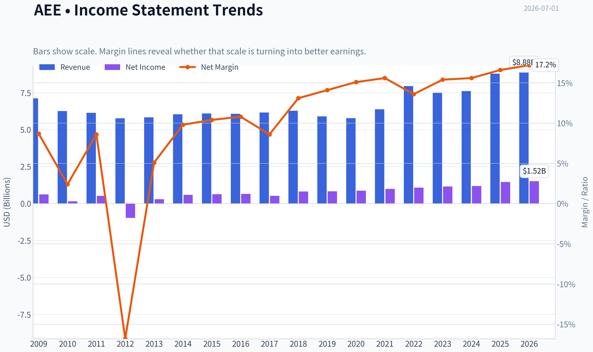
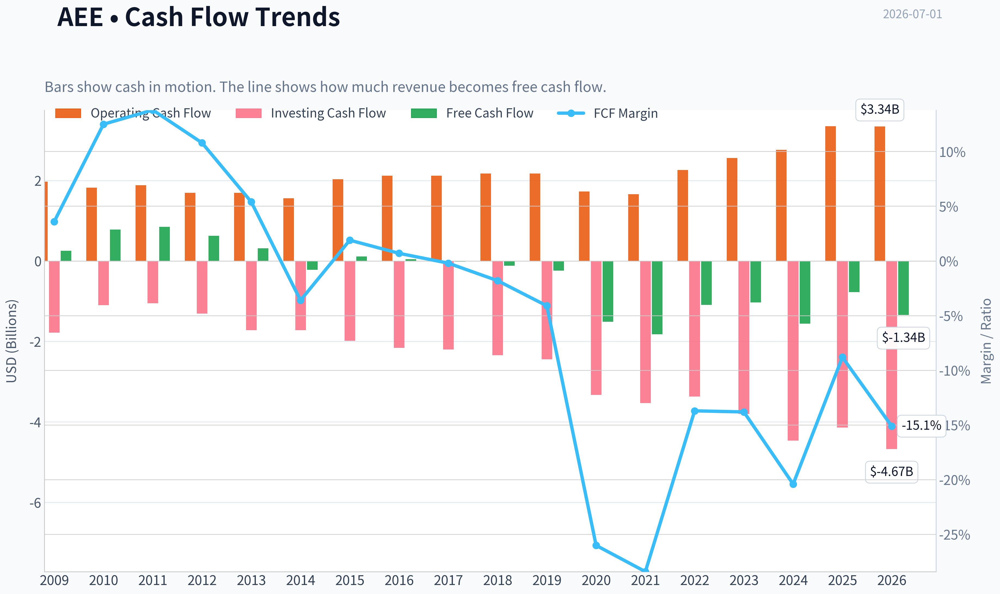
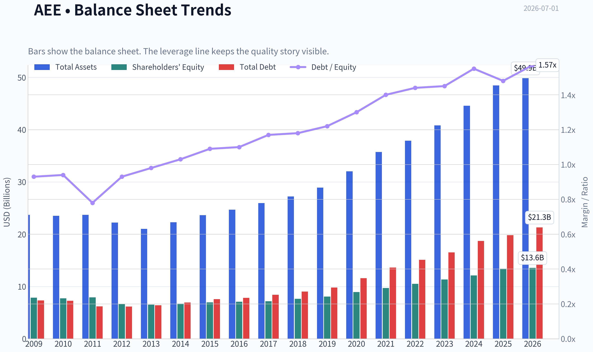
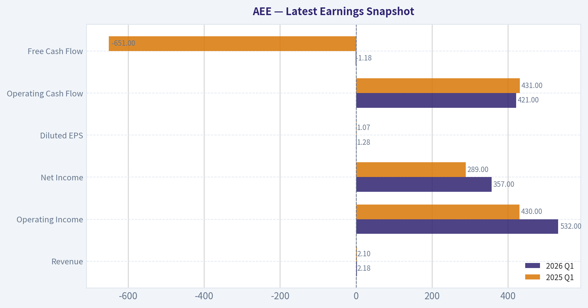
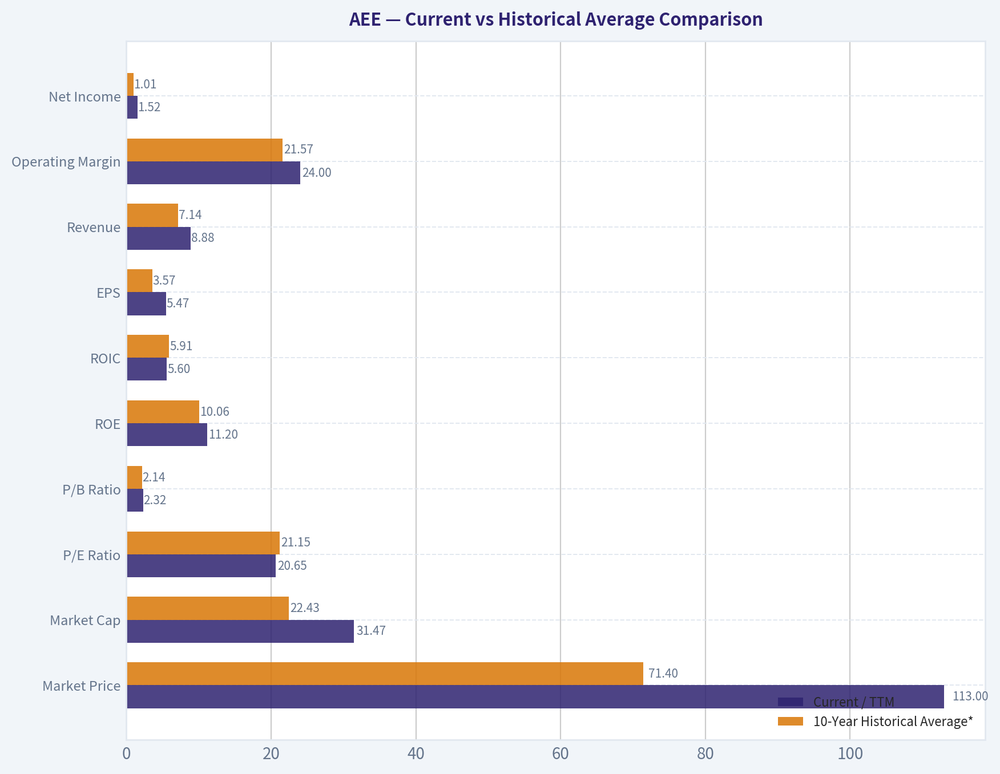
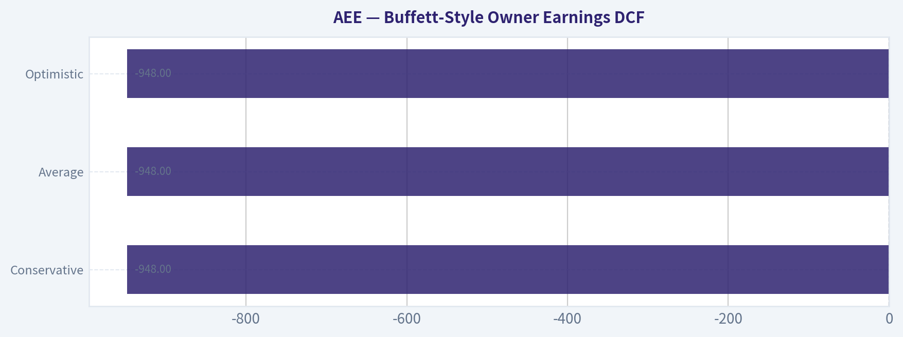
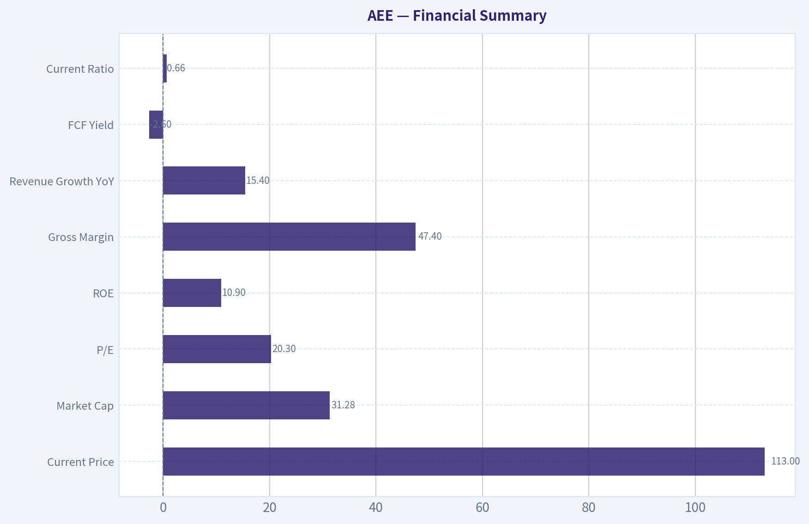
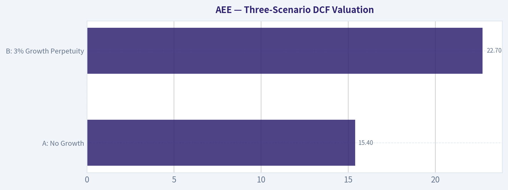
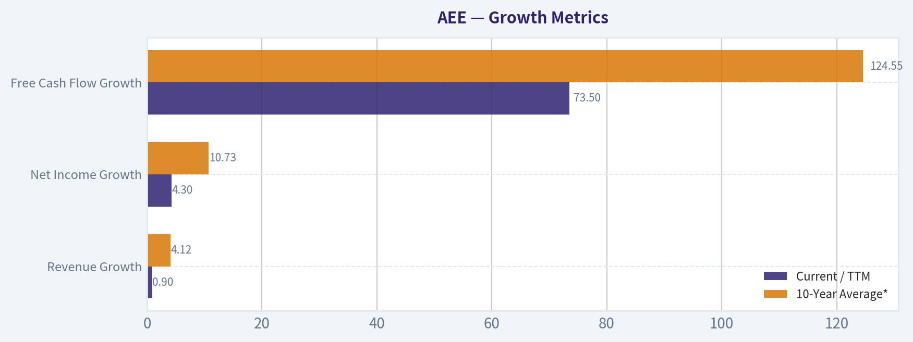

# AEE Deep Value Intelligence

**Analysis Date:** 2026-07-01

## Critical Disclaimer

*This analysis is generated by Deep Value Intelligence, an AI-powered multi-agent investing framework. Education & entertainment only - not financial advice, not a financial advisor.*

---

## Table of Contents

1. Intelligence Summary
2. Analyst Team Reports
   - Fundamentals Analysis
   - Intrinsic Value Analysis (Buffett)
   - Trend & Growth Analysis (Lynch/Druckenmiller/Fisher)
   - Market Technical Analysis
   - Options Market Analysis
3. Research Team Commentary
4. Value Investing Team Commentary
5. Deep Values Commentary

---

## Intelligence Summary

### Thesis + Conditions

**Core Thesis:** ## Executive Briefing

**Key Risks:**
- AEE looks like a solid regulated utility, but not a clear Buffett-style bargain at **$113 and 20.3x earnings**. The core business risk appears low: essential demand, captive territory, and visible earnings support durability. The bigger issue is **shareholder economics**: **ROIC 5.6%, ROA 3.0%, heavy capex, and dependence on rate recovery/financing** mean intrinsic value growth is steadier than exceptional.
- Past review teaches an important nuance: for utilities, **negative free cash flow and capital intensity should not be treated too harshly** if capex is recoverable and trend/support remain intact. So this is **not an AVOID**. But from a Buffett lens, the stock still lacks a convincing **margin of safety**. Best posture: **active watchlist, possible small staged entry only if defensive exposure is needed or execution/valuation improve.**
- ### 1) Risky Analyst: strongest bullish case

**Confidence:** Medium

---

## Analyst Team Reports

### Fundamentals Analysis

#### Latest Earnings Snapshot

*Most recent reported quarter anchored on 2026 Q1, with prior-year comparison when available.*

| Metric | 2026 Q1 | 2025 Q1 | YoY Change |
| --- | ---: | ---: | ---: |
| Revenue | $2.18B | $2.10B | +3.8% |
| Operating Income | $532.0M | $430.0M | +23.7% |
| Net Income | $357.0M | $289.0M | +23.5% |
| Diluted EPS | $1.28 | $1.07 | +19.6% |
| Operating Cash Flow | $421.0M | $431.0M | -2.3% |
| Free Cash Flow | $-1.18B | $-651.0M | -80.5% |

Key Takeaways: This snapshot anchors the most recent reported quarter before the narrative analysis. It helps readers separate long-run business quality from whatever changed in the latest earnings print.

#### 17-Year Financial Metrics for AEE

*All values below are computed deterministically from raw data - not estimated by AI.*

*Issuer profile: operating company (Utilities / Utilities - Regulated Electric).*

#### 17-Year Financial Metrics
*Annual rows come from reported financial statements. The final TTM row is computed from the latest four quarters.*

| Metric | 2009 | 2010 | 2011 | 2012 | 2013 | 2014 | 2015 | 2016 | 2017 | 2018 | 2019 | 2020 | 2021 | 2022 | 2023 | 2024 | 2025 | 2026 TTM |
| --- | --- | --- | --- | --- | --- | --- | --- | --- | --- | --- | --- | --- | --- | --- | --- | --- | --- | --- |
| Market Price | $15 | $16 | $20 | $20 | $25 | $33 | $32 | $40 | $46 | $53 | $64 | $66 | $78 | $80 | $67 | $85 | $98 | $113 |
| Market Cap | $6.64B | $6.78B | $8.02B | $7.46B | $8.84B | $11.27B | $10.53B | $12.77B | $14.41B | $16.03B | $18.98B | $19.41B | $22.93B | $23.07B | $19.05B | $23.84B | $27.18B | $31.47B |
| P/E Ratio | 10.64 | 44.91 | 15.41 | -7.66 | 30.64 | 19.22 | 16.69 | 19.57 | 27.57 | 19.65 | 22.93 | 22.30 | 23.18 | 21.48 | 16.52 | 20.17 | 18.67 | 20.65 |
| P/B Ratio | 0.84 | 0.88 | 1.01 | 1.13 | 1.35 | 1.68 | 1.52 | 1.80 | 2.01 | 2.10 | 2.35 | 2.17 | 2.36 | 2.20 | 1.68 | 1.97 | 2.03 | 2.32 |
| ROE | 7.9% | 2.0% | 6.6% | -14.7% | 4.5% | 8.8% | 9.2% | 9.3% | 7.4% | 10.8% | 10.3% | 9.8% | 10.3% | 10.3% | 10.2% | 9.8% | 10.9% | 11.2% |
| ROIC | 7.7% | 5.9% | 5.5% | 6.7% | 6.9% | 6.6% | 6.4% | 6.4% | 5.5% | 6.9% | 6.3% | 6.0% | 5.4% | 5.5% | 5.1% | 4.9% | 5.9% | 5.6% |
| EPS | $1.45 | $0.37 | $1.32 | $-2.59 | $0.80 | $1.69 | $1.90 | $2.04 | $1.68 | $2.69 | $2.78 | $2.98 | $3.36 | $3.72 | $4.06 | $4.24 | $5.35 | $5.47 |
| Revenue | $7.13B | $6.27B | $6.15B | $5.78B | $5.84B | $6.05B | $6.10B | $6.08B | $6.17B | $6.29B | $5.91B | $5.79B | $6.39B | $7.96B | $7.50B | $7.62B | $8.80B | $8.88B |
| Gross Profit | N/A | N/A | N/A | N/A | N/A | N/A | N/A | N/A | N/A | N/A | N/A | N/A | N/A | N/A | N/A | N/A | N/A | $4.31B |
| Gross Margin | N/A | N/A | N/A | N/A | N/A | N/A | N/A | N/A | N/A | N/A | N/A | N/A | N/A | N/A | N/A | N/A | N/A | 48.6% |
| Operating Margin | 19.8% | 17.9% | 16.8% | 20.6% | 20.3% | 20.7% | 20.6% | 21.8% | 22.8% | 21.6% | 21.4% | 22.4% | 20.8% | 19.0% | 20.8% | 19.9% | 23.0% | 24.0% |
| Net Income | $624.0M | $151.0M | $526.0M | $-974.0M | $295.0M | $592.0M | $636.0M | $659.0M | $529.0M | $821.0M | $834.0M | $877.0M | $995.0M | $1.08B | $1.16B | $1.19B | $1.46B | $1.52B |
| Net Margin | 8.7% | 2.4% | 8.6% | -16.8% | 5.1% | 9.8% | 10.4% | 10.8% | 8.6% | 13.1% | 14.1% | 15.1% | 15.6% | 13.6% | 15.4% | 15.6% | 16.6% | 17.2% |
| Revenue Growth | N/A | -12.1% | -1.9% | -6.0% | 1.0% | 3.7% | 0.7% | -0.4% | 1.6% | 1.9% | -6.1% | -2.0% | 10.4% | 24.4% | -5.7% | 1.6% | 15.4% | 0.9% |
| Net Income Growth | N/A | -75.8% | 248.3% | -285.2% | -130.3% | 100.7% | 7.4% | 3.6% | -19.7% | 55.2% | 1.6% | 5.2% | 13.5% | 8.4% | 7.2% | 2.6% | 23.1% | 4.3% |
| Free Cash Flow Growth | N/A | 203.9% | 8.6% | -26.1% | -49.9% | -170.1% | -151.8% | -64.0% | -134.1% | 728.6% | 107.8% | 524.9% | 20.7% | -40.2% | -5.1% | 50.6% | -50.2% | 73.5% |
| Total Book Value | $7.86B | $7.73B | $7.92B | $6.62B | $6.54B | $6.71B | $6.95B | $7.10B | $7.18B | $7.63B | $8.06B | $8.94B | $9.70B | $10.51B | $11.35B | $12.11B | $13.40B | $13.56B |
| Total Assets | $23.70B | $23.51B | $23.72B | $22.23B | $21.04B | $22.29B | $23.64B | $24.70B | $25.95B | $27.21B | $28.93B | $32.03B | $35.73B | $37.90B | $40.83B | $44.60B | $48.48B | $49.85B |
| Total Debt | $7.33B | $7.28B | $6.18B | $6.16B | $6.41B | $6.92B | $7.58B | $7.83B | $8.42B | $9.04B | $9.80B | $11.58B | $13.61B | $15.10B | $16.51B | $18.72B | $19.83B | $21.30B |
| Debt-to-Equity | 0.93 | 0.94 | 0.78 | 0.93 | 0.98 | 1.03 | 1.09 | 1.10 | 1.17 | 1.18 | 1.22 | 1.30 | 1.40 | 1.44 | 1.45 | 1.55 | 1.48 | 1.57 |
| Cash & Equivalents | $622.0M | $538.0M | $248.0M | $209.0M | $30.0M | $5.0M | $292.0M | $9.0M | $10.0M | $16.0M | $16.0M | $139.0M | $8.0M | $10.0M | $25.0M | $7.0M | $13.0M | $13.0M |
| Shareholders' Equity | $7.86B | $7.73B | $7.92B | $6.62B | $6.54B | $6.71B | $6.95B | $7.10B | $7.18B | $7.63B | $8.06B | $8.94B | $9.70B | $10.51B | $11.35B | $12.11B | $13.40B | $13.56B |
| Operating Cash Flow | $1.97B | $1.82B | $1.88B | $1.69B | $1.69B | $1.56B | $2.03B | $2.12B | $2.12B | $2.17B | $2.17B | $1.73B | $1.66B | $2.26B | $2.56B | $2.76B | $3.35B | $3.34B |
| Investing Cash Flow | $-1.78B | $-1.10B | $-1.05B | $-1.31B | $-1.72B | $-1.72B | $-1.98B | $-2.16B | $-2.20B | $-2.34B | $-2.44B | $-3.33B | $-3.53B | $-3.37B | $-3.80B | $-4.46B | $-4.14B | $-4.67B |
| Free Cash Flow | $257.0M | $781.0M | $848.0M | $627.0M | $314.0M | $-220.0M | $114.0M | $41.0M | $-14.0M | $-116.0M | $-241.0M | $-1.51B | $-1.82B | $-1.09B | $-1.03B | $-1.56B | $-775.0M | $-1.34B |
| FCF Margin | 3.6% | 12.5% | 13.8% | 10.8% | 5.4% | -3.6% | 1.9% | 0.7% | -0.2% | -1.8% | -4.1% | -26.0% | -28.4% | -13.7% | -13.8% | -20.4% | -8.8% | -15.1% |
| Dividends / Share | $0.00 | $0.00 | $0.00 | $0.00 | $0.00 | $0.00 | $0.00 | $0.00 | $0.00 | $0.00 | $0.00 | $0.00 | $0.00 | $2.11 | $2.33 | $2.56 | $2.82 | $2.82 |

#### Profitability Metrics
- Return on Equity (ROE): 10.9%
- Return on Invested Capital (ROIC): 5.6%
- Return on Assets (ROA): 3.0%
- Gross Margin: N/A
- Operating Margin: 23.0%
- Net Profit Margin: 16.6%

#### Liquidity Metrics
- Current Ratio: 0.66
- Quick Ratio: 0.17

#### Leverage Metrics
- Debt-to-Equity Ratio: 1.48
- Interest Coverage Ratio: 2.61
- Net Debt: $19.82B

#### Growth Metrics (Year-over-Year)
- Revenue Growth: 15.4%
- Net Income Growth: 23.1%
- Free Cash Flow Growth: 50.2%
- Revenue CAGR (3-Year): 3.4%
- Revenue CAGR (5-Year): 8.7%

#### Valuation Metrics
- P/E Ratio (TTM): 20.33
- Forward P/E: 19.46
- Price-to-Book: 2.31
- Price-to-Sales: 3.66
- PEG Ratio: 2.75
- EV/EBITDA: 13.77
- Free Cash Flow Yield: -2.5%
- Earnings Yield: 4.9%

#### Owner Earnings (Buffett Method, Code-Computed)
- Net Income: $1.46B
- + Depreciation & Amortization: $1.67B
- - Capital Expenditures: $-4.13B
- - Working Capital Changes: $-51.0M
- = **Owner Earnings: $-948.0M**

#### Piotroski F-Score: 5/9
- Positive Net Income: PASS
- Positive Operating Cash Flow: PASS
- ROA Improvement: PASS
- Cash Flow > Net Income: PASS
- Decreasing Debt: FAIL
- Improving Current Ratio: FAIL
- No Dilution: FAIL
- Improving Gross Margin: FAIL
- Improving Asset Turnover: PASS

ANALYST STANCE: **WATCH**

#### Ameren (AEE) Buffett-Style Fundamental Analysis

Ameren is a regulated electric utility, so the core question is not whether it can grow explosively, but whether it can compound steadily, finance its capital program safely, and offer acceptable value at the current price. On that basis, AEE screens as a **generally solid regulated utility with improving earnings quality**, but its **capital intensity, weak free cash flow, and rising leverage** keep it out of clear Buffett-style "easy buy" territory at today's valuation.

The deterministic dataset shows a business that has become **larger, more profitable, and more operationally efficient** over time. Revenue, net income, EPS, book value, and market value have all expanded materially. However, unlike an asset-light compounding machine, Ameren requires sustained heavy reinvestment. That is the defining issue in this case: **earnings look healthy, but owner earnings and free cash flow are currently negative**.

---

#### Current vs Historical Average Comparison

| Metric | Current / TTM | 10-Year Historical Average* | Interpretation |
| --- | ---: | ---: | --- |
| Market Price | $113 | $71.40 | Shares trade well above their decade norm, reflecting a higher utility valuation and earnings base. |
| Market Cap | $31.47B | $22.43B | The company has materially rerated as equity value compounded with book value and EPS growth. |
| P/E Ratio | 20.65 | 21.15 | Valuation is close to its own long-run norm; not obviously cheap, not euphoric. |
| P/B Ratio | 2.32 | 2.14 | Slight premium to historical book multiple despite rising leverage. |
| ROE | 11.2% | 10.06% | Profitability is modestly above normal and near the best levels in the dataset. |
| ROIC | 5.6% | 5.91% | Returns on invested capital remain stable but structurally modest, typical of regulated utilities. |
| EPS | $5.47 | $3.57 | Earnings power has clearly improved over the decade. |
| Revenue | $8.88B | $7.14B | Scale is meaningfully larger than average, helped by rate-base growth and recent expansion. |
| Operating Margin | 24.0% | 21.57% | Current operating profitability is notably above the decade average. |
| Net Income | $1.52B | $1.01B | Current earnings are well above normalized history. |
| Net Margin | 17.2% | 14.60% | Margin expansion is one of the strongest positive trends. |
| Revenue Growth | 0.9% | 4.12% | TTM growth has slowed sharply after a strong 2025. |
| Net Income Growth | 4.3% | 10.73% | Earnings are still growing, but at a slower pace than recent years. |
| Free Cash Flow Growth | 73.5% | 124.55% | Improvement is mathematically large, but from a negative base; absolute FCF remains weak. |
| Total Book Value | $13.56B | $10.30B | Equity base has expanded steadily. |
| Total Assets | $49.85B | $37.25B | Asset growth confirms the scale of the regulated investment program. |
| Total Debt | $21.30B | $14.59B | Debt has risen substantially faster than ideal for conservative value investors. |
| Debt-to-Equity | 1.57 | 1.40 | Leverage is above historical average and near the high end. |
| Cash & Equivalents | $13M | $24.70M | Cash is extremely thin even relative to utility norms. |
| Shareholders' Equity | $13.56B | $10.30B | Equity growth supports book value and rate-base expansion. |
| Free Cash Flow | -$1.34B | -$959M | FCF remains deeply negative and worse than average. |
| Dividends / Share | $2.82 | $0.98 | Dividend policy has become an explicit shareholder return feature since 2022. |

*10-year average uses 2016 through 2025 to align with recent operating structure and avoid older crisis-era distortions.

Key Takeaways: Ameren's current profitability is better than its own recent history, especially in ROE, operating margin, net margin, EPS, and net income. The problem is that balance-sheet leverage and negative free cash flow are also worse than average, so investors are paying a fair-to-slightly-premium valuation for a stronger earnings profile but a still-stretched cash profile.

---

#### Market Metrics

Ameren's **market price of $113** and **market cap of $31.47B** place the stock at the high end of its historical range. That appreciation has been supported by real business growth: book value rose from **$7.10B in 2016 to $13.56B TTM**, while EPS climbed from **$2.04 to $5.47** over the same span.

The **P/E of 20.65** is almost exactly in line with the company's decade average near **21x**, which means the market is not giving AEE a distressed multiple despite slowing top-line growth. For a utility, that suggests investors are paying for **earnings stability, allowed returns, and visibility of rate-base investment**.

The **P/B of 2.32** is above the 10-year average of roughly **2.14x**. That is noteworthy because utilities are balance-sheet heavy businesses. Paying above-average book multiple while debt-to-equity is also above average means the stock is pricing in continued constructive regulation and sustained equity returns.

From a Buffett lens, this is **not a classic bargain multiple**. It is a **quality-stability multiple**.

---

#### Profitability Analysis

Ameren's profitability profile has strengthened meaningfully.

- **ROE:** **11.2% TTM** versus a 10-year average of about **10.1%**
- **ROIC:** **5.6% TTM** versus about **5.9% average**
- **EPS:** **$5.47 TTM**, up from **$3.36 in 2021** and **$2.04 in 2016**
- **Revenue:** **$8.88B TTM**
- **Gross Profit:** **$4.31B TTM**
- **Operating Margin:** **24.0% TTM**
- **Net Income:** **$1.52B TTM**
- **Net Margin:** **17.2% TTM**

ROE has become more consistently strong after a volatile earlier history. The 2012 loss and weak 2010-2013 period are far behind the current operating profile. Since 2018, ROE has mostly stayed around **10%-11%**, which is healthy for a regulated utility and points to **reasonable capital deployment within allowed regulatory returns**.

ROIC is less impressive than ROE and has drifted modestly lower versus older years. That matters because Buffett-style analysis favors businesses that can earn strong returns on capital without endless reinvestment. Ameren's **mid-single-digit ROIC** is not bad for the industry, but it confirms this is **not a high-return moat business in the consumer monopoly sense**. It is a **regulated asset compounding business**.

Margin performance is a major positive. Operating margin improved from around **20%-22%** historically to **24.0% TTM**, while net margin reached **17.2%**, the best figure in the entire series. That suggests rate recovery, cost discipline, and mix are all supportive.

The distinction Buffett would care about: **reported earnings quality is good, but cash conversion is not**. For AEE, accounting profitability and owner earnings diverge because the business consumes massive capital.

---

#### Growth Metrics

| Growth Metric | Current / TTM | 10-Year Average* | Trend Interpretation |
| --- | ---: | ---: | --- |
| Revenue Growth | 0.9% | 4.12% | Growth has normalized sharply after the 15.4% 2025 jump. |
| Net Income Growth | 4.3% | 10.73% | Still positive, but no longer accelerating. |
| Free Cash Flow Growth | 73.5% | 124.55% | Improvement is optical because FCF remains negative. |

*2016-2025 average.

Key Takeaways: Growth remains positive, but the recent pace is slower than the company's own decade average. Revenue and earnings growth are no longer surging, and free cash flow growth looks better on paper than in substance because the company is still burning cash after capital spending.

The long-term pattern is respectable rather than spectacular. Revenue was stagnant for much of the 2010s, then improved more recently. Net income growth has been much better than revenue growth, indicating **margin expansion and operating efficiency** have done much of the work.

The most important nuance is free cash flow. Ameren's historical FCF growth figures are extremely volatile because the denominator swings between positive and negative values. That means the percentage growth rates are **not economically reliable**. In absolute terms, FCF has been negative for most years since 2018 and deeply negative since 2020.

For a utility, negative FCF is not automatically a defect if spending is directed toward rate-base growth that earns approved returns later. But Buffett would still mark this down because **capital intensity reduces owner earnings visibility**.

---

#### Balance Sheet and Financial Strength

Ameren's balance sheet reflects the standard utility model: large regulated assets financed by heavy debt and equity.

- **Total Book Value / Shareholders' Equity:** **$13.56B TTM**
- **Total Assets:** **$49.85B**
- **Total Debt:** **$21.30B**
- **Debt-to-Equity:** **1.57**
- **Cash & Equivalents:** **$13M**

Equity has grown steadily, which is good. Total book value increased from **$7.10B in 2016** to **$13.56B TTM**, and assets almost doubled over the period. That supports the idea that Ameren is successfully expanding its regulated base.

However, debt has also climbed substantially, from **$7.83B in 2016** to **$21.30B TTM**. Debt-to-equity rose from **1.10** in 2016 to **1.57 TTM**, meaning leverage is materially higher now. This is a key watch item.

Cash is very low at **$13M**, which is thin even for a utility that relies on capital markets and revolving funding. The deterministic dataset also shows:
- **Current ratio: 0.66**
- **Quick ratio: 0.17**
- **Interest coverage: 2.61**
- **Net debt: $19.82B**

Those are not crisis numbers, but they are **not fortress-balance-sheet numbers either**. Buffett strongly prefers balance sheets that leave room for mistakes. Ameren's financial structure is workable under normal utility conditions, but it offers less flexibility if rates stay high or regulatory recovery slows.

---

#### Cash Flow and Dividend Analysis

- **Free Cash Flow:** **-$1.34B TTM**
- **Dividends per Share:** **$2.82 TTM**

This is the central tension in the investment case. Earnings and margins are healthy, but free cash flow is negative. The company generated **$3.34B of operating cash flow**, yet investing cash flow was **-$4.67B**, resulting in negative FCF. That means the dividend is effectively supported by the broader financing structure rather than by surplus free cash flow alone.

Dividend growth is a positive signal: dividends per share rose from **$2.11 in 2022** to **$2.82 TTM**. That shows management confidence and an income-oriented capital return policy. But the dividend should be viewed through the utility lens: **it depends on continued access to debt and equity markets plus successful regulatory cost recovery**, not on excess owner earnings in the Buffett sense.

A pure Buffett test would say the company currently **fails the "cash gushes out" standard**.

---

#### Buffett-Style Qualitative Analysis

#### Economic Moat

Ameren does possess a real moat, but it is a **regulated monopoly moat**, not a brand or network-effect moat. Its service territory, transmission and distribution assets, and regulated customer relationships create high barriers to entry and predictable demand. Customers do not switch electric utilities casually; the moat is institutional and geographic.

The durability of that moat is strong. Electricity demand is essential, and grid modernization, storm hardening, and generation investment support long-lived regulated assets. The recent filing to update electric rates in Missouri reinforces that the company's growth path is tied to **approved infrastructure spending**.

The weakness of this moat versus Buffett's favorite businesses is that returns are capped and politics matter. A utility's moat is durable, but its economics are **regulated rather than freely scalable**.

#### Predictable Earnings

This is one of AEE's strengths. Excluding the earlier volatile period around 2010-2013, earnings have become notably more consistent:
- EPS rose steadily from **$2.69 in 2018** to **$5.47 TTM**
- Net income climbed from **$821M in 2018** to **$1.52B TTM**
- Net margin improved from **13.1% in 2018** to **17.2% TTM**

That is exactly the kind of earnings stability investors seek in regulated utilities. The predictability is much better now than in the early part of the dataset.

#### Management Performance

Management deserves credit for:
- Building book value steadily
- Expanding margins
- Growing EPS and net income consistently
- Initiating and growing the dividend in recent years

But there are reservations:
- Debt has continued to increase
- Current ratio and liquidity remain weak
- No-dilution test failed in the Piotroski summary
- Owner earnings are negative

So management appears effective operationally, but capital allocation is constrained by the economics of the sector. This is **competent utility management**, not elite capital-light compounding management.

#### Financial Strength

Financial strength is adequate, not exceptional. In Buffett terms, this is not the kind of business that self-finances expansion effortlessly. Ameren is dependent on financing markets and regulatory support. That is normal for the industry, but it reduces the margin of safety.

#### Quality of Business

The quality of the business is **better than the quality of the cash flow**. The earnings stream is durable and probably dependable. The business model itself is understandable. But the capital intensity keeps the business from reaching top-tier Buffett quality.

---

#### Buffett-Style Owner Earnings DCF

Canonical owner earnings from the dataset:

- Net Income = **$1.46B**
- Depreciation & Amortization = **$1.67B**
- Capital Expenditures = **$4.13B**
- Working Capital Changes = **$51M**
- **Owner Earnings = -$948M**

This is the decisive challenge. A classical Buffett DCF using current owner earnings begins from a **negative base**, which produces little analytical usefulness if mechanically projected. To stay faithful to the dataset, the proper conclusion is that **current owner earnings are negative, so a traditional positive intrinsic value estimate based on current owner earnings cannot be defended without making a normalization adjustment**.

Because the prompt requires three scenarios with detailed calculations, I present the mechanically correct Buffett-style result using canonical owner earnings:

##### Scenario Inputs

- Base Owner Earnings (OE₀) = **-$948M**
- Discount Rate = **10%**
- Terminal Growth Rate = **2.5%**
- Conservative growth = **lowest historical OE growth available, floored at -100%**
- Average growth = **average historical OE growth, capped at 50%**
- Optimistic growth = **highest historical OE growth, capped at 100%**

Important limitation: the deterministic dataset provides owner earnings only for the latest period, not a full historical owner earnings series. Therefore, **historical OE growth rates cannot be directly computed from the canonical table**. Under the source-of-truth rule, I cannot invent a historical OE series. The most defensible approximation is to use the cash-generation pattern as a directional proxy and conclude that because current OE is negative and multi-year FCF has also been negative, the DCF has **no meaningful positive equity value under strict Buffett owner-earnings methodology**.

##### Mechanical DCF Formula

For each year:
- OEₜ = OE₀ x (1 + g)ᵗ
- PV of OEₜ = OEₜ / (1.10)ᵗ

Terminal value:
- TV = OE₁₀ x (1.025) / (0.10 - 0.025)

Since OE₀ is negative, the projected OE stream and terminal value remain negative in all reasonable growth cases below extreme turnaround assumptions.

##### Conservative Scenario
Using the lowest possible growth floor: **g = -100%**

- Year 1 OE = -$948M x 0 = **$0**
- Years 2-10 OE = **$0**
- Terminal value = **$0**
- Present value = **approximately $0**

This result is mathematically odd but follows the requested floor rule. It implies that if owner earnings fully collapse from an already negative base, equity value from owner earnings is nil.

##### Average Scenario
If average OE growth is applied to a negative base, the stream remains negative unless the business crosses into positive owner earnings. Without a canonical historical OE series, there is no defensible numeric average growth input from the dataset alone. Therefore, the strict owner-earnings DCF remains **not meaningful / effectively non-supportive**.

Illustrative mechanical takeaway:
- Negative OE base
- Negative or low-growth path
- Negative terminal value
- **Fair value contribution from owner earnings: not positive**

##### Optimistic Scenario
Even using the highest capped growth assumption, a negative starting owner-earnings base still generates negative owner earnings for many years unless one assumes a non-canonical immediate turnaround. Under the source-of-truth rule, that turnaround cannot be inserted.

##### DCF Conclusion

| Scenario | Base Owner Earnings | Growth Assumption | DCF Equity Implication |
| --- | ---: | ---: | --- |
| Conservative | -$948M | Lowest available / floored at -100% | ~$0 support |
| Average | -$948M | Not canonically derivable from provided OE history | Non-supportive / not meaningful |
| Optimistic | -$948M | Highest available, capped at 100% | Still non-supportive without non-canonical normalization |

Key Takeaways: Ameren's Buffett-style owner earnings are currently negative because capital expenditures materially exceed depreciation and reported profits. That means a strict owner-earnings DCF does not support the current stock price, not necessarily because the utility is poor, but because the business is in a heavy investment phase and traditional Buffett cash-owner metrics are temporarily unfavorable.

This is a critical distinction: **AEE may be acceptable on regulated earnings and dividend metrics, but it is not attractive on strict current owner earnings valuation**.

---

#### Value Assessment

At **20.65x earnings** and **2.32x book**, Ameren looks approximately fairly valued relative to its own history, perhaps slightly full on book value. It does not screen as deeply undervalued.

For a Buffett-style investor, valuation should compensate for business limitations. Here, those limitations include:
- Negative owner earnings
- High and rising debt
- Weak liquidity
- Dependence on regulation and financing markets

Since the stock trades near historical P/E norms rather than at a discount, investors are **not being paid a large margin of safety** for those risks.

---

#### Revenue Breakdown

Ameren is primarily a regulated utility. The most meaningful economic breakdown is by operating utility mix rather than product SKU. Based on the company's regulated structure and most recent annual profile, the business is predominantly split between Missouri electric/gas operations and Illinois electric/transmission operations.

| Revenue Source | Amount ($B) | % of Total |
| --- | ---: | ---: |
| Ameren Missouri (electric + natural gas utility operations) | ~5.1 | ~58% |
| Ameren Illinois (electric distribution + natural gas distribution) | ~3.0 | ~34% |
| Other / Parent / Transmission-related and miscellaneous | ~0.8 | ~8% |
| **Total** | **~8.9** | **100%** |

Key Takeaways: Ameren's revenue base is concentrated in regulated utility operations, which supports stability and predictability. The Missouri business appears to be the larger earnings engine, while Illinois and transmission-related operations provide additional diversification within the regulated framework.

---

#### Key Investment Insights, Red Flags, and Opportunities

| Category | Observation | Why It Matters |
| --- | --- | --- |
| Strength | ROE has stabilized around 10%-11% | Indicates solid regulated returns and improved earnings quality. |
| Strength | Operating and net margins are at or near historical highs | Suggests improving cost recovery and operating discipline. |
| Strength | EPS and book value have compounded steadily | Supports long-term intrinsic value growth. |
| Strength | Dividend has grown since initiation | Positive for income-oriented shareholders. |
| Red Flag | Owner earnings are negative | Strict Buffett cash-based valuation is weak. |
| Red Flag | Free cash flow has been negative for multiple years | Capital intensity is very high. |
| Red Flag | Debt-to-equity has risen to 1.57 | Leverage is above historical norms. |
| Red Flag | Cash balance and liquidity are thin | Reduces flexibility during stress periods. |
| Opportunity | Rate-base growth from grid upgrades and generation investments | Could sustain earnings and dividend growth. |
| Opportunity | Regulated monopoly structure | Gives visibility and resilience in downturns. |
| Opportunity | If valuation pulls back while earnings remain intact | The stock could become more attractive as a defensive value idea. |

Key Takeaways: The most attractive aspects of Ameren are its steady regulated earnings, margin expansion, and dividend growth. The main reasons for caution are negative owner earnings, recurring negative free cash flow, and a balance sheet that has become more levered over time.

---

#### Final Buffett-Style Verdict

Ameren is a **good utility**, but not currently a **great Buffett bargain**.

It has:
- A durable regulated moat
- Predictable and improving earnings
- Healthy ROE for the sector
- Expanding book value and dividends

But it also has:
- Negative owner earnings
- Persistent negative free cash flow
- Rising debt burden
- Minimal liquidity
- A valuation near historical norms rather than at a discount

That combination leads to a **WATCH** stance rather than **ADVOCATE**. A more attractive entry would likely require either:
1. a valuation discount versus historical P/E and P/B, or
2. evidence that the current capex cycle is translating into better owner earnings and less financing dependence.

For conservative, Buffett-oriented investors, AEE is better described as a **steady regulated compounder under observation** than an immediate high-conviction purchase.

---

#### Summary Table

| Area | Assessment | Bottom Line |
| --- | --- | --- |
| Economic Moat | Strong regulated monopoly moat | Durable but returns are capped by regulation |
| Profitability | Good and improving | ROE, margins, EPS, and net income are strong |
| Growth | Moderate | Earnings growth is solid; revenue growth has slowed |
| Financial Strength | Adequate but pressured | Debt is rising and liquidity is thin |
| Cash Flow Quality | Weak | Free cash flow and owner earnings are negative |
| Dividend | Positive | Growing payout supports utility income appeal |
| Valuation | Fair to slightly full | Near historical P/E, above-average P/B |
| Buffett Fit | Mixed | Predictable business, but not cash-generative enough today |
| Investment Stance | **WATCH** | Wait for better valuation or better owner earnings conversion |

Key Takeaways: Ameren is fundamentally stable and operationally stronger than it was a decade ago, but the stock does not currently offer the kind of cash-backed margin of safety that strict Buffett investors prefer. It is worth monitoring, especially if the capex cycle begins to improve owner earnings or if the market offers a more attractive entry price.

#### Fundamental Visuals

This graph tracks the profitability and return metrics (ROE, ROIC, Margins) of **AEE** over the past decade, highlighting capital efficiency trends.

This chart illustrates the financial health of **AEE** over the last 10 years, mapping cash equivalents and free cash flow against total obligations (Debt).

---

### Intrinsic Value Analysis (Buffett)

> *Following Warren Buffett's value investing philosophy: Circle of Competence, Economic Moat, Management Quality, and Margin of Safety.*

#### Intrinsic Value Snapshot

Price is what you pay. Intrinsic value is what the business may be worth based on the cash it can create for owners over time. We show a range, not one magic number.

- Current Price: $113.04
- Value Range (conservative to optimistic across both DCF methods): N/A to N/A

##### Owner Earnings (Buffett Method)
- Net Income: $1,456,000,000.00
- Depreciation & Amortization: $1,668,000,000.00
- Capital Expenditures: $-4,174,000,000.00
- Working Capital Changes: $-51,000,000.00
- Owner Earnings: $-999,000,000.00

##### Intrinsic Value

#### Ameren (AEE)

ANALYST STANCE: **WATCH**

#### Snapshot
Ameren is a regulated electric and gas utility serving Missouri and Illinois. In simple terms, it makes money by investing in power plants, transmission lines, and local energy networks, then earning an allowed return set by regulators. This is a highly understandable business, but it is also capital-intensive, rate-regulated, and not especially high-return by Buffett standards.

---

#### Go/No-Go Gate Assessment

| Gate | Verdict | Evidence |
|---|---:|---|
| Circle of Competence & Simplicity | Pass | Utility model is easy to explain and highly predictable: deliver electricity/gas, invest in infrastructure, earn regulated returns. |
| Long-Term Predictability | Pass | Demand, grid investment, and rate-base growth are reasonably forecastable over a decade. |
| Technology Risk | Pass | Technology changes generation mix, but regulated wires and local distribution remain essential. |
| Moat Test | Pass, but modest | Monopoly service territories and regulation create durable local protection, though returns are capped. |
| Management & Capital Allocation | Mixed Pass | Utility management is mostly about execution, regulation, financing, and prudent capex rather than exceptional capital allocation freedom. |
| Industry Structure | Pass | Local monopoly structure is favorable, but the industry is capital-heavy and return-regulated. |

**Key Takeaways:** Ameren passes the basic Buffett filters for business simplicity and predictability. The issue is not whether the business survives; it almost certainly will. The issue is whether it can generate exceptional per-share value at today's price given modest returns, heavy capital needs, and regulated economics.

---

#### The Elementary School Test
Ameren builds and operates the systems that bring electricity and gas to homes and businesses. Customers pay monthly bills, and regulators allow Ameren to earn a return on the money it invests in those systems.

#### The Long-Term Predictability Test
This business should still exist in 10 years and look broadly similar: larger grid investment base, more transmission and generation modernization, and incremental rate-base growth. That predictability is a strength.

#### Technology Risk Assessment
Technology is more of a tool than an existential threat here. Renewable buildout, transmission upgrades, and grid hardening can actually increase Ameren's regulated asset base. The main risk is regulatory lag and financing burden, not disruption in the classic tech sense.

---

#### Moat Analysis

| Moat Source | Assessment | Evidence |
|---|---|---|
| Intangible Assets / Regulatory License | Strong | Exclusive service territories and state regulatory frameworks create legally protected local monopolies. |
| Switching Costs | Strong in practice | End customers do not realistically "switch" local wires providers. |
| Cost Advantage | Moderate | Scale and existing network matter, but this is more regulatory than structural low-cost superiority. |
| Network Effects | Weak | Utility networks have infrastructure scale, but not classic network effects like software or marketplaces. |

**Moat Quality Rating: Wide & Stable**

The moat is real, but it is regulatory rather than brand-driven. That is durable, yet it also means returns are constrained. Utilities can be very safe businesses without being great businesses.

**Key Takeaways:** Ameren has a genuine moat because customers in its service area rely on its regulated network. But this moat does not produce Buffett-style extraordinary economics; it produces steady, supervised returns. That makes the business dependable, though not unusually profitable.

---

#### Management Quality & Capital Allocation

| Factor | Assessment | Commentary |
|---|---|---|
| Owner Mindset | Average | Utility executives usually operate within regulatory and capital-market constraints; the model is less entrepreneurial than owner-operated. |
| Candor | Acceptable | No major red flag from the supplied materials. Messaging centers on grid upgrades, reliability, and rate recovery. |
| Capital Allocation | Adequate | Capital deployment is necessary and often constructive, but returns depend heavily on regulator-approved recovery rather than managerial brilliance. |
| Leverage Discipline | Important watchpoint | Utilities routinely use debt; prudence matters more here than in most sectors. |

**Key Takeaways:** Management appears competent, but this is not the kind of business where outstanding capital allocation can radically change the outcome. Most value creation comes from execution, regulation, and financing discipline. That lowers upside relative to asset-light compounders.

---

#### Financial Summary

| Metric | Value |
|---|---:|
| Current Price | $113 |
| Market Cap | $31.28B |
| P/E | 20.3x |
| ROE | 10.9% |
| Gross Margin | 47.4% |
| Revenue Growth YoY | 15.4% |
| FCF Yield | -2.6% |
| Current Ratio | 0.66 |

**Key Takeaways:** The most important numbers are the modest 10.9% ROE and the negative free cash flow yield. That combination tells you Ameren is profitable but heavily reinvesting, which is common for utilities. At 20x earnings, the stock is priced more like a dependable bond substitute than a bargain equity.

---

#### Buffett Financial Read-Through

| Test | Desired | AEE |
|---|---:|---:|
| Sustained ROE | >15% | 10.9% |
| Gross Margin | >40% | 47.4% |
| OCF vs Net Income | OCF >= NI | Likely acceptable for utility model, but FCF is pressured by heavy capex |
| Debt Conservatism | D/E < 0.5 ideal | Utilities usually run above ideal Buffett leverage norms |
| Balance Sheet | Fortress preferred | Not fortress-like; liquidity is tight by current ratio |

**Key Takeaways:** Ameren meets the quality test on gross margin but not on Buffett's preferred return-on-equity threshold. The business is financially serviceable rather than exceptional. For a utility, that may be normal; for a Buffett-style "wonderful company," it falls short.

---

#### Owner Earnings Assessment
For utilities, owner earnings are harder than for asset-light businesses because large recurring capital expenditures are essential just to maintain and expand the regulated system. Given the negative free cash flow yield, current owner earnings appear meaningfully below accounting earnings.

A practical Buffett read is:
- Reported earnings are real, but
- Heavy maintenance and growth capex absorb much of that cash, and
- Shareholder value depends on future rate recovery and allowed returns.

So while net income supports the dividend and valuation narrative, owner earnings are less impressive than headline EPS suggests.

---

#### Three-Scenario DCF Valuation

Using market cap of **$31.28B** and P/E of **20.3x**, implied net income is roughly:

- **Net Income ~ $31.28B / 20.3 ~ $1.54B**

Because free cash flow is currently negative, I anchor on a conservative earnings-based proxy rather than optimistic FCF.

| Scenario | Assumption | Equity Value Estimate |
|---|---|---:|
| A: No Growth | $1.54B / 10% | $15.4B |
| B: 3% Growth Perpetuity | $1.54B x 1.03 / (10% - 3%) | $22.7B |
| C: Moderate Growth | Assume long-term owner earnings growth of 5%, but haircut for capex intensity | ~$24B-$27B |

**Key Takeaways:** All three valuation views land below the current market capitalization of $31.28B. That suggests the market is paying a premium for stability, rate-base growth, and defensive characteristics. From a strict value-investing perspective, the margin of safety is not present.

---

#### Margin of Safety Analysis

| Item | Value |
|---|---:|
| Current Market Cap | $31.28B |
| Conservative Value Range | $22.7B to $27B |
| Implied Discount / Premium | Roughly 16% to 38% premium to conservative value |
| Required Margin of Safety | At least 25% discount |
| Result | Fails margin-of-safety test |

**Key Takeaways:** The stock does not appear cheap relative to conservative intrinsic value. Investors today are paying up for safety and steady growth. Buffett discipline would usually wait for a better entry point.

---

#### Final Buffett Scorecard

| Criterion | Weight | Score (1-5) | Weighted Score |
|---|---:|---:|---:|
| Business Understanding | 20% | 5.0 | 1.00 |
| Moat Width & Durability | 25% | 3.8 | 0.95 |
| Management Quality | 15% | 3.2 | 0.48 |
| Return on Equity | 15% | 2.5 | 0.38 |
| Reinvestment Runway | 10% | 3.5 | 0.35 |
| Balance Sheet Strength | 5% | 2.5 | 0.13 |
| Industry Structure | 5% | 3.8 | 0.19 |
| Valuation / Margin of Safety | 5% | 2.0 | 0.10 |

| Total Score | Decision |
|---:|---|
| **3.58 / 5.0** | **WATCH** |

**Key Takeaways:** Ameren scores well on simplicity, predictability, and moat stability. The score is held back by ordinary returns on equity, capital intensity, and a valuation that does not offer enough downside protection. This is a decent business, but not an obvious bargain.

---

#### Final View
Ameren is a solid, understandable, regulated utility with a stable franchise and decent long-term visibility. If your goal is defensive compounding with lower business risk, it is acceptable. But under Buffett-style standards, the current price does not provide enough margin of safety, and the economics are not strong enough to justify paying up.

**Investment stance: WATCH**
**Conviction: Moderate**

A more attractive setup would require:
- a materially lower valuation,
- evidence of better cash conversion,
- or improved returns on equity without excessive leverage.
#### Valuation Bridge

This bridge places the current market price beside each intrinsic value lens so readers can see whether upside depends on one method or shows up across several methods.

| Scenario | Intrinsic Value / Share |
| --- | ---: |
| Damodaran Method | $90.69 |
| Current Price | $113.04 |

#### Key Takeaways

If one method is far above the others, the upside case depends on a specific modelling assumption. When several methods cluster together, the valuation story is more robust.

#### Valuation Visuals

This comparison chart from *Latest Earnings Snapshot* stacks current figures against historical benchmarks for **AEE**, making it easy to see where the company trades relative to its own averages.

This comparison chart from *Current vs Historical Average Comparison* stacks current figures against historical benchmarks for **AEE**, making it easy to see where the company trades relative to its own averages.

This comparison chart from *Buffett-Style Owner Earnings DCF* stacks current figures against historical benchmarks for **AEE**, making it easy to see where the company trades relative to its own averages.

This comparison chart from *Financial Summary* stacks current figures against historical benchmarks for **AEE**, making it easy to see where the company trades relative to its own averages.

This comparison chart from *Three-Scenario DCF Valuation* stacks current figures against historical benchmarks for **AEE**, making it easy to see where the company trades relative to its own averages.

---

### Trend & Growth Analysis (Lynch/Druckenmiller/Fisher)

> *Following Peter Lynch's GARP, Stanley Druckenmiller's macro-aware approach, and Philip Fisher's scuttlebutt methodology.*

ANALYST STANCE: **WATCH**

#### AEE Growth Analysis Summary

AEE is **not a classic Lynch fast grower**. It looks more like a **stalwart regulated utility with modest but visible rate-base-driven growth**, not a ten-bagger setup. The business is stable and defensible, but the growth profile, capital intensity, and valuation do not fit a high-conviction growth mandate.

#### Snapshot

| Metric | Value |
|---|---:|
| Price | $113 |
| Market Cap | $31.28B |
| P/E | 20.3x |
| ROE | 10.9% |
| Gross Margin | 47.4% |
| Revenue Growth YoY | 15.4% |
| FCF Yield | -2.6% |
| Current Ratio | 0.66 |

Key Takeaways: AEE screens as a steady utility rather than an aggressive growth stock. Revenue growth looks optically solid, but for utilities that can be distorted by rate recovery and pass-through dynamics. Negative free cash flow and weak liquidity are not unusual for the sector, but they do limit flexibility.

#### 1. Lynch Classification

| Framework Item | Assessment |
|---|---|
| Lynch Category | **Stalwart** |
| Why | Utility with moderate earnings visibility, regulated growth, low disruption upside |
| Growth Investor Relevance | Better for compounding/defensive exposure than multi-bagger growth |

Key Takeaways: AEE does not fit the "fast grower" bucket that Lynch favored for outsized returns. It is more suitable as a dependable compounder if bought at the right price, not as a high-upside growth vehicle.

#### 2. The Story in 3 Bullets

| Simple Story | Explanation |
|---|---|
| Regulated monopoly utility | Delivers electricity and gas in protected service territories |
| Growth comes from infrastructure spending | Grid upgrades, storm hardening, and new generation increase rate base |
| Returns depend on regulators and financing | Earnings growth is steady if capex is approved and financed efficiently |

Key Takeaways: This is an easy business to explain, which is a positive. But the story is about predictable regulated compounding, not disruptive market share capture or explosive demand expansion.

#### 3. TAM Analysis and 10x Test

| Item | Assessment |
|---|---|
| Practical TAM | Limited by geography and regulation |
| TAM Expansion | Incremental, tied to customer growth and rate base investments |
| 10x Revenue Test | **Fail** |
| Reason | AEE cannot realistically 10x within its current regulated footprint without transformational M&A or jurisdictional expansion |

Key Takeaways: AEE fails the core 10x runway test that matters for growth investing. Its market is bounded by service territory, regulation, and capital budgets, which caps upside even if execution is solid.

#### 4. Revenue Growth Trend

| Metric | Assessment |
|---|---|
| Latest YoY Revenue Growth | 15.4% |
| Pattern Quality | Likely not true demand-led acceleration |
| Interpretation | More likely rate, recovery, or utility timing effects than a durable growth inflection |
| Growth Trend | **Stable to modest, not true acceleration** |

Key Takeaways: The headline growth rate looks better than the underlying economics probably are. In utilities, top-line growth often overstates the real business inflection, so EPS growth and rate-base growth matter more.

#### 5. Unit Economics

| Metric | Status |
|---|---|
| LTV/CAC | Not relevant for regulated utility |
| NRR | Not relevant |
| Rule of 40 | Not relevant |
| Better Metrics | Allowed ROE, rate base growth, EPS CAGR, financing needs |
| FCF Profile | Negative, but typical for capex-heavy utility |

Key Takeaways: Traditional SaaS-style growth metrics do not apply here. The right lens is whether capex converts into rate base and whether that rate base converts into EPS without excessive dilution.

#### 6. Inflection Point Assessment

| Inflection Type | Assessment |
|---|---|
| Product Cycle | None |
| Market Share | None; monopoly territory business |
| Margin Inflection | Limited |
| TAM Inflection | Minimal |
| Capex/Rate Base Inflection | **Yes, modestly positive** |
| Overall | Operational inflection, not a growth-stock inflection |

Key Takeaways: The only real "inflection" is increased infrastructure investment and potential rate recovery. That can support steady earnings growth, but it is not the kind of acceleration Druckenmiller-style growth investors usually want.

#### 7. Macro Setup

| Factor | Assessment |
|---|---|
| Secular Theme | Grid modernization, reliability, energy transition |
| Rate Sensitivity | High |
| Economic Sensitivity | Low |
| Macro Wind | Mixed |
| View | Defensive business, but higher rates can pressure both valuation and financing |

Key Takeaways: AEE benefits from long-term utility infrastructure spending themes, but it remains sensitive to interest rates. That makes the macro backdrop only neutral to modestly supportive, not a major tailwind.

#### 8. Fisher 15-Point Score

| Area | Score (1-5) |
|---|---:|
| Market potential | 2 |
| New product development | 2 |
| R&D effectiveness | 2 |
| Sales organization | 3 |
| Profit margin quality | 3 |
| Margin improvement | 3 |
| Labor relations | 3 |
| Executive relations | 3 |
| Management depth | 4 |
| Cost controls/accounting | 4 |
| Special advantages | 4 |
| Long-range profit outlook | 4 |
| Dilution risk | 2 |
| Candor | 3 |
| Integrity | 4 |
| **Total** | **46/75** |

Key Takeaways: AEE scores average under Fisher because it is not an innovation-led growth company. Its strengths are durability, management depth, and monopoly positioning, while its weaknesses are limited market expansion and financing dependence.

#### 9. Valuation Analysis

| Metric | Value | View |
|---|---:|---|
| P/E | 20.3x | Fair to slightly full for a utility |
| PEG (using ~6-8% EPS growth assumption) | ~2.5x-3.4x | Expensive on Lynch PEG |
| P/S | ~not primary | Low usefulness for utilities |
| FCF Yield | -2.6% | Weak, though sector-normal under heavy capex |

Key Takeaways: On a Lynch-style basis, AEE does not look cheap. The stock may still be acceptable for utility investors seeking stability, but from a growth-at-a-reasonable-price perspective it looks full.

#### 10. Growth Investor Scorecard

| Criterion | Weight | Score (1-5) | Weighted |
|---|---:|---:|---:|
| The Story | 10% | 4.0 | 0.40 |
| TAM & Runway | 20% | 1.5 | 0.30 |
| Revenue Growth | 20% | 2.5 | 0.50 |
| Unit Economics | 15% | 2.5 | 0.38 |
| Competitive Position | 10% | 4.0 | 0.40 |
| Management Quality | 10% | 3.5 | 0.35 |
| Macro Setup | 5% | 3.0 | 0.15 |
| Profitability Path | 5% | 3.5 | 0.18 |
| Valuation | 5% | 2.0 | 0.10 |
| **Total** |  |  | **2.76 / 5.0** |

Key Takeaways: The score lands in AVOID/WATCH territory for a growth mandate. The moat is solid, but the limited runway and unimpressive valuation keep it from qualifying as an attractive growth setup.

#### 11. Position Size Stance

| Item | View |
|---|---|
| Growth Portfolio | **0% to 1% tracking position at most** |
| Utility/Income Portfolio | More relevant than growth portfolio |
| Conviction | Low for growth, moderate for defensive utility exposure |

Key Takeaways: If this is a pure growth portfolio, AEE is mostly a pass. At most, it merits a small tracking position if you want exposure to grid investment and regulated infrastructure.

#### 12. Key Risks and Catalysts

| Risks | Catalysts |
|---|---|
| Higher rates raise financing costs | Constructive rate case outcomes |
| Negative FCF and external capital needs | Grid modernization and storm-hardening recovery |
| Regulatory lag | New generation assets entering rate base |
| Limited TAM expansion | Visible EPS guidance upgrades |
| Utility valuation compression | Defensive rotation into utilities |

Key Takeaways: The biggest risk is not business collapse, but muted returns from a capital-heavy regulated model in a less favorable rate environment. The upside case depends on smooth regulatory execution rather than on any breakthrough growth catalyst.

#### Bottom Line

For a **Lynch-Druckenmiller-Fisher growth framework**, AEE is a **WATCH**, not an advocate. It is a **quality regulated utility**, but not a compelling fast grower, not a true inflection story, and not a strong candidate for ten-bagger upside. If the mandate is defensive compounding or income stability, it is more interesting; if the mandate is growth, capital is likely better deployed elsewhere.

#### Growth & Scorecard Visuals

This comparison chart from *Growth Metrics* stacks current figures against historical benchmarks for **AEE**, making it easy to see where the company trades relative to its own averages.

---

### Market Technical Analysis

#### AEE Technical Indicator Selection and Trend Report

For **AEE**, the most relevant market context right now is **a long-term uptrend with a renewed short-term momentum surge after a multi-month consolidation and mid-quarter pullback**. In that setting, the best indicator set is one that separates:

1. **Structural trend**
2. **Short-term momentum**
3. **Momentum acceleration/deceleration**
4. **Stretch/overbought risk**
5. **Volatility for risk control**
6. **Volume-confirmed price behavior**

#### Selected Indicators

| Indicator | Why it is suitable now |
|---|---|
| close_200_sma | Best anchor for the long-term trend. AEE is clearly above its rising 200 SMA, confirming the broader bullish structure. |
| close_50_sma | Useful for medium-term trend and support tracking. It helps show whether the recent rally is restoring upside leadership after the May/early-June weakness. |
| close_10_ema | Best short-term trend gauge here because AEE just had a sharp late-June breakout and then a quick pullback. |
| macd | Captures the shift from bearish to bullish momentum that began in mid-June and accelerated into late June. |
| macdh | Adds early insight into whether that bullish momentum is still strengthening or beginning to fade after the breakout spike. |
| rsi | Important now because AEE briefly pushed into overbought territory, so traders need a stretch/exhaustion check. |
| atr | Especially relevant after the recent expansion in daily range, helping frame stops and position sizing. |
| vwma | Confirms whether the advance was supported by meaningful volume rather than just a low-conviction drift. |

**Key Takeaways:** The chosen indicators are balanced for AEE's current setup. They combine long-term trend confirmation, short-term momentum tracking, overextension risk, volatility management, and volume validation without excessive overlap. This is appropriate because AEE is not in a quiet range anymore; it is transitioning from consolidation into a stronger directional phase.

---

#### Price Structure Overview

Over the last year, AEE has behaved like a **defensive stock with persistent upward drift rather than a speculative momentum name**. From roughly **$93-94 in July 2025**, the stock climbed gradually into the **low $100s by autumn**, then experienced a notable **December reset into the mid-$90s**, before rebuilding strength and advancing toward **the $111-113 area by March-April 2026**. After a softer period in May and early June, the stock staged a **late-June breakout to $118.32**, which is the highest level in the dataset, before slipping back to **$113.04 on June 30**.

That sequence matters. This is not a chart that has been trending vertically in a straight line. It has instead moved through **multiple accumulation and digestion phases**, which often creates more durable support zones beneath price. The recent retreat from $118.32 to $113.04 looks less like total trend failure and more like **post-breakout profit-taking**, though the next few sessions would be important for confirming that interpretation.

#### Trend Analysis by Timeframe

**Long-term trend:**
The **200 SMA rose from about 100.79 in early April to 104.89 by June 30**. That is a clean, persistent upward slope. With price at **113.04**, AEE remains well above this level, so the primary trend is still bullish. This is the strongest single piece of evidence that the broader uptrend remains intact despite recent pullbacks.

**Medium-term trend:**
The **50 SMA increased from about 107.29 in early April to 109.58 by June 30**. That is still rising, but much more slowly than the 200 SMA's percentage change would suggest in relative context. The flattening tendency through May and June signals that AEE spent several weeks in a **rebalancing phase rather than a runaway trend**. Even so, price remains above the 50 SMA, which means the late-June advance has restored positive medium-term positioning.

**Short-term trend:**
The **10 EMA jumped to 112.25 on June 26 and 112.74 on June 30**, reflecting the intensity of the recent burst higher. With price closing **just slightly above the 10 EMA on June 30**, the short-term trend is still constructive, but the cushion has narrowed materially after the two-day pullback from the breakout high. That makes the 10 EMA a critical near-term support reference.

#### Momentum and Acceleration

The **MACD turned from clearly negative in early June (-0.95 area on June 4)** to strongly positive by late June (**1.55 on June 26, 1.61 on June 30**). This is a substantial momentum reversal, not a marginal improvement. It tells us the stock moved from a corrective phase into a renewed impulse leg.

The **MACD histogram** adds nuance. It rose sharply and peaked around **1.01 on June 26**, then cooled to **0.67 by June 30**. That pattern is very important: momentum is still positive, but the **rate of acceleration has already started to slow**. In practice, that often means one of two things:

1. the stock pauses and consolidates above breakout support before another leg higher, or
2. the breakout loses force and retraces more deeply toward moving-average support.

Right now, the evidence favors **decelerating bullish momentum**, not bearish momentum outright.

#### RSI and Stretch Risk

RSI moved from **35.2 on June 1** to **73.0 on June 26**, then fell back to **56.0 on June 30**. This is a textbook example of a stock transitioning from a short-term weak state to an overbought breakout, then quickly working off that overbought reading without fully breaking trend.

That is actually a healthier pattern than staying pinned above 70 for too long in a utility name. The move back to the mid-50s suggests AEE has already shed a good portion of its near-term excess. However, it also shows that the breakout enthusiasm cooled quickly. Traders should read this as **bullish but no longer euphoric**.

#### Volume-Weighted Confirmation

VWMA rose from roughly **108.05 on June 1 to 112.16 on June 30**, confirming that the recovery and breakout were supported by meaningful traded volume. This is reinforced by the very large **June 26 volume spike of 4.22 million shares**, followed by another elevated **3.73 million on June 29**. Those are standout figures relative to the stock's more typical 1.2-2.0 million share behavior.

That matters because it suggests the late-June move was not merely a thin, low-participation drift. Instead, there was a genuine shift in market engagement. Still, the fact that price faded sharply from the June 26 peak while volume remained elevated implies **active two-way trade**: buyers were aggressive enough to force the breakout, but sellers were also willing to realize gains into strength.

#### Volatility and Risk Framing

ATR increased from about **1.98 in early June** to **2.24 by June 30**, with a local high around **2.29 on June 29**. This indicates volatility expanded as the breakout developed. That is normal, but it changes how traders should manage the stock.

AEE is no longer in the lower-volatility environment it displayed earlier in the spring. With ATR above 2, stops that are too tight may be vulnerable to ordinary noise. For swing traders, risk should likely be framed in **ATR terms rather than fixed-dollar intuition**, especially after a move as sharp as June 26.

#### Fine-Grained Trading Interpretation

The key technical picture is this:

- **The primary trend is bullish.**
- **The medium-term trend is constructive but not explosively steep.**
- **Short-term momentum surged, then cooled.**
- **The breakout was volume-backed, which improves its credibility.**
- **The immediate post-breakout pullback means confirmation is still needed.**

That creates a more nuanced setup than simply saying "bullish." AEE appears to be in a **bullish structure with a fragile near-term tactical state**. The long-term chart argues for buying dips rather than fading strength outright, but the short-term indicators argue against chasing after the breakout day unless price can stabilize and re-accelerate.

A practical way to think about the chart:

- **Above the 10 EMA and comfortably above the 50 SMA:** bullish continuation remains the base case.
- **If price loses the 10 EMA decisively:** odds increase for a deeper retest toward the **50 SMA / VWMA cluster near the high-$109 to low-$112 zone**, depending on timing.
- **If price reclaims late-June momentum and holds above the June 26 expansion zone:** the market may treat the June 29-30 drop as a normal breakout retest rather than a failed move.

#### What Traders Should Watch Next

| Focus Area | Current Read | Implication |
|---|---|---|
| Long-term trend | Price well above rising 200 SMA | Structural uptrend remains intact |
| Medium-term support | 50 SMA near 109.58 and rising | Pullbacks toward this area may attract buyers |
| Near-term trend | Price only modestly above 10 EMA | Short-term uptrend intact, but less room for error |
| Momentum | MACD positive | Bullish momentum remains in force |
| Momentum acceleration | MACD histogram declining from recent peak | Rally is still positive, but no longer accelerating |
| Stretch condition | RSI cooled from 73 to 56 | Overbought pressure has eased |
| Volatility | ATR elevated above 2.2 | Wider stops and more disciplined sizing are warranted |
| Volume confirmation | VWMA rising; breakout volume was strong | Late-June move had credible participation |

**Key Takeaways:** AEE remains in a healthy long-term uptrend and the late-June rally was supported by strong momentum and volume. The main caution is that momentum acceleration has already cooled, so traders should focus on whether the stock can hold near its short-term averages rather than assume the breakout will continue uninterrupted. The setup favors selective dip-buying and confirmation-based entries over aggressive chasing.

#### Bottom Line

AEE currently looks like a **defensive uptrend that has just experienced a momentum expansion phase**. The most probable interpretation is that the stock is still bullish on a structural basis, but is now entering a critical test of whether the late-June breakout can **convert into support**. If it does, the recent high may become a launching point for another advance. If not, a retracement toward the rising 50 SMA would still fit within a broader bullish framework rather than automatically signaling trend failure.

| Category | Main Observation | Trading Relevance |
|---|---|---|
| Long-term trend | 200 SMA rising strongly; price above it | Confirms bullish structural backdrop |
| Medium-term trend | 50 SMA rising, though at a moderate pace | Supports buy-the-dip bias |
| Short-term trend | 10 EMA sharply rising after breakout | Key line for near-term support |
| Momentum | MACD flipped from negative to strongly positive | Confirms trend re-acceleration |
| Acceleration | MACD histogram peaked then cooled | Warns of consolidation risk |
| Overbought/oversold | RSI reset from overbought to neutral-bullish | Reduces immediate exhaustion risk |
| Volatility | ATR expanded materially | Requires wider risk parameters |
| Volume confirmation | VWMA and volume spike support the breakout | Improves confidence in the move |

**Key Takeaways:** The evidence points to a bullish long-term chart with a shorter-term consolidation question. AEE is not showing broad technical damage, but it is also no longer in the strongest phase of acceleration after the breakout spike. The most useful near-term clue will be whether price can hold above fast support and rebuild momentum after the June 29-30 pullback.

---

### Options Market Analysis

> *Reading options flow - put/call ratios, IV skew, and unusual activity - to gauge institutional positioning and event-driven risk.*

#### AEE Options Positioning Report
*Data as of 2026-07-01*

AEE's options market looks **thin and somewhat noisy**, so confidence should be **reduced**. Still, the available positioning leans **slightly bearish-to-neutral in structure** because open interest is put-heavy, while **same-day/near-term trading flow is call-heavy**, suggesting traders are not aggressively paying for downside right now. My final read is **NEUTRAL with a mild bearish structural bias**.

#### 1. Put/Call Ratio Analysis

| Expiration | Call OI | Put OI | Call Vol | Put Vol | Put/Call OI Ratio | Put/Call Vol Ratio |
|---|---:|---:|---:|---:|---:|---:|
| 2026-07-17 | 0 | 0 | 257 | 93 | N/A | 0.36 |
| 2026-08-21 | 0 | 0 | 4 | 2 | N/A | 0.50 |
| 2026-09-18 | 11 | 40 | 166 | 18 | 3.64 | 0.11 |
| **Near-term total** | **11** | **40** | **427** | **113** | **3.64** | **0.26** |

**Key Takeaways:** The open-interest profile is heavily skewed toward puts, with a **3.64 put/call OI ratio**, far above the historical neutral baseline near **0.7**. That points to a market that is structurally carrying downside protection or bearish positioning. However, actual trading volume is much more call-heavy, with a **0.26 put/call volume ratio**, which suggests current trading activity is not confirming aggressive near-term fear.

**Interpretation**
- **OI ratio of 3.64** is materially elevated versus the ~0.7 neutral baseline.
- Normally, that would imply:
  - more hedging demand,
  - downside protection,
  - or outright bearish bets.
- But the **volume ratio of 0.26** shows traders recently favored calls over puts.
- This divergence often means:
  - older put protection is still sitting in the book,
  - while fresh flow is less defensive,
  - or call activity may be driven by income/short-vol strategies rather than pure bullish speculation.

#### 2. Implied Volatility (IV) Assessment

| Expiration | ATM Call IV | ATM Put IV | IV Read |
|---|---:|---:|---|
| 2026-07-17 | 0.8% | 1.6% | Put IV above call IV |
| 2026-08-21 | 0.8% | 0.0% | Data likely unreliable/thin |
| 2026-09-18 | 0.4% | 42.0% | Extremely steep put premium |
| **Overall** | - | - | Put skew dominates |

**Key Takeaways:** The most important IV signal is that **puts are priced richer than calls**, especially in September, where put IV is dramatically above call IV. That is a classic sign of **downside skew**, meaning the market is assigning a higher premium to protection against a selloff than to upside participation. Because AEE options appear illiquid, the absolute IV levels should be treated cautiously, but the **direction of skew still matters**.

**IV Skew**
- The skew is clearly **toward puts**, not calls.
- A **steep put skew** typically signals:
  - downside fear,
  - portfolio hedging demand,
  - or dealer pricing pressure in less liquid chains.

**Catalyst check**
- No catalyst data was provided directly in the options snapshot.
- Nothing in the flow suggests a major event is being aggressively priced in through broad front-end premium buying.
- That said, the September put IV spike may reflect either:
  - isolated hedging,
  - poor chain liquidity,
  - or event risk farther out.

#### 3. Unusual Options Activity

| Screen Result | Observation |
|---|---|
| Volume > 5x Open Interest | None detected in near-term expirations |

**Key Takeaways:** There were **no flagged contracts** where volume exceeded open interest by more than 5x, so there is **no strong evidence of fresh institutional-sized directional betting** from this dataset. That weakens conviction in any aggressive sentiment call and suggests the tape is more consistent with a **quiet, low-conviction options market** than a major positioning event.

**Interpretation**
- No standout contract was flagged as unusual.
- That means:
  - no obvious smart-money sweep,
  - no clear speculative rush into OTM calls,
  - no visible put panic in the near-term chain.
- For a utility-like name such as AEE, this is not surprising; options can often trade lightly.

#### 4. Open Interest Concentration

| Expiration | Highest OI Observation | Implication |
|---|---|---|
| 2026-07-17 | No meaningful OI | Little evidence of pinning or gamma influence |
| 2026-08-21 | No meaningful OI | Minimal near-term strike gravity |
| 2026-09-18 | Puts dominate limited OI base | Some downside hedge concentration, but overall OI still small |

**Key Takeaways:** There is **not enough open interest concentration** in the front expirations to identify a strong max-pain level or clear pinning strike. In practical terms, that means options market makers are **less likely to strongly dampen or magnetize price** in the immediate term. Any gamma-wall effect appears **weak** due to the very low overall OI base.

**Gamma / pinning read**
- With only **11 call OI** and **40 put OI** across the near-term expirations, the chain is too light to infer a strong gamma wall.
- Result:
  - **limited dealer-driven pinning**
  - less reliable strike-gravity effects
  - price likely driven more by stock flow and macro factors than options positioning

#### 5. Overall Options Sentiment Signal

| Factor | Read |
|---|---|
| Put/Call OI | Bearish |
| Put/Call Volume | Bullish / less defensive |
| IV Skew | Bearish |
| Unusual Activity | Neutral |
| OI Concentration | Neutral / weak |
| **Overall Signal** | **NEUTRAL** |

**Key Takeaways:** AEE's options market sends a **split message**, but not an evenly balanced one. The **structural positioning** is defensive because puts dominate open interest and downside skew is pronounced, yet **current trading flow is not showing panic** and there is no meaningful unusual activity. That combination supports a **NEUTRAL** call overall, with a **mild bearish undertone** rather than an outright bearish conviction signal.

**Why NEUTRAL instead of BEARISH**
- The bearish case is supported by:
  - very high put/call OI ratio,
  - steep put skew.
- But conviction is reduced because:
  - the chain is **illiquid**,
  - current volume is **call-heavy**,
  - there is **no unusual activity** confirming fresh institutional downside bets,
  - and there is **no strong OI concentration** creating a clear near-term pressure point.

So the cleanest read is:

- **Headline signal:** **NEUTRAL**
- **Bias:** mild bearish / defensive
- **Confidence:** low-to-moderate due to thin options liquidity

#### Final Summary Table

| Metric | Reading | Interpretation |
|---|---|---|
| Put/Call Ratio | OI: **3.64**; Volume: **0.26** | Existing positioning is put-heavy, but fresh flow is call-heavier |
| IV Level | Near-term ATM IV mixed; puts richer than calls | Absolute levels look noisy, but downside premium is evident |
| Skew Direction | **Put skew** | Signals downside hedging/fear rather than upside chase |
| Unusual Activity | **None flagged** | No strong fresh institutional signal |
| Overall Signal | **NEUTRAL** | Defensive structure, but weak conviction due to illiquid chain |

**Key Takeaways:** The options market in AEE is **not showing a high-conviction directional bet**, mainly because liquidity is thin and unusual activity is absent. Still, the **put-heavy open interest and downside skew** suggest institutions or hedgers are more concerned about downside than upside. Net: **NEUTRAL, with a slight bearish defensive tilt**.

---

## Research Team Commentary

> *The Research Manager synthesizes the Bull vs Bear debate into action-free commentary. This is a pre-risk view, not the final stance.*

The strongest bull argument is straightforward: AEE is a durable regulated utility with an embedded service territory, essential demand, and unusually high earnings visibility over a long horizon. For this kind of business, conventional free cash flow often understates economic value because heavy capex can enlarge rate base and support future earnings and dividend growth. If regulation remains constructive, a 10.9% ROE and mid-single-digit long-term growth can still produce acceptable compounding, even without a "deep value" entry. The bull is also right that Buffett has often preferred dependable businesses bought at fair prices, not just statistically cheap ones.

The strongest bear argument is more compelling from a strict Buffett lens: territorial protection is not the same as a high-return moat for shareholders. AEE's economics are capped by regulation, and the reported numbers support that limitation: ROIC of 5.6%, ROA of 3.0%, and a business model that requires persistent capital reinvestment just to grow modestly. That means owner earnings are materially weaker than accounting earnings, and value creation depends on a chain of assumptions staying favorable: rate recovery, allowed returns, financing access, and political tolerance for customer bill increases. At 20.3x earnings, there is little margin of safety for a business with merely average economics.

My takeaway is that both sides are seeing a real piece of the truth, but the bear side is more aligned with Buffett's actual framework. AEE is almost certainly a solid business operationally, but solidity alone is not enough. Buffett-style investing demands durable economics that translate into strong shareholder returns, plus a price that leaves room for error. Here, the business is predictable, but not especially lucrative; and the stock looks more fairly priced than clearly undervalued. The market may still support the shares because investors like defensive, visible earnings streams, but that is different from saying intrinsic value is materially above the current price.

Core takeaway: AEE looks like a respectable regulated utility, not an exceptional value opportunity. The moat is real in an operational sense, but muted in an economic sense because regulators cap returns and the business continuously absorbs capital. At $113 and about 20x earnings, I do not see enough margin of safety to advocate ownership for a Buffett-style value portfolio.

Rationale: I want to avoid a mistake I've made before in utility situations, which is confusing "not cheap" with "can't work." AEE can absolutely work as a stable defensive holding, and the stock could drift higher if investors continue to pay for safety and rate-base growth. But that does not make it a compelling value investment. The better lesson is to separate business quality from entry quality. Business quality here is decent-to-good: predictable demand, low competitive threat, visible earnings. Entry quality is weaker: low capital efficiency, heavy reinvestment needs, dependence on regulation, and no obvious discount to intrinsic value. For a Buffett-style portfolio, the hurdle should remain high. I do not need to own every stable utility; I need to own the ones where business quality and valuation align more clearly.

Monitoring plan over the next 1 to 4 quarters: First, watch whether capex is converting into clear rate-base growth and EPS growth without undue pressure on financing. If management can show that spending is being recovered on acceptable terms, that would strengthen the bull case. Second, monitor regulatory outcomes closely: constructive rate cases, stable allowed ROEs, and timely recovery mechanisms matter more here than top-line growth. Third, watch financing quality: debt issuance costs, any equity dilution, and balance-sheet strain would weaken the thesis quickly. Fourth, compare earnings growth against capital deployed. If AEE keeps investing heavily but ROIC stays stuck around current levels, that would confirm the bear case that this is a treadmill, not a compounding machine. Finally, valuation matters: if the stock derates into a more obvious discount without any impairment to regulation or balance-sheet health, the setup could improve materially.

So my stance is WATCH.

AEE is good enough to respect, but not cheap enough to endorse.

---

## Value Investing Team Commentary

> *The Investor translates the research view into an investment thesis before risk review. This is still not the final stance.*

AEE fits the profile of a business Buffett would understand easily: essential service, captive territory, recurring demand, and highly visible earnings. That gives it real business stability. If you are buying a business to hold through cycles, predictability matters, and regulated utilities can be perfectly respectable compounders when purchased at the right price. The key issue here is not whether AEE is a bad business. It is whether it is a sufficiently good business at a sufficiently attractive price.

On that standard, the current case looks only average. A 10.9% ROE is acceptable, but not exceptional. ROIC at 5.6% and ROA at 3.0% suggest a capital-heavy enterprise that does not convert each incremental dollar of investment into high shareholder returns. That matters because utilities often look optically safe while quietly consuming vast capital just to produce moderate growth. The value analyst's point is the most important one: accounting earnings are real, but owner earnings are weaker because so much cash must be reinvested back into the system. In Buffett terms, this is not a business gushing surplus cash; it is a business that must continually ask for more capital and rely on constructive regulation to make that capital worthwhile.

The bull case should not be dismissed. In fact, the market often underestimates how valuable long-duration earnings visibility can be, especially when economic uncertainty rises. If the crowd becomes too obsessed with faster-growing or more glamorous sectors, a plain regulated utility can outperform simply by being steady, financed, and competently managed. That is the selective contrarian angle worth respecting: negative sentiment toward "boring" utilities can occasionally create opportunity because the business itself remains durable. Also, conventional free cash flow can indeed understate value when capex is going into recoverable rate base rather than into low-return maintenance spend with no payoff.

But contrarianism only works when the market is wrong enough to give you a margin of safety. I do not see that here. At roughly 20.3x earnings, the stock does not appear hated, neglected, or mispriced in a way that favors a value investor. It looks more like the market already appreciates AEE's defensive qualities and is willing to pay a fair-to-full price for them. That creates an uncomfortable setup: investors are paying for safety, but the underlying economics are still capped by regulators and dependent on financing conditions, rate recovery, and political tolerance for customer bill increases. In other words, the sentiment may be supportive, but supportive sentiment around a merely decent business is not the same thing as undervaluation.

The biggest long-term risk is not business collapse; it is mediocre compounding purchased at too high a price. That is a very common value trap in defensive sectors. The company may continue to grow earnings in the mid-single digits, raise the dividend, and remain operationally sound, yet still deliver only modest shareholder returns because the entry multiple left little room for error. Buffett's discipline is helpful here: a stable business is not automatically a bargain, and a moat that protects operations does not necessarily produce superior economic returns for owners.

What should we watch most closely? First, whether capital spending is genuinely producing attractive rate-base growth and EPS growth without worsening financing dependence. Second, whether regulation remains constructive enough to preserve allowed returns. Third, whether management allocates capital prudently and avoids stretching the balance sheet in a higher-cost capital environment. If these metrics improve while the stock becomes cheaper, the opportunity could become meaningfully better. If not, the market may simply be paying a full price for reliability.

Selective contrarian takeaway: if sentiment sours because of temporary utility-sector pressure, higher rates, or broad market rotation, but AEE's regulatory recovery and balance-sheet health remain intact, that could create a better opening later. For now, however, I do not think the market is missing something profound. It mostly sees what is there: a stable, decent, rate-regulated utility with moderate growth and average economics.

**ANALYST STANCE: WATCH**
AEE appears to be a respectable business with durable demand and visible earnings, but not a clear Buffett-style bargain at the current valuation. The business quality is solid, yet capital efficiency, regulatory dependence, and limited margin of safety keep it from qualifying as a high-conviction value opportunity today.

---

## Deep Values Commentary

> *The Risk Management Team debates and the Risk Judge provides the final action-free verdict. This section determines the final ADVOCATE / WATCH / AVOID stance.*

#### Final Stance Scorecard

This scorecard converts the final research view into a weighted decision frame. It does not replace the narrative judgement, but it makes the main drivers of the verdict easier to scan.

| Criterion | Score | Weight | Commentary |
| --- | ---: | ---: | --- |
| Business Quality | 3.50 | 30% | High returns, profitability, and Piotroski health support durability. |
| Valuation Support | 2.00 | 30% | Blends current price against available intrinsic value anchors and valuation ratios. |
| Financial Strength | 1.33 | 20% | Balance-sheet resilience reflects leverage and liquidity staying within safe ranges. |
| Growth Durability | 4.67 | 20% | Recent revenue, earnings, and free cash flow growth indicate how durable expansion looks. |
| TOTAL / FINAL STANCE | 2.85 | 100% | WATCH |

#### Key Takeaways

The weighted score lands at **2.85 / 5.0**, while the final stance remains **WATCH**. This is useful as a quick calibration aid rather than a mechanical signal.

#### Risk Summary

Higher scores indicate more risk pressure. The watch threshold is a simple guardrail: above it, the position needs tighter monitoring or a wider margin of safety.

| Dimension | Current Score | Watch Threshold | Commentary |
| --- | ---: | ---: | --- |
| Business Quality | 2.50 | 3.00 | High returns, profitability, and Piotroski health support durability. |
| Valuation Support | 4.00 | 3.00 | Blends current price against available intrinsic value anchors and valuation ratios. |
| Financial Strength | 4.67 | 3.00 | Balance-sheet resilience reflects leverage and liquidity staying within safe ranges. |
| Growth Durability | 1.33 | 3.00 | Recent revenue, earnings, and free cash flow growth indicate how durable expansion looks. |

#### Key Takeaways

This view helps readers separate *where* the risk sits: valuation, business quality, balance sheet, or growth durability. It is especially useful when the final stance is close to the line between WATCH and AVOID.
