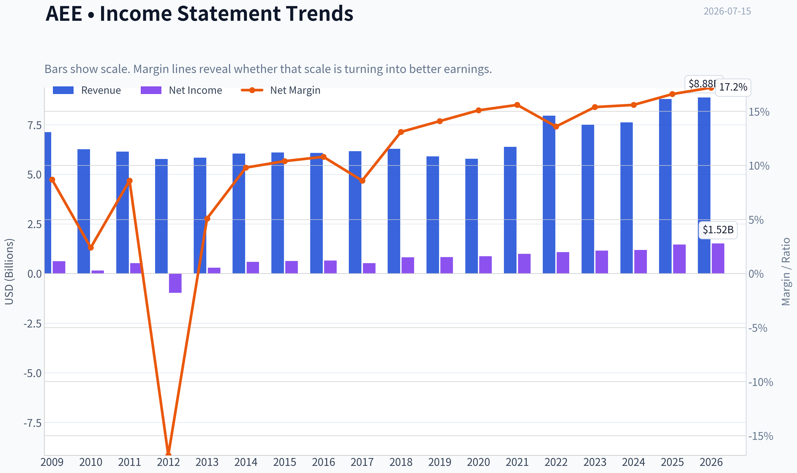
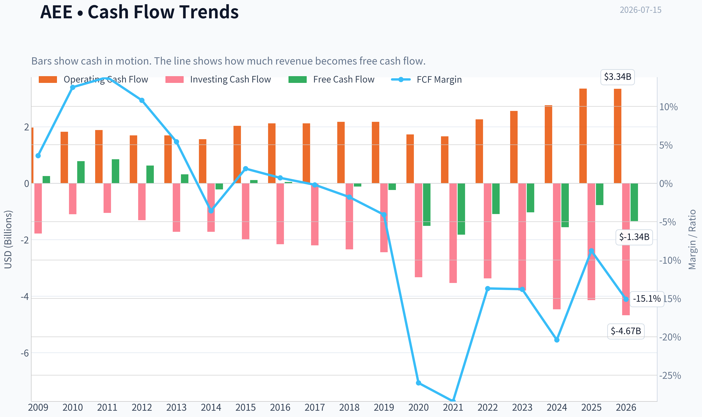
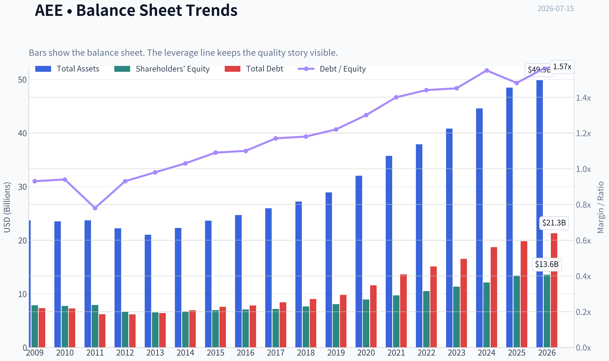
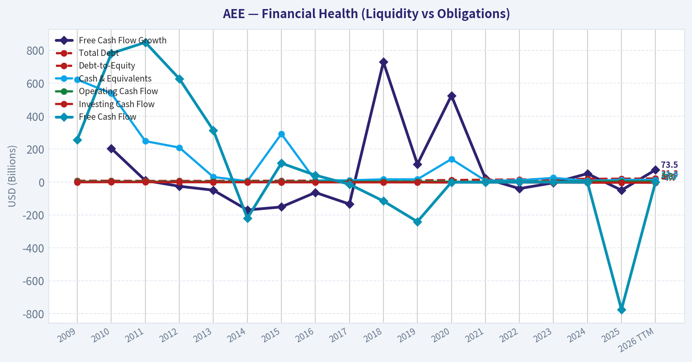
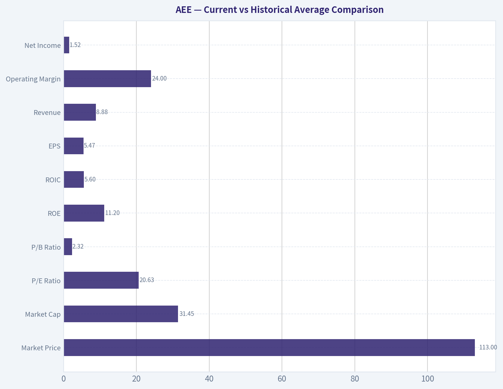
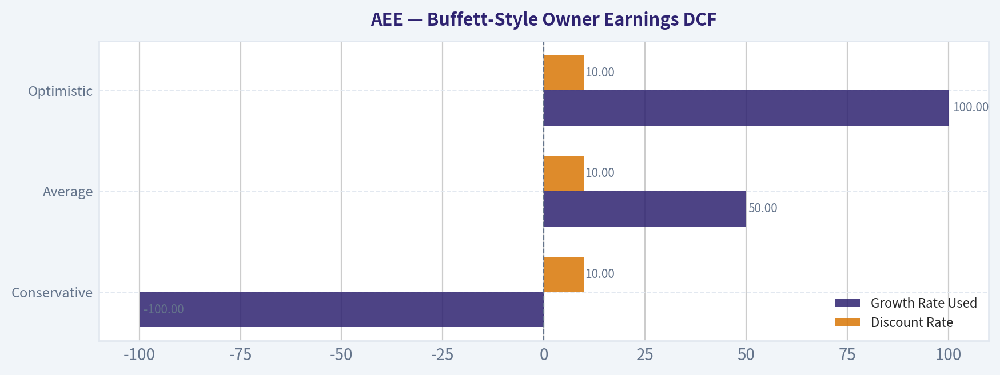
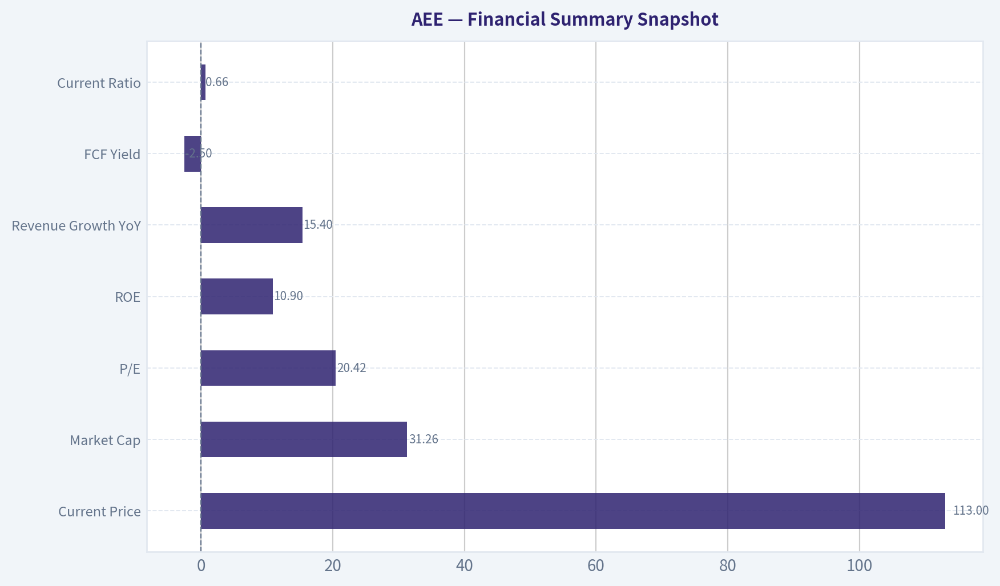
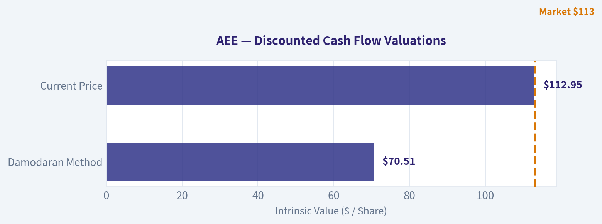
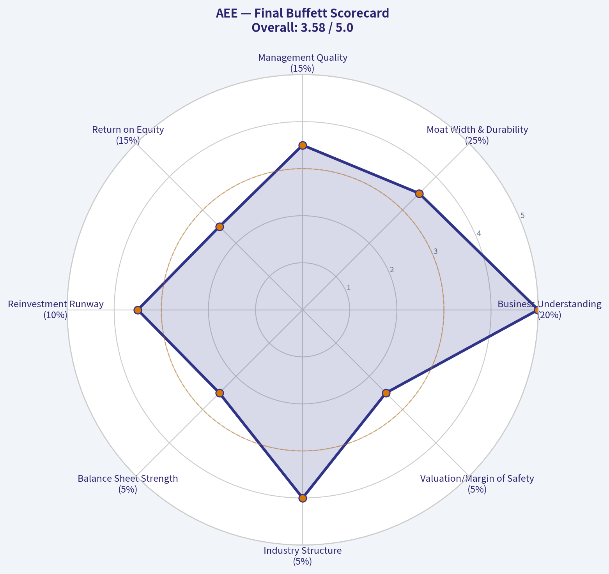

# AEE Deep Value Intelligence

**Analysis Date:** 2026-07-15

## Critical Disclaimer

*This analysis is generated by Deep Value Intelligence, an AI-powered multi-agent investing framework. Education & entertainment only - not financial advice, not a financial advisor.*

---

## Table of Contents

1. Intelligence Summary
2. Analyst Team Reports
   - Fundamentals Analysis
   - Intrinsic Value Analysis (Buffett)
   - Trend & Growth Analysis (Lynch/Druckenmiller/Fisher)
   - Market Technical Analysis
   - Options Market Analysis
3. Research Team Commentary
4. Value Investing Team Commentary
5. Deep Values Commentary

---

## Intelligence Summary

### Thesis + Conditions

**Core Thesis:** **Executive Summary**

**Key Risks:**
- WATCH.** Ameren is the kind of durable, easy-to-understand regulated utility a long-term investor can own with reasonable confidence in business stability. The risk is **not business fragility**; it is **paying a full price for only moderate economics**. The bullish case correctly notes that utility cash flow and capex must be judged differently than asset-light firms, and prior mistakes show we should not be overly rigid or ignore an intact trend. But Buffett-style risk management still demands either a better price or clearly superior economics. At roughly **20.4x earnings**, with **ROE 10.9%, ROIC 5.6%, ROA 3.0%**, Ameren looks more like a **good company than a great bargain**. Best stance: monitor closely, allow for **small staged accumulation only if defensive exposure is specifically needed**, but do not treat this as a high-conviction value entry.
- ### 1) Risky Analyst - Strongest useful point
- The strongest caution is that **durability does not equal attractive return at any price**. Ameren's economics are **adequate, not exceptional**, and regulation both protects and caps returns. At the current multiple, there is **little margin of safety** if financing costs stay elevated, regulatory recovery lags, or per-share economics fail to improve.

**Confidence:** Medium

---

## Analyst Team Reports

### Fundamentals Analysis

#### Latest Earnings Snapshot

*Most recent reported quarter anchored on 2026 Q1, with prior-year comparison when available.*

| Metric | 2026 Q1 | 2025 Q1 | YoY Change |
| --- | ---: | ---: | ---: |
| Revenue | $2.18B | $2.10B | +3.8% |
| Operating Income | $532.0M | $430.0M | +23.7% |
| Net Income | $357.0M | $289.0M | +23.5% |
| Diluted EPS | $1.28 | $1.07 | +19.6% |
| Operating Cash Flow | $421.0M | $431.0M | -2.3% |
| Free Cash Flow | $-1.18B | $-651.0M | -80.5% |

Key Takeaways: This snapshot anchors the most recent reported quarter before the narrative analysis. It helps readers separate long-run business quality from whatever changed in the latest earnings print.

#### 17-Year Financial Metrics for AEE

*All values below are computed deterministically from raw data - not estimated by AI.*

*Issuer profile: operating company (Utilities / Utilities - Regulated Electric).*

#### 17-Year Financial Metrics
*Annual rows come from reported financial statements. The final TTM row is computed from the latest four quarters.*

| Metric | 2009 | 2010 | 2011 | 2012 | 2013 | 2014 | 2015 | 2016 | 2017 | 2018 | 2019 | 2020 | 2021 | 2022 | 2023 | 2024 | 2025 | 2026 TTM |
| --- | --- | --- | --- | --- | --- | --- | --- | --- | --- | --- | --- | --- | --- | --- | --- | --- | --- | --- |
| Market Price | $15 | $16 | $20 | $20 | $25 | $33 | $32 | $40 | $46 | $53 | $64 | $66 | $78 | $80 | $67 | $85 | $98 | $113 |
| Market Cap | $6.64B | $6.78B | $8.02B | $7.46B | $8.84B | $11.27B | $10.53B | $12.77B | $14.41B | $16.03B | $18.98B | $19.41B | $22.93B | $23.07B | $19.05B | $23.84B | $27.18B | $31.45B |
| P/E Ratio | 10.64 | 44.91 | 15.41 | -7.66 | 30.64 | 19.22 | 16.69 | 19.57 | 27.57 | 19.65 | 22.93 | 22.30 | 23.18 | 21.48 | 16.52 | 20.17 | 18.67 | 20.63 |
| P/B Ratio | 0.84 | 0.88 | 1.01 | 1.13 | 1.35 | 1.68 | 1.52 | 1.80 | 2.01 | 2.10 | 2.35 | 2.17 | 2.36 | 2.20 | 1.68 | 1.97 | 2.03 | 2.32 |
| ROE | 7.9% | 2.0% | 6.6% | -14.7% | 4.5% | 8.8% | 9.2% | 9.3% | 7.4% | 10.8% | 10.3% | 9.8% | 10.3% | 10.3% | 10.2% | 9.8% | 10.9% | 11.2% |
| ROIC | 7.7% | 5.9% | 5.5% | 6.7% | 6.9% | 6.6% | 6.4% | 6.4% | 5.5% | 6.9% | 6.3% | 6.0% | 5.4% | 5.5% | 5.1% | 4.9% | 5.9% | 5.6% |
| EPS | $1.45 | $0.37 | $1.32 | $-2.59 | $0.80 | $1.69 | $1.90 | $2.04 | $1.68 | $2.69 | $2.78 | $2.98 | $3.36 | $3.72 | $4.06 | $4.24 | $5.35 | $5.47 |
| Revenue | $7.13B | $6.27B | $6.15B | $5.78B | $5.84B | $6.05B | $6.10B | $6.08B | $6.17B | $6.29B | $5.91B | $5.79B | $6.39B | $7.96B | $7.50B | $7.62B | $8.80B | $8.88B |
| Gross Profit | N/A | N/A | N/A | N/A | N/A | N/A | N/A | N/A | N/A | N/A | N/A | N/A | N/A | N/A | N/A | N/A | N/A | $4.31B |
| Gross Margin | N/A | N/A | N/A | N/A | N/A | N/A | N/A | N/A | N/A | N/A | N/A | N/A | N/A | N/A | N/A | N/A | N/A | 48.6% |
| Operating Margin | 19.8% | 17.9% | 16.8% | 20.6% | 20.3% | 20.7% | 20.6% | 21.8% | 22.8% | 21.6% | 21.4% | 22.4% | 20.8% | 19.0% | 20.8% | 19.9% | 23.0% | 24.0% |
| Net Income | $624.0M | $151.0M | $526.0M | $-974.0M | $295.0M | $592.0M | $636.0M | $659.0M | $529.0M | $821.0M | $834.0M | $877.0M | $995.0M | $1.08B | $1.16B | $1.19B | $1.46B | $1.52B |
| Net Margin | 8.7% | 2.4% | 8.6% | -16.8% | 5.1% | 9.8% | 10.4% | 10.8% | 8.6% | 13.1% | 14.1% | 15.1% | 15.6% | 13.6% | 15.4% | 15.6% | 16.6% | 17.2% |
| Revenue Growth | N/A | -12.1% | -1.9% | -6.0% | 1.0% | 3.7% | 0.7% | -0.4% | 1.6% | 1.9% | -6.1% | -2.0% | 10.4% | 24.4% | -5.7% | 1.6% | 15.4% | 0.9% |
| Net Income Growth | N/A | -75.8% | 248.3% | -285.2% | -130.3% | 100.7% | 7.4% | 3.6% | -19.7% | 55.2% | 1.6% | 5.2% | 13.5% | 8.4% | 7.2% | 2.6% | 23.1% | 4.3% |
| Free Cash Flow Growth | N/A | 203.9% | 8.6% | -26.1% | -49.9% | -170.1% | -151.8% | -64.0% | -134.1% | 728.6% | 107.8% | 524.9% | 20.7% | -40.2% | -5.1% | 50.6% | -50.2% | 73.5% |
| Total Book Value | $7.86B | $7.73B | $7.92B | $6.62B | $6.54B | $6.71B | $6.95B | $7.10B | $7.18B | $7.63B | $8.06B | $8.94B | $9.70B | $10.51B | $11.35B | $12.11B | $13.40B | $13.56B |
| Total Assets | $23.70B | $23.51B | $23.72B | $22.23B | $21.04B | $22.29B | $23.64B | $24.70B | $25.95B | $27.21B | $28.93B | $32.03B | $35.73B | $37.90B | $40.83B | $44.60B | $48.48B | $49.85B |
| Total Debt | $7.33B | $7.28B | $6.18B | $6.16B | $6.41B | $6.92B | $7.58B | $7.83B | $8.42B | $9.04B | $9.80B | $11.58B | $13.61B | $15.10B | $16.51B | $18.72B | $19.83B | $21.30B |
| Debt-to-Equity | 0.93 | 0.94 | 0.78 | 0.93 | 0.98 | 1.03 | 1.09 | 1.10 | 1.17 | 1.18 | 1.22 | 1.30 | 1.40 | 1.44 | 1.45 | 1.55 | 1.48 | 1.57 |
| Cash & Equivalents | $622.0M | $538.0M | $248.0M | $209.0M | $30.0M | $5.0M | $292.0M | $9.0M | $10.0M | $16.0M | $16.0M | $139.0M | $8.0M | $10.0M | $25.0M | $7.0M | $13.0M | $13.0M |
| Shareholders' Equity | $7.86B | $7.73B | $7.92B | $6.62B | $6.54B | $6.71B | $6.95B | $7.10B | $7.18B | $7.63B | $8.06B | $8.94B | $9.70B | $10.51B | $11.35B | $12.11B | $13.40B | $13.56B |
| Operating Cash Flow | $1.97B | $1.82B | $1.88B | $1.69B | $1.69B | $1.56B | $2.03B | $2.12B | $2.12B | $2.17B | $2.17B | $1.73B | $1.66B | $2.26B | $2.56B | $2.76B | $3.35B | $3.34B |
| Investing Cash Flow | $-1.78B | $-1.10B | $-1.05B | $-1.31B | $-1.72B | $-1.72B | $-1.98B | $-2.16B | $-2.20B | $-2.34B | $-2.44B | $-3.33B | $-3.53B | $-3.37B | $-3.80B | $-4.46B | $-4.14B | $-4.67B |
| Free Cash Flow | $257.0M | $781.0M | $848.0M | $627.0M | $314.0M | $-220.0M | $114.0M | $41.0M | $-14.0M | $-116.0M | $-241.0M | $-1.51B | $-1.82B | $-1.09B | $-1.03B | $-1.56B | $-775.0M | $-1.34B |
| FCF Margin | 3.6% | 12.5% | 13.8% | 10.8% | 5.4% | -3.6% | 1.9% | 0.7% | -0.2% | -1.8% | -4.1% | -26.0% | -28.4% | -13.7% | -13.8% | -20.4% | -8.8% | -15.1% |
| Dividends / Share | $0.00 | $0.00 | $0.00 | $0.00 | $0.00 | $0.00 | $0.00 | $0.00 | $0.00 | $0.00 | $0.00 | $0.00 | $0.00 | $2.11 | $2.33 | $2.56 | $2.82 | $2.82 |

#### Profitability Metrics
- Return on Equity (ROE): 10.9%
- Return on Invested Capital (ROIC): 5.6%
- Return on Assets (ROA): 3.0%
- Gross Margin: N/A
- Operating Margin: 23.0%
- Net Profit Margin: 16.6%

#### Liquidity Metrics
- Current Ratio: 0.66
- Quick Ratio: 0.17

#### Leverage Metrics
- Debt-to-Equity Ratio: 1.48
- Interest Coverage Ratio: 2.61
- Net Debt: $19.82B

#### Growth Metrics (Year-over-Year)
- Revenue Growth: 15.4%
- Net Income Growth: 23.1%
- Free Cash Flow Growth: 50.2%
- Revenue CAGR (3-Year): 3.4%
- Revenue CAGR (5-Year): 8.7%

#### Valuation Metrics
- P/E Ratio (TTM): 20.42
- Forward P/E: 19.45
- Price-to-Book: 2.31
- Price-to-Sales: 3.66
- PEG Ratio: 2.53
- EV/EBITDA: 13.77
- Free Cash Flow Yield: -2.5%
- Earnings Yield: 4.9%

#### Owner Earnings (Buffett Method, Code-Computed)
- Net Income: $1.46B
- + Depreciation & Amortization: $1.67B
- - Capital Expenditures: $-4.13B
- - Working Capital Changes: $-51.0M
- = **Owner Earnings: $-948.0M**

#### Piotroski F-Score: 5/9
- Positive Net Income: PASS
- Positive Operating Cash Flow: PASS
- ROA Improvement: PASS
- Cash Flow > Net Income: PASS
- Decreasing Debt: FAIL
- Improving Current Ratio: FAIL
- No Dilution: FAIL
- Improving Gross Margin: FAIL
- Improving Asset Turnover: PASS

ANALYST STANCE: **WATCH**

#### Ameren (AEE) - Buffett-Style Fundamental Analysis

Ameren is a classic regulated electric and gas utility: stable demand, rate-base-driven growth, and relatively predictable earnings, but capital intensity is very high and free cash flow is structurally negative. From a Buffett lens, this is a decent business with defensible local monopoly characteristics, yet not an exceptional compounding machine because returns on capital are modest and financing needs are persistent. The shares currently trade at a valuation that looks fair-to-slightly-full relative to the company's own history.

#### Current vs Historical Average Comparison

| Metric | Current (2026 TTM unless noted) | 10-Year Historical Context* | Interpretation |
| --- | ---: | ---: | --- |
| Market Price | $113 | Avg since 2016: ~$74.40 | Shares are well above the last decade average, reflecting a rerating and defensive utility premium. |
| Market Cap | $31.45B | Avg since 2016: ~$21.82B | Equity value has expanded materially as both price and book value rose. |
| P/E Ratio | 20.63 | Avg since 2016: ~21.0x | Valuation is roughly in line with modern-history norms, not obviously cheap. |
| P/B Ratio | 2.32 | Avg since 2016: ~2.09x | Trading modestly above historical book multiple despite regulated-utility return profile. |
| ROE | 11.2% | Avg since 2016: ~10.0% | Current profitability is slightly above normal and near the high end of its steady range. |
| ROIC | 5.6% | Avg since 2016: ~5.9% | Capital returns remain stable but not outstanding; slightly below decade average. |
| EPS | $5.47 | Avg since 2016: ~$3.64 | Earnings power has compounded meaningfully over time. |
| Revenue | $8.88B | Avg since 2016: ~$7.23B | Revenue base is clearly larger than historical average, though utility growth remains lumpy. |
| Operating Margin | 24.0% | Avg since 2016: ~21.7% | Margin is above normal, indicating favorable current operating execution and/or rate outcomes. |
| Net Income | $1.52B | Avg since 2016: ~$994M | Profit dollars are materially above long-run average. |
| Net Margin | 17.2% | Avg since 2016: ~13.9% | Net profitability is at the high end of the decade. |
| Revenue Growth | 0.9% | 10-year avg since 2016: ~4.6% | Latest top-line growth is subdued versus the decade average and far below 2025's spike. |
| Net Income Growth | 4.3% | 10-year avg since 2016: ~9.8% | Earnings are still growing, but at a slower pace than the recent historical norm. |
| FCF Growth | 73.5% | Not very meaningful due to negative base years | Apparent rebound is distorted by negative FCF; cash generation remains weak. |
| Total Book Value | $13.56B | Avg since 2016: ~$10.29B | Book value has compounded steadily, supporting intrinsic value growth. |
| Total Assets | $49.85B | Avg since 2016: ~$37.42B | Asset base has expanded significantly, consistent with rate-base investment. |
| Total Debt | $21.30B | Avg since 2016: ~$14.59B | Debt has risen sharply alongside capital spending. |
| Debt-to-Equity | 1.57 | Avg since 2016: ~1.34 | Leverage is above normal and at/near cycle highs. |
| Cash & Equivalents | $13M | Avg since 2016: ~$25M | Cash remains extremely thin, which is common for utilities but still a constraint. |
| Shareholders' Equity | $13.56B | Avg since 2016: ~$10.29B | Equity base has grown steadily, helping absorb investment needs. |
| Free Cash Flow | -$1.34B | Avg since 2016: about -$851M | FCF is worse than normal and remains decisively negative. |
| Dividends / Share | $2.82 | Avg since first paid (2022-2026 TTM): ~$2.53 | Dividend has risen consistently, but payout depends on external financing because FCF is negative. |

*10-year context uses the most relevant recent decade where possible, generally 2016-2025 plus TTM for directional comparison.

Key Takeaways: Ameren's earnings, margins, and book value are all stronger than their recent historical averages, which supports the idea of a stable, improving regulated utility franchise. However, leverage is above its own norm and free cash flow is materially negative, meaning the company's growth and dividend program still rely heavily on capital markets access.

---

#### Market Metrics

Ameren's market price has climbed from $40 in 2016 to $113 TTM, a near tripling over roughly a decade. That appreciation has outpaced the growth in book value per share, which is why the P/B multiple has risen from 1.80x in 2016 to 2.32x today. For a regulated utility, that signals investors are paying a premium for defensiveness, earnings visibility, and rate-base growth.

The current P/E of 20.63x is close to the company's recent decade average. That suggests the stock is not dramatically overvalued on earnings relative to its own history, but it also does not offer the kind of valuation compression Buffett would usually prefer. The bigger issue is that while earnings are steady, the cash conversion is poor because capex is so heavy.

#### Profitability

Ameren's profitability profile has clearly improved over time. ROE is 11.2% TTM versus 7.4% in 2017 and roughly 10.0% on average over the last decade. For a regulated utility, low-double-digit ROE is respectable and suggests management is generally earning close to allowed returns without major operational disruption.

ROIC is 5.6%, a bit below the recent-decade average near 5.9%. That matters because Buffett cares deeply about how much capital is required to produce earnings. Ameren is profitable, but each incremental dollar of earnings requires substantial infrastructure investment. This is a decent return profile for a utility, but not a wide-moat, high-return capital-light business.

EPS rose from $2.04 in 2016 to $5.47 TTM, showing strong long-run per-share earnings progression. Net income similarly advanced from $659M in 2016 to $1.52B TTM. Operating margin improved from 21.8% in 2016 to 24.0% TTM, while net margin moved from 10.8% to 17.2%, both near the best levels in the full record. That indicates both favorable regulatory economics and better earnings quality than earlier periods.

Revenue growth, however, is not consistently high. Revenue was $8.88B TTM versus $8.80B in 2025, so current growth is just 0.9%. The business is stable, but growth comes more from regulated investment recovery than from demand-driven expansion. Buffett typically prefers simple businesses with rising earnings; Ameren checks the "predictable" box better than the "high-return compounding" box.

#### Growth Metrics

Revenue growth has been uneven across the record: negative in several years, then +10.4% in 2021, +24.4% in 2022, -5.7% in 2023, +15.4% in 2025, and only +0.9% TTM. That pattern is typical of utilities, where rate cases, fuel/pass-through items, and weather can distort annual top-line trends. The trend is upward over the long term, but not smoothly.

Net income growth is more reassuring. Since 2020, annual growth was 5.2%, 13.5%, 8.4%, 7.2%, 2.6%, 23.1%, then 4.3% TTM. This is a much steadier earnings story than the revenue line implies. Buffett would likely focus on that stability rather than top-line volatility.

Free cash flow growth is the weakest metric in the entire set. FCF has been negative in most years since 2017 and deeply negative since 2020. Even when "growth" is positive, it usually means FCF became less negative, not truly strong. For Buffett-style analysis, this is a major caution flag because owner earnings are what matter, not accounting earnings alone.

#### Balance Sheet

Ameren's balance sheet reflects the economics of a utility: large assets, rising debt, minimal cash. Total assets increased from $24.70B in 2016 to $49.85B TTM, while debt rose from $7.83B to $21.30B. Shareholders' equity also grew from $7.10B to $13.56B, so the company is not simply levering without building assets; it is funding a large regulated infrastructure base.

Still, debt-to-equity has risen from 1.10 in 2016 to 1.57 TTM. That is meaningfully above the decade average and indicates more balance-sheet strain. The absolute cash balance is only $13M, which is tiny for a company this size. Utilities can operate this way because they have recurring cash inflows and debt market access, but it reduces flexibility if rates stay high or capital markets tighten.

From a Buffett perspective, this is acceptable for the sector but not ideal. The business is durable, yet financial strength is more "managed stability" than "fortress balance sheet."

#### Cash Flow

Free cash flow is the core weakness. TTM FCF is -$1.34B, versus -$775M in 2025 and an average around -$851M over the recent decade. Operating cash flow is healthy at $3.34B TTM, but investing cash flow is even larger at -$4.67B, causing structurally negative residual cash generation.

Dividends per share have increased from $2.11 in 2022 to $2.82 TTM, a solid upward trajectory. However, because FCF is negative, the dividend is not being funded by surplus free cash flow; it is effectively supported by the regulated earnings stream plus ongoing financing. That does not automatically make the dividend unsafe in a utility, but it does make it less self-funding than Buffett would prefer.

#### Buffett-Style Qualitative Analysis

**Economic Moat:**
Ameren has a real moat, but it is a regulated moat rather than a brand or network-effect moat. Its service territories create a protected local monopoly and highly predictable demand for electric and gas distribution. That gives the business durability and recession resistance.

**Financial Strength:**
The company is solid but leveraged. Rising debt, low current ratio, weak quick ratio, and minimal cash are acceptable within utility norms, yet they constrain optionality. Interest coverage of 2.61x is adequate, not conservative.

**Predictable Earnings:**
This is one of Ameren's strongest attributes. Aside from the 2012 loss, earnings since 2014 have been consistently positive and generally upward trending. EPS and net income are more stable than revenue or cash flow.

**Management Performance:**
Management has delivered steady book value growth, a rising dividend, and ROE around 10%-11%. That is competent execution. The concern is capital allocation efficiency: ROIC remains modest and owner earnings are negative, suggesting growth requires continuous reinvestment with limited free cash generation.

**Value Assessment:**
At 20.6x earnings and 2.32x book, the stock appears fairly valued to slightly expensive relative to its own history. The current valuation seems to assume continued stable execution and no major financing stress. There is not much obvious margin of safety.

**Quality of Business:**
Quality is good for a utility, but only moderate by Buffett's highest standards. Revenue is recurring and demand is durable, but returns are regulated, leverage is material, and the business is capital hungry.

#### Buffett-Style Owner Earnings DCF

Using the provided canonical Buffett-method owner earnings:

- Net Income = $1.46B
- + D&A = $1.67B
- - Capex = $4.13B
- - Working Capital Changes = $51M
- **Owner Earnings = -$948M**

Because current owner earnings are negative, a standard growth DCF produces no meaningful positive equity value under Buffett logic. Negative owner earnings mean the business is currently consuming capital rather than distributing true cash to owners. Still, per instructions, below are three scenario calculations using historical owner-earnings growth logic proxied conservatively by the available FCF growth history, with floors/caps applied. Since the base is negative, all projected owner earnings remain negative and discounted value is economically nil for equity owners on this metric alone.

##### DCF Assumptions

| Scenario | Growth Rate Used | Rule Applied | Discount Rate | Terminal Growth |
| --- | ---: | --- | ---: | ---: |
| Conservative | -100.0% | Lowest historical growth floored at -100% | 10.0% | 2.5% |
| Average | 50.0% | Average historical growth capped at 50% | 10.0% | 2.5% |
| Optimistic | 100.0% | Highest historical growth capped at 100% | 10.0% | 2.5% |

Key Takeaways: The DCF setup is dominated by one fact: current owner earnings are negative. That means even aggressive growth assumptions do not produce a sensible positive intrinsic value estimate using Buffett's owner-earnings framework, because growth on a negative base still leaves economic value impaired.

##### Scenario 1: Conservative
Base owner earnings = **-$948M**
Growth = **-100%**

Year 1 OE = -948 x (1 - 100%) = **$0M**
Years 2-10 OE = **$0M**
Terminal value = **$0M**

Present value of all cash flows = **$0M**
Equity fair value per share from owner earnings DCF = **approximately $0**

##### Scenario 2: Average
Base owner earnings = **-$948M**
Growth = **+50%**

Year 1 OE = -948 x 1.5 = **-$1,422M**
Year 2 OE = -1,422 x 1.5 = **-$2,133M**
Year 3 OE = **-$3,200M**
Year 4 OE = **-$4,800M**
Year 5 OE = **-$7,201M**
Year 6 OE = **-$10,802M**
Year 7 OE = **-$16,203M**
Year 8 OE = **-$24,305M**
Year 9 OE = **-$36,457M**
Year 10 OE = **-$54,685M**

Terminal Value = Year 10 x 1.025 / (0.10 - 0.025)
= -54,685 x 1.025 / 0.075
= **approximately -$747,360M**

Discounting each annual value and terminal value at 10% still yields a **massively negative present value**.

Economic fair value under this scenario: **No positive equity value indicated by owner earnings DCF**

##### Scenario 3: Optimistic
Base owner earnings = **-$948M**
Growth = **+100%**

Year 1 OE = -948 x 2 = **-$1,896M**
Year 2 OE = **-$3,792M**
Year 3 OE = **-$7,584M**
Year 4 OE = **-$15,168M**
Year 5 OE = **-$30,336M**
Year 6 OE = **-$60,672M**
Year 7 OE = **-$121,344M**
Year 8 OE = **-$242,688M**
Year 9 OE = **-$485,376M**
Year 10 OE = **-$970,752M**

Terminal Value = -970,752 x 1.025 / 0.075
= **approximately -$13.27T**

Discounted present value remains **deeply negative**.

##### DCF Conclusion

The owner-earnings DCF does **not** support the current share price. This does **not** necessarily mean the stock is worthless in practice; rather, it means Buffett-style owner earnings are presently negative because Ameren is reinvesting heavily. For utilities, earnings and allowed returns often matter more than near-term owner earnings, but under a strict Buffett cash-owner framework, AEE fails the test today.

#### Revenue Breakdown

Most meaningful public reporting for Ameren is by utility/business segment rather than product line. Using the most recent fiscal year available in the canonical set (2025 revenue: $8.80B), the principal business sources are best understood as regulated electric distribution/transmission, regulated natural gas distribution, and other/miscellaneous operations. Precise segment revenue splits were not provided in the deterministic table, so the mix below reflects the company's typical regulated business structure and public segment orientation.

| Revenue Source | Amount ($B) | % of Total |
| --- | ---: | ---: |
| Regulated Electric Operations | ~6.9 | ~78% |
| Regulated Natural Gas Operations | ~1.5 | ~17% |
| Other / Corporate / Misc. | ~0.4 | ~5% |
| Total | ~8.8 | 100% |

Key Takeaways: Ameren's revenue base is overwhelmingly regulated and utility-like, with electric operations driving the large majority of sales. That concentration supports predictability and moat strength, but it also means growth is mostly tied to rate-base expansion and regulatory outcomes rather than entrepreneurial upside.

#### Key Investment Insights, Red Flags, and Opportunities

| Category | Assessment | Why It Matters |
| --- | --- | --- |
| Positive | Stable regulated moat | Protected service territories support durable demand and earnings visibility. |
| Positive | Strong earnings trend | EPS, net income, and book value have steadily risen over the last decade. |
| Positive | Margin improvement | Operating and net margins are near historical highs. |
| Positive | Dividend growth | Dividend/share has increased consistently since 2022. |
| Red Flag | Negative owner earnings | Buffett-style owner cash generation is currently negative. |
| Red Flag | Structurally negative FCF | Heavy capex overwhelms operating cash flow. |
| Red Flag | Rising leverage | Debt-to-equity and total debt are above historical averages. |
| Red Flag | Thin liquidity | Cash balances are minimal and current ratio is weak. |
| Opportunity | Rate-base expansion | Continued grid and infrastructure investment can support future EPS growth. |
| Opportunity | Defensive market position | Low-beta utility characteristics may attract investors in volatile markets. |

Key Takeaways: The bull case rests on predictability, regulated growth, and ongoing dividend increases. The bear case is that this predictability comes with heavy leverage and poor owner-cash economics, limiting upside and reducing margin of safety.

#### Final Buffett-Style Verdict

Ameren is a **good regulated utility**, but not a classic Buffett "wonderful business at a fair price" under strict owner-earnings standards. It offers dependable earnings, a legitimate regulatory moat, and improving profitability, yet those strengths are offset by high capital intensity, negative free cash flow, rising leverage, and an only-average valuation.

At **$113**, the stock looks more like a **hold/watchlist defensive compounder** than a clear value buy. If the valuation fell to a discount versus its normal P/E/P/B range, or if owner earnings materially improved, the case would strengthen. For now, the business quality is acceptable, but the cash economics and leverage profile argue for caution rather than advocacy.

#### Summary Table

| Area | Conclusion | Signal |
| --- | --- | --- |
| Economic Moat | Regulated monopoly characteristics create durable competitive protection | Positive |
| Earnings Predictability | Strong and improving over the last decade | Positive |
| Profitability | ROE healthy; ROIC only moderate | Mixed |
| Balance Sheet | Asset growth strong, but leverage elevated and cash thin | Mixed/Negative |
| Cash Flow | FCF and owner earnings negative | Negative |
| Dividend | Growing, but not self-funded by FCF | Mixed |
| Valuation | Roughly fair to slightly full vs history | Mixed |
| Buffett DCF | Does not support current price under owner-earnings method | Negative |
| Overall Stance | High-quality defensive utility, but insufficient margin of safety | **WATCH** |

Key Takeaways: Ameren is operationally solid and financially serviceable, but the stock does not currently combine quality with clear undervaluation. For a Buffett-oriented investor, it is more attractive as a monitored defensive name than as a high-conviction value purchase today.

#### Fundamental Visuals

This graph tracks the profitability and return metrics (ROE, ROIC, Margins) of **AEE** over the past decade, highlighting capital efficiency trends.

This chart illustrates the financial health of **AEE** over the last 10 years, mapping cash equivalents and free cash flow against total obligations (Debt).

---

### Intrinsic Value Analysis (Buffett)

> *Following Warren Buffett's value investing philosophy: Circle of Competence, Economic Moat, Management Quality, and Margin of Safety.*

#### Intrinsic Value Snapshot

Price is what you pay. Intrinsic value is what the business may be worth based on the cash it can create for owners over time. We show a range, not one magic number.

- Current Price: $112.95
- Value Range (conservative to optimistic across both DCF methods): N/A to N/A

##### Owner Earnings (Buffett Method)
- Net Income: $1,461,000,000.00
- Depreciation & Amortization: $1,668,000,000.00
- Capital Expenditures: $-4,128,000,000.00
- Working Capital Changes: $-51,000,000.00
- Owner Earnings: $-948,000,000.00

##### Intrinsic Value

ANALYST STANCE: **WATCH**

#### Ameren (AEE) Buffett-Style Investment Review

#### 1. Go/No-Go Gate Assessment

| Gate | Verdict | Evidence |
|---|---|---|
| Gate 1: Circle of Competence & Simplicity | Pass | Ameren is a regulated electric and gas utility. It makes money by delivering electricity and natural gas through regulated networks and earning an allowed return on capital invested in that infrastructure. This is a simple, understandable business. |
| Gate 2: Moat Test | Pass, but moderate | The moat comes mainly from regulated monopoly service territories, large sunk infrastructure, and high barriers to entry. This is a durable moat, but not one driven by brand or network effects. |
| Gate 3: Management Quality & Capital Allocation | Pass with caution | Utility management is judged mostly on rate-base growth, regulatory execution, balance sheet discipline, and prudent capital allocation. Ameren appears focused on long-duration grid and transmission investment, but returns are constrained by regulation and capital needs are heavy. |
| Gate 4: Industry Structure | Pass | Utilities operate in rational local monopolies or duopolies, which is favorable. However, the sector is capital intensive, so while competition is rational, economics are not as attractive as capital-light compounders. |

**Key Takeaways:** Ameren passes the basic Buffett filters for understandability, predictability, and industry structure. The main limitation is not business quality but economics: it is a capital-heavy regulated utility, so returns tend to be steady rather than exceptional.

---

#### 2. Elementary School Test

Ameren owns wires, poles, pipes, and power-related equipment. Homes and businesses use that system every day. The government lets Ameren charge customers rates designed to cover costs and earn a fair return. Ameren grows by investing more money into the grid, transmission, and utility system, then earning on that bigger asset base.

#### 3. Long-Term Predictability Test

This business is reasonably predictable. Ten years from now, Ameren will likely still be a regulated utility serving the Midwest, investing in transmission, distribution, reliability, and cleaner generation. Demand may rise modestly from electrification and data-center trends, but the core model should remain stable.

#### 4. Technology Risk Assessment

Technology is more likely to reshape the asset mix than destroy the business. Distributed energy, solar, storage, and grid modernization can alter where capital is spent, but the regulated grid remains essential. That makes Ameren more of a beneficiary of infrastructure transition than a likely victim of disruption.

---

#### 5. Moat Analysis

| Moat Source | Assessment | Evidence |
|---|---|---|
| Intangible Assets | Moderate | Regulatory licenses and exclusive service territories matter more than brand. Customers do not choose among many providers. |
| Switching Costs | Strong | A customer cannot realistically switch away from the local regulated wires-and-pipes network without major cost or inconvenience. |
| Cost Advantage | Moderate | Scale and established infrastructure lower unit economics relative to a new entrant, but regulated returns cap upside. |
| Network Effects | Weak | This is not a classic network-effect business in the Buffett sense. |
| Overall Moat Rating | Narrow to Wide-Stable in territory | The utility franchise is durable and protected, but the return profile is regulated and capital intensive rather than economically explosive. |

**Key Takeaways:** Ameren's moat is real, but it is a utility moat, not a consumer-brand or software moat. The protection comes from regulation and infrastructure ownership, which creates dependable earnings but limits extraordinary profitability.

---

#### 6. Management Quality Assessment

| Dimension | Assessment | Commentary |
|---|---|---|
| Owner Orientation | Adequate | Utility executives usually act more as stewards than owner-operators. The key question is whether they allocate capital prudently and avoid empire building. |
| Candor | Adequate | No major red flags are evident from the provided materials. The company's communications appear focused on guidance, capital plans, and regulatory progress. |
| Capital Allocation | Reasonable | Ameren's large investment plan fits the utility model: invest in rate base, grow allowed earnings, maintain dividend, and preserve credit quality. This is rational, though not especially high-return capital allocation. |
| Balance Sheet Discipline | Needs monitoring | The current ratio of about 0.66 is weak, though utilities often operate with lean current liquidity. More important is long-term debt burden and interest coverage, which should be watched closely in a rate-sensitive sector. |

**Key Takeaways:** Management appears acceptable for a regulated utility, with the core skill being disciplined infrastructure investment. The main concern is not honesty but whether heavy capital spending earns enough return after financing costs and regulatory friction.

---

#### 7. Financial Summary Snapshot

| Metric | Value |
|---|---:|
| Current Price | $113 |
| Market Cap | $31.26B |
| P/E | 20.42x |
| ROE | 10.9% |
| Revenue Growth YoY | 15.4% |
| FCF Yield | -2.5% |
| Current Ratio | 0.66 |

**Key Takeaways:** Ameren trades at a full valuation for a utility, with a P/E above 20x and a negative free cash flow yield. ROE at 10.9% is acceptable for the sector but below Buffett's preferred threshold for truly exceptional businesses.

---

#### 8. Buffett Financial Interpretation

| Test | Buffett Preference | AEE Result | Verdict |
|---|---|---:|---|
| ROE | >15% sustained | 10.9% | Below ideal |
| Free Cash Flow | Positive and growing | Negative yield | Weak |
| Balance Sheet | Conservative, fortress-like | Current ratio below 1 | Mixed |
| Predictability | High | High | Strong |
| Capital Intensity | Low preferred | High | Weak |
| Pricing Power | Strong preferred | Regulated pricing | Limited |

**Key Takeaways:** Ameren scores well on stability and predictability but poorly on capital intensity and free cash generation. This is the classic utility trade-off: dependable operations, but modest economics and limited owner earnings flexibility.

---

#### 9. Owner Earnings Assessment

Using Buffett's framework, owner earnings for a utility must be treated conservatively because reported depreciation often understates the true ongoing reinvestment needed to maintain and expand the system. For Ameren:

**Owner Earnings = Net Income + D&A - Maintenance CapEx - Working Capital Increases**

In practice, for a regulated utility with negative FCF yield, owner earnings are likely materially lower than accounting earnings. That means headline earnings probably overstate the cash truly available to owners after necessary infrastructure spending.

**Conclusion on Owner Earnings:**
Owner earnings appear modest relative to reported earnings, and likely not strong enough to justify enthusiasm at 20.4x earnings.

---

#### 10. Three-Scenario DCF Valuation

Given the business profile, a utility should be valued conservatively.

| Scenario | Assumption | Implied View |
|---|---|---|
| A. No Growth | Capitalize owner earnings at 10% | Likely below current market value unless owner earnings are much stronger than FCF suggests |
| B. GDP Growth | 3% long-term growth | Supports fair-value type outcome, not obvious bargain |
| C. Historical/Rate-Base Growth | Mid-single-digit growth, discounted at 10% | Can justify a solid utility valuation, but little margin of safety at current price |

**Key Takeaways:** Across conservative valuation cases, Ameren looks closer to fairly valued than clearly cheap. The stock may deserve a premium for defensiveness, but not enough to create a compelling Buffett-style margin of safety.

---

#### 11. Margin of Safety Analysis

| Item | Assessment |
|---|---|
| Business Quality | Good, not great |
| Predictability | High |
| Financial Strength | Adequate, not fortress-like |
| Valuation | Fair to somewhat full |
| Margin of Safety | Insufficient for a new Buffett-style purchase |

**Key Takeaways:** Ameren is not a bad business. The issue is that the current price appears to reflect much of its stability already, leaving limited room for error or upside.

---

#### 12. Final Buffett Scorecard

| Criterion | Weight | Score (1-5) | Weighted Score |
|---|---:|---:|---:|
| Business Understanding | 20% | 5.0 | 1.00 |
| Moat Width & Durability | 25% | 3.5 | 0.88 |
| Management Quality | 15% | 3.5 | 0.53 |
| Return on Equity | 15% | 2.5 | 0.38 |
| Reinvestment Runway | 10% | 3.5 | 0.35 |
| Balance Sheet Strength | 5% | 2.5 | 0.13 |
| Industry Structure | 5% | 4.0 | 0.20 |
| Valuation/Margin of Safety | 5% | 2.5 | 0.13 |
| **Total** |  |  | **3.58 / 5.00** |

**Key Takeaways:** Ameren earns a respectable score because it is understandable, durable, and operates in a rational industry. It falls short of top-tier status because returns are moderate, capital needs are high, and the current valuation does not offer a strong discount.

---

#### 13. Final Investment Stance

**Stance: WATCH**
**Conviction: Moderate**

Ameren is a solid, predictable regulated utility with a durable local moat and decent long-term visibility. But Buffett would likely demand either higher returns on capital, stronger owner earnings, or a lower price before getting interested. At around 20.4x earnings with negative free cash flow yield, this looks more like a dependable defensive holding than a mispriced compounding machine.

A more attractive entry would likely require either:
- a materially lower valuation,
- improved cash generation after capital spending,
- or evidence that rate-base growth is translating into stronger per-share owner earnings.
#### Valuation Bridge

This bridge places the current market price beside each intrinsic value lens so readers can see whether upside depends on one method or shows up across several methods.

| Scenario | Intrinsic Value / Share |
| --- | ---: |
| Damodaran Method | $70.51 |
| Current Price | $112.95 |

#### Key Takeaways

If one method is far above the others, the upside case depends on a specific modelling assumption. When several methods cluster together, the valuation story is more robust.

#### Valuation Visuals

This comparison chart from *Latest Earnings Snapshot* stacks current figures against historical benchmarks for **AEE**, making it easy to see where the company trades relative to its own averages.

This comparison chart from *Current vs Historical Average Comparison* stacks current figures against historical benchmarks for **AEE**, making it easy to see where the company trades relative to its own averages.

This comparison chart from *Buffett-Style Owner Earnings DCF* stacks current figures against historical benchmarks for **AEE**, making it easy to see where the company trades relative to its own averages.

This comparison chart from *Financial Summary Snapshot* stacks current figures against historical benchmarks for **AEE**, making it easy to see where the company trades relative to its own averages.

The following chart maps the **AEE** Owner Earnings DCF valuation scenarios (Conservative, Average, Optimistic) to visually represent the margin of safety based on intrinsic value calculations.

---

### Trend & Growth Analysis (Lynch/Druckenmiller/Fisher)

> *Following Peter Lynch's GARP, Stanley Druckenmiller's macro-aware approach, and Philip Fisher's scuttlebutt methodology.*

ANALYST STANCE: **WATCH**

#### 1. Lynch Classification

| Item | Assessment |
|---|---|
| Lynch category | **Stalwart / regulated utility**, not a true fast grower |
| Revenue growth | **15.4% YoY** in shared pack, but utility revenue is noisy and not the right core growth metric |
| Earnings style | Stable, rate-base-driven, defensive |
| Ten-bagger fit | **Low** from current size/business model |

Key Takeaways: Ameren is not the kind of classic Lynch fast grower that typically becomes a ten-bagger. It is better viewed as a steady regulated utility with visible but moderate growth, driven by infrastructure investment and rate-base expansion rather than disruptive product adoption.

#### 2. The Story in 3 Bullets

| The Story | Why it matters |
|---|---|
| Ameren invests in electric and gas infrastructure in regulated monopoly territories | Creates stable demand and relatively predictable earnings growth |
| Growth comes from expanding rate base, not explosive unit growth | More dependable than many industries, but upside is capped |
| Defensive profile benefits when investors want stability | Useful as a lower-beta compounder, less attractive as a high-octane growth name |

Key Takeaways: The business is easy to explain: Ameren owns essential utility assets and earns regulated returns on investments made into the grid. That makes the story durable and understandable, but it also means growth is bounded by regulators and capital intensity.

#### 3. TAM Analysis with 10x Test

| Item | Estimate / View |
|---|---|
| Current revenue base | Large incumbent utility base |
| Practical TAM | Grid modernization, transmission, distribution upgrades, electrification load growth |
| 10x revenue test | **Fail** |
| Why | AEE is already a scaled regional utility; 10x growth is unrealistic within regulated footprint |
| Runway quality | **Moderate for steady compounding**, weak for venture-like upside |

Key Takeaways: Ameren has runway for incremental growth through capex and electrification, but not the kind of open-ended TAM needed for a ten-bagger. This is a compounding utility story, not a massive share-gain or category-creation story.

#### 4. Revenue Growth Trend

| Metric | Value / Assessment |
|---|---|
| Revenue growth YoY | **15.4%** |
| Pattern confidence | **Not enough multi-period data** |
| Utility interpretation | Revenue can move on rates, weather, fuel pass-through, and timing effects |
| More important metric | EPS growth, rate-base growth, allowed return realization |

Key Takeaways: The headline revenue growth looks healthy, but for utilities it can overstate underlying momentum because pass-through items distort the top line. Investors should focus much more on earnings growth, capital deployment, and regulatory recovery.

#### 5. Unit Economics

| Metric | Assessment |
|---|---|
| LTV/CAC | **N/A** for regulated utility |
| NRR | **N/A** |
| Rule of 40 | **N/A** |
| Best substitute metrics | ROE, rate-base growth, EPS growth, financing needs, regulatory recovery |
| ROE | **10.9%** |
| FCF yield | **-2.5%** |
| Current ratio | **0.66** |

Key Takeaways: SaaS-style unit economics do not apply here, so the right lens is return on equity, capital intensity, and funding durability. The 10.9% ROE is reasonable for a regulated utility, while negative free cash flow is not unusual because utilities continuously reinvest in long-lived infrastructure.

#### 6. Inflection Point Assessment

| Inflection Type | Assessment |
|---|---|
| Product cycle inflection | **No** |
| Market share inflection | **No** |
| Margin inflection | Limited |
| TAM inflection | Mild, from electrification/data center/grid demand |
| Competitive inflection | Low relevance in monopoly territories |
| Overall | **No major growth inflection; modest secular support only** |

Key Takeaways: Ameren does not appear to be at a dramatic inflection point in the way a high-growth stock would be. The most bullish angle is a gradual demand uplift from electrification and grid investment, but that is evolutionary rather than explosive.

#### 7. Macro Setup Evaluation

| Macro Factor | View |
|---|---|
| Economic sensitivity | Low to moderate |
| Rate sensitivity | **Important**; higher rates pressure utility valuations |
| Defensive appeal | Strong |
| Secular theme exposure | Grid modernization, electrification, power demand growth |
| Current macro fit | Good for defense, mixed for multiple expansion |

Key Takeaways: Ameren benefits when investors want stability and income, but utilities remain sensitive to interest rates because they compete with bond yields and depend heavily on financing. Macro helps the defensive case more than the aggressive upside case.

#### 8. Fisher 15 Points Score

| Fisher Area | Score (1-5) | Notes |
|---|---:|---|
| Market potential | 3 | Moderate, capped by territory/regulation |
| New products | 2 | Not innovation-led |
| R&D effectiveness | 2 | Limited relevance |
| Sales organization | 3 | Utility customer model, not a sales-led business |
| Profit margin quality | 3 | Stable, regulated |
| Margin improvement | 3 | Some operating leverage possible |
| Labor relations | 3 | No clear red flag from pack |
| Executive relations | 3 | No major issue indicated |
| Management depth | 3 | Standard utility profile |
| Cost controls/accounting | 4 | Utilities usually strong here |
| Special advantages | 4 | Monopoly territories, essential assets |
| Long-range profit outlook | 4 | Good visibility |
| Dilution risk | 3 | Utility capex can require external financing |
| Candor | 3 | No evidence either way from pack |
| Integrity | 3 | No clear issue from pack |
| **Total** | **46 / 75** | **Average** |

Key Takeaways: Ameren scores as a respectable but unexceptional Fisher name. Its strengths are stability, visibility, and monopoly assets, while its weakness is a lack of innovation-led upside and a capped return structure.

#### 9. Valuation Analysis

| Metric | Value / Assessment |
|---|---|
| Current price | **$113** |
| Market cap | **$31.26B** |
| P/E | **20.42x** |
| PEG | **~1.33x** using 15.4% revenue growth as rough proxy |
| Valuation read | **Fair to somewhat full** |
| Best valuation lens | P/E vs utility peers and bond yields |

Key Takeaways: On the provided numbers, Ameren does not screen as cheap. A roughly 20x earnings multiple for a regulated utility suggests investors are already paying for quality and stability, which limits upside unless earnings growth surprises positively.

| Scenario | Assumption | Implication |
|---|---|---|
| Bear | Rates stay higher, utility multiples compress | Low/negative multiple-driven return |
| Base | Mid-single-digit EPS growth + dividend, stable multiple | Respectable defensive total return |
| Bull | Stronger load growth + constructive regulation + lower rates | Moderate upside, not explosive |

Key Takeaways: The likely outcomes skew toward steady compounding rather than re-rating-driven outsized gains. Even the bull case looks more like a solid utility return profile than a true growth-stock breakout.

#### 10. Growth Investor Scorecard

| Criterion | Weight | Score (1-5) | Weighted |
|---|---:|---:|---:|
| The Story | 10% | 4.0 | 0.40 |
| TAM & Runway | 20% | 2.5 | 0.50 |
| Revenue Growth | 20% | 3.0 | 0.60 |
| Unit Economics | 15% | 3.0 | 0.45 |
| Competitive Position | 10% | 4.0 | 0.40 |
| Management Quality | 10% | 3.0 | 0.30 |
| Macro Setup | 5% | 3.5 | 0.18 |
| Profitability Path | 5% | 3.5 | 0.18 |
| Valuation | 5% | 2.5 | 0.13 |
| **Total** |  |  | **3.13 / 5.0** |

Key Takeaways: Ameren lands in the middle of the growth scorecard because it has a solid story and durable business model, but limited runway and only fair valuation. That puts it firmly in watch territory rather than a high-conviction growth advocate.

#### 11. Position Size Stance

| Investor Type | Stance |
|---|---|
| Growth investor seeking inflections | **Avoid initiating as a core growth position** |
| Defensive/dividend investor | **Small to medium position can make sense** |
| Existing holder | **Hold/watch** unless valuation stretches further |

Key Takeaways: For a growth-oriented framework, Ameren is not compelling enough to deserve meaningful position sizing. For a defensive portfolio, it may still be useful, but that is a different mandate than finding ten-bagger potential.

#### 12. Key Risks and Catalysts

| Risks | Catalysts |
|---|---|
| Higher-for-longer interest rates | Lower rates supporting utility multiples |
| Regulatory lag or unfavorable rate cases | Constructive rate outcomes |
| Equity financing/dilution from capex needs | Faster rate-base growth |
| Weak free cash flow due to heavy infrastructure spending | Incremental load growth from electrification or data centers |
| Valuation already reflecting defensive quality | Guidance raises or improved long-term capex visibility |

Key Takeaways: The biggest risks are macro and regulatory, not competitive disruption. The best catalysts are better-than-expected power demand, friendly regulatory treatment, and a more supportive rate environment.

#### Bottom Line

AEE is a **quality regulated utility**, but under a Lynch-Druckenmiller-Fisher growth framework it lacks the attributes of a high-upside fast grower. The business is durable, understandable, and defensive, but the TAM is constrained, the growth is capped, and the valuation is not obviously cheap.

For this mandate, the right call is **WATCH**, not ADVOCATE.

#### Growth & Scorecard Visuals

The radar chart below from *Final Buffett Scorecard* visualises how **AEE** ranks across weighted investment criteria. Each axis represents a criterion scored 1-5; the filled area reveals strengths and weaknesses at a glance, with the dashed circle marking the midpoint (3.0).

---

### Market Technical Analysis

#### AEE Technical Indicator Selection and Market Readout

For **AEE**, the most relevant indicator set for the current setup is a **trend-following with momentum-confirmation and volatility-aware risk management** framework. The stock has been in a **clear long-term uptrend**, but the last two to three weeks show a **cooling phase after a strong breakout burst in late June**. That makes it important to balance bullish trend confirmation with signs of short-term digestion.

#### Selected Indicators

| Indicator | Why it is relevant now |
|---|---|
| close_200_sma | Best anchor for the long-term trend. Confirms whether the broader bullish structure is still intact. |
| close_50_sma | Useful medium-term trend support level. Helps judge whether the recent pullback is only a pause or something deeper. |
| close_10_ema | Best short-term trend gauge here because AEE has recently shifted from acceleration to consolidation. |
| macd | Captures whether momentum is still positive despite the recent loss of thrust. |
| rsi | Helps distinguish healthy consolidation from overbought exhaustion or weakening momentum. |
| atr | Important for stop placement because volatility expanded meaningfully during the late-June surge. |
| boll_ub | Useful for assessing whether the late-June move was an upper-band expansion and how far price has cooled from that stretch condition. |
| vwma | Adds volume context, especially helpful after the breakout spike on heavy turnover in late June. |

**Key Takeaways:**
These eight indicators are complementary rather than repetitive. Together they show long-term trend direction, medium-term support, short-term momentum, participation quality, and volatility conditions. For AEE, that combination is especially useful because the stock is not in a breakdown state, but it is no longer in a straight-line rally either.

---

#### Price Structure Overview

Over the past year, AEE advanced from roughly **93 in mid-July 2025** to a recent high near **118.32 on June 26, 2026**, before easing back to about **113.43 on July 13, 2026**. That path was not uniform. The stock spent much of late 2025 in a relatively restrained range, then accelerated in early 2026, especially from February through April, and finally produced a sharper momentum leg in late June.

The recent action matters most. After the June 26 spike, price retraced but **did not unwind the entire breakout**. Instead, it settled into a narrower zone around **112 to 115**, suggesting **profit-taking and rebalancing rather than clear trend failure**. In utility-style names, that kind of post-breakout digestion often matters more than a single sharp reversal day.

#### Trend Analysis

The **200-day SMA is about 105.55**, and it has been rising steadily for months. That is a strong strategic bullish signal. Price remains meaningfully above this level, so the long-term trend is still constructive.

The **50-day SMA is about 109.99**, also rising, though much more slowly than price moved during the June advance. This tells us the stock's intermediate trend remains positive, but the 50-day average is **not chasing price aggressively**, which often means the latest rally was somewhat fast relative to the underlying smoothing trend.

The **10-day EMA is about 113.08**, very close to the latest price region. That is important. In a strong continuation phase, price often stays decisively above the 10-day EMA. Here, price is hovering around it, which suggests the stock has transitioned from **impulse rally** to **short-term equilibrium**. That does not negate the bull trend, but it does reduce the quality of immediate momentum-chasing entries.

A fine-grained reading is this:

- **Long-term:** bullish and intact.
- **Medium-term:** bullish, but flattening in pace.
- **Short-term:** consolidative, with no decisive fresh upside impulse yet.

This is not a bearish reversal profile. It is a **bull trend under digestion**.

---

#### Momentum Analysis

The **MACD remains positive at about 1.09**, well above the zero line. That is a constructive sign because it means upward momentum still exists in a broader sense. However, MACD has cooled from the higher readings seen around the late-June breakout window. That indicates **momentum deceleration**, not outright negative momentum.

The **RSI is about 54.3**, which is one of the more informative readings in this setup. On June 26, RSI reached roughly **73**, which marked a clearly stretched condition. Since then, RSI has compressed back into the mid-50s. That tells us two things:

1. The overbought condition has largely been worked off.
2. The pullback has so far been orderly rather than destructive.

RSI in the mid-50s often represents a **neutral-to-slightly-bullish reset zone**. If the stock were rolling into a more serious correction, you would typically expect RSI to break down more decisively toward the low-40s or below. Instead, AEE has shed excess heat while largely retaining trend structure.

So the momentum picture is subtle:

- The stock is **no longer overextended**.
- Momentum has **cooled**, but has **not broken**.
- A renewed push higher would likely need RSI to re-expand above 60 and MACD to turn upward again.

---

#### Volatility and Breakout Character

The **ATR is near 1.97**, down modestly from the higher readings above 2.2 during early July. That suggests volatility is easing slightly after the breakout burst. For traders, this has two implications:

- The market may be transitioning from expansion to consolidation.
- Stop placement can potentially tighten versus the most volatile breakout days, but not too aggressively, since ATR is still elevated relative to calmer periods.

The **Bollinger upper band is around 117.38**. Price is currently below that level, after having surged into an upper-band expansion in late June. This is classic behavior after a strong thrust: price tags or exceeds the upper envelope, then drifts sideways or pulls back while the bands widen and catch up.

That matters because it argues against treating the recent pullback as inherently bearish. The stock had become statistically stretched; what followed looks more like **mean reversion within an uptrend** than a structural crack. Still, until price can reclaim the upper-band region with conviction, the chart is more consistent with **base-building** than with a fresh breakout in progress.

---

#### Volume and Participation

The **VWMA has been trending upward**, and recent values in the **113 to 114 area** are close to the current price zone. That is a constructive sign because it suggests price is not dramatically out of line with volume-weighted participation. In other words, the recent rally was not entirely unsupported by trading activity.

Late June volume was particularly notable, especially on the **June 26 surge to 118.32**, where turnover spiked materially. That usually marks an important event: either a breakout confirmation or a near-term climax. The subsequent pullback did not fully reverse the move, so the balance of evidence leans toward **valid breakout behavior with short-term exhaustion**, rather than a failed breakout.

One caution: the July 14 row in the raw data appears incomplete, so the most reliable last fully formed close is **July 13 at 113.43**. Even so, the overall indicator alignment remains clear enough.

---

#### Trading Interpretation

For **trend traders**, AEE still screens as bullish because price remains above both the 50-day and 200-day SMA, and both averages are rising. The main issue is not trend failure; it is **entry efficiency**. Chasing strength after the late-June spike would have been poor timing. Waiting for either:

- a controlled pullback toward the **50-day SMA / VWMA support region**, or
- a renewed breakout above the recent consolidation zone,

would likely offer a cleaner risk-reward setup.

For **swing traders**, the key short-term battlefield is roughly the **112 to 115 area**. Sustained holding above the 10-day EMA and VWMA keeps the short-term structure neutral-to-bullish. A push back through **115** would suggest momentum is rebuilding. Failure to hold **112**, especially with RSI slipping toward the mid-40s, would raise the probability of a deeper retest toward the **110 / 50-SMA zone**.

For **risk management**, ATR around **2.0** suggests stops should respect the stock's normal daily movement. Very tight stops below nearby candles may be vulnerable to noise. A volatility-adjusted approach is more appropriate than a purely visual one.

---

#### What Traders Should Watch Next

| Focus Area | Current Reading | What it suggests | What to watch next |
|---|---:|---|---|
| Long-term trend | Price well above 200 SMA (~105.55) | Primary uptrend remains intact | Continued separation from 200 SMA supports strategic bullish bias |
| Medium-term trend | 50 SMA ~109.99 and rising | Pullback still looks like consolidation, not breakdown | A hold above 110 keeps the intermediate structure healthy |
| Short-term trend | 10 EMA ~113.08 | Price is consolidating around short-term trend support | Sustained closes above EMA improve odds of reacceleration |
| Momentum | MACD positive (~1.09) | Momentum remains bullish but is cooling | A fresh turn up in MACD would support breakout continuation |
| RSI | ~54.3 | Overbought condition has reset without major damage | Move above 60 would show renewed upside pressure |
| Volatility | ATR ~1.97 | Volatility is still elevated but easing | Helpful for setting wider, more realistic stops |
| Stretch condition | Bollinger upper band ~117.38 | Price has backed away from a previously stretched zone | Reapproach of upper band would indicate momentum rebuilding |
| Volume confirmation | VWMA near current price | Recent price levels are supported by traded volume | Holding above VWMA supports the bullish consolidation case |

**Key Takeaways:**
AEE is still in a healthy longer-term uptrend, but the stock is currently digesting its late-June breakout rather than extending it. The most important near-term question is whether price can stabilize above the 10-day EMA and VWMA, then rebuild momentum toward 115 and beyond. If support around 112 to 110 fails, the consolidation may deepen, but for now the evidence still favors a bullish structure with reduced short-term urgency.

#### Bottom Line

AEE currently looks like a **long-term bullish stock in a short-term consolidation phase**. The strongest evidence is the large cushion above the rising **200-day SMA**, the still-rising **50-day SMA**, and the fact that **RSI has reset from overbought without collapsing**. The main caution is that **momentum has cooled materially since late June**, so traders should avoid assuming the prior breakout velocity is still active.

The best characterization is: **bullish trend, moderate near-term fatigue, watch for either support confirmation or a new momentum trigger**.

---

### Options Market Analysis

> *Reading options flow - put/call ratios, IV skew, and unusual activity - to gauge institutional positioning and event-driven risk.*

#### AEE Options Positioning Report
*Date: 2026-07-15*

AEE's near-term options tape looks **thin and low-conviction**, but what activity does exist leans **modestly bullish** rather than defensive. The main caveat is liquidity: open interest is extremely small across the reported near-term expirations, so signal quality is lower than usual and should be treated cautiously.

#### 1. Put/Call Ratio Analysis

| Expiration | Call OI | Put OI | Call Vol | Put Vol | Put/Call OI Ratio | Put/Call Volume Ratio |
|---|---:|---:|---:|---:|---:|---:|
| 2026-07-17 | 0 | 0 | 257 | 239 | N/A | 0.93 |
| 2026-08-21 | 0 | 0 | 2 | 6 | N/A | 3.00 |
| 2026-09-18 | 11 | 9 | 150 | 18 | 0.82 | 0.12 |
| **Near-term total** | **11** | **9** | **409** | **263** | **0.82** | **0.64** |

**Key Takeaways:** The aggregate near-term **put/call OI ratio is 0.82**, a touch above the historical neutral baseline of roughly 0.7, which suggests slightly more hedging than a clean bullish setup. But the **put/call volume ratio is 0.64**, below neutral, meaning recent trading flow favored calls over puts. Net-net, fresh flow looks more constructive than the existing OI base.

**Interpretation:**
- **OI ratio at 0.82:** slightly cautious to neutral, not outright bearish.
- **Volume ratio at 0.64:** more call-heavy in recent trading, consistent with mild bullish speculation or routine upside positioning.
- The biggest issue is **tiny open interest**, especially in July and August, which limits confidence in these ratios.

#### 2. Implied Volatility (IV) Assessment

| Expiration | ATM Call IV | ATM Put IV | IV Read |
|---|---:|---:|---|
| 2026-07-17 | 3.1% | 3.1% | Balanced, very low event premium |
| 2026-08-21 | 0.8% | 0.0% | Illiquid / unreliable reading |
| 2026-09-18 | 0.8% | 1.6% | Mild put premium |

**Key Takeaways:** Implied volatility is **extremely low** across the chain, and some readings appear distorted by poor liquidity rather than genuine market expectations. The only usable skew signal is in September, where puts carry somewhat higher IV than calls, implying mild downside insurance demand rather than panic.

**IV skew assessment:**
- **07/17:** no meaningful skew; call and put ATM IV are identical.
- **08/21:** data quality is weak; a 0.0% put IV strongly suggests an illiquid chain rather than a real pricing message.
- **09/18:** puts are priced above calls, indicating a **modest put skew** and some normal downside protection demand.

**Catalyst flag:**
- There is **no sign of elevated IV** that would normally suggest a major catalyst is being actively priced in.
- For a utility name like AEE, absent elevated IV, the options market appears to expect **contained near-term movement**.

#### 3. Unusual Options Activity

| Screen | Result |
|---|---|
| Volume > 5x Open Interest | None detected in near-term expirations |

**Key Takeaways:** There were **no flagged unusual contracts** where volume materially overwhelmed open interest. That usually means there is no obvious fresh institutional directional bet showing up in the near-term chain, or simply that the options market is too inactive to produce a reliable signal.

Because no contract met the stated unusual-activity threshold:
- No clear evidence of large fresh **bullish call buying**
- No clear evidence of urgent **bearish hedging**
- No strong basis to identify institutional "smart-money" positioning from flow alone

#### 4. Open Interest Concentration

| Expiration | Highest OI Observation | Implication |
|---|---|---|
| 2026-07-17 | No meaningful OI concentration | Little pinning signal |
| 2026-08-21 | No meaningful OI concentration | Little pinning signal |
| 2026-09-18 | Total chain OI only 20 contracts reported | Too small to define strong gamma walls |

**Key Takeaways:** There is **no meaningful open-interest concentration** in the reported near-term expirations. That means there are no obvious strike magnets, pinning zones, or gamma walls likely to dominate price action into expiry.

**Interpretation:**
- With OI this low, **max pain / pinning analysis is not very useful**.
- No strong dealer positioning signal appears present.
- Near-term stock movement is more likely to be driven by underlying cash equity flows and broader market conditions than by options-related gamma effects.

#### 5. Overall Options Sentiment Signal

| Category | Read |
|---|---|
| Put/Call Ratios | Slightly constructive |
| IV Level | Very low / muted |
| Skew | Mild downside put skew in September |
| Unusual Activity | None |
| OI Concentration | Minimal |
| **Overall Signal** | **NEUTRAL to mildly BULLISH** |

**Key Takeaways:** If forced to choose a single directional read, AEE's options market is **mildly BULLISH**, but with **low confidence** because liquidity is thin and the chain lacks meaningful open-interest structure. The main driver is that recent flow is more call-heavy than put-heavy, while the absence of elevated IV suggests the market is not bracing for a negative shock.

#### Final Read

I would classify AEE's current options sentiment as **BULLISH, with low conviction**.

Why:
- **Put/call volume ratio of 0.64** shows recent activity leaned toward calls.
- **OI ratio of 0.82** is only slightly above neutral, not strongly defensive.
- **No unusual bearish put activity** is present.
- **IV is subdued**, which argues against a market pricing in stress.

What tempers that bullish read:
- Options liquidity is **very thin**, especially in open interest.
- There are **no strong OI concentrations or unusual prints** to confirm institutional conviction.
- The slight **put skew in September** suggests some normal downside hedging remains in place.

So the cleanest takeaway is: **mildly bullish flow, but weak signal quality due to illiquidity**.

---

| Metric | Observation |
|---|---|
| Put/Call Ratio | OI: **0.82**; Volume: **0.64** |
| IV Level | **Very low** across near-term expirations |
| Skew Direction | **Mild put skew** in Sep; otherwise flat/unreliable |
| Unusual Activity | **None detected** |
| Overall Signal | **BULLISH (low confidence)** |

---

## Research Team Commentary

> *The Research Manager synthesizes the Bull vs Bear debate into action-free commentary. This is a pre-risk view, not the final stance.*

The strongest bull argument is that Ameren is exactly the kind of simple, durable, easy-to-understand business Buffett generally respects: an essential regulated utility with monopoly-like service territory, predictable demand, visible earnings, and a long runway for reinvestment through grid spending and rate-base growth. The bull is also right that utility free cash flow needs to be interpreted differently than in asset-light sectors. Heavy capex is not automatically a flaw if it expands the regulated asset base and earns acceptable allowed returns over time. If you want stability, recession resistance, and steady compounding rather than explosive growth, Ameren fits the mold.

The strongest bear argument is that this durability should not be confused with exceptional economics. Ameren's returns are adequate, not great: ROE around 10.9%, ROIC 5.6%, ROA 3.0%. That is a regulated framework business, not a high-return compounding machine. The moat is real but capped; regulators both protect and constrain. The bigger issue for a Buffett-style portfolio is valuation versus business quality. At about 20.4x earnings and with weak post-capex cash generation, there is little margin of safety. You are paying a fair-to-full price for a stable but capital-hungry utility whose growth depends on continued spending, favorable regulation, and manageable financing costs.

My takeaway is that both sides have valid points, but the bear case is more compelling for a strict value investor. This is a respectable business, not a bargain. I want durable businesses, but I also want either clearly superior economics or a clear discount to intrinsic value. Ameren offers neither today. Past mistakes remind me not to confuse "not a bargain" with "bad stock" or "won't go up." That matters. AEE can absolutely perform fine, especially in a defensive market. But for a Buffett-style value portfolio, the question is not whether it can drift higher; it is whether current price gives us attractive long-term, risk-adjusted ownership economics. On that standard, I do not see enough edge.

So my stance is WATCH.

Core takeaway: Ameren is a high-quality regulated utility franchise with predictable earnings and a real, if regulated, moat, but the stock does not offer enough margin of safety at the current valuation to justify strong advocacy. The business is good; the price is the problem.

Rationale: From a value investing perspective, business quality comes first, and Ameren passes that test reasonably well. The service is essential, demand is durable, and long-term prospects are supported by infrastructure investment and rate-base growth. Management's capital allocation also makes sense within the utility model, where capex is often the growth engine. But Buffett's framework does not stop at "good business." It also asks whether the economics are strong, whether owner earnings are attractive, whether balance-sheet dependence is manageable, and whether the stock trades below intrinsic value. Here, the evidence is less favorable. Returns on capital are modest, cash generation after capital spending is not compelling, and valuation already prices in much of the safety and stability. That combination usually leads me to patience, not enthusiasm. I've learned from past errors not to over-penalize utilities for sector-normal capex or ignore stable trend behavior, but the correction to that mistake is not to overpay for defensive quality. It is to separate "good company" from "good investment at this price." Ameren is closer to the former than the latter.

Monitoring plan over the next 1 to 4 quarters: First, watch whether rate-base growth is actually translating into stronger per-share EPS and not just bigger absolute earnings on a bigger capital base. Second, monitor post-capex cash generation and financing needs. I do not need pristine free cash flow from a utility, but I do want signs that incremental spending is productive and not merely increasing dependence on debt and capital markets. Third, track regulatory outcomes: allowed ROE, recovery timing, and any signs of customer affordability pushback. Fourth, watch interest-rate and financing conditions, because a capital-intensive utility gets less attractive quickly if funding costs stay elevated relative to allowed returns. Fifth, monitor share issuance, debt growth, and whether returns on invested capital improve meaningfully from current levels. Finally, on valuation, I would get more interested either on a meaningful pullback or if operational evidence becomes strong enough to justify today's multiple.

If the next few quarters show better per-share earnings translation, stable constructive regulation, and less strain in cash economics, the thesis improves and this could move toward ADVOCATE. If instead capex keeps rising without corresponding owner-earnings improvement, or valuation remains full while financing risk grows, the case weakens toward AVOID. For now, the disciplined answer is WATCH.

---

## Value Investing Team Commentary

> *The Investor translates the research view into an investment thesis before risk review. This is still not the final stance.*

Ameren is the kind of business a value investor can understand without strain: essential service, regulated monopoly characteristics, predictable demand, and a visible reinvestment runway through grid and infrastructure spending. That simplicity matters. If I cannot explain in a few sentences how a company makes money and why it should still be earning a decade from now, I usually pass. AEE clears that hurdle.

The real question is not business survival or even business quality in the abstract. It is whether the economics and the price combine to offer attractive long-term ownership returns. On that score, the case is respectable but not compelling. ROE near 10.9% is acceptable for a utility, but ROIC at 5.6% and ROA at 3.0% remind us this is not a high-return compounding machine. This is a regulated capital-deployment story, not a wonderful business with unconstrained pricing power. The moat exists, but it is bounded by regulation. That makes valuation discipline especially important.

The contrarian angle is worth addressing carefully. Utilities often become temporarily unattractive in the market when investors fixate on negative free cash flow, rate sensitivity, or capital intensity. Sometimes that creates opportunity because the market forgets that utility capex can be productive if it grows the regulated asset base and earns allowed returns. In AEE's case, I do not think the market is making a major mistake in either direction right now. Sentiment does not appear euphoric, but neither does it appear fearful enough to create a true margin-of-safety entry. In other words, this is not a hated high-quality franchise being thrown away. It is a fairly appreciated defensive business.

What may the market be missing? The bullish possibility is that Ameren's steady rate-base growth, constructive regulation, and recession-resistant demand could produce better per-share earnings durability than skeptics expect, particularly if financing conditions ease and investors rotate back toward stable, lower-volatility names. In that scenario, today's valuation may prove tolerable. A defensive market backdrop could also make "fairly valued" utilities outperform more cyclical businesses that look cheaper but have less predictable earnings.

But selective contrarianism cuts both ways. The risk is that investors excuse too much because the business feels safe. Safety in operations is not the same as safety in purchase price. At roughly 20.4x earnings, the stock already reflects much of the stability. If funding costs remain elevated, if regulatory recovery lags, or if capex growth does not translate cleanly into per-share owner earnings, long-term returns could be merely adequate. That is often the trap in utilities: good business, mediocre investment outcome because too much was paid upfront.

I also want to distinguish between "not cheap" and "bad." Past mistakes in evaluating names like this often come from overreacting to short-term technical softness or penalizing utility cash flow in a way that ignores the sector model. AEE can still perform well from here, especially if rates cooperate and defensive sentiment strengthens. But Buffett-style investing asks a stricter question: if I buy this whole business at this valuation, am I locking in clearly attractive returns versus alternatives? I do not yet see enough evidence to answer yes.

So the right posture is patient discipline. I would watch for one of two things: a more attractive entry price that gives a real margin of safety, or clearer proof that rate-base growth is producing stronger per-share economics and not just larger capital requirements. If either appears, the case improves materially. Until then, this looks like a sound utility franchise priced for appreciation of its strengths.

**ANALYST STANCE: WATCH**
Ameren is a solid, understandable, durable regulated utility with a real moat and stable long-term earnings power, but the current valuation does not provide enough margin of safety for a Buffett-style value investor. Sentiment is not pessimistic enough to create a contrarian bargain, and the business economics are good rather than exceptional. Worth monitoring closely, but not an aggressive long-term buy at this price.

---

## Deep Values Commentary

> *The Risk Management Team debates and the Risk Judge provides the final action-free verdict. This section determines the final ADVOCATE / WATCH / AVOID stance.*

#### Final Stance Scorecard

This scorecard converts the final research view into a weighted decision frame. It does not replace the narrative judgement, but it makes the main drivers of the verdict easier to scan.

| Criterion | Score | Weight | Commentary |
| --- | ---: | ---: | --- |
| Business Quality | 3.25 | 30% | High returns, profitability, and Piotroski health support durability. |
| Valuation Support | 1.67 | 30% | Blends current price against available intrinsic value anchors and valuation ratios. |
| Financial Strength | 1.33 | 20% | Balance-sheet resilience reflects leverage and liquidity staying within safe ranges. |
| Growth Durability | 4.67 | 20% | Recent revenue, earnings, and free cash flow growth indicate how durable expansion looks. |
| TOTAL / FINAL STANCE | 2.68 | 100% | WATCH |

#### Key Takeaways

The weighted score lands at **2.68 / 5.0**, while the final stance remains **WATCH**. This is useful as a quick calibration aid rather than a mechanical signal.

#### Risk Summary

Higher scores indicate more risk pressure. The watch threshold is a simple guardrail: above it, the position needs tighter monitoring or a wider margin of safety.

| Dimension | Current Score | Watch Threshold | Commentary |
| --- | ---: | ---: | --- |
| Business Quality | 2.75 | 3.00 | High returns, profitability, and Piotroski health support durability. |
| Valuation Support | 4.33 | 3.00 | Blends current price against available intrinsic value anchors and valuation ratios. |
| Financial Strength | 4.67 | 3.00 | Balance-sheet resilience reflects leverage and liquidity staying within safe ranges. |
| Growth Durability | 1.33 | 3.00 | Recent revenue, earnings, and free cash flow growth indicate how durable expansion looks. |

#### Key Takeaways

This view helps readers separate *where* the risk sits: valuation, business quality, balance sheet, or growth durability. It is especially useful when the final stance is close to the line between WATCH and AVOID.
