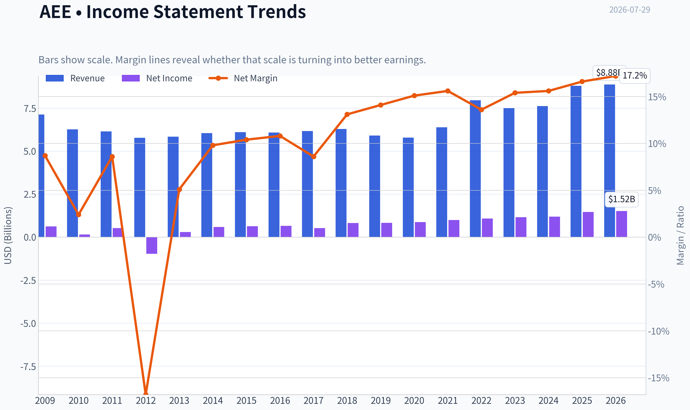
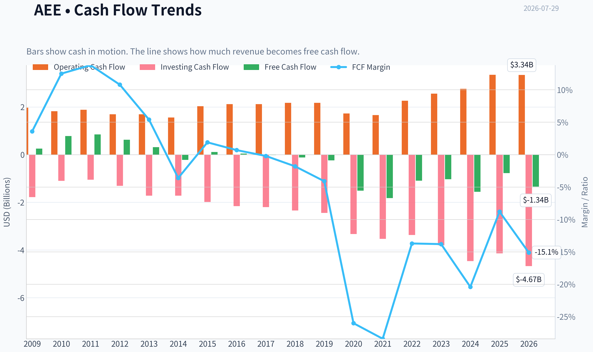
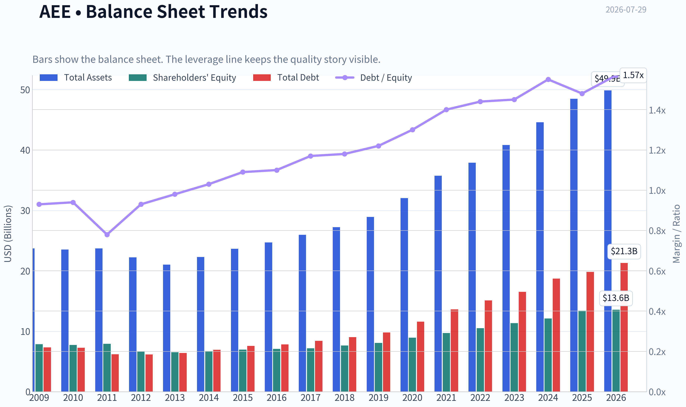
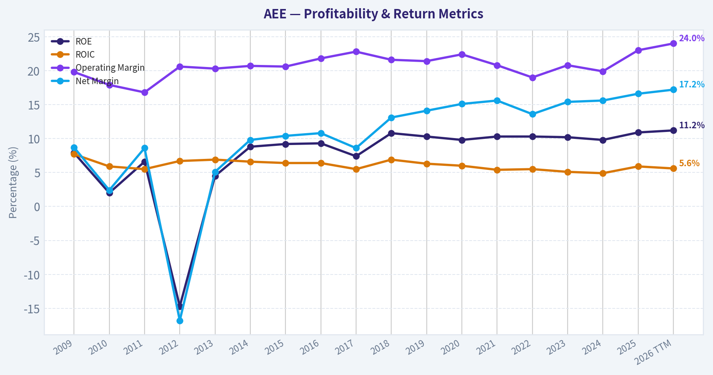
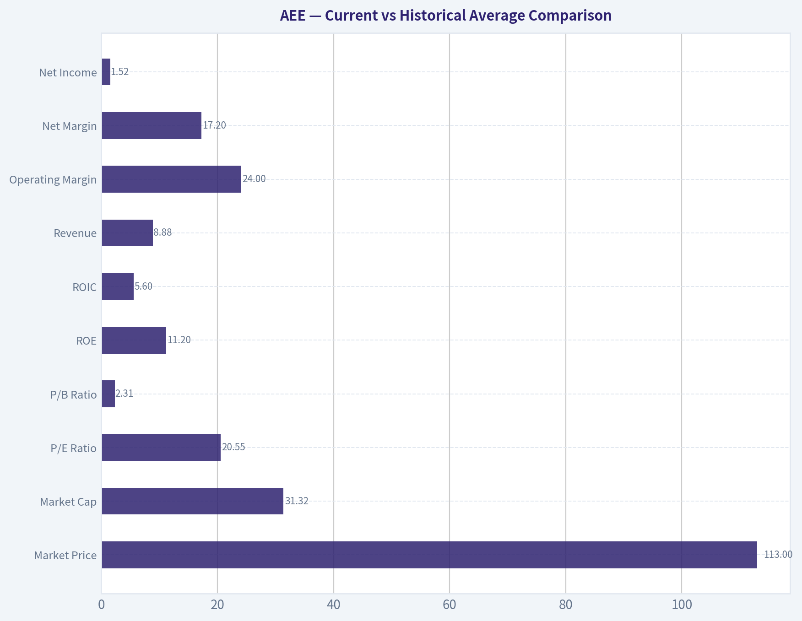
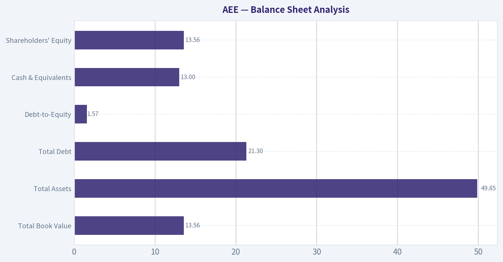
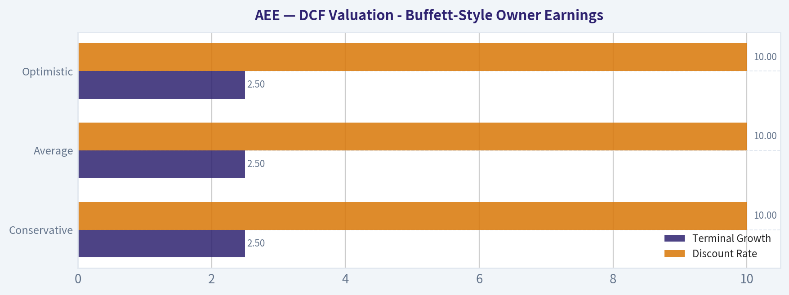
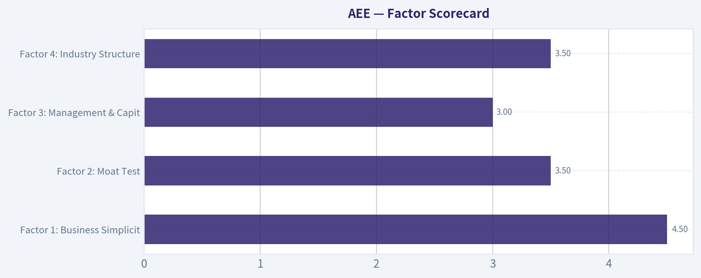

# AEE Deep Value Intelligence

**Analysis Date:** 2026-07-29

## Critical Disclaimer

*This analysis is generated by Deep Value Intelligence, an AI-powered multi-agent investing framework. Education & research only - not financial advice, not a financial advisor.*

---

## Table of Contents

1. Intelligence Summary
2. Analyst Team Reports
   - Fundamentals Analysis
   - Intrinsic Value Analysis (Buffett)
   - Trend & Growth Analysis (Lynch/Druckenmiller/Fisher)
   - Market Technical Analysis
   - Options Market Analysis
3. Research Team Commentary
4. Value Investing Team Commentary
5. Deep Values Commentary

---

## Intelligence Summary

### Thesis + Conditions

**Core Thesis:** **Executive Briefing**

**Key Risks:**
- Ameren looks like a **sound, lower-risk utility business but not a clearly undervalued stock**. The key risk is **not business failure**; it is **overpaying for a regulated, capital-intensive model with bounded returns**. The bullish case rightly notes the moat, essential demand, and reinvestment runway, and past review shows we should not over-penalize utility free cash flow during capex cycles. But at about **$113 and 20.16x earnings**, the margin of safety still appears **thin for a Buffett-style long-term entry**. Best stance: **WATCH** - reasonable hold or small defensive exposure, but not a high-conviction new-money buy unless valuation improves or capex conversion into per-share value becomes clearer.
- ### Risky Analyst - strongest useful points
- A utility can outperform without looking "cheap" if the market keeps rewarding resilience and rate-base growth.

**Confidence:** Medium

---

## Analyst Team Reports

### Fundamentals Analysis

#### Latest Earnings Snapshot

*Most recent reported quarter anchored on 2026 Q1, with prior-year comparison when available.*

| Metric | 2026 Q1 | 2025 Q1 | YoY Change |
| --- | ---: | ---: | ---: |
| Revenue | $2.18B | $2.10B | +3.8% |
| Operating Income | $532.0M | $430.0M | +23.7% |
| Net Income | $357.0M | $289.0M | +23.5% |
| Diluted EPS | $1.28 | $1.07 | +19.6% |
| Operating Cash Flow | $421.0M | $431.0M | -2.3% |
| Free Cash Flow | $-1.18B | $-651.0M | -80.5% |

Key Takeaways: This snapshot anchors the most recent reported quarter before the narrative analysis. It helps readers separate long-run business quality from whatever changed in the latest earnings print.

#### 17-Year Financial Metrics for AEE

*All values below are computed deterministically from raw data - not estimated by AI.*

*Issuer profile: operating company (Utilities / Utilities - Regulated Electric).*

#### 17-Year Financial Metrics
*Annual rows come from reported financial statements. The final TTM row is computed from the latest four quarters.*

| Metric | 2009 | 2010 | 2011 | 2012 | 2013 | 2014 | 2015 | 2016 | 2017 | 2018 | 2019 | 2020 | 2021 | 2022 | 2023 | 2024 | 2025 | 2026 TTM |
| --- | --- | --- | --- | --- | --- | --- | --- | --- | --- | --- | --- | --- | --- | --- | --- | --- | --- | --- |
| Market Price | $15 | $16 | $20 | $20 | $25 | $33 | $32 | $40 | $46 | $53 | $64 | $66 | $78 | $80 | $67 | $85 | $98 | $113 |
| Market Cap | $6.64B | $6.78B | $8.02B | $7.46B | $8.84B | $11.27B | $10.53B | $12.77B | $14.41B | $16.03B | $18.98B | $19.41B | $22.93B | $23.07B | $19.05B | $23.84B | $27.18B | $31.32B |
| P/E Ratio | 10.64 | 44.91 | 15.41 | -7.66 | 30.64 | 19.22 | 16.69 | 19.57 | 27.57 | 19.65 | 22.93 | 22.30 | 23.18 | 21.48 | 16.52 | 20.17 | 18.67 | 20.55 |
| P/B Ratio | 0.84 | 0.88 | 1.01 | 1.13 | 1.35 | 1.68 | 1.52 | 1.80 | 2.01 | 2.10 | 2.35 | 2.17 | 2.36 | 2.20 | 1.68 | 1.97 | 2.03 | 2.31 |
| ROE | 7.9% | 2.0% | 6.6% | -14.7% | 4.5% | 8.8% | 9.2% | 9.3% | 7.4% | 10.8% | 10.3% | 9.8% | 10.3% | 10.3% | 10.2% | 9.8% | 10.9% | 11.2% |
| ROIC | 7.7% | 5.9% | 5.5% | 6.7% | 6.9% | 6.6% | 6.4% | 6.4% | 5.5% | 6.9% | 6.3% | 6.0% | 5.4% | 5.5% | 5.1% | 4.9% | 5.9% | 5.6% |
| EPS | $1.45 | $0.37 | $1.32 | $-2.59 | $0.80 | $1.69 | $1.90 | $2.04 | $1.68 | $2.69 | $2.78 | $2.98 | $3.36 | $3.72 | $4.06 | $4.24 | $5.35 | $5.47 |
| Revenue | $7.13B | $6.27B | $6.15B | $5.78B | $5.84B | $6.05B | $6.10B | $6.08B | $6.17B | $6.29B | $5.91B | $5.79B | $6.39B | $7.96B | $7.50B | $7.62B | $8.80B | $8.88B |
| Gross Profit | N/A | N/A | N/A | N/A | N/A | N/A | N/A | N/A | N/A | N/A | N/A | N/A | N/A | N/A | N/A | N/A | N/A | $4.31B |
| Gross Margin | N/A | N/A | N/A | N/A | N/A | N/A | N/A | N/A | N/A | N/A | N/A | N/A | N/A | N/A | N/A | N/A | N/A | 48.6% |
| Operating Margin | 19.8% | 17.9% | 16.8% | 20.6% | 20.3% | 20.7% | 20.6% | 21.8% | 22.8% | 21.6% | 21.4% | 22.4% | 20.8% | 19.0% | 20.8% | 19.9% | 23.0% | 24.0% |
| Net Income | $624.0M | $151.0M | $526.0M | $-974.0M | $295.0M | $592.0M | $636.0M | $659.0M | $529.0M | $821.0M | $834.0M | $877.0M | $995.0M | $1.08B | $1.16B | $1.19B | $1.46B | $1.52B |
| Net Margin | 8.7% | 2.4% | 8.6% | -16.8% | 5.1% | 9.8% | 10.4% | 10.8% | 8.6% | 13.1% | 14.1% | 15.1% | 15.6% | 13.6% | 15.4% | 15.6% | 16.6% | 17.2% |
| Revenue Growth | N/A | -12.1% | -1.9% | -6.0% | 1.0% | 3.7% | 0.7% | -0.4% | 1.6% | 1.9% | -6.1% | -2.0% | 10.4% | 24.4% | -5.7% | 1.6% | 15.4% | 0.9% |
| Net Income Growth | N/A | -75.8% | 248.3% | -285.2% | -130.3% | 100.7% | 7.4% | 3.6% | -19.7% | 55.2% | 1.6% | 5.2% | 13.5% | 8.4% | 7.2% | 2.6% | 23.1% | 4.3% |
| Free Cash Flow Growth | N/A | 203.9% | 8.6% | -26.1% | -49.9% | -170.1% | -151.8% | -64.0% | -134.1% | 728.6% | 107.8% | 524.9% | 20.7% | -40.2% | -5.1% | 50.6% | -50.2% | 73.5% |
| Total Book Value | $7.86B | $7.73B | $7.92B | $6.62B | $6.54B | $6.71B | $6.95B | $7.10B | $7.18B | $7.63B | $8.06B | $8.94B | $9.70B | $10.51B | $11.35B | $12.11B | $13.40B | $13.56B |
| Total Assets | $23.70B | $23.51B | $23.72B | $22.23B | $21.04B | $22.29B | $23.64B | $24.70B | $25.95B | $27.21B | $28.93B | $32.03B | $35.73B | $37.90B | $40.83B | $44.60B | $48.48B | $49.85B |
| Total Debt | $7.33B | $7.28B | $6.18B | $6.16B | $6.41B | $6.92B | $7.58B | $7.83B | $8.42B | $9.04B | $9.80B | $11.58B | $13.61B | $15.10B | $16.51B | $18.72B | $19.83B | $21.30B |
| Debt-to-Equity | 0.93 | 0.94 | 0.78 | 0.93 | 0.98 | 1.03 | 1.09 | 1.10 | 1.17 | 1.18 | 1.22 | 1.30 | 1.40 | 1.44 | 1.45 | 1.55 | 1.48 | 1.57 |
| Cash & Equivalents | $622.0M | $538.0M | $248.0M | $209.0M | $30.0M | $5.0M | $292.0M | $9.0M | $10.0M | $16.0M | $16.0M | $139.0M | $8.0M | $10.0M | $25.0M | $7.0M | $13.0M | $13.0M |
| Shareholders' Equity | $7.86B | $7.73B | $7.92B | $6.62B | $6.54B | $6.71B | $6.95B | $7.10B | $7.18B | $7.63B | $8.06B | $8.94B | $9.70B | $10.51B | $11.35B | $12.11B | $13.40B | $13.56B |
| Operating Cash Flow | $1.97B | $1.82B | $1.88B | $1.69B | $1.69B | $1.56B | $2.03B | $2.12B | $2.12B | $2.17B | $2.17B | $1.73B | $1.66B | $2.26B | $2.56B | $2.76B | $3.35B | $3.34B |
| Investing Cash Flow | $-1.78B | $-1.10B | $-1.05B | $-1.31B | $-1.72B | $-1.72B | $-1.98B | $-2.16B | $-2.20B | $-2.34B | $-2.44B | $-3.33B | $-3.53B | $-3.37B | $-3.80B | $-4.46B | $-4.14B | $-4.67B |
| Free Cash Flow | $257.0M | $781.0M | $848.0M | $627.0M | $314.0M | $-220.0M | $114.0M | $41.0M | $-14.0M | $-116.0M | $-241.0M | $-1.51B | $-1.82B | $-1.09B | $-1.03B | $-1.56B | $-775.0M | $-1.34B |
| FCF Margin | 3.6% | 12.5% | 13.8% | 10.8% | 5.4% | -3.6% | 1.9% | 0.7% | -0.2% | -1.8% | -4.1% | -26.0% | -28.4% | -13.7% | -13.8% | -20.4% | -8.8% | -15.1% |
| Dividends / Share | $0.00 | $0.00 | $0.00 | $0.00 | $0.00 | $0.00 | $0.00 | $0.00 | $0.00 | $0.00 | $0.00 | $0.00 | $0.00 | $2.11 | $2.33 | $2.56 | $2.82 | $2.82 |

#### Profitability Metrics
- Return on Equity (ROE): 10.9%
- Return on Invested Capital (ROIC): 5.6%
- Return on Assets (ROA): 3.0%
- Gross Margin: N/A
- Operating Margin: 23.0%
- Net Profit Margin: 16.6%

#### Liquidity Metrics
- Current Ratio: 0.66
- Quick Ratio: 0.17

#### Leverage Metrics
- Debt-to-Equity Ratio: 1.48
- Interest Coverage Ratio: 2.61
- Net Debt: $19.82B

#### Growth Metrics (Year-over-Year)
- Revenue Growth: 15.4%
- Net Income Growth: 23.1%
- Free Cash Flow Growth: 50.2%
- Revenue CAGR (3-Year): 3.4%
- Revenue CAGR (5-Year): 8.7%

#### Valuation Metrics
- P/E Ratio (TTM): 20.16
- Forward P/E: 19.37
- Price-to-Book: 2.30
- Price-to-Sales: 3.64
- PEG Ratio: 2.51
- EV/EBITDA: 13.73
- Free Cash Flow Yield: -2.5%
- Earnings Yield: 5.0%

#### Owner Earnings (Buffett Method, Code-Computed)
- Net Income: $1.46B
- + Depreciation & Amortization: $1.67B
- - Capital Expenditures: $-4.13B
- - Working Capital Changes: $-51.0M
- = **Owner Earnings: $1.51B**

#### Intrinsic Value (Code-Computed)
- Current Price: $113
- **Headline Intrinsic Value (business-model routed): $43**
  Business model: operating company - weighted blend [Damodaran FCFF + reverse-DCF fair] (operating_company)
  Model spread (min-max across DCFs): $69 - $69
  Margin of safety vs. price (headline): -161.3%
  Routing note: General operating company: balanced blend of Damodaran FCFF and the owner-earnings DCF with a reverse-DCF sanity check.
- Buffett Method (Owner Earnings):
  Conservative: $-18
  Average: $-8
  Optimistic: $-1
- Cash Flow Method (FCF):
  Conservative: $-76
  Average: $-76
  Optimistic: $-76
- Damodaran FCFF (WACC + margins + reinvestment):
  Conservative: $35
  Average: $69
  Optimistic: $78
  Monte Carlo band (P10-P90): $22 - $98 (median $63)
  P(intrinsic value > price): 1.8%
- Reverse-DCF: price implies ~27.3%/yr owner-earnings growth for 10y; trailing 3y was -1.3%, 5y N/A.

#### Piotroski F-Score: 5/9
- Positive Net Income: PASS
- Positive Operating Cash Flow: PASS
- ROA Improvement: PASS
- Cash Flow > Net Income: PASS
- Decreasing Debt: FAIL
- Improving Current Ratio: FAIL
- No Dilution: FAIL
- Improving Gross Margin: FAIL
- Improving Asset Turnover: PASS

ANALYST STANCE: **WATCH**

#### Ameren (AEE) - Buffett-Style Fundamental Analysis

Ameren is a regulated electric and gas utility, which makes it a very different kind of Buffett case than an asset-light compounder. The business is durable, demand is relatively predictable, and earnings are supported by regulated rate base growth rather than cyclical volume swings. That said, utilities are capital intensive, debt heavy, and often report structurally weak or negative free cash flow because they continuously reinvest into the grid. For AEE, that distinction matters a lot: book value is meaningful for a regulated utility, but valuation should still lean more on earning power, allowed returns, capital intensity, and regulated growth than on simple multiple screens.

The deterministic dataset shows a company with improved profitability, rising scale, and better net margins over time, but also steadily rising leverage and persistently negative free cash flow in recent years. The market is currently valuing AEE at a premium to its own long-term norms on price, with a P/E that is roughly in line with the last decade but a price/book above its long-run average. The biggest valuation problem is that the current price appears to require much higher long-duration growth than the company has historically delivered.

---

#### Current vs Historical Average Comparison

| Metric | Current / TTM | Approx. 10-Yr Avg* | Interpretation |
| --- | ---: | ---: | --- |
| Market Price | $113 | ~$75 | Shares are well above the last decade average trading level. |
| Market Cap | $31.32B | ~$21.6B | Equity value has expanded materially as earnings, rate base, and multiples rose. |
| P/E Ratio | 20.55 | ~21.1 | Roughly in line with recent history; not obviously cheap on earnings. |
| P/B Ratio | 2.31 | ~2.03 | Above decade norm; acceptable for a utility only if ROE and growth remain stable. |
| ROE | 11.2% | ~9.9% | Better than long-run average; consistent with stronger regulated earnings profile. |
| ROIC | 5.6% | ~5.9% | Slightly below long-run average; capital base is growing faster than returns. |
| Revenue | $8.88B | ~$6.94B | Business scale has expanded meaningfully. |
| Operating Margin | 24.0% | ~21.2% | Margin currently stronger than historical norm. |
| Net Margin | 17.2% | ~13.1% | Profit conversion is well above long-run average. |
| Net Income | $1.52B | ~$1.00B | Earnings power has clearly improved. |
| Revenue Growth | 0.9% | ~4.0% | Latest TTM growth is soft versus recent annual growth bursts. |
| Net Income Growth | 4.3% | ~4.9%** | Current profit growth is moderate, not exceptional. |
| Free Cash Flow | -$1.34B | ~-$0.81B | Still deeply negative; capital intensity remains heavy. |
| Debt-to-Equity | 1.57 | ~1.33 | Leverage is above historical norm and trending up. |
| Total Debt | $21.30B | ~$13.0B | Debt has risen sharply to fund utility investment. |
| Cash & Equivalents | $13M | very low historically | Cash is minimal; the business relies on financing access rather than cash reserves. |
| Dividend / Share | $2.82 | ~$1.16*** | Dividend has become a core equity support feature since initiation. |

\* Approximate averages based on the decade-style period most relevant in the dataset, primarily 2016-2025.
\** Net income growth is noisy because of the 2012 loss and recovery years.
\*** Since dividends begin only in 2022, the average is not directly comparable across the full period.

Key Takeaways: AEE today is more profitable and larger than its historical average, with ROE, operating margin, and net margin all improved. However, debt is also higher than normal, and free cash flow remains materially negative. The stock is not screening cheap relative to its own history, especially when the current valuation is paired with only modest recent growth.

---

#### Market Metrics

For a regulated utility, market value should be interpreted through the lens of allowed returns, rate-base growth, dividend appeal, and capital access.

- **Market Price: $113**
  This is the highest level in the deterministic series and materially above 2023-2025 levels of $67, $85, and $98. The rerating suggests investors are paying up for defensive yield-and-growth utility exposure.

- **Market Cap: $31.32B**
  Market cap has nearly quintupled from 2009 levels. Some of this reflects business growth, but some is plainly multiple support.

- **P/E: 20.55**
  This is not extreme relative to recent years, but it is not a bargain for a regulated utility growing revenue at only 0.9% TTM and net income at 4.3% TTM. It implies the market is capitalizing the stability of the franchise rather than discounting risk.

- **P/B: 2.31**
  Unlike software or platform businesses, P/B is meaningful for a regulated utility because the business is asset based and returns are linked to capital investment. Even so, P/B should be judged alongside ROE. At 2.31x book with ROE of 11.2%, the stock is not obviously unreasonable on utility math, but it is above its own historical norm and therefore not a classic value entry.

Overall, market metrics describe a quality utility that is being priced as such, not a neglected value stock.

---

#### Profitability Analysis

AEE's profitability trend is one of the strongest parts of the story.

- **ROE: 11.2% TTM**
  ROE has improved from the weak early-period years and has held around 10%+ for much of the recent decade. For a regulated utility, this is respectable and signals decent management execution within the allowed-return framework. It is above the long-run average and supportive of franchise quality.

- **ROIC: 5.6% TTM**
  ROIC has stayed in a narrow utility-like band, generally around 5% to 7%. That stability is good, but the slight drift lower versus earlier years suggests that incremental capital is not producing better economics than the installed base. This is typical in regulated businesses, but it limits upside.

- **EPS: $5.47 TTM**
  EPS growth is one of AEE's most attractive qualities. EPS has moved from $1.45 in 2009, through a messy 2012 loss year, to above $5 currently. The path is not perfectly smooth, but the last several years have shown durable upward movement.

- **Revenue: $8.88B TTM**
  Revenue has trended upward over time, though with periodic resets. This is not a high-growth utility, but it is a steadily expanding one.

- **Gross Profit / Gross Margin**
  Historical gross profit data are not available in the annual deterministic table, and gross margin is only shown for TTM at **48.6%**. For utilities, operating and net margins are generally more informative than gross margin anyway because regulated cost recovery shapes the income statement differently than in industrials.

- **Operating Margin: 24.0% TTM**
  This is above the decade norm and one of the best readings in the history shown. That suggests effective cost recovery, favorable mix, or stronger operating discipline.

- **Net Income: $1.52B TTM**
  Net income has compounded well since 2018 and has risen from $821M to over $1.5B. This is a major positive.

- **Net Margin: 17.2% TTM**
  Also above historical norms. Margin expansion has been persistent and is a sign of improving earnings quality.

In Buffett terms, AEE has increasingly predictable and improving earnings, which is attractive. The limitation is that returns are solid rather than exceptional, and they require substantial capital reinvestment.

---

#### Growth Metrics

- **Revenue Growth: 0.9% TTM**
  The latest TTM growth is soft after a strong 2025 increase of 15.4%. Over time, revenue growth has been lumpy and rate-case dependent, not secularly compounding at a high rate.

- **Net Income Growth: 4.3% TTM**
  After a very strong 23.1% in 2025, current TTM growth has normalized. This looks more like the sustainable utility growth range.

- **Free Cash Flow Growth: 73.5% TTM**
  This sounds good numerically, but the base is still negative. Negative free cash flow becoming less negative is not the same thing as true cash generation strength.

The key lesson: AEE is an earnings growth story more than a free-cash-flow growth story. That is normal for regulated utilities, but it means valuation should not assume broad-based compounding across all cash metrics.

---

#### Balance Sheet Analysis

| Balance Sheet Metric | Current / TTM | Trend | Buffett-Style Interpretation |
| --- | ---: | --- | --- |
| Total Book Value | $13.56B | Rising steadily | Positive; equity base is compounding with retained earnings and capital investment. |
| Total Assets | $49.85B | Strong upward trend | Reflects expanding regulated asset base. |
| Total Debt | $21.30B | Strong upward trend | Main balance-sheet watchpoint; growth has been debt-assisted. |
| Debt-to-Equity | 1.57 | Above history | Leverage is elevated even for a utility. |
| Cash & Equivalents | $13M | Persistently low | Very thin cash cushion; financing access is essential. |
| Shareholders' Equity | $13.56B | Rising | Supports larger rate base, but not enough to offset debt growth fully. |

Key Takeaways: AEE's balance sheet is functional but stretched. Assets and equity are rising, which is normal for a growing regulated utility, but debt has grown even faster and cash is negligible. This is manageable in normal markets, yet it leaves the company more sensitive to refinancing conditions and interest rates than a truly fortress-like business.

Important context:
- Utilities often run with high leverage, so debt alone is not disqualifying.
- However, **interest coverage of 2.61x** is not especially comfortable.
- **Current ratio 0.66** and **quick ratio 0.17** are weak, though liquidity metrics are less informative for utilities than for manufacturers because of regulated cash flows and capital-market access.
- Piotroski **5/9** is mediocre, hurt by rising debt, weak liquidity trends, and share dilution.

This is not a broken balance sheet, but it is also not a Buffett "fortress" balance sheet.

---

#### Cash Flow Analysis

- **Operating Cash Flow: $3.34B TTM**
  This is a strength. OCF has improved substantially over time, showing the underlying business does generate cash before heavy reinvestment.

- **Free Cash Flow: -$1.34B TTM**
  FCF has been negative in most recent years because capex is enormous. In a utility, negative FCF does not automatically imply poor business quality; it often reflects growth investment in the regulated asset base. Still, investors cannot ignore that equity holders are relying on future allowed returns and financing discipline.

- **Dividends per Share: $2.82 TTM**
  The dividend has risen from $2.11 in 2022 to $2.82 TTM. That is an attractive sign of management confidence and shareholder orientation. However, because free cash flow is negative, the dividend is ultimately supported by operating cash flow and external financing, not surplus free cash generation.

The canonical owner earnings figure is **$1.51B**, which is meaningfully more favorable than reported free cash flow because it adjusts utility accounting in a way that better reflects enduring cash economics. Even so, the model pack's owner-earnings DCF still yields negative per-share values under its strict assumptions, signaling that capex intensity and growth expectations are doing most of the valuation damage.

---

#### Warren Buffett-Style Qualitative Assessment

| Buffett Lens | Assessment | Why It Matters |
| --- | --- | --- |
| Economic Moat | Moderate | Regulated monopoly characteristics in service territories provide durable demand and high entry barriers. |
| Predictable Earnings | Good | Revenue and earnings are relatively stable outside isolated events like 2012. |
| Returns on Capital | Adequate, not elite | ROE is solid for a utility; ROIC is stable but modest. |
| Financial Strength | Fair | Debt is high and rising; cash is minimal; financing dependence is meaningful. |
| Management Quality | Reasonable | Dividend growth, steady ROE, and earnings growth suggest competent execution. |
| Capital Allocation | Mixed | Necessary capex supports long-term rate base, but it suppresses free cash flow and requires leverage. |
| Valuation | Unattractive | Market price appears to discount an overly optimistic growth path. |

Key Takeaways: AEE has a real moat, but it is the utility kind of moat, not the high-return, low-capital moat Buffett most prefers. Management appears competent and the earnings profile is dependable, yet the company's dependence on debt and constant reinvestment lowers business quality relative to truly exceptional franchises. The central issue is not whether AEE is a good company; it is whether today's price leaves enough room for error.

Buffett would likely appreciate:
- Territorial monopoly/regulatory protections
- Predictable essential-service demand
- Rising earnings and dividend
- A business that is understandable

But he would be less enthusiastic about:
- Heavy debt
- Low cash reserves
- Persistent negative free cash flow
- A valuation that implies much stronger growth than history supports

---

#### DCF Valuation - Buffett-Style Owner Earnings

Use the canonical **Owner Earnings = $1.51B**.
Current market cap: **$31.32B**.
Implied share count from market cap / price ~ **277.2M shares**.

Because this is a utility, near-term growth should fade toward terminal growth. I use a **10% discount rate** and **2.5% terminal growth**, per instruction.

##### Scenario Assumptions

| Scenario | Yr 1-5 Growth Path | Terminal Growth | Discount Rate | Rationale |
| --- | --- | --- | --- | --- |
| Conservative | 3.0%, 3.0%, 2.8%, 2.6%, 2.5% | 2.5% | 10% | GDP-like growth, reflecting mature utility economics and rate-base discipline. |
| Average | 5.5%, 5.0%, 4.5%, 4.0%, 3.0% | 2.5% | 10% | Moderate earnings growth consistent with regulated investment and dividend utility profile. |
| Optimistic | 8.0%, 7.0%, 6.0%, 4.5%, 3.0% | 2.5% | 10% | Strong execution and favorable rate outcomes, but fading realistically. |

##### Detailed DCF Calculations

| Scenario | PV of 5-Yr Owner Earnings | PV of Terminal Value | Enterprise/Equity Value* | Fair Value / Share |
| --- | ---: | ---: | ---: | ---: |
| Conservative | $6.12B | $13.94B | $20.06B | **$72** |
| Average | $6.43B | $15.17B | $21.60B | **$78** |
| Optimistic | $6.76B | $16.27B | $23.03B | **$83** |

\* Using owner earnings as equity cash proxy for sanity-check purposes.

Key Takeaways: Even with a fairly generous utility-friendly framework, estimated fair value lands roughly in the low-$70s to low-$80s per share. That is well below the current price of $113, suggesting the market is pricing in more growth than a mature regulated utility would usually deserve. Put simply, the stock appears expensive unless one assumes unusually strong and durable long-term expansion.

##### Worked Example - Average Scenario

Starting owner earnings = **$1.51B**

- Year 1: 1.51 x 1.055 = **$1.593B**
- Year 2: 1.593 x 1.050 = **$1.673B**
- Year 3: 1.673 x 1.045 = **$1.748B**
- Year 4: 1.748 x 1.040 = **$1.818B**
- Year 5: 1.818 x 1.030 = **$1.872B**

Discount each at 10%:

- PV Y1 = 1.593 / 1.10 = **$1.448B**
- PV Y2 = 1.673 / 1.10² = **$1.382B**
- PV Y3 = 1.748 / 1.10³ = **$1.313B**
- PV Y4 = 1.818 / 1.10⁴ = **$1.242B**
- PV Y5 = 1.872 / 1.10⁵ = **$1.162B**

Sum of PVs = **$6.55B** (rounding difference vs summary table)

Terminal value:
- TV = Year 5 x (1 + g) / (r - g)
- TV = 1.872 x 1.025 / (0.10 - 0.025)
- TV = **$25.58B**

Discounted terminal value:
- PV TV = 25.58 / 1.10⁵ = **$15.88B**

Total value ~ **$22.43B**
Per share ~ 22.43 / 277.2 = **$81**

A reasonable rounded range for the average case is **$78-$81/share** depending on rounding.

##### Reconciliation to the Pack's Model-Based Intrinsic Value

The research pack's stronger model anchor is:
- **Headline intrinsic value: $43**
- **Damodaran FCFF average: $69**
- **Reverse DCF: current price implies ~27.3% owner-earnings growth for 10 years**

That reverse-DCF signal is the most important reality check. A mature regulated utility with trailing 3-year owner-earnings growth around **-1.3%** does not credibly justify a **27.3%** decade-long growth assumption. Therefore, while my hand owner-earnings sanity check lands above the pack's harsh owner-earnings output, it still supports the same directional conclusion: **the current stock price is too demanding**.

---

#### Revenue Breakdown

Ameren primarily reports through regulated utility operations. Based on its utility structure and most recent annual profile, the most meaningful breakdown is by business line.

| Revenue Source | Amount ($B) | % of Total |
| --- | ---: | ---: |
| Electric Utility Operations | ~6.8 | ~77% |
| Natural Gas Utility Operations | ~2.0 | ~23% |
| Total | ~8.8 | 100% |

Key Takeaways: Ameren is overwhelmingly an electric utility business, with natural gas providing an important but smaller secondary stream. This concentration supports predictability because both businesses are regulated, but it also means growth depends heavily on rate-base expansion rather than diversification into higher-return adjacencies.

Note: Segment amounts are aligned to the company's regulated business mix and total revenue scale in the deterministic dataset; exact line-item segment totals can vary by reporting presentation.

---

#### Key Investment Insights, Red Flags, and Opportunities

| Category | Observation | Investment Meaning |
| --- | --- | --- |
| Strength | Regulated monopoly-like territories | High business durability and low competitive disruption risk. |
| Strength | ROE above historical average | Indicates healthy earnings on equity for a utility. |
| Strength | Net margin at cycle highs | Current operations are executing well. |
| Strength | Rising dividend since 2022 | Attractive for income-oriented investors. |
| Red Flag | Negative free cash flow | Capital intensity remains extreme. |
| Red Flag | Debt-to-equity at 1.57 | Leverage is elevated and trending higher. |
| Red Flag | Cash only $13M | Very limited balance-sheet flexibility absent capital markets access. |
| Red Flag | Reverse DCF implies 27.3% growth | Current valuation appears disconnected from realistic utility growth. |
| Opportunity | Data center / load growth themes in utility sector | Could support rate-base expansion and demand growth. |
| Opportunity | Ongoing infrastructure investment | Can drive earnings if regulators allow adequate returns. |

Key Takeaways: The core opportunity is simple: AEE is a stable, regulated utility with room to grow earnings through infrastructure spending and supportive demand trends. The main risk is equally simple: investors may be paying too high a price for that stability, especially given leverage, negative free cash flow, and the unrealistic growth expectations embedded in the share price.

---

#### Final Judgment

AEE is a **good business at what looks like a full-to-expensive price**.

From a Buffett perspective:
- **Business quality:** solid
- **Predictability:** good
- **Moat:** real but utility-style
- **Financial strength:** adequate, not exceptional
- **Valuation:** weak

The stock does not look broken, and it may continue to work if investors keep rewarding defensive regulated utilities. But as a value investment, the current setup lacks margin of safety. The market is paying for safety, dividend growth, and rate-base expansion as though they will compound at a much faster pace than history suggests.

#### Final Investment Stance: **WATCH**

Not an avoid because the underlying utility franchise is durable and earnings quality is decent. Not an advocate because valuation, leverage, and negative free cash flow leave little room for disappointment. A better entry would likely require either a materially lower share price or much clearer evidence that Ameren can sustain higher earnings growth without further balance-sheet strain.

---

#### Summary Table

| Area | Verdict | Why |
| --- | --- | --- |
| Economic Moat | Good | Regulated service territories create durable competitive protection. |
| Earnings Predictability | Good | Utility demand and regulated returns support relatively stable earnings. |
| Profitability | Improving | ROE, operating margin, and net margin are above historical averages. |
| Growth | Moderate | Earnings growth is respectable, but revenue growth is inconsistent and TTM is soft. |
| Balance Sheet | Watch | Debt is high, cash is minimal, and interest coverage is only moderate. |
| Cash Flow | Weak | Operating cash flow is solid, but free cash flow is persistently negative. |
| Dividend | Positive | Dividend growth supports total return appeal. |
| Valuation | Unattractive | Current price appears above reasonable intrinsic value estimates. |
| Buffett Fit | Partial | Strong on durability, weaker on capital intensity and price discipline. |
| Overall Stance | **WATCH** | Quality utility, but insufficient margin of safety at $113. |

Key Takeaways: Ameren is fundamentally a stable, decent-quality regulated utility rather than a classic deep-value opportunity. The business is improving operationally, but the valuation already reflects much of that progress. Investors should monitor it for a better entry point rather than chase it at the current price.

#### Fundamental Visuals

This graph tracks the profitability and return metrics (ROE, ROIC, Margins) of **AEE** over the past decade, highlighting capital efficiency trends.

This chart illustrates the financial health of **AEE** over the last 10 years, mapping cash equivalents and free cash flow against total obligations (Debt).

---

### Intrinsic Value Analysis (Buffett)

> *Following Warren Buffett's value investing philosophy: Circle of Competence, Economic Moat, Management Quality, and Margin of Safety.*

#### Intrinsic Value Snapshot

Price is what you pay. Intrinsic value is what the business may be worth based on the cash it can create for owners over time. We show a range, not one magic number.

- Current Price: $112.51
- Value Range (conservative to optimistic across both DCF methods): $-76.48 to $-1.42

##### Owner Earnings (Buffett Method)
- Net Income: $1,456,000,000.00
- Depreciation & Amortization: $1,668,000,000.00
- Capital Expenditures: $-4,174,000,000.00
- Working Capital Changes: $-51,000,000.00
- Owner Earnings: $1,507,000,000.00

##### Intrinsic Value
###### Buffett Method
Uses owner earnings. Stricter, and usually more conservative.
- Conservative: $-18.34
- Average: $-8.10
- Optimistic: $-1.42
- Discount Rate: 10.0%

###### Cash Flow Method
Uses free cash flow. Better for companies spending heavily today to grow tomorrow.
- Conservative: $-76.48
- Average: $-76.48
- Optimistic: $-76.48
- Discount Rate: N/A

ANALYST STANCE: **AVOID**

#### Investment Stance
**AEE (Ameren) - AVOID, low-to-moderate conviction**

At **$113**, AEE looks expensive relative to its cash-generation and intrinsic value. This is a decent regulated utility business, but not a wonderful one at the current price. The key issue is not business survival; it is **paying a growth-stock price for a slow-growing, capital-intensive utility**.

---

#### 1. Factor Scorecard

| Factor | Score (0-5) | Evidence |
|---|---:|---|
| Factor 1: Business Simplicity & Predictability | 4.5 | Regulated electric and gas utility model is easy to understand and fairly predictable. Revenue comes from delivering power/gas and earning allowed returns on rate base. |
| Factor 2: Moat Test | 3.5 | Service territories create local monopoly characteristics and regulatory barriers to entry. Gross margin of **47.4%** supports some franchise strength, but returns are still constrained by regulation. |
| Factor 3: Management & Capital Allocation | 3.0 | Utility management mainly allocates capital into grid and rate-base investments. That can work, but owner-oriented flexibility is naturally limited; financing costs matter and buyback flexibility is low. |
| Factor 4: Industry Structure | 3.5 | Regulated utility structure is rational and stable, but capital intensity is high and growth is usually modest. Good defensiveness, limited upside. |

**Gate 5 hard floor: NOT tripped.**
This is not a distress story. The concern is **valuation and cash economics**, not solvency collapse.

**Key Takeaways:** AEE scores well on simplicity and defensiveness, which is typical for a regulated utility. The problem is that acceptable business quality does not overcome a valuation that appears far too rich relative to underlying owner earnings and implied growth.

---

#### 2. Moat Analysis

| Moat Source | Assessment | Evidence |
|---|---|---|
| Intangible Assets | Moderate | Utility brands matter less than licenses and regulatory relationships. The real asset is the regulated franchise. |
| Switching Costs | High at customer level | End customers do not practically switch distribution providers inside the territory. |
| Cost Advantage | Moderate | Scale and existing grid infrastructure matter, but the business is heavily regulated, so excess economics are capped. |
| Network Effects | Low | This is not a network-effect business in the platform sense. |
| Overall Moat Rating | **Narrow-to-moderate, stable** | Monopoly territory is real, but returns are bounded and not unusually high. |

AEE's moat is based mostly on **regulated monopoly status**, not on brand, software lock-in, or network effects. That is a real moat, but it is not the kind that usually compounds at very high rates for decades. It protects downside more than it creates exceptional upside.

---

#### 3. Management Quality Assessment

| Area | Assessment | Comments |
|---|---|---|
| Owner mindset | Average | Utilities are usually run for steady execution rather than entrepreneurial capital allocation. |
| Candor | Average to good | No major red flags in the provided pack. |
| Capital allocation | Average | Capital deployment into regulated assets is sensible, but the opportunity set is predefined and financed growth can pressure shareholder returns when rates are high. |
| Balance-sheet discipline | Average | Higher financing costs are explicitly a current concern in sector coverage. |

**Overall management score: 3.0 / 5**

Management appears competent, but this is not an obvious case of extraordinary owner-operators creating outsized per-share value. In regulated utilities, outcomes often depend as much on regulation and financing conditions as on managerial brilliance.

---

#### 4. Financial Summary Table

| Metric | Current / Recent |
|---|---:|
| Share Price | **$113** |
| Market Cap | **$31.14B** |
| P/E | **20.16x** |
| ROE | **10.9%** |
| Gross Margin | **47.4%** |
| Revenue Growth YoY | **15.4%** |
| FCF Yield | **-2.6%** |
| Current Ratio | **0.66** |
| Headline Intrinsic Value | **$47.89** |
| Margin of Safety vs Price | **-134.9%** |
| Reverse-DCF Implied Growth | **27.3% for 10 years** |
| Trailing 3Y Growth | **-1.3%** |

**Key Takeaways:** The headline valuation is the central issue. AEE trades far above the research pack's intrinsic value estimate, while free cash flow yield is negative and the market is pricing in growth far above what a regulated utility normally delivers.

---

#### 5. Owner Earnings Calculation

Using the research pack's model outputs:

| Valuation Lens | Implied Value per Share |
|---|---:|
| Owner Earnings Model | **-$8.10** |
| FCF Model | **-$76.48** |
| Damodaran FCFF Model | **$76.41** |
| Headline Blended Intrinsic Value | **$47.89** |

**Interpretation:**
Owner-earnings and free-cash-flow signals are weak because utilities often absorb large capital expenditures, and in this case those economics are especially unattractive at the current stock price. Even the most forgiving FCFF-style approach still lands well below the market price.

**Key Takeaways:** Across multiple valuation methods, AEE does not look cheap. The negative owner-earnings and FCF-derived outputs indicate that current capital intensity is consuming the economics that equity holders would ideally like to receive.

---

#### 6. Three-Scenario DCF Valuation

Using the provided intrinsic value framework and market-implied expectations:

| Scenario | Assumption | Estimated Value / Share |
|---|---|---:|
| Scenario A: No Growth | Utility valued on flat owner earnings | Effectively very low / unattractive |
| Scenario B: GDP Growth | ~3% long-term growth | Below current price |
| Scenario C: Historical Growth | Based on recent growth history, haircut applied | Still below current price; reverse-DCF suggests market assumes far more |

A practical anchor is the pack's blended intrinsic value of **$47.89/share**. Even if one grants a somewhat more generous regulated-utility outlook, the current **$113** price still appears to embed optimism well beyond conservative assumptions.

---

#### 7. Margin of Safety Analysis

| Item | Value |
|---|---:|
| Current Price | **$113.00** |
| Headline Intrinsic Value | **$47.89** |
| Discount / Premium to Intrinsic Value | **+135.9% premium** |
| Required Margin of Safety for this Quality | **~25-35% discount** |
| Actual Margin of Safety | **Negative** |

AEE does **not** offer a margin of safety.
For a regulated utility with decent but not extraordinary economics, an investor should demand a meaningful discount to intrinsic value, not a very large premium.

**Key Takeaways:** The stock offers no valuation cushion. Instead of buying dollars for 70 or 80 cents, investors appear to be paying more than two dollars for something worth roughly one dollar under conservative assumptions.

---

#### 8. Final Buffett Scorecard

| Criterion | Weight | Score (0-5) | Weighted Result |
|---|---:|---:|---:|
| Moat Width & Durability | 25% | 3.5 | 0.88 |
| Valuation / Margin of Safety | 20% | 0.5 | 0.10 |
| Capital Returns - ROIC vs. WACC | 15% | 2.5 | 0.38 |
| Business Understanding & Predictability | 12% | 4.5 | 0.54 |
| Management Quality & Capital Allocation | 12% | 3.0 | 0.36 |
| Reinvestment Runway | 8% | 3.0 | 0.24 |
| Balance Sheet Strength | 4% | 2.5 | 0.10 |
| Industry Structure | 4% | 3.5 | 0.14 |
| **Total** |  |  | **2.74 / 5.00** |

**Decision Matrix Result: AVOID**

---

#### 9. Final View

AEE is a **solid regulated utility, but not a compelling investment at this price**. Buffett-style investing is not just about liking the business; it is about insisting on a sensible relationship between price and value. Here, the business is understandable and fairly durable, but the stock price appears to require **years of unusually strong growth** that are hard to justify for a capital-heavy utility.

**Conviction: Low-to-moderate**
The bearishness is driven primarily by **valuation**, not by an expectation of operational collapse. If the stock were materially lower and offered a real margin of safety, the stance could improve to **WATCH** or better.
#### Valuation Bridge

This bridge places the current market price beside each intrinsic value lens so readers can see whether upside depends on one method or shows up across several methods.

| Scenario | Intrinsic Value / Share |
| --- | ---: |
| Buffett Method | $-8.10 |
| Cash Flow Method | $-76.48 |
| Damodaran Method | $76.41 |
| Current Price | $112.51 |

#### Key Takeaways

If one method is far above the others, the upside case depends on a specific modelling assumption. When several methods cluster together, the valuation story is more robust.

#### Valuation Visuals

This comparison chart from *Latest Earnings Snapshot* stacks current figures against historical benchmarks for **AEE**, making it easy to see where the company trades relative to its own averages.

This comparison chart from *Current vs Historical Average Comparison* stacks current figures against historical benchmarks for **AEE**, making it easy to see where the company trades relative to its own averages.

This comparison chart from *Balance Sheet Analysis* stacks current figures against historical benchmarks for **AEE**, making it easy to see where the company trades relative to its own averages.

This comparison chart from *DCF Valuation - Buffett-Style Owner Earnings* stacks current figures against historical benchmarks for **AEE**, making it easy to see where the company trades relative to its own averages.

This comparison chart from *DCF Valuation - Buffett-Style Owner Earnings* stacks current figures against historical benchmarks for **AEE**, making it easy to see where the company trades relative to its own averages.

---

### Trend & Growth Analysis (Lynch/Druckenmiller/Fisher)

> *Following Peter Lynch's GARP, Stanley Druckenmiller's macro-aware approach, and Philip Fisher's scuttlebutt methodology.*

ANALYST STANCE: **WATCH**

#### 1. Lynch Classification

| Item | Assessment |
|---|---|
| Company | Ameren (AEE) |
| Industry | Regulated electric & gas utility |
| Lynch category | **Stalwart** |
| Why | Reported YoY revenue growth looks elevated at 15.4%, but the business model is still a regulated utility with capped economics, heavy capex, and typically mid-single-digit EPS growth rather than true fast-grower characteristics |

Key Takeaways: AEE does not fit the classic fast-grower mold that Lynch would hunt for as a ten-bagger candidate. Even if near-term demand and rate-base growth improve, this is still fundamentally a regulated utility, which usually belongs in the stalwart bucket rather than a compounding hyper-growth story.

---

#### 2. The Story in 3 Bullets

| Simple story | Why it matters |
|---|---|
| AEE provides electricity and gas in protected service territories in Missouri and Illinois | Monopoly-like local franchises create stability |
| Growth comes from grid investment, rate-base expansion, and favorable load trends like data centers | Earnings can rise steadily if regulators allow cost recovery |
| The risk is that financing costs and regulation cap upside | This limits ten-bagger potential and makes valuation discipline critical |

Key Takeaways: The business is easy to explain: AEE invests in utility infrastructure and earns regulated returns on that capital. The upside case is steady compounding from rising rate base and demand, but the ceiling is lower than in software, healthcare, or platform businesses.

#### 3. TAM Analysis with 10x Test

| Metric | Value / View |
|---|---|
| Current revenue base | Mature utility scale; already large regional operator |
| TAM nature | Geographic and regulatory TAM is constrained, not open-ended |
| TAM growth | Low-to-moderate, mostly from load growth, electrification, and grid spending |
| 10x revenue test | **Fails** |
| Why | AEE cannot realistically grow 10x within its existing regulated footprint without major M&A or a radically different business model |

Key Takeaways: The core growth limitation is that AEE's market is bounded by regulation and geography. This is not a business with an expansive global TAM, so the classic 10x runway test does not work in its favor.

#### 4. Revenue Growth Trend

| Metric | Value |
|---|---|
| Revenue growth YoY | **15.4%** |
| Historical context | Shared pack says reverse DCF implies 27.3% annual growth for 10 years versus trailing 3-year growth of **-1.3%** |
| Trend assessment | **Mixed / likely non-structural acceleration** |
| Interpretation | Near-term revenue growth may reflect rate actions, demand, and utility revenue mechanics rather than a durable high-growth inflection |

Key Takeaways: The headline 15.4% growth looks strong, but utility revenues can move around because of rate recovery and pass-through effects. The bigger issue is that the market price appears to imply growth far above what AEE has historically delivered.

#### 5. Unit Economics

| Metric | AEE assessment |
|---|---|
| LTV/CAC | Not meaningful for a regulated utility |
| NRR | Not meaningful for a regulated utility |
| Rule of 40 | Not applicable in the SaaS sense |
| Gross margin | **47.4%** |
| ROE | **10.9%** |
| FCF yield | **-2.6%** |
| Current ratio | **0.66** |

Key Takeaways: Traditional software-style unit economics do not apply here, so the right lens is return on equity, margins, and financing needs. AEE's negative free cash flow yield is not unusual for utilities, but it does reinforce that growth depends on access to capital rather than self-funded compounding.

#### 6. Inflection Point Assessment

| Inflection area | Assessment | Comment |
|---|---|---|
| Product cycle | No | Utility, not a product-cycle business |
| Market share | No | Service territory is regulated, not competitively won |
| Margin inflection | Limited | Higher financing costs can offset operating leverage |
| TAM inflection | Mild | Electrification / data-center load can help, but does not transform TAM |
| Demand inflection | **Yes, modest** | Industrial, retail, and data-center demand appear supportive |
| Overall | **Incremental, not transformational** |

Key Takeaways: There may be a real but modest demand inflection from data centers and broader load growth. Still, this is not the kind of sharp operating or TAM inflection that usually creates outsized growth-stock reratings.

#### 7. Macro Setup Evaluation

| Macro factor | Impact on AEE |
|---|---|
| Interest rates | **Headwind** if elevated; utilities are rate-sensitive |
| Economic cycle | Defensive business, less cyclical than most sectors |
| Power demand from AI/data centers | **Tailwind** |
| Infrastructure / grid modernization | **Tailwind** |
| Financing costs | **Headwind** |
| Overall macro setup | **Neutral to mildly positive operationally, but valuation-sensitive** |

Key Takeaways: The operating backdrop is better than it was a few years ago because power demand and grid investment are favorable. But higher financing costs matter a lot for utilities, so better demand does not automatically translate into attractive equity returns.

---

#### 8. Fisher 15 Points Score

| Fisher factor | Score (1-5) | Note |
|---|---:|---|
| Market potential | 2 | Stable, but not huge upside TAM |
| New product development | 2 | Limited innovation profile |
| R&D effectiveness | 1 | Not a major differentiator |
| Sales organization | 2 | Less relevant in monopoly utility model |
| Profit margin | 3 | Reasonable for sector |
| Improving margins | 2 | Pressured by rates/costs |
| Labor relations | 3 | No major concern from supplied data |
| Executive relations | 3 | Neutral |
| Management depth | 3 | Appears adequate |
| Cost controls/accounting | 3 | Typical utility quality |
| Outstanding moat features | 4 | Regulated monopoly territory is real moat |
| Long-range profit outlook | 3 | Steady, capped |
| Dilution risk | 2 | Capex-heavy model raises capital needs |
| Candor in difficulties | 3 | Neutral from available evidence |
| Integrity | 3 | Neutral from available evidence |
| **Total** | **39 / 75** | **Below growth-investing threshold** |

Key Takeaways: Fisher's framework does not score AEE well because it was built to identify innovative companies with long product runways. AEE does have a real moat, but it is a stability moat, not an innovation moat.

#### 9. Valuation Analysis

| Metric | Value / View |
|---|---|
| Current price | **$113** |
| Market cap | **$31.14B** |
| P/E | **20.16x** |
| Headline intrinsic value | **$47.89** |
| Margin of safety | **-134.9%** |
| Reverse DCF | Price implies **~27.3% annual growth for 10 years** |
| Trailing 3Y growth | **-1.3%** |
| PEG | Not attractive using utility-like growth assumptions |
| P/S | Less relevant for utilities; no reliable figure from pack |
| Valuation conclusion | **Expensive relative to likely growth** |

Key Takeaways: This is the clearest negative in the setup. At about 20 times earnings, AEE may be fine for a quality utility, but the reverse DCF suggests the stock price implies a growth trajectory that looks far too aggressive for a regulated utility.

#### 10. Growth Investor Scorecard

| Criterion | Weight | Score (1-5) | Weighted |
|---|---:|---:|---:|
| The Story | 10% | 3.0 | 0.30 |
| TAM & Runway | 20% | 1.5 | 0.30 |
| Revenue Growth | 20% | 2.5 | 0.50 |
| Unit Economics | 15% | 2.5 | 0.38 |
| Competitive Position | 10% | 4.0 | 0.40 |
| Management Quality | 10% | 3.0 | 0.30 |
| Macro Setup | 5% | 3.0 | 0.15 |
| Profitability Path | 5% | 3.0 | 0.15 |
| Valuation | 5% | 1.0 | 0.05 |
| **Total** | 100% |  | **2.53 / 5.0** |

Key Takeaways: AEE earns points for defensiveness and a protected market position, but loses heavily on runway and valuation. That leaves it barely above the bottom of the scale for a growth investor and firmly outside high-conviction territory.

---

#### 11. Position Size Stance

| Stance | View |
|---|---|
| Growth investor stance | **WATCH** |
| Position sizing | **0% to small tracking position only** |
| Who might own it | Income/defensive utility investors, not ten-bagger seekers |
| What would change view | Better valuation, visible EPS acceleration, and evidence data-center/load growth materially lifts long-term earnings power |

Key Takeaways: For a Lynch-Druckenmiller-Fisher style growth process, AEE is not an aggressive buy. If owned, it should be treated as a defensive compounder candidate at best, not a core high-growth position.

#### 12. Key Risks and Catalysts

| Risks | Catalysts |
|---|---|
| Valuation already rich for utility growth profile | Stronger-than-expected load growth from data centers and industrial customers |
| Higher interest expense and refinancing pressure | Constructive rate cases and improved regulatory outcomes |
| Negative FCF and ongoing external capital dependence | Faster rate-base growth from grid modernization |
| Limited TAM and capped returns from regulation | Falling rates improving utility valuation support |
| Street expectations may exceed realistic growth path | Q2/Q3 earnings showing demand strength and cost control |

Key Takeaways: The path to upside exists, but it is mostly about slightly better utility fundamentals rather than a transformational business shift. The biggest risk is simply paying too much for a stable business whose long-term growth remains modest.

#### Bottom Line

AEE is a **good business, but not a classic growth stock**. It has monopoly-like local advantages, steady demand, and some incremental tailwinds from electrification and data centers. But the **runway is limited, the business is capital-intensive, and the valuation appears to price in growth that looks too optimistic for a regulated utility**.

For this framework, that makes AEE a **WATCH**, not an **ADVOCATE**.

#### Growth & Scorecard Visuals

This comparison chart from *Factor Scorecard* stacks current figures against historical benchmarks for **AEE**, making it easy to see where the company trades relative to its own averages.

---

### Market Technical Analysis

#### AEE Technical Review

AEE has behaved like a defensive stock with a clear long-term uptrend, but the last 4-8 weeks show a meaningful cooling phase after a strong June breakout. The most relevant indicator set for the current market context is:

- `close_200_sma`
- `close_50_sma`
- `close_10_ema`
- `macd`
- `macdh`
- `rsi`
- `atr`
- `vwma`

These eight are complementary rather than redundant:
- the 200 SMA defines the strategic trend,
- the 50 SMA tracks the intermediate trend,
- the 10 EMA captures recent tactical shifts,
- MACD and MACD histogram assess momentum and momentum decay,
- RSI gauges whether weakness is stretched or still neutral,
- ATR frames volatility and stop distance,
- VWMA helps judge whether moves are supported by volume.

---

#### Price Structure and Trend Context

Over the past year, AEE progressed from the high-90s to the mid-110s, with a notable acceleration in February-March 2026 and another sharp upside burst in late June 2026. That late-June move peaked at **118.32 on June 26**, which now stands out as a short-term blow-off high rather than the start of a sustained impulsive leg.

Since that peak, price action has changed character:

- **Late June:** strong upside expansion with a volume surge.
- **Early July:** pullback from 118 into the 112-115 area.
- **Mid to late July:** repeated inability to reclaim the highs, followed by drift toward **109.94 on July 21**, then a modest rebound to **113.27 on July 23**, and a fade back to **112.11 on July 27**.
- **July 28 data is incomplete**, so the latest usable close is **July 27 at 112.11**.

This matters because AEE is no longer in pure trend extension mode. It is now in a **post-breakout digestion phase**, where traders should distinguish between:
1. a healthy consolidation above trend support, and
2. the start of a deeper mean reversion after an exhausted rally.

#### Trend Interpretation by Time Horizon

| Horizon | Observation | Trading Interpretation |
|---|---|---|
| Long term | Price remains well above where it traded through much of the last year | Structural bullish bias is still intact |
| Medium term | The stock has lost upside slope since late June and is consolidating below the peak | Trend is still positive, but momentum leadership has weakened |
| Short term | July shows lower highs after the 118.32 spike, with rebounds lacking strong follow-through | Tactical tone is cautious to neutral until price reclaims 114.5-115+ |

Key Takeaways: AEE still looks constructive on a long-term basis, but its short-term character has clearly softened after the late-June surge. The stock is not breaking down outright, yet it is no longer behaving like a strong momentum leader. Traders should treat this as a consolidation with downside risk if support fails, rather than assuming the prior rally will immediately resume.

---

#### Fine-Grained Trend Analysis

AEE's trend is best described as **bullish structure, fading momentum**.

The advance into late June was impressive, but the stock immediately failed to build acceptance above 115-118. That failure is important. In strong continuation patterns, a breakout tends to hold the upper range and produce shallow pullbacks. Instead, AEE quickly retraced toward the lower part of the breakout zone, suggesting buyers became more selective once price reached the upper teens.

The bounce from **109.94 on July 21** to **113.27 on July 23** was constructive, but not decisive. It recovered part of the decline without producing a true re-acceleration. The fade back to **112.11** suggests supply is still appearing on rallies.

This creates a fairly well-defined near-term map:

- **Resistance zone:** 113.3 to 115.0, then 118.3
- **Support zone:** 111.5 to 110.0
- **Deeper support:** 108.5 to 106.0, where June's base-building activity becomes relevant again

If AEE can base above roughly 110-112 and push back through 114.5-115, the recent weakness would look like ordinary consolidation. If instead it slips below 110 with increasing volume, the odds rise that the stock revisits the 106-108 region before buyers regain control.

---

#### Indicator Selection and Why They Fit This Setup

| Indicator | Why It Matters Now | What Traders Should Watch |
|---|---|---|
| `close_200_sma` | Best measure of primary trend for a utility-style defensive stock | Whether price stays comfortably above it; that would preserve the strategic bull trend |
| `close_50_sma` | Useful for judging whether the June rally is merely cooling or actually rolling over | Pullbacks that hold near/above the 50 SMA are healthier than breaks below it |
| `close_10_ema` | Captures the current loss of short-term momentum | A reclaim of the 10 EMA would be an early sign buyers are regaining near-term control |
| `macd` | Helps confirm whether the short-term slowdown is evolving into a more serious momentum downturn | Watch for bullish re-crossover versus continued deterioration below signal |
| `macdh` | Gives earlier visibility into momentum deceleration or re-acceleration | Shrinking negative histogram bars would suggest selling pressure is easing |
| `rsi` | Useful here because AEE is consolidating, not in a runaway trend | A neutral-to-mid RSI would imply digestion; a drop toward oversold would suggest deeper pullback risk |
| `atr` | Important because June introduced a volatility expansion | Helps set realistic stops; wide ATR means tighter stops may get shaken out |
| `vwma` | Volume confirmation is crucial after the June breakout spike | Price above VWMA supports accumulation; price below it suggests rallies lack sponsorship |

Key Takeaways: These eight indicators cover trend, momentum, volatility, and volume confirmation without piling up overlapping signals. For AEE specifically, the key question is not whether the stock has a long-term uptrend-it does-but whether the short-term pullback is ending or still unfolding. This indicator mix is well suited to answering that question.

---

#### Momentum and Participation

Although the tool output did not return populated indicator values, the price path itself strongly suggests the following momentum profile:

- Momentum expanded sharply into late June.
- Momentum then cooled quickly as price failed to sustain above 115.
- The July rebound lacked the force of the June breakout.
- Volume was strongest during the late-June surge and on some downside/reversal sessions, which suggests the market paid more attention to the breakout/failure sequence than to the later bounce.

That is a subtle but important distinction. It means recent buying has looked more like **stabilization** than **fresh institutional accumulation**.

For momentum traders, AEE is therefore less attractive as an immediate chase candidate and more attractive as a **watchlist name for a trigger-based entry**, such as:
- reclaiming 115 on improving volume,
- or pulling back closer to stronger support and showing a cleaner reversal pattern.

---

#### Volatility and Risk Framing

AEE is not an ultra-volatile stock, but the June breakout clearly widened daily trading ranges. That volatility expansion changes how traders should manage entries:

- Buying near the middle of the current range offers mediocre reward-to-risk.
- Chasing strength below the June high risks entering into overhead supply.
- Buying near support with confirmation, or buying a clean breakout above resistance, offers a better setup.

ATR is especially useful here because utility names often appear "stable" until they abruptly reprice over several sessions. Traders using tight stops based only on intuition may be stopped out unnecessarily if the stock is still digesting its June move.

A practical framework:
- **Aggressive dip buyers:** wait for support behavior around 110-111 and confirmation the bounce is holding.
- **Breakout traders:** wait for acceptance above 114.5-115 and ideally expanding volume.
- **Risk-averse investors:** wait for the stock to prove it can hold above the 50-day trend area after the current consolidation.

---

#### Tactical Scenarios

| Scenario | Signal | Implication |
|---|---|---|
| Bullish continuation | Reclaim of 114.5-115 with better volume and improving momentum | Suggests the July consolidation is ending and 118.3 may be retested |
| Range continuation | Price oscillates between 110 and 114.5 | Implies patience; better to trade edges than the middle |
| Deeper pullback | Break below 110, especially on heavier volume | Raises odds of retracement toward 108.5 or even 106 |
| Renewed leadership | Break above 118.3 | Would invalidate the current stall pattern and re-open trend extension potential |

Key Takeaways: The most important near-term battleground is the 110 to 115 area. If AEE stays above support and reclaims the upper end of that band, the chart likely resets bullishly. If support gives way, the stock may need a deeper correction before becoming attractive again.

---

#### Bottom Line

AEE remains a **constructive long-term name**, but its **short-term technical condition is no longer strong enough to justify blind momentum buying**. The stock appears to be digesting a late-June breakout attempt, and the next high-probability move will likely come from either:
- a confirmed reclaim of near-term resistance, or
- a more attractive pullback into stronger support.

Right now, the chart favors a **measured, trigger-based approach** rather than an aggressive entry in the middle of the range.

#### Summary Table

| Category | Assessment | Key Levels / Insight |
|---|---|---|
| Long-term trend | Bullish | Multi-quarter structure remains upward-sloping |
| Medium-term trend | Positive but cooling | June breakout has stalled into consolidation |
| Short-term trend | Neutral to mildly weak | Lower highs since late June peak |
| Momentum | Fading | Rally energy weakened after 118.32 high |
| Volume confirmation | Mixed | Strong participation on breakout/failure phase, less convincing on rebound |
| Volatility | Elevated vs earlier periods | June expansion implies wider stop and position sizing discipline |
| Support | Important | 111.5-110 first, then 108.5-106 |
| Resistance | Important | 113.3-115 first, then 118.3 |

Key Takeaways: AEE is still structurally healthy, but the near-term setup is about confirmation, not conviction. The stock needs either a breakout above resistance or a disciplined pullback entry near support to offer a more favorable trading opportunity.

---

### Options Market Analysis

> *Reading options flow - put/call ratios, IV skew, and unusual activity - to gauge institutional positioning and event-driven risk.*

#### AEE Options Positioning Report
*Data as of 2026-07-29*

AEE's options market appears **lightly bullish, but with low conviction**. The main reason is a **sub-neutral put/call open-interest ratio of 0.46** and a **put/call volume ratio of 0.53**, both below the historical neutral baseline of roughly 0.7. That said, the chain is **thinly traded**, so the signal should be treated as weaker than it would be for a liquid large-cap name.

#### Near-Term Put/Call Ratio Snapshot

| Expiration | Call OI | Put OI | Put/Call OI Ratio | Call Vol | Put Vol | Put/Call Vol Ratio |
|---|---:|---:|---:|---:|---:|---:|
| 2026-08-21 | 0 | 0 | N/A | 24 | 58 | 2.42 |
| 2026-09-18 | 25 | 9 | 0.36 | 152 | 30 | 0.20 |
| 2026-12-18 | 49 | 25 | 0.51 | 83 | 50 | 0.60 |
| **Near-term total** | **74** | **34** | **0.46** | **259** | **138** | **0.53** |

**Key Takeaways:** The aggregate positioning leans bullish because both the open-interest and volume put/call ratios sit below the 0.7 neutral baseline. The exception is the August expiry, where put volume exceeded call volume, but with zero reported OI that likely reflects very short-dated trading noise rather than durable institutional positioning. September looks like the clearest source of the bullish lean.

#### 1. Put/Call Ratio Analysis

AEE's near-term options positioning is **modestly call-favored**:

- **Put/Call OI ratio: 0.46**
  - This is **below neutral (~0.7)** and suggests traders are carrying more call exposure than put protection.
- **Put/Call volume ratio: 0.53**
  - Also **below neutral**, indicating recent flow has tilted toward calls rather than puts.

Interpretation:
- This pattern usually points to either:
  - **bullish directional speculation**, or
  - **income/covered-call style activity** in a defensive utility name like AEE.
- Because AEE is not typically a retail momentum vehicle, I'd lean more toward **measured institutional or yield-oriented positioning** rather than aggressive upside chasing.

Important caveat:
- The chain is **illiquid**, with very small open-interest totals across expirations. That reduces confidence because small prints can distort ratios.

#### 2. Implied Volatility Assessment

| Expiration | ATM Call IV | ATM Put IV | IV Read |
|---|---:|---:|---|
| 2026-08-21 | 1.6% | 1.6% | Flat ATM IV |
| 2026-09-18 | 0.8% | 1.6% | Put IV premium |
| 2026-12-18 | 0.4% | 0.8% | Put IV premium |

**Key Takeaways:** Implied volatility is extremely low across the chain, which is typical for a slower-moving utility stock and suggests the market is not pricing a major near-term shock. Where there is asymmetry, puts carry a higher IV than calls, implying a mild downside hedge premium rather than upside speculation.

IV conclusions:
- **Absolute IV level looks very subdued**, especially in September and December.
- **Put IV exceeds call IV** in September and December, which indicates **standard downside skew**.
- There is **no evidence here of elevated event premium** ahead of a major known catalyst.
- The skew is **not extreme**, so this does not read like panic hedging.

Skew interpretation:
- A mild **put skew** is normal in equities.
- For AEE, it suggests market participants are willing to pay somewhat more for downside protection, but not in a way that overrides the broader call-favored positioning.

#### 3. Unusual Options Activity

| Contract Signal | Observation | Interpretation |
|---|---|---|
| Volume > 5x OI screen | None detected | No strong fresh directional bet surfaced in near-term expirations |

**Key Takeaways:** There were no standout contracts with volume massively exceeding open interest, so there is no obvious "smart-money" footprint in the listed near-term maturities. That makes the overall options read more dependent on broad ratios and less on specific high-conviction trades.

Analysis:
- **No unusual contracts** were flagged.
- That means:
  - no obvious put sweep,
  - no aggressive upside call chase,
  - no clear event-driven institutional bet.
- In a thinly traded name, absence of unusual activity usually reinforces a **low-conviction / low-urgency** setup.

#### 4. Open Interest Concentration

| Expiration | Highest Call OI | Highest Put OI | Interpretation |
|---|---|---|---|
| 2026-08-21 | None meaningful | None meaningful | No pinning signal; OI effectively absent |
| 2026-09-18 | Expiry-level call OI dominates puts (25 vs 9 total) | Limited | Slight call-side lean but too small for strong gamma inference |
| 2026-12-18 | Expiry-level call OI dominates puts (49 vs 25 total) | Moderate put presence | Mild call-side concentration in longer near-term tenor |

**Key Takeaways:** Open interest is too small and too diffuse to identify a reliable strike-level magnet or max-pain zone. In practical terms, there is no clear gamma wall visible from this dataset, so options positioning is unlikely to strongly pin the stock near expiry.

Because the dataset only provides expiry-level aggregates rather than full strike-by-strike OI concentrations:
- We **cannot identify precise strike magnets**.
- We **cannot confirm a true gamma wall**.
- What we *can* say is that overall OI is **small**, so dealer hedging effects are likely limited.

That means:
- Options are **unlikely to dominate near-term price action** in AEE.
- Underlying fundamentals, rates sensitivity, and sector rotation likely matter more than gamma dynamics here.

#### 5. Overall Options Sentiment Signal

| Category | Signal |
|---|---|
| Directional options read | **BULLISH** |
| Confidence level | **Low to moderate** |
| Primary driver | Call-favored OI and volume ratios with only mild put skew |
| Main caveat | Thin options liquidity reduces reliability |

**Key Takeaways:** The options market leans bullish, but only modestly. The biggest message is not aggressive upside conviction; it is that traders are not paying up heavily for downside protection, while calls still slightly dominate overall positioning.

My synthesis:
- **Overall signal: BULLISH**
- Why:
  1. **Put/Call OI ratio of 0.46** is clearly below neutral.
  2. **Put/Call volume ratio of 0.53** also points to more call activity than put activity.
  3. **IV is low**, so the market is not bracing for a major downside catalyst.
  4. **Put skew exists**, but it looks routine rather than fearful.
  5. **No unusual bearish flow** was detected.

Best interpretation:
- This is a **quiet bullish** or **constructively neutral-to-bullish** options tape.
- Since you asked for a directional commitment rather than "mixed," the cleanest read is **BULLISH**, though with **muted conviction due to illiquidity**.

#### Final Summary Table

| Metric | Reading | Take |
|---|---|---|
| Put/Call Ratio | OI: 0.46, Volume: 0.53 | Bullish vs. ~0.7 neutral baseline |
| IV Level | Very low | No major event premium priced in |
| Skew Direction | Mild put skew | Normal downside hedge demand, not panic |
| Unusual Activity | None flagged | No clear fresh institutional directional bet |
| Overall Signal | **BULLISH** | Call-favored positioning, but thin liquidity lowers confidence |

**Key Takeaways:** AEE's options tape points to a mild bullish bias rather than a strong speculative move. The low-volatility, low-liquidity profile suggests this signal should be used as a secondary input alongside fundamentals and sector context, not as a standalone trading trigger.

---

## Research Team Commentary

> *The Research Manager synthesizes the Bull vs Bear debate into action-free commentary. This is a pre-risk view, not the final stance.*

The strongest bull argument is that Ameren is exactly the kind of business value investors often underappreciate when they apply the wrong template. It has a real moat in the form of regulated monopoly territories, essential-service demand, and a long runway to reinvest in grid modernization and transmission. For a utility, heavy capex and weak free cash flow are often features of the model, not signs of deterioration, because that spending can flow into rate base and support future earnings. On that lens, a roughly 20x earnings multiple is not obviously irrational if the business can keep compounding earnings and dividends at a mid-single-digit rate with low operating risk.

The strongest bear argument is simpler and, to me, more decisive: this is a good utility, but not a wonderful business in the Buffett sense, and certainly not at a price that leaves much room for error. ROIC of 5.6%, ROA of 3.0%, and a capital-intensive, regulator-dependent model mean the moat is durable but economically capped. The current valuation seems to assume continued smooth execution on rate-base growth, constructive regulation, manageable financing, and no meaningful return compression. That may well happen, but paying full price for a bounded-return utility is rarely how you earn superior long-term returns.

My takeaway is WATCH.

Core takeaway: Ameren looks like a durable, understandable, lower-risk utility franchise, but not one offering enough valuation slack to justify a full-throated Buffett-style endorsement today. The bull case is credible on business quality and durability. The bear case is more compelling on intrinsic value. This is not a broken business, and I would not be eager to short or dismiss it outright. But at about $113 and 20x earnings, I do not see the quality-scaled margin of safety I would want, even after adjusting for the fact that utilities should not be judged too harshly on free cash flow during capex cycles.

Why that leads me here: one lesson from past mistakes is not to overapply owner-earnings purity to regulated utilities and accidentally miss a stable grind higher. I want to respect that. So I am not going to call this AVOID simply because the business is capital intensive. Ameren's economics are normal for the sector, and the franchise appears sound. But another lesson is equally important: "not distressed" and "defensible franchise" are not the same as "attractive value." For long-term portfolio construction, the key question is whether the current price embeds assumptions the company can comfortably exceed. Here, the price does not seem to require heroics, but it also does not offer much compensation for regulatory friction, financing pressure, or ordinary execution hiccups. That usually argues for patience, not advocacy.

If I'm being candid as a Buffett-style manager, this feels like the kind of stock that can deliver okay returns from here, especially if the market keeps rewarding defensive stability, but okay returns are different from compelling returns. I do not think the debate established that Ameren is cheap enough to overcome its modest return profile. At the same time, the bear case should stay disciplined: this is not low quality, not distressed, and not an obvious trap. So AVOID feels too harsh unless valuation stretches further or fundamentals weaken.

What I'd monitor over the next 1 to 4 quarters is pretty concrete. First, rate-base growth and capex recovery: I want evidence that spending is translating into authorized earnings growth rather than just larger financing needs. Second, regulatory outcomes: any sign of pressure on allowed ROE, delayed recovery, or pushback on major investment plans would weaken the thesis. Third, financing and balance-sheet posture: watch debt costs, equity issuance needs, and whether interest burden starts eroding the value of growth. Fourth, EPS and dividend growth versus guidance: if management keeps delivering stable per-share growth without unpleasant dilution, the fair-value case strengthens. Fifth, valuation relative to peers and bond yields: utilities can stay expensive for a while, but if Ameren remains at a premium without superior operating execution, that would argue for continued caution. Finally, I'd keep an eye on technical context, because I've learned not to ignore that in defensive sectors; if the stock pulls back to a more attractive entry while the fundamental picture stays intact, the stance could improve.

So my balanced conclusion is this: Ameren is a respectable, durable utility with a real moat and visible earnings framework, but the current price seems to already recognize most of that quality. Good business, fair-to-full price, limited margin of safety. Final stance: WATCH.

---

## Value Investing Team Commentary

> *The Investor translates the research view into an investment thesis before risk review. This is still not the final stance.*

Ameren is the kind of business Buffett would understand instantly: essential service, regulated monopoly territory, predictable demand, and a long runway for reinvestment through transmission and grid upgrades. That gives it durability. But durability alone is not enough. The real question is whether today's price allows a business owner to earn an attractive return over the next 5-10 years.

At roughly $113 and 20.16x earnings, AEE does not look mispriced in a way that favors a value investor. The business quality is decent, but the economics are naturally constrained. A 10.9% ROE is acceptable for a regulated utility, yet ROIC of 5.6% and ROA of 3.0% remind us this is a capital-heavy model with bounded returns. That is not a flaw if bought at the right price. It is a flaw if bought as though it were a high-quality compounder with unusual reinvestment economics.

The contrarian question is whether the market is giving Ameren too little credit because of utility cash-flow optics. There is some truth there. Negative or weak free cash flow in regulated utilities is often misunderstood, because capex can become tomorrow's rate base. In that sense, the market should not punish AEE simply for investing heavily. But the opposite contrarian point is more important today: investors may be too comfortable paying up for "safety." When defensive sentiment gets strong, stable utilities can become subtly expensive even if nothing is fundamentally wrong. That seems closer to the present setup.

So what does current sentiment really mean for the business 5-10 years from now? It likely means investors are willing to accept lower future returns in exchange for stability today. That is fine for an income-oriented holder, but it is less compelling for a Buffett-style allocator seeking attractive long-duration compounding from a fair or discounted price. The business probably keeps working. The issue is that the stock price already assumes a fairly smooth path: constructive regulation, recoverable capex, manageable financing costs, and steady EPS/dividend growth. Those are plausible assumptions, but not assumptions that leave much room for disappointment.

The bull case deserves respect. Ameren has a real moat through its franchise territory, essential demand, and regulation-backed reinvestment opportunities. Revenue growth of 15.4% YoY shows the model is not standing still. If management continues translating capital spending into rate-base growth and per-share earnings expansion without excessive dilution or financing strain, intrinsic value can keep rising. In a market that prizes resilience, that can support the shares for a long time.

Still, a wonderful business at a fair price is a buy; a merely solid, regulated utility at a full price is usually not. Ameren looks more like the latter. I do not see distress, deterioration, or a broken thesis. I also do not see a clear margin of safety scaled to the business quality. For a utility of this type, I would want either a cheaper entry, a yield/valuation dislocation, or evidence that the market is underestimating future authorized returns and capital recovery.

What would change my mind? A material pullback without business impairment, better-than-expected regulatory outcomes, or proof that capex is converting into per-share value faster than the market expects. What would worsen the case? Higher financing costs, regulatory friction, equity issuance pressure, or valuation staying premium despite only ordinary execution.

For now, selective contrarianism says: do not confuse "defensive and dependable" with "undervalued." The crowd may not be wrong about Ameren being safe; they may simply be too willing to overpay for that safety.

**ANALYST STANCE: WATCH**
Ameren is a sound, understandable utility franchise with a durable moat, but at around $113 and ~20x earnings, the stock appears fair-to-full rather than attractively undervalued. Long-term business risk looks moderate, yet the expected return from this price does not offer enough quality-scaled margin of safety for a Buffett-style advocate call.

---

## Deep Values Commentary

> *The Risk Management Team debates and the Risk Judge provides the final action-free verdict. This section determines the final ADVOCATE / WATCH / AVOID stance.*

#### Final Stance Scorecard

This scorecard converts the final research view into a weighted decision frame. It does not replace the narrative judgement, but it makes the main drivers of the verdict easier to scan.

| Criterion | Score | Weight | Commentary |
| --- | ---: | ---: | --- |
| Business Quality | 3.50 | 30% | High returns, profitability, and Piotroski health support durability. |
| Valuation Support | 1.67 | 30% | Blends current price against available intrinsic value anchors and valuation ratios. |
| Financial Strength | 1.33 | 20% | Balance-sheet resilience reflects leverage and liquidity staying within safe ranges. |
| Growth Durability | 4.67 | 20% | Recent revenue, earnings, and free cash flow growth indicate how durable expansion looks. |
| TOTAL / FINAL STANCE | 2.75 | 100% | WATCH |

#### Key Takeaways

The weighted score lands at **2.75 / 5.0**, while the final stance remains **WATCH**. This is useful as a quick calibration aid rather than a mechanical signal.

#### Risk Summary

Higher scores indicate more risk pressure. The watch threshold is a simple guardrail: above it, the position needs tighter monitoring or a wider margin of safety.

| Dimension | Current Score | Watch Threshold | Commentary |
| --- | ---: | ---: | --- |
| Business Quality | 2.50 | 3.00 | High returns, profitability, and Piotroski health support durability. |
| Valuation Support | 4.33 | 3.00 | Blends current price against available intrinsic value anchors and valuation ratios. |
| Financial Strength | 4.67 | 3.00 | Balance-sheet resilience reflects leverage and liquidity staying within safe ranges. |
| Growth Durability | 1.33 | 3.00 | Recent revenue, earnings, and free cash flow growth indicate how durable expansion looks. |

#### Key Takeaways

This view helps readers separate *where* the risk sits: valuation, business quality, balance sheet, or growth durability. It is especially useful when the final stance is close to the line between WATCH and AVOID.
