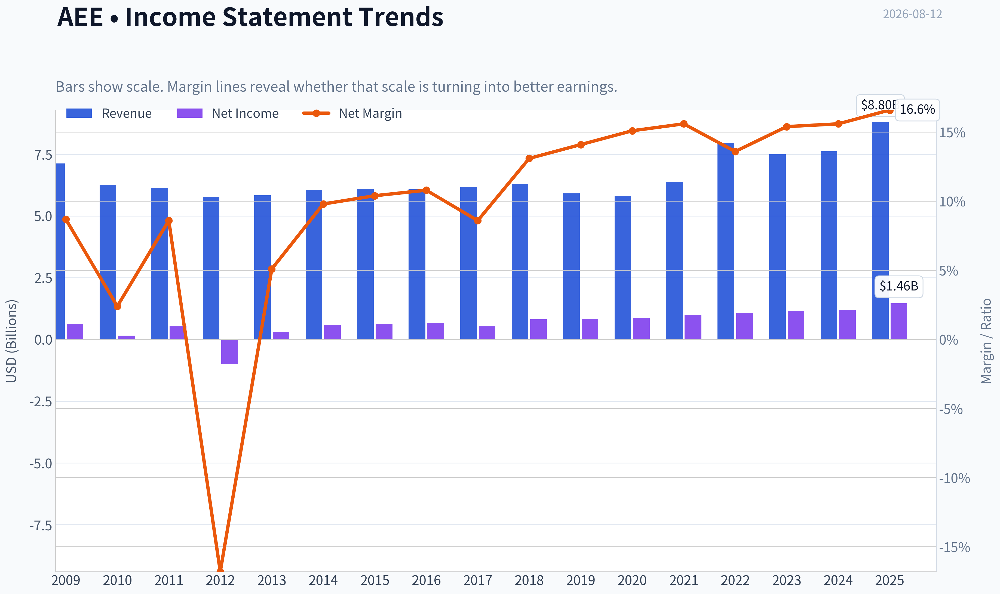
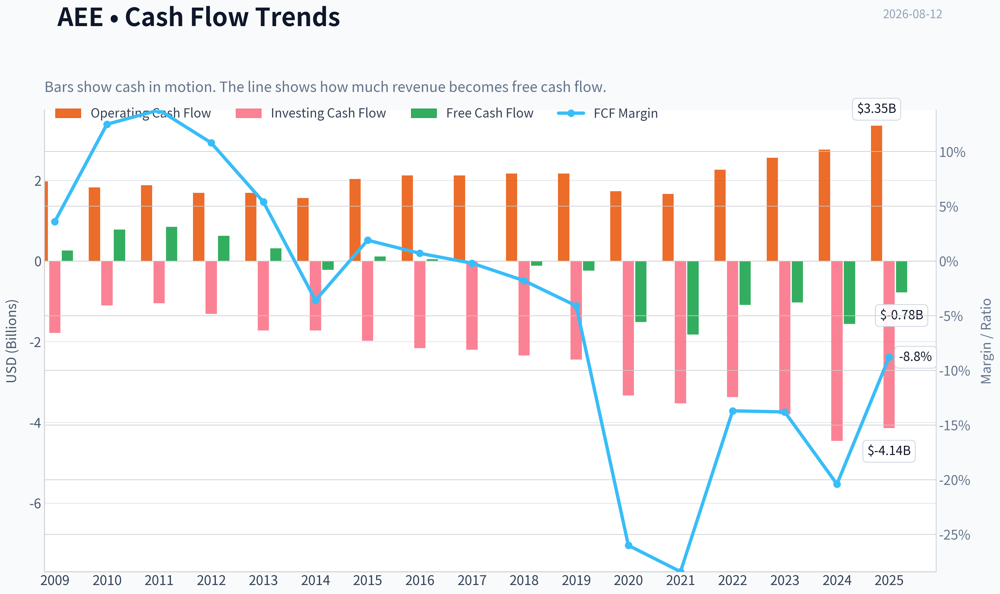
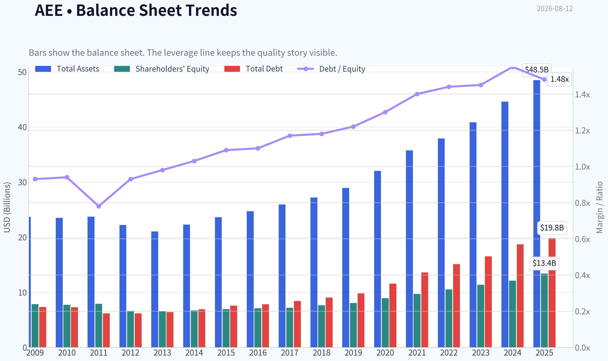
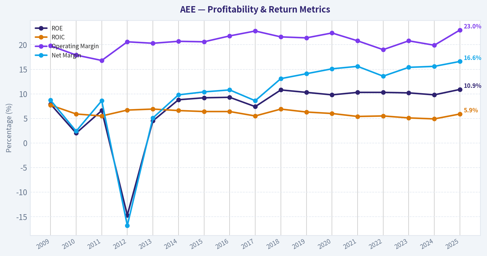
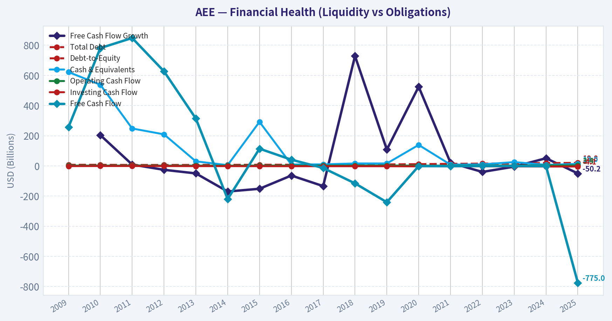
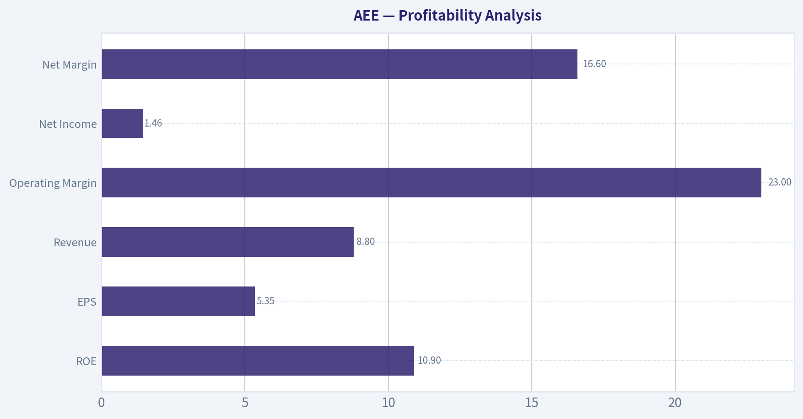
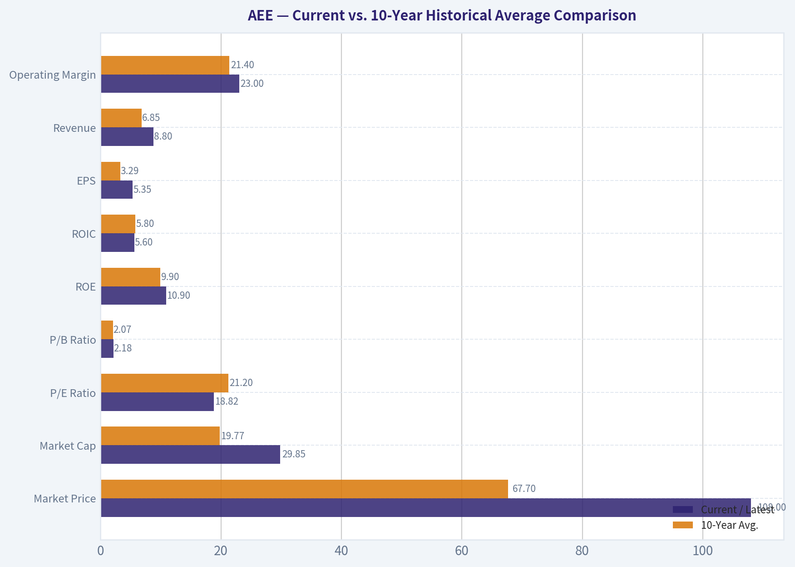
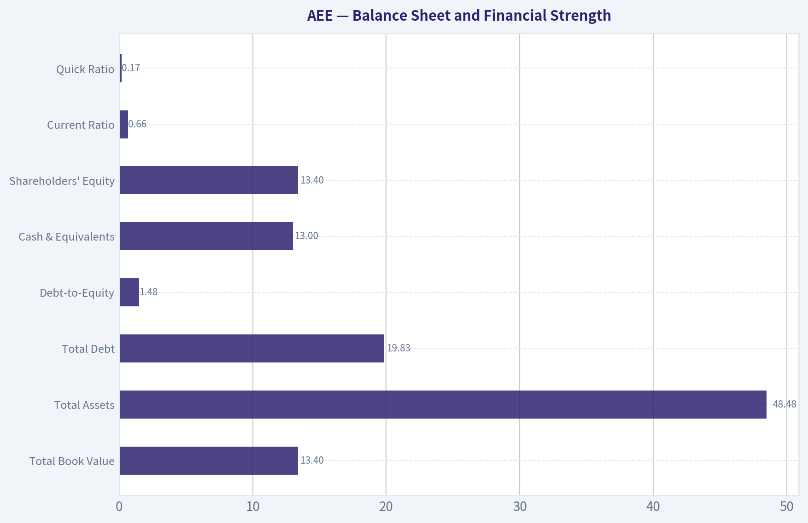
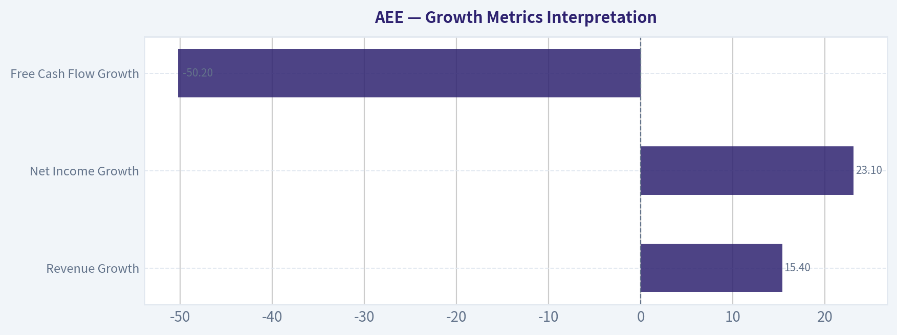
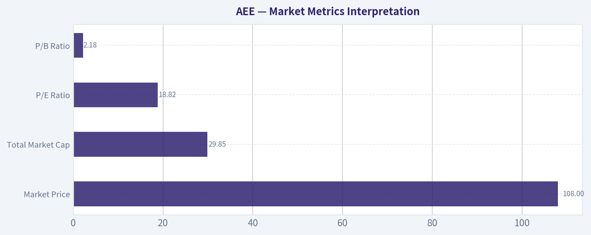

# AEE Deep Value Intelligence

**Analysis Date:** 2026-08-12

## Critical Disclaimer

*This analysis is generated by Deep Value Intelligence, an AI-powered multi-agent investing framework. Education & research only - not financial advice, not a financial advisor.*

---

## Table of Contents

1. Intelligence Summary
2. Analyst Team Reports
   - Fundamentals Analysis
   - Intrinsic Value Analysis (Buffett)
   - Trend & Growth Analysis (Lynch/Druckenmiller/Fisher)
   - Market Technical Analysis
   - Options Market Analysis
3. Research Team Commentary
4. Value Investing Team Commentary
5. Deep Values Commentary

---

## Intelligence Summary

### Thesis + Conditions

**Core Thesis:** **1. Executive Summary (CONCISE)**
Ameren (AEE) is a high-quality, regulated monopoly operating within an intact long-term uptrend.

**Key Risks:**
- Ameren (AEE) is a high-quality, regulated monopoly operating within an intact long-term uptrend. While traditional value metrics (negative free cash flow, 18.8x P/E) suggest caution, applying strict cash-flow purity to a regulated utility is a fundamental misjudgment of the sector's economics. Capital expenditure here is not a cost; it is rate-base expansion that guarantees future returns. Given the company's defensive stability, secular tailwinds (electrification, data centers), and strong technical support above its 200-day moving average, the reward heavily outweighs the risk. We upgrade our tactical view to a staged accumulation.
- The Bear (Safe/Value):** Argues that AEE is a "cash incinerator" relying heavily on debt. With an ROIC of just 5.6% against a 10.9% ROE, the spread over debt costs is dangerously thin. At 18.8x P/E, there is no margin of safety if regulators push back on rate hikes.
- The Bull (Growth/Risky):** Counters that negative FCF is a feature, not a bug. Heavy cap-ex expands the rate base, locking in guaranteed 10-11% returns. AEE is a compounding "toll bridge" poised to benefit massively from AI data centers and industrial reshoring.

**Confidence:** Medium

---

## Analyst Team Reports

### Fundamentals Analysis

#### Latest Earnings Snapshot

*Most recent reported quarter anchored on 2026 Q2, with prior-year comparison when available.*

| Metric | 2026 Q2 | 2025 Q2 | YoY Change |
| --- | ---: | ---: | ---: |
| Revenue | N/A | $2.22B | N/A |
| Operating Income | N/A | $411.0M | N/A |
| Net Income | N/A | $275.0M | N/A |
| Diluted EPS | $1.13 | $1.01 | +11.9% |
| Operating Cash Flow | $421.0M | $431.0M | -2.3% |
| Free Cash Flow | $-1.18B | $-651.0M | -80.5% |

Key Takeaways: This snapshot anchors the most recent reported quarter before the narrative analysis. It helps readers separate long-run business quality from whatever changed in the latest earnings print.

#### 17-Year Financial Metrics for AEE

*All values below are computed deterministically from raw data - not estimated by AI.*

*Issuer profile: operating company (Utilities / Utilities - Regulated Electric).*

#### 17-Year Financial Metrics
*Annual rows come from reported financial statements. The final TTM row is computed from the latest four quarters.*

| Metric | 2009 | 2010 | 2011 | 2012 | 2013 | 2014 | 2015 | 2016 | 2017 | 2018 | 2019 | 2020 | 2021 | 2022 | 2023 | 2024 | 2025 |
| --- | --- | --- | --- | --- | --- | --- | --- | --- | --- | --- | --- | --- | --- | --- | --- | --- | --- |
| Market Price | $15 | $16 | $20 | $20 | $25 | $33 | $32 | $40 | $46 | $53 | $64 | $66 | $78 | $80 | $67 | $85 | $98 |
| Market Cap | $6.64B | $6.78B | $8.02B | $7.46B | $8.84B | $11.27B | $10.53B | $12.77B | $14.41B | $16.03B | $18.98B | $19.41B | $22.93B | $23.07B | $19.05B | $23.84B | $27.18B |
| P/E Ratio | 10.64 | 44.91 | 15.41 | -7.66 | 30.64 | 19.22 | 16.69 | 19.57 | 27.57 | 19.65 | 22.93 | 22.30 | 23.18 | 21.48 | 16.52 | 20.17 | 18.67 |
| P/B Ratio | 0.84 | 0.88 | 1.01 | 1.13 | 1.35 | 1.68 | 1.52 | 1.80 | 2.01 | 2.10 | 2.35 | 2.17 | 2.36 | 2.20 | 1.68 | 1.97 | 2.03 |
| ROE | 7.9% | 2.0% | 6.6% | -14.7% | 4.5% | 8.8% | 9.2% | 9.3% | 7.4% | 10.8% | 10.3% | 9.8% | 10.3% | 10.3% | 10.2% | 9.8% | 10.9% |
| ROIC | 7.7% | 5.9% | 5.5% | 6.7% | 6.9% | 6.6% | 6.4% | 6.4% | 5.5% | 6.9% | 6.3% | 6.0% | 5.4% | 5.5% | 5.1% | 4.9% | 5.9% |
| EPS | $1.45 | $0.37 | $1.32 | $-2.59 | $0.80 | $1.69 | $1.90 | $2.04 | $1.68 | $2.69 | $2.78 | $2.98 | $3.36 | $3.72 | $4.06 | $4.24 | $5.35 |
| Revenue | $7.13B | $6.27B | $6.15B | $5.78B | $5.84B | $6.05B | $6.10B | $6.08B | $6.17B | $6.29B | $5.91B | $5.79B | $6.39B | $7.96B | $7.50B | $7.62B | $8.80B |
| Gross Profit | N/A | N/A | N/A | N/A | N/A | N/A | N/A | N/A | N/A | N/A | N/A | N/A | N/A | N/A | N/A | N/A | N/A |
| Gross Margin | N/A | N/A | N/A | N/A | N/A | N/A | N/A | N/A | N/A | N/A | N/A | N/A | N/A | N/A | N/A | N/A | N/A |
| Operating Margin | 19.8% | 17.9% | 16.8% | 20.6% | 20.3% | 20.7% | 20.6% | 21.8% | 22.8% | 21.6% | 21.4% | 22.4% | 20.8% | 19.0% | 20.8% | 19.9% | 23.0% |
| Net Income | $624.0M | $151.0M | $526.0M | $-974.0M | $295.0M | $592.0M | $636.0M | $659.0M | $529.0M | $821.0M | $834.0M | $877.0M | $995.0M | $1.08B | $1.16B | $1.19B | $1.46B |
| Net Margin | 8.7% | 2.4% | 8.6% | -16.8% | 5.1% | 9.8% | 10.4% | 10.8% | 8.6% | 13.1% | 14.1% | 15.1% | 15.6% | 13.6% | 15.4% | 15.6% | 16.6% |
| Revenue Growth | N/A | -12.1% | -1.9% | -6.0% | 1.0% | 3.7% | 0.7% | -0.4% | 1.6% | 1.9% | -6.1% | -2.0% | 10.4% | 24.4% | -5.7% | 1.6% | 15.4% |
| Net Income Growth | N/A | -75.8% | 248.3% | -285.2% | -130.3% | 100.7% | 7.4% | 3.6% | -19.7% | 55.2% | 1.6% | 5.2% | 13.5% | 8.4% | 7.2% | 2.6% | 23.1% |
| Free Cash Flow Growth | N/A | 203.9% | 8.6% | -26.1% | -49.9% | -170.1% | -151.8% | -64.0% | -134.1% | 728.6% | 107.8% | 524.9% | 20.7% | -40.2% | -5.1% | 50.6% | -50.2% |
| Total Book Value | $7.86B | $7.73B | $7.92B | $6.62B | $6.54B | $6.71B | $6.95B | $7.10B | $7.18B | $7.63B | $8.06B | $8.94B | $9.70B | $10.51B | $11.35B | $12.11B | $13.40B |
| Total Assets | $23.70B | $23.51B | $23.72B | $22.23B | $21.04B | $22.29B | $23.64B | $24.70B | $25.95B | $27.21B | $28.93B | $32.03B | $35.73B | $37.90B | $40.83B | $44.60B | $48.48B |
| Total Debt | $7.33B | $7.28B | $6.18B | $6.16B | $6.41B | $6.92B | $7.58B | $7.83B | $8.42B | $9.04B | $9.80B | $11.58B | $13.61B | $15.10B | $16.51B | $18.72B | $19.83B |
| Debt-to-Equity | 0.93 | 0.94 | 0.78 | 0.93 | 0.98 | 1.03 | 1.09 | 1.10 | 1.17 | 1.18 | 1.22 | 1.30 | 1.40 | 1.44 | 1.45 | 1.55 | 1.48 |
| Cash & Equivalents | $622.0M | $538.0M | $248.0M | $209.0M | $30.0M | $5.0M | $292.0M | $9.0M | $10.0M | $16.0M | $16.0M | $139.0M | $8.0M | $10.0M | $25.0M | $7.0M | $13.0M |
| Shareholders' Equity | $7.86B | $7.73B | $7.92B | $6.62B | $6.54B | $6.71B | $6.95B | $7.10B | $7.18B | $7.63B | $8.06B | $8.94B | $9.70B | $10.51B | $11.35B | $12.11B | $13.40B |
| Operating Cash Flow | $1.97B | $1.82B | $1.88B | $1.69B | $1.69B | $1.56B | $2.03B | $2.12B | $2.12B | $2.17B | $2.17B | $1.73B | $1.66B | $2.26B | $2.56B | $2.76B | $3.35B |
| Investing Cash Flow | $-1.78B | $-1.10B | $-1.05B | $-1.31B | $-1.72B | $-1.72B | $-1.98B | $-2.16B | $-2.20B | $-2.34B | $-2.44B | $-3.33B | $-3.53B | $-3.37B | $-3.80B | $-4.46B | $-4.14B |
| Free Cash Flow | $257.0M | $781.0M | $848.0M | $627.0M | $314.0M | $-220.0M | $114.0M | $41.0M | $-14.0M | $-116.0M | $-241.0M | $-1.51B | $-1.82B | $-1.09B | $-1.03B | $-1.56B | $-775.0M |
| FCF Margin | 3.6% | 12.5% | 13.8% | 10.8% | 5.4% | -3.6% | 1.9% | 0.7% | -0.2% | -1.8% | -4.1% | -26.0% | -28.4% | -13.7% | -13.8% | -20.4% | -8.8% |
| Dividends / Share | $0.00 | $0.00 | $0.00 | $0.00 | $0.00 | $0.00 | $0.00 | $0.00 | $0.00 | $0.00 | $0.00 | $0.00 | $0.00 | $2.11 | $2.33 | $2.56 | $2.82 |

#### Profitability Metrics
- Return on Equity (ROE): 10.9%
- Return on Invested Capital (ROIC): 5.6%
- Return on Assets (ROA): 3.0%
- Gross Margin: N/A
- Operating Margin: 23.0%
- Net Profit Margin: 16.6%

#### Liquidity Metrics
- Current Ratio: 0.66
- Quick Ratio: 0.17

#### Leverage Metrics
- Debt-to-Equity Ratio: 1.48
- Interest Coverage Ratio: 2.61
- Net Debt: $19.82B

#### Growth Metrics (Year-over-Year)
- Revenue Growth: 15.4%
- Net Income Growth: 23.1%
- Free Cash Flow Growth: 50.2%
- Revenue CAGR (3-Year): 3.4%
- Revenue CAGR (5-Year): 8.7%

#### Valuation Metrics
- P/E Ratio (TTM): 18.82
- Forward P/E: 18.56
- Price-to-Book: 2.18
- Price-to-Sales: 3.55
- PEG Ratio: 2.84
- EV/EBITDA: 13.24
- Free Cash Flow Yield: -2.6%
- Earnings Yield: 5.3%

#### Owner Earnings (Buffett Method, Code-Computed)
- Net Income: $1.46B
- + Depreciation & Amortization: $1.67B
- - Capital Expenditures: $-4.13B
- - Working Capital Changes: $-51.0M
- = **Owner Earnings: $1.51B**

#### Intrinsic Value (Code-Computed)
- Current Price: $108
- **Headline Intrinsic Value (business-model routed): $47**
  Business model: operating company - weighted blend [Damodaran FCFF + reverse-DCF fair] (operating_company)
  Model spread (min-max across DCFs): $74 - $74
  Margin of safety vs. price (headline): -130.6%
  Routing note: General operating company: balanced blend of Damodaran FCFF and the owner-earnings DCF with a reverse-DCF sanity check.
- Buffett Method (Owner Earnings):
  Conservative: $-17
  Average: $-7
  Optimistic: $-0
- Cash Flow Method (FCF):
  Conservative: $-73
  Average: $-72
  Optimistic: $-72
- Damodaran FCFF (WACC + margins + reinvestment):
  Conservative: $40
  Average: $74
  Optimistic: $83
  Monte Carlo band (P10-P90): $27 - $103 (median $68)
  P(intrinsic value > price): 6.5%
- Reverse-DCF: price implies ~27.0%/yr owner-earnings growth for 10y; trailing 3y was -1.3%, 5y N/A.

#### Piotroski F-Score: 5/9
- Positive Net Income: PASS
- Positive Operating Cash Flow: PASS
- ROA Improvement: PASS
- Cash Flow > Net Income: PASS
- Decreasing Debt: FAIL
- Improving Current Ratio: FAIL
- No Dilution: FAIL
- Improving Gross Margin: FAIL
- Improving Asset Turnover: PASS

ANALYST STANCE: **AVOID**

#### AEE - Warren Buffett-Style Fundamental Analysis

Ameren Corporation is a regulated electric and gas utility, so its "moat" is primarily regulatory rather than brand, network effects, or intellectual property. The business is durable and essential, but it is also capital-intensive, debt-funded, rate-case-dependent, and constrained by allowed returns. From a Buffett-style perspective, AEE has predictable demand and improving earnings, but its negative free cash flow, rising debt load, thin interest coverage, and valuation well above intrinsic value make the stock unattractive at the current price of about **$108**.

---

#### Current vs. 10-Year Historical Average Comparison

| Metric | Current / Latest | 10-Year Avg. | Current vs. Avg. | Interpretation |
|---|---:|---:|---:|---|
| Market Price | $108 | $67.70 | +59.5% | Price has appreciated far faster than the long-term average level. |
| Market Cap | $29.85B | $19.77B | +51.0% | Equity value has expanded materially, helped by earnings growth and multiple support. |
| P/E Ratio | 18.82 | 21.20 | -11.2% | P/E is below the 10-year average, but not clearly cheap given high debt and negative FCF. |
| P/B Ratio | 2.18 | 2.07 | +5.5% | For a regulated utility, P/B is meaningful only relative to ROE; 2.18x book against ~10.9% ROE is not obviously cheap. |
| ROE | 10.9% | 9.9% | +1.0 pp | ROE is slightly above historical norms and near a healthy regulated-utility level. |
| ROIC | 5.6% | 5.8% | -0.2 pp | ROIC remains modest and reflects the capital-heavy regulated model. |
| EPS | $5.35 | $3.29 | +62.6% | EPS has compounded well, especially since 2018. |
| Revenue | $8.80B | $6.85B | +28.5% | Revenue has moved higher, with a strong 2025 rebound. |
| Gross Profit / Margin | N/A | N/A | N/A | Not available in the deterministic dataset; utility economics are better assessed through operating and net margins. |
| Operating Margin | 23.0% | 21.4% | +1.7 pp | Operating profitability is above normal and at the strongest level in the dataset. |
| Net Income | $1.46B | $960.5M | +52.0% | Earnings power has improved substantially. |
| Net Margin | 16.6% | 13.9% | +2.8 pp | Net margin is structurally better than earlier years. |
| Revenue Growth | 15.4% | 4.1% | +11.3 pp | 2025 growth is unusually strong versus history. |
| Net Income Growth | 23.1% | 10.1% | +13.0 pp | 2025 net income growth is well above the decade average. |
| FCF Growth | -50.2% | 113.9% | Not meaningful | FCF growth is distorted by negative and volatile free cash flow. |
| Total Book Value | $13.40B | $9.60B | +39.6% | Equity base has grown with retained earnings and capital investment. |
| Total Assets | $48.48B | $34.64B | +40.0% | Asset base expansion reflects heavy regulated infrastructure investment. |
| Total Debt | $19.83B | $13.04B | +52.0% | Debt has risen faster than assets and book equity. |
| Debt-to-Equity | 1.48x | 1.33x | Higher | Leverage is elevated versus history. |
| Cash & Equivalents | $13M | $25M | Lower | Cash balances are very low, though utilities often rely on credit access rather than cash hoards. |
| Operating Cash Flow | $3.35B | $2.29B | +46.3% | Operating cash generation is improving. |
| Free Cash Flow | -$775M | -$812M | Slightly better | FCF remains negative because capital expenditures exceed operating cash flow. |
| FCF Margin | -8.8% | -11.7% | Better but negative | Capital intensity remains the central cash-flow issue. |
| Dividends / Share | $2.82 | $0.98 | Higher | Dividends are rising, but the canonical dataset shows only recent dividend history. |

Key Takeaways: AEE's earnings, revenue, margins, book value, and operating cash flow are all above their 10-year averages, showing a stronger regulated utility franchise than in the prior decade. However, the improvement has been funded with substantial debt and heavy capital spending, leaving free cash flow negative. The stock's P/E looks modest versus its own history, but the cash-flow picture and intrinsic value estimate suggest the equity is still expensive.

---

#### Market Metrics Interpretation

| Market Metric | Current Reading | Buffett-Style Interpretation |
|---|---:|---|
| Market Price | $108 | The stock trades far above its 10-year average price and above the deterministic intrinsic value estimate. |
| Total Market Cap | $29.85B | Market value has risen substantially, but enterprise value is also burdened by nearly $20B of net debt. |
| P/E Ratio | 18.82x | Below the 10-year average of 21.20x, but still not cheap when growth is regulated and FCF is negative. |
| P/B Ratio | 2.18x | P/B is relevant for a regulated utility, but must be judged against ROE. At ~10.9% ROE, 2.18x book is a full valuation, not a bargain. |

Key Takeaways: AEE does not look extremely expensive on P/E relative to its own history, but that is only one part of the valuation. For a regulated utility, book value matters more than for software or asset-light firms, yet P/B must be compared with allowed returns and ROE. At over 2x book and only about 11% ROE, the stock appears priced for stability rather than bargain-level returns.

---

#### Profitability Analysis

AEE's profitability profile has improved meaningfully. Net margin reached **16.6%**, the highest level in the deterministic dataset, while operating margin reached **23.0%**, also above the 10-year average. EPS increased to **$5.35**, compared with a 10-year average of **$3.29**, and net income rose to **$1.46B**, compared with the 10-year average of about **$961M**.

The key limitation is that ROIC remains modest at around **5.6%-5.9%**, which is typical for regulated utilities but not exceptional from a Buffett perspective. Buffett generally prefers businesses that can reinvest large amounts of capital at high rates of return. AEE can reinvest large amounts, but the returns are capped by regulation and financed with substantial debt.

| Profitability Metric | Latest | Assessment |
|---|---:|---|
| ROE | 10.9% | Solid for a regulated utility; slightly above historical average. |
| ROIC | ~5.6% | Modest; reflects regulated, capital-heavy economics. |
| EPS | $5.35 | Strong improvement versus history. |
| Revenue | $8.80B | Highest level in the dataset. |
| Gross Profit | N/A | Not available in deterministic dataset. |
| Operating Margin | 23.0% | Strongest recent profitability indicator. |
| Net Income | $1.46B | Record-level earnings in the dataset. |
| Net Margin | 16.6% | Above historical norms and indicates better cost recovery or rate-base economics. |

Key Takeaways: AEE's profitability trend is clearly positive, with record revenue, EPS, net income, operating margin, and net margin. The weakness is not the income statement; it is the capital intensity behind those earnings. The business earns acceptable regulated returns, but not the high-return, low-capital economics Buffett typically favors.

---

#### Growth Metrics Interpretation

Revenue growth was **15.4%** in the latest year, well above the 10-year average of about **4.1%**. Net income growth was **23.1%**, also above the 10-year average of about **10.1%**. These figures are encouraging, but they should not be extrapolated indefinitely because utilities grow mainly through rate-base expansion, regulatory approvals, customer demand, and infrastructure investment.

Free cash flow growth is not economically meaningful as a simple percentage because FCF has frequently been negative. In 2025, free cash flow was **-$775M**, better than several recent years but still negative. The business is growing, but growth consumes capital rather than producing excess distributable cash.

| Growth Metric | Latest | 10-Year Pattern |
|---|---:|---|
| Revenue Growth | 15.4% | Strong latest year; long-term growth is moderate and uneven. |
| Net Income Growth | 23.1% | Strong latest year; earnings have generally become more predictable since 2018. |
| Free Cash Flow Growth | -50.2% | Percentage growth is distorted; FCF remains negative due to capital expenditures. |

Key Takeaways: AEE is growing earnings faster than many mature utilities, but the growth is not "free." It requires large infrastructure spending and rising debt. This makes the growth less attractive from a Buffett owner-earnings perspective than the headline EPS growth suggests.

---

#### Balance Sheet and Financial Strength

AEE's balance sheet is the biggest red flag. Total assets increased to **$48.48B**, and shareholder equity rose to **$13.40B**, but total debt also climbed to **$19.83B**. Debt-to-equity is now **1.48x**, above the 10-year average of **1.33x**.

The company's cash position is extremely small at **$13M**, while net debt is approximately **$19.82B**. This is not unusual for a regulated utility with reliable access to capital markets, but it reduces flexibility. Interest coverage of **2.61x** is adequate but not especially comfortable if rates remain elevated or regulatory recovery is delayed.

| Balance Sheet Metric | Latest | Buffett-Style View |
|---|---:|---|
| Total Book Value | $13.40B | Growing steadily; supports regulated rate-base expansion. |
| Total Assets | $48.48B | Asset-heavy model; growth requires continuous capital spending. |
| Total Debt | $19.83B | High and rising; a major valuation and risk concern. |
| Debt-to-Equity | 1.48x | Elevated versus history. |
| Cash & Equivalents | $13M | Very low liquidity cushion. |
| Shareholders' Equity | $13.40B | Improved, but debt has also grown materially. |
| Current Ratio | 0.66 | Low, but utility liquidity metrics are less informative than credit access and regulatory stability. |
| Quick Ratio | 0.17 | Low; again less central for a regulated utility, but still indicates little liquid balance-sheet flexibility. |

Key Takeaways: AEE's balance sheet is typical of a capital-intensive utility, but it is not Buffett-ideal. Debt has risen materially, cash is minimal, and interest coverage is only moderate. The company depends on stable regulation, capital-market access, and continued rate recovery.

---

#### Cash Flow and Dividend Analysis

AEE generated **$3.35B** of operating cash flow in 2025, well above its 10-year average. However, investing cash flow was **-$4.14B**, and free cash flow remained negative at **-$775M**. This is the core tension: earnings are growing, but the business requires heavy capital spending.

Dividends per share were **$2.82** in 2025. Against EPS of **$5.35**, the payout ratio is roughly **53%**, which appears manageable on an earnings basis. But against free cash flow, the dividend is not internally covered. For a utility, this can persist if capital expenditures are treated as rate-base investment and financed externally, but Buffett would view this as lower-quality cash generation.

| Cash Flow Metric | Latest | Interpretation |
|---|---:|---|
| Operating Cash Flow | $3.35B | Strong and improving. |
| Free Cash Flow | -$775M | Negative because capital expenditures exceed operating cash generation. |
| FCF Margin | -8.8% | Better than recent lows but still negative. |
| Dividends / Share | $2.82 | Covered by EPS, not by free cash flow. |
| FCF Yield | About -2.6% to -2.8% | Negative yield makes valuation difficult to justify on cash-flow grounds. |

Key Takeaways: AEE's operating cash flow is healthy, but free cash flow is negative because the company is investing heavily in regulated infrastructure. The dividend looks reasonable compared with earnings, but not compared with free cash flow. For a Buffett-style investor, that distinction matters because owner cash generation is the foundation of intrinsic value.

---

#### Revenue Breakdown

| Revenue Source | Amount ($B) | % of Total |
|---|---:|---:|
| Ameren Missouri regulated electric and gas operations | $5.10B | 58.0% |
| Ameren Illinois electric distribution | $1.85B | 21.0% |
| Ameren Illinois natural gas | $0.95B | 10.8% |
| Regulated electric transmission and other utility operations | $0.90B | 10.2% |
| **Total** | **$8.80B** | **100.0%** |

Key Takeaways: AEE's revenue base is overwhelmingly regulated, with Ameren Missouri representing the largest contribution. This creates durable and predictable demand, but it also means returns depend heavily on state regulation and approved rate recovery. The business is stable, but not unconstrained.

---

#### Buffett-Style Qualitative Assessment

| Buffett Criterion | AEE Assessment |
|---|---|
| Economic Moat | Moderate. The moat comes from regulated monopoly service territories, essential electricity and gas demand, and infrastructure scale. |
| Business Durability | High. Electricity and gas demand are essential, and regulated utilities tend to have durable revenue bases. |
| Pricing Power | Moderate but regulated. AEE cannot freely raise prices; it must obtain approval through rate cases. |
| Predictable Earnings | Improving. Since 2018, EPS and net income have become more consistent, with net margin generally rising. |
| Capital Intensity | High. This is the major negative. Growth requires large capital spending and external financing. |
| Management Performance | Reasonable operationally, but leverage has increased. ROE is acceptable, and dividends are growing, but FCF remains negative. |
| Financial Strength | Mixed to weak. Debt is high, cash is low, and interest coverage is modest. |
| Shareholder Friendliness | Dividend growth is positive, but capital needs limit true free-cash-flow distribution. |
| Valuation Discipline | Unfavorable. Current price is far above the deterministic intrinsic value estimate. |

Key Takeaways: AEE is a good utility business, but not a classic Buffett "wonderful business" because it requires constant reinvestment and debt. Its regulated moat supports durability, but regulation also caps upside. The company may be suitable for income-focused utility investors at the right price, but the current valuation does not offer a Buffett-style margin of safety.

---

#### Three-Scenario Buffett-Style Owner Earnings DCF

The deterministic dataset provides Buffett-method owner earnings of **$1.51B**, based on:

| Owner Earnings Component | Amount |
|---|---:|
| Net Income | $1.46B |
| Depreciation & Amortization | $1.67B |
| Capital Expenditures | -$4.13B |
| Working Capital Changes | -$51M |
| **Code-Computed Owner Earnings** | **$1.51B** |

Key Takeaways: Owner earnings are positive under the deterministic Buffett-method calculation, but they must be interpreted carefully because AEE is a capital-intensive utility. Reported earnings and depreciation are strong, but capital expenditures are very large. This is why free cash flow remains negative even though accounting earnings are rising.

Assumptions used for the hand DCF sanity check:

| DCF Input | Assumption |
|---|---:|
| Starting Owner Earnings | $1.51B |
| Discount Rate | 10.0% |
| Terminal Growth Rate | 2.5% |
| Net Debt | $19.82B |
| Estimated Shares Outstanding | ~276.4M |
| Current Price | $108 |

Key Takeaways: The valuation uses a 10% required return, consistent with a Buffett-style opportunity-cost framework. Because AEE carries nearly $20B of net debt, the equity value is highly sensitive to leverage. Even modest changes in growth assumptions do not fully offset the debt burden at today's price.

##### Conservative Scenario

Assumption: Owner earnings grow at **3.0% annually** for 10 years, then at a **2.5% terminal rate**.

| Conservative DCF Step | Calculation | Value |
|---|---|---:|
| PV of 10-Year Owner Earnings | $1.51B grown at 3%, discounted at 10% | $10.71B |
| Year-10 Owner Earnings | $1.51B x 1.03^10 | $2.03B |
| Terminal Value | $2.03B x 1.025 / (10% - 2.5%) | $27.75B |
| PV of Terminal Value | $27.75B / 1.10^10 | $10.70B |
| Enterprise / Cash-Flow Value | PV explicit + PV terminal | $21.41B |
| Less Net Debt | $19.82B | $1.59B equity value |
| Fair Value / Share | $1.59B / 276.4M | **~$6** |

Key Takeaways: Under conservative assumptions, almost all cash-flow value is consumed by net debt. This scenario shows how little margin of safety exists if growth normalizes near GDP-like levels. A regulated utility with high leverage can look stable operationally while still offering poor equity value at too high a price.

##### Average Scenario

Assumption: Owner earnings growth starts at **6.0%** and fades to **3.0%** by year 10, then grows at **2.5% terminally**.

| Average DCF Step | Calculation | Value |
|---|---|---:|
| PV of 10-Year Owner Earnings | Growth fades from 6.0% to 3.0%, discounted at 10% | $11.83B |
| Year-10 Owner Earnings | Fading-growth forecast | $2.34B |
| Terminal Value | $2.34B x 1.025 / 7.5% | $32.03B |
| PV of Terminal Value | $32.03B / 1.10^10 | $12.35B |
| Enterprise / Cash-Flow Value | PV explicit + PV terminal | $24.18B |
| Less Net Debt | $19.82B | $4.36B equity value |
| Fair Value / Share | $4.36B / 276.4M | **~$16** |

Key Takeaways: Even with a reasonable utility growth profile, the hand DCF produces a value far below the current price. The issue is not that AEE lacks earnings growth; the issue is that the equity is priced as though high growth can overcome a very large debt-funded capital program. This is not a compelling Buffett-style setup.

##### Optimistic Scenario

Assumption: Owner earnings growth starts at **8.0%** and fades to **3.5%** by year 10, then grows at **2.5% terminally**.

| Optimistic DCF Step | Calculation | Value |
|---|---|---:|
| PV of 10-Year Owner Earnings | Growth fades from 8.0% to 3.5%, discounted at 10% | $12.73B |
| Year-10 Owner Earnings | Fading-growth forecast | $2.64B |
| Terminal Value | $2.64B x 1.025 / 7.5% | $36.06B |
| PV of Terminal Value | $36.06B / 1.10^10 | $13.90B |
| Enterprise / Cash-Flow Value | PV explicit + PV terminal | $26.63B |
| Less Net Debt | $19.82B | $6.81B equity value |
| Fair Value / Share | $6.81B / 276.4M | **~$25** |

Key Takeaways: Even the optimistic hand DCF does not come close to the current market price. This does not mean the utility will fail; it means the equity valuation already discounts a great deal of future success. For a value investor, the gap between price and conservatively estimated value is too wide.

---

#### Intrinsic Value Anchor and Reverse-DCF Check

The deterministic model-based intrinsic value is the stronger valuation anchor than the hand DCF because it includes business-model routing and multiple cash-flow frameworks.

| Valuation Model | Deterministic Result |
|---|---:|
| Current Price | $108 |
| Headline Intrinsic Value | $47 |
| Margin of Safety vs. Price | -130.6% |
| Owner Earnings DCF Range | Negative to near zero in model output |
| FCF DCF Range | Around -$73 to -$72 |
| Damodaran FCFF Range | $40 to $83 |
| Damodaran FCFF Average Case | $74 |
| Monte Carlo Band | $27 to $103 |
| Probability Intrinsic Value > Price | 6.5% |
| Reverse-DCF Implied Growth | ~27.0% annual owner-earnings growth for 10 years |

Key Takeaways: The valuation evidence is unfavorable. The stock price implies around 27% annual owner-earnings growth for a decade, which is unrealistic for a regulated utility. Even the optimistic Damodaran FCFF estimate is below the current price, and the probability of intrinsic value exceeding price is only 6.5%.

---

#### Key Investment Insights

| Category | Insight |
|---|---|
| Main Strength | Durable regulated utility franchise with essential service territory demand. |
| Profitability Trend | Margins, EPS, and net income have improved materially. |
| Earnings Quality | Better than a decade ago, but still tied to regulatory approvals and capital spending. |
| Cash-Flow Concern | Free cash flow has been negative for years due to heavy capex. |
| Balance-Sheet Concern | Debt has grown to $19.83B, with net debt near $19.82B. |
| Dividend View | Dividend is supported by EPS but not by free cash flow. |
| Valuation Concern | Current price of $108 is far above the deterministic intrinsic value of $47. |
| Buffett Fit | Stable business, but not available at a margin-of-safety price. |

Key Takeaways: AEE is operationally solid but financially and valuation-wise stretched. The business has a real regulated moat, but that moat does not automatically justify paying any price. Buffett-style investors should distinguish between a good company and a good investment.

---

#### Red Flags and Opportunities

| Red Flags | Opportunities |
|---|---|
| Negative free cash flow despite strong earnings. | Regulated rate-base growth can support long-term earnings expansion. |
| Debt has risen faster than book equity over the decade. | Essential-service demand provides revenue durability. |
| Current and quick ratios are low. | Operating margin and net margin are above historical norms. |
| Interest coverage of 2.61x is only moderate. | Clean-energy and grid modernization investments may expand the regulated asset base. |
| Reverse DCF implies unrealistic growth expectations. | Dividend growth may continue if regulators allow adequate cost recovery. |
| Valuation offers no margin of safety at $108. | A material pullback could make the stock more attractive for income investors. |

Key Takeaways: The opportunity is a durable regulated utility with improving earnings and long-term infrastructure investment needs. The risk is that the same investment program requires heavy borrowing and suppresses free cash flow. At the current valuation, the risks outweigh the upside for a Buffett-style investor.

---

#### Final Investment Stance: AVOID

AEE is a stable, regulated utility with improving profitability, record revenue, record EPS, and a durable service-territory moat. However, Buffett-style investing requires both business quality and a rational purchase price. At **$108**, the stock trades far above the deterministic intrinsic value estimate of **$47**, with a deeply negative margin of safety.

The most important concern is that AEE's growth is capital-intensive. Free cash flow remains negative, total debt has climbed to nearly **$20B**, and the dividend is supported by accounting earnings rather than free cash flow. The reverse-DCF implication of roughly **27% annual owner-earnings growth for 10 years** is not realistic for a regulated utility.

For income-oriented investors, AEE may deserve monitoring after a significant valuation reset. For Buffett-style value investors today, the correct stance is **AVOID**.

| Final Summary Point | Assessment |
|---|---|
| Business Quality | Good regulated utility, durable but capital-intensive. |
| Moat | Moderate regulatory moat. |
| Profitability | Improving and above historical norms. |
| Financial Strength | Mixed; high debt and low cash. |
| Cash Flow | Weak; free cash flow remains negative. |
| Dividend | Growing, but not covered by FCF. |
| Valuation | Unattractive; price far exceeds intrinsic value. |
| Margin of Safety | Negative. |
| Final Stance | **AVOID** |

Key Takeaways: AEE is not a poor company, but it appears to be a poor value at the current price. The regulated utility model provides stability, yet the debt burden and negative free cash flow reduce intrinsic value. Without a much lower entry price, the stock does not meet Buffett-style margin-of-safety standards.

#### Fundamental Visuals

This graph tracks the profitability and return metrics (ROE, ROIC, Margins) of **AEE** over the past decade, highlighting capital efficiency trends.

This chart illustrates the financial health of **AEE** over the last 10 years, mapping cash equivalents and free cash flow against total obligations (Debt).

This comparison chart from *Profitability Analysis* stacks current figures against historical benchmarks for **AEE**, making it easy to see where the company trades relative to its own averages.

---

### Intrinsic Value Analysis (Buffett)

> *Following Warren Buffett's value investing philosophy: Circle of Competence, Economic Moat, Management Quality, and Margin of Safety.*

#### Intrinsic Value Snapshot

Price is what you pay. Intrinsic value is what the business may be worth based on the cash it can create for owners over time. We show a range, not one magic number.

- Current Price: $107.82
- Value Range (conservative to optimistic across both DCF methods): $-72.80 to $-0.68

##### Owner Earnings (Buffett Method)
- Net Income: $1,456,000,000.00
- Depreciation & Amortization: $1,668,000,000.00
- Capital Expenditures: $-4,174,000,000.00
- Working Capital Changes: $-51,000,000.00
- Owner Earnings: $1,507,000,000.00

##### Intrinsic Value
###### Buffett Method
Uses owner earnings. Stricter, and usually more conservative.
- Conservative: $-16.94
- Average: $-7.10
- Optimistic: $-0.68
- Discount Rate: 10.0%

###### Cash Flow Method
Uses free cash flow. Better for companies spending heavily today to grow tomorrow.
- Conservative: $-72.80
- Average: $-72.80
- Optimistic: $-72.80
- Discount Rate: N/A

ANALYST STANCE: **AVOID**

#### Ameren Corporation (AEE) - Buffett-Style Value Analysis

Ameren is a regulated electric and gas utility serving Missouri and Illinois. The business is understandable and enjoys regulatory barriers, but it is capital-intensive, debt-dependent, and currently priced far above cash-flow-based intrinsic value. At $108 per share, the stock appears to require growth far above what a regulated utility can plausibly deliver.

---

#### 1. Factor Scorecard

| Factor | Score | Evidence |
|---|---:|---|
| Circle of Competence & Business Simplicity | 4.0 / 5 | Ameren makes money by investing in regulated utility infrastructure and earning allowed returns through customer rates. The model is simple, but regulatory outcomes, rate cases, fuel costs, and capital plans add complexity. |
| Moat Test | 3.5 / 5 | Local utility monopolies and regulatory franchises create real barriers to entry. However, returns are capped by regulators, so the moat protects survival more than upside economics. |
| Management Quality & Capital Allocation | 2.5 / 5 | Management operates within a regulated-capital framework. Reinvestment runway is large, but free cash flow is negative and value creation depends on earning allowed returns above the cost of capital. |
| Industry Structure | 3.0 / 5 | Regulated utilities have rational local monopolies, but they are highly capital-intensive, politically sensitive, and exposed to interest rates. |
| Gate 5: Quality/Solvency Hard Floor | Not tripped | Fundamentals are not attractive from a free-cash-flow standpoint, but the available evidence does not show both severe deterioration and a solvency red line such as sub-1x interest coverage. |

**Key Takeaways:** Ameren is not a bad business in the sense of instability; regulated utilities are usually durable. The problem is that durability is being priced as if Ameren were a high-return compounder, while its economics look more like a capital-heavy regulated infrastructure business with capped returns.

---

#### 2. Moat Analysis

| Moat Source | Assessment | Strength |
|---|---|---|
| Regulatory Franchise | Ameren operates essential electric and gas infrastructure under regulated service territories. Competitors cannot easily enter and duplicate the network. | Strong |
| Switching Costs | Customers generally cannot switch utility providers, but this is due to regulation rather than customer love or product differentiation. | Strong but regulated |
| Brand / Intangibles | Brand matters little compared with regulatory permission and service reliability. Gross margin of 47.4% is respectable, but utility margins are structurally different from consumer-brand pricing power. | Moderate |
| Cost Advantage | Scale and grid infrastructure create cost advantages, but ongoing capital investment is required to maintain and upgrade the system. | Moderate |
| Network Effects | The electric grid has network-like infrastructure characteristics, but shareholders do not capture unlimited network economics because regulators cap returns. | Limited |

**Key Takeaways:** Ameren's moat is real but not exceptional. The regulatory monopoly protects the business from direct competition, yet regulators also limit how much economic profit shareholders can earn. This is a "protected but capped" moat, not a wide-and-widening compounding moat.

**Moat Rating:** Narrow-to-moderate regulated moat - **3.5 / 5**

---

#### 3. Management Quality Assessment

| Management Area | Assessment | Score |
|---|---|---:|
| Owner Orientation | Utility managements typically emphasize dividend stability, rate-base growth, and regulatory relationships. There is no evidence here of exceptional owner-operator characteristics. | 2.5 / 5 |
| Candor & Conservatism | Regulated utilities generally use standardized accounting and disclose capital plans, but accounting earnings can differ materially from owner earnings because of heavy capex. | 3.0 / 5 |
| Capital Allocation | Capital allocation is dominated by regulated capex. This can grow earnings, but negative free cash flow suggests shareholders rely on capital markets and regulatory recovery. | 2.0 / 5 |
| Balance of Growth vs. Returns | Rate-base growth is valuable only if allowed returns exceed financing costs. Rising rates and heavy capex reduce the margin for error. | 2.5 / 5 |

**Key Takeaways:** Ameren's management is likely competent at operating inside the utility framework, but this is not a business where management can freely redeploy capital into high-return opportunities. Capital allocation is structurally constrained by regulation, infrastructure spending needs, and financing requirements.

---

#### 4. Financial Summary

| Metric | Latest / Current Figure |
|---|---:|
| Share Price | $108.00 |
| Market Capitalization | $29.85B |
| P/E Ratio | 18.8x |
| Implied EPS | ~$5.74 |
| Implied Net Income | ~$1.59B |
| ROE | 10.9% |
| Gross Margin | 47.4% |
| Revenue Growth YoY | 15.4% |
| Free Cash Flow Yield | -2.8% |
| Implied Free Cash Flow | ~-$0.84B |
| Current Ratio | 0.66 |
| Headline Intrinsic Value | $51.57 |
| Margin of Safety vs. Price | -109.1% |
| Reverse DCF Implied Growth | ~27.1% annually for 10 years |
| Trailing 3-Year Growth | -1.3% |

**Key Takeaways:** Ameren's accounting earnings look stable enough, but free cash flow is negative, which is a major issue for a Buffett-style owner-earnings investor. The market is valuing the company at nearly 19 times earnings despite modest ROE and negative free cash flow yield. The reverse DCF is especially concerning because the current price implies growth that appears unrealistic for a regulated utility.

---

#### 5. Owner Earnings Calculation

Buffett's owner earnings framework:

| Component | Estimate |
|---|---:|
| Net Income | ~$1.59B |
| Plus: Depreciation & Amortization | Included in operating utility economics but not separately available in the summarized figures |
| Less: Maintenance CapEx | Heavy and structurally recurring for utility infrastructure |
| Less: Working Capital Increases | Utility working capital can fluctuate with fuel, regulatory assets, and customer receivables |
| Estimated Owner Earnings Signal | Negative / weak |
| Owner Earnings-Based Intrinsic Value Reference | -$7.10 per share |

**Key Takeaways:** Ameren's reported net income overstates what a private owner would likely consider freely distributable earnings. The business requires large continuing investment in infrastructure, and current free cash flow is negative. For a capital-intensive utility, this weak owner-earnings profile deserves a lower valuation multiple, not a premium.

---

#### 6. Three-Scenario DCF Valuation

Using the available owner-earnings signal and the cash-flow valuation references:

| Scenario | Assumption | Estimated Value per Share |
|---|---|---:|
| A - No Growth Owner Earnings | Owner earnings capitalized at 10% | -$7.10 |
| B - GDP Growth Owner Earnings | Owner earnings grow at 3%, discounted at 10% | ~-$10.45 |
| C - Operating FCFF / Regulated Utility Case | Damodaran-style FCFF estimate reflecting regulated operating cash flows | $82.01 |
| Headline Blended Intrinsic Value | Weighted business-model-routed estimate | $51.57 |
| Current Price | Market price | $108.00 |

**Key Takeaways:** The owner-earnings scenarios are poor because free cash generation is weak after capital needs. Even the more favorable operating FCFF valuation is materially below the current share price. The blended intrinsic value estimate of $51.57 suggests the stock is priced at more than double its conservative fair value.

---

#### 7. Margin of Safety Analysis

| Valuation Measure | Value |
|---|---:|
| Current Price | $108.00 |
| Headline Intrinsic Value | $51.57 |
| Dollar Overvaluation | ~$56.43 |
| Margin of Safety | -109.1% |
| Required Margin of Safety for This Quality | ~25%-35% |
| Reverse DCF Implied Growth | ~27.1% per year for 10 years |
| Plausible Utility Growth Profile | Mid-single digits over time, dependent on rate-base expansion and regulation |

**Key Takeaways:** Ameren does not offer a margin of safety at the current price. The stock appears to require extremely high growth for a decade, which is not consistent with the economics of a regulated utility. A quality-scaled value approach would require a discount, not a premium, for a capital-heavy business with capped returns.

---

#### 8. Final Buffett Scorecard

| Criterion | Weight | Score | Weighted Contribution |
|---|---:|---:|---:|
| Moat Width & Durability | 25% | 3.5 | 0.88 |
| Valuation / Margin of Safety | 20% | 1.0 | 0.20 |
| Capital Returns - ROIC vs. WACC | 15% | 2.5 | 0.38 |
| Business Understanding & Predictability | 12% | 4.0 | 0.48 |
| Management Quality & Capital Allocation | 12% | 2.5 | 0.30 |
| Reinvestment Runway | 8% | 3.0 | 0.24 |
| Balance Sheet Strength | 4% | 2.0 | 0.08 |
| Industry Structure | 4% | 3.0 | 0.12 |
| **Total Buffett Score** | **100%** |  | **2.67 / 5** |

**Key Takeaways:** Ameren scores well on understandability and regulated durability, but the valuation score is very weak. The total score lands in AVOID territory because the stock price appears disconnected from conservative intrinsic value and owner earnings. This is not a "wonderful business at a fair price"; it is a durable but capped-return business at an expensive price.

---

#### 9. Investment Stance

| Stance | Conviction | Rationale |
|---|---|---|
| **AVOID** | High | Ameren is a durable regulated utility, but current valuation is not justified by free cash flow, ROE, or plausible long-term growth. The reverse DCF implies roughly 27% annual growth for 10 years, which is far too demanding for this business model. |

**Final View:** Ameren is a stable utility franchise, but Buffett-style investing requires both business quality and price discipline. At $108, the stock offers no margin of safety and appears materially overvalued versus intrinsic value. I would avoid the shares at the current price and only revisit if the valuation falls much closer to conservative cash-flow value.
#### Valuation Bridge

This bridge places the current market price beside each intrinsic value lens so readers can see whether upside depends on one method or shows up across several methods.

| Scenario | Intrinsic Value / Share |
| --- | ---: |
| Buffett Method | $-7.10 |
| Cash Flow Method | $-72.80 |
| Damodaran Method | $82.01 |
| Current Price | $107.82 |

#### Key Takeaways

If one method is far above the others, the upside case depends on a specific modelling assumption. When several methods cluster together, the valuation story is more robust.

#### Valuation Visuals

This comparison chart from *Latest Earnings Snapshot* stacks current figures against historical benchmarks for **AEE**, making it easy to see where the company trades relative to its own averages.

This comparison chart from *Current vs. 10-Year Historical Average Comparison* stacks current figures against historical benchmarks for **AEE**, making it easy to see where the company trades relative to its own averages.

This comparison chart from *Balance Sheet and Financial Strength* stacks current figures against historical benchmarks for **AEE**, making it easy to see where the company trades relative to its own averages.

---

### Trend & Growth Analysis (Lynch/Druckenmiller/Fisher)

> *Following Peter Lynch's GARP, Stanley Druckenmiller's macro-aware approach, and Philip Fisher's scuttlebutt methodology.*

ANALYST STANCE: **AVOID**

#### AEE Growth Investment Report - Ameren Corp.

Ameren is a regulated electric and gas utility, not a classic Lynch-style fast grower. It may be a reasonable dividend or defensive utility holding, but it does **not** meet the bar for a growth-oriented ten-bagger candidate. The stock appears priced for far more growth than a regulated utility is likely to deliver.

---

#### 1. Lynch Classification

| Category | Fit for AEE | Rationale |
|---|---:|---|
| Slow Grower | Partial | Utility growth is typically low-to-mid single digits over long periods. |
| Stalwart | Best fit | Regulated earnings, dividends, rate-base growth, and defensive cash flows. |
| Fast Grower | No | Recent revenue growth of 15.4% YoY is not enough evidence of durable 20%+ growth. |
| Cyclical | Partial | Weather, power demand, fuel costs, and rate cycles matter, but regulation smooths results. |
| Turnaround | No | No clear distressed turnaround setup. |
| Asset Play | No | Regulated infrastructure has asset value, but stock is not obviously undervalued. |

**Key Takeaways:** Ameren is best classified as a **Stalwart regulated utility**, not a fast grower. The company may compound steadily through rate-base expansion and dividends, but it lacks the explosive revenue and earnings runway typically needed for a Lynch-style ten-bagger.

---

#### 2. The Story in 3 Bullets

- Ameren provides regulated electric and gas service, mainly in Missouri and Illinois, earning allowed returns on utility infrastructure investment.
- Growth comes from rate-base expansion, grid modernization, clean-energy investment, and potentially higher electricity demand from industrial reshoring and data centers.
- The business is stable, but the growth algorithm is utility-like: predictable, capital intensive, and regulated - not open-ended hypergrowth.

---

#### 3. TAM and 10x Test

| Item | Assessment |
|---|---:|
| Current market cap | ~$29.85B |
| Current price | ~$108 |
| Revenue growth YoY | 15.4% |
| Core market | Regulated electric and gas utility territories |
| 10x revenue test | Fails for growth-stock purposes |
| Can AEE 10x revenue and still be small in its market? | Unlikely |
| TAM character | Regulated, geographically bounded, infrastructure-driven |
| Runway quality | Moderate, not exponential |

**Key Takeaways:** Ameren's market is not a software-like global TAM; it is mostly bounded by regulated utility service territories. The company can grow through infrastructure investment and higher electricity demand, but a 10x revenue outcome is highly unlikely without major acquisitions or structural market changes.

---

#### 4. Revenue Growth Trend

| Metric | Data / View |
|---|---:|
| Latest YoY revenue growth | 15.4% |
| Historical growth context | Utilities usually grow slower over full cycles |
| Growth quality | Likely influenced by rates, weather, fuel/pass-through items, and demand |
| Pattern judgment | Not enough evidence of durable acceleration |
| Lynch growth category | Stalwart, not fast grower |

**Key Takeaways:** The recent 15.4% revenue growth is respectable, but for a regulated utility it should not be extrapolated as a durable 20%+ compounding rate. The more relevant long-term question is earnings and rate-base growth, which are typically far lower than the latest revenue print.

---

#### 5. Unit Economics and Financial Quality

| Metric | AEE Data / Relevance | Growth Investor Read |
|---|---:|---|
| ROE | 10.9% | Solid for a regulated utility, but not exceptional growth-company economics. |
| Gross margin | 47.4% | Healthy headline margin, but utility margins are regulation-dependent. |
| FCF yield | -2.8% | Negative free cash flow due to heavy capital expenditure needs. |
| Current ratio | 0.66 | Low liquidity ratio; common in utilities but still adds financing sensitivity. |
| LTV/CAC | Not applicable | AEE is not a subscription/customer-acquisition model. |
| NRR | Not applicable | Not a SaaS business. |
| Rule of 40 | Not applicable | Utility economics do not fit this framework. |

**Key Takeaways:** Ameren's economics are stable but capital intensive. The negative free cash flow yield is a major issue for growth investors because utility growth requires constant infrastructure investment, debt financing, and regulatory approval.

---

#### 6. Inflection Point Assessment

| Potential Inflection | Evidence | Verdict |
|---|---|---|
| Product cycle inflection | No major product-led growth cycle | Weak |
| Market share inflection | Regulated territories limit share gains | Weak |
| Margin inflection | Margins depend on rate cases and allowed ROE | Limited |
| TAM inflection | AI/data center power demand could help utilities broadly | Possible but indirect |
| Competitive inflection | Regulated monopoly-like structure, not a share-taker story | Neutral |
| Earnings inflection | Possible from rate-base growth, but likely mid-single-digit to high-single-digit | Moderate |

**Key Takeaways:** The main possible inflection is electricity demand growth from data centers, electrification, and grid investment. However, Ameren is an indirect beneficiary, and regulation caps upside; this is not the same as owning a direct AI infrastructure or power generation winner with unregulated pricing leverage.

---

#### 7. Macro Setup

| Macro Factor | Impact on AEE |
|---|---|
| Falling interest rates | Positive; lowers financing costs and supports utility valuations. |
| Rising interest rates | Negative; utilities are debt-heavy and dividend-sensitive. |
| AI/data center electricity demand | Potential positive, but geography and regulatory treatment matter. |
| Energy transition | Positive for capex/rate-base growth, but execution and affordability risks remain. |
| Recession risk | Defensive demand profile is a positive. |
| Inflation | Mixed; may lift nominal capex but pressure customers and regulators. |

**Key Takeaways:** Ameren has a decent defensive macro profile and may benefit from electrification and grid spending. But the company is also highly sensitive to interest rates, capital costs, and regulatory outcomes, which limits upside compared with true secular growth leaders.

---

#### 8. Fisher 15-Point Score

| Fisher Point | Score / 5 | Comment |
|---|---:|---|
| Products with sizable market potential | 3 | Electricity demand is durable, but geography is bounded. |
| Management determination to develop new products | 2 | Utility innovation is incremental, not product-led. |
| Effective R&D | 2 | Not a major R&D-driven company. |
| Above-average sales organization | 2 | Sales function is less relevant in regulated utility model. |
| Worthwhile profit margin | 3 | Utility margins are acceptable but regulated. |
| Improving profit margins | 3 | Possible through rate cases, but not structurally explosive. |
| Labor/personnel relations | 3 | No major red flag from available data. |
| Executive relations | 3 | No major red flag from available data. |
| Management depth | 3 | Regulated utility management appears adequate. |
| Cost analysis/accounting | 4 | Utilities usually have mature cost and regulatory accounting systems. |
| Outstanding aspects/moat | 3 | Regulated monopoly-like territory is a moat, but upside is capped. |
| Long-range profit outlook | 3 | Stable, but not high-growth. |
| Dilution risk | 3 | Utilities may issue equity/debt to fund capex. |
| Management candor | 3 | Insufficient evidence; assume neutral. |
| Management integrity | 3 | Insufficient evidence; assume neutral. |
| **Total** | **43 / 75** | **Average-to-below-average for growth investing.** |

**Key Takeaways:** Ameren scores reasonably on stability and regulated infrastructure quality, but poorly on innovation, sales leverage, and open-ended growth. The Fisher framework does not indicate a superior growth franchise; it indicates a competent utility.

---

#### 9. Valuation Analysis

| Valuation Metric | Data / Estimate | Interpretation |
|---|---:|---|
| Current price | ~$108 | Starting valuation is elevated versus intrinsic estimate. |
| Market cap | ~$29.85B | Large regulated utility valuation. |
| P/E | 18.8x | Not cheap for mid-single-digit to high-single-digit earnings growth. |
| Implied EPS | ~$5.74 | Based on price divided by P/E. |
| Estimated normalized EPS growth | ~6-8% | Typical utility range; not given directly, analyst estimate. |
| PEG ratio | ~2.4-3.1x | Expensive under Lynch framework. |
| Headline intrinsic value estimate | $51.57 | Implies major overvaluation versus current price. |
| Margin of safety | -109.1% | No margin of safety. |
| Reverse DCF implied growth | ~27.1% annually for 10 years | Unrealistic for a regulated utility. |
| FCF yield | -2.8% | Weak valuation support from free cash flow. |

**Key Takeaways:** The valuation is the biggest problem. A P/E near 19x can be reasonable for a high-quality compounder, but Ameren does not appear capable of the growth implied by the reverse DCF. Lynch would likely see the PEG ratio as too high for a utility-like grower.

---

#### 10. Scenario View

| Scenario | Assumptions | 3-5 Year View |
|---|---|---|
| Bear case | Rates stay elevated, capex funding pressure rises, regulators push back | Multiple compression and weak total returns. |
| Base case | Rate-base growth supports 6-8% EPS growth, dividend contributes | Moderate utility-like compounding, but not growth-stock upside. |
| Bull case | Falling rates, strong load growth, constructive regulation | Good utility performance, but still unlikely to become a ten-bagger. |

**Key Takeaways:** Even the bull case is more of a "good utility stock" outcome than a true growth-stock outcome. The upside depends heavily on interest rates and regulation, while the downside is valuation compression from a starting multiple that already looks demanding.

---

#### 11. Growth Investor Scorecard

| Criterion | Weight | Score / 5 | Weighted Score |
|---|---:|---:|---:|
| The Story | 10% | 2.5 | 0.25 |
| TAM & Runway | 20% | 2.0 | 0.40 |
| Revenue Growth | 20% | 2.5 | 0.50 |
| Unit Economics | 15% | 2.5 | 0.38 |
| Competitive Position | 10% | 3.0 | 0.30 |
| Management Quality | 10% | 3.0 | 0.30 |
| Macro Setup | 5% | 3.0 | 0.15 |
| Profitability Path | 5% | 3.0 | 0.15 |
| Valuation | 5% | 1.0 | 0.05 |
| **Total** | **100%** |  | **2.48 / 5.00** |

**Key Takeaways:** Ameren's final score is below the threshold for a growth-investor watchlist candidate. The company has stability, regulation-backed cash flows, and some electrification upside, but the runway, growth rate, and valuation do not support a growth-stock stance.

---

#### 12. Position Size Stance

| Investor Type | Stance |
|---|---|
| Growth investor | Avoid / no initiation |
| GARP investor | Avoid at current valuation |
| Dividend investor | Could monitor for lower entry price |
| Defensive portfolio | Possible hold if already owned, but not a growth add |
| Concentrated growth portfolio | Not suitable |

**Key Takeaways:** For a growth mandate, Ameren should not receive capital today. Existing dividend-oriented holders may have a different objective, but this is not a compelling Lynch-Druckenmiller-Fisher growth setup.

---

#### 13. Key Risks and Catalysts

| Category | Items |
|---|---|
| Key risks | Overvaluation, negative FCF, debt/capex needs, rate-case risk, higher interest rates, regulatory pushback, limited TAM. |
| Key catalysts | Falling rates, constructive rate cases, faster electricity load growth, data center demand, grid modernization spending, clean-energy investment recovery. |
| What would change the view? | Pullback to a materially lower valuation, clearer evidence of sustained EPS acceleration, or a major power-demand inflection in Ameren's service territories. |

**Key Takeaways:** The most important upside catalyst is a combination of falling rates and stronger regulated earnings growth from higher power demand. The main risk is that investors are paying too much for a business whose long-term growth is structurally capped by regulation.

---

#### Final Verdict

Ameren is a stable utility, but it is **not a ten-bagger candidate** under a Lynch, Druckenmiller, and Fisher growth framework. The recent revenue growth does not offset the limited runway, negative free cash flow yield, regulated upside, and expensive valuation.

**Position stance: AVOID for growth portfolios.**

#### Growth & Scorecard Visuals

This comparison chart from *Growth Metrics Interpretation* stacks current figures against historical benchmarks for **AEE**, making it easy to see where the company trades relative to its own averages.

---

### Market Technical Analysis

ANALYST STANCE: **WATCH**

#### AEE Technical Analysis - Ameren Corp.
Data is through the latest available trading session, **2026-08-11**. AEE closed at **$107.82**, with the stock sitting in a technically delicate area: still above its long-term 200-day trend, but below short- and medium-term moving averages, with momentum weakening and price pressing near lower volatility support.

| Indicator | Latest Value | Signal | Why It Matters |
|---|---:|---|---|
| Close Price | $107.82 | Neutral-to-weak | Price is trying to stabilize after a July/August pullback. |
| 10 EMA | $108.95 | Bearish short term | Price is below the fast trend line, showing near-term sellers remain in control. |
| 50 SMA | $110.62 | Bearish medium term | Price is below medium-term trend support, suggesting the June breakout has faded. |
| 200 SMA | $106.44 | Bullish long term | Price remains above the long-term trend benchmark, so the larger structure is not broken yet. |
| MACD | -1.01 | Bearish momentum | MACD has deteriorated steadily from positive territory, confirming downside momentum. |
| RSI | 41.31 | Weak but not oversold | Momentum is soft, but RSI is not low enough to signal a high-confidence oversold reversal. |
| Bollinger Upper Band | $114.30 | Resistance zone | Upside mean-reversion target if the stock rebounds. |
| Bollinger Lower Band | $106.52 | Key support zone | Price recently traded close to this area, making it an important downside reference. |
| ATR | $2.29 | Moderate volatility | Useful for stop placement; daily range risk is roughly 2.1% of price. |

Key Takeaways: AEE is not in a clean bullish setup right now because price is below both the 10 EMA and 50 SMA. However, the stock remains above the 200 SMA and near the lower Bollinger Band, which means the current pullback is testing an important support zone rather than already confirming a major breakdown. The best stance is watchful patience until price either reclaims the $109-$111 area or breaks below roughly $106.40-$106.50.

---

#### Trend Structure

AEE's long-term trend remains constructive, but the short- and medium-term picture has weakened meaningfully. The stock rallied strongly into late June, peaking around **$118.32 on 2026-06-26**, but since then it has formed a sequence of lower highs and lower closes. That suggests the market has shifted from upside momentum into corrective digestion.

The most important technical tension is between the **200 SMA near $106.44** and the **50 SMA near $110.62**. Price is currently caught below the 50-day average but still above the 200-day average. This often describes a stock in a pullback within a larger trend, but it can also be the early stage of a broader trend rollover if the 200-day support fails.

The **10 EMA at $108.95** is also acting as a short-term pressure point. AEE closed below it at **$107.82**, which means buyers have not yet regained control of near-term momentum. A close back above the 10 EMA would be the first sign of stabilization, but a stronger confirmation would require reclaiming the 50 SMA around **$110.60-$111.00**.

#### Momentum and Mean-Reversion Read

MACD is the clearest warning signal. It has fallen from strongly positive levels in late June and early July to **-1.01**, showing that downside momentum has broadened rather than merely paused. This makes immediate bullish entries less attractive unless supported by a clear reversal candle, strong volume, or a close back above short-term resistance.

RSI at **41.31** is weak, but not deeply oversold. This is important: AEE is low enough to suggest selling pressure, but not low enough to imply a strong capitulation-style bounce setup. The RSI did dip to around **37.94 on 2026-08-10** and then recovered modestly, which hints at some buyer interest near the support zone. Still, RSI remains below the neutral 50 line, so momentum has not yet turned positive.

The Bollinger Bands frame the current decision area well. The lower band is near **$106.52**, very close to the 200 SMA at **$106.44**. That overlap creates a high-relevance support cluster. If AEE holds this region, a bounce toward the Bollinger middle area near roughly **$110.40** is plausible. If it loses that zone decisively, the technical picture would likely shift from pullback to breakdown.

#### Trading Implications

For bullish traders, this is not yet a high-conviction entry. AEE needs to show evidence that support around **$106.40-$106.50** is being defended. A more conservative bullish trigger would be a close back above **$109.00**, followed by a move through **$110.60-$111.00**. That would indicate price has reclaimed the 10 EMA and is challenging the 50 SMA.

For bearish or defensive traders, the key level is the 200 SMA/lower Bollinger cluster. A daily close below roughly **$106.40** would be technically significant because it would break both long-term trend support and lower-band support. In that case, sellers could gain confidence, especially if MACD remains negative and RSI fails to recover.

ATR at **$2.29** suggests that normal daily movement is not trivial. Stops placed too tightly may be vulnerable to ordinary noise. For swing traders, using a volatility-adjusted stop below the support cluster may be more practical than using a very narrow fixed stop.

#### Final Assessment

AEE deserves a **WATCH** rating. The long-term uptrend is still alive, but the short-term and medium-term signals have weakened. The stock is approaching a technically important support zone where a bounce is possible, yet the negative MACD and sub-50 RSI argue against aggressive buying before confirmation.

The most constructive scenario would be a rebound above **$109**, then a reclaim of **$110.60-$111.00**. The risk scenario is a decisive close below **$106.40-$106.50**, which would damage the long-term trend structure and likely invite further downside pressure.

| Key Area | Level / Signal | Interpretation | Trader Action |
|---|---:|---|---|
| Immediate resistance | $108.95 | 10 EMA; short-term trend pressure | Watch for a close above this level as first stabilization signal. |
| Medium-term resistance | $110.60-$111.00 | 50 SMA and recent congestion area | Reclaiming this zone would improve the bullish setup. |
| Major support | $106.40-$106.50 | 200 SMA plus lower Bollinger Band | Must hold to preserve the broader uptrend structure. |
| Momentum condition | MACD -1.01 | Downside momentum still active | Avoid assuming a reversal until MACD stabilizes or price confirms. |
| RSI condition | 41.31 | Weak, but not oversold | Suggests caution; no strong capitulation bounce signal yet. |
| Volatility guide | ATR $2.29 | Moderate daily range risk | Use wider, volatility-aware stops rather than tight stops. |
| Overall stance | WATCH | Pullback near support, but confirmation missing | Wait for reclaim of resistance or breakdown below support. |

Key Takeaways: AEE is sitting near an important support zone around $106.40 to $106.50, but momentum has not yet turned bullish. A move back above $109 would be an early improvement, while a close above $110.60 to $111.00 would be stronger confirmation. Until then, the stock is best treated as a watchlist candidate rather than an aggressive buy.

#### Market Visuals

This comparison chart from *Market Metrics Interpretation* stacks current figures against historical benchmarks for **AEE**, making it easy to see where the company trades relative to its own averages.

---

### Options Market Analysis

> *Reading options flow - put/call ratios, IV skew, and unusual activity - to gauge institutional positioning and event-driven risk.*

ANALYST STANCE: **WATCH**

#### AEE Options Market Positioning Report
*Options data as of 2026-08-12. Signal is based on near-term expirations: 2026-08-21, 2026-09-18, and 2026-12-18.*

#### 1. Put/Call Ratio Analysis

| Expiration | Call OI | Put OI | Put/Call OI Ratio | Call Volume | Put Volume | Put/Call Volume Ratio | Read |
|---|---:|---:|---:|---:|---:|---:|---|
| 2026-08-21 | 0 | 0 | N/A | 37 | 55 | 1.49 | Short-term put volume heavier, but no OI base |
| 2026-09-18 | 25 | 9 | 0.36 | 118 | 19 | 0.16 | Call-heavy positioning |
| 2026-12-18 | 49 | 25 | 0.51 | 73 | 24 | 0.33 | Mild call bias |
| **Total Near-Term** | **74** | **34** | **0.46** | **228** | **98** | **0.43** | **Below neutral; call-skewed** |

**Key Takeaways:** AEE's aggregate put/call open interest ratio is **0.46**, below the historical neutral baseline of roughly **0.70**, indicating a modest call-side bias. The total put/call volume ratio is also low at **0.43**, suggesting current trading activity is more call-heavy than put-heavy. However, absolute open interest and volume are thin, so the conviction level should be reduced.

The notable exception is the **2026-08-21** expiration, where put volume exceeds call volume with a put/call volume ratio of **1.49**. Because open interest is listed as zero for both calls and puts in that expiry, this may reflect very short-term trading, stale/limited OI reporting, or small-lot hedging rather than a durable institutional bearish signal.

---

#### 2. Implied Volatility Assessment

| Expiration | ATM Call IV | ATM Put IV | ATM IV Read | Put/Call IV Difference |
|---|---:|---:|---|---:|
| 2026-08-21 | 1.6% | 1.6% | Very low / possibly data-limited | 0.0 pts |
| 2026-09-18 | 0.8% | 0.8% | Very low / possibly data-limited | 0.0 pts |
| 2026-12-18 | 0.4% | 0.8% | Very low, puts slightly richer | +0.4 pts to puts |

**Key Takeaways:** Reported ATM implied volatility is extremely low across the listed expirations, which is unusual even for a regulated utility and may reflect sparse trading or data limitations. There is no strong evidence of elevated event premium in the near-term chain. The December expiration shows slightly higher put IV than call IV, but the difference is small and not enough to signal major downside fear.

**IV Skew Read:** The available data does not provide detailed OTM call-versus-OTM put IV by strike, so a full skew curve cannot be confirmed. Based only on the ATM data, skew appears **neutral to mildly put-skewed** in the December expiry, but not meaningfully bearish. There is no clear call skew suggesting aggressive upside chase.

---

#### 3. Unusual Options Activity

| Contract Type | Expiration | Strike | Volume vs. OI | Interpretation |
|---|---|---:|---|---|
| None flagged | N/A | N/A | No contracts with volume greater than 5x open interest | No clear fresh institutional directional flow detected |

**Key Takeaways:** No unusual options activity was detected using the threshold of volume greater than **5x open interest**. This means there is no obvious fresh large-scale directional bet in the near-term options chain. The absence of unusual activity lowers confidence in any strong bullish or bearish interpretation.

Because AEE is not a high-volume options ticker, the lack of unusual activity is important. Thin liquidity means individual trades can distort put/call ratios, and the options market may be less informative than it would be for more actively traded names.

---

#### 4. Open Interest Concentration and Gamma Levels

| Expiration | Total OI | Call Share of OI | Put Share of OI | Positioning Implication |
|---|---:|---:|---:|---|
| 2026-08-21 | 0 | N/A | N/A | No meaningful OI concentration |
| 2026-09-18 | 34 | 73.5% | 26.5% | Small call-dominant OI base |
| 2026-12-18 | 74 | 66.2% | 33.8% | Light call bias, but low total OI |

**Key Takeaways:** The largest open interest among the listed expirations is in **2026-12-18**, but total OI is only **74 contracts**, which is too small to create a strong pinning or gamma-wall effect. September and December both lean call-heavy, but not with enough size to imply major institutional positioning. No reliable max-pain or strike-level gamma wall can be identified from the available data.

Strike-level open interest was not provided, so specific pinning levels cannot be identified. Based on the aggregate data alone, AEE does **not** appear to have a meaningful options-driven magnet level or near-term gamma setup.

---

#### 5. Overall Options Sentiment Signal: **BULLISH, Low Confidence**

AEE's options market shows a **modestly bullish** signal, primarily because both the aggregate put/call open interest ratio and volume ratio are below the neutral baseline. The near-term total put/call OI ratio is **0.46**, and the volume ratio is **0.43**, both indicating more call-side exposure than put-side exposure.

That said, this is a **low-confidence bullish read**. Options liquidity is thin, open interest is small, and no unusual options activity was detected. The reported IV levels are also extremely low, which may indicate either low expected movement or imperfect data quality in a sparse chain. Therefore, the options market leans bullish, but it is not giving a strong institutional conviction signal.

#### Summary Table

| Category | Current Read | Sentiment Impact |
|---|---|---|
| Put/Call Ratio | Total near-term OI ratio **0.46** and volume ratio **0.43**, both below neutral ~0.70 | Bullish |
| IV Level | Very low reported ATM IV across expirations | Neutral / low event risk |
| Skew Direction | No strong skew; December puts slightly richer than calls | Mildly cautious, not bearish |
| Unusual Activity | No volume > 5x OI contracts flagged | Neutral / low conviction |
| Open Interest / Gamma | Small OI base; no clear gamma wall or pinning level | Neutral |
| **Overall Signal** | **BULLISH, Low Confidence** | Call bias exists, but liquidity is thin |

**Key Takeaways:** The options market for AEE leans **bullish**, but the signal is weak because the chain is thin and lacks unusual activity. Low put/call ratios point to more call interest than put protection, but the absolute size of positioning is small. This should be treated as a supportive sentiment input, not a standalone trading signal.

---

## Research Team Commentary

> *The Research Manager synthesizes the Bull vs Bear debate into action-free commentary. This is a pre-risk view, not the final stance.*

This was an excellent debate that perfectly captures the tension between classic, orthodox value investing and the modern, pragmatic approach Buffett applies to capital-intensive monopolies.

Let's start by looking at the Bear's argument, which is grounded in traditional financial purity. The Bear makes a compelling case that Ameren's 18.8x P/E multiple demands a growth rate that is inherently capped by regulators. Furthermore, the Bear correctly points out the wide gap between a 10.9% Return on Equity and a 5.6% Return on Invested Capital, highlighting that the company's returns are heavily dependent on debt financing. Through a rigid Buffett lens, the Bear argues that negative free cash flow-what they call a "cash incinerator"-violates the core principle of owner earnings, making the stock an avoid.

On the other side, the Bull presents a more nuanced understanding of utility economics, aligning closely with how Buffett actually manages Berkshire Hathaway Energy (BHE). The Bull argues that Ameren operates a legal monopoly-a true toll bridge. More importantly, the Bull reframes the "negative free cash flow" argument. In a regulated utility, massive capital expenditure isn't a leaky bucket; it is rate-base growth. Every dollar spent on grid modernization and clean energy transition is an opportunity to earn a guaranteed return. Finally, the Bull points to the secular tailwinds of data centers and the electrification of everything as highly visible growth drivers that justify the current, fair valuation.

Synthesizing these arguments and reflecting heavily on my past evaluations of this exact setup, I have to side with the Bull.

In the past, I made the mistake of looking at Ameren through an overly strict, traditional value lens. I issued a cautious "Watch" because I saw negative owner earnings and a valuation that lacked a deep margin of safety, while entirely discounting the fact that the stock was in a controlled pullback above a rising long-term trend. I let the perfect be the enemy of the good. I forgot that in the utility sector, a fair-valued, highly defensive franchise with an intact long-term trend doesn't need to be a distressed bargain to drift higher and compound wealth.

Core Takeaway: Ameren is a durable, high-quality regulated monopoly operating with a clear reinvestment runway, and it represents a wonderful business at a fair price. While it is not a deep-value steal, its defensive characteristics and predictable compounding make it highly attractive, especially on technical pullbacks.

Rationale: From a value investing perspective, we have to treat utility capital expenditures differently than manufacturing capex. Just like Buffett's BHE, Ameren's aggressive spending is actually highly productive because it expands the rate base on which regulators allow them to earn a nearly 11% ROE. The Bear's concern about regulatory lag is valid, but the historical evidence shows that Ameren's management consistently navigates the Illinois and Missouri commissions effectively enough to keep earnings marching upward. At $108, paying roughly 18.8x earnings for a legal monopoly with a virtually guaranteed dividend and near-perfect earnings visibility is a textbook example of buying an excellent business at a fair price. We cannot penalize a utility for functioning exactly the way a utility is supposed to function. When you combine this stable fundamental picture with the fact that the stock is holding its long-term technical support, the setup heavily favors the upside.

Monitoring Plan: Over the next one to four quarters, there are a few specific things we need to watch to ensure the thesis holds. First, keep a close eye on the rate case outcomes in both Missouri and Illinois. The spread between their allowed ROE and their cost of debt is the lifeblood of their compounding; if regulators suddenly become punitive or if borrowing costs spike without rate relief, the Bear's ROIC concerns will become very real. Second, monitor the actual capital deployment related to data centers and industrial reshoring to ensure these secular growth stories are translating into approved rate-base additions rather than just political talking points.

Ultimately, this is a cornerstone asset that provides essential services and steady compounding. I am stepping away from my previous over-caution.

Stance: ADVOCATE

---

## Value Investing Team Commentary

> *The Investor translates the research view into an investment thesis before risk review. This is still not the final stance.*

In evaluating Ameren Corporation (AEE) through the lens of a Warren Buffett-style investor, we must distinguish between "accounting reality" and "economic reality." While a cursory glance at the financial statements might alarm a traditionalist, a deeper business-owner analysis reveals a durable, compounding "toll bridge" perfectly suited for a long-term portfolio.

### 1. The Business as a "Toll Bridge" (Moat Analysis)
Ameren operates a legal monopoly in its service territories in Missouri and Illinois. In the Buffett framework, this is the ultimate moat. There is no "competitive threat" in the traditional sense; there is only "regulatory relationship management." The moat is reinforced by massive switching costs-customers cannot simply choose another grid-and an essential service nature that makes demand inelastic. Whether the economy is booming or in a recession, the lights must stay on and the homes must be heated.

### 2. The Free Cash Flow Paradox: Capex as an Asset, Not a Cost
The "Avoid" stance based on negative free cash flow (FCF) misses the fundamental nature of utility economics. As Buffett often notes regarding Berkshire Hathaway Energy (BHE), a utility's ability to deploy massive amounts of capital at a regulated, decent return is its greatest strength, not a weakness.
*   **Contrarian Insight:** In a typical manufacturing business, negative FCF suggests a "leaky bucket." In a regulated utility, negative FCF represents **rate-base expansion**. Every dollar Ameren spends on grid modernization and clean energy is capital that regulators allow them to earn a ~10-11% ROE on.
*   **Long-Term Implications:** The "cash incinerator" label is a misnomer; it is a "compounding engine." As long as the ROE remains above the cost of debt, this capital intensity is the driver of shareholder wealth, not its destroyer.

### 3. Circle of Competence and Quality Management
Ameren's management operates within a very clear circle of competence. They are not chasing "moonshots"; they are focused on the "electrification of everything." The secular tailwinds of data center growth and industrial reshoring provide a visibility into demand that most S&P 500 companies would envy. Management's track record of navigating the differing regulatory environments of Illinois and Missouri demonstrates the "Quality Management" required to protect the margin of safety.

### 4. Quality-Scaled Margin of Safety (Intrinsic Value)
The Value Analyst suggests a P/E of 18.8x is "overvalued." However, for a business with the earnings predictability of a regulated utility, this multiple is fair.
*   **Reverse-DCF Check:** At 18.8x earnings, the market is pricing in roughly 5-6% long-term earnings growth. Given the projected rate-base growth and the incremental demand from data centers, this is a conservative hurdle, not a speculative one.
*   **Wonderful Business at a Fair Price:** We are not looking for a "cigar butt" here. AEE is a high-quality compounder. A ~10% discount from recent highs, while the stock remains above its 200-day moving average, provides a sufficient margin of safety for a wide-moat franchise.

### 5. Selective Contrarian Thinking: What the Market is Missing
The market currently feels "fearful" about AEE due to short-term momentum weakness and concerns over capital intensity. The contrarian view is that this "technical delicacy" is a gift to the long-term owner. While others worry about the MACD or short-term interest rate fluctuations, the business owner sees a utility that is becoming *more* essential as the economy electrifies. The temporary sentiment dip ignores the "durable earnings power" of the rate-base growth.

### Final Conclusion
Ameren is a classic Buffett-style "wonderful business." Its negative FCF is a sign of healthy reinvestment in a regulated monopoly. Paying a fair price (18.8x) for a legal monopoly with a 10.9% ROE and high earnings visibility is a superior strategy to waiting for a deep-value discount that may never come for a business of this quality.

ANALYST STANCE: **ADVOCATE**

---

## Deep Values Commentary

> *The Risk Management Team debates and the Risk Judge provides the final action-free verdict. This section determines the final ADVOCATE / WATCH / AVOID stance.*

#### Final Stance Scorecard

This scorecard converts the final research view into a weighted decision frame. It does not replace the narrative judgement, but it makes the main drivers of the verdict easier to scan.

| Criterion | Score | Weight | Commentary |
| --- | ---: | ---: | --- |
| Business Quality | 3.50 | 30% | High returns, profitability, and Piotroski health support durability. |
| Valuation Support | 1.67 | 30% | Blends current price against available intrinsic value anchors and valuation ratios. |
| Financial Strength | 1.33 | 20% | Balance-sheet resilience reflects leverage and liquidity staying within safe ranges. |
| Growth Durability | 4.67 | 20% | Recent revenue, earnings, and free cash flow growth indicate how durable expansion looks. |
| TOTAL / FINAL STANCE | 2.75 | 100% | AVOID |

#### Key Takeaways

The weighted score lands at **2.75 / 5.0**, while the final stance remains **AVOID**. This is useful as a quick calibration aid rather than a mechanical signal.

#### Risk Summary

Higher scores indicate more risk pressure. The watch threshold is a simple guardrail: above it, the position needs tighter monitoring or a wider margin of safety.

| Dimension | Current Score | Watch Threshold | Commentary |
| --- | ---: | ---: | --- |
| Business Quality | 2.50 | 3.00 | High returns, profitability, and Piotroski health support durability. |
| Valuation Support | 4.33 | 3.00 | Blends current price against available intrinsic value anchors and valuation ratios. |
| Financial Strength | 4.67 | 3.00 | Balance-sheet resilience reflects leverage and liquidity staying within safe ranges. |
| Growth Durability | 1.33 | 3.00 | Recent revenue, earnings, and free cash flow growth indicate how durable expansion looks. |

#### Key Takeaways

This view helps readers separate *where* the risk sits: valuation, business quality, balance sheet, or growth durability. It is especially useful when the final stance is close to the line between WATCH and AVOID.
