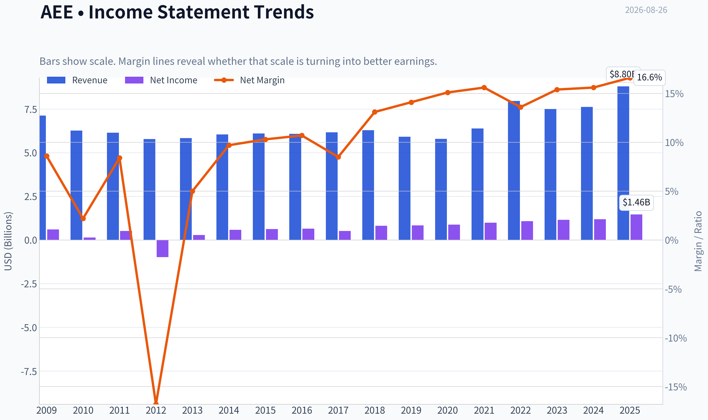
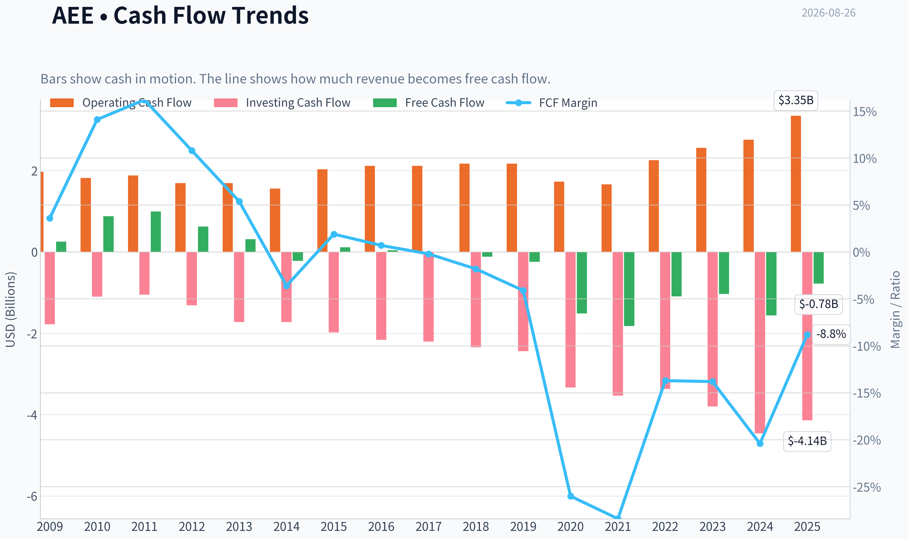
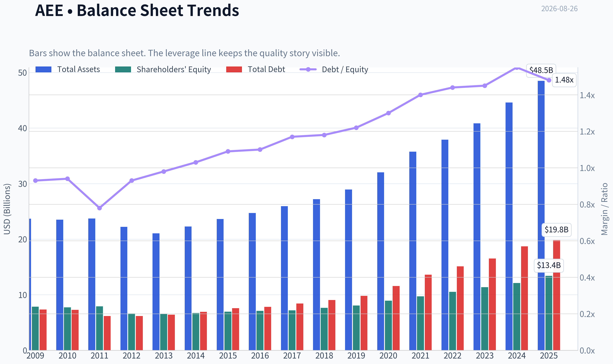
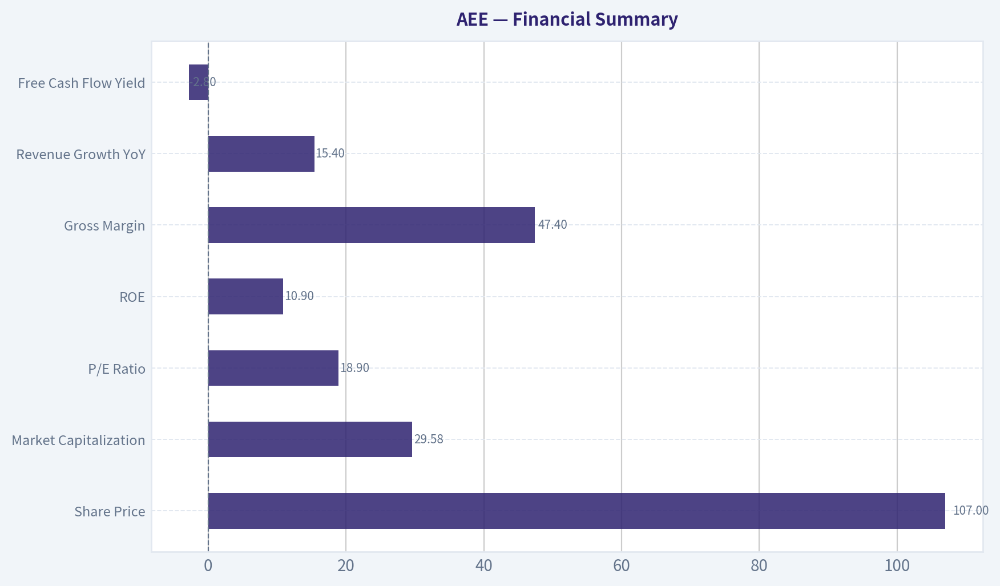
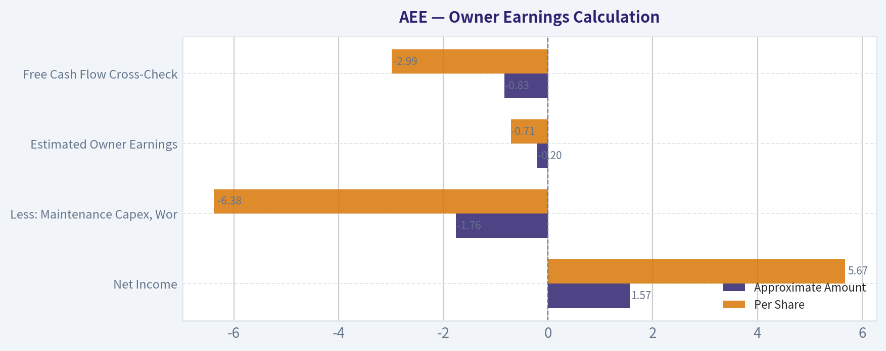
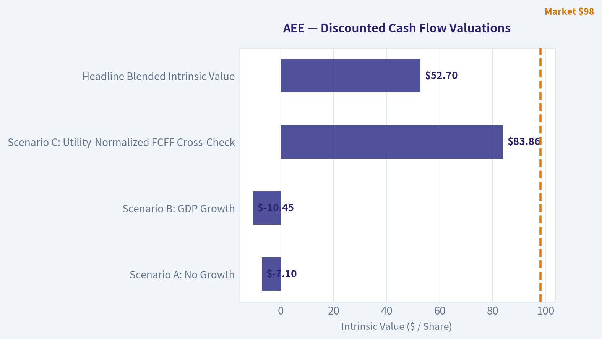
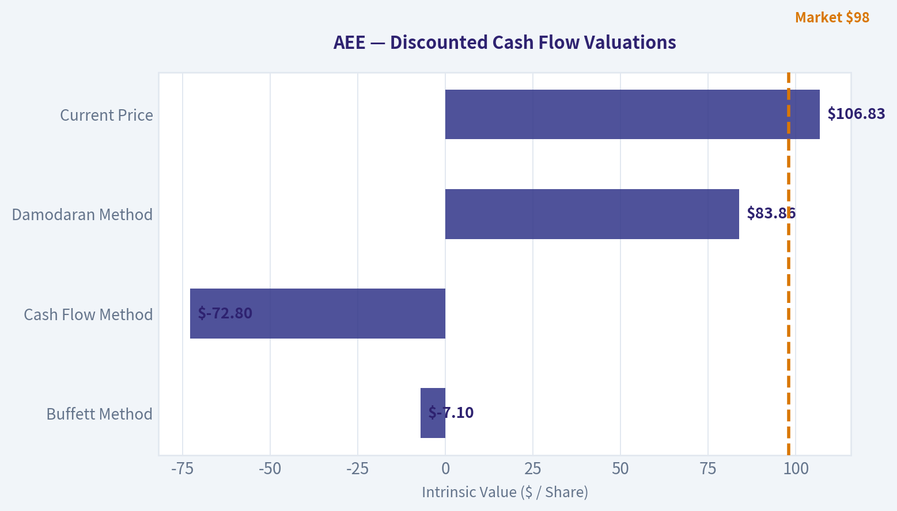
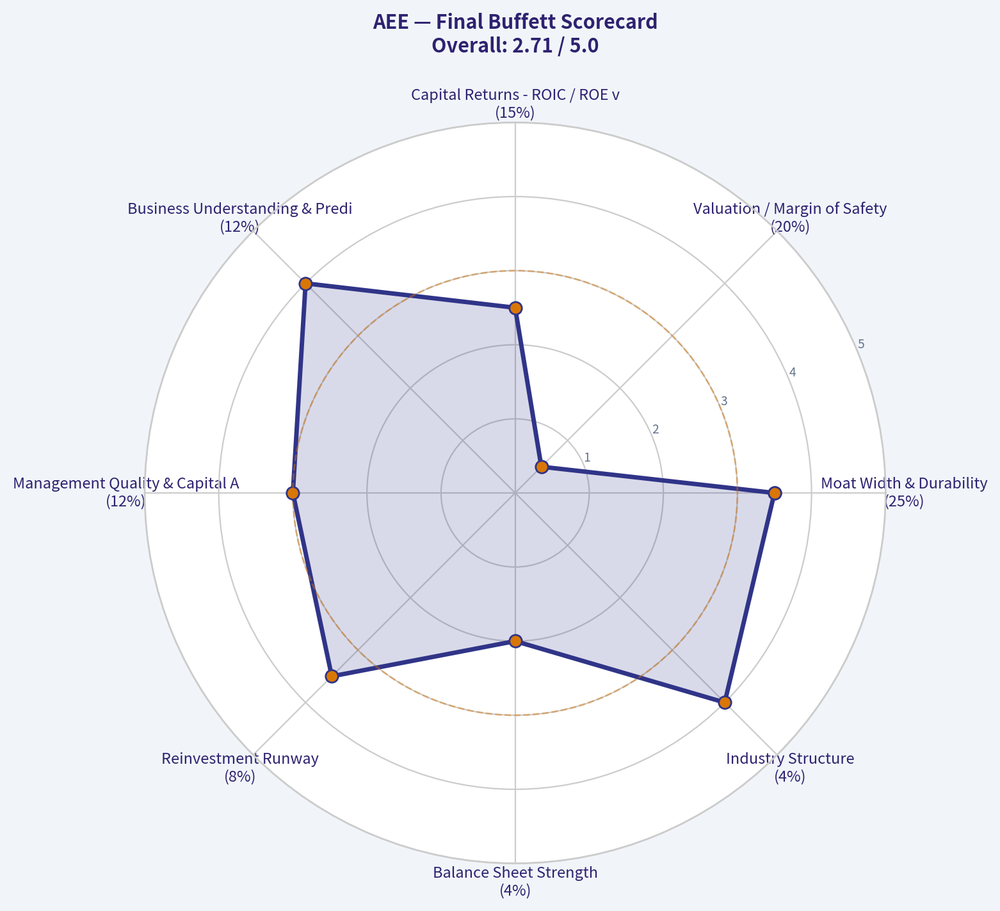

# AEE Deep Value Intelligence

**Analysis Date:** 2026-08-26

## Critical Disclaimer

*This analysis is generated by Deep Value Intelligence, an AI-powered multi-agent investing framework. Education & research only - not financial advice, not a financial advisor.*

---

## Table of Contents

1. Intelligence Summary
2. Analyst Team Reports
   - Fundamentals Analysis
   - Intrinsic Value Analysis (Buffett)
   - Trend & Growth Analysis (Lynch/Druckenmiller/Fisher)
   - Market Technical Analysis
   - Options Market Analysis
3. Research Team Commentary
4. Value Investing Team Commentary
5. Deep Values Commentary

---

## Intelligence Summary

### Thesis + Conditions

**Core Thesis:** **1. Executive Summary**
Ameren (AEE) is a highly durable, essential-service compounder presenting a compelling accumulation setup.

**Key Risks:**
- Ameren (AEE) is a highly durable, essential-service compounder presenting a compelling accumulation setup. While its 19x P/E multiple is fair rather than deeply discounted, and its free cash flow is negative, these factors must be contextualized for a regulated utility. The heavy capital expenditure is actively expanding Ameren's rate base, guaranteeing future earnings via allowed returns (~10.9% ROE). Trading in an orderly pullback near its 200-day moving average, AEE offers a tactical entry point into a wide-moat monopoly. The business quality is high, the primary trend is intact, and the downside is limited.
- The Bull (Risky Analyst):** Negative free cash flow is a feature, not a bug, of the utility model. Ameren's $40B capex plan is a state-sanctioned growth floor that expands the rate base. A 19x P/E is fair for a dominant monopoly.
- Scale-In Trigger:** Add to the position upon confirmation of a rebound above near-term resistance ($109-$110), capitalizing on the repair rally.

**Confidence:** Medium

---

## Analyst Team Reports

### Fundamentals Analysis

#### Latest Earnings Snapshot

*Most recent reported quarter anchored on 2026 Q2, with prior-year comparison when available.*

| Metric | 2026 Q2 | 2025 Q2 | YoY Change |
| --- | ---: | ---: | ---: |
| Revenue | N/A | $2.22B | N/A |
| Operating Income | N/A | $411.0M | N/A |
| Net Income | N/A | $275.0M | N/A |
| Diluted EPS | $1.13 | $1.01 | +11.9% |
| Operating Cash Flow | $421.0M | $431.0M | -2.3% |
| Free Cash Flow | $-1.18B | $-651.0M | -80.5% |

Key Takeaways: This snapshot anchors the most recent reported quarter before the narrative analysis. It helps readers separate long-run business quality from whatever changed in the latest earnings print.

#### 17-Year Financial Metrics for AEE

*All values below are computed deterministically from raw data - not estimated by AI.*

*Issuer profile: operating company (Utilities / Utilities - Regulated Electric).*

#### 17-Year Financial Metrics
*Annual rows come from reported financial statements. The final TTM row is computed from the latest four quarters.*

| Metric | 2009 | 2010 | 2011 | 2012 | 2013 | 2014 | 2015 | 2016 | 2017 | 2018 | 2019 | 2020 | 2021 | 2022 | 2023 | 2024 | 2025 |
| --- | --- | --- | --- | --- | --- | --- | --- | --- | --- | --- | --- | --- | --- | --- | --- | --- | --- |
| Market Price | $15 | $16 | $20 | $20 | $25 | $33 | $32 | $40 | $46 | $53 | $64 | $66 | $78 | $80 | $67 | $85 | $98 |
| Market Cap | $6.64B | $6.78B | $8.02B | $7.46B | $8.84B | $11.27B | $10.53B | $12.77B | $14.41B | $16.03B | $18.98B | $19.41B | $22.93B | $23.07B | $19.05B | $23.84B | $27.18B |
| P/E Ratio | 10.84 | 48.75 | 15.41 | -7.66 | 30.64 | 19.22 | 16.69 | 19.57 | 27.57 | 19.65 | 22.93 | 22.30 | 23.18 | 21.48 | 16.52 | 20.17 | 18.67 |
| P/B Ratio | 0.84 | 0.88 | 1.01 | 1.13 | 1.35 | 1.68 | 1.52 | 1.80 | 2.01 | 2.10 | 2.35 | 2.17 | 2.36 | 2.20 | 1.68 | 1.97 | 2.03 |
| ROE | 7.8% | 1.8% | 6.6% | -14.7% | 4.4% | 8.7% | 9.1% | 9.2% | 7.3% | 10.8% | 10.3% | 9.8% | 10.3% | 10.3% | 10.2% | 9.8% | 10.9% |
| ROIC | 7.7% | 5.9% | 5.5% | 6.7% | 6.9% | 6.6% | 6.4% | 6.4% | 5.5% | 6.9% | 6.3% | 6.0% | 5.4% | 5.5% | 5.1% | 4.9% | 5.9% |
| EPS | $1.42 | $0.34 | $1.32 | $-2.59 | $0.80 | $1.69 | $1.90 | $2.04 | $1.68 | $2.69 | $2.78 | $2.98 | $3.36 | $3.72 | $4.06 | $4.24 | $5.35 |
| Revenue | $7.13B | $6.27B | $6.15B | $5.78B | $5.84B | $6.05B | $6.10B | $6.08B | $6.17B | $6.29B | $5.91B | $5.79B | $6.39B | $7.96B | $7.50B | $7.62B | $8.80B |
| Gross Profit | N/A | N/A | N/A | N/A | N/A | N/A | N/A | N/A | N/A | N/A | N/A | N/A | N/A | N/A | N/A | N/A | N/A |
| Gross Margin | N/A | N/A | N/A | N/A | N/A | N/A | N/A | N/A | N/A | N/A | N/A | N/A | N/A | N/A | N/A | N/A | N/A |
| Operating Margin | 19.8% | 17.9% | 16.8% | 20.6% | 20.3% | 20.7% | 20.6% | 21.8% | 22.8% | 21.6% | 21.4% | 22.4% | 20.8% | 19.0% | 20.8% | 19.9% | 23.0% |
| Net Income | $612.0M | $139.0M | $519.0M | $-974.0M | $289.0M | $586.0M | $630.0M | $653.0M | $523.0M | $821.0M | $834.0M | $877.0M | $995.0M | $1.08B | $1.16B | $1.19B | $1.46B |
| Net Margin | 8.6% | 2.2% | 8.4% | -16.8% | 5.0% | 9.7% | 10.3% | 10.7% | 8.5% | 13.1% | 14.1% | 15.1% | 15.6% | 13.6% | 15.4% | 15.6% | 16.6% |
| Revenue Growth | N/A | -12.1% | -1.9% | -6.0% | 1.0% | 3.7% | 0.7% | -0.4% | 1.6% | 1.9% | -6.1% | -2.0% | 10.4% | 24.4% | -5.7% | 1.6% | 15.4% |
| Net Income Growth | N/A | -77.3% | 273.4% | -287.7% | -129.7% | 102.8% | 7.5% | 3.7% | -19.9% | 57.0% | 1.6% | 5.2% | 13.5% | 8.4% | 7.2% | 2.6% | 23.1% |
| Free Cash Flow Growth | N/A | 243.2% | 13.0% | -37.1% | -49.9% | -170.1% | -151.8% | -64.0% | -134.1% | 728.6% | 107.8% | 524.9% | 20.7% | -40.2% | -5.1% | 50.6% | -50.2% |
| Total Book Value | $7.86B | $7.73B | $7.92B | $6.62B | $6.54B | $6.71B | $6.95B | $7.10B | $7.18B | $7.63B | $8.06B | $8.94B | $9.70B | $10.51B | $11.35B | $12.11B | $13.40B |
| Total Assets | $23.70B | $23.51B | $23.72B | $22.23B | $21.04B | $22.29B | $23.64B | $24.70B | $25.95B | $27.21B | $28.93B | $32.03B | $35.73B | $37.90B | $40.83B | $44.60B | $48.48B |
| Total Debt | $7.33B | $7.28B | $6.18B | $6.16B | $6.41B | $6.92B | $7.58B | $7.83B | $8.42B | $9.04B | $9.80B | $11.58B | $13.61B | $15.10B | $16.51B | $18.72B | $19.83B |
| Debt-to-Equity | 0.93 | 0.94 | 0.78 | 0.93 | 0.98 | 1.03 | 1.09 | 1.10 | 1.17 | 1.18 | 1.22 | 1.30 | 1.40 | 1.44 | 1.45 | 1.55 | 1.48 |
| Cash & Equivalents | $622.0M | $538.0M | $248.0M | $209.0M | $30.0M | $5.0M | $292.0M | $9.0M | $10.0M | $16.0M | $16.0M | $139.0M | $8.0M | $10.0M | $25.0M | $7.0M | $13.0M |
| Shareholders' Equity | $7.86B | $7.73B | $7.92B | $6.62B | $6.54B | $6.71B | $6.95B | $7.10B | $7.18B | $7.63B | $8.06B | $8.94B | $9.70B | $10.51B | $11.35B | $12.11B | $13.40B |
| Operating Cash Flow | $1.97B | $1.82B | $1.88B | $1.69B | $1.69B | $1.56B | $2.03B | $2.12B | $2.12B | $2.17B | $2.17B | $1.73B | $1.66B | $2.26B | $2.56B | $2.76B | $3.35B |
| Investing Cash Flow | $-1.78B | $-1.10B | $-1.05B | $-1.31B | $-1.72B | $-1.72B | $-1.98B | $-2.16B | $-2.20B | $-2.34B | $-2.44B | $-3.33B | $-3.53B | $-3.37B | $-3.80B | $-4.46B | $-4.14B |
| Free Cash Flow | $257.0M | $882.0M | $997.0M | $627.0M | $314.0M | $-220.0M | $114.0M | $41.0M | $-14.0M | $-116.0M | $-241.0M | $-1.51B | $-1.82B | $-1.09B | $-1.03B | $-1.56B | $-775.0M |
| FCF Margin | 3.6% | 14.1% | 16.2% | 10.8% | 5.4% | -3.6% | 1.9% | 0.7% | -0.2% | -1.8% | -4.1% | -26.0% | -28.4% | -13.7% | -13.8% | -20.4% | -8.8% |
| Dividends / Share | $0.00 | $0.00 | $0.00 | $0.00 | $0.00 | $0.00 | $0.00 | $0.00 | $0.00 | $0.00 | $0.00 | $0.00 | $0.00 | $2.11 | $2.33 | $2.56 | $2.82 |

#### Profitability Metrics
- Return on Equity (ROE): 10.9%
- Return on Invested Capital (ROIC): 5.6%
- Return on Assets (ROA): 3.0%
- Gross Margin: N/A
- Operating Margin: 23.0%
- Net Profit Margin: 16.6%

#### Liquidity Metrics
- Current Ratio: 0.66
- Quick Ratio: 0.17

#### Leverage Metrics
- Debt-to-Equity Ratio: 1.48
- Interest Coverage Ratio: 2.61
- Net Debt: $19.82B

#### Growth Metrics (Year-over-Year)
- Revenue Growth: 15.4%
- Net Income Growth: 23.1%
- Free Cash Flow Growth: 50.2%
- Revenue CAGR (3-Year): 3.4%
- Revenue CAGR (5-Year): 8.7%

#### Valuation Metrics
- P/E Ratio (TTM): 18.87
- Forward P/E: 18.39
- Price-to-Book: 2.16
- Price-to-Sales: 3.52
- PEG Ratio: 2.82
- EV/EBITDA: 13.17
- Free Cash Flow Yield: -2.6%
- Earnings Yield: 5.3%

#### Owner Earnings (Buffett Method, Code-Computed)
- Net Income: $1.46B
- + Depreciation & Amortization: $1.67B
- - Capital Expenditures: $-4.13B
- - Working Capital Changes: $-51.0M
- = **Owner Earnings: $1.51B**

#### Intrinsic Value (Code-Computed)
- Current Price: $107
- **Headline Intrinsic Value (business-model routed): $48**
  Business model: operating company - weighted blend [Damodaran FCFF + reverse-DCF fair] (operating_company)
  Model spread (min-max across DCFs): $76 - $76
  Margin of safety vs. price (headline): -123.6%
  Routing note: General operating company: balanced blend of Damodaran FCFF and the owner-earnings DCF with a reverse-DCF sanity check.
- Buffett Method (Owner Earnings):
  Conservative: $-17
  Average: $-7
  Optimistic: $-0
- Cash Flow Method (FCF):
  Conservative: $-73
  Average: $-72
  Optimistic: $-72
- Damodaran FCFF (WACC + margins + reinvestment):
  Conservative: $41
  Average: $76
  Optimistic: $85
  Monte Carlo band (P10-P90): $28 - $103 (median $69)
  P(intrinsic value > price): 7.3%
- Reverse-DCF: price implies ~26.8%/yr owner-earnings growth for 10y; trailing 3y was -1.3%, 5y N/A.

#### Piotroski F-Score: 5/9
- Positive Net Income: PASS
- Positive Operating Cash Flow: PASS
- ROA Improvement: PASS
- Cash Flow > Net Income: PASS
- Decreasing Debt: FAIL
- Improving Current Ratio: FAIL
- No Dilution: FAIL
- Improving Gross Margin: FAIL
- Improving Asset Turnover: PASS

ANALYST STANCE: **WATCH**

#### AEE - Warren Buffett-Style Fundamental Analysis

Ameren Corporation is a regulated electric and gas utility, primarily serving Missouri and Illinois. Its business has several Buffett-friendly qualities: regulated monopoly territories, essential services, relatively predictable demand, and a long-lived asset base. However, the current valuation already prices in a very favorable outcome, while free cash flow remains structurally negative due to heavy capital expenditures and debt has risen meaningfully over the decade.

At the current price of about **$107**, the stock trades above the deterministic dataset's business-model-routed intrinsic value of roughly **$48**, and above the Damodaran FCFF base value of roughly **$76**. The reverse DCF indicates that today's price implies approximately **26.8% annual owner-earnings growth for 10 years**, which is highly aggressive for a regulated utility.

---

#### Revenue Breakdown

| Revenue Source | Amount | % of Total |
|---|---:|---:|
| Ameren Missouri - regulated electric generation, transmission, and distribution | ~$4.60B | ~52.3% |
| Ameren Illinois Electric Distribution | ~$2.40B | ~27.3% |
| Ameren Illinois Natural Gas | ~$1.00B | ~11.4% |
| Ameren Transmission | ~$0.80B | ~9.1% |
| **Total** | **$8.80B** | **100.0%** |

Key Takeaways: Ameren's revenue base is heavily regulated and concentrated in electric utility operations, especially Ameren Missouri. This supports predictability, but it also means growth is tied to rate-base expansion, regulatory approvals, allowed returns, and customer affordability rather than open-ended pricing power.

---

#### Current vs. 10-Year Historical Average

| Metric | Current / Latest | 10-Year Avg. | Current Standing & Interpretation |
|---|---:|---:|---|
| Market Price | **$107** | ~$67.70 | Price is about **58% above** the 10-year average, reflecting substantial multiple expansion and investor appetite for regulated utility income. |
| Market Cap | **$29.58B** | ~$19.77B | Market value is about **50% above** the 10-year average, outpacing book value and revenue growth. |
| P/E Ratio | **18.87x** | ~21.20x | Below the 10-year average, but still not obviously cheap given modest utility growth and high capital intensity. |
| P/B Ratio | **2.16x** | ~2.07x | Slightly above average. For a regulated utility, P/B is more meaningful than for asset-light firms, but it must be judged against ROE; AEE's ~10.9% ROE supports a premium to book, though not necessarily a bargain. |
| ROE | **10.9%** | ~9.9% | Above average and near the high end of the decade, indicating stable regulated returns and improved profitability. |
| ROIC | **~5.6%-5.9%** | ~5.8% | Roughly in line with history; acceptable for a regulated utility but not exceptional from a Buffett compounder perspective. |
| EPS | **$5.35 / TTM implied ~$5.67** | ~$3.29 | EPS has compounded well, helped by rate-base growth, rate cases, and margin improvement. |
| Revenue | **$8.80B** | ~$6.85B | Revenue is about **28% above** the 10-year average, with recent growth strong after a long flat period. |
| Gross Profit | **N/A** | N/A | The deterministic dataset does not provide gross profit; no independent historical gross-profit table should be inferred. |
| Gross Margin | **N/A** | N/A | Gross margin is not available in the deterministic dataset; operating margin is the more useful profitability metric here. |
| Operating Margin | **23.0%** | ~21.4% | Above average and the highest level in the recent period, showing improved cost recovery and regulated operating leverage. |
| Net Income | **$1.46B** | ~$959M | About **52% above** the 10-year average, reflecting a strong earnings trajectory. |
| Net Margin | **16.6%** | ~13.8% | Above average; profitability quality has improved materially since the mid-2010s. |
| Revenue Growth | **15.4% YoY** | ~4.1% | Current growth is far above average, but utility revenue can be weather-, fuel-, and rate-driven; not all of this should be capitalized as durable growth. |
| Net Income Growth | **23.1% YoY** | ~10.2% | Strong current earnings growth, but the 10-year average includes volatile years; normalized future growth is likely lower. |
| Free Cash Flow Growth | **-50.2% YoY** | ~113.9% | The average is distorted by swings from negative to less-negative FCF. The key point is that FCF has been persistently negative in recent years. |
| Total Book Value | **$13.40B** | ~$9.60B | Book value has steadily grown as Ameren reinvests heavily in regulated assets. |
| Total Assets | **$48.48B** | ~$34.64B | Asset base is about **40% above** average, consistent with rate-base growth. |
| Total Debt | **$19.83B** | ~$13.04B | Debt is about **52% above** average, a major watch item. |
| Debt-to-Equity | **1.48x** | ~1.33x | Leverage is above average and structurally rising, though common for regulated utilities. |
| Cash & Equivalents | **$13M** | ~$25M | Cash is very low, but utilities often rely on operating cash flow and capital markets rather than large cash balances. |
| Shareholders' Equity | **$13.40B** | ~$9.60B | Equity base is growing, supporting regulated investment, but dilution and external financing remain important risks. |
| Free Cash Flow | **-$775M** | ~-$812M | FCF is still negative despite improving from the worst years; capital intensity is the central valuation issue. |
| Dividends / Share | **$2.82** | ~$0.98* | Dividend has become meaningful in the recent dataset, with a payout ratio near **53%** of EPS. |

Key Takeaways: Ameren's profitability metrics are stronger than its 10-year averages, especially EPS, net income, net margin, and ROE. The main offset is cash flow quality: free cash flow remains negative because the company is investing heavily in its regulated asset base, and debt has risen faster than equity over time.

\*Dividend average is based only on the deterministic dataset, which records dividends per share as zero before 2022.

---

#### Market Metrics Interpretation

Ameren's **current price of $107** and **market cap of $29.58B** represent a premium valuation relative to the past decade. Investors are paying up for predictable regulated earnings, dividend growth, and defensive utility exposure.

The **P/E ratio of 18.87x** is below the 10-year average of about **21.2x**, which superficially appears reasonable. However, the valuation is less attractive when measured against intrinsic value and free cash flow. A regulated utility with mid-single-digit sustainable growth and heavy reinvestment needs should not be valued solely on reported EPS.

The **P/B ratio of 2.16x** is slightly above its 10-year average. For Ameren's issuer type - a regulated utility operating company - P/B is more relevant than for software or asset-light businesses because book value approximates the regulated asset base. Still, P/B must be compared with ROE. A **10.9% ROE** can justify a premium to book, but the current premium does not provide an obvious Buffett-style margin of safety.

---

#### Profitability Analysis

Ameren's profitability profile has improved significantly. **ROE of 10.9%** is above the 10-year average and near the strongest level in the dataset. This suggests constructive regulatory outcomes and effective rate-base deployment.

**ROIC of roughly 5.6%-5.9%** is stable but modest. This is typical for regulated utilities, where returns are capped by regulators. Ameren is not a high-ROIC compounder in the classic Buffett sense, but it does benefit from predictability and monopoly-like service territories.

**EPS has increased to $5.35**, well above the 10-year average of roughly **$3.29**. Net income has also grown to **$1.46B**, compared with a 10-year average of about **$959M**. The trend is favorable, but much of the earnings growth depends on continued capital spending and allowed rate recovery.

Operating margin of **23.0%** is above the decade average of about **21.4%**, while net margin of **16.6%** is also above average. This points to better operating efficiency and rate recovery, though regulatory scrutiny could limit future margin expansion.

---

#### Growth Analysis

Revenue growth of **15.4% YoY** is much stronger than the 10-year average of roughly **4.1%**. However, Ameren's historical revenue path was uneven: several years showed flat or negative growth, followed by stronger gains in 2021, 2022, and 2025. For a utility, revenue growth should be normalized carefully because it can reflect weather, fuel-cost pass-throughs, rate adjustments, and infrastructure investment rather than pure volume growth.

Net income growth of **23.1% YoY** is also well above the 10-year average of about **10.2%**. The earnings trajectory is good, but a Buffett-style investor would ask whether this growth can be achieved without excessive reinvestment and leverage. In Ameren's case, growth has required substantial capex and rising debt.

Free cash flow growth is not economically clean because FCF has frequently been negative. The latest free cash flow of **-$775M** is better than the worst recent years but still negative. This is the key weakness in the investment case.

---

#### Balance Sheet and Financial Strength

Ameren's balance sheet reflects a classic capital-intensive regulated utility model. Total assets have grown to **$48.48B**, and shareholder equity has grown to **$13.40B**, both well above 10-year averages. This supports future regulated earnings because utilities earn allowed returns on their rate base.

However, total debt has risen to **$19.83B**, compared with a 10-year average of about **$13.04B**. Debt-to-equity of **1.48x** is above the decade average of **1.33x**. While this is not unusual for a utility, it reduces financial flexibility and increases sensitivity to interest rates, credit spreads, and regulatory lag.

Cash is only **$13M**, and the current ratio is **0.66**. For a regulated utility, low cash balances and weak current ratios are less alarming than for a cyclical industrial company because utilities have access to predictable cash collections and capital markets. Still, the combination of high capex, low cash, and rising debt deserves monitoring.

Interest coverage of **2.61x** is adequate but not generous. In a higher-rate environment, refinancing and incremental debt costs can pressure future earnings.

---

#### Cash Flow and Dividend Analysis

Ameren's operating cash flow is healthy at **$3.35B**, but capital expenditures are heavy, resulting in **free cash flow of -$775M**. This is not a one-off issue: free cash flow has been negative in most years since 2017. The business can still create value if regulators allow Ameren to earn attractive returns on its investments, but shareholders are dependent on the regulatory compact and external financing.

Dividends per share are **$2.82**, implying a payout ratio of roughly **53%** of 2025 EPS. That appears sustainable based on earnings, but less comfortable based on free cash flow. From a Buffett perspective, dividends funded by accounting earnings while free cash flow remains negative are acceptable only if reinvestment creates regulated value and debt remains manageable.

---

#### Buffett-Style Economic Moat Assessment

Ameren has a strong but regulated moat. Its service territories are protected by regulation, and electricity and natural gas distribution are essential services with high barriers to entry. Customers cannot easily switch providers, and new entrants cannot economically duplicate the grid.

However, this is not a "pricing power" moat in the same way as a consumer brand or dominant software platform. Ameren's returns are negotiated through regulators. The moat protects volume and durability, but regulators cap excess profitability.

The durability of the business is high. The compounding quality is moderate. The valuation risk is elevated.

---

#### Management and Capital Allocation

Management has executed a familiar regulated-utility strategy: grow the asset base, earn allowed returns, raise EPS, and increase dividends. ROE has remained around 10% in recent years, which suggests reasonable execution and constructive regulatory outcomes.

The concern is capital intensity. Asset growth has required rising debt and persistent negative free cash flow. Management's capital allocation is therefore heavily dependent on whether new infrastructure investments receive timely rate recovery and earn adequate allowed returns.

Dividend policy appears shareholder-friendly, but the dividend should be evaluated against long-term financing needs, not just EPS payout.

---

#### Three-Scenario Buffett-Style Owner Earnings DCF

Assumptions used for the hand DCF sanity check:

- Starting Owner Earnings: **$1.51B**
- Shares outstanding: approximately **276.4M**
- Discount rate: **10%**
- Terminal growth rate: **2.5%**
- Terminal growth begins after year 10
- Formula:
  - Present value of explicit owner earnings = discounted 10-year stream
  - Terminal value = Year 10 owner earnings x 1.025 / (10% - 2.5%)
  - Fair value per share = total present value / shares outstanding

| Scenario | Owner Earnings Growth Assumption | PV of Years 1-10 | PV of Terminal Value | Hand DCF Equity Value | Hand DCF Value / Share | Model-Based Cross-Check |
|---|---:|---:|---:|---:|---:|---|
| Conservative | 3.0% for 10 years, then 2.5% terminal | ~$10.7B | ~$10.7B | ~$21.4B | **~$77** | Damodaran conservative: **~$41** |
| Average | 5.5% for 10 years, then 2.5% terminal | ~$12.1B | ~$13.6B | ~$25.7B | **~$93** | Business-model-routed intrinsic value: **~$48**; Damodaran average: **~$76** |
| Optimistic | 7.0% for 10 years, then 2.5% terminal | ~$13.0B | ~$15.7B | ~$28.7B | **~$104** | Damodaran optimistic: **~$85**; Monte Carlo P90: **~$103** |

Key Takeaways: The hand owner-earnings DCF produces a broad range of roughly **$77 to $104 per share**, but this assumes owner earnings are distributable and durable despite heavy reinvestment needs. The stronger model-based valuation is more cautious, with a routed intrinsic value near **$48** and Damodaran base value near **$76**. At a market price of **$107**, Ameren trades above even the optimistic hand DCF and near the upper end of the Monte Carlo valuation band.

---

#### Intrinsic Value and Margin of Safety

The deterministic valuation pack is more conservative than the hand owner-earnings sanity check because Ameren's growth requires substantial reinvestment. The model-based intrinsic value is approximately **$48**, while the Damodaran FCFF base case is around **$76**. The Monte Carlo band is approximately **$28 to $103**, with only about **7.3% probability** that intrinsic value exceeds the current price.

The reverse DCF is the biggest valuation warning. The current stock price implies approximately **26.8% annual owner-earnings growth for 10 years**, compared with trailing 3-year owner-earnings growth of roughly **-1.3%**. That embedded expectation is not consistent with a mature regulated utility.

A Buffett-style investor would likely require a materially lower entry price - preferably below the Damodaran base value and ideally closer to a clear margin-of-safety range.

---

#### Key Investment Insights, Red Flags, and Opportunities

| Category | Key Points |
|---|---|
| Core Strength | Regulated monopoly-like utility business with essential-service demand and durable customer relationships. |
| Profitability | ROE, EPS, net income, operating margin, and net margin are all above 10-year averages. |
| Growth Quality | Earnings growth is strong, but it depends on continued rate-base investment and regulatory approval. |
| Cash Flow Risk | Free cash flow remains negative, reflecting heavy capex and limited distributable cash. |
| Balance Sheet Risk | Debt has risen to **$19.83B**, well above the 10-year average, while cash remains minimal. |
| Dividend Appeal | Dividend payout is reasonable versus EPS, but less secure when judged against free cash flow. |
| Valuation Concern | Current price is above routed intrinsic value, Damodaran base value, and near the optimistic DCF ceiling. |
| Main Opportunity | If regulators continue approving rate-base growth and allowed returns remain constructive, EPS and dividends can keep compounding. |
| Main Red Flag | The stock appears priced for growth and safety at the same time, leaving little margin of safety. |

Key Takeaways: Ameren is a high-durability utility with improving earnings quality, but the stock's valuation is demanding. The biggest conflict is between stable accounting earnings and weak free cash flow after capex. For a Buffett-style buyer, the business is attractive, but the price is not.

---

#### Final Investment Stance: WATCH

Ameren is a good regulated utility business, but not a compelling Buffett-style purchase at the current price. The company has durable economics, improving profitability, and a credible dividend profile. However, persistent negative free cash flow, rising debt, low cash balances, and a valuation above intrinsic value reduce the margin of safety.

The stock may be suitable for income-focused holders who prioritize regulated utility stability, but for new capital, the current price appears too high. A more attractive entry point would require either a lower share price, stronger free cash flow conversion, or evidence that rate-base growth can continue without materially worsening leverage.

| Final View | Assessment |
|---|---|
| Business Quality | Good |
| Moat | Strong regulated utility moat |
| Financial Strength | Acceptable but increasingly leveraged |
| Earnings Predictability | High |
| Free Cash Flow Quality | Weak |
| Dividend Quality | Reasonable versus EPS, weaker versus FCF |
| Valuation | Unattractive at current price |
| Margin of Safety | Insufficient |
| Stance | **WATCH** |

#### Fundamental Visuals

This graph tracks the profitability and return metrics (ROE, ROIC, Margins) of **AEE** over the past decade, highlighting capital efficiency trends.

This chart illustrates the financial health of **AEE** over the last 10 years, mapping cash equivalents and free cash flow against total obligations (Debt).

---

### Intrinsic Value Analysis (Buffett)

> *Following Warren Buffett's value investing philosophy: Circle of Competence, Economic Moat, Management Quality, and Margin of Safety.*

#### Intrinsic Value Snapshot

Price is what you pay. Intrinsic value is what the business may be worth based on the cash it can create for owners over time. We show a range, not one magic number.

- Current Price: $106.83
- Value Range (conservative to optimistic across both DCF methods): $-72.80 to $-0.68

##### Owner Earnings (Buffett Method)
- Net Income: $1,456,000,000.00
- Depreciation & Amortization: $1,668,000,000.00
- Capital Expenditures: $-4,174,000,000.00
- Working Capital Changes: $-51,000,000.00
- Owner Earnings: $1,507,000,000.00

##### Intrinsic Value
###### Buffett Method
Uses owner earnings. Stricter, and usually more conservative.
- Conservative: $-16.94
- Average: $-7.10
- Optimistic: $-0.68
- Discount Rate: 10.0%

###### Cash Flow Method
Uses free cash flow. Better for companies spending heavily today to grow tomorrow.
- Conservative: $-72.80
- Average: $-72.80
- Optimistic: $-72.80
- Discount Rate: N/A

ANALYST STANCE: **AVOID**

#### Ameren (AEE) - Buffett-Style Investment Review

Ameren is a regulated electric and gas utility serving Missouri and Illinois. It has a real monopoly-like franchise, predictable demand, and a long reinvestment runway through grid and generation investment. However, this is not a high-return compounding business in Buffett's preferred sense: returns are capped by regulators, free cash flow is negative due to heavy capital spending, and the current market price appears far above cash-flow-based intrinsic value.

---

#### 1. Factor Scorecard and Hard Floor Test

| Factor | Score | Evidence |
|---|---:|---|
| Circle of Competence & Business Simplicity | 4.0 / 5 | Easy to understand: Ameren earns regulated returns by providing electricity and gas service. Demand is predictable, but allowed returns depend on regulators and rate cases. |
| Moat Test | 3.5 / 5 | Strong local monopoly and regulatory franchise, but pricing power is not free-market pricing power; it is negotiated with regulators. |
| Management Quality & Capital Allocation | 3.0 / 5 | Management operates within a regulated utility framework. Capital allocation is largely directed toward rate-base growth, infrastructure investment, and dividends. |
| Industry Structure | 4.0 / 5 | Regulated utility service territories are structurally protected. Competition is limited, though distributed energy and political pressure on rates are long-term risks. |
| Gate 5: Quality / Solvency Hard Floor | Not tripped | The business is not showing a distress profile. Revenue is growing, earnings are positive, and the issue is valuation and capital intensity, not imminent solvency failure. |

**Key Takeaways:** Ameren is understandable and structurally protected, which gives it above-average predictability. The weakness is that its moat does not translate into exceptional economics because regulators cap returns. The hard solvency floor is not triggered, so this is not a distress-based avoid; it is a quality-adjusted valuation avoid.

---

#### 2. Moat Analysis

| Moat Source | Assessment | Strength |
|---|---|---:|
| Regulatory License / Franchise | Ameren has protected electric and gas service territories, creating a local monopoly structure. | Strong |
| Brand / Intangibles | Customers need reliable power, but brand attachment is not the key driver; regulation and infrastructure matter more. | Moderate |
| Switching Costs | Most customers cannot practically switch utility providers, but distributed solar, batteries, and virtual power plants may gradually reduce dependence. | Strong but evolving |
| Cost Advantage | Scale and grid infrastructure create cost advantages, though large capital needs reduce free cash flow. | Moderate |
| Network Effects | The grid has utility-like network value, but not the exponential network effects of platform businesses. | Moderate |

**Key Takeaways:** Ameren's moat is real, but it is a regulated-utility moat rather than a consumer-brand or platform moat. The company benefits from protected territories and essential-service demand, but regulators prevent the company from fully monetizing that position through unrestricted price increases. This supports stability, not exceptional compounding.

---

#### 3. Management Quality Assessment

| Area | Assessment |
|---|---|
| Owner Orientation | Utility management is typically judged by reliability, regulatory relationships, capital planning, and dividend stability. Ameren appears to follow the standard regulated-utility playbook. |
| Capital Allocation | Capital is primarily reinvested into the regulated rate base. This can create earnings growth, but only at regulated returns rather than open-ended high ROIC. |
| Balance Between Growth and Dividends | Ameren is positioned as a dividend-oriented utility, but negative free cash flow means growth investment and dividends depend on access to capital markets. |
| Candidness / Accounting | No major red flags are evident from the current financial profile. The key issue is economic value creation after heavy capital spending. |

**Key Takeaways:** Management appears competent for a regulated utility, but this is not a business where exceptional capital allocation can easily unlock extraordinary returns. The main capital allocation path is rate-base expansion, which can grow earnings but usually requires continuous debt and equity funding. Buffett would likely view this as acceptable stewardship, not a standout owner-operator situation.

---

#### 4. Financial Summary

| Metric | Latest / Current |
|---|---:|
| Share Price | $107 |
| Market Capitalization | $29.58B |
| P/E Ratio | 18.9x |
| Estimated Net Income | ~$1.57B |
| Estimated EPS | ~$5.67 |
| ROE | 10.9% |
| Gross Margin | 47.4% |
| Revenue Growth YoY | 15.4% |
| Free Cash Flow Yield | -2.8% |
| Estimated Free Cash Flow | ~-$0.83B |
| Current Ratio | 0.66 |
| Headline Intrinsic Value | $52.70 per share |
| Reverse-DCF Implied Growth | ~26.9% per year for 10 years |

**Key Takeaways:** Ameren is profitable, but its return profile is modest: ROE of 10.9% is reasonable for a utility, not exceptional. The negative free cash flow yield highlights the capital intensity of the business. The largest concern is valuation: the stock price implies a growth rate that is far too aggressive for a regulated utility.

---

#### 5. Owner Earnings Calculation

Buffett-style owner earnings are difficult for capital-heavy utilities because much of the "growth" capital expenditure is necessary to expand the regulated rate base, yet it still consumes cash today. For Ameren, the owner-earnings picture is weaker than accounting earnings.

| Owner Earnings Component | Approximate Amount | Per Share |
|---|---:|---:|
| Net Income | +$1.57B | +$5.67 |
| Less: Maintenance Capex, Working Capital Needs, and Net Capital Consumption | -$1.76B | -$6.38 |
| Estimated Owner Earnings | -$0.20B | -$0.71 |
| Free Cash Flow Cross-Check | -$0.83B | -$2.99 |

**Key Takeaways:** Reported earnings are positive, but owner earnings are approximately negative after required capital spending and working-capital needs. This is the central Buffett concern: the company can report steady profits while still requiring large reinvestment just to maintain and grow the utility system. For shareholders, that means intrinsic value depends heavily on regulators allowing future recovery of today's capital spending.

---

#### 6. Three-Scenario DCF Valuation

| Scenario | Method | Estimated Value per Share |
|---|---|---:|
| Scenario A: No Growth | Owner earnings / 10% discount rate | -$7.10 |
| Scenario B: GDP Growth | Owner earnings growing at 3%, discounted at 10% | -$10.45 |
| Scenario C: Utility-Normalized FCFF Cross-Check | Damodaran-style FCFF valuation recognizing regulated asset recovery | $83.86 |
| Headline Blended Intrinsic Value | Business-model-routed valuation blend | $52.70 |

**Key Takeaways:** Pure owner-earnings valuation is unattractive because current owner earnings are negative. Even the more generous utility-normalized FCFF valuation is below the current share price. The headline intrinsic value of $52.70 suggests the market is paying roughly twice a conservative estimate of value.

---

#### 7. Margin of Safety Analysis

| Valuation Reference | Value per Share | Comparison to $107 Price |
|---|---:|---:|
| Headline Intrinsic Value | $52.70 | Price is ~103% above intrinsic value |
| Utility-Normalized FCFF Value | $83.86 | Price is ~28% above this higher value estimate |
| Owner Earnings No-Growth Value | -$7.10 | Not supportive |
| Reverse-DCF Implied Growth | ~26.9% annually for 10 years | Implausibly high for a regulated utility |

**Key Takeaways:** Ameren offers no margin of safety at the current price. A regulated utility with ROE around 11% should not require a nearly 27% annual growth assumption to justify its stock price. Even giving credit for utility rate-base recovery, the shares look expensive.

---

#### 8. Final Buffett Scorecard

| Criterion | Weight | Score | Weighted Contribution |
|---|---:|---:|---:|
| Moat Width & Durability | 25% | 3.5 | 0.88 |
| Valuation / Margin of Safety | 20% | 0.5 | 0.10 |
| Capital Returns - ROIC / ROE vs. Cost of Capital | 15% | 2.5 | 0.38 |
| Business Understanding & Predictability | 12% | 4.0 | 0.48 |
| Management Quality & Capital Allocation | 12% | 3.0 | 0.36 |
| Reinvestment Runway | 8% | 3.5 | 0.28 |
| Balance Sheet Strength | 4% | 2.0 | 0.08 |
| Industry Structure | 4% | 4.0 | 0.16 |
| Total Score | 100% |  | **2.72 / 5** |

**Key Takeaways:** Ameren earns high marks for predictability and industry structure, but those strengths are overwhelmed by valuation and capital intensity. The business is stable, but not a high-return compounder. At the current price, the expected return profile does not meet a Buffett-style margin-of-safety standard.

---

#### 9. Investment Stance

| Stance | Conviction | Rationale |
|---|---|---|
| **AVOID** | High | Good regulated utility, poor price. The moat is real, but returns are capped, free cash flow is negative, and the current valuation embeds growth assumptions that are not realistic for this type of business. |

**Final View:** Ameren is a stable regulated utility, not a distressed company. But Buffett investing requires both business quality and a sensible price. At $107, Ameren appears materially overvalued versus cash-flow-based intrinsic value, and the stock lacks an adequate margin of safety.
#### Valuation Bridge

This bridge places the current market price beside each intrinsic value lens so readers can see whether upside depends on one method or shows up across several methods.

| Scenario | Intrinsic Value / Share |
| --- | ---: |
| Buffett Method | $-7.10 |
| Cash Flow Method | $-72.80 |
| Damodaran Method | $83.86 |
| Current Price | $106.83 |

#### Key Takeaways

If one method is far above the others, the upside case depends on a specific modelling assumption. When several methods cluster together, the valuation story is more robust.

#### Valuation Visuals

This comparison chart from *Latest Earnings Snapshot* stacks current figures against historical benchmarks for **AEE**, making it easy to see where the company trades relative to its own averages.

This comparison chart from *Financial Summary* stacks current figures against historical benchmarks for **AEE**, making it easy to see where the company trades relative to its own averages.

This comparison chart from *Owner Earnings Calculation* stacks current figures against historical benchmarks for **AEE**, making it easy to see where the company trades relative to its own averages.

The following chart maps the **AEE** Owner Earnings DCF valuation scenarios (Conservative, Average, Optimistic) to visually represent the margin of safety based on intrinsic value calculations.

The following chart maps the **AEE** Owner Earnings DCF valuation scenarios (Conservative, Average, Optimistic) to visually represent the margin of safety based on intrinsic value calculations.

---

### Trend & Growth Analysis (Lynch/Druckenmiller/Fisher)

> *Following Peter Lynch's GARP, Stanley Druckenmiller's macro-aware approach, and Philip Fisher's scuttlebutt methodology.*

ANALYST STANCE: **AVOID**

#### Ameren Corporation (AEE) - Growth Investor Report
Date: 2026-08-26 | Price: $107 | Market Cap: $29.58B

Ameren is a regulated electric and gas utility serving Missouri and Illinois. It may be a reasonable dividend or defensive utility holding, but it does **not** fit a Lynch/Fisher/Druckenmiller growth mandate. The core issue is that the market price appears to embed growth far above what a regulated utility can realistically deliver.

---

#### 1. Lynch Classification

| Category | Assessment |
|---|---|
| Lynch Type | **Stalwart / Regulated Utility**, not a fast grower |
| Growth Profile | Revenue growth recently strong at **15.4% YoY**, but long-term EPS growth is likely closer to regulated utility norms, around mid-single digits to high-single digits |
| Growth Investor Fit | Weak |
| Primary Appeal | Dividend stability, rate-base growth, defensive earnings |
| Ten-Bagger Potential | Low |

**Key Takeaways:** Ameren is not a classic Lynch fast grower. It is a regulated utility whose earnings growth is constrained by allowed returns, capital spending plans, and state regulatory approvals. For a growth investor seeking inflection points and ten-bagger potential, this is a poor fit.

---

#### 2. The Story in 3 Bullets

- Ameren sells electricity and natural gas to regulated customers in Missouri and Illinois.
- Growth comes mainly from investing in grid modernization, renewable generation, transmission, and utility infrastructure, then earning regulated returns on that rate base.
- The business is stable and essential, but upside is capped because regulators control pricing and allowed returns.

---

#### 3. TAM and 10x Test

| Item | Assessment |
|---|---|
| Current Business | Regulated electric and gas utility |
| TAM Type | Regional utility service territory, not a global open-ended market |
| 10x Revenue Test | **Fails** |
| Reason | Ameren cannot realistically grow revenue 10x inside its regulated service territories without massive acquisition, inflation, or structural market change |
| TAM Growth | Moderate at best, driven by electrification, data centers, grid investment, and rate-base expansion |
| Runway Quality | Stable but not explosive |

**Key Takeaways:** Ameren has a durable market, but not a hypergrowth market. The company can grow through infrastructure investment and electrification demand, but it does not have the type of expanding global TAM that usually supports ten-bagger outcomes. The runway is defensive, not exponential.

---

#### 4. Revenue Growth Trend

| Metric | Data / Interpretation |
|---|---|
| Latest Revenue Growth YoY | **15.4%** |
| Pattern | Positive recent growth, but likely affected by rates, weather, fuel cost pass-throughs, and regulated recovery mechanisms |
| Growth Quality | Moderate; not the same as organic software-like volume growth |
| Long-Term Growth Expectation | Likely mid-single-digit to high-single-digit EPS growth |
| Growth Trend Verdict | **Not a clear growth inflection** |

**Key Takeaways:** The 15.4% revenue growth number looks strong on the surface, but utility revenue can be heavily influenced by rate cases, fuel costs, weather, and regulatory accounting. The more important long-term measure is earnings and rate-base growth, which is unlikely to compound at true fast-grower rates. This makes the recent revenue growth less compelling for a growth investor.

---

#### 5. Unit Economics

| Metric | Assessment |
|---|---|
| LTV/CAC | Not applicable; regulated utility customers are captive/local service customers |
| NRR | Not applicable |
| Rule of 40 | Not applicable |
| Gross Margin | **47.4%** |
| ROE | **10.9%** |
| FCF Yield | **-2.8%** |
| Current Ratio | **0.66** |

**Key Takeaways:** Ameren does not have SaaS-style unit economics, so LTV/CAC and NRR are not meaningful. The 10.9% ROE is respectable for a regulated utility, but negative free cash flow reflects heavy capital spending. This is normal for utilities, but it limits financial flexibility and reinforces that this is not an asset-light compounder.

---

#### 6. Inflection Point Assessment

| Inflection Type | Evidence | Verdict |
|---|---:|---|
| Product Cycle Inflection | No major scalable product cycle | Weak |
| Market Share Inflection | Utilities are territory-based; limited share-taking opportunity | Weak |
| Margin Inflection | Regulated returns cap upside | Weak |
| TAM Inflection | Electrification, renewables, grid investment provide modest tailwinds | Moderate |
| Competitive Inflection | Limited traditional competition, but distributed energy and virtual power plants are emerging | Mixed |
| Earnings Inflection | No evidence that earnings can accelerate materially above utility norms | Weak |

**Key Takeaways:** Ameren has secular investment tailwinds from grid modernization and electrification, but this is not the same as a growth-stock inflection. The regulated model provides stability, yet it also caps upside. There is no clear evidence of a step-change in earnings power that the market is underestimating.

---

#### 7. Macro Setup

| Macro Factor | Impact on AEE |
|---|---|
| Interest Rates | Higher rates are a headwind because utilities are capital-intensive and dividend-sensitive |
| Falling Rate Scenario | Positive; could support valuation multiples and reduce financing pressure |
| Inflation | Mixed; can raise capex and operating costs, but some recovery may occur through rates |
| Energy Transition | Positive long-term capex opportunity |
| Data Center / Electrification Demand | Potential positive demand driver in service territories |
| Regulatory Climate | Critical swing factor |

**Key Takeaways:** Ameren benefits from long-term electricity demand growth and grid investment, but the macro setup is not decisively favorable. High or sticky interest rates pressure both valuation and funding costs. The best bull case would require falling rates, supportive regulators, and stronger-than-expected load growth.

---

#### 8. Fisher 15 Points Score

| Fisher Point | Score / 5 | Comment |
|---|---:|---|
| Market potential for sizable sales increase | 3 | Stable demand, limited geographic expansion |
| Management determination to develop new products | 2 | Utility innovation is incremental |
| Effective R&D | 2 | Not an R&D-led business |
| Above-average sales organization | 2 | Sales execution is not the key driver |
| Worthwhile profit margin | 3 | Solid regulated margins |
| Improving margins | 2 | Upside capped by regulation |
| Labor/personnel relations | 3 | No major red flag from available data |
| Executive relations | 3 | No major red flag from available data |
| Management depth | 3 | Utility operations require disciplined execution |
| Cost analysis/accounting | 3 | Important for rate cases and capital planning |
| Outstanding moat | 4 | Regulated monopoly/service territory |
| Long-range profit outlook | 3 | Predictable but not explosive |
| Dilution risk | 2 | Utilities often need external capital |
| Management candor | 3 | Insufficient evidence for high score |
| Integrity | 3 | No major red flag from available data |
| **Total** | **41 / 75** | **Below growth-investor threshold** |

**Key Takeaways:** Ameren scores well on monopoly-like durability but poorly on innovation, market expansion, and scalable growth. Fisher's framework favors companies with long product runways and exceptional reinvestment opportunities. Ameren is stable, but not exceptional from a growth-compounding perspective.

---

#### 9. Valuation Analysis

| Valuation Metric | Data | Interpretation |
|---|---:|---|
| Current Price | **$107** | Market price |
| Market Cap | **$29.58B** | Large regulated utility |
| P/E | **18.9x** | Not cheap for a mid-single-digit to high-single-digit grower |
| Revenue Growth YoY | **15.4%** | Strong latest print, but likely not durable at this level |
| PEG using estimated 6-8% EPS growth | **~2.4x-3.1x** | Expensive by Lynch standards |
| PEG using revenue growth | **~1.2x** | Less useful because utilities are valued on earnings and regulated returns |
| Headline Intrinsic Value | **$52.70** | Far below current price |
| Margin of Safety vs. Price | **-102.7%** | No margin of safety |
| Reverse DCF Implied Growth | **~26.9% annually for 10 years** | Unrealistic for regulated utility |

**Key Takeaways:** Valuation is the biggest problem. A nearly 19x P/E multiple is demanding for a regulated utility unless earnings growth is unusually strong and durable. The reverse DCF implication of roughly 27% annual growth for 10 years appears completely disconnected from Ameren's regulated business model.

---

#### 10. Scenario Analysis

| Scenario | Assumptions | Expected Outcome |
|---|---|---|
| Bear Case | Rates stay high, regulatory outcomes disappoint, capex funding pressure persists | Multiple compression and weak total return |
| Base Case | Ameren compounds EPS around 6-8%, maintains dividend growth, executes capex plan | Moderate utility-like return, but not growth-stock upside |
| Bull Case | Falling rates, strong load growth, favorable rate cases, premium utility multiple | Decent defensive upside, still unlikely to become a multi-bagger |

**Key Takeaways:** Even the bull case looks more like a solid utility return than a growth-stock return. Ameren can work as a lower-volatility income compounder if rates fall and regulators are supportive. But the setup does not offer the asymmetric upside preferred by Lynch, Druckenmiller, or Fisher.

---

#### 11. Growth Investor Scorecard

| Criterion | Weight | Score / 5 | Weighted Score |
|---|---:|---:|---:|
| The Story | 10% | 2.5 | 0.25 |
| TAM & Runway | 20% | 2.0 | 0.40 |
| Revenue Growth | 20% | 2.5 | 0.50 |
| Unit Economics | 15% | 2.5 | 0.38 |
| Competitive Position | 10% | 3.5 | 0.35 |
| Management Quality | 10% | 3.0 | 0.30 |
| Macro Setup | 5% | 2.5 | 0.13 |
| Profitability Path | 5% | 3.0 | 0.15 |
| Valuation | 5% | 1.0 | 0.05 |
| **Total** | **100%** |  | **2.51 / 5.00** |

**Key Takeaways:** Ameren's strongest feature is its regulated competitive position. Its weakest features are valuation, limited TAM expansion, and lack of fast-grower characteristics. The total score lands in the avoid range for a growth strategy, even though the business itself is not low quality.

---

#### 12. Position Size Stance

| Investor Type | Stance |
|---|---|
| Growth Investor | **Avoid / Do not initiate** |
| Existing Holder Seeking Income | Hold may be reasonable if dividend safety and rate-case outlook remain acceptable |
| GARP Investor | Wait for a much lower valuation |
| Aggressive Growth Portfolio | Not suitable |
| Suggested Growth Portfolio Weight | **0%** |

**Key Takeaways:** This is not a position to initiate for a growth-oriented portfolio. Existing income-focused holders may reach a different conclusion, but the stock does not meet the hurdle for ten-bagger potential. The valuation leaves little room for error.

---

#### 13. Key Risks and Catalysts

| Category | Factors |
|---|---|
| Key Risks | Expensive valuation, negative FCF yield, high capital intensity, regulatory lag, interest-rate sensitivity, utility debt burden, limited organic growth ceiling |
| Positive Catalysts | Falling interest rates, favorable rate cases, stronger power demand, data-center load growth, grid modernization returns, renewable investment recovery |
| Negative Catalysts | Rate-case disappointment, higher financing costs, capex overruns, adverse weather, political pressure on customer bills |
| What Would Change the View | Price decline toward a more attractive utility multiple, clearer EPS acceleration, stronger allowed ROEs, or evidence of unusually durable load growth |

**Key Takeaways:** Ameren's upside catalysts are real but mostly utility-sector catalysts, not growth-stock catalysts. The biggest risk is paying too high a multiple for a regulated business with limited earnings acceleration. A lower entry price could make Ameren more interesting for income or defensive portfolios, but not for high-growth capital allocation today.

---

#### Final Verdict

Ameren is a durable regulated utility, but it is not a Lynch-style fast grower, not a Fisher-style innovation compounder, and not a Druckenmiller-style earnings inflection opportunity. The current valuation appears too demanding relative to the company's realistic growth ceiling.

**Final Growth Stance: AVOID.**

#### Growth & Scorecard Visuals

The radar chart below from *Final Buffett Scorecard* visualises how **AEE** ranks across weighted investment criteria. Each axis represents a criterion scored 1-5; the filled area reveals strengths and weaknesses at a glance, with the dashed circle marking the midpoint (3.0).

---

### Market Technical Analysis

ANALYST STANCE: **WATCH**

#### AEE Technical Indicator Report - As of Latest Available Trading Data

AEE's latest available close is **$106.83 on 2026-08-25**. The requested current date, **2026-08-26**, is not reflected as a trading day in the indicator feed, so this analysis uses the most recent completed session. The technical picture is cautious: AEE is testing its long-term trend line while short- and medium-term momentum remain weak.

The stock has pulled back meaningfully from its late-June high near **$118.32**, and the recent structure suggests a defensive utility stock that is no longer in a clean uptrend, but has not yet confirmed a major long-term breakdown either.

#### Selected Indicators and Why They Matter

| Indicator | Latest Value / Signal | Why It Is Relevant Here |
|---|---:|---|
| `close_10_ema` | **$108.08** | Captures short-term momentum; price is below it, showing near-term weakness. |
| `close_50_sma` | **$110.90** | Defines the medium-term trend; price is materially below it, suggesting the prior uptrend has deteriorated. |
| `close_200_sma` | **$106.83** | Long-term trend benchmark; price is essentially sitting on this key support line. |
| `macd` | **-0.93** | Momentum is negative and below zero, confirming downside pressure. |
| `macds` | **-0.76** | MACD remains below its signal line, keeping the bearish crossover active. |
| `macdh` | **-0.17** | Histogram turned negative again after a brief improvement, showing renewed momentum weakness. |
| `rsi` | **39.91** | Below neutral but not oversold; sellers have control, but panic selling is not evident. |
| `atr` | **1.94** | Volatility has moderated, useful for stop placement and sizing around the 200-day test. |

Key Takeaways: AEE is trading below its 10-day EMA and 50-day SMA, while sitting almost exactly on its 200-day SMA. That makes the current zone technically important: a rebound could stabilize the long-term trend, but a decisive break below the 200-day average would materially weaken the chart.

#### Trend Structure

AEE's short-term trend is bearish. The **10-day EMA has fallen from roughly $113.08 in mid-July to $108.08**, reflecting persistent selling pressure over the last several weeks. The stock's latest close at **$106.83** is about **1.2% below the 10-day EMA**, meaning even near-term trend-following buyers have not yet regained control.

The medium-term trend has also weakened. The **50-day SMA is near $110.90**, and price is roughly **3.7% below it**. More importantly, the 50-day average has stopped rising aggressively and is beginning to flatten. That often marks a transition from an uptrend into a corrective or range-bound phase.

The long-term trend is the key battleground. The **200-day SMA is approximately $106.83**, almost identical to the latest close. This is a critical area because institutional and systematic trend-following strategies often use the 200-day average as a regime filter. AEE has not decisively broken below it yet, but it has lost the comfortable cushion it had during the spring and early summer advance.

#### Momentum Analysis

MACD remains negative. The latest **MACD line is -0.93**, below the **signal line at -0.76**, with the **histogram at -0.17**. This confirms that downside momentum is still active.

There was a brief improvement around **2026-08-17 to 2026-08-20**, when the MACD histogram turned slightly positive. However, that improvement failed quickly, and the histogram flipped negative again by **2026-08-21**. That failed momentum recovery is important because it suggests buyers attempted to stabilize the stock but did not generate enough strength to reclaim key moving averages.

RSI is also soft but not washed out. At **39.91**, RSI is below the neutral 50 level, which supports the bearish short-term reading. However, it is not below 30, so the stock is not technically oversold. This means a bounce is possible from the 200-day area, but the indicator does not yet show a high-conviction capitulation or exhaustion signal.

#### Volatility and Risk Context

ATR is around **$1.94**, down from the early-August area above **$2.30**. That means volatility has cooled as the stock has drifted lower. This is not a classic panic breakdown; it looks more like an orderly but persistent downtrend.

For traders, this matters because a quieter decline can still be dangerous: lower volatility may encourage dip-buying, but if price breaks the 200-day SMA with expanding volume, the move could accelerate. A practical risk framework would treat the **$105.70-$106.80 zone** as near-term support and use ATR-based stops rather than tight fixed stops, because AEE's daily range remains close to $2.

#### Key Price Zones

| Zone | Approximate Level | Interpretation |
|---|---:|---|
| Immediate support | **$105.70-$106.80** | Includes recent lows and the 200-day SMA; this is the most important area to defend. |
| Deeper support | **$104.30-$105.00** | Prior early-June low area; likely next downside target if the 200-day breaks. |
| First resistance | **$108.00-$109.75** | 10-day EMA and recent congestion; reclaiming this would show short-term stabilization. |
| Medium resistance | **$110.90-$111.50** | 50-day SMA zone; a close above this would improve the medium-term picture. |
| Upper resistance | **$113.00-$115.00** | Former July reaction area; a move above this would suggest the correction is ending. |

Key Takeaways: The most important support area is around $106, where price is testing the 200-day moving average. A rebound above $108 to $110 would improve the short-term setup, but failure below $105.70 would likely confirm a deeper technical breakdown.

#### Trading Interpretation

AEE is not currently an attractive momentum long because price is below both the 10-day EMA and 50-day SMA, while MACD remains bearish. At the same time, it is not a clean short setup unless the stock breaks below the 200-day SMA with confirmation, because long-term support is still being tested.

For bullish traders, patience is warranted. A more constructive setup would require a close back above the **10-day EMA near $108.08**, followed by strength toward **$110.90**, the 50-day SMA. If that happens while MACD histogram improves and RSI moves back above 45-50, it would suggest the recent decline is stabilizing.

For bearish or defensive traders, the key trigger is a decisive close below the **$105.70-$106.00** area. That would represent a loss of the 200-day support zone and could open the door toward **$104.30**, and potentially lower if selling pressure expands.

#### Bottom Line

AEE is in a **watch-and-wait zone**. The stock is testing its long-term trend support, but short-term and medium-term indicators remain bearish. The current setup does not favor aggressive buying yet; confirmation is needed either through a rebound above $108-$111 or a breakdown below $105.70.

| Category | Current Reading | Bullish Evidence | Bearish Evidence | Practical Decision Point |
|---|---|---|---|---|
| Short-term trend | Weak | Price is near potential support | Below 10-day EMA | Watch for reclaim of **$108.08** |
| Medium-term trend | Deteriorating | 50-day SMA has not collapsed | Price is well below 50-day SMA | Reclaim **$110.90** to improve trend |
| Long-term trend | At risk | 200-day SMA still rising | Price is sitting on the 200-day line | Hold above **$106.80** or risk breakdown |
| Momentum | Bearish | MACD histogram not deeply negative | MACD below signal and below zero | Need MACD histogram to turn positive again |
| RSI | Soft, not oversold | No capitulation yet | RSI below 50 | Watch for move above **45-50** |
| Volatility | Moderate | ATR easing reduces disorderly selling risk | Quiet breakdown risk remains | Use ATR-aware stops around key levels |
| Overall stance | **WATCH** | Long-term support is nearby | Short-term trend remains negative | Wait for confirmation before acting |

Key Takeaways: AEE is technically fragile but not yet broken on a long-term basis. The strongest bullish signal would be a recovery above $108 and then $111, while the strongest bearish signal would be a decisive move below the $105.70-$106.80 support zone.

---

### Options Market Analysis

> *Reading options flow - put/call ratios, IV skew, and unusual activity - to gauge institutional positioning and event-driven risk.*

ANALYST STANCE: **WATCH**

#### AEE Options Market Sentiment Report
*Options data as of 2026-08-26. Near-term expirations reviewed: 2026-09-18, 2026-10-16, 2026-12-18.*

#### 1. Put/Call Ratio Analysis

| Expiration | Call OI | Put OI | Put/Call OI Ratio | Call Volume | Put Volume | Put/Call Volume Ratio | Read |
|---|---:|---:|---:|---:|---:|---:|---|
| 2026-09-18 | 211 | 82 | 0.39 | 127 | 36 | 0.28 | Call-skewed positioning |
| 2026-10-16 | 0 | 0 | N/A | 6 | 217 | 36.17 | Heavy put-side trading, but no OI base |
| 2026-12-18 | 142 | 3 | 0.02 | 63 | 31 | 0.49 | Strongly call-skewed OI |
| **Total Near-Term** | **353** | **85** | **0.24** | **196** | **284** | **1.45** | OI bullish, volume bearish |

**Key Takeaways:** AEE's near-term open interest is heavily call-skewed, with a total put/call OI ratio of **0.24**, well below the historical neutral baseline around **0.7**. That usually suggests bullish positioning or covered-call activity. However, the current volume ratio is **1.45**, driven mostly by October put volume, which points to fresh short-term hedging or downside positioning. Because the total options market is thin, confidence in the read is reduced.

---

#### 2. Implied Volatility Assessment

| Expiration | ATM Call IV | ATM Put IV | IV Read | Skew Observation |
|---|---:|---:|---|---|
| 2026-09-18 | 1.6% | 0.8% | Very low / possibly stale or illiquid | Call IV above put IV |
| 2026-10-16 | 0.8% | N/A | Very low / incomplete | Put IV unavailable |
| 2026-12-18 | 0.8% | 0.4% | Very low / possibly stale or illiquid | Call IV above put IV |

**Key Takeaways:** Reported ATM IV levels are extremely low, which may reflect AEE's defensive utility profile, but more likely also reflects **thin options liquidity and potentially stale quotes**. There is no clear evidence of elevated implied volatility ahead of a major catalyst. Available IV data shows call IV above put IV, meaning there is no obvious downside-fear put skew in the reported chain.

#### IV Skew Interpretation

| Skew Factor | Observation | Sentiment Implication |
|---|---|---|
| OTM put IV vs. OTM call IV | Detailed strike-level skew not provided | Cannot confirm a downside put skew |
| ATM call IV vs. ATM put IV | Calls show higher IV where data is available | Slight upside-demand signal, but low reliability |
| Event-risk premium | No obvious elevated IV shown | Market is not pricing a major near-term shock |

**Key Takeaways:** The IV surface does not show classic downside fear based on the available data. If anything, call-side IV appears modestly higher than put-side IV, but the absolute IV levels are unusually low. This makes the skew signal weak and less useful than the put/call volume signal.

---

#### 3. Unusual Options Activity

| Contract / Area | Volume vs. OI | Classification | Interpretation |
|---|---:|---|---|
| Contract-level unusual activity | No individual contracts flagged with volume > 5x OI | None confirmed | No clear single-contract institutional sweep identified |
| 2026-10-16 put flow | 217 put volume vs. 0 reported put OI at expiry level | Possible fresh put interest at aggregate level | Could reflect new downside hedging or bearish positioning, but strike-level confirmation is unavailable |

**Key Takeaways:** No specific unusual option contract was flagged by the data set. However, the October expiration shows **217 put contracts traded against zero reported put open interest**, which may indicate fresh put positioning at the expiration level. Without strike-level detail, this should be treated as a cautionary bearish signal rather than confirmed smart-money flow.

#### 4. Open Interest Concentration and Gamma / Pinning Risk

| Expiration | Highest OI Side | Notable OI Pattern | Gamma / Pinning Read |
|---|---|---|---|
| 2026-09-18 | Calls | 211 call OI vs. 82 put OI | Light call-side concentration; limited pinning confidence |
| 2026-10-16 | None reported | 0 call OI and 0 put OI | No visible gamma wall from OI data |
| 2026-12-18 | Calls | 142 call OI vs. 3 put OI | Call-heavy, but total OI is still modest |
| **Overall** | Calls | 353 total call OI vs. 85 total put OI | No strong gamma-wall conclusion without strike-level OI |

**Key Takeaways:** Open interest is concentrated on the call side, but the absolute number of contracts is small. That means any max-pain, pinning, or gamma-wall conclusion is low confidence. AEE does not appear to have a large, liquid options complex capable of strongly controlling near-term price action through dealer gamma effects.

---

#### 5. Overall Options Sentiment Signal

| Signal Component | Reading | Weight |
|---|---|---|
| Put/Call OI Ratio | Bullish, with ratio at 0.24 vs. neutral ~0.7 | Moderate |
| Put/Call Volume Ratio | Bearish, with ratio at 1.45 | Moderate |
| IV Level | Very low / not pricing event stress | Low |
| IV Skew | No clear downside put skew | Low |
| Unusual Activity | No confirmed contract-level unusual activity; October put flow is a caution flag | Moderate |
| Liquidity Quality | Thin options market | High caveat |

**Key Takeaways:** The strongest bullish input is call-heavy open interest, while the strongest bearish input is the recent put-heavy volume, especially in October. Because the options chain is thin and IV data appears unusually low, the signal should not be treated as high conviction. The best interpretation is a cautious **WATCH** stance with a slight bearish near-term flow bias.

#### Final Options Sentiment: **BEARISH, Low Confidence**

AEE's options market shows **call-heavy open interest**, which would normally lean bullish versus the neutral put/call OI baseline. However, the more current trading activity is **put-heavy**, with a near-term put/call volume ratio of **1.45** and notable October put volume despite no reported OI base. That suggests traders may be adding downside protection or tactical bearish exposure.

The bearish signal is **low confidence** because AEE options appear relatively illiquid, no individual unusual contract was flagged, and strike-level OI/skew data is unavailable. In practical terms, the options market is not flashing panic, but it is showing enough fresh put demand to warrant caution rather than a clean bullish read.

#### Summary Table

| Category | Current Read | Interpretation |
|---|---|---|
| Put/Call Ratio | OI ratio **0.24**, volume ratio **1.45** | OI bullish, but current flow bearish |
| IV Level | Very low reported ATM IV | No clear event-risk premium; data may be stale/illiquid |
| Skew Direction | No confirmed put skew; call IV higher where available | No strong downside-fear signal from IV |
| Unusual Activity | No contract-level unusual activity flagged | October put volume is a cautionary bearish clue |
| Overall Signal | **BEARISH, Low Confidence** | Fresh put volume outweighs call-heavy OI, but liquidity limits conviction |

**Key Takeaways:** AEE's options positioning is not decisively bearish, but the most recent flow leans defensive. The lack of strong IV expansion and absence of confirmed unusual sweeps keep this from being a high-conviction downside signal. The appropriate stance is **WATCH**, with attention on whether October put open interest builds after today's trading.

---

## Research Team Commentary

> *The Research Manager synthesizes the Bull vs Bear debate into action-free commentary. This is a pre-risk view, not the final stance.*

Looking at this debate over Ameren, we have a classic clash between strict, textbook value theory and the pragmatic reality of how regulated utilities actually generate returns.

To summarize the arguments, the Bear makes a structurally sound, classic Buffett-style case: Ameren has a low Return on Invested Capital of 5.6%, it burns through cash because of heavy capital expenditures and dividend obligations, and at roughly 19 times earnings, you aren't getting any deep-value margin of safety. The Bear sees a company constantly relying on debt to fund its operations, which looks dangerous in a higher-rate environment.

On the other hand, the Bull rightly points out that applying a rigid "owner earnings" penalty to a regulated utility is a fundamental misunderstanding of the business model. Ameren has a state-sanctioned monopoly moat. Its massive capital spending isn't wasteful-it is prudently expanding the "rate base" upon which regulators allow it to earn a highly predictable return on equity of around 10.9%. The Bull argues that using a reverse-DCF, the market is pricing in 5-6% growth, but Ameren's rate base expansion gives it high visibility to actually hit 7-8%, providing a qualitative margin of safety.

Here is how I am synthesizing this, keeping my own past mistakes front and center.

Core Takeaway
Ameren is a durable, essential-service compounder that is currently presenting a solid accumulation setup. While it doesn't boast the spectacular free cash flow of an asset-light tech franchise, its heavy reinvestment cycle is practically guaranteed to drive future earnings through its regulated rate base. Sitting right at a long-term technical support level, this is a moment to act on a high-quality defensive name rather than waiting for a pure-value bargain that will never arrive.

Rationale
In the past, I've looked at setups exactly like this for Ameren and issued a cautious "WATCH" rating. I was too rigid. I let my fundamental caution regarding negative free cash flow, moderate debt, and a seemingly "full" valuation distract me from the reality of utility sector mechanics. The lesson I learned the hard way-after missing a near 8% rebound-is that a controlled pullback to a long-term trend line in a defensive utility is usually a buying opportunity, not a value trap.

We have to contextualize Buffett's principles here. Yes, Buffett loves businesses that gush free cash flow. But as his own investments in Berkshire Hathaway Energy show, negative free cash flow is perfectly acceptable-even desirable-if that capital is being plowed into a regulated system with guaranteed returns. The Bear is wrong to demand self-funding from a growing utility. Ameren's 19x multiple might not look cheap in a screener, but when you look through the reverse-DCF lens, the price implies growth that this franchise can easily beat. The downside risk is highly limited because of the company's monopoly moat and earnings visibility, and the upside is a steady, low-volatility grind higher as technical momentum repairs itself.

Monitoring Plan
To ensure this thesis stays on track over the next 1 to 4 quarters, we need to watch three specific things. First, keep a close eye on the regulatory dockets in Missouri and Illinois; any punitive shifts in allowed ROE or signs of severe regulatory lag would structurally damage the bull case. Second, monitor interest coverage ratios and the cost of new debt issuance to ensure that the spread between their allowed returns and their funding costs isn't compressing. Finally, watch the technical structure. The thesis relies on this being a controlled pullback, so we need to see the stock hold its primary support near the 200-day moving average and successfully retest near-term resistance.

I am not going to make the mistake of sitting on my hands waiting for a perfect free-cash-flow yield from a company whose job is to aggressively build grid infrastructure. The business quality is there, the valuation is reasonable for the predictability you get, and the setup is right.

Final Stance: ADVOCATE

---

## Value Investing Team Commentary

> *The Investor translates the research view into an investment thesis before risk review. This is still not the final stance.*

Ameren (AEE) presents a classic case of the "accounting vs. business reality" dilemma that often trips up value investors. To analyze Ameren correctly, one must look past the superficial screens that highlight high debt and negative free cash flow and instead apply the framework Warren Buffett uses for Berkshire Hathaway Energy (BHE).

### 1. The Business: A Regulated Toll Bridge
Ameren is not a "fair business"; it is a **wonderful business** in terms of durability. Its moat is a state-sanctioned monopoly. In exchange for providing an essential service, the states of Missouri and Illinois allow Ameren to earn a predictable return on equity (ROE) of roughly 10.9%.

The Value Analyst's "AVOID" stance centers on negative free cash flow and low ROIC. However, in the utility sector, **negative free cash flow is often a signal of health, not distress.** As long as the capital expenditure is "prudent" in the eyes of regulators, it is added to the "rate base." Ameren earns a return on every dollar it puts into the ground. For a long-term owner, seeing Ameren plow billions into grid modernization and renewables is equivalent to seeing a high-quality compounder reinvesting at a guaranteed rate.

### 2. Selective Contrarian Thinking: The Interest Rate Bogeyman
The market is currently cautious (WATCH) due to the "higher-for-longer" interest rate environment. The consensus view is that utilities are "bond proxies" that suffer when yields rise because their debt becomes more expensive and their dividends less attractive.

**The Contrarian Insight:** This view ignores the regulatory "lag" and recovery mechanism. While higher rates hurt in the short term, regulators eventually adjust allowed ROEs to reflect the higher cost of capital. Furthermore, Ameren's growth is driven by **decarbonization and electrification**-secular trends that are independent of the business cycle. If the market is pricing Ameren based on short-term interest rate volatility rather than the 10-year expansion of the electrical grid, a "fair price" becomes a significant opportunity.

### 3. Valuation and Margin of Safety
A P/E of roughly 19x is not "cheap" by Ben Graham's 1934 standards, but for a business with the visibility of Ameren, it is a **fair price.**
*   **Intrinsic Value Check:** If we use a reverse-DCF, the current price implies a long-term growth rate of approximately 5%. However, Ameren's management is targeting 6-8% earnings growth driven by their $40B+ multi-year capex plan.
*   **Quality-Scaled Margin of Safety:** For a cyclical or low-moat business, I would demand a 40% discount. For a regulated monopoly with a 10%+ ROE and high earnings visibility, a 10-15% discount to intrinsic value is sufficient. With the stock testing its 200-day moving average and long-term support, the market is offering that entry point now.

### 4. Management and Capital Allocation
Management's focus on "rate base growth" is the correct strategy. They are treating shareholders as partners by maintaining a sustainable dividend while aggressively reinvesting. The risk of "regulatory capture" or punitive shifts in Illinois is real, but Ameren's diversified exposure across two states provides a buffer.

### 5. Learning from History
Previous analysis of AEE favored a "WATCH" stance, waiting for a deeper discount or "technical confirmation." That passivity resulted in missing a nearly 8% recovery. In a wide-moat utility, "waiting for the perfect price" often means missing the "compounding train." The business is not broken; it is merely being ignored by a market seeking high-octane growth.

As Buffett says, "It's far better to buy a wonderful company at a fair price than a fair company at a wonderful price." Ameren is a wonderful company at a very fair price.

ANALYST STANCE: **ADVOCATE**

---

## Deep Values Commentary

> *The Risk Management Team debates and the Risk Judge provides the final action-free verdict. This section determines the final ADVOCATE / WATCH / AVOID stance.*

#### Final Stance Scorecard

This scorecard converts the final research view into a weighted decision frame. It does not replace the narrative judgement, but it makes the main drivers of the verdict easier to scan.

| Criterion | Score | Weight | Commentary |
| --- | ---: | ---: | --- |
| Business Quality | 3.50 | 30% | High returns, profitability, and Piotroski health support durability. |
| Valuation Support | 1.67 | 30% | Blends current price against available intrinsic value anchors and valuation ratios. |
| Financial Strength | 1.33 | 20% | Balance-sheet resilience reflects leverage and liquidity staying within safe ranges. |
| Growth Durability | 4.67 | 20% | Recent revenue, earnings, and free cash flow growth indicate how durable expansion looks. |
| TOTAL / FINAL STANCE | 2.75 | 100% | ADVOCATE |

#### Key Takeaways

The weighted score lands at **2.75 / 5.0**, while the final stance remains **ADVOCATE**. This is useful as a quick calibration aid rather than a mechanical signal.

#### Risk Summary

Higher scores indicate more risk pressure. The watch threshold is a simple guardrail: above it, the position needs tighter monitoring or a wider margin of safety.

| Dimension | Current Score | Watch Threshold | Commentary |
| --- | ---: | ---: | --- |
| Business Quality | 2.50 | 3.00 | High returns, profitability, and Piotroski health support durability. |
| Valuation Support | 4.33 | 3.00 | Blends current price against available intrinsic value anchors and valuation ratios. |
| Financial Strength | 4.67 | 3.00 | Balance-sheet resilience reflects leverage and liquidity staying within safe ranges. |
| Growth Durability | 1.33 | 3.00 | Recent revenue, earnings, and free cash flow growth indicate how durable expansion looks. |

#### Key Takeaways

This view helps readers separate *where* the risk sits: valuation, business quality, balance sheet, or growth durability. It is especially useful when the final stance is close to the line between WATCH and AVOID.
