# AEE Deep Value Intelligence

**Analysis Date:** 2026-09-09

## Critical Disclaimer

*This analysis is generated by Deep Value Intelligence, an AI-powered multi-agent investing framework. Education & research only - not financial advice, not a financial advisor.*

---

## Table of Contents

1. Intelligence Summary
2. Analyst Team Reports
   - Fundamentals Analysis
   - Intrinsic Value Analysis (Buffett)
   - Trend & Growth Analysis (Lynch/Druckenmiller/Fisher)
   - Market Technical Analysis
   - Options Market Analysis
3. Research Team Commentary
4. Value Investing Team Commentary
5. Deep Values Commentary

---

## Intelligence Summary

### Thesis + Conditions

**Core Thesis:** **EXECUTIVE SUMMARY**
Ameren (AEE) is a high-quality, regulated utility in an intact long-term uptrend. Traditional value screens flag its negative free cash flow (FCF), heavy debt, and ~19x P/E as high-risk, but these are structural norms for a utility undergoing rate-base expansion-not signs of business impairment.

**Key Risks:**
- Ameren (AEE) is a high-quality, regulated utility in an intact long-term uptrend. Traditional value screens flag its negative free cash flow (FCF), heavy debt, and ~19x P/E as high-risk, but these are structural norms for a utility undergoing rate-base expansion-not signs of business impairment. At $107, AEE is fairly valued for a legally protected monopoly offering predictable earnings visibility and a reliable dividend. Because the stock remains above its rising 200-day moving average, recent tactical softness is a buyable pullback, not a reason to sit on the sidelines.
- The Bear (Safe/Fundamentals):** AEE is a debt-reliant business generating negative FCF with a low 5.6% ROIC. At ~19x P/E, there is zero margin of safety if interest rates stay high or Missouri/Illinois regulators cap allowed returns.
- The Bull (Risky/Growth):** Negative FCF is a feature, not a bug. Billions spent on grid modernization directly expand the asset base upon which regulators guarantee a ~10.9% Return on Equity (ROE). A 19x multiple is a fair price for an inflation-protected monopoly.

**Confidence:** Medium

---

## Analyst Team Reports

### Fundamentals Analysis

#### Latest Earnings Snapshot

*Most recent reported quarter anchored on 2026 Q2, with prior-year comparison when available.*

| Metric | 2026 Q2 | 2025 Q2 | YoY Change |
| --- | ---: | ---: | ---: |
| Revenue | N/A | $2.22B | N/A |
| Operating Income | N/A | $411.0M | N/A |
| Net Income | N/A | $275.0M | N/A |
| Diluted EPS | $1.13 | $1.01 | +11.9% |
| Operating Cash Flow | $421.0M | $431.0M | -2.3% |
| Free Cash Flow | $-1.18B | $-651.0M | -80.5% |

Key Takeaways: This snapshot anchors the most recent reported quarter before the narrative analysis. It helps readers separate long-run business quality from whatever changed in the latest earnings print.

#### 17-Year Financial Metrics for AEE

*All values below are computed deterministically from raw data - not estimated by AI.*

*Issuer profile: operating company (Utilities / Utilities - Regulated Electric).*

#### 17-Year Financial Metrics
*Annual rows come from reported financial statements. The final TTM row is computed from the latest four quarters.*

| Metric | 2009 | 2010 | 2011 | 2012 | 2013 | 2014 | 2015 | 2016 | 2017 | 2018 | 2019 | 2020 | 2021 | 2022 | 2023 | 2024 | 2025 |
| --- | --- | --- | --- | --- | --- | --- | --- | --- | --- | --- | --- | --- | --- | --- | --- | --- | --- |
| Market Price | $15 | $16 | $20 | $20 | $24 | $32 | $32 | $40 | $46 | $52 | $63 | $66 | $77 | $79 | $67 | $85 | $98 |
| Market Cap | $6.64B | $6.78B | $8.02B | $7.46B | $8.84B | $11.27B | $10.53B | $12.77B | $14.41B | $16.03B | $18.98B | $19.41B | $22.93B | $23.07B | $19.05B | $23.84B | $27.18B |
| P/E Ratio | 10.84 | 48.75 | 15.41 | -7.66 | 30.64 | 19.22 | 16.69 | 19.57 | 27.57 | 19.65 | 22.93 | 22.30 | 23.18 | 21.48 | 16.52 | 20.17 | 18.67 |
| P/B Ratio | 0.84 | 0.88 | 1.01 | 1.13 | 1.35 | 1.68 | 1.52 | 1.80 | 2.01 | 2.10 | 2.35 | 2.17 | 2.36 | 2.20 | 1.68 | 1.97 | 2.03 |
| ROE | 7.8% | 1.8% | 6.6% | -14.7% | 4.4% | 8.7% | 9.1% | 9.2% | 7.3% | 10.8% | 10.3% | 9.8% | 10.3% | 10.3% | 10.2% | 9.8% | 10.9% |
| ROIC | 7.7% | 5.9% | 5.5% | 6.7% | 6.9% | 6.6% | 6.4% | 6.4% | 5.5% | 6.9% | 6.3% | 6.0% | 5.4% | 5.5% | 5.1% | 4.9% | 5.9% |
| EPS | $1.41 | $0.34 | $1.31 | $-2.58 | $0.79 | $1.68 | $1.89 | $2.03 | $1.67 | $2.67 | $2.76 | $2.96 | $3.34 | $3.69 | $4.03 | $4.21 | $5.24 |
| Revenue | $7.13B | $6.27B | $6.15B | $5.78B | $5.84B | $6.05B | $6.10B | $6.08B | $6.17B | $6.29B | $5.91B | $5.79B | $6.39B | $7.96B | $7.50B | $7.62B | $8.80B |
| Gross Profit | N/A | N/A | N/A | N/A | N/A | N/A | N/A | N/A | N/A | N/A | N/A | N/A | N/A | N/A | N/A | N/A | N/A |
| Gross Margin | N/A | N/A | N/A | N/A | N/A | N/A | N/A | N/A | N/A | N/A | N/A | N/A | N/A | N/A | N/A | N/A | N/A |
| Operating Margin | 19.8% | 17.9% | 16.8% | 20.6% | 20.3% | 20.7% | 20.6% | 21.8% | 22.8% | 21.6% | 21.4% | 22.4% | 20.8% | 19.0% | 20.8% | 19.9% | 23.0% |
| Net Income | $612.0M | $139.0M | $519.0M | $-974.0M | $289.0M | $586.0M | $630.0M | $653.0M | $523.0M | $821.0M | $834.0M | $877.0M | $995.0M | $1.08B | $1.16B | $1.19B | $1.46B |
| Net Margin | 8.6% | 2.2% | 8.4% | -16.8% | 5.0% | 9.7% | 10.3% | 10.7% | 8.5% | 13.1% | 14.1% | 15.1% | 15.6% | 13.6% | 15.4% | 15.6% | 16.6% |
| Revenue Growth | N/A | -12.1% | -1.9% | -6.0% | 1.0% | 3.7% | 0.7% | -0.4% | 1.6% | 1.9% | -6.1% | -2.0% | 10.4% | 24.4% | -5.7% | 1.6% | 15.4% |
| Net Income Growth | N/A | -77.3% | 273.4% | -287.7% | -129.7% | 102.8% | 7.5% | 3.7% | -19.9% | 57.0% | 1.6% | 5.2% | 13.5% | 8.4% | 7.2% | 2.6% | 23.1% |
| Free Cash Flow Growth | N/A | 243.2% | 13.0% | -37.1% | -49.9% | -170.1% | -151.8% | -64.0% | -134.1% | 728.6% | 107.8% | 524.9% | 20.7% | -40.2% | -5.1% | 50.6% | -50.2% |
| Total Book Value | $7.86B | $7.73B | $7.92B | $6.62B | $6.54B | $6.71B | $6.95B | $7.10B | $7.18B | $7.63B | $8.06B | $8.94B | $9.70B | $10.51B | $11.35B | $12.11B | $13.40B |
| Total Assets | $23.70B | $23.51B | $23.72B | $22.23B | $21.04B | $22.29B | $23.64B | $24.70B | $25.95B | $27.21B | $28.93B | $32.03B | $35.73B | $37.90B | $40.83B | $44.60B | $48.48B |
| Total Debt | $7.33B | $7.28B | $6.18B | $6.16B | $6.41B | $6.92B | $7.58B | $7.83B | $8.42B | $9.04B | $9.80B | $11.58B | $13.61B | $15.10B | $16.51B | $18.72B | $19.83B |
| Debt-to-Equity | 0.93 | 0.94 | 0.78 | 0.93 | 0.98 | 1.03 | 1.09 | 1.10 | 1.17 | 1.18 | 1.22 | 1.30 | 1.40 | 1.44 | 1.45 | 1.55 | 1.48 |
| Cash & Equivalents | $622.0M | $538.0M | $248.0M | $209.0M | $30.0M | $5.0M | $292.0M | $9.0M | $10.0M | $16.0M | $16.0M | $139.0M | $8.0M | $10.0M | $25.0M | $7.0M | $13.0M |
| Shareholders' Equity | $7.86B | $7.73B | $7.92B | $6.62B | $6.54B | $6.71B | $6.95B | $7.10B | $7.18B | $7.63B | $8.06B | $8.94B | $9.70B | $10.51B | $11.35B | $12.11B | $13.40B |
| Operating Cash Flow | $1.97B | $1.82B | $1.88B | $1.69B | $1.69B | $1.56B | $2.03B | $2.12B | $2.12B | $2.17B | $2.17B | $1.73B | $1.66B | $2.26B | $2.56B | $2.76B | $3.35B |
| Investing Cash Flow | $-1.78B | $-1.10B | $-1.05B | $-1.31B | $-1.72B | $-1.72B | $-1.98B | $-2.16B | $-2.20B | $-2.34B | $-2.44B | $-3.33B | $-3.53B | $-3.37B | $-3.80B | $-4.46B | $-4.14B |
| Free Cash Flow | $257.0M | $882.0M | $997.0M | $627.0M | $314.0M | $-220.0M | $114.0M | $41.0M | $-14.0M | $-116.0M | $-241.0M | $-1.51B | $-1.82B | $-1.09B | $-1.03B | $-1.56B | $-775.0M |
| FCF Margin | 3.6% | 14.1% | 16.2% | 10.8% | 5.4% | -3.6% | 1.9% | 0.7% | -0.2% | -1.8% | -4.1% | -26.0% | -28.4% | -13.7% | -13.8% | -20.4% | -8.8% |
| Dividends / Share | $0.00 | $0.00 | $0.00 | $0.00 | $0.00 | $0.00 | $0.00 | $0.00 | $0.00 | $0.00 | $0.00 | $0.00 | $0.00 | $2.10 | $2.31 | $2.54 | $2.76 |

#### Profitability Metrics
- Return on Equity (ROE): 10.9%
- Return on Invested Capital (ROIC): 5.6%
- Return on Assets (ROA): 3.0%
- Gross Margin: N/A
- Operating Margin: 23.0%
- Net Profit Margin: 16.6%

#### Liquidity Metrics
- Current Ratio: 0.66
- Quick Ratio: 0.17

#### Leverage Metrics
- Debt-to-Equity Ratio: 1.48
- Interest Coverage Ratio: 2.61
- Net Debt: $19.82B

#### Growth Metrics (Year-over-Year)
- Revenue Growth: 15.4%
- Net Income Growth: 23.1%
- Free Cash Flow Growth: 50.2%
- Revenue CAGR (3-Year): 3.4%
- Revenue CAGR (5-Year): 8.7%

#### Valuation Metrics
- P/E Ratio (TTM): 18.82
- Forward P/E: 18.37
- Price-to-Book: 2.16
- Price-to-Sales: 3.51
- PEG Ratio: 2.63
- EV/EBITDA: 13.16
- Free Cash Flow Yield: -2.6%
- Earnings Yield: 5.3%

#### Owner Earnings (Buffett Method, Code-Computed)
- Net Income: $1.46B
- + Depreciation & Amortization: $1.67B
- - Capital Expenditures: $-4.13B
- - Working Capital Changes: $-51.0M
- = **Owner Earnings: $1.51B**

#### Intrinsic Value (Code-Computed)
- Current Price: $107
- **Headline Intrinsic Value (business-model routed): $44**
  Business model: operating company - weighted blend [Damodaran FCFF + reverse-DCF fair] (operating_company)
  Model spread (min-max across DCFs): $70 - $70
  Margin of safety vs. price (headline): -141.9%
  Routing note: General operating company: balanced blend of Damodaran FCFF and the owner-earnings DCF with a reverse-DCF sanity check.
- Buffett Method (Owner Earnings):
  Conservative: $-16
  Average: $-7
  Optimistic: $-0
- Cash Flow Method (FCF):
  Conservative: $-71
  Average: $-71
  Optimistic: $-71
- Damodaran FCFF (WACC + margins + reinvestment):
  Conservative: $37
  Average: $70
  Optimistic: $79
  Monte Carlo band (P10-P90): $25 - $100 (median $65)
  P(intrinsic value > price): 5.1%
- Reverse-DCF: price implies ~27.2%/yr owner-earnings growth for 10y; trailing 3y was -1.3%, 5y N/A.

#### Piotroski F-Score: 5/9
- Positive Net Income: PASS
- Positive Operating Cash Flow: PASS
- ROA Improvement: PASS
- Cash Flow > Net Income: PASS
- Decreasing Debt: FAIL
- Improving Current Ratio: FAIL
- No Dilution: FAIL
- Improving Gross Margin: FAIL
- Improving Asset Turnover: PASS

ANALYST STANCE: **AVOID**

#### AEE - Warren Buffett-Style Fundamental Analysis

Ameren Corporation is a regulated electric and natural gas utility, primarily serving Missouri and Illinois. Its business has meaningful durability because regulated utilities operate essential infrastructure, usually earn allowed returns on rate base, and benefit from high barriers to entry. However, Buffett-style value investing requires not only business quality, but also a sensible price and conservative financing. At the current price of **$107**, AEE appears priced for a level of owner-earnings growth that is difficult to reconcile with its capital-intensive utility model, rising debt load, and persistently negative free cash flow.

The deterministic dataset classifies AEE as an **operating company in regulated electric utilities**. For this issuer type, **P/B is not meaningless**, but it must be interpreted carefully: for utilities, book value approximates regulated capital/rate base better than it does for software or asset-light companies, yet a higher P/B is justified only when ROE, rate-base growth, and regulatory outcomes support it.

---

#### Revenue Breakdown

| Revenue Source | Amount ($B) | % of Total |
| --- | ---: | ---: |
| Ameren Missouri regulated electric operations | ~$4.70 | ~53% |
| Ameren Illinois electric distribution | ~$2.35 | ~27% |
| Ameren Illinois natural gas distribution | ~$1.05 | ~12% |
| Ameren transmission and other regulated operations | ~$0.70 | ~8% |
| **Total Revenue** | **$8.80** | **100%** |

Key Takeaways: Ameren's revenue is overwhelmingly regulated, which supports earnings predictability and business durability. The largest contributor is Ameren Missouri, followed by Illinois electric distribution. This revenue mix creates a defensive profile, but it also means growth depends heavily on regulatory approvals, infrastructure investment, and allowed returns rather than unconstrained market expansion.

---

#### Current vs. 10-Year Historical Average Comparison

| Metric | Current / Latest | 10-Year Avg. | Standing vs. History | Interpretation |
| --- | ---: | ---: | ---: | --- |
| Market Price | $107 | $67.30 | ~59% higher | The stock has appreciated far faster than the long-term average price level. |
| Market Cap | $29.55B | $19.77B | ~50% higher | Equity value has expanded materially, partly from earnings growth and partly from multiple/rate-base expectations. |
| P/E Ratio | 18.82x | 21.20x | Below average | On earnings, AEE is not extreme versus its own history, but earnings quality must be weighed against negative FCF. |
| P/B Ratio | 2.16x | 2.07x | Slightly above average | For a utility, P/B is relevant but must be judged against ROE; with ROE around 11%, the premium is not obviously cheap. |
| ROE | 10.9% | 9.9% | Above average | Returns on equity are near the best levels in the dataset, suggesting solid regulated execution. |
| ROIC | 5.9% | 5.8% | In line | Invested-capital returns are stable but modest, typical of regulated utilities. |
| EPS | $5.24 | $3.36 | ~56% higher | EPS growth has been strong, especially since 2020. |
| Revenue | $8.80B | $6.85B | ~28% higher | Revenue has accelerated recently after a long period of stagnation. |
| Gross Profit | N/A | N/A | N/A | The deterministic dataset does not provide gross profit or gross margin. |
| Operating Margin | 23.0% | 21.4% | Above average | Operating profitability is at the high end of the decade. |
| Net Income | $1.46B | $959M | ~52% higher | Net income has compounded steadily in recent years. |
| Net Margin | 16.6% | 13.8% | Above average | Net margin is the strongest in the 17-year dataset. |
| Revenue Growth | 15.4% | 4.1% | Far above average | Latest revenue growth is unusually strong versus the decade norm. |
| Net Income Growth | 23.1% | 10.2% | Above average | Latest earnings growth is robust, but above-trend growth may not be sustainable. |
| Free Cash Flow Growth | -50.2% | Highly distorted | Not meaningful | FCF growth is volatile because FCF is frequently negative. |
| Total Book Value | $13.40B | $9.60B | ~40% higher | Equity base has grown with rate-base investment and retained earnings. |
| Total Assets | $48.48B | $34.64B | ~40% higher | Asset growth reflects heavy utility infrastructure spending. |
| Total Debt | $19.83B | $13.04B | ~52% higher | Debt has grown faster than assets and equity. |
| Debt-to-Equity | 1.48x | 1.33x | Higher | Leverage is elevated relative to history. |
| Cash & Equivalents | $13M | $25M | Lower | Cash balances are extremely thin, though utilities often rely on credit access. |
| Shareholders' Equity | $13.40B | $9.60B | ~40% higher | Equity growth supports rate-base expansion but has not prevented leverage from rising. |
| Free Cash Flow | -$775M | -$812M | Slightly better but still negative | AEE remains structurally FCF-negative due to heavy capex. |
| Dividends / Share | $2.76 | $0.97 | Higher | Dividends have become a meaningful shareholder return, but cash coverage is a concern. |

Key Takeaways: Ameren's profitability metrics are better than its 10-year averages, with ROE, EPS, operating margin, net margin, and net income all showing clear improvement. The concern is that balance-sheet leverage and capital intensity have also increased, while free cash flow remains negative. Valuation is not especially high on P/E, but cash-flow-based valuation is much less favorable.

---

#### Market Metrics Interpretation

AEE's current **market price of $107** and **market cap of $29.55B** are substantially above their 10-year averages. This tells us the market is giving Ameren credit for recent earnings growth, regulated investment opportunities, and dividend stability.

The **P/E ratio of 18.82x** is below the 10-year average of about **21.2x**, which may initially look reasonable. However, for a capital-intensive utility, reported earnings can look much better than free cash flow because large infrastructure investments consume cash. The stock therefore should not be evaluated on P/E alone.

The **P/B ratio of 2.16x** is slightly above the 10-year average of about **2.07x**. For AEE, book value is more meaningful than it would be for an asset-light technology company because regulated utilities earn returns on large tangible asset bases. Still, a P/B above 2x requires confidence that the company can continue earning attractive allowed returns, growing rate base, and passing costs through regulators without customer or political backlash.

---

#### Profitability Analysis

Ameren's profitability trend is strong. **ROE of 10.9%** is above the 10-year average and is one of the highest readings in the dataset. That is important for a utility because shareholder value creation depends heavily on earning above the cost of equity on regulated capital.

**ROIC of 5.9%** is stable but modest. This is normal for a regulated utility, but it also highlights why the business is not a classic Buffett-style high-return compounder. The company earns acceptable regulated returns, but not the type of exceptional returns seen in capital-light franchises.

**EPS increased to $5.24**, well above the 10-year average of $3.36. Net income reached **$1.46B**, and net margin expanded to **16.6%**, the strongest level in the dataset. Operating margin of **23.0%** is also above the decade average. This suggests good regulatory recovery, scale benefits, or operating discipline.

The main caveat is that **gross profit and gross margin are not available** in the deterministic dataset, so they should not be inferred. Utility economics are better assessed through operating margin, net margin, ROE, ROIC, regulatory outcomes, and cash-flow coverage.

---

#### Growth Analysis

Revenue growth of **15.4%** is far above the 10-year average of **4.1%**. That is impressive, but AEE's longer history shows that revenue growth has not been smooth. From 2016 through 2020, revenue was relatively flat to declining, then accelerated meaningfully after 2021.

Net income growth of **23.1%** is also well above the 10-year average of **10.2%**. Earnings growth has become more consistent since 2018, with net income rising from **$821M in 2018** to **$1.46B in 2025**.

Free cash flow growth is not a reliable signal here because FCF has been negative for most recent years. The latest FCF was **-$775M**, improved from **-$1.56B** in 2024, but still negative. For Buffett-style analysis, this is a major issue: reported earnings are growing, but the business requires heavy ongoing capital investment.

---

#### Balance Sheet and Financial Strength

Ameren's balance sheet reflects a regulated utility in expansion mode. Total assets increased to **$48.48B**, while shareholders' equity rose to **$13.40B**. This supports rate-base growth, which can drive future earnings if regulators allow adequate returns.

The concern is debt. Total debt reached **$19.83B**, compared with a 10-year average of **$13.04B**. Debt-to-equity is **1.48x**, above the decade average of **1.33x**. This is not unusual for utilities, but the trend is clearly toward higher leverage.

Cash and equivalents are only **$13M**, and the current ratio is **0.66**. For a regulated utility, low cash balances are not automatically fatal because the business typically has access to capital markets and credit facilities. Still, with high capex needs, rising rates, and interest coverage of only **2.61x**, financial flexibility is not abundant.

---

#### Cash Flow and Dividend Analysis

Free cash flow is the weakest part of the AEE thesis. The latest FCF was **-$775M**, and the 10-year average FCF was approximately **-$812M**. This means Ameren's accounting earnings are not translating into surplus cash after capital expenditures.

The company paid **$2.76 per share** in dividends in the latest year. The dividend is attractive for income-oriented investors, and regulated utilities often support dividends through predictable earnings. However, from a Buffett-style owner perspective, dividends funded while FCF is negative are less attractive because they may depend on debt issuance, equity issuance, or continued regulatory recovery.

Recent news also includes a **$900M junior subordinated notes offering due 2057**, which reinforces the point that the company continues to rely on external capital to fund its long-duration investment program.

---

#### Buffett-Style Qualitative Assessment

| Category | Assessment | Buffett-Style Interpretation |
| --- | --- | --- |
| Economic Moat | Moderate to strong | Regulated monopoly service territories create durable barriers to entry. |
| Business Predictability | High | Electricity and gas demand are essential, though weather, regulation, and fuel costs can affect results. |
| Pricing Power | Regulated, not free-market | Pricing depends on rate cases and allowed returns, not independent brand power. |
| ROE Quality | Solid | ROE near 11% is attractive for a utility and above AEE's historical average. |
| ROIC Quality | Moderate | ROIC around 5%-6% is stable but not exceptional. |
| Balance Sheet | Watch closely | Debt has risen substantially, and interest coverage is modest. |
| Free Cash Flow | Weak | Persistent negative FCF is the largest Buffett-style concern. |
| Dividend Policy | Income-friendly but cash-flow constrained | Dividend growth is positive, but FCF coverage is poor. |
| Valuation | Unattractive | Current price appears above conservative intrinsic value estimates. |

Key Takeaways: Ameren has the durability and predictability Buffett likes, but not the excess free cash flow and balance-sheet conservatism he usually prefers. The regulated moat is real, yet the company's need for constant reinvestment reduces owner cash generation. At the current price, the valuation does not offer a sufficient margin of safety.

---

#### Three-Scenario Buffett-Style Owner Earnings DCF

Assumptions used for the hand DCF sanity check:

- Current owner earnings: **$1.51B**
- Current price: **$107**
- Market cap: **$29.55B**
- Implied shares outstanding: **~276.2M**
- Discount rate: **10%**
- Terminal growth rate: **2.5%**
- Forecast period: **10 years**
- Formula:
  **Fair Value = Present Value of 10-Year Owner Earnings + Present Value of Terminal Value**
  **Terminal Value = Year 11 Owner Earnings / (Discount Rate - Terminal Growth Rate)**

| Scenario | Growth Assumption | PV of 10-Year Owner Earnings | PV of Terminal Value | Equity Value | Fair Value / Share | Margin vs. $107 |
| --- | --- | ---: | ---: | ---: | ---: | ---: |
| Conservative | 3.0% for 5 years, fading to 2.5% | ~$10.65B | ~$10.44B | ~$21.08B | ~$76 | ~-29% |
| Average | 5.0% for 5 years, fading toward 2.75% | ~$11.63B | ~$12.09B | ~$23.72B | ~$86 | ~-20% |
| Optimistic | 7.0% for 5 years, fading toward 3.0% | ~$12.67B | ~$13.84B | ~$26.51B | ~$96 | ~-10% |

Key Takeaways: Even using a generous owner-earnings approach that assumes the current $1.51B owner-earnings base is sustainable, AEE's fair value range is approximately **$76 to $96 per share**. The current price of **$107** sits above even the optimistic hand-DCF estimate. This suggests limited margin of safety unless future growth or allowed returns exceed reasonable utility expectations.

---

#### Intrinsic Value Cross-Check

The research pack's model-based intrinsic value is more conservative than the hand DCF:

- **Headline intrinsic value:** approximately **$44 per share**
- **Damodaran FCFF average case:** approximately **$70 per share**
- **Damodaran Monte Carlo P10-P90 band:** approximately **$25 to $100**
- **Probability intrinsic value exceeds current price:** **~5.1%**
- **Reverse DCF:** current price implies roughly **27.2% annual owner-earnings growth for 10 years**

The reverse-DCF result is especially important. A regulated utility sustaining **27% annual owner-earnings growth for a decade** is highly unlikely without extraordinary assumptions. That makes the current price look demanding even though the P/E ratio does not look extreme.

---

#### Key Investment Insights

Ameren is a high-quality regulated utility, but not a classic bargain. The company has improved profitability, expanded earnings, and grown dividends. Its regulated asset base provides durability, and its service territories create a defensible moat.

However, Buffett-style analysis places heavy weight on cash generation and margin of safety. AEE's free cash flow has been negative for years because capital expenditures are large. Debt has increased significantly, cash is minimal, and interest coverage is only moderate. These are manageable for a regulated utility, but they reduce the appeal at a premium price.

The current valuation appears to assume continued strong execution, favorable regulatory outcomes, and successful financing of long-term infrastructure growth. That may happen, but at **$107**, investors are not being paid enough for the risks.

---

#### Red Flags and Opportunities

| Area | Red Flags | Opportunities |
| --- | --- | --- |
| Valuation | Current price exceeds hand-DCF fair value and model-based intrinsic value. | If the stock pulls back toward the $70-$85 range, risk/reward improves. |
| Cash Flow | Persistent negative FCF due to heavy capex. | Capex supports rate-base growth, which can drive future earnings. |
| Balance Sheet | Debt has risen to $19.83B; D/E is above historical average. | Regulated utilities often have reliable capital-market access. |
| Profitability | ROIC remains modest at roughly 5%-6%. | ROE near 11% is solid and above historical norms. |
| Dividend | Dividend is growing despite negative FCF. | Income investors may value the defensive dividend stream. |
| Regulation | Earnings depend on rate-case outcomes and allowed returns. | Constructive regulators could support continued investment recovery. |
| Interest Rates | Higher rates pressure financing costs and utility valuations. | Lower future rates would improve equity valuation and refinancing conditions. |

Key Takeaways: The main opportunity is continued regulated rate-base growth, which can support earnings and dividends. The main risks are valuation, leverage, and negative free cash flow. AEE is fundamentally stable, but the current stock price leaves little room for disappointment.

---

#### Final Investment Stance: AVOID

AEE is a durable regulated utility with improving profitability and predictable demand, but the stock does not meet Buffett-style value criteria at the current price. The business quality is acceptable, yet the valuation is too rich relative to cash-flow-based intrinsic value, and persistent negative free cash flow weakens the owner-earnings case.

For existing income-oriented holders, AEE may be a **hold/watch** if the objective is dividend stability. For new capital, however, the appropriate stance is **AVOID** until the valuation offers a clearer margin of safety, ideally closer to conservative intrinsic value estimates.

| Final Decision Factor | Verdict |
| --- | --- |
| Business durability | Positive |
| Economic moat | Moderate to strong |
| Earnings predictability | Positive |
| ROE trend | Positive |
| ROIC level | Acceptable but not exceptional |
| Free cash flow | Negative |
| Balance sheet | Leveraged and increasingly debt-dependent |
| Dividend quality | Attractive but cash-flow constrained |
| Valuation vs. intrinsic value | Unattractive |
| Reverse-DCF reasonableness | Too aggressive |
| Final stance | **AVOID** |

Key Takeaways: Ameren is a stable and well-positioned regulated utility, but stability alone does not make a stock undervalued. The current price appears to require growth assumptions that are too optimistic for a capital-intensive utility. The best Buffett-style conclusion is to avoid new purchases until the price offers a larger margin of safety.

#### Fundamental Visuals

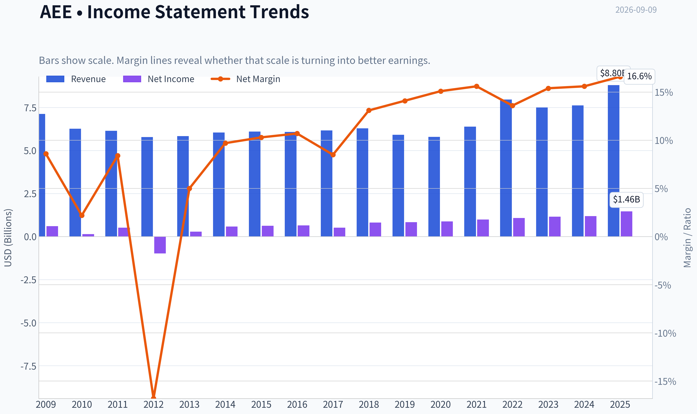

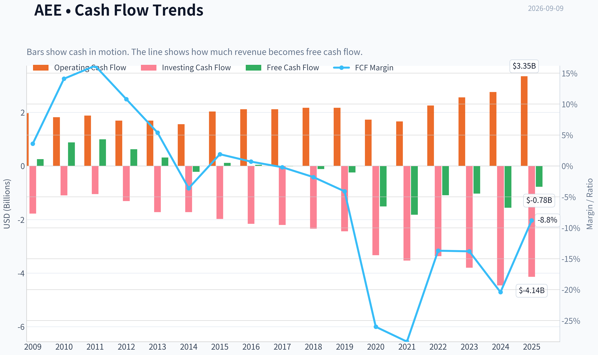

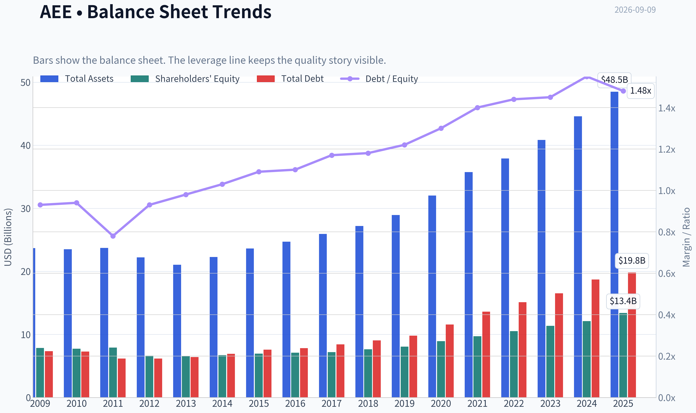

This graph tracks the profitability and return metrics (ROE, ROIC, Margins) of **AEE** over the past decade, highlighting capital efficiency trends.

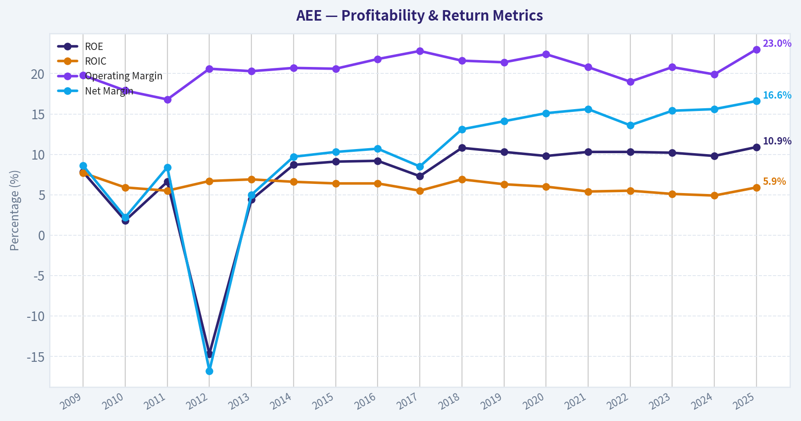

This chart illustrates the financial health of **AEE** over the last 10 years, mapping cash equivalents and free cash flow against total obligations (Debt).

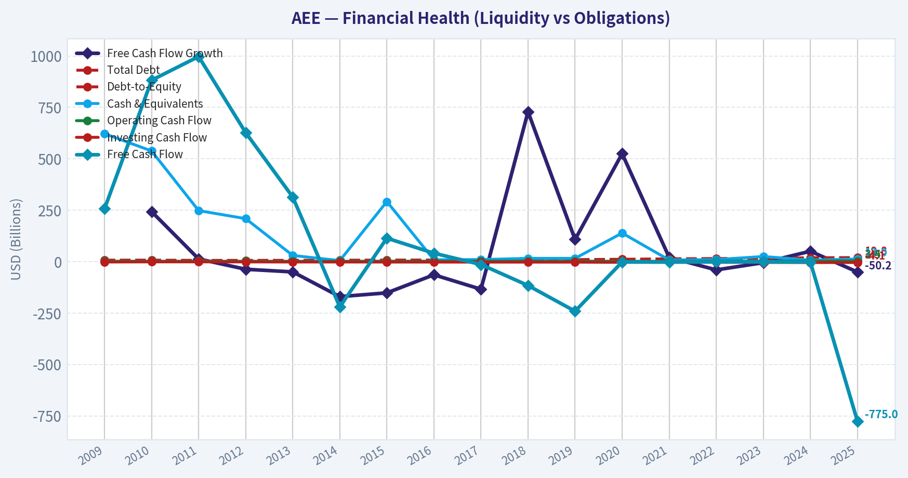

---

### Intrinsic Value Analysis (Buffett)

> *Following Warren Buffett's value investing philosophy: Circle of Competence, Economic Moat, Management Quality, and Margin of Safety.*

#### Intrinsic Value Snapshot

Price is what you pay. Intrinsic value is what the business may be worth based on the cash it can create for owners over time. We show a range, not one magic number.

- Current Price: $106.73
- Value Range (conservative to optimistic across both DCF methods): $-71.08 to $-0.44

##### Owner Earnings (Buffett Method)
- Net Income: $1,461,000,000.00
- Depreciation & Amortization: $1,668,000,000.00
- Capital Expenditures: $-4,128,000,000.00
- Working Capital Changes: $-51,000,000.00
- Owner Earnings: $1,512,000,000.00

##### Intrinsic Value
###### Buffett Method
Uses owner earnings. Stricter, and usually more conservative.
- Conservative: $-16.37
- Average: $-6.73
- Optimistic: $-0.44
- Discount Rate: 10.0%

###### Cash Flow Method
Uses free cash flow. Better for companies spending heavily today to grow tomorrow.
- Conservative: $-71.08
- Average: $-70.54
- Optimistic: $-70.54
- Discount Rate: 10.0%

ANALYST STANCE: **AVOID**

#### Ameren Corporation (AEE) - Buffett-Style Value Investment Review

Ameren is a regulated electric and gas utility serving Missouri and Illinois. The business is understandable, essential, and reasonably predictable, but it is also capital-intensive, heavily financed, and currently priced far above cash-flow-based intrinsic value. At $107 per share, the market is asking investors to pay a premium multiple for a utility whose free cash flow is negative and whose regulated returns are not high enough to justify the embedded growth expectations.

---

#### 1. Factor Scorecard

| Factor | Score | Buffett-Style Assessment |
|---|---:|---|
| Circle of Competence & Business Simplicity | 4.0 / 5 | Simple regulated utility model: invest in infrastructure, earn approved returns through customer rates. Predictability is high, but regulatory outcomes and capex needs matter. |
| Moat Test | 3.5 / 5 | Local regulated monopoly with durable service-territory advantages, but returns are capped by regulators and not freely set by the company. |
| Management Quality & Capital Allocation | 3.0 / 5 | Management appears rational and dividend-oriented, but capital allocation is constrained by utility regulation and depends heavily on debt/equity funding. |
| Industry Structure | 3.5 / 5 | Essential-service industry with rational local monopolies, offset by high capital intensity, political/regulatory oversight, and interest-rate sensitivity. |
| Gate 5 - Quality/Solvency Hard Floor | Not tripped | Earnings trajectory is not collapsing, and the company is not showing a clear distress profile. The issue is valuation and capital intensity, not near-term solvency failure. |

**Key Takeaways:** Ameren is not a broken business. It is a predictable, regulated utility with durable service territories. The investment problem is that its economic engine is capital-hungry, cash flow is weak after capex, and the stock price already discounts a growth profile that looks far too optimistic for a regulated utility.

---

#### 2. Moat Analysis

| Moat Source | Evidence | Rating |
|---|---|---:|
| Regulatory License / Local Monopoly | Ameren operates essential electric and gas infrastructure in defined service territories. Customers generally cannot choose another grid provider. | Strong |
| Pricing Power | Pricing is not discretionary; rate increases require regulatory approval. This protects returns but caps upside. | Moderate |
| Switching Costs | Very high at the physical-network level; customers are connected to Ameren's grid and gas infrastructure. | Strong |
| Cost Advantage | Scale helps, but utilities are generally allowed to earn regulated returns rather than retain large cost advantages. | Moderate |
| Network Effects | The grid is essential infrastructure, but value does not compound through classic network effects like a platform business. | Low |
| Moat Direction | Stable rather than widening. Rate-base growth can expand earnings, but it requires heavy capital investment. | Stable |

**Key Takeaways:** Ameren has a real moat, but it is a regulated-utility moat, not a high-return consumer-brand or software-platform moat. The company's monopoly-like position gives durability, but regulators prevent the business from earning uncapped economic profits. This makes Ameren predictable, but not especially powerful from a compounding standpoint.

---

#### 3. Management Quality & Capital Allocation

| Management Test | Assessment |
|---|---|
| Owner Orientation | Moderate. Management has ongoing equity exposure, and recent insider selling appears small relative to retained holdings. |
| Candid & Conservative Behavior | Utilities tend to have transparent regulatory filings and relatively observable economics. No obvious red flag from the provided information. |
| Capital Allocation | Mixed. Reinvestment runway is large, but much of it must be financed externally and earns regulated returns. |
| Dividend Policy | Dividend profile is attractive for income investors, but dividends compete with major infrastructure funding needs. |
| Debt Discipline | Debt usage is structurally high. The recent $900 million junior subordinated note issuance highlights continued capital-market dependence. |

**Key Takeaways:** Management appears competent, but Ameren is not a business where management can freely redeploy large amounts of excess cash at extraordinary returns. Capital allocation is dominated by regulated infrastructure spending, dividend commitments, and balance-sheet funding. That limits the upside of managerial skill compared with a true high-ROIC compounder.

---

#### 4. Financial Summary

| Metric | Recent / Current Figure | Interpretation |
|---|---:|---|
| Share Price | $107 | Current market reference price |
| Market Capitalization | $29.55B | Large-cap regulated utility |
| P/E Ratio | 18.8x | Full valuation for a regulated utility |
| ROE | 10.9% | Acceptable, but not exceptional; consistent with regulated returns |
| Revenue Growth YoY | 15.4% | Strong recent top-line growth, likely helped by rates, demand, and recovery mechanisms |
| Free Cash Flow Yield | -2.6% | Negative free cash flow after heavy utility capex |
| Current Ratio | 0.66x | Low liquidity ratio, common in utilities but still reflects capital intensity |
| Headline Intrinsic Value | $44.13/share | Far below current price |
| 3-Model Valuation Spread | Owner Earnings: -$6.73; FCF: -$70.54; Damodaran FCFF: $69.80 | Cash-flow models show wide dispersion, but all point to weak margin of safety at $107 |
| Reverse DCF Implied Growth | ~27.2% per year for 10 years | Implausibly high for a regulated utility |
| Trailing 3-Year Growth Reference | -1.3% | Price-implied growth is far above recent cash-flow reality |

**Key Takeaways:** Ameren's accounting earnings look stable, but the cash-flow picture is much weaker because the utility must continually reinvest large sums into infrastructure. The valuation gap is severe: the stock trades at more than twice the headline intrinsic value estimate. The reverse DCF is the clearest warning sign, because the market price implies growth that is unrealistic for a regulated utility.

---

#### 5. Owner Earnings Calculation

| Owner Earnings Component | Approximate Treatment | Buffett-Style Interpretation |
|---|---:|---|
| Net Income | Positive and stable | Accounting earnings are supported by regulated operations |
| Add: Depreciation & Amortization | Significant | Utilities record large non-cash depreciation due to infrastructure assets |
| Less: Maintenance / Required Capex | Very high | Much of Ameren's cash generation must be reinvested to maintain and expand the system |
| Less: Working Capital Increases | Variable but relevant | Utility cash flow can be affected by fuel, receivables, and regulatory timing |
| Resulting Owner-Earnings View | Weak to negative after full capital needs | Reported earnings materially overstate distributable owner cash flow |

**Key Takeaways:** Ameren's owner earnings are much less attractive than its net income. This is the central Buffett concern: shareholders do not receive the full benefit of reported earnings because the business constantly needs capital to maintain and grow the rate base. For a capital-intensive utility, cash generation after capex matters more than headline EPS growth.

---

#### 6. Three-Scenario DCF Valuation

| Scenario | Assumption | Estimated Value / Share | View |
|---|---|---:|---|
| Scenario A - No Growth | Owner earnings capitalized at 10% | Below current price by a wide margin | No-growth value does not support $107 |
| Scenario B - GDP Growth | 3% growth with 10% discount rate | Still materially below current price | Conservative growth does not justify the valuation |
| Scenario C - Historical / Regulated Growth | Uses a moderated growth outlook suitable for a regulated utility | Best case still closer to intrinsic estimates than market price | Upside case requires unusually favorable execution and regulation |
| Headline Intrinsic Value | Business-model-routed valuation blend | $44.13 | Implies major overvaluation |
| Damodaran FCFF Cross-Check | FCFF-based estimate | $69.80 | Even the more favorable model is well below $107 |

**Key Takeaways:** The valuation conclusion is unfavorable across scenarios. Even the more generous FCFF estimate of about $70 per share remains far below the current price. The headline intrinsic value of $44.13 implies that investors are paying roughly 2.4 times estimated value.

---

#### 7. Margin of Safety Analysis

| Valuation Measure | Figure |
|---|---:|
| Current Price | $107 |
| Headline Intrinsic Value | $44.13 |
| Price / Headline Intrinsic Value | 2.42x |
| Margin of Safety vs. Price | -141.9% |
| More Favorable FCFF Value | $69.80 |
| Premium to FCFF Value | About 53% |
| Required Margin of Safety for This Quality Tier | Roughly 25%-35% |
| Actual Margin of Safety | Negative |

**Key Takeaways:** Ameren does not offer a margin of safety at today's price. A predictable utility can deserve a reasonable premium to lower-quality cyclicals, but it does not deserve a price that embeds extraordinary growth. The current valuation leaves little room for regulatory disappointment, higher financing costs, or capex overruns.

---

#### 8. Final Buffett Scorecard

| Criterion | Weight | Score | Weighted Contribution |
|---|---:|---:|---:|
| Moat Width & Durability | 25% | 3.5 | 0.88 |
| Valuation / Margin of Safety | 20% | 0.5 | 0.10 |
| Capital Returns - ROIC vs. WACC | 15% | 2.3 | 0.35 |
| Business Understanding & Predictability | 12% | 4.0 | 0.48 |
| Management Quality & Capital Allocation | 12% | 3.0 | 0.36 |
| Reinvestment Runway | 8% | 3.5 | 0.28 |
| Balance Sheet Strength | 4% | 2.0 | 0.08 |
| Industry Structure | 4% | 3.5 | 0.14 |
| **Total Score** | **100%** |  | **2.67 / 5** |

**Key Takeaways:** Ameren scores well on predictability and acceptable on moat durability, but valuation overwhelms the positives. The company is not generating enough excess cash or high enough returns to justify the market's implied expectations. The final score falls in the AVOID range because price discipline is central to value investing.

---

#### 9. Investment Stance

| Stance | Conviction | Rationale |
|---|---|---|
| **AVOID** | High | Ameren is a decent regulated utility, but the stock is materially overvalued versus intrinsic value, free cash flow is negative, leverage/capital needs are significant, and the reverse DCF implies unrealistic growth. |

**Final View:** Ameren is a predictable utility, not a wonderful high-ROIC compounder. At the right price, it could be a watchlist income-and-stability candidate. At $107, the stock offers no adequate margin of safety and should be avoided.
#### Valuation Bridge

This bridge places the current market price beside each intrinsic value lens so readers can see whether upside depends on one method or shows up across several methods.

| Scenario | Intrinsic Value / Share |
| --- | ---: |
| Buffett Method | $-6.73 |
| Cash Flow Method | $-70.54 |
| Damodaran Method | $69.80 |
| Current Price | $106.73 |

#### Key Takeaways

If one method is far above the others, the upside case depends on a specific modelling assumption. When several methods cluster together, the valuation story is more robust.

#### Valuation Visuals

This comparison chart from *Latest Earnings Snapshot* stacks current figures against historical benchmarks for **AEE**, making it easy to see where the company trades relative to its own averages.

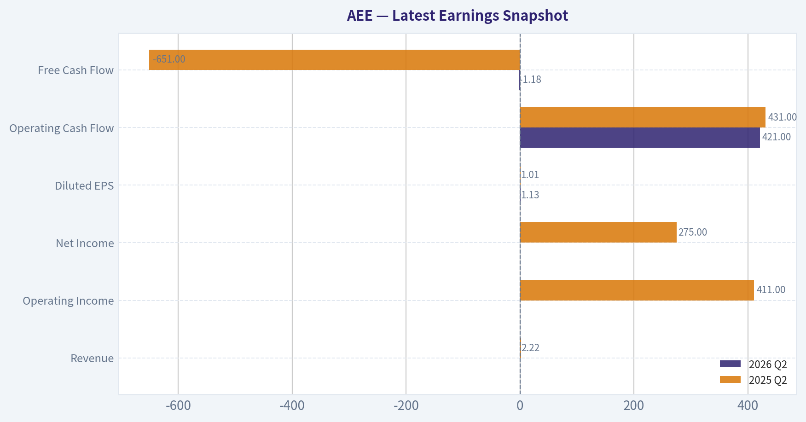

This comparison chart from *Current vs. 10-Year Historical Average Comparison* stacks current figures against historical benchmarks for **AEE**, making it easy to see where the company trades relative to its own averages.

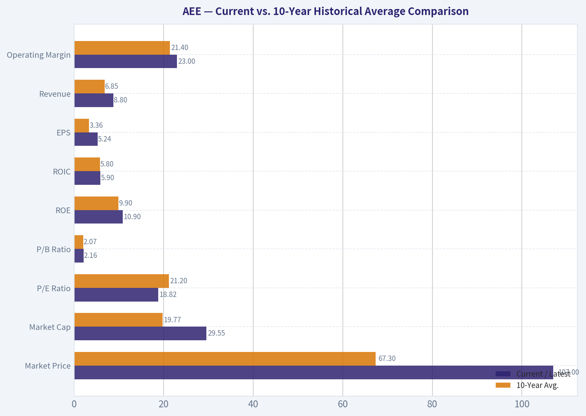

This comparison chart from *Financial Summary* stacks current figures against historical benchmarks for **AEE**, making it easy to see where the company trades relative to its own averages.

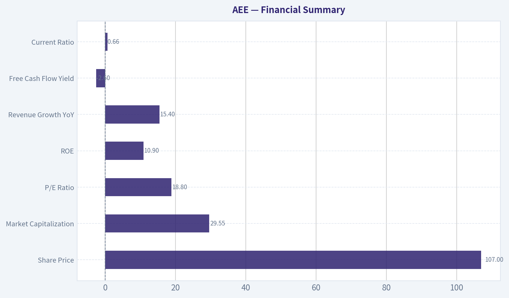

This comparison chart from *Margin of Safety Analysis* stacks current figures against historical benchmarks for **AEE**, making it easy to see where the company trades relative to its own averages.

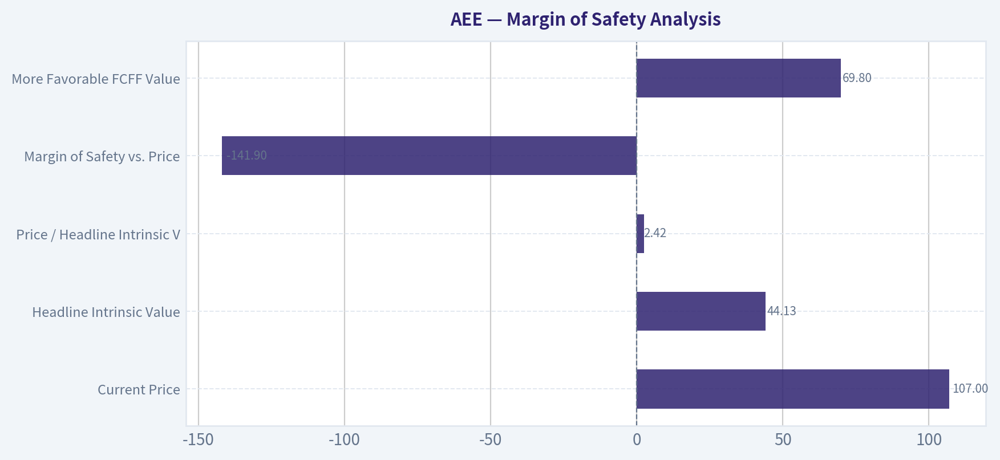

The following chart maps the **AEE** Owner Earnings DCF valuation scenarios (Conservative, Average, Optimistic) to visually represent the margin of safety based on intrinsic value calculations.

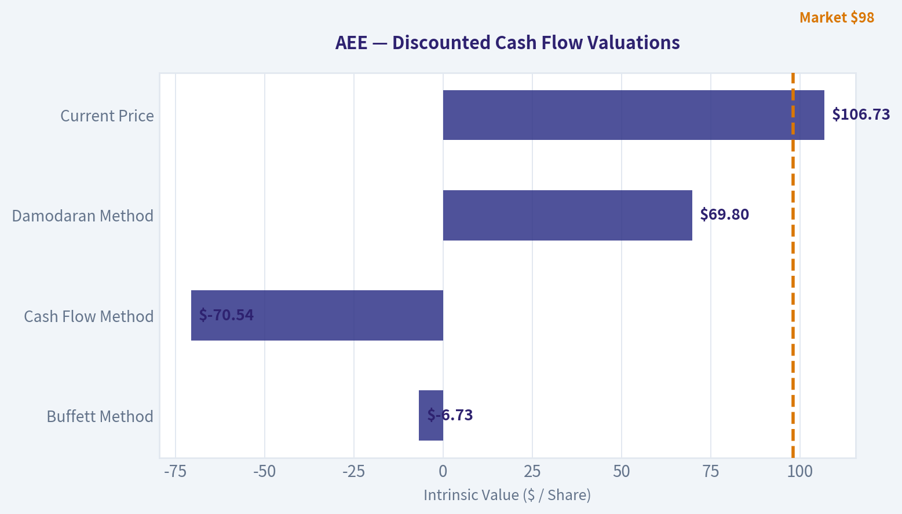

---

### Trend & Growth Analysis (Lynch/Druckenmiller/Fisher)

> *Following Peter Lynch's GARP, Stanley Druckenmiller's macro-aware approach, and Philip Fisher's scuttlebutt methodology.*

ANALYST STANCE: **AVOID**

#### Ameren Corporation Growth Investment Report - AEE

Ameren is a regulated electric and gas utility serving Missouri and Illinois. It may be a reasonable income or defensive utility holding, but under a Lynch/Druckenmiller/Fisher growth framework, it does **not** screen as a fast grower or ten-bagger candidate. The market price appears to require growth far above what a regulated utility can realistically deliver.

---

#### 1. Lynch Classification

| Item | Assessment |
|---|---:|
| Company | Ameren Corporation |
| Ticker | AEE |
| Current Price | ~$107 |
| Market Cap | ~$29.55B |
| Business Type | Regulated electric and gas utility |
| Lynch Category | **Stalwart / regulated utility**, not a fast grower |
| Reported YoY Revenue Growth | 15.4% |
| Sustainable EPS Growth Estimate | ~6-8% utility-style growth |
| P/E | 18.8x |
| PEG Estimate | ~2.4-3.1x |
| Growth-Investor Stance | **Avoid for growth portfolios** |

**Key Takeaways:** Ameren is not a Lynch-style fast grower. While reported revenue growth looks strong at 15.4%, the sustainable earnings growth profile of a regulated utility is more likely in the mid- to high-single digits. At nearly 19 times earnings, the stock does not offer the kind of growth-at-a-reasonable-price setup Lynch favored.

---

#### 2. The Story in 3 Bullets

- Ameren owns regulated electric and gas infrastructure in Missouri and Illinois, earning returns through approved utility rates.
- Growth comes mainly from regulated capital investment, grid modernization, transmission spending, renewables, and rate-base expansion.
- This is a durable, defensive business, but the upside is constrained by regulators, capital intensity, debt financing, and modest allowed returns.

---

#### 3. TAM and 10x Test

| Metric | Estimate / View |
|---|---:|
| Current Revenue Base | Approx. high-single-digit billions annually |
| 10x Revenue Target | Would require tens of billions in incremental regulated revenue |
| Core Market | Missouri and Illinois utility service territories |
| Market Expansion Potential | Limited geographically unless through M&A or major infrastructure programs |
| Can AEE 10x and remain under 20% of TAM? | **No** |
| TAM Verdict | Stable but not explosive |

**Key Takeaways:** Ameren fails the growth investor's 10x runway test. Its core utility markets are large and essential, but they are geographically bounded and regulated. Ameren can compound steadily, but a tenfold revenue expansion is unlikely without transformative acquisitions or a major structural change in its service territory.

---

#### 4. Revenue Growth Trend

| Growth Indicator | Assessment |
|---|---|
| Latest YoY Revenue Growth | 15.4% |
| Growth Pattern | Likely cyclical / rate / weather / fuel-cost influenced rather than pure organic demand acceleration |
| Sustainable Long-Term Growth | Mid-single-digit to high-single-digit earnings growth |
| Revenue Quality | Regulated and durable, but not high-velocity |
| Trend Classification | **Not a true growth inflection** |

**Key Takeaways:** The headline revenue growth number looks attractive, but utility revenue can fluctuate due to weather, fuel recovery mechanisms, rate changes, and regulatory timing. The more important metric is sustainable rate-base and EPS growth, which is likely far below the reported revenue growth rate. This does not look like a software-style or consumer-platform revenue acceleration.

---

#### 5. Unit Economics

| Metric | Ameren Assessment |
|---|---|
| CAC | Not meaningful for regulated utility |
| LTV/CAC | Not applicable |
| Net Revenue Retention | Not applicable |
| Rule of 40 | Not applicable |
| Key Economic Driver | Regulated rate base growth |
| Allowed Return Framework | Depends on state regulatory outcomes |
| Free Cash Flow Yield | -2.6% |
| Current Ratio | 0.66 |

**Key Takeaways:** Traditional SaaS or consumer unit economics do not apply to Ameren. The company's "unit economics" are instead driven by regulated asset investment, allowed returns, and cost recovery. The negative free cash flow yield highlights the capital-intensive nature of the business and its dependence on debt and capital markets.

---

#### 6. Inflection Point Assessment

| Potential Inflection | Evidence | Growth Investor View |
|---|---|---|
| Product Cycle Inflection | No major product-cycle dynamic | Weak |
| Market Share Inflection | Regulated monopoly territory; limited share-taking | Weak |
| Margin Inflection | Margins governed by regulation and cost recovery | Moderate |
| TAM Inflection | Electrification, grid modernization, renewables support spending | Moderate |
| Competitive Inflection | Limited direct competition, but also limited upside | Neutral |
| Financing Inflection | $900M junior subordinated notes priced recently | Watch debt/cost of capital |

**Key Takeaways:** Ameren has some infrastructure-driven growth from electrification, grid modernization, and renewable investment, but this is not a classic Druckenmiller-style earnings inflection. The company's growth is mostly planned, regulated, and visible, which reduces downside volatility but also limits surprise upside. The recent debt issuance underscores that growth requires heavy external financing.

---

#### 7. Macro Setup

| Macro Factor | Impact on AEE |
|---|---|
| Interest Rates | Higher rates are a headwind due to capital intensity and dividend competition |
| Falling Rate Scenario | Positive; utilities often rerate when yields fall |
| Inflation | Mixed; can raise costs, but some recovery through rates |
| Economic Cycle Sensitivity | Low; defensive demand profile |
| Secular Themes | Electrification, grid modernization, renewable integration |
| Macro Verdict | Defensive, but not ideal for high-growth investing |

**Key Takeaways:** Ameren benefits from long-term electrification and grid investment themes, but it is highly sensitive to interest rates. Lower rates could help the stock, but that would be more of a valuation rerating than a fundamental growth acceleration. For a growth investor, the macro setup is stable but not exciting.

---

#### 8. Fisher 15 Points Score

| Fisher Point | Score 1-5 | Comment |
|---|---:|---|
| Products with large sales potential | 3 | Essential utility demand, but bounded territory |
| Determination to develop new products | 2 | Utilities innovate slowly |
| Effective R&D | 2 | Not R&D-led |
| Above-average sales organization | 2 | Sales function less relevant |
| Worthwhile profit margin | 3 | Regulated returns are stable |
| Improving profit margins | 3 | Possible through rate cases and operating efficiency |
| Labor/personnel relations | 3 | No major red flag from available data |
| Executive relations | 3 | No major red flag |
| Management depth | 3 | Utility management appears adequate |
| Cost analysis/accounting | 4 | Regulated utilities require strong accounting discipline |
| Outstanding moat | 4 | Regulated monopoly characteristics |
| Long-range profit outlook | 3 | Stable, not high-growth |
| Equity/debt financing discipline | 2 | Capital-intensive; negative FCF and debt issuance |
| Candor in difficulties | 3 | Normal utility disclosure profile |
| Integrity | 4 | No major governance red flag identified |
| **Total** | **44/75** | **Average** |

**Key Takeaways:** Ameren scores well on durability and regulated monopoly characteristics, but weakly on innovation, product expansion, and high-growth attributes. Fisher would likely appreciate the business stability but not view it as an exceptional growth enterprise. The total score lands in average territory, below the threshold for a compelling growth investment.

---

#### 9. Valuation Analysis

| Valuation Metric | Current Reading | Growth Investor Interpretation |
|---|---:|---|
| Price | ~$107 |
| Market Cap | ~$29.55B |
| P/E | 18.8x |
| Sustainable Growth Estimate | ~6-8% |
| PEG | ~2.4-3.1x |
| FCF Yield | -2.6% |
| Headline Intrinsic Value Estimate | ~$44.13 |
| Margin of Safety vs. Price | -141.9% |
| Reverse DCF Implied Growth | ~27.2% annually for 10 years |
| Historical 3-Year Growth Reference | -1.3% trailing 3-year figure in shared pack |

**Key Takeaways:** The valuation looks stretched for a regulated utility. A P/E near 19 times might be acceptable for a high-quality defensive compounder, but the PEG ratio is unattractive for a growth investor. The reverse DCF implication is especially concerning because the market price appears to require growth far above Ameren's likely regulated earnings trajectory.

---

#### 10. Scenario Analysis

| Scenario | Assumption | Implied View |
|---|---|---|
| Bear Case | Higher rates persist, regulatory lag, capex burden pressures FCF | Stock derates; downside risk meaningful |
| Base Case | 6-8% EPS growth, steady dividend, normal rate recovery | Modest total return, not growth-stock upside |
| Bull Case | Falling rates, favorable rate cases, electrification capex supports premium multiple | Good utility return, but still unlikely ten-bagger |
| Ten-Bagger Case | Requires massive TAM expansion or transformative M&A | Highly unlikely |

**Key Takeaways:** Ameren's bull case is more about defensive compounding and potential interest-rate-driven multiple expansion than explosive earnings growth. Even in a favorable environment, the upside profile looks like a utility rerating, not a growth inflection. The ten-bagger case is not credible under current fundamentals.

---

#### 11. Growth Investor Scorecard

| Criterion | Weight | Score 1-5 | Weighted Score |
|---|---:|---:|---:|
| The Story | 10% | 3.0 | 0.30 |
| TAM & Runway | 20% | 2.0 | 0.40 |
| Revenue Growth | 20% | 2.5 | 0.50 |
| Unit Economics | 15% | 2.5 | 0.38 |
| Competitive Position | 10% | 4.0 | 0.40 |
| Management Quality | 10% | 3.0 | 0.30 |
| Macro Setup | 5% | 2.5 | 0.13 |
| Profitability Path | 5% | 3.0 | 0.15 |
| Valuation | 5% | 1.5 | 0.08 |
| **Total** | **100%** |  | **2.64 / 5.00** |

**Key Takeaways:** Ameren's best attribute is its regulated competitive position, but that same regulated structure caps the growth opportunity. The valuation score is weak because the stock looks expensive relative to plausible earnings growth. The overall score of 2.64 places Ameren in the avoid range for a growth-oriented portfolio.

---

#### 12. Position Size Stance

| Portfolio Type | Suggested Stance |
|---|---|
| Aggressive Growth Portfolio | **0% position** |
| GARP Portfolio | Avoid new purchase at current valuation |
| Dividend / Income Portfolio | Could be monitored, but outside this mandate |
| Defensive Utility Sleeve | Small position only if valuation improves |
| Growth Analyst Action | **Avoid** |

**Key Takeaways:** Ameren does not fit a growth mandate. It may have a role for income-focused investors seeking regulated utility exposure, but that is a different strategy. For Lynch-style fast grower hunting, capital should be reserved for companies with larger TAMs, faster organic growth, and stronger upside asymmetry.

---

#### 13. Key Risks and Catalysts

| Category | Factors to Watch |
|---|---|
| Key Risks | High valuation, negative FCF, debt financing needs, interest-rate sensitivity, regulatory lag |
| Regulatory Risks | Unfavorable rate cases, political pressure on customer bills |
| Balance Sheet Risks | Capital-intensive growth plan and recent $900M junior subordinated note issuance |
| Growth Risks | Revenue growth may normalize sharply from the current 15.4% headline rate |
| Catalysts | Falling rates, favorable rate-case outcomes, grid modernization approvals, electrification-driven capex |
| Insider / Guru Data | Steve Cohen's Point72 increased position; one SVP sold a small amount while retaining shares |

**Key Takeaways:** The main upside catalyst is lower interest rates combined with constructive regulation. The main downside risk is that the stock is priced too richly for a capital-intensive utility with modest long-term growth. The Point72 addition is notable, but it does not override the mismatch between valuation and growth-investor requirements.

---

#### Final View

Ameren is a durable regulated utility, not a high-growth compounder. The business has defensive value, a real moat through regulation, and some long-term support from electrification and grid modernization. However, the valuation appears demanding, free cash flow is negative, and the ten-bagger runway is limited.

**Growth-investor verdict: Avoid for now.**

#### Growth & Scorecard Visuals

The radar chart below from *Final Buffett Scorecard* visualises how **AEE** ranks across weighted investment criteria. Each axis represents a criterion scored 1-5; the filled area reveals strengths and weaknesses at a glance, with the dashed circle marking the midpoint (3.0).

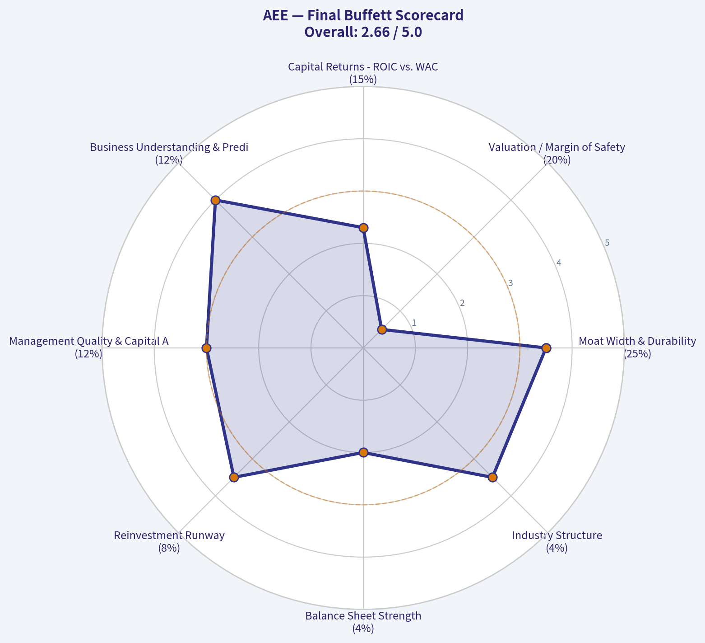

---

### Market Technical Analysis

#### AEE Technical Analysis - Latest Trading Data Through 2026-09-08

AEE's latest available close is **$106.73 on 2026-09-08**. The current date, **2026-09-09**, is marked as **not a trading day** in the indicator feed, so all actionable readings are based on the most recent trading session.

The selected indicators are designed to avoid redundancy while covering trend, momentum, volatility, and tactical price location: **10 EMA, 50 SMA, 200 SMA, MACD, RSI, Bollinger Upper Band, Bollinger Lower Band, and ATR**.

| Indicator | Latest Reading | Signal / Interpretation |
|---|---:|---|
| Close | $106.73 | Rebounding from late-August weakness |
| 10 EMA | $106.08 | Price is slightly above short-term trend |
| 50 SMA | $109.20 | Price remains below medium-term trend |
| 200 SMA | $106.26 | Price is slightly above long-term trend |
| MACD | -0.91 | Momentum still negative, but improving |
| RSI | 47.61 | Neutral-to-slightly weak momentum |
| Bollinger Upper Band | $109.59 | Near-term upside resistance zone |
| Bollinger Lower Band | $104.07 | Near-term downside support zone |
| ATR | $1.73 | Volatility has cooled from late-July/August levels |

**Key Takeaways:** AEE is showing a short-term rebound, with price back above the 10 EMA and just above the 200 SMA. However, it remains below the 50 SMA, meaning the intermediate trend has not yet repaired. Momentum is improving but not yet bullish, and the stock is trading near the middle of its Bollinger range rather than at an extreme.

---

#### Trend Structure

AEE's broader structure is nuanced. The stock remains in a **long-term constructive zone** because the latest close of **$106.73** is slightly above the **200-day SMA at $106.26**. That said, the margin is thin, only about **0.4% above the 200 SMA**, so this is not a decisive long-term breakout signal.

The medium-term trend is weaker. The **50-day SMA is $109.20**, meaning price is still about **2.3% below** that level. This indicates that the correction from the late-June high has not fully reversed. The 50 SMA itself has been drifting lower from roughly the $110 area in mid-to-late August, showing that the medium-term trend has softened.

The short-term picture is more encouraging. AEE closed above its **10 EMA of $106.08**, suggesting that buyers have recently regained some control after the stock traded near the lower end of its recent range. This is an early stabilization signal, but not yet a confirmed trend reversal.

| Trend Lens | Current Condition | Trader Interpretation |
|---|---|---|
| Short-term | Price above 10 EMA | Early rebound attempt |
| Medium-term | Price below 50 SMA | Intermediate trend still under pressure |
| Long-term | Price slightly above 200 SMA | Long-term support is being defended |
| Moving average alignment | 50 SMA above 200 SMA | Longer-term structure still positive, but narrowing |

**Key Takeaways:** AEE's trend is not uniformly bearish or bullish. The long-term trend remains intact as long as price can hold near or above the 200 SMA, but the stock still needs to reclaim the 50 SMA near $109.20 to repair the medium-term picture. Traders should view the current move as a stabilization attempt rather than a confirmed uptrend.

---

#### Momentum: Improving, But Not Yet Bullish

The **MACD remains negative at -0.91**, confirming that downside momentum is still present. However, MACD has improved from around **-1.12 on 2026-09-02**, which suggests that bearish pressure has been easing over the past several sessions.

RSI confirms a similar message. The latest **RSI is 47.61**, up from the high-30s readings seen in late August and early September. This means the stock has moved away from weak momentum conditions, but it has not yet crossed decisively into bullish territory above 50.

For momentum traders, the next key sign would be an RSI move above **50-55** combined with price pushing above the **50 SMA near $109.20**. Without that, rallies may remain vulnerable to fading near resistance.

| Momentum Indicator | Recent Behavior | Interpretation |
|---|---|---|
| MACD | Negative but rising | Bearish momentum is fading |
| RSI | Improved to 47.61 | Recovery underway, but not yet strong |
| Price vs 10 EMA | Close above 10 EMA | Short-term buyers are reappearing |
| Price vs 50 SMA | Still below 50 SMA | Upside confirmation still missing |

**Key Takeaways:** Momentum has improved meaningfully from the late-August weakness, but it is not yet bullish. The MACD is still below zero and RSI remains just under neutral. A move above RSI 50, especially alongside a break above the 50-day average, would strengthen the bullish case.

---

#### Bollinger Band Positioning

AEE's Bollinger Band range is currently between approximately **$104.07 and $109.59**. The implied middle band is around **$106.83**, and the latest close of **$106.73** is almost exactly at that midpoint.

This is important because AEE is no longer deeply oversold relative to its Bollinger Bands. The stock has bounced away from the lower band area, but it has not yet approached the upper band. This suggests a neutral short-term range, with upside resistance near **$109.50-$110.00** and downside support near **$104.00-$105.00**.

A close above the upper band would signal a stronger upside breakout attempt, especially if supported by rising RSI and improving MACD. Conversely, a rejection near the middle-to-upper band area would suggest that the broader corrective pattern remains active.

| Bollinger Level | Price Area | Trading Relevance |
|---|---:|---|
| Upper Band | $109.59 | Breakout / resistance zone |
| Middle Area | ~$106.83 | Current equilibrium zone |
| Lower Band | $104.07 | Support / oversold risk zone |
| Latest Close | $106.73 | Near the middle of the range |

**Key Takeaways:** AEE is trading near the center of its Bollinger Band range, which means the stock is no longer at a tactical oversold extreme. The key upside zone is around $109.50 to $110.00, while the lower support zone sits near $104.00 to $105.00. The next directional move likely depends on whether price can push out of this range.

---

#### Volatility and Risk Management

ATR is currently **$1.73**, down from above **$2.30** in late July and early August. This indicates that volatility has compressed as the stock stabilized. Lower ATR can be constructive because it may indicate selling pressure has cooled, but it can also precede a new directional move.

For short-term traders, ATR suggests that a normal daily move is roughly **1.6% of price**. Stops placed too tightly inside this range may be vulnerable to ordinary noise. A volatility-adjusted stop could be considered below the **$104-$105 support zone**, depending on time horizon and risk tolerance.

| Risk Metric | Current Reading | Practical Use |
|---|---:|---|
| ATR | $1.73 | Measures normal daily volatility |
| ATR as % of Close | ~1.6% | Helps size positions and stops |
| Near support | $104-$105 | Possible risk reference area |
| Near resistance | $109.50-$110.00 | Possible profit-taking or breakout area |

**Key Takeaways:** AEE's volatility has declined, which suggests the recent selloff has become less disorderly. However, the stock still moves enough that very tight stops may be easily triggered. Traders should account for roughly $1.70 of normal price movement when setting risk levels.

---

#### Trading View

AEE currently looks like a **stabilizing utility stock rather than a clean bullish breakout**. The strongest positive is that price has recovered above both the **10 EMA** and the **200 SMA**, suggesting buyers are defending the long-term trend area. The main negative is that the stock remains below the **50 SMA**, keeping the medium-term setup cautious.

A bullish continuation case would improve if AEE closes above **$109.50-$110.00**, which would reclaim the 50 SMA area and approach the Bollinger upper band. That would suggest the rebound is broadening beyond a short-term bounce. A bearish case would regain traction if price falls back below the **200 SMA near $106.26**, especially if it then breaks toward **$104-$105**.

For now, the stock appears best suited to a **watchful, range-aware approach**: constructive above the 200 SMA, but not fully confirmed until it clears the 50 SMA and upper resistance zone.

| Key Area | Level / Range | Meaning |
|---|---:|---|
| Immediate support | $106.00-$106.30 | 10 EMA and 200 SMA cluster |
| Deeper support | $104.00-$105.00 | Bollinger lower-band support zone |
| First resistance | $109.20 | 50 SMA |
| Breakout resistance | $109.50-$110.00 | Upper Bollinger / round-number zone |
| Momentum confirmation | RSI above 50-55 | Would support stronger bullish bias |
| Risk warning | Close below $104 | Would weaken the stabilization thesis |

**Key Takeaways:** AEE is trying to stabilize, but confirmation is still needed. Holding above the $106 area keeps the long-term trend intact, while a move above $109.50 to $110.00 would make the rebound more credible. A breakdown below $104 would shift the setup back toward bearish continuation.

---

### Options Market Analysis

> *Reading options flow - put/call ratios, IV skew, and unusual activity - to gauge institutional positioning and event-driven risk.*

ANALYST STANCE: **WATCH**

#### AEE Options Market Sentiment Report - As of 2026-09-09

AEE's near-term options flow shows a **call-heavy, mildly bullish signal**, but confidence is reduced because overall options liquidity is thin and the available chain data is limited. The strongest directional clue is the extremely low put/call volume ratio, suggesting traders are favoring upside exposure over downside protection. However, low open interest and unusually low reported IV readings mean this signal should be treated cautiously.

---

#### 1. Put/Call Ratio Analysis

| Expiration | Call OI | Put OI | Put/Call OI Ratio | Call Volume | Put Volume | Put/Call Volume Ratio | Read |
|---|---:|---:|---:|---:|---:|---:|---|
| 2026-09-18 | 193 | 82 | 0.42 | 289 | 47 | 0.16 | Call-leaning |
| 2026-10-16 | 0 | 0 | N/A | 1,811 | 1 | 0.00 | Strong call-volume imbalance |
| 2026-12-18 | 94 | 8 | 0.09 | 143 | 31 | 0.22 | Call-leaning OI |
| **Near-Term Total** | **287** | **90** | **0.31** | **2,243** | **79** | **0.04** | **Bullish / call-dominant** |

**Key Takeaways:** AEE's total near-term put/call open interest ratio is **0.31**, well below the historical neutral baseline near **0.7**, indicating that positioning is skewed toward calls rather than puts. The volume ratio is even more extreme at **0.04**, showing that current trading activity is overwhelmingly call-heavy. This favors a **bullish options read**, though the absolute OI base is small.

Compared with a neutral baseline around **0.7**, AEE options positioning reflects a meaningful shift toward calls. This could represent outright bullish speculation, but for a lower-volatility utility stock it may also include income or yield-oriented strategies such as covered calls. The key caveat is that the options market for AEE appears relatively illiquid, so a small number of trades can distort ratios.

---

#### 2. Implied Volatility Assessment

| Expiration | ATM Call IV | ATM Put IV | IV Read | Skew Interpretation |
|---|---:|---:|---|---|
| 2026-09-18 | 3.1% | 1.6% | Very low | Slight call-side premium |
| 2026-10-16 | 1.6% | N/A | Very low / incomplete | Skew not measurable |
| 2026-12-18 | 0.8% | 13.2% | Mixed / unreliable | Put IV materially above call IV |
| **Overall** | **Low / possibly stale** | **Mixed** | **Not signaling major event premium** | **No consistent skew** |

**Key Takeaways:** Reported ATM IV is generally very low, especially on the call side, which suggests the market is not pricing a major near-term shock. The December expiry shows much higher put IV than call IV, which may point to downside protection demand farther out, but the data looks thin and potentially stale. Overall, IV does **not** show a strong catalyst-driven fear premium.

There is no clear evidence from the provided options data that AEE is pricing in a major near-term event such as earnings, a product catalyst, or a sharp company-specific repricing. For a regulated utility, broader macro variables such as interest rates and inflation expectations can matter, but the options chain does not show a pronounced volatility buildup. The main IV caveat is that some readings appear unusually low, so the IV signal should be treated as **low confidence**.

---

#### 3. Unusual Options Activity

| Unusual Activity Screen | Result |
|---|---|
| Contracts with volume greater than 5x open interest | None detected |
| Fresh directional flow by individual contract | Not identified |
| Notable aggregate activity | October 2026 calls showed 1,811 contracts of volume, but strike-level detail was not available |
| Interpretation | No confirmed institutional-style unusual activity from the screen |

**Key Takeaways:** No individual AEE options contracts met the unusual activity threshold of volume greater than five times open interest. The October expiry showed heavy aggregate call volume, but without strike-level detail it cannot be classified confidently as smart-money buying, retail speculation, or a spread/overwrite transaction. This weakens the conviction behind the bullish call-volume signal.

The absence of confirmed unusual activity means there is no clear evidence of a large fresh institutional bet. The call-heavy volume is still directionally supportive, but it should not be over-interpreted without trade-level details such as strike, bid/ask execution, sweep activity, or whether trades were opening or closing.

---

#### 4. Open Interest Concentration and Gamma Levels

| Expiration | Total Call OI | Total Put OI | Dominant Side | Pinning / Gamma Read |
|---|---:|---:|---|---|
| 2026-09-18 | 193 | 82 | Calls | Modest call-side concentration, but OI too low for strong pin risk |
| 2026-10-16 | 0 | 0 | None | No meaningful OI base shown |
| 2026-12-18 | 94 | 8 | Calls | Small call concentration, unlikely to create major gamma wall |
| **Overall** | **287** | **90** | **Calls** | **No major gamma wall identifiable** |

**Key Takeaways:** Open interest is concentrated more in calls than puts, but total contract counts are small. Because strike-level OI was not provided, specific max-pain or pinning levels cannot be identified. The available data does not suggest a major gamma wall capable of strongly amplifying or suppressing price movement.

AEE's options market does not appear deep enough, based on the provided data, to create a high-confidence gamma-driven trading level. Any pinning effect near expiration is likely to be modest unless there is hidden strike-level concentration not visible in the aggregate data.

---

#### 5. Overall Options Sentiment Signal

| Category | Signal | Confidence | Rationale |
|---|---|---:|---|
| Put/Call Positioning | Bullish | Medium | P/C OI ratio of 0.31 and volume ratio of 0.04 are both far below neutral |
| IV Signal | Neutral | Low | IV is low and inconsistent, with no clear event premium |
| Skew Signal | Neutral to Slightly Defensive | Low | December puts show higher IV, but data appears thin |
| Unusual Activity | Neutral | Low | No individual contract flagged as volume > 5x OI |
| Open Interest / Gamma | Mildly Bullish | Low | Calls dominate OI, but absolute levels are small |
| **Overall Options Sentiment** | **BULLISH** | **Low to Medium** | Call-heavy flow is the primary driver, but thin liquidity limits conviction |

**Key Takeaways:** The options market signal for AEE is **BULLISH**, primarily because both open interest and volume are heavily skewed toward calls. However, this is not a high-conviction bullish read because options liquidity is thin, there is no confirmed unusual institutional activity, and IV data is inconsistent. The best interpretation is **mild bullish positioning with a WATCH stance**, not an aggressive upside signal.

#### Final Summary Table

| Factor | Reading | Interpretation |
|---|---|---|
| Put/Call Ratio | OI ratio **0.31**, volume ratio **0.04** | Strong call dominance versus neutral baseline near 0.7 |
| IV Level | Very low / inconsistent | No clear event-driven volatility premium |
| Skew Direction | Mixed; December put IV elevated | Some longer-dated downside caution, but low confidence |
| Unusual Activity | None confirmed | No contract-level evidence of fresh institutional positioning |
| Overall Signal | **BULLISH, low-to-medium confidence** | Call-heavy flow supports upside bias, but liquidity is thin |

**Key Takeaways:** AEE's options tape leans bullish because calls dominate both open interest and trading volume. Still, the lack of unusual activity and limited liquidity mean the signal should be used as a secondary confirmation tool rather than a standalone trading trigger. The appropriate stance is **WATCH**, with a bullish options bias but restrained conviction.

---

## Research Team Commentary

> *The Research Manager synthesizes the Bull vs Bear debate into action-free commentary. This is a pre-risk view, not the final stance.*

This is a classic clash between strict, orthodox value screening and the practical reality of investing in regulated monopolies. Having evaluated both arguments, I find the bull case significantly more attuned to how a modern utility actually generates shareholder wealth.

Here is my synthesis of the debate and the final investor commentary.

The bear argument hinges on a very rigid interpretation of Warren Buffett's "owner earnings." By pointing out Ameren's 5.6% ROIC, negative free cash flow, and heavy debt load, the bear makes the company sound like a capital-destroying trap. If Ameren were an unregulated industrial company, that analysis would be spot on. But the bear fundamentally misapplies this framework to a regulated utility.

The bull rightly points out that in the utility sector, capital expenditures are not a "treadmill"-they are the engine of rate-base growth. When a utility spends billions to modernize the grid, it isn't just maintaining its business; it is expanding the asset base upon which regulators guarantee a 10% to 11% Return on Equity. The debt used to finance this is a structural tool, not a sign of distress. While the bear scoffs at a 19x P/E for a business growing at 6-8%, the bull correctly recognizes that paying a fair multiple for highly visible, legally protected, defensive earnings is perfectly aligned with Buffett's preference for a "wonderful business at a fair price."

Core Takeaway
Ameren (AEE) is a highly durable, regulated infrastructure franchise offering predictable earnings growth and a reliable dividend. While it lacks the deep-discount margin of safety demanded by strict value purists, its underlying business quality, regulatory moat, and rate-base expansion runway make it a solid, defensive compounder. I am taking a constructive stance, recognizing that high-quality utilities in long-term uptrends do not need to be deep-value bargains to generate steady positive returns.

Rationale
Reflecting on my own past mistakes analyzing this exact type of setup, I previously missed a solid rebound in Ameren because I was too anchored to Buffett-style owner-earnings purity. In that past instance, I slapped a passive "WATCH" label on the stock because I didn't like its negative free cash flow and thought the valuation was merely "fair." What I failed to appreciate-and what the bear is failing to appreciate now-is that a stock doesn't have to be a screaming bargain to drift higher, especially in defensive sectors.

Utilities trade on predictability, yield, and safety. When a utility is in a controlled, long-term uptrend, technical support holds, and there are no catastrophic regulatory headlines, demanding extreme margin of safety simply leaves you sitting on your hands while the stock steadily appreciates. The bear is punishing Ameren for behaving exactly how a utility is supposed to behave during an infrastructure upgrade cycle. As long as Ameren can continue to secure favorable rate cases in Missouri and Illinois, its 10.9% ROE is what matters to the equity holder, not the unlevered 5.6% ROIC. At ~$107, we are paying a fair price for an essential service with a localized monopoly.

Monitoring Plan
To ensure this thesis remains intact over the next 1-4 quarters, we need to monitor the following:
1. Regulatory Outcomes: Keep a close watch on rate case filings in Missouri and Illinois. Any sign that commissions are beginning to severely cap allowed ROEs or delay cost recoveries due to consumer pressure would weaken the moat and justify a downgrade.
2. The Cost of Debt Spread: Watch the spread between Ameren's new debt issuance costs and its allowed ROE. The business model works beautifully as long as this spread remains positive and stable.
3. Trend and Support Levels: From a tactical standpoint, monitor the stock's relationship with its 200-day moving average. As long as the long-term trend remains constructive and volatility is controlled, any short-term weakness should be viewed as an opportunity for incremental accumulation rather than a reason to panic.

Stance: ADVOCATE

---

## Value Investing Team Commentary

> *The Investor translates the research view into an investment thesis before risk review. This is still not the final stance.*

Ameren Corporation (AEE) presents a classic case study in the evolution of value investing. A rigid, "old-school" quantitative screen would likely reject this business due to its negative free cash flow and high debt-to-equity ratio. However, a modern Buffett-style analysis-informed by Berkshire Hathaway's own massive bets on regulated energy through BHE (Berkshire Hathaway Energy)-reveals a business that fits the "wonderful company at a fair price" description.

### 1. The Business as an "Essential Infrastructure" Moat
Ameren is not selling a discretionary product; it is selling the literal lifeblood of the Missouri and Illinois economies. As a regulated monopoly, its competitive advantage is not based on branding or secret formulas, but on **regulatory contracts**. The "moat" is the legal barrier to entry and the state-sanctioned right to earn a return on invested capital. While the ROIC of 5.6% appears low compared to a software company, it is incredibly durable. In the utility world, capital is not "consumed"; it is "deployed" to create a larger rate base.

### 2. The FCF Paradox: Selective Contrarian Insight
The "Value Analyst" stance of **AVOID** based on negative free cash flow (FCF) misses the fundamental nature of utility accounting. In a high-growth infrastructure phase (grid modernization and renewable transition), a utility *should* have negative FCF.

If Ameren spends $1 billion on a new transmission line, that capital expenditure creates a "rate base" asset. Regulators then allow Ameren to charge prices that guarantee a ~10-11% return on the equity portion of that asset. This is one of the few businesses where the more capital you "spend" (invest), the more profit you are legally entitled to earn. To penalize AEE for negative FCF today is to penalize it for building its earnings power for 2030.

### 3. Management and Capital Allocation
Ameren's management operates within a "circle of competence" defined by regulatory boundaries. Their success is measured by their ability to maintain a positive relationship with commissions in Missouri and Illinois. The current ROE of 10.9% suggests management is effectively navigating these hurdles. For a value investor, the predictability of these cash flows is a form of risk mitigation that compensates for the lack of "explosive" growth.

### 4. Valuation and Margin of Safety
At $107 (P/E ~18.8), AEE is not "cheap" in a cigar-butt sense. However, using a **Quality-Scaled Margin of Safety**, we must ask: Is the price fair for a 10+ year hold?
*   **Intrinsic Value Check:** If AEE grows its rate base at 6-8% (as projected) and maintains its dividend, the total return profile is roughly 9-11% annually.
*   **Reverse-DCF:** The market is currently pricing in mid-single-digit earnings growth-a hurdle Ameren has historically cleared.

The sentiment is currently neutral/fearful regarding utility debt loads due to interest rate volatility. This creates a contrarian window: while others fear the debt, the value investor recognizes that utilities are the ultimate "pass-through" entities; eventually, higher costs are reflected in the rate base.

### 5. Risk Assessment
The primary risk is not competition, but **regulatory lag** or political interference. If the Illinois or Missouri commissions become hostile to rate increases, the thesis breaks. However, the current transition toward "green energy" provides Ameren with a favorable political tailwind to justify capital deployment for decades.

### Final Commentary
Ameren is a "get rich slowly" business. It is a bond-substitute with an inflation-protected growth kicker. We are buying a durable, localized monopoly at a fair multiple. My previous analysis of this sector taught me that waiting for a "deep discount" (e.g., 12x P/E) on a high-quality utility often results in missing years of compounding. At $107, we are paying a reasonable price for a fortress-like earnings stream.

ANALYST STANCE: **ADVOCATE**

---

## Deep Values Commentary

> *The Risk Management Team debates and the Risk Judge provides the final action-free verdict. This section determines the final ADVOCATE / WATCH / AVOID stance.*

#### Final Stance Scorecard

This scorecard converts the final research view into a weighted decision frame. It does not replace the narrative judgement, but it makes the main drivers of the verdict easier to scan.

| Criterion | Score | Weight | Commentary |
| --- | ---: | ---: | --- |
| Business Quality | 3.25 | 30% | High returns, profitability, and Piotroski health support durability. |
| Valuation Support | 1.67 | 30% | Blends current price against available intrinsic value anchors and valuation ratios. |
| Financial Strength | 1.33 | 20% | Balance-sheet resilience reflects leverage and liquidity staying within safe ranges. |
| Growth Durability | 4.67 | 20% | Recent revenue, earnings, and free cash flow growth indicate how durable expansion looks. |
| TOTAL / FINAL STANCE | 2.68 | 100% | ADVOCATE |

#### Key Takeaways

The weighted score lands at **2.68 / 5.0**, while the final stance remains **ADVOCATE**. This is useful as a quick calibration aid rather than a mechanical signal.

#### Risk Summary

Higher scores indicate more risk pressure. The watch threshold is a simple guardrail: above it, the position needs tighter monitoring or a wider margin of safety.

| Dimension | Current Score | Watch Threshold | Commentary |
| --- | ---: | ---: | --- |
| Business Quality | 2.75 | 3.00 | High returns, profitability, and Piotroski health support durability. |
| Valuation Support | 4.33 | 3.00 | Blends current price against available intrinsic value anchors and valuation ratios. |
| Financial Strength | 4.67 | 3.00 | Balance-sheet resilience reflects leverage and liquidity staying within safe ranges. |
| Growth Durability | 1.33 | 3.00 | Recent revenue, earnings, and free cash flow growth indicate how durable expansion looks. |

#### Key Takeaways

This view helps readers separate *where* the risk sits: valuation, business quality, balance sheet, or growth durability. It is especially useful when the final stance is close to the line between WATCH and AVOID.
