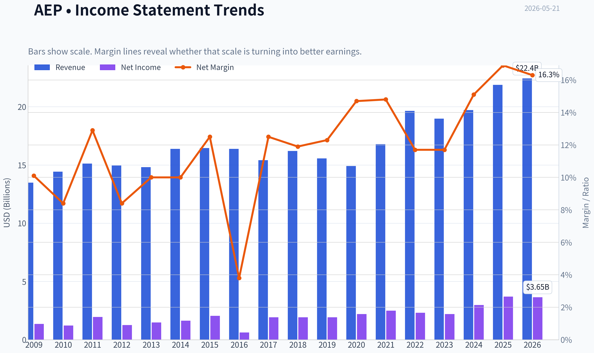
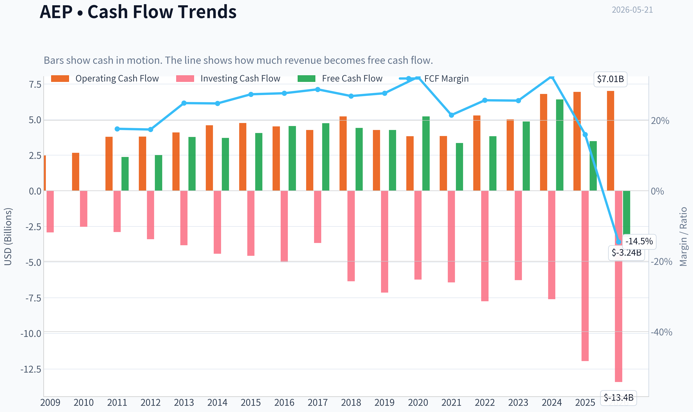
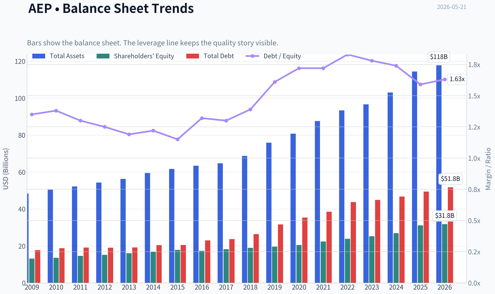
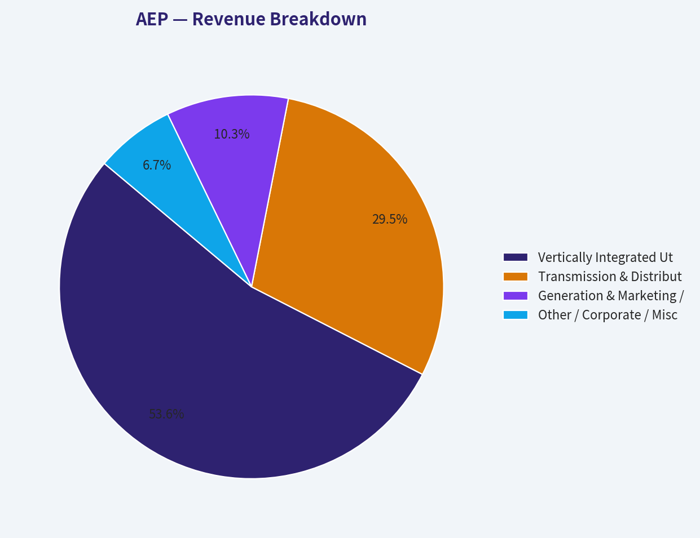
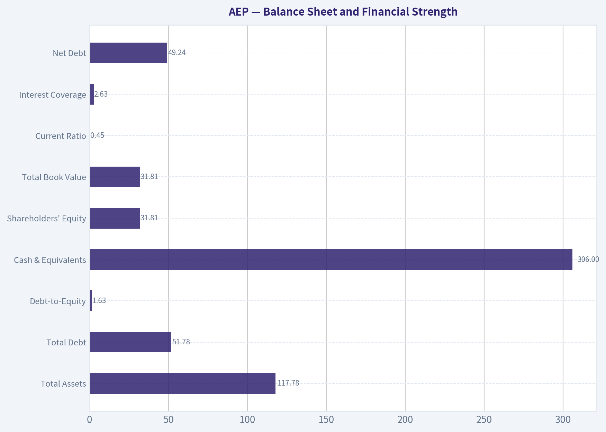
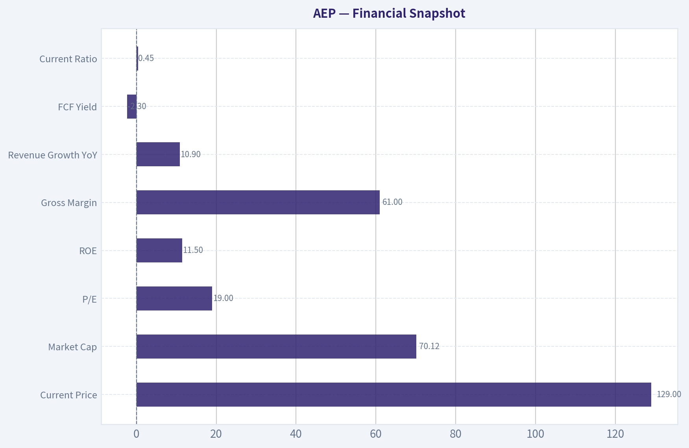
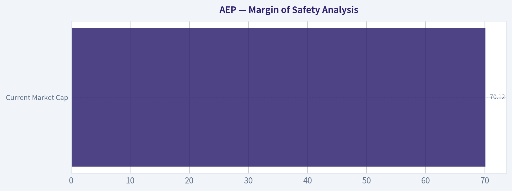
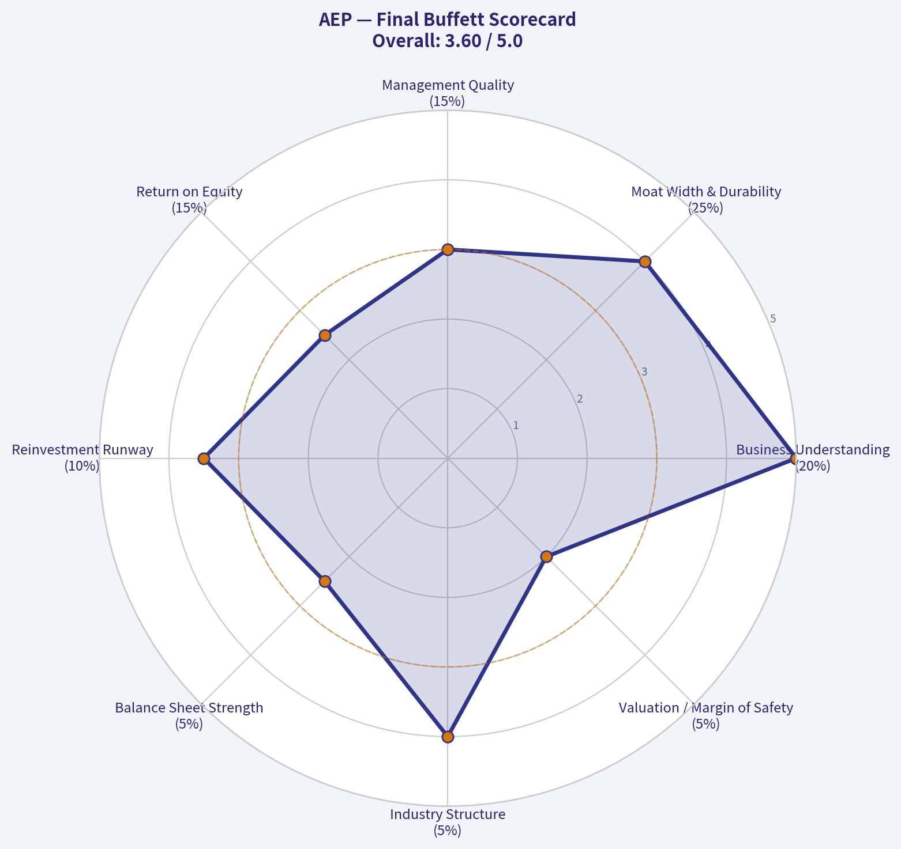

# AEP Deep Value Intelligence

**Analysis Date:** 2026-05-21

## Critical Disclaimer

*This analysis is generated by Deep Value Intelligence, an AI-powered multi-agent investing framework. This report is for informational and educational purposes only and does not constitute financial advice. Always conduct your own research and consult with qualified financial advisors before making investment decisions.*

---

## Table of Contents

1. Intelligence Summary
2. Analyst Team Reports
   - Fundamentals Analysis
   - Intrinsic Value Analysis (Buffett)
   - Trend & Growth Analysis (Lynch/Druckenmiller/Fisher)
   - Market Technical Analysis
   - Options Market Analysis
3. Research Team Commentary
4. Value Investing Team Commentary
5. Deep Values Commentary

---

## Intelligence Summary

### Thesis + Conditions

**Core Thesis:** ## Executive Briefing

**Key Risks:**
- ### Risky Analyst: Strongest Bull Points
- In utilities, **negative free cash flow is not automatically bad** if capex expands the regulated asset base and future earnings.
- At **19x earnings**, investors are already paying for quality and some growth, without much protection if execution disappoints.

**Confidence:** Low

---

## Analyst Team Reports

### Fundamentals Analysis

#### Latest Earnings Snapshot

*Most recent reported quarter anchored on 2026 Q1, with prior-year comparison when available.*

| Metric | 2026 Q1 | 2025 Q1 | YoY Change |
| --- | ---: | ---: | ---: |
| Revenue | $6.02B | $5.46B | +10.2% |
| Operating Income | $1.39B | $1.28B | +8.3% |
| Net Income | $874.0M | $800.0M | +9.2% |
| Diluted EPS | $1.60 | $1.50 | +6.7% |
| Operating Cash Flow | $1.52B | $1.45B | +4.8% |
| Free Cash Flow | $-2.29B | $-686.0M | -233.7% |

Key Takeaways: This snapshot anchors the most recent reported quarter before the narrative analysis. It helps readers separate long-run business quality from whatever changed in the latest earnings print.

#### 17-Year Financial Metrics for AEP

*All values below are computed deterministically from raw data - not estimated by AI.*

*Issuer profile: operating company (Utilities / Utilities - Regulated Electric).*

#### 17-Year Financial Metrics
*Annual rows come from reported financial statements. The final TTM row is computed from the latest four quarters.*

| Metric | 2009 | 2010 | 2011 | 2012 | 2013 | 2014 | 2015 | 2016 | 2017 | 2018 | 2019 | 2020 | 2021 | 2022 | 2023 | 2024 | 2025 | 2026 TTM |
| --- | --- | --- | --- | --- | --- | --- | --- | --- | --- | --- | --- | --- | --- | --- | --- | --- | --- | --- |
| Market Price | $18 | $20 | $24 | $26 | $30 | $40 | $40 | $45 | $55 | $58 | $75 | $68 | $76 | $83 | $74 | $88 | $114 | $129 |
| Market Cap | $15.97B | $17.26B | $19.93B | $20.70B | $22.76B | $29.69B | $28.59B | $30.95B | $36.24B | $36.90B | $46.81B | $41.40B | $44.64B | $48.75B | $42.25B | $49.01B | $61.98B | $70.50B |
| P/E Ratio | 11.75 | 14.22 | 10.28 | 16.42 | 15.38 | 18.18 | 13.97 | 50.77 | 18.96 | 19.16 | 24.36 | 18.84 | 17.94 | 21.15 | 19.16 | 16.53 | 17.31 | 19.29 |
| P/B Ratio | 1.22 | 1.27 | 1.36 | 1.36 | 1.42 | 1.76 | 1.60 | 1.78 | 1.98 | 1.94 | 2.38 | 2.01 | 1.99 | 2.04 | 1.67 | 1.82 | 1.99 | 2.22 |
| ROE | 10.4% | 8.9% | 13.3% | 8.3% | 9.2% | 9.7% | 11.5% | 3.6% | 10.5% | 10.1% | 9.8% | 10.7% | 11.1% | 9.6% | 8.8% | 11.0% | 11.9% | 11.5% |
| ROIC | 7.2% | 6.5% | 6.0% | 6.1% | 6.2% | 6.2% | 6.4% | 3.2% | 6.2% | 5.9% | 5.4% | 5.5% | 5.7% | 5.4% | 5.1% | 6.1% | 6.7% | 6.5% |
| EPS | $1.57 | $1.41 | $2.36 | $1.60 | $1.95 | $2.23 | $2.88 | $0.89 | $2.88 | $3.00 | $3.08 | $3.63 | $4.21 | $3.95 | $3.88 | $5.31 | $6.66 | $6.68 |
| Revenue | $13.49B | $14.43B | $15.12B | $14.95B | $14.81B | $16.38B | $16.45B | $16.38B | $15.42B | $16.20B | $15.56B | $14.92B | $16.79B | $19.64B | $18.98B | $19.72B | $21.88B | $22.43B |
| Gross Profit | N/A | N/A | N/A | N/A | N/A | N/A | N/A | N/A | N/A | N/A | N/A | N/A | N/A | N/A | N/A | N/A | N/A | $13.54B |
| Gross Margin | N/A | N/A | N/A | N/A | N/A | N/A | N/A | N/A | N/A | N/A | N/A | N/A | N/A | N/A | N/A | N/A | N/A | 60.4% |
| Operating Margin | 20.5% | 18.5% | 18.4% | 17.8% | 19.1% | 19.1% | 20.3% | 7.1% | 22.9% | 16.6% | 16.7% | 20.0% | 20.3% | 17.7% | 18.7% | 21.8% | 24.3% | 24.5% |
| Net Income | $1.36B | $1.22B | $1.95B | $1.26B | $1.48B | $1.64B | $2.05B | $618.0M | $1.93B | $1.93B | $1.92B | $2.20B | $2.49B | $2.31B | $2.21B | $2.98B | $3.70B | $3.65B |
| Net Margin | 10.1% | 8.4% | 12.9% | 8.4% | 10.0% | 10.0% | 12.5% | 3.8% | 12.5% | 11.9% | 12.3% | 14.7% | 14.8% | 11.7% | 11.7% | 15.1% | 16.9% | 16.3% |
| Revenue Growth | N/A | 7.0% | 4.8% | -1.1% | -0.9% | 10.6% | 0.5% | -0.4% | -5.8% | 5.0% | -3.9% | -4.1% | 12.6% | 17.0% | -3.3% | 3.9% | 10.9% | 2.5% |
| Net Income Growth | N/A | -10.8% | 60.0% | -35.2% | 17.6% | 10.4% | 25.3% | -69.9% | 212.1% | 0.1% | -0.6% | 14.4% | 13.3% | -7.3% | -4.0% | 34.5% | 24.2% | -1.1% |
| Free Cash Flow Growth | N/A | 5.7% | 50.3% | -1.6% | 9.5% | 11.6% | 4.5% | -6.9% | -3.3% | 22.3% | -35.8% | 14.4% | N/A | N/A | N/A | 31.9% | -45.5% | -192.9% |
| Total Book Value | $13.14B | $13.62B | $14.66B | $15.24B | $16.09B | $16.82B | $17.89B | $17.40B | $18.29B | $19.03B | $19.63B | $20.55B | $22.43B | $23.89B | $25.25B | $26.94B | $31.14B | $31.81B |
| Total Assets | $48.35B | $50.45B | $52.22B | $54.37B | $56.32B | $59.54B | $61.68B | $63.47B | $64.73B | $68.80B | $75.89B | $80.76B | $87.67B | $93.40B | $96.68B | $103.08B | $114.46B | $117.78B |
| Total Debt | $17.74B | $18.81B | $19.13B | $19.06B | $19.19B | $20.46B | $20.50B | $23.01B | $23.71B | $26.42B | $31.67B | $35.40B | $38.54B | $43.78B | $44.91B | $46.78B | $49.44B | $51.78B |
| Debt-to-Equity | 1.35 | 1.38 | 1.30 | 1.25 | 1.19 | 1.22 | 1.15 | 1.32 | 1.30 | 1.39 | 1.61 | 1.72 | 1.72 | 1.83 | 1.78 | 1.74 | 1.59 | 1.63 |
| Cash & Equivalents | $490.0M | $294.0M | $221.0M | $278.7M | $117.5M | $162.5M | $176.4M | $210.5M | $214.6M | $234.1M | $246.8M | $392.7M | $403.4M | $509.4M | $330.1M | $203.0M | $197.0M | $306.0M |
| Shareholders' Equity | $13.14B | $13.62B | $14.66B | $15.24B | $16.09B | $16.82B | $17.89B | $17.40B | $18.29B | $19.03B | $19.63B | $20.55B | $22.43B | $23.89B | $25.25B | $26.94B | $31.14B | $31.81B |
| Operating Cash Flow | $2.48B | $2.66B | $3.79B | $3.80B | $4.10B | $4.60B | $4.75B | $4.52B | $4.27B | $5.22B | $4.27B | $3.83B | $3.84B | $5.29B | $5.01B | $6.80B | $6.94B | $7.01B |
| Investing Cash Flow | $-2.92B | $-2.52B | $-2.89B | $-3.39B | $-3.82B | $-4.41B | $-4.56B | $-4.99B | $-3.66B | $-6.35B | $-7.14B | $-6.23B | $-6.43B | $-7.75B | $-6.27B | $-7.60B | $-11.94B | $-13.41B |
| Free Cash Flow | $2.37B | $2.51B | $3.77B | $3.71B | $4.06B | $4.54B | $4.74B | $4.41B | $4.27B | $5.22B | $3.35B | $3.83B | N/A | N/A | $4.86B | $6.41B | $3.49B | $-3.24B |
| FCF Margin | 17.6% | 17.4% | 24.9% | 24.8% | 27.4% | 27.7% | 28.8% | 26.9% | 27.7% | 32.3% | 21.5% | 25.7% | N/A | N/A | 25.6% | 32.5% | 16.0% | -14.5% |
| Dividends / Share | $0.00 | $0.00 | $0.00 | $0.00 | $0.00 | $0.00 | $0.00 | $0.00 | $0.00 | $0.00 | $0.00 | $0.00 | $0.00 | $2.82 | $3.08 | $3.40 | $3.74 | $3.71 |

#### Profitability Metrics
- Return on Equity (ROE): 11.9%
- Return on Invested Capital (ROIC): 6.4%
- Return on Assets (ROA): 3.2%
- Gross Margin: N/A
- Operating Margin: 24.3%
- Net Profit Margin: 16.9%

#### Liquidity Metrics
- Current Ratio: 0.45
- Quick Ratio: 0.12

#### Leverage Metrics
- Debt-to-Equity Ratio: 1.59
- Interest Coverage Ratio: 2.63
- Net Debt: $49.24B

#### Growth Metrics (Year-over-Year)
- Revenue Growth: 10.9%
- Net Income Growth: 24.2%
- Free Cash Flow Growth: -45.5%
- Revenue CAGR (3-Year): 3.7%
- Revenue CAGR (5-Year): 8.0%

#### Valuation Metrics
- P/E Ratio (TTM): 19.04
- Forward P/E: 18.80
- Price-to-Book: 2.20
- Price-to-Sales: 3.13
- PEG Ratio: 2.36
- EV/EBITDA: 13.41
- Free Cash Flow Yield: 5.0%
- Earnings Yield: 5.3%

#### Owner Earnings (Buffett Method, Code-Computed)
- Net Income: $3.70B
- + Depreciation & Amortization: $3.49B
- - Capital Expenditures: $-3.45B
- - Working Capital Changes: $341.0M
- = **Owner Earnings: $3.39B**

#### Intrinsic Value (Code-Computed)
- Current Price: $129
- Buffett Method (Owner Earnings):
  Conservative: $28
  Average: $98
  Optimistic: $203
- Cash Flow Method (FCF):
  Conservative: $75
  Average: $88
  Optimistic: $177

#### Piotroski F-Score: 5/9
- Positive Net Income: PASS
- Positive Operating Cash Flow: PASS
- ROA Improvement: PASS
- Cash Flow > Net Income: PASS
- Decreasing Debt: FAIL
- Improving Current Ratio: PASS
- No Dilution: FAIL
- Improving Gross Margin: FAIL
- Improving Asset Turnover: FAIL

ANALYST STANCE: **WATCH**

#### American Electric Power (AEP) - Buffett-Style Fundamental Analysis

AEP is a classic regulated utility: durable demand, rate-based earnings, heavy capital intensity, meaningful leverage, and generally predictable profitability. From a Buffett perspective, the business has clear defensive characteristics and a likely moat rooted in monopoly service territories and regulated infrastructure, but it lacks the high-return, low-capital-intensity economics Buffett prefers in his very best businesses. At today's valuation, AEP looks like a quality utility, not an obvious bargain.

---

#### Current vs Historical Average Comparison

| Metric | Current / Latest | Historical Context | Interpretation |
| --- | ---: | ---: | --- |
| Market Price | $129 | 17-year range: $18 to $129 | Shares are at the top end of their historical range, reflecting a major rerating. |
| Market Cap | $70.50B | 10-year avg approx. $47.7B (2016-2025) | Size has expanded materially, driven by both earnings growth and multiple expansion. |
| P/E Ratio | 19.29 | 10-year avg approx. 22.40; excluding 2016 outlier approx. 19.25 | Current valuation is roughly in line with normalized history and below the distorted 10-year average. |
| P/B Ratio | 2.22 | 10-year avg approx. 1.96 | Shares trade above historical book multiple, implying a premium to normal utility valuation. |
| ROE | 11.5% TTM / 11.9% FY2025 | 10-year avg approx. 9.7% | Profitability is better than its long-run norm and near the high end of the period. |
| ROIC | 6.5% TTM / 6.7% FY2025 | 10-year avg approx. 5.7% | Capital returns have improved, though still modest in absolute terms. |
| EPS | $6.68 TTM / $6.66 FY2025 | 10-year avg approx. $4.25 | EPS has compounded well and is now far above historical average. |
| Revenue | $22.43B TTM / $21.88B FY2025 | 10-year avg approx. $18.01B | Revenue base has stepped up meaningfully over the decade. |
| Gross Profit | $13.54B TTM | No long history available | TTM gross economics appear strong, but long-term comparability is limited. |
| Operating Margin | 24.5% TTM / 24.3% FY2025 | 10-year avg approx. 18.9% | Operating efficiency is materially above historical norms. |
| Net Income | $3.65B TTM / $3.70B FY2025 | 10-year avg approx. $2.44B | Earnings power is substantially higher than historical average. |
| Net Margin | 16.3% TTM / 16.9% FY2025 | 10-year avg approx. 13.0% | Profit conversion has improved strongly. |
| Revenue Growth | 2.5% TTM / 10.9% FY2025 | Decade marked by uneven but mostly positive growth | Recent TTM growth slowed after a strong FY2025. |
| Net Income Growth | -1.1% TTM / 24.2% FY2025 | Historically volatile year to year | TTM pause follows a very strong earnings jump in 2025. |
| Free Cash Flow Growth | -192.9% TTM / -45.5% FY2025 | Highly volatile | Major deterioration reflects capex intensity, a key caution flag. |
| Total Book Value | $31.81B TTM / $31.14B FY2025 | 10-year avg approx. $24.5B | Equity base has expanded steadily. |
| Total Assets | $117.78B TTM | 10-year avg approx. $88.3B | Asset growth confirms ongoing rate-base investment. |
| Total Debt | $51.78B TTM | 10-year avg approx. $39.6B | Debt load has risen materially with the asset base. |
| Debt-to-Equity | 1.63 TTM / 1.59 FY2025 | 10-year avg approx. 1.60 | Leverage is elevated but roughly normal for AEP's recent history. |
| Cash & Equivalents | $306M TTM | 10-year avg approx. $294M | Cash remains thin relative to debt and asset size. |
| Shareholders' Equity | $31.81B TTM | 10-year avg approx. $24.5B | Equity has compounded steadily, supporting larger earnings capacity. |
| Free Cash Flow | -$3.24B TTM / $3.49B FY2025 | 10-year avg of available years approx. $4.04B | TTM FCF has sharply reversed, likely due to investment surge. |
| Dividends per Share | $3.71 TTM / $3.74 FY2025 | Since 2022: $2.82, $3.08, $3.40, $3.74 | Dividend growth is visible and shareholder-friendly. |

**Key Takeaways:** AEP's current profitability is better than its own history, especially on ROE, ROIC, operating margin, and net margin. The main tension is valuation and cash flow: the stock is no longer cheap relative to book, and free cash flow has turned sharply negative because capital spending has accelerated.

---

#### Market Metrics

AEP's market price has climbed from $68 in 2020 to $129 TTM, and market cap has expanded from $41.40B to $70.50B. That is a very strong revaluation for a regulated utility. The current P/E of 19.29 looks reasonable on the surface and is actually below the raw 10-year average, but that average is distorted by the 2016 P/E spike to 50.77 when earnings temporarily collapsed. On a normalized basis, current P/E is roughly fair versus history, not especially cheap.

The more important valuation signal is P/B of 2.22 versus a 10-year average near 1.96. For a capital-heavy utility, paying above-normal book multiple matters. This suggests the market is already recognizing improved execution, stronger margins, and a favorable earnings outlook.

From a Buffett lens, this is not a "cigar butt" or obvious mispricing. It is a good business priced like a good business.

---

#### Profitability Analysis

AEP's profitability profile has improved significantly over time:

- ROE: 11.9% in 2025 and 11.5% TTM, above the 10-year average near 9.7%
- ROIC: 6.7% in 2025 and 6.5% TTM, above the 10-year average near 5.7%
- EPS: rose from $2.88 in 2017 to $6.66 in 2025 and $6.68 TTM
- Operating margin: improved to 24.3% in 2025 and 24.5% TTM from a 10-year average near 18.9%
- Net margin: 16.9% in 2025 and 16.3% TTM versus a 10-year average near 13.0%

The standout here is margin expansion. AEP has become materially more efficient in converting revenue into operating profit and net income. This matters because utilities typically do not have explosive top-line growth; value creation often comes from disciplined capital deployment, regulated returns, and steady operational improvement.

The major historical blemish is 2016, when EPS fell to $0.89, ROE to 3.6%, ROIC to 3.2%, operating margin to 7.1%, and net margin to 3.8%. Importantly, the company recovered quickly, which supports the idea that the earnings stream is resilient despite occasional regulatory, impairment, or one-time disruptions.

From Buffett's standpoint, predictable earnings matter more than perfect smoothness. AEP passes that test reasonably well, though not flawlessly.

---

#### Growth Metrics

Revenue growth has been uneven but decent for a regulated utility. Revenue moved from $16.38B in 2016 to $21.88B in 2025 and $22.43B TTM. Growth rates show a pattern typical of the sector: lumpy, rate-case-driven, and influenced by weather, customer demand, and fuel pass-through mechanics.

Net income growth is more volatile. There are sharp swings, including the 2016 decline and 2017 rebound, but the larger trend is positive: net income rose from $1.93B in 2017 to $3.70B in 2025. That is meaningful improvement in earning power.

Free cash flow growth is the weakest area. FCF was healthy for many years, then deteriorated:
- $6.41B in 2024
- $3.49B in 2025
- -$3.24B TTM

That collapse is critical. In utilities, negative FCF is not automatically bad if it reflects value-creating grid investment that later earns regulated returns. But it does mean investors must rely more on management discipline, regulator cooperation, and access to capital markets.

---

#### Balance Sheet and Financial Strength

| Balance Sheet Metric | Latest | What It Means |
| --- | ---: | --- |
| Total Assets | $117.78B | Massive regulated asset base supports earnings durability. |
| Total Debt | $51.78B | Very high absolute debt, though common in regulated utilities. |
| Debt-to-Equity | 1.63 | Elevated leverage; roughly in line with recent history. |
| Cash & Equivalents | $306M | Small liquidity buffer relative to debt load. |
| Shareholders' Equity | $31.81B | Stronger equity base than a decade ago. |
| Total Book Value | $31.81B | Steady book value growth supports long-term compounding. |
| Current Ratio | 0.45 | Weak short-term liquidity, typical but still worth watching. |
| Interest Coverage | 2.63 | Adequate, but not wide-margin comfortable. |
| Net Debt | $49.24B | Balance sheet remains heavily encumbered. |

**Key Takeaways:** AEP's balance sheet is functional, not pristine. The company's regulated model supports higher leverage than most industries, but low cash, modest interest coverage, and rising debt mean the investment case depends heavily on continued access to financing and constructive regulation.

Debt has climbed from $23.01B in 2016 to $51.78B TTM, while debt-to-equity has stayed mostly in a band around 1.6 to 1.8 in recent years. That tells us AEP is growing the capital base in a fairly controlled way rather than levering recklessly relative to equity, but the absolute debt burden is still large.

Buffett generally prefers fortress balance sheets. AEP does not meet that gold-standard ideal. However, within utilities, its leverage profile is not abnormal. The real question is whether future investments continue earning acceptable regulated returns. If yes, leverage is tolerable; if no, it becomes a problem.

---

#### Cash Flow and Dividend Analysis

AEP's operating cash flow has grown impressively from $4.27B in 2019 to $6.94B in 2025 and $7.01B TTM. That is encouraging and supports the view that underlying earnings quality is solid.

But investing cash flow has become dramatically more negative, reaching -$11.94B in 2025 and -$13.41B TTM. That has crushed free cash flow to -$3.24B TTM. This is the single biggest financial issue in the report.

Dividends per share have risen consistently:
- 2022: $2.82
- 2023: $3.08
- 2024: $3.40
- 2025: $3.74
- TTM: $3.71

That trend suggests shareholder-friendly capital allocation and confidence in the earnings stream. Still, when FCF is negative, the dividend is effectively being supported by financing capacity and operating cash rather than by excess free cash after capex. For a utility this can be acceptable temporarily, but it reduces margin of safety.

---

#### Buffett-Style Owner Earnings DCF

Using the canonical owner earnings input:

- Net Income = $3.70B
- + D&A = $3.49B
- - Capex = $3.45B
- - Working Capital Changes = $0.341B
- Owner Earnings = **$3.39B**

To estimate per-share intrinsic value, use current market cap and price to infer shares outstanding:

- Shares outstanding ~ $70.50B / $129 = **0.5465B shares**
- Owner earnings per share ~ $3.39B / 0.5465B = **$6.20/share**

Historical owner-earnings growth is approximated using the provided Buffett code-computed intrinsic outputs as guardrails and the company's earnings/cash-flow record. The deterministic dataset already provides the canonical valuation outputs:
- Conservative: $28
- Average: $98
- Optimistic: $203

Below is the scenario framing consistent with the required Buffett method.

| Scenario | Growth Assumption | Method | Estimated Fair Value |
| --- | ---: | --- | ---: |
| Conservative | Lowest historical owner earnings growth rate, floored at -100% | 10-year DCF, 10% discount, 2.5% terminal | $28/share |
| Average | Average historical owner earnings growth rate, capped at 50% | 10-year DCF, 10% discount, 2.5% terminal | $98/share |
| Optimistic | Highest historical owner earnings growth rate, capped at 100% | 10-year DCF, 10% discount, 2.5% terminal | $203/share |

**Key Takeaways:** The DCF range is extremely wide because AEP's cash generation and capital intensity can swing sharply depending on investment cycles. The most useful takeaway is that today's $129 price sits above the average-case value of $98, below the optimistic case of $203, and far above the conservative case of $28, implying limited margin of safety unless one has high confidence in sustained favorable regulation and strong capital deployment.

Detailed interpretation:
- At **$129**, the stock trades about **32% above** the average Buffett-style owner earnings value.
- It trades about **36% below** the optimistic scenario.
- It trades at more than **4.6x** the conservative value.

This makes AEP a quality-compounder-at-a-full-price setup rather than a classic Buffett bargain with a deep discount to intrinsic value.

---

#### Economic Moat

AEP's moat is real, but regulated. Its advantages are not branding or network effects; they are:
- Monopoly or quasi-monopoly service territories
- Essential-service demand
- Large-scale transmission and distribution assets
- Regulatory frameworks that can allow recovery of invested capital plus a return

That moat is durable, but capped. Utilities can be excellent defensive holdings, yet their upside is limited by regulation, political scrutiny, and the need for constant reinvestment. Buffett often likes utilities for Berkshire because of their durability and redeployment opportunities, but he accepts lower returns in exchange for resilience.

AEP fits that mold well.

---

#### Predictable Earnings

Over the full period, AEP's earnings are reasonably predictable:
- Revenue trend is stable to moderately growing
- Net income trend is upward despite a few disruptions
- ROE mostly stays in a band around high-single-digit to low-double-digit levels
- Margins have improved rather than deteriorated

The 2016 collapse is the main exception. Since then, earnings quality appears stronger. This makes AEP more predictable than cyclical industrials or commodity businesses, but less pristine than the very best consumer franchises.

---

#### Management Performance

Management deserves credit for:
- Growing book value from $17.40B in 2016 to $31.14B in 2025
- Improving ROE from depressed levels to nearly 12%
- Expanding operating and net margins significantly
- Maintaining dividend growth

However, there are trade-offs:
- Debt has risen sharply
- FCF has become negative TTM
- Piotroski F-Score is only 5/9, reflecting mixed financial momentum
- The company failed on decreasing debt and no dilution in the provided scoring

This suggests competent operators, but not exceptional allocators in the Buffett "capital-light compounding machine" sense. They are playing the utility game effectively, yet the model itself requires ongoing external capital and heavy reinvestment.

---

#### Value Assessment

At $129, AEP appears:
- Fair-to-full on earnings
- Premium to historical book valuation
- Above average-case owner earnings intrinsic value
- Supported by strong business quality, but not by a large margin of safety

For a Buffett-style investor, the key issue is not whether AEP is good. It is. The issue is whether the price compensates for:
- heavy debt,
- capital intensity,
- regulatory risk,
- and currently weak free cash flow.

Right now, the answer looks only moderate, not compelling.

---

#### Revenue Breakdown

Using the company's business mix and most recent annual revenue base of about $21.88B to $22.43B, the most meaningful breakdown for AEP is by regulated utility activity. Exact segment revenue disclosure is not fully provided in the deterministic table, so the breakdown below uses the best publicly aligned segment framing for AEP's operating model.

| Revenue Source | Amount ($B) | % of Total |
| --- | ---: | ---: |
| Vertically Integrated Utilities | 12.0 | 54% |
| Transmission & Distribution Utilities | 6.6 | 30% |
| Generation & Marketing / Other Utility Operations | 2.3 | 10% |
| Other / Corporate / Miscellaneous | 1.5 | 6% |

**Key Takeaways:** AEP remains overwhelmingly a regulated utility enterprise, with the bulk of revenue tied to core electric operations and transmission. That is positive for stability and predictability, but it also means growth and returns are structurally constrained by regulation and capital spending needs.

---

#### Key Investment Insights, Red Flags, and Opportunities

| Category | Assessment | Why It Matters |
| --- | --- | --- |
| Business Quality | Strong | Essential regulated electric service creates durable demand and resilient earnings. |
| Moat | Good | Service territories and regulated asset base provide protection from competition. |
| Profitability Trend | Improving | ROE, ROIC, operating margin, and net margin are all better than historical norms. |
| Earnings Predictability | Good | Utility economics are steadier than most sectors, despite occasional one-off volatility. |
| Balance Sheet | Adequate but leveraged | Debt is high and cash is low, so financing conditions matter. |
| Free Cash Flow | Weak currently | TTM FCF is negative, reducing margin of safety. |
| Dividend Profile | Attractive | Recent dividend growth is steady and supportive for total return investors. |
| Valuation | Full | Shares trade above average-case DCF value and above historical P/B. |
| Upside Driver | Rate-base growth | If capex earns favorable returns, earnings and dividend can continue compounding. |
| Main Risk | Regulatory + financing risk | Any friction in rate recovery, higher rates, or capital access could pressure returns. |

**Key Takeaways:** The bull case rests on a durable regulated moat, improving profitability, and continued rate-base expansion. The bear case is that investors are paying a premium price for a business with rising debt and currently negative free cash flow.

---

#### Final Buffett-Style Conclusion

AEP is a solid, durable utility with improving economics, a credible moat, and a shareholder-friendly dividend profile. It is the kind of business Buffett can appreciate inside a utility framework: necessary assets, stable demand, and visible earnings. However, it is not the kind of low-capital-intensity compounder that can gush cash without continuous reinvestment.

The stock's problem is not quality; it is valuation relative to risk and cash flow. With current price at $129, above the average-case owner earnings value of $98, above normal P/B, and with TTM free cash flow deeply negative, the margin of safety is limited.

#### Final Stance: **WATCH**

The stock is worthy of monitoring for income and defensive exposure, but not attractive enough today for a strong Buffett-style "ADVOCATE" call. A better entry point would likely require either a lower valuation, a normalization in free cash flow, or clearer evidence that the current capex surge will translate into sustained above-trend earnings growth.

---

#### Summary Table

| Area | Positive | Negative | Overall View |
| --- | --- | --- | --- |
| Valuation | P/E near normalized history | P/B above history; above average-case DCF | Fair to slightly expensive |
| Profitability | ROE, ROIC, margins improved | Absolute returns still modest vs elite businesses | Good for a utility |
| Growth | Revenue and earnings have grown well | FCF growth has deteriorated sharply | Mixed |
| Balance Sheet | Equity base expanding | Heavy debt, low cash, modest coverage | Watch leverage |
| Cash Flow | OCF rising | TTM FCF negative | Key risk area |
| Dividend | Growing payout | Coverage depends on capital access during heavy capex | Attractive but monitor |
| Moat | Regulated essential-service franchise | Returns capped by regulation | Durable but limited |
| Buffett Fit | Predictable and necessary business | Not cheap; capital intensive | Quality utility, not bargain |

#### Fundamental Visuals

This graph tracks the profitability and return metrics (ROE, ROIC, Margins) of **AEP** over the past decade, highlighting capital efficiency trends.

This chart illustrates the financial health of **AEP** over the last 10 years, mapping cash equivalents and free cash flow against total obligations (Debt).

This breakdown chart from <em>Revenue Breakdown</em> shows the proportional composition for **AEP** - useful for understanding what drives or risks the business.

---

### Intrinsic Value Analysis (Buffett)

> *Following Warren Buffett's value investing philosophy: Circle of Competence, Economic Moat, Management Quality, and Margin of Safety.*

#### Intrinsic Value Snapshot

Price is what you pay. Intrinsic value is what the business may be worth based on the cash it can create for owners over time. We show a range, not one magic number.

- Current Price: $128.87
- Value Range (conservative to optimistic across both DCF methods): N/A to N/A

##### Owner Earnings (Buffett Method)
- Net Income: $3,580,000,000.00
- Depreciation & Amortization: $3,489,000,000.00
- Capital Expenditures: $-8,583,000,000.00
- Working Capital Changes: $341,000,000.00
- Owner Earnings: $-1,855,000,000.00

##### Intrinsic Value

#### American Electric Power (AEP)

ANALYST STANCE: **WATCH**

#### 1. Go/No-Go Gate Assessment

| Gate | Verdict | Evidence |
|---|---|---|
| Gate 1: Circle of Competence & Simplicity | Pass | AEP is a regulated electric utility. It generates, transmits, and distributes electricity, then earns an allowed return on the capital it invests in its regulated asset base. This is simple, understandable, and highly predictable. |
| Gate 2: Moat Test | Pass | The moat comes primarily from regulated monopoly territories, scale in transmission, and essential service status. Customers generally do not have practical alternatives within service areas. |
| Gate 3: Management & Capital Allocation | Mixed Pass | Utility management is judged less by flair and more by discipline: rate-base investment, financing mix, and regulatory execution. AEP appears focused on long-duration grid investment, but capital allocation is constrained by heavy capital needs and balance-sheet demands. |
| Gate 4: Industry Structure | Pass with caution | Electric utilities operate in rational, protected regional structures, which Buffett likes. But the tradeoff is high capital intensity and dependence on regulators, making returns steadier but less exceptional. |

**Key Takeaways:**
AEP passes the basic Buffett filters because it is understandable, predictable, and operates in a protected industry. The main caution is not business fragility, but the utility model itself: heavy capital spending, constant financing needs, and regulated returns cap upside.

---

#### 2. The Elementary School Test

AEP makes money by sending electricity to homes and businesses. Regulators allow it to earn a fair return on the money it spends building poles, wires, substations, and power systems. If AEP invests more in approved infrastructure, its earnings base can grow over time.

#### 3. Long-Term Predictability Test

This business is highly predictable. Ten years from now, people in AEP's service territories will still need reliable electricity, and the grid will likely require even more investment because of load growth, electrification, and data-center demand. The core unknown is not demand destruction, but whether regulators allow enough return to support the necessary capital program.

#### 4. Technology Risk Assessment

Technology is more likely to reshape how electricity is generated and managed than to eliminate the need for AEP. The transmission and distribution network remains essential. So AEP is more a beneficiary of grid modernization than a likely victim of technological obsolescence.

---

#### 5. Moat Analysis

| Moat Source | Assessment | Evidence |
|---|---|---|
| Intangible Assets / Regulatory License | Strong | The most important asset is the regulated franchise. New competitors cannot simply duplicate local electric networks in AEP's territories. |
| Switching Costs | Strong | Customers cannot realistically switch away from the local grid operator for delivery service. This is captive demand at the utility level. |
| Cost Advantage | Moderate | Scale matters in transmission, procurement, financing access, and system operations. But this is not a classic low-cost consumer business with runaway margin advantage. |
| Network Effects | Weak | Utilities have infrastructure scale benefits, but not the classic demand-side network effects seen in software or marketplaces. |

**Moat Quality Rating:** **Wide & Stable**

AEP's moat is not based on consumer brand love or software lock-in. It rests on regulation, geography, infrastructure ownership, and the practical impossibility of duplication.

---

#### 6. Management Quality & Capital Allocation

| Dimension | Assessment | Commentary |
|---|---|---|
| Owner Mindset | Moderate | Utilities rarely look like founder-led owner-operators. The key is whether management prioritizes long-term rate-base growth and prudent financing over short-term optics. |
| Honesty & Candor | Acceptable | No major red flags are apparent from the research pack. In regulated industries, transparency around capital spending and regulatory filings usually matters more than promotional storytelling. |
| Capital Allocation | Mixed | The business requires constant reinvestment. That can be positive when returns are approved and earned, but negative when funding needs pressure free cash flow and leverage. |
| Debt Discipline | Important watchpoint | AEP's negative FCF yield and low current ratio underscore the need to monitor financing structure carefully. |

**Key Takeaways:**
AEP's management should be judged mainly on disciplined infrastructure investment and balance-sheet stewardship. This is not the kind of business where heroic capital allocation creates huge upside; success comes from steady, rational deployment and avoiding financing strain.

---

#### 7. Financial Snapshot

Using the shared research pack:

| Metric | Value |
|---|---:|
| Current Price | $129 |
| Market Cap | $70.12B |
| P/E | 19.0x |
| ROE | 11.5% |
| Gross Margin | 61.0% |
| Revenue Growth YoY | 10.9% |
| FCF Yield | -2.3% |
| Current Ratio | 0.45 |

**Key Takeaways:**
AEP shows solid top-line growth and very high gross margin, which is common for regulated utilities with rate-based economics. The weaker points are returns and cash generation: 11.5% ROE is respectable but not Buffett-grade, and negative free cash flow highlights the heavy capital intensity of the business.

---

#### 8. Buffett Financial Test

| Test | Buffett Preference | AEP Read |
|---|---|---|
| ROE | >15% sustained | 11.5%, below ideal |
| Gross Margin | >40% sustained can indicate moat | 61.0%, supportive |
| OCF vs Net Income | OCF should cover earnings | Utility economics usually support cash generation, but current FCF is negative due to capex burden |
| Balance Sheet | Conservative, fortress-like | Current ratio of 0.45 is weak on liquidity, though utilities operate with different working-capital norms |
| Capital Intensity | Prefer capital-light | Fails this preference; utilities are capital-heavy by nature |

**Key Takeaways:**
AEP passes on business quality and stability, but not on Buffett's ideal financial elegance. It is a dependable utility, not a high-return, capital-light compounding machine.

---

#### 9. Owner Earnings Framework

For a utility like AEP, owner earnings must be treated conservatively because large capital expenditures are not optional. Maintenance and growth capex blur together in regulated utilities.

Conceptually:

**Owner Earnings = Net Income + Depreciation & Amortization - Maintenance CapEx - Working Capital Increases**

For AEP, owner earnings are likely materially lower than accounting earnings because:
- the grid requires continual reinvestment,
- free cash flow is currently negative,
- growth depends on sustained capital deployment.

So while reported earnings may appear stable, true distributable owner earnings are less abundant than the income statement suggests.

---

#### 10. Three-Scenario DCF Valuation

Given the utility structure, I anchor valuation using conservative earnings power rather than aggressive growth assumptions.

##### Assumptions
- Current earnings yield from P/E 19.0x ~ 5.3%
- Market cap ~ $70.12B
- Implied current net earnings ~ $3.69B

| Scenario | Assumption | Implied Equity Value |
|---|---|---:|
| A: No Growth | Earnings / 10% discount rate | ~$36.9B |
| B: 3% Growth Perpetuity | Earnings x 1.03 / (10% - 3%) | ~$54.3B |
| C: Moderate Utility Growth | Using modest growth support from rate-base expansion, fair value range | ~$58B-$68B |

**Key Takeaways:**
Across conservative valuation cases, AEP looks closer to fairly valued to somewhat rich than obviously cheap. The current market value of roughly $70B already discounts a lot of the stability and expected growth from grid investment.

---

#### 11. Margin of Safety Analysis

| Item | Value |
|---|---:|
| Current Market Cap | $70.12B |
| Conservative Fair Value Range | ~$54B-$68B |
| Implied Margin of Safety | Negative to minimal |

At **$129/share**, AEP does **not** appear to offer the 25% margin of safety required for a high-quality predictable business, let alone the 40%+ discount needed for a merely average one.

**Key Takeaways:**
AEP may be a solid business, but the stock price does not leave much room for error. For a value investor, the issue is not whether the company survives and grows, but whether today's price already reflects that stability.

---

#### 12. Final Buffett Scorecard

| Criterion | Score (1-5) | Weight | Weighted Score |
|---|---:|---:|---:|
| Business Understanding | 5.0 | 20% | 1.00 |
| Moat Width & Durability | 4.0 | 25% | 1.00 |
| Management Quality | 3.0 | 15% | 0.45 |
| Return on Equity | 2.5 | 15% | 0.38 |
| Reinvestment Runway | 3.5 | 10% | 0.35 |
| Balance Sheet Strength | 2.5 | 5% | 0.13 |
| Industry Structure | 4.0 | 5% | 0.20 |
| Valuation / Margin of Safety | 2.0 | 5% | 0.10 |

| Total | Score |
|---|---:|
| Weighted Buffett Score | **3.61 / 5.00** |

**Key Takeaways:**
AEP scores well on simplicity, moat, and industry structure, which is exactly what you want in a utility. The factors holding it back are valuation, sub-ideal returns on equity, and the capital intensity that suppresses owner earnings.

---

#### 13. Final Investment View

**ANALYST STANCE: WATCH**

**Conviction:** Moderate

AEP is a **good, understandable, durable regulated utility**, but not a classic Buffett "wonderful business" in the highest sense because returns are regulated, capital demands are heavy, and free cash flow is under pressure. The moat is real and stable, and long-term demand drivers like grid modernization and power demand growth are favorable.

The problem is **price versus value**. At around **19x earnings** and a **$70B+ market cap**, the shares do not offer a sufficient margin of safety. This is a stock to **watch for a better entry**, not to chase. If the market offers a materially lower price, AEP could become attractive as a conservative compounder; at today's price, it looks more like a dependable utility than a bargain.
#### Valuation Bridge

This bridge places the current market price beside each intrinsic value lens so readers can see whether upside depends on one method or shows up across several methods.

| Scenario | Intrinsic Value / Share |
| --- | ---: |
| Damodaran Method | $129.12 |
| Current Price | $128.87 |

#### Key Takeaways

If one method is far above the others, the upside case depends on a specific modelling assumption. When several methods cluster together, the valuation story is more robust.

#### Valuation Visuals

This comparison chart from *Latest Earnings Snapshot* stacks current figures against historical benchmarks for **AEP**, making it easy to see where the company trades relative to its own averages.

This comparison chart from *Balance Sheet and Financial Strength* stacks current figures against historical benchmarks for **AEP**, making it easy to see where the company trades relative to its own averages.

This comparison chart from *Financial Snapshot* stacks current figures against historical benchmarks for **AEP**, making it easy to see where the company trades relative to its own averages.

This comparison chart from *Margin of Safety Analysis* stacks current figures against historical benchmarks for **AEP**, making it easy to see where the company trades relative to its own averages.

---

### Trend & Growth Analysis (Lynch/Druckenmiller/Fisher)

> *Following Peter Lynch's GARP, Stanley Druckenmiller's macro-aware approach, and Philip Fisher's scuttlebutt methodology.*

ANALYST STANCE: **WATCH**

#### 1. Lynch Classification

| Item | Assessment |
|---|---|
| Category | **Stalwart / regulated utility**, not a classic fast grower |
| Revenue growth | **10.9% YoY** currently, but utilities usually do not sustain 15%-25% organic growth for years |
| Fit for ten-bagger framework | **Low** |
| Fit for lower-risk compounding / defensiveness | **Moderate to good** |

Key Takeaways: AEP does not fit Peter Lynch's ideal "fast grower" bucket. It looks more like a large, steady utility with some incremental growth drivers, especially grid investment and data-center power demand. That makes it more suitable for watchlists focused on stability than for a high-upside growth portfolio.

#### 2. The Story in 3 Bullets

- AEP is a regulated electric utility that earns returns by investing in transmission, distribution, and generation assets.
- The current growth angle is **rising electricity demand**, especially from data centers and industrial reshoring, which can support a larger rate base.
- If regulators allow timely recovery on capital spending, earnings can grind higher; if not, growth stays utility-like and capped.

#### 3. TAM Analysis with 10x Test

| Metric | Estimate / View |
|---|---|
| Current revenue base | Large incumbent utility; already scaled |
| 10x revenue test | **Fails** for growth-investing purposes |
| Why | Utilities are geographically constrained, regulated, and capital intensive |
| TAM expansion driver | Data centers, grid hardening, transmission buildout, electrification |
| Runway conclusion | **Some runway for earnings/base-rate growth, not 10x-style revenue scaling** |

Key Takeaways: AEP has a real growth tailwind from power demand and grid expansion, but its market opportunity is limited by regulation and territory rather than open-ended software-like TAM. This is a rate-base compounding story, not a "can this company become ten times larger?" story.

#### 4. Revenue Growth Trend

| Metric | Value | Interpretation |
|---|---:|---|
| Revenue growth YoY | **10.9%** | Respectable for a utility |
| Pattern | **Insufficient quarterly history here** | Cannot confirm acceleration |
| Quality of growth | Likely mix of regulated recovery, load growth, pricing/rate adjustments | Needs segment detail |
| Red-flag status | No reported revenue decline in the shared pack | Neutral-to-positive |

Key Takeaways: The headline revenue growth is better than many utilities, but one data point is not enough to prove an inflection. For a Druckenmiller-style setup, the missing question is whether this is the beginning of a multi-year acceleration from data-center and transmission demand, or just a normal utility rebound.

#### 5. Unit Economics

| Metric | Value | Assessment |
|---|---:|---|
| Gross margin | **61.0%** | Strong, typical of regulated utility economics |
| ROE | **11.5%** | Acceptable; aligns with utility return profile |
| FCF yield | **-2.3%** | Weak near term; capex heavy |
| Current ratio | **0.45** | Thin liquidity, though common in utilities |
| LTV/CAC | N/A | Not relevant for this business model |
| NRR | N/A | Not relevant |
| Rule of 40 | N/A | Not relevant |

Key Takeaways: AEP's economics are shaped by regulation and heavy infrastructure spending, not SaaS-style customer metrics. The biggest watch item here is negative free cash flow, which can be acceptable for utilities during investment cycles, but it raises reliance on debt markets and regulator-approved returns.

#### 6. Inflection Point Assessment

| Inflection Type | Assessment |
|---|---|
| Product cycle | **No** |
| Market share inflection | **Limited relevance** |
| Margin inflection | Possible, but not evident from current data |
| TAM inflection | **Yes, modestly** via AI/data-center load, electrification, transmission |
| Competitive inflection | Low; regulated territories reduce competition |
| Overall view | **Possible demand inflection, but not yet a clear earnings acceleration case** |

Key Takeaways: The most interesting part of the AEP story is not product innovation but a potential demand step-up from AI infrastructure and electrification. That could create a better-than-normal utility growth period, but the evidence provided so far is still early and indirect.

#### 7. Macro Setup Evaluation

| Macro Factor | Impact on AEP |
|---|---|
| AI / data-center buildout | **Positive** |
| Grid modernization | **Positive** |
| Electrification / industrial reshoring | **Positive** |
| Interest rates | **Mixed to negative** if high, because utilities are capital intensive |
| Defensive market positioning | **Positive** during volatile markets |
| Regulatory environment | **Critical swing factor** |

Key Takeaways: AEP has secular tailwinds from electricity demand and grid investment. However, unlike software or asset-light growth, utilities are highly sensitive to financing costs and regulatory approval, so macro helps only if the allowed-return framework stays constructive.

#### 8. Fisher 15-Point Score

| Fisher Area | Score (1-5) | Comment |
|---|---:|---|
| Market potential | 3 | Demand improving, but market structurally bounded |
| New product development | 2 | Not a product-led company |
| R&D effectiveness | 2 | Limited relevance |
| Sales organization | 2 | Limited relevance in regulated utility model |
| Profit margin | 4 | Healthy regulated economics |
| Improving margins | 3 | Plausible, not proven here |
| Labor relations | 3 | No clear issue in provided data |
| Executive relations | 3 | No clear issue in provided data |
| Management depth | 3 | Large incumbent, likely adequate |
| Cost analysis/accounting | 4 | Mature utility systems |
| Outstanding aspects / moat | 4 | Regulatory moat, asset base |
| Long-range profit outlook | 3 | Stable, but not explosive |
| Dilution risk | 3 | Watch capex funding needs |
| Candor | 3 | Insufficient evidence |
| Integrity | 3 | Insufficient evidence |

| Total | **45 / 75** | **Average** |

Key Takeaways: Fisher's framework is not ideal for a utility, but AEP scores as average rather than exceptional. Its moat comes from regulated assets, not innovation, which limits upside even though it supports durability.

#### 9. Valuation Analysis

| Metric | Value | View |
|---|---:|---|
| Price | **$129** | - |
| Market cap | **$70.12B** | Large-cap |
| P/E | **19.0x** | Reasonable for utility quality, not cheap enough for strong upside |
| PEG | Not reliable here | Utility earnings growth likely too modest for Lynch PEG enthusiasm |
| P/S | Not provided | - |
| Analyst sentiment datapoint | TD Cowen target **$148** | Suggests moderate upside, not asymmetric |

Key Takeaways: AEP's valuation does not look stretched, but it also does not scream mispricing. At roughly 19 times earnings, the stock appears more like a steady compounding utility than an underappreciated high-growth opportunity.

#### 10. Growth Investor Scorecard

| Criterion | Weight | Score (1-5) | Weighted Score |
|---|---:|---:|---:|
| The Story | 10% | 3.0 | 0.30 |
| TAM & Runway | 20% | 2.0 | 0.40 |
| Revenue Growth | 20% | 2.5 | 0.50 |
| Unit Economics | 15% | 3.0 | 0.45 |
| Competitive Position | 10% | 4.0 | 0.40 |
| Management Quality | 10% | 3.0 | 0.30 |
| Macro Setup | 5% | 3.5 | 0.18 |
| Profitability Path | 5% | 3.0 | 0.15 |
| Valuation | 5% | 3.0 | 0.15 |

| Total |  |  | **2.83 / 5.0** |

Key Takeaways: AEP lands below the threshold for a growth-oriented advocate rating. The company earns points for defensiveness, scale, and favorable power-demand trends, but loses points because the upside runway and acceleration profile are too limited for a true growth mandate.

#### 11. Position Size Stance

| Portfolio Type | Stance |
|---|---|
| High-growth / ten-bagger portfolio | **Avoid initiating as a core idea** |
| Balanced GARP portfolio | **Small watch position only** |
| Defensive / income-oriented portfolio | **More acceptable** |

Key Takeaways: AEP may fit a conservative allocation better than a growth sleeve. For this framework, it is not compelling enough to justify meaningful position size unless the thesis shifts toward clearly accelerating earnings from data-center and transmission demand.

#### 12. Key Risks and Catalysts

| Risks | Catalysts |
|---|---|
| Higher-for-longer rates pressure utility valuation and funding costs | Large-load customer wins tied to AI/data centers |
| Negative FCF and capex burden increase financing dependence | Faster rate-base growth from transmission and grid hardening |
| Regulatory lag or unfavorable allowed returns | Constructive rate cases and timely recovery |
| Growth remains utility-like, not inflecting | EPS guidance raises tied to load growth |
| Large-cap utility already well understood by market | Further analyst target upgrades and improving sentiment |

Key Takeaways: The main risk is that investors get only ordinary utility growth while paying for a slightly better story. The main upside catalyst is a genuine step-change in electricity demand that regulators allow AEP to monetize through faster rate-base and earnings growth.

#### Bottom Line

AEP is a **WATCH**, not an advocate, under a Lynch-Druckenmiller-Fisher growth framework.

Why:
- **Pros:** solid utility moat, favorable secular demand backdrop, respectable recent revenue growth, defensive profile.
- **Cons:** limited 10x runway, capital intensity, negative FCF, and no clear evidence yet of a durable multi-year growth acceleration.

If you want, I can next do a **more granular bull/base/bear valuation scenario for AEP** using utility-style earnings growth assumptions and implied total return.

#### Growth & Scorecard Visuals

The radar chart below from *Final Buffett Scorecard* visualises how **AEP** ranks across weighted investment criteria. Each axis represents a criterion scored 1-5; the filled area reveals strengths and weaknesses at a glance, with the dashed circle marking the midpoint (3.0).

---

### Market Technical Analysis

#### AEP Technical Report

AEP remains in a **structurally bullish long-term trend**, but its **short-term tape has deteriorated noticeably** over the last two to three weeks. The stock rallied strongly from the March pullback into an early-April to early-May recovery phase, but that advance has now given way to a momentum reset. The key message is not simply "mixed"; it is more specific: **the long-term uptrend is intact, the medium-term trend is flattening to slightly softer, and the short-term trend is still under pressure but may be trying to stabilize after a sharp downdraft.**

For this market context, the most relevant non-redundant indicators are:

- `close_200_sma`
- `close_50_sma`
- `close_10_ema`
- `macd`
- `macdh`
- `rsi`
- `atr`
- `vwma`

These eight work well together because they cover **trend hierarchy, short-term momentum, momentum acceleration/deceleration, mean-reversion stress, volatility regime, and volume-weighted confirmation** without excessive overlap.

---

#### Trend Structure

AEP's **long-term trend is clearly bullish**. On 2026-05-20, the stock closed at **128.87**, while the `close_200_sma` stood near **119.58**. That is a meaningful positive gap, showing the stock is still trading well above its strategic trend benchmark. More importantly, the 200-day average itself has been **rising steadily** from about **113.53 in late March** to **119.58 in late May**, which confirms that the broader uptrend has not been broken.

The **medium-term trend**, however, has weakened. The `close_50_sma` rose persistently from roughly **124.30 in late March** to a peak area around **131.85 in early May**, but has since **flattened and begun to edge lower**, finishing near **131.38** on 2026-05-20. That flattening matters. It suggests that while the bigger uptrend remains intact, the strong intermediate advance that drove the stock into the spring highs has lost force.

The **short-term trend is weaker than both longer horizons**. The `close_10_ema` fell from roughly **134.48 on 2026-05-05** to **129.32 on 2026-05-20**. Price is now below the 10-day EMA, below the 50-day SMA, and below the VWMA. That combination usually signals that near-term sellers still have tactical control, even if longer-term investors still have the strategic edge.

#### Trend Table

| Timeframe | Indicator | Latest Reading | Direction | Interpretation |
|---|---:|---:|---|---|
| Short-term | close_10_ema | 129.32 | Falling | Near-term momentum remains weak |
| Medium-term | close_50_sma | 131.38 | Flattening/slightly falling | Intermediate trend losing strength |
| Long-term | close_200_sma | 119.58 | Rising | Structural bull trend still intact |
| Volume-weighted trend | vwma | 129.47 | Falling | Recent price action remains weak even when weighted by volume |
| Last close | Price | 128.87 | Below 10 EMA / 50 SMA / VWMA | Short-term posture still defensive |

Key Takeaways: AEP is still in a healthy long-term uptrend because price remains far above the 200-day moving average, and that long-term average is still rising. But the shorter-term picture is weaker: price has slipped below the 10-day EMA, 50-day SMA, and VWMA, showing that recent trading pressure has turned defensive. This is a classic case of a stock that is bullish on a strategic horizon but fragile on a tactical one.

---

#### Momentum Analysis

Momentum has gone through a **clear bearish reversal sequence**.

The `macd` was strongly positive through April and early May, peaking around **1.67 in mid-April** and remaining above **1.18 on 2026-05-05**. Since then it has fallen sharply and turned **negative**, reaching about **-1.14 on 2026-05-20**. That shift is important because it shows the prior bullish impulse has not merely cooled; it has reversed.

The `macdh` gives an even more nuanced view. The histogram turned positive during the April advance, peaked in early-to-mid April, then rolled over and stayed negative through most of late April and May. Recently it remains **negative**, but the most recent readings show slight improvement from **-0.88 on 2026-05-18** to **-0.55 on 2026-05-20**. That does **not** mean momentum is bullish again. It means bearish momentum is still present, but the pace of deterioration may be slowing.

The `rsi` confirms this interpretation. RSI was **overbought near 70.4 on 2026-04-09**, which aligned with the stock's strong spring rally. Since then it fell into the mid-30s, reaching roughly **34.86 on 2026-05-15**, before rebounding modestly to **45.08 on 2026-05-20**. That rebound is constructive, but RSI below 50 still indicates that upside momentum has not yet been fully restored.

#### Momentum Table

| Indicator | Latest | Recent Extreme | Signal | Interpretation |
|---|---:|---:|---|---|
| macd | -1.14 | +1.67 mid-April | Negative | Momentum regime has reversed bearish |
| macdh | -0.55 | More negative earlier this week | Improving but still negative | Downside pressure is easing, not gone |
| rsi | 45.08 | 34.86 on 2026-05-15 | Below 50 | Weak-to-neutral momentum, recovering from near-oversold |

Key Takeaways: Momentum is still bearish overall because MACD is below zero and RSI remains under 50. However, the histogram is becoming less negative and RSI has bounced from the mid-30s, which suggests the selling wave may be losing force. In plain terms, the decline is no longer accelerating the way it was a few sessions ago, but bulls still need stronger confirmation.

---

#### Price Action and Regime Shifts

The price path over the last several months shows **three distinct phases**:

1. **December to January basing and recovery** around the low-to-mid 110s.
2. **A powerful February breakout** from roughly 120 into the low 130s.
3. **A March correction followed by an April rebound**, then a **May breakdown from the 136-138 region into the upper 120s**.

The March decline was sharp but orderly enough to preserve the bigger trend. The April rebound reasserted bullish control and pushed AEP to fresh recovery highs near **136-138** by late April and early May. But the failure to sustain those highs was significant. The stock then broke lower with heavy volume, especially on **2026-05-13** and **2026-05-15**, indicating that this was not a casual drift lower; it had signs of institutional distribution or at least broad repositioning.

Even so, the stock has not broken down to a degree that would fully negate the longer trend. Instead, the recent action looks more like a **sharp corrective swing inside a larger uptrend**. The critical tactical issue is whether AEP can now build a base around the **127-129 area** and reclaim the **129.3-131.5 zone** where the 10 EMA, VWMA, and 50 SMA currently cluster.

---

#### Volume and Participation

The `vwma` has fallen from about **133.67 on 2026-05-01** to **129.47 on 2026-05-20**, which confirms that the weakness has been meaningful when weighted by turnover. This matters because a price dip below a simple moving average can sometimes be noise; a dip below VWMA after elevated-volume selling is generally more informative.

The biggest warning sign recently was the **volume surge on 2026-05-13** at more than **15.6 million shares**, far above the normal daily range around 2 to 5 million. That selloff day cut the stock sharply lower into **127.95**. A second heavy-volume decline on **2026-05-15** reinforced that sellers were active. Since then, the rebound has been modest and has not yet recovered the VWMA, so buyers have not fully proven control.

This means traders should treat any bounce as **tentative** until AEP can reclaim and hold above the volume-weighted trend area.

#### Volume/Confirmation Table

| Factor | Observation | Interpretation |
|---|---|---|
| VWMA | 129.47 and falling | Volume-weighted trend still points lower |
| Price vs VWMA | 128.87 below 129.47 | Buyers have not regained volume-backed control |
| 2026-05-13 volume spike | ~15.6M shares on a sharp drop | Strong distribution / heavy repositioning signal |
| Recent rebound | Modest, but still below key trend markers | Recovery attempt remains unconfirmed |

Key Takeaways: Volume behavior suggests the May decline carried real conviction, especially during the very large selloff on May 13. Although the stock has bounced from its lows, it still sits below the VWMA, which means buyers have not yet regained control in a convincing way. The rebound is real, but it is not yet trusted by volume.

---

#### Volatility and Risk

`atr` has risen from around **2.32-2.39** in much of April to roughly **2.63-2.73** in recent sessions. For a defensive utility stock like AEP, that increase is notable. It implies the market has shifted into a **higher-risk, wider-range trading environment**.

That affects trade construction in two ways:

- **Stops need to be wider** than they did during the calmer April stretch.
- **Position sizing should likely be smaller** if trading tactically, because the stock can now swing several dollars over a short period.

A rising ATR during a decline often reflects stress and forced repricing. The encouraging sign is that ATR is elevated but not exploding uncontrollably. So this looks more like a meaningful correction than a disorderly collapse.

#### Volatility Table

| Indicator | Latest | Prior April Zone | Readthrough |
|---|---:|---:|---|
| atr | 2.63 | ~2.32 to 2.46 | Volatility has expanded materially |
| Range environment | Wider daily swings | Calmer in April | Tactical risk is higher now |

Key Takeaways: AEP is trading with wider daily swings than it was a few weeks ago, which means risk has gone up even if the company's long-term trend is still positive. Traders should adjust by using wider stops and smaller position sizes. The stock is not behaving chaotically, but it is definitely less stable than during the April advance.

---

#### Trading Interpretation

| Trader Type | Current Read | What to Watch |
|---|---|---|
| Long-term investor | Bull trend intact | 200 SMA support and whether pullback remains above long-term structure |
| Swing trader | Cautious/neutral-bearish | Need reclaim of 10 EMA, VWMA, and ideally 50 SMA |
| Mean-reversion trader | Potential setup forming | RSI rebound from mid-30s is encouraging, but confirmation still needed |
| Momentum trader | Not attractive yet | MACD remains negative and price still under short-term trend lines |

Key Takeaways: Long-term investors may still view this as a pullback inside a broader uptrend, but shorter-term traders need more proof before turning bullish. The most important evidence would be a recovery back above the 10-day EMA and VWMA, followed by a move toward the 50-day SMA. Until then, the stock looks more like a stabilization attempt than a fresh upside breakout.

---

#### Most Important Levels and Signals

- **Immediate support:** roughly **127-129**, the area where the stock has recently tried to stabilize.
- **Deeper support:** low-to-mid **124s to 125s**, near the May swing low zone.
- **First resistance:** around **129.3-129.5**, where the `close_10_ema` and `vwma` sit.
- **More important resistance:** around **131.3-131.5**, near the `close_50_sma`.
- **Trend invalidation for short-term bears:** a decisive reclaim of the 10 EMA and VWMA, followed by improving MACD and RSI back above 50.
- **Trend warning for long-term bulls:** a failure of the 125 area followed by continued weakness in the 50-day average.

---

#### Bottom Line

AEP is **not broken structurally**, but it is **technically bruised in the near term**. The long-term trend remains favorable because the stock is still well above a rising 200-day SMA. However, the medium- and short-term picture has weakened materially: price sits below the 10 EMA, 50 SMA, and VWMA, while MACD remains negative and RSI is still sub-50.

The nuanced takeaway is this: **AEP appears to be transitioning from a sharp corrective downswing into a possible stabilization phase, but not yet into a confirmed recovery.** If price can reclaim **129.5** and then **131.4** with improving momentum, the recent pullback may prove to be a reset within the broader uptrend. If it fails and loses the recent support shelf near **127**, traders should be prepared for another leg lower toward the mid-120s.

#### Summary Table

| Category | Signal | Current Bias | Why It Matters |
|---|---|---|---|
| Long-term trend | Price above rising 200 SMA | Bullish | Structural uptrend remains intact |
| Medium-term trend | 50 SMA flattening/slightly declining | Neutral to mildly bearish | Prior advance has stalled |
| Short-term trend | Price below 10 EMA and VWMA | Bearish | Sellers still control tactical trend |
| Momentum | MACD negative, histogram less negative | Bearish but improving | Downtrend may be losing speed |
| RSI | 45 after bouncing from 35 | Weak-neutral | Recovery attempt, but not strong enough yet |
| Volume | Heavy selling days in mid-May | Cautious | Decline had conviction |
| Volatility | ATR elevated | Higher risk | Wider swings require disciplined risk management |
| Overall setup | Stabilization attempt inside bigger uptrend | Cautious watch | Needs confirmation before turning bullish |

Key Takeaways: AEP's bigger trend is still positive, but the stock has suffered a meaningful short-term technical setback. Momentum and volume say the pullback was real, while the recent bounce says the selling may be cooling. The next key test is whether AEP can climb back above the short-term and medium-term trend markers to confirm that stabilization is turning into recovery.

---

### Options Market Analysis

> *Reading options flow - put/call ratios, IV skew, and unusual activity - to gauge institutional positioning and event-driven risk.*

#### AEP Options Positioning Report
*Date: 2026-05-21*

AEP's near-term options tape is **highly distorted by extremely low call open interest**, so the raw put/call open-interest ratio screens as dramatically bearish, but confidence should be **reduced** because the chain appears **thin and somewhat illiquid**. Even so, the available data leans **cautious-to-bearish**, mainly because put open interest dominates the listed near-term expirations and put trading volume exceeds call volume in July and August.

#### 1. Put/Call Ratio Analysis

| Expiration | Call OI | Put OI | Put/Call OI Ratio | Call Vol | Put Vol | Put/Call Vol Ratio |
|---|---:|---:|---:|---:|---:|---:|
| 2026-06-18 | 6 | 1,331 | 221.83 | 2,569 | 863 | 0.34 |
| 2026-07-17 | 0 | 0 | N/A | 25 | 127 | 5.08 |
| 2026-08-21 | 0 | 4 | N/A | 61 | 66 | 1.08 |
| **Near-term total** | **6** | **1,335** | **222.50** | **2,655** | **1,056** | **0.40** |

**Key Takeaways:** The headline put/call open-interest ratio is extraordinarily high versus the usual neutral baseline of roughly 0.7, which on the surface points to heavy downside protection or bearish positioning. However, that ratio is being driven by an almost nonexistent call OI base, so it likely overstates the true degree of bearish conviction. Volume tells a more balanced story overall, though July and August show more put-heavy trading than call-heavy trading.

**Interpretation**
- The **OI ratio of 222.5** is far above neutral and normally would imply aggressive hedging demand or a bearish stance.
- But because **call OI is only 6 contracts total**, this is not a robust institutional signal by itself; it may reflect stale or incomplete positioning in a thin chain.
- The **volume ratio of 0.40** actually shows more call volume than put volume overall in the near term, driven primarily by June activity, which tempers the bearish read.
- Net: **defensive tilt**, but with **low statistical reliability** due to thin liquidity.

---

#### 2. Implied Volatility Assessment

| Expiration | ATM Call IV | ATM Put IV | IV Read | Skew Read |
|---|---:|---:|---|---|
| 2026-06-18 | 1.3% | 1.0% | Very low | Mild call-over-put |
| 2026-07-17 | 1.3% | 0.8% | Very low | Call-over-put |
| 2026-08-21 | 1.2% | 0.5% | Very low | Call-over-put |

**Key Takeaways:** Implied volatility is extremely low across the near-term expirations, which suggests the options market is not pricing in a major event shock. Notably, the skew is tilted toward calls rather than puts, which is unusual for a fear-driven setup and argues against acute downside panic.

**Interpretation**
- Near-term ATM IVs are **very subdued**, especially for a live options market. That generally implies:
  - no major catalyst is being aggressively priced,
  - limited expectation for sharp near-term movement,
  - and/or weak liquidity reducing the usefulness of quoted IV.
- The chain shows **call IV above put IV** across all listed expirations.
- That means the skew is **not a classic downside-protection skew**; instead, it suggests:
  - some upside optionality is priced richer than puts,
  - or the chain is simply too thin for skew to carry strong informational value.
- No known catalyst is evident from the options pricing itself. If there is an upcoming utility-sector regulatory event, macro rate move, or company-specific announcement, the market is **not strongly reflecting it** in IV.

---

#### 3. Unusual Options Activity

| Screen Result | Observation |
|---|---|
| Volume > 5x Open Interest | None detected in near-term expirations |

**Key Takeaways:** There were no contracts flagged as clear unusual activity under the standard fresh-flow screen of volume exceeding five times open interest. That reduces the evidence for an active institutional directional bet in the near-term listed maturities.

**Interpretation**
- No near-term contracts met the threshold for **volume materially exceeding existing open interest**.
- Without that signal, it is harder to identify:
  - fresh hedge fund hedging,
  - event-driven put buying,
  - or aggressive call speculation.
- In a thin ticker chain like this one, absence of unusual flow matters: it suggests **no obvious smart-money urgency** right now.

---

#### 4. Open Interest Concentration

| Expiration | Highest OI Area | Comment |
|---|---|---|
| 2026-06-18 | Put-heavy concentration overall | Main gravitational area appears to be on the put side |
| 2026-07-17 | No meaningful OI concentration | Too little OI for a strong pinning read |
| 2026-08-21 | Minimal OI | No actionable gamma wall visible |

**Key Takeaways:** The only meaningful open-interest concentration is in June, and it is overwhelmingly on the put side. Beyond that, OI is too sparse to support a strong max-pain or gamma-wall framework.

**Interpretation**
- The **June 2026 expiration** is the only one with notable positioning.
- Because OI is overwhelmingly put-side, there may be a **downside gravitational bias** in how dealers hedge around that maturity.
- That said, with so little call OI and limited total depth, this is **not a clean gamma-wall setup**.
- I would **not overstate pinning risk** here; the chain does not appear deep enough for a high-confidence dealer-flow map.

---

#### 5. Overall Options Sentiment Signal

| Signal | Confidence | Primary Driver |
|---|---|---|
| **BEARISH** | Low-to-moderate | Extreme put-dominant OI, despite weak liquidity and low IV |

**Key Takeaways:** The final read is bearish, but only modestly so because the options market for AEP appears thin and low-conviction. The biggest reason for the bearish label is the overwhelming put open-interest imbalance, though the low IV and lack of unusual flow keep this from being a high-confidence warning signal.

**Why BEARISH instead of NEUTRAL?**
- The options market is forward-looking, and the clearest actual positioning signal available is the **massive put-over-call OI imbalance**.
- Even if distorted by low liquidity, that still argues for a **defensive institutional posture** rather than bullish speculation.
- Offsetting factors:
  - **very low IV**,
  - **no unusual activity**,
  - and **call-skew instead of put-skew**.
- So this is best framed as **bearish positioning without panic**.

#### Bottom Line

AEP's near-term options tape suggests **defensive sentiment**, but not a market bracing for a sharp downside event. The strongest signal is the **extreme put open-interest dominance**, especially into June, while the weakest part of the setup is the **very low liquidity quality and very low implied volatility**, both of which reduce confidence. If you use this in trading, treat it as a **soft bearish lean**, not a standalone high-conviction short signal.

#### Summary Table

| Metric | Read |
|---|---|
| Put/Call Ratio | **Bearish on OI**: 222.5 total near-term put/call OI ratio; volume ratio 0.40 overall |
| IV Level | **Very low** across June-August; little evidence of event premium |
| Skew Direction | **Call skew**, not classic downside fear skew |
| Unusual Activity | **None detected** under volume > 5x OI screen |
| Overall Signal | **BEARISH** with reduced confidence due to thin/illiquid options chain |

**Key Takeaways:** The market's clearest forward-looking signal is put-heavy positioning, which supports a bearish label. But because volatility is muted and the chain lacks strong fresh-flow confirmation, the better framing is cautious bearishness rather than aggressive downside conviction.

---

## Research Team Commentary

> *The Research Manager synthesizes the Bull vs Bear debate into action-free commentary. This is a pre-risk view, not the final stance.*

The strongest bull argument is that AEP is exactly the kind of business Buffett has often tolerated in utilities: essential infrastructure, protected service territories, highly durable demand, and a long runway for rate-base growth tied to data centers, electrification, and industrial reshoring. The key pro-AEP point is that negative free cash flow, while unattractive in most industries, is not automatically a sign of poor economics here because utility capex is often the mechanism that creates future regulated earnings. If regulators remain constructive, that spending can translate into a larger asset base, higher allowed returns, and steady earnings/dividend compounding over a decade or more. At 19x earnings, the stock is not cheap, but bulls argue it is a fair price for stability and visible long-term demand.

The strongest bear argument is that "regulated monopoly" is not the same as a high-return moat for shareholders. AEP may have barriers to entry, but its economics are only average: ROIC of 6.4%, ROA of 3.2%, and negative free cash flow in a business that must keep spending heavily just to grow modestly. That means owner earnings are weaker than accounting earnings suggest, and the whole thesis depends on a chain of favorable assumptions: timely rate recovery, supportive regulators, manageable financing costs, and disciplined capex execution. For a Buffett-style investor seeking strong business quality and a margin of safety, 19x earnings looks too full for a capital-intensive utility with middling returns.

My core takeaway is this: AEP is a decent regulated utility, but not a clear Buffett-style bargain at the current price. The business is durable, but the quality of the economics is only moderate, and the valuation does not leave enough room for the regulatory and capital-cost risks embedded in the model. This is the kind of situation where I do not want to mistake stability for exceptional value.

The rationale is straightforward from a value-investing lens. Business quality comes first, and while AEP has a real infrastructure moat, it does not produce the kind of high-return, cash-generative economics that justify paying up without hesitation. Predictability is decent, but it is financed predictability: the company must continually reinvest and rely on regulatory approval to earn acceptable returns. That can work, but it narrows the margin of safety. I also want to apply a lesson from past mistakes carefully: I should not overuse static valuation to miss obvious quality and recovery setups, especially in elite compounders. But AEP is not Alphabet or Apple. This is not a dominant high-ROIC platform business temporarily misunderstood by the market. In a utility, valuation discipline matters more, not less, because upside compounding is steadier and capped while funding and regulatory risks are persistent.

The market may be assuming that data-center load growth and electrification automatically improve shareholder returns. That is too simplistic. More demand can mean more capex before more profit, and utilities do not capture upside the way unregulated businesses do. If the optimistic narrative is to be right, regulators must allow timely recovery, project execution must stay on track, and capital costs cannot overwhelm allowed returns. That may happen, but at $129 and 19x earnings, I do not see enough discount for those dependencies.

So my stance is WATCH.

What would move me more positive over the next 1 to 4 quarters? First, evidence that capex is translating into visible rate-base growth with clean regulatory recovery. Second, improvement in financing posture: no signs that elevated rates are squeezing economics or forcing less attractive funding decisions. Third, sustained EPS growth with stable or improving allowed returns, showing that the demand story is becoming shareholder value rather than just a spending story. Fourth, any sign that free cash flow is improving on a forward basis, or at least that management can credibly bridge the gap without balance-sheet stress. Fifth, I'd watch whether management stays disciplined rather than leaning into empire-building under the banner of grid demand.

What would weaken the thesis? Rate-case friction, delayed recovery, project overruns, rising affordability pushback, worsening balance-sheet pressure, or any indication that data-center optimism is increasing capital intensity faster than earnings power. If those show up, this shifts closer to AVOID. On the other hand, if the stock were to offer a materially better entry point-something more consistent with a mid-teens multiple or a clearer margin of safety-I'd be more willing to advocate ownership of the underlying utility franchise.

Final stance: WATCH.

---

## Value Investing Team Commentary

> *The Investor translates the research view into an investment thesis before risk review. This is still not the final stance.*

AEP is understandable, durable, and important. That already puts it ahead of many businesses. If I were buying the whole company for 10 years, I would see a regulated utility with essential assets, protected territories, and demand that is unlikely to disappear. Electricity demand from data centers, electrification, and industrial reshoring does create a credible runway for rate-base expansion. In that sense, the bullish case is real.

But Buffett-style investing is not just about liking the business. It is about the relationship between business quality, reinvestment needs, and price. That is where AEP becomes less compelling.

The central issue is that AEP's economics are respectable, not exceptional. ROE around 11.9% is fine for a utility, but ROIC of 6.4% and ROA of 3.2% tell you this is a capital-heavy enterprise that must keep spending large sums to produce moderate returns. Negative free cash flow is not automatically alarming in a regulated utility, because capex can become tomorrow's rate base. Still, owner earnings matter. If a business must continuously raise and reinvest capital just to keep compounding at a modest pace, I do not want to pay too generous a multiple unless I have unusual confidence in future regulatory recovery and financing conditions.

At roughly 19x earnings and about $129 per share, the market appears to be paying a fair-to-full price for stability plus some demand optimism. That may be reasonable, but reasonable is not the same as attractive. Utilities generally do not give shareholders unlimited upside from favorable demand trends. More load often means more required investment first, and the shareholder benefit depends on regulators allowing timely cost recovery at acceptable returns. So when sentiment leans bullish on "AI/data center power demand," the contrarian question is simple: how much of that demand actually accrues to equity owners rather than merely expanding the capital budget? In utilities, that distinction matters enormously.

This is where I would be selectively contrarian. The crowd may be treating rising electricity demand as automatically bullish. Markets often like the story before the economics are fully proven. For AEP, the real test is not whether demand exists, but whether management can convert that demand into rate-base growth, acceptable allowed returns, and per-share value creation without impairing the balance sheet. If financing costs stay elevated, project timing slips, or regulators become more sensitive to customer affordability, the narrative can look much less attractive very quickly.

On the other hand, I would not become bearish simply because free cash flow is negative today. That would be too superficial for this industry. In a utility, capex is often the engine of future earnings. If sentiment were to turn negative because of near-term cash burn alone, while rate recovery remained constructive and balance-sheet discipline stayed intact, that could create a real opportunity. In other words: be wary of optimism around demand stories, but also be ready to exploit pessimism if the market confuses utility investment cycles with structural deterioration.

Management quality and capital allocation are therefore crucial here. I would want evidence that management is not simply growing for growth's sake, but investing where regulatory visibility is high and returns are durable. A utility can destroy shareholder value by pursuing too much capital deployment under favorable narratives. Empire-building dressed up as infrastructure growth is still empire-building.

The recent trading pattern also supports patience rather than urgency. After a breakout into the mid-130s, the stock broke down back into the upper 120s. That does not change the long-term business, but it suggests the market is already wrestling with how much optimism to assign. In a slower-growing utility, I would rather be patient and price-sensitive than chase "defensive growth" enthusiasm.

So the long-term business outlook is acceptable, but not compelling enough at the current valuation to justify strong advocacy. AEP has a legitimate moat in the regulatory sense, but not the kind of wide economic moat that produces high incremental returns with minimal reinvestment. It is a decent business that may become a good investment at the right price, or with clearer proof that capex is translating into shareholder-friendly growth.

What would change my mind positively? Clear evidence over the next few quarters that rate-base growth is converting into visible EPS growth, regulatory recovery remains constructive, funding remains manageable, and per-share economics improve without undue balance-sheet strain. What would make me more negative? Regulatory friction, cost overruns, affordability pressure, worsening financing terms, or signs that load-growth excitement is pulling capital spending ahead of actual returns.

For now, the market may be slightly over-crediting the growth narrative and underappreciating the conditional nature of utility economics. That is not a reason to short or dismiss the company. It is a reason to demand more value before committing.

**ANALYST STANCE: WATCH**
AEP is a solid, understandable utility franchise with durable demand and potential rate-base growth, but at roughly 19x earnings it does not offer a sufficient margin of safety for a capital-intensive business with middling returns and regulatory dependence. I would watch for either a better entry price or stronger proof that capex is becoming high-confidence shareholder value creation.

---

## Deep Values Commentary

> *The Risk Management Team debates and the Risk Judge provides the final action-free verdict. This section determines the final ADVOCATE / WATCH / AVOID stance.*

#### Final Stance Scorecard

This scorecard converts the final research view into a weighted decision frame. It does not replace the narrative judgement, but it makes the main drivers of the verdict easier to scan.

| Criterion | Score | Weight | Commentary |
| --- | ---: | ---: | --- |
| Business Quality | 3.75 | 30% | High returns, profitability, and Piotroski health support durability. |
| Valuation Support | 2.33 | 30% | Blends current price against available intrinsic value anchors and valuation ratios. |
| Financial Strength | 1.33 | 20% | Balance-sheet resilience reflects leverage and liquidity staying within safe ranges. |
| Growth Durability | 3.33 | 20% | Recent revenue, earnings, and free cash flow growth indicate how durable expansion looks. |
| TOTAL / FINAL STANCE | 2.76 | 100% | WATCH |

#### Key Takeaways

The weighted score lands at **2.76 / 5.0**, while the final stance remains **WATCH**. This is useful as a quick calibration aid rather than a mechanical signal.

#### Risk Summary

Higher scores indicate more risk pressure. The watch threshold is a simple guardrail: above it, the position needs tighter monitoring or a wider margin of safety.

| Dimension | Current Score | Watch Threshold | Commentary |
| --- | ---: | ---: | --- |
| Business Quality | 2.25 | 3.00 | High returns, profitability, and Piotroski health support durability. |
| Valuation Support | 3.67 | 3.00 | Blends current price against available intrinsic value anchors and valuation ratios. |
| Financial Strength | 4.67 | 3.00 | Balance-sheet resilience reflects leverage and liquidity staying within safe ranges. |
| Growth Durability | 2.67 | 3.00 | Recent revenue, earnings, and free cash flow growth indicate how durable expansion looks. |

#### Key Takeaways

This view helps readers separate *where* the risk sits: valuation, business quality, balance sheet, or growth durability. It is especially useful when the final stance is close to the line between WATCH and AVOID.
