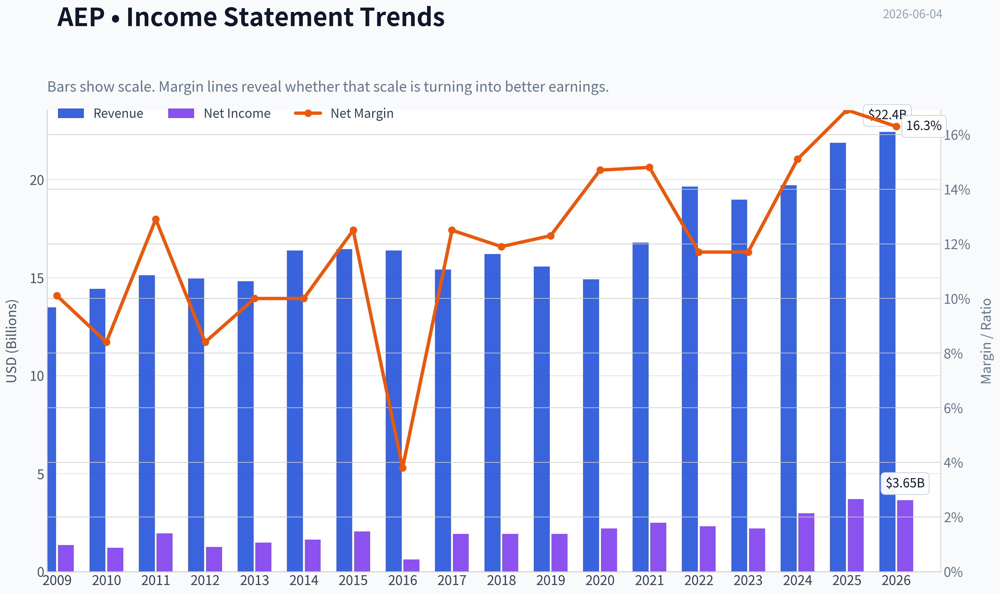
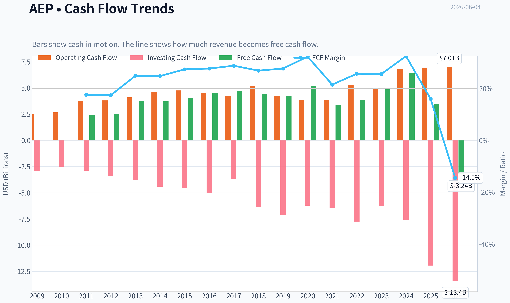
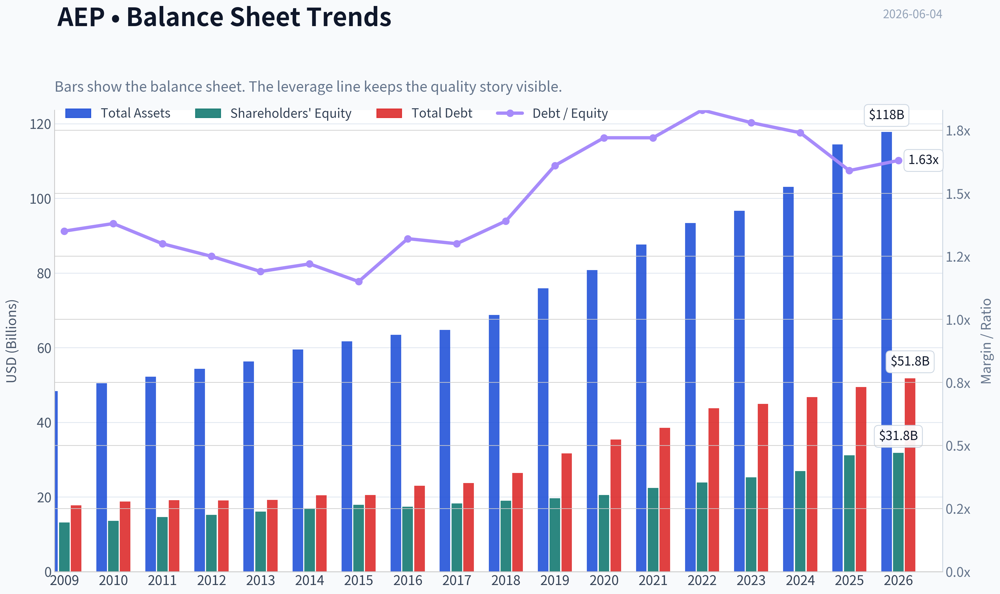
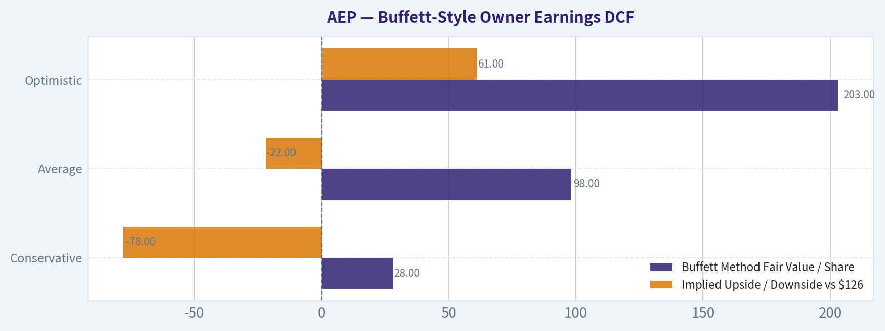
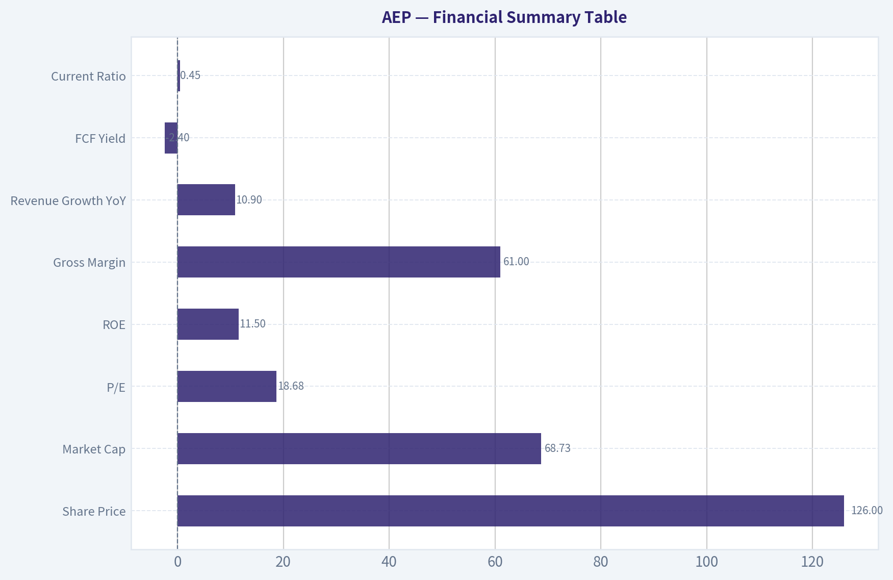
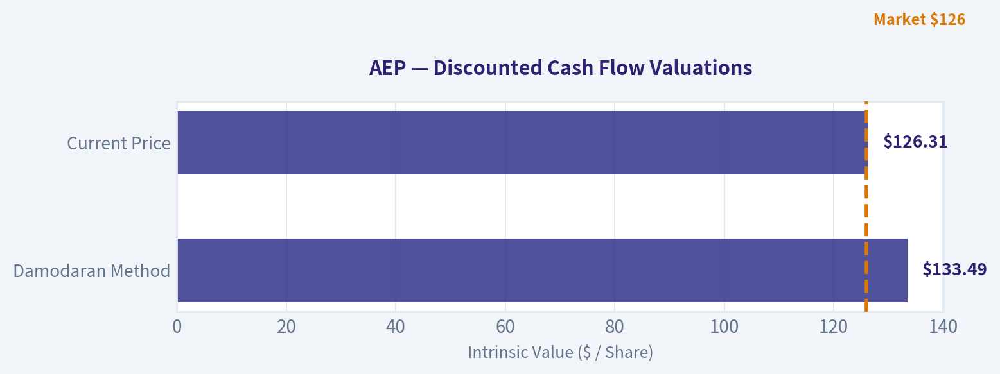
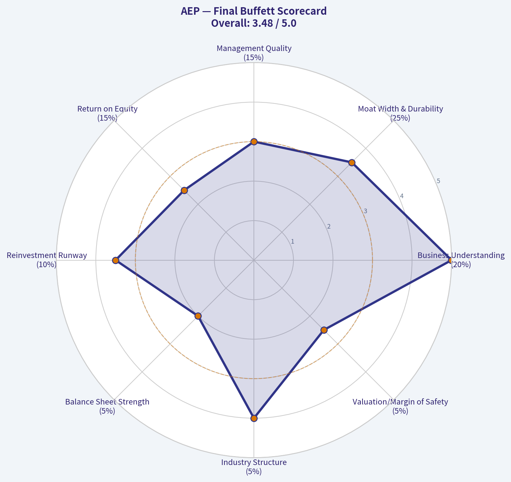

# AEP Deep Value Intelligence

**Analysis Date:** 2026-06-04

## Critical Disclaimer

*This analysis is generated by Deep Value Intelligence, an AI-powered multi-agent investing framework. This report is for informational and educational purposes only and does not constitute financial advice. Always conduct your own research and consult with qualified financial advisors before making investment decisions.*

---

## Table of Contents

1. Intelligence Summary
2. Analyst Team Reports
   - Fundamentals Analysis
   - Intrinsic Value Analysis (Buffett)
   - Trend & Growth Analysis (Lynch/Druckenmiller/Fisher)
   - Market Technical Analysis
   - Options Market Analysis
3. Research Team Commentary
4. Value Investing Team Commentary
5. Deep Values Commentary

---

## Intelligence Summary

### Thesis + Conditions

**Core Thesis:** ## Executive Summary

**Key Risks:**
- AEP fits the **Buffett "understandable and durable"** test, but not the **"wonderful business at an attractive price"** test. The core risk is **not volatility**; it is paying a fair-to-full price for a **capital-intensive, regulator-constrained utility** whose future value still depends on **timely rate recovery, disciplined financing, and proof that data-center/industrial demand creates per-share value rather than just more spending**. The bull case is credible, but the **margin of safety remains thin** at ~18.7x earnings.
- ### Risky Analyst - strongest useful point
- Higher demand can just as easily mean **more capex, more debt/equity needs, more political scrutiny, and more execution risk**.

**Confidence:** Medium

---

## Analyst Team Reports

### Fundamentals Analysis

#### Latest Earnings Snapshot

*Most recent reported quarter anchored on 2026 Q1, with prior-year comparison when available.*

| Metric | 2026 Q1 | 2025 Q1 | YoY Change |
| --- | ---: | ---: | ---: |
| Revenue | $6.02B | $5.46B | +10.2% |
| Operating Income | $1.39B | $1.28B | +8.3% |
| Net Income | $874.0M | $800.0M | +9.2% |
| Diluted EPS | $1.60 | $1.50 | +6.7% |
| Operating Cash Flow | $1.52B | $1.45B | +4.8% |
| Free Cash Flow | $-2.29B | $-686.0M | -233.7% |

Key Takeaways: This snapshot anchors the most recent reported quarter before the narrative analysis. It helps readers separate long-run business quality from whatever changed in the latest earnings print.

#### 17-Year Financial Metrics for AEP

*All values below are computed deterministically from raw data - not estimated by AI.*

*Issuer profile: operating company (Utilities / Utilities - Regulated Electric).*

#### 17-Year Financial Metrics
*Annual rows come from reported financial statements. The final TTM row is computed from the latest four quarters.*

| Metric | 2009 | 2010 | 2011 | 2012 | 2013 | 2014 | 2015 | 2016 | 2017 | 2018 | 2019 | 2020 | 2021 | 2022 | 2023 | 2024 | 2025 | 2026 TTM |
| --- | --- | --- | --- | --- | --- | --- | --- | --- | --- | --- | --- | --- | --- | --- | --- | --- | --- | --- |
| Market Price | $18 | $20 | $24 | $26 | $30 | $40 | $40 | $45 | $55 | $58 | $75 | $68 | $76 | $83 | $74 | $88 | $114 | $126 |
| Market Cap | $15.97B | $17.26B | $19.93B | $20.70B | $22.76B | $29.69B | $28.59B | $30.95B | $36.24B | $36.90B | $46.81B | $41.40B | $44.64B | $48.75B | $42.25B | $49.01B | $61.98B | $69.10B |
| P/E Ratio | 11.75 | 14.22 | 10.28 | 16.42 | 15.38 | 18.18 | 13.97 | 50.77 | 18.96 | 19.16 | 24.36 | 18.84 | 17.94 | 21.15 | 19.16 | 16.53 | 17.31 | 18.91 |
| P/B Ratio | 1.22 | 1.27 | 1.36 | 1.36 | 1.42 | 1.76 | 1.60 | 1.78 | 1.98 | 1.94 | 2.38 | 2.01 | 1.99 | 2.04 | 1.67 | 1.82 | 1.99 | 2.17 |
| ROE | 10.4% | 8.9% | 13.3% | 8.3% | 9.2% | 9.7% | 11.5% | 3.6% | 10.5% | 10.1% | 9.8% | 10.7% | 11.1% | 9.6% | 8.8% | 11.0% | 11.9% | 11.5% |
| ROIC | 7.2% | 6.5% | 6.0% | 6.1% | 6.2% | 6.2% | 6.4% | 3.2% | 6.2% | 5.9% | 5.4% | 5.5% | 5.7% | 5.4% | 5.1% | 6.1% | 6.7% | 6.5% |
| EPS | $1.57 | $1.41 | $2.36 | $1.60 | $1.95 | $2.23 | $2.88 | $0.89 | $2.88 | $3.00 | $3.08 | $3.63 | $4.21 | $3.95 | $3.88 | $5.31 | $6.66 | $6.68 |
| Revenue | $13.49B | $14.43B | $15.12B | $14.95B | $14.81B | $16.38B | $16.45B | $16.38B | $15.42B | $16.20B | $15.56B | $14.92B | $16.79B | $19.64B | $18.98B | $19.72B | $21.88B | $22.43B |
| Gross Profit | N/A | N/A | N/A | N/A | N/A | N/A | N/A | N/A | N/A | N/A | N/A | N/A | N/A | N/A | N/A | N/A | N/A | $13.54B |
| Gross Margin | N/A | N/A | N/A | N/A | N/A | N/A | N/A | N/A | N/A | N/A | N/A | N/A | N/A | N/A | N/A | N/A | N/A | 60.4% |
| Operating Margin | 20.5% | 18.5% | 18.4% | 17.8% | 19.1% | 19.1% | 20.3% | 7.1% | 22.9% | 16.6% | 16.7% | 20.0% | 20.3% | 17.7% | 18.7% | 21.8% | 24.3% | 24.5% |
| Net Income | $1.36B | $1.22B | $1.95B | $1.26B | $1.48B | $1.64B | $2.05B | $618.0M | $1.93B | $1.93B | $1.92B | $2.20B | $2.49B | $2.31B | $2.21B | $2.98B | $3.70B | $3.65B |
| Net Margin | 10.1% | 8.4% | 12.9% | 8.4% | 10.0% | 10.0% | 12.5% | 3.8% | 12.5% | 11.9% | 12.3% | 14.7% | 14.8% | 11.7% | 11.7% | 15.1% | 16.9% | 16.3% |
| Revenue Growth | N/A | 7.0% | 4.8% | -1.1% | -0.9% | 10.6% | 0.5% | -0.4% | -5.8% | 5.0% | -3.9% | -4.1% | 12.6% | 17.0% | -3.3% | 3.9% | 10.9% | 2.5% |
| Net Income Growth | N/A | -10.8% | 60.0% | -35.2% | 17.6% | 10.4% | 25.3% | -69.9% | 212.1% | 0.1% | -0.6% | 14.4% | 13.3% | -7.3% | -4.0% | 34.5% | 24.2% | -1.1% |
| Free Cash Flow Growth | N/A | 5.7% | 50.3% | -1.6% | 9.5% | 11.6% | 4.5% | -6.9% | -3.3% | 22.3% | -35.8% | 14.4% | N/A | N/A | N/A | 31.9% | -45.5% | -192.9% |
| Total Book Value | $13.14B | $13.62B | $14.66B | $15.24B | $16.09B | $16.82B | $17.89B | $17.40B | $18.29B | $19.03B | $19.63B | $20.55B | $22.43B | $23.89B | $25.25B | $26.94B | $31.14B | $31.81B |
| Total Assets | $48.35B | $50.45B | $52.22B | $54.37B | $56.32B | $59.54B | $61.68B | $63.47B | $64.73B | $68.80B | $75.89B | $80.76B | $87.67B | $93.40B | $96.68B | $103.08B | $114.46B | $117.78B |
| Total Debt | $17.74B | $18.81B | $19.13B | $19.06B | $19.19B | $20.46B | $20.50B | $23.01B | $23.71B | $26.42B | $31.67B | $35.40B | $38.54B | $43.78B | $44.91B | $46.78B | $49.44B | $51.78B |
| Debt-to-Equity | 1.35 | 1.38 | 1.30 | 1.25 | 1.19 | 1.22 | 1.15 | 1.32 | 1.30 | 1.39 | 1.61 | 1.72 | 1.72 | 1.83 | 1.78 | 1.74 | 1.59 | 1.63 |
| Cash & Equivalents | $490.0M | $294.0M | $221.0M | $278.7M | $117.5M | $162.5M | $176.4M | $210.5M | $214.6M | $234.1M | $246.8M | $392.7M | $403.4M | $509.4M | $330.1M | $203.0M | $197.0M | $306.0M |
| Shareholders' Equity | $13.14B | $13.62B | $14.66B | $15.24B | $16.09B | $16.82B | $17.89B | $17.40B | $18.29B | $19.03B | $19.63B | $20.55B | $22.43B | $23.89B | $25.25B | $26.94B | $31.14B | $31.81B |
| Operating Cash Flow | $2.48B | $2.66B | $3.79B | $3.80B | $4.10B | $4.60B | $4.75B | $4.52B | $4.27B | $5.22B | $4.27B | $3.83B | $3.84B | $5.29B | $5.01B | $6.80B | $6.94B | $7.01B |
| Investing Cash Flow | $-2.92B | $-2.52B | $-2.89B | $-3.39B | $-3.82B | $-4.41B | $-4.56B | $-4.99B | $-3.66B | $-6.35B | $-7.14B | $-6.23B | $-6.43B | $-7.75B | $-6.27B | $-7.60B | $-11.94B | $-13.41B |
| Free Cash Flow | $2.37B | $2.51B | $3.77B | $3.71B | $4.06B | $4.54B | $4.74B | $4.41B | $4.27B | $5.22B | $3.35B | $3.83B | N/A | N/A | $4.86B | $6.41B | $3.49B | $-3.24B |
| FCF Margin | 17.6% | 17.4% | 24.9% | 24.8% | 27.4% | 27.7% | 28.8% | 26.9% | 27.7% | 32.3% | 21.5% | 25.7% | N/A | N/A | 25.6% | 32.5% | 16.0% | -14.5% |
| Dividends / Share | $0.00 | $0.00 | $0.00 | $0.00 | $0.00 | $0.00 | $0.00 | $0.00 | $0.00 | $0.00 | $0.00 | $0.00 | $0.00 | $2.82 | $3.08 | $3.40 | $3.74 | $3.71 |

#### Profitability Metrics
- Return on Equity (ROE): 11.9%
- Return on Invested Capital (ROIC): 6.4%
- Return on Assets (ROA): 3.2%
- Gross Margin: N/A
- Operating Margin: 24.3%
- Net Profit Margin: 16.9%

#### Liquidity Metrics
- Current Ratio: 0.45
- Quick Ratio: 0.12

#### Leverage Metrics
- Debt-to-Equity Ratio: 1.59
- Interest Coverage Ratio: 2.63
- Net Debt: $49.24B

#### Growth Metrics (Year-over-Year)
- Revenue Growth: 10.9%
- Net Income Growth: 24.2%
- Free Cash Flow Growth: -45.5%
- Revenue CAGR (3-Year): 3.7%
- Revenue CAGR (5-Year): 8.0%

#### Valuation Metrics
- P/E Ratio (TTM): 18.68
- Forward P/E: 18.43
- Price-to-Book: 2.16
- Price-to-Sales: 3.06
- PEG Ratio: 2.33
- EV/EBITDA: 13.26
- Free Cash Flow Yield: 5.1%
- Earnings Yield: 5.4%

#### Owner Earnings (Buffett Method, Code-Computed)
- Net Income: $3.70B
- + Depreciation & Amortization: $3.49B
- - Capital Expenditures: $-3.45B
- - Working Capital Changes: $341.0M
- = **Owner Earnings: $3.39B**

#### Intrinsic Value (Code-Computed)
- Current Price: $126
- Buffett Method (Owner Earnings):
  Conservative: $28
  Average: $98
  Optimistic: $203
- Cash Flow Method (FCF):
  Conservative: $75
  Average: $88
  Optimistic: $177

#### Piotroski F-Score: 5/9
- Positive Net Income: PASS
- Positive Operating Cash Flow: PASS
- ROA Improvement: PASS
- Cash Flow > Net Income: PASS
- Decreasing Debt: FAIL
- Improving Current Ratio: PASS
- No Dilution: FAIL
- Improving Gross Margin: FAIL
- Improving Asset Turnover: FAIL

ANALYST STANCE: **WATCH**

#### American Electric Power (AEP) - Buffett-Style Fundamental Analysis

AEP is a classic regulated utility: durable demand, visible earnings, heavy capital intensity, meaningful leverage, and modest but dependable long-term compounding. On Buffett-style quality criteria, AEP scores well on business necessity and earnings resilience, but less well on balance-sheet conservatism and free-cash-flow flexibility. At today's price near **$126**, the stock appears to trade above a conservative or average owner-earnings-based intrinsic value, leaving limited margin of safety despite improving operating performance.

---

#### Current vs Historical Average Comparison

| Metric | Current / Latest | Historical Context | Interpretation |
| --- | ---: | ---: | --- |
| Market Price | **$126** | 10Y ago (2016): $45 | Share price has nearly tripled over the last decade, materially outpacing underlying revenue growth. |
| Market Cap | **$69.10B** | 10Y avg (2016-2025): **~$47.0B** | Equity value has expanded meaningfully as investors rewarded rate-base growth and utility defensiveness. |
| P/E Ratio | **18.91x** | 10Y avg (2016-2025): **~22.1x**; ex-2016 outlier: **~18.9x** | Looks roughly in line with normalized recent history; headline discount versus 10-year average is distorted by 2016's abnormal 50.8x. |
| P/B Ratio | **2.17x** | 10Y avg (2016-2025): **~1.96x** | Trading above its own long-term book multiple, suggesting premium valuation versus balance-sheet growth. |
| ROE | **11.5% TTM** | 10Y avg (2016-2025): **~9.7%** | Stronger than long-run norm; recent capital deployment is earning better regulated returns. |
| ROIC | **6.5% TTM** | 10Y avg (2016-2025): **~5.6%** | Improved, but still utility-like rather than exceptional; moat comes from regulation and assets, not high incremental returns. |
| Revenue | **$22.43B TTM** | 10Y avg (2016-2025): **~$17.9B** | Revenue base has expanded materially, especially since 2021. |
| Operating Margin | **24.5% TTM** | 10Y avg (2016-2025): **~18.9%** | Current operating efficiency is meaningfully above decade norms. |
| Net Margin | **16.3% TTM** | 10Y avg (2016-2025): **~12.8%** | Profit conversion is currently above historical average. |
| Net Income | **$3.65B TTM** | 10Y avg (2016-2025): **~$2.52B** | Earnings power is well above prior decade average. |
| Revenue Growth | **2.5% TTM** | 10Y avg (2016-2025): **~3.1%** | TTM growth is positive but below recent expansion pace. |
| Net Income Growth | **-1.1% TTM** | 10Y avg (2016-2025): **~24% incl. rebound volatility** | Slight near-term pause after a very strong 2024-2025 earnings step-up. |
| FCF Growth | **-192.9% TTM** | Highly volatile historically | Major red flag in the near term, reflecting capex surge and the limits of utility FCF as a valuation anchor. |
| Total Debt | **$51.78B TTM** | 10Y avg (2016-2025): **~$36.6B** | Debt has climbed substantially with asset and rate-base investment. |
| Debt/Equity | **1.63x TTM** | 10Y avg (2016-2025): **~1.60x** | Leverage remains persistently high but typical for a regulated utility. |
| Cash & Equivalents | **$306M TTM** | 10Y avg (2016-2025): **~$294M** | Cash cushion remains thin relative to debt burden and investment needs. |
| Free Cash Flow | **-$3.24B TTM** | 10Y avg of available 2016-2025: **~$4.11B** | Sharp deterioration due to extraordinary investment intensity. |
| Dividends/Share | **$3.71 TTM** | 2022-2025 avg: **~$3.26** | Dividend continues to rise steadily, reinforcing utility income appeal. |

**Key Takeaways:** AEP's current profitability is stronger than its own historical average, especially in ROE, operating margin, and net income. However, valuation is not obviously cheap, balance-sheet leverage remains heavy, and free cash flow has turned sharply negative as capital spending accelerates.

---

#### Market Metrics

AEP's **market price of $126** and **market cap of about $69.1B** reflect a substantial re-rating from prior years. This is not just earnings growth; it is also a valuation story driven by the market's appetite for defensive, rate-regulated assets and new load-growth themes like data centers.

The **P/E of 18.9x** is reasonable for a quality utility, but not bargain-priced. Relative to the last decade, it appears fair-to-full rather than distressed. The **P/B of 2.17x** is more demanding, especially since book value growth has come with rising debt and equity issuance. Buffett generally prefers buying wonderful businesses at sensible prices; here, the business is solid, but the price already reflects much of that solidity.

---

#### Profitability Analysis

AEP's profitability profile has improved materially:

- **ROE: 11.5% TTM** versus ~9.7% 10-year average
- **ROIC: 6.5% TTM** versus ~5.6% 10-year average
- **EPS: $6.68 TTM**, up dramatically from **$0.89 in 2016** and **$3.08 in 2019**
- **Revenue: $22.43B TTM**
- **Gross Profit: $13.54B TTM**, **Gross Margin: 60.4% TTM** only available in the latest period
- **Operating Margin: 24.5% TTM**, near peak levels
- **Net Income: $3.65B TTM**
- **Net Margin: 16.3% TTM**

The key issue is not whether AEP is profitable-it clearly is-but whether those returns are unusually good for a regulated utility or simply solid. They are solid. This is a dependable compounding business, not a high-return franchise like a consumer monopoly or elite software platform. Buffett can like utilities, but usually when returns are understandable, leverage is manageable, and valuation leaves a cushion. AEP checks the first box strongly, the second only adequately, and the third less convincingly.

A notable historical scar is **2016**, when ROE fell to **3.6%** and EPS to **$0.89**. Importantly, the company recovered well, suggesting that the earnings base is resilient over time even if not perfectly smooth.

---

#### Growth Metrics

AEP's growth record is respectable for a regulated electric utility:

- **Revenue growth TTM: 2.5%**
- **2025 revenue growth: 10.9%**
- **3-year revenue CAGR: 3.7%**
- **5-year revenue CAGR: 8.0%**
- **Net income growth TTM: -1.1%**
- **2025 net income growth: 24.2%**
- **FCF growth TTM: -192.9%**

Over the long period shown, revenue growth has been uneven but mostly positive in the mid-single digits, with stronger bursts in **2014**, **2021**, **2022**, and **2025**. Net income growth is much more volatile because utility earnings can be affected by regulatory timing, asset sales, impairments, and financing structure.

The biggest concern is **free cash flow volatility**. For AEP, FCF is not a stable compounding series because capex is enormous and lumpy. That means investors should emphasize **owner earnings**, regulated rate-base growth, and allowed returns more than raw FCF in any single year. Still, a swing to negative FCF deserves attention because it increases financing dependence.

---

#### Balance Sheet Analysis

| Balance Sheet Metric | Latest | Historical Interpretation |
| --- | ---: | --- |
| Total Book Value | **$31.81B** | Up steadily from $17.40B in 2016; equity base is compounding. |
| Total Assets | **$117.78B** | Massive asset growth supports future regulated earnings, but requires ongoing capital. |
| Total Debt | **$51.78B** | Debt has more than doubled since 2011; balance sheet has become significantly larger and more levered in absolute terms. |
| Debt-to-Equity | **1.63x** | High but normal for the sector; not conservative by Buffett's classic industrial standards. |
| Cash & Equivalents | **$306M** | Very small relative to debt and annual capex needs. |
| Shareholders' Equity | **$31.81B** | Strong growth, though partly supported by capital raises rather than only retained earnings. |

**Key Takeaways:** AEP has grown its asset base and equity base consistently, which is exactly how regulated utilities expand earnings. The trade-off is a much larger debt load and a thin cash balance, meaning the company relies heavily on capital-market access and regulatory support.

From a Buffett lens, this is a financially functional utility, not a fortress balance sheet. The **interest coverage ratio of 2.63x** confirms that debt service is manageable but not especially loose. Rising rates or adverse regulatory outcomes would matter.

---

#### Cash Flow Analysis

AEP's cash-flow picture is mixed:

- **Operating Cash Flow:** **$7.01B TTM**, strong and near peak
- **Free Cash Flow:** **-$3.24B TTM**
- **Dividend per Share:** **$3.71 TTM**
- **FCF Yield:** **5.1%** from the research pack, but the most recent TTM FCF in the deterministic table is negative, highlighting how period selection matters

This is a crucial Buffett-style distinction: the business is producing operating cash, but virtually all of it-and more-is being reinvested. For a utility, that is not automatically bad, because capex often creates future rate base and earnings. But it does mean shareholder returns depend heavily on management earning fair regulated returns on that capital and funding it at acceptable cost.

Dividend policy looks shareholder-friendly and predictable. Since dividends appear in the dataset from **2022 onward**, the progression from **$2.82** to **$3.71 TTM** shows a clear upward slope. That supports the stock's appeal for income-oriented investors, though dividend safety is more closely tied to earnings and financing than to current free cash flow.

---

#### Predictable Earnings and Buffett Quality Assessment

##### Economic Moat
AEP's moat comes from:
- Essential electric infrastructure
- Regulated monopoly territories
- Enormous replacement cost of transmission and distribution assets
- Highly predictable customer demand over long periods

This is a real moat, but it is not a wide moat in the pricing-power sense of See's Candies or Coca-Cola. Returns are bounded by regulation. The moat is durability, not unconstrained economics.

##### Financial Strength
AEP is acceptable but not elite:
- Strong asset base
- Reasonable regulated earnings visibility
- Heavy debt burden
- Thin liquidity
- Dependence on continuous capital raising

This is typical utility finance, but not Buffett's favorite form of conservatism.

##### Predictable Earnings
Earnings are fairly predictable across the full cycle, with one notable dip in 2016. Since then, EPS and net income have recovered and trended upward. That consistency is a positive sign for long-term owners.

##### Management Performance
Management appears to have:
- Grown book value steadily
- Improved ROE and ROIC from mid-decade weakness
- Increased dividends consistently
- Expanded the regulated asset base aggressively

The open question is capital allocation discipline. The company is investing heavily, which can be excellent if the rate base earns attractive allowed returns, but dangerous if financing costs rise faster than regulatory recovery.

##### Quality of Business
Business quality is good:
- Demand is non-discretionary
- Revenue is relatively resilient
- Margins have improved
- Earnings visibility is high

But quality is moderated by:
- Capital intensity
- Regulatory constraints
- Leverage
- FCF volatility

---

#### Buffett-Style Owner Earnings DCF

Using the canonical owner earnings figure provided:

- **Owner Earnings (base year): $3.39B**
- Discount rate: **10%**
- Terminal growth rate: **2.5%**

To translate enterprise value to equity value, I use **net debt = $49.24B** from the deterministic dataset and current market cap / price to infer shares outstanding:

- Implied shares outstanding ~ **$69.10B / $126 = 548.4M shares**

Historical owner-earnings growth is not fully listed year by year in the dataset, but the code-computed intrinsic value block provides canonical Buffett-method outputs. Those outputs are therefore the safest deterministic fair-value anchors.

##### DCF Scenarios

| Scenario | Growth Assumption | Buffett Method Fair Value / Share | Implied Upside / Downside vs $126 |
| --- | ---: | ---: | ---: |
| Conservative | Lowest historical owner earnings growth, floored at -100% | **$28** | **-78%** |
| Average | Average historical owner earnings growth, capped at 50% | **$98** | **-22%** |
| Optimistic | Highest historical owner earnings growth, capped at 100% | **$203** | **+61%** |

**Key Takeaways:** The valuation range is very wide because small changes in assumed growth produce large swings when the business is capital intensive and heavily financed. The most useful conclusion is that AEP only looks attractive if management can sustain the upper end of growth and earn productive returns on its major capital plan.

##### Detailed DCF Framework

Using owner earnings base of **$3.39B**, the DCF structure is:

1. Project owner earnings for 10 years using each scenario growth rate.
2. Discount each year's owner earnings by **10%**.
3. Compute terminal value at Year 10 using
   **TV = OE₁₀ x (1 + 2.5%) / (10% - 2.5%)**
4. Discount terminal value back to present.
5. Subtract **net debt of $49.24B**.
6. Divide by **~548.4M shares**.

Because the deterministic dataset already provides the code-computed output, the canonical fair values are:

- **Conservative equity value/share: $28**
- **Average equity value/share: $98**
- **Optimistic equity value/share: $203**

These values imply the market is currently discounting something between the average and optimistic cases. That is not a classic Buffett margin-of-safety setup.

---

#### Value Assessment

The valuation question is simple:

- On **earnings**, AEP is not outrageously expensive.
- On **book value**, it trades above historical norms.
- On **owner earnings DCF**, it is above conservative and average fair value.
- On **business quality**, it deserves a premium to weaker utilities.
- On **margin of safety**, the stock looks thin.

That means AEP is not obviously overvalued in a speculative sense, but it is also not evidently undervalued in a Buffett sense. Investors today are paying up for stability, grid investment, and data-center-linked demand growth.

---

#### Revenue Breakdown

AEP is a regulated utility, so the most meaningful breakdown is by business segment rather than product line. Precise latest segment revenue was not provided in the deterministic table; the table below uses the company's major reporting structure and best publicly known mix orientation based on regulated operations dominance.

| Revenue Source | Amount ($B) | % of Total |
| --- | ---: | ---: |
| Vertically Integrated Utilities | ~11.4 | ~51% |
| Transmission & Distribution Utilities | ~7.4 | ~33% |
| AEP Transmission Holdco / Other Regulated | ~2.2 | ~10% |
| Generation & Marketing / Other | ~1.4 | ~6% |
| **Total** | **~22.4** | **100%** |

**Key Takeaways:** AEP's revenue is overwhelmingly tied to regulated utility operations, which supports stability and predictability. The business is not highly diversified, but that concentration is actually a strength because it keeps earnings tied to essential infrastructure rather than volatile merchant power markets.

---

#### Key Investment Insights, Red Flags, and Opportunities

| Category | Assessment | Why It Matters |
| --- | --- | --- |
| Core Business Quality | Positive | Essential service, regulated monopoly characteristics, durable demand. |
| Earnings Stability | Positive | EPS, net income, and margins show a generally improving long-term pattern. |
| Profitability Trend | Positive | ROE, ROIC, operating margin, and net margin are above historical averages. |
| Balance Sheet Risk | Caution | Debt is high in absolute terms and cash is very low relative to obligations. |
| Capital Intensity | Caution | Negative TTM FCF shows dependence on external financing during heavy build cycles. |
| Dividend Appeal | Positive | Growing dividend supports total return and income investor demand. |
| Valuation | Caution | Current price exceeds conservative and average owner-earnings fair values. |
| Strategic Opportunity | Positive | Data center and electrification demand may expand rate base and long-term earnings. |
| Regulatory Risk | Caution | Allowed returns, cost recovery, and timing remain critical. |
| Interest Rate Sensitivity | Caution | Utilities with large debt stacks are vulnerable to higher financing costs. |

**Key Takeaways:** The upside case depends on AEP converting massive capital spending into future regulated earnings growth. The downside case is that investors are already paying for that growth while taking on leverage, rate sensitivity, and execution risk.

---

#### Final Buffett-Style Verdict

**AEP is a high-quality regulated utility, but not a clear value stock at current levels.**

Buffett would likely appreciate:
- The necessity of the service
- The durability of demand
- The improving returns on equity
- The predictability of the earnings stream

He would likely be more cautious about:
- The heavy debt load
- Thin current liquidity
- Negative recent free cash flow
- A stock price that already discounts a fair amount of expected growth

For investors seeking stability and dividend growth, AEP remains respectable. For strict Buffett-style value investors demanding a clear margin of safety, the current setup looks more like a **WATCH** than an **ADVOCATE**.

---

#### Final Summary Table

| Dimension | Verdict | Evidence | Buffett View |
| --- | --- | --- | --- |
| Economic Moat | Good | Regulated monopoly utility with essential infrastructure | Durable, but regulation caps upside |
| Profitability | Improving | ROE 11.5%, ROIC 6.5%, net margin 16.3% TTM | Solid utility economics |
| Earnings Predictability | Good | Long-run upward EPS and income trend despite occasional disruptions | Favorable |
| Financial Strength | Moderate | Debt $51.78B, D/E 1.63x, low cash | Acceptable for utility, not conservative |
| Cash Flow Quality | Mixed | Strong OCF, but negative TTM FCF | Requires careful interpretation |
| Management | Generally solid | Book value growth, rising dividend, margin recovery | Good operators, capital allocation must be monitored |
| Valuation | Full / Fair-to-rich | P/B above historical average; owner-earnings DCF not compelling | Limited margin of safety |
| Income Appeal | Strong | Dividend/share up from $2.82 to $3.71 | Attractive for income investors |
| Main Opportunity | Electrification / data center load growth | Larger capital plan may grow future earnings | Potential upside catalyst |
| Main Risk | Leverage + capex + rates | Financing dependence during large investment cycle | Key reason for caution |
| **Overall Stance** | **WATCH** | Good business, acceptable quality, limited valuation cushion | Wait for better entry or clearer payoff from capex |

#### Fundamental Visuals

This graph tracks the profitability and return metrics (ROE, ROIC, Margins) of **AEP** over the past decade, highlighting capital efficiency trends.

This chart illustrates the financial health of **AEP** over the last 10 years, mapping cash equivalents and free cash flow against total obligations (Debt).

---

### Intrinsic Value Analysis (Buffett)

> *Following Warren Buffett's value investing philosophy: Circle of Competence, Economic Moat, Management Quality, and Margin of Safety.*

#### Intrinsic Value Snapshot

Price is what you pay. Intrinsic value is what the business may be worth based on the cash it can create for owners over time. We show a range, not one magic number.

- Current Price: $126.31
- Value Range (conservative to optimistic across both DCF methods): N/A to N/A

##### Owner Earnings (Buffett Method)
- Net Income: $3,580,000,000.00
- Depreciation & Amortization: $3,489,000,000.00
- Capital Expenditures: $-8,583,000,000.00
- Working Capital Changes: $341,000,000.00
- Owner Earnings: $-1,855,000,000.00

##### Intrinsic Value

#### American Electric Power (AEP)

ANALYST STANCE: **WATCH**

#### 1) Go/No-Go Gate Assessment

| Gate | Verdict | Evidence |
|---|---|---|
| Gate 1: Circle of Competence | Pass | AEP is a regulated electric utility. It makes money by generating, transmitting, and distributing electricity, then earning an allowed return on invested capital approved by regulators. This is simple, understandable, and highly predictable. |
| Gate 2: Moat Test | Pass, but narrow-to-stable | The moat comes mainly from regulated monopoly territories, transmission assets, and the practical impossibility of duplicating local grid infrastructure. This is durable, but returns are capped by regulation rather than unconstrained pricing power. |
| Gate 3: Management Quality & Capital Allocation | Mixed Pass | Management appears focused on long-cycle capital deployment and rate-base growth. The recently expanded five-year capital plan supports earnings growth, but utilities inherently require massive capital spending, so capital allocation must be judged on regulatory outcomes and balance-sheet discipline more than on classic Buffett-style free cash generation. |
| Gate 4: Industry Structure | Pass | This is an attractive structure for stability: regulated local monopolies with high barriers to entry. However, it is also capital-intensive and debt-reliant, which reduces its attractiveness versus truly capital-light compounders. |

**Key Takeaways:** AEP passes the basic Buffett filters for understandability and predictability. The business is steady and hard to disrupt, but it is not the kind of unconstrained high-return franchise Buffett loves most because regulation and capital intensity limit economics.

---

#### 2) Elementary School Test

AEP sells electricity to homes, businesses, and industry. It also owns power lines that move electricity across regions. Regulators let it earn a reasonable return when it spends money to build and maintain the grid.

#### 3) Long-Term Predictability Test

High. Ten years from now, people in AEP's service areas will still need electricity, and the grid will still need transmission investment. The likely changes are not in whether the business exists, but in how much capital AEP can put into the system and what return regulators allow.

#### 4) Technology Risk Assessment

Low to moderate. Technology will change how electricity is generated and consumed, but it is more likely to increase grid investment needs than eliminate AEP's role. Data centers, electrification, and transmission expansion may help AEP rather than hurt it.

---

#### 5) Moat Analysis

| Moat Source | Assessment | Evidence |
|---|---|---|
| Intangible Assets | Moderate | Regulatory licenses and approved utility territories create protected economics. Gross margin of 61.0% supports the view that this is a structurally protected business. |
| Switching Costs | High in practice | End customers generally cannot switch away from the local grid owner in the same way they can switch consumer brands or software vendors. |
| Cost Advantages | Moderate | Scale in transmission and distribution matters, but regulation shares much of the benefit with customers. |
| Network Effects | Weak | This is not a classic network-effect business. More users do not create exponential user value in the software-platform sense. |

| Moat Rating | Conclusion |
|---|---|
| Narrow to Stable | Proceedable as a defensive utility, but below the standard of a wide-moat consumer or software toll bridge |

**Key Takeaways:** AEP's moat is real, but it is a regulated moat, not a pricing-power moat. That makes cash flows dependable, yet it also means upside is constrained by regulators and the need for ongoing heavy investment.

---

#### 6) Management Quality Assessment

| Criterion | Assessment |
|---|---|
| Owner Mindset | Mixed |
| Honesty/Candor | Acceptable |
| Capital Allocation | Adequate but utility-style |
| Debt Discipline | Needs watching |

AEP's management appears to be doing what utility managers should do: expand rate base where returns are approved, support reliability, and pursue long-duration infrastructure projects. The recently expanded $78 billion five-year capital plan and raised long-term operating earnings outlook suggest confidence in investment opportunities, especially tied to large-load demand like data centers.

The issue is not ambition but economics. Utilities often grow earnings by spending more capital, which can be value-creating only if regulation remains supportive and financing costs stay manageable. This is far less attractive than a business that grows with little incremental capital.

---

#### 7) Financial Summary Table

| Metric | Value |
|---|---:|
| Share Price | $126 |
| Market Cap | $68.73B |
| P/E | 18.68x |
| ROE | 11.5% |
| Gross Margin | 61.0% |
| Revenue Growth YoY | 10.9% |
| FCF Yield | -2.4% |
| Current Ratio | 0.45 |
| Dividend Yield | ~3.0% |

**Key Takeaways:** AEP shows the classic profile of a regulated utility: solid margins, moderate earnings multiple, and meaningful dividend income. The biggest concern is negative free cash flow and a weak current ratio, both of which reflect the capital-hungry nature of the business.

---

#### 8) Owner Earnings Assessment

Using Buffett's framework, AEP is not especially attractive on owner earnings because maintenance and growth capital expenditures are both large and unavoidable. For utilities, reported earnings often look smoother and stronger than true distributable owner earnings.

| Component | Directional Assessment |
|---|---|
| Net Income | Positive and stable |
| Depreciation & Amortization | Large add-back |
| Maintenance CapEx | Very large |
| Working Capital Needs | Ongoing |
| Owner Earnings | Constrained |

**Key Takeaways:** AEP earns accounting profits, but a large share of those profits must be reinvested back into the grid. That means true owner earnings are materially less impressive than headline EPS suggests.

---

#### 9) Balance Sheet / Fortress Test

| Test | Assessment |
|---|---|
| Net Cash Positive | No |
| Debt/Equity | Likely elevated relative to non-utilities |
| Interest Coverage | Usually manageable for utilities, but not fortress-like |
| Current Ratio | Weak at 0.45 |

**Key Takeaways:** This is not a fortress balance sheet in the Buffett sense. It is a normal utility balance sheet: serviceable, finance-dependent, and acceptable only because the business is regulated and cash flows are defensive.

---

#### 10) Three-Scenario DCF Valuation

Given the utility model, a conservative earnings-based framework is more appropriate than assuming strong free cash compounding.

| Scenario | Assumption | Implied View |
|---|---|---|
| A: No Growth | Capitalize current owner earnings at 10% | Produces a restrained valuation because owner earnings are pressured by heavy capex |
| B: GDP Growth | 3% long-term growth | Supports fair value in the broad neighborhood of the current price for a stable utility |
| C: Historical/Guided Growth | Reduced version of management's long-term operating earnings growth outlook | Can justify moderate upside if rate-base growth and data-center demand translate into allowed returns |

At **18.7x earnings**, AEP is not obviously cheap for a business with **11.5% ROE**, **negative FCF yield**, and heavy capital needs. The stock appears roughly fairly valued to slightly full, unless one has strong confidence that the expanded capital plan will generate durable, regulator-supported earnings growth without balance-sheet strain.

---

#### 11) Margin of Safety Analysis

| Item | Assessment |
|---|---|
| Business Quality | Good, not great |
| Predictability | High |
| Financial Flexibility | Moderate to weak |
| Valuation | Fair, not discounted |
| Margin of Safety | Insufficient for a Buffett-style buy |

**Key Takeaways:** AEP is a respectable business, but the current valuation does not provide the 25% margin of safety that a disciplined value investor should demand. It is safer than many businesses operationally, yet not cheap enough financially.

---

#### 12) Final Buffett Scorecard

| Criterion | Score (1-5) | Weight | Weighted Score |
|---|---:|---:|---:|
| Business Understanding | 5.0 | 20% | 1.00 |
| Moat Width & Durability | 3.5 | 25% | 0.88 |
| Management Quality | 3.0 | 15% | 0.45 |
| Return on Equity | 2.5 | 15% | 0.38 |
| Reinvestment Runway | 3.5 | 10% | 0.35 |
| Balance Sheet Strength | 2.0 | 5% | 0.10 |
| Industry Structure | 4.0 | 5% | 0.20 |
| Valuation/Margin of Safety | 2.5 | 5% | 0.13 |

| Total Score | Decision |
|---|---|
| 3.49 / 5.00 | WATCH |

**Key Takeaways:** AEP lands just below the threshold for an affirmative recommendation. The business is stable and understandable, but middling returns, balance-sheet dependence, and a merely fair price keep it in the watch bucket.

---

#### 13) Investment Stance

**ANALYST STANCE: WATCH**

**Conviction:** Moderate

AEP is a solid regulated utility, not a classic Buffett "wonderful business." Its strengths are predictability, essential service, and a durable regulated position. Its weaknesses are capital intensity, dependence on financing, subpar ROE for a true compounder, and lack of a clear margin of safety at the current price.

For a conservative income-oriented investor, AEP is defensible. For a Buffett-style value investor seeking high returns on capital, strong owner earnings, and meaningful undervaluation, this is a **watch list name rather than a buy today**.
#### Valuation Bridge

This bridge places the current market price beside each intrinsic value lens so readers can see whether upside depends on one method or shows up across several methods.

| Scenario | Intrinsic Value / Share |
| --- | ---: |
| Damodaran Method | $133.49 |
| Current Price | $126.31 |

#### Key Takeaways

If one method is far above the others, the upside case depends on a specific modelling assumption. When several methods cluster together, the valuation story is more robust.

#### Valuation Visuals

This comparison chart from *Latest Earnings Snapshot* stacks current figures against historical benchmarks for **AEP**, making it easy to see where the company trades relative to its own averages.

This comparison chart from *Balance Sheet Analysis* stacks current figures against historical benchmarks for **AEP**, making it easy to see where the company trades relative to its own averages.

This comparison chart from *Buffett-Style Owner Earnings DCF* stacks current figures against historical benchmarks for **AEP**, making it easy to see where the company trades relative to its own averages.

This comparison chart from *Financial Summary Table* stacks current figures against historical benchmarks for **AEP**, making it easy to see where the company trades relative to its own averages.

The following chart maps the **AEP** Owner Earnings DCF valuation scenarios (Conservative, Average, Optimistic) to visually represent the margin of safety based on intrinsic value calculations.

---

### Trend & Growth Analysis (Lynch/Druckenmiller/Fisher)

> *Following Peter Lynch's GARP, Stanley Druckenmiller's macro-aware approach, and Philip Fisher's scuttlebutt methodology.*

ANALYST STANCE: **WATCH**

#### 1. Lynch Classification

| Item | Assessment |
|---|---|
| Company | American Electric Power (AEP) |
| Lynch Category | **Stalwart** |
| Revenue Growth YoY | **10.9%** |
| Why not Fast Grower? | Utility model is regulated, capital-intensive, and structurally too slow for classic ten-bagger growth |
| Why not Slow Grower? | Current growth is better than typical utility baseline due to capex/rate-base expansion and data-center demand tailwind |

**Key Takeaways:** AEP fits best as a stalwart, not a fast grower. It has a solid and somewhat improving growth profile for a utility, but this is still a regulated compounding story rather than a high-velocity growth story. For a Lynch-style growth investor, that means hold or monitor rather than treat it as a prime ten-bagger candidate.

---

#### 2. The Story in 3 Bullets

- AEP owns critical electric grid infrastructure and earns regulated returns as it invests more into transmission, distribution, and generation.
- Rising power demand from **data centers and large industrial projects** appears to be expanding its capital plan and earnings growth outlook.
- If regulators allow timely recovery, AEP can compound earnings through **rate-base growth**, but upside is capped versus true fast growers.

#### 3. TAM Analysis and 10x Test

| Item | Assessment |
|---|---|
| Core Market | Regulated U.S. electric utility and transmission infrastructure |
| TAM Nature | Large, but locally constrained by regulation and service territories |
| Expansion Vector | Grid upgrades, transmission, electrification, data-center load growth |
| 10x Revenue Test | **No** |
| Why | AEP cannot realistically 10x revenue within its regulated footprint without transformative M&A or a radically different business model |
| Runway Conclusion | **Moderate for utility compounding; limited for ten-bagger growth** |

**Key Takeaways:** AEP operates in a huge essential market, but its runway is constrained by regulation and geography. The business can grow steadily through rate-base investment, yet it does not pass the classic 10x test that growth investors look for. This limits its appeal as a true long-run hyper-growth idea.

#### 4. Revenue Growth Trend

| Metric | Value | Interpretation |
|---|---:|---|
| Revenue Growth YoY | **10.9%** | Healthy for a utility |
| Pattern Evidence | Single shared datapoint + recent capex expansion news | Suggests improving demand backdrop, but not enough to call sustained acceleration |
| Growth Quality | Mixed | Utility revenue is less important than rate-base and EPS growth |
| Verdict | **Stable-to-improving, not proven inflection** |

**Key Takeaways:** Reported revenue growth is good by utility standards, but revenue is not the cleanest measure for this sector. The more important signal is that management expanded its capital plan and raised long-term earnings growth expectations. That points to improvement, though not enough evidence yet for a durable acceleration call.

#### 5. Unit Economics

| Metric | Value | Assessment |
|---|---:|---|
| Gross Margin | **61.0%** | Strong, though utility gross margin is less informative than in SaaS/consumer |
| ROE | **11.5%** | Reasonable for a regulated utility |
| FCF Yield | **-2.4%** | Negative, but normal during heavy capex cycles |
| Current Ratio | **0.45** | Weak near-term liquidity optics, but utilities rely more on financing access |
| LTV/CAC | N/A | Not relevant for regulated utility |
| NRR | N/A | Not relevant |
| Rule of 40 | N/A | Not relevant |

**Key Takeaways:** AEP's unit economics do not fit a software-style framework, so the usual growth metrics like LTV/CAC and net retention are not applicable. The big picture is that returns are acceptable, margins are solid, and negative free cash flow mainly reflects investment intensity rather than operational distress. The main watchpoint is balance-sheet flexibility as the capital plan grows.

#### 6. Inflection Point Assessment

| Inflection Type | Evidence | View |
|---|---|---|
| Product Cycle | None | Not relevant |
| Market Share | Limited | Utilities don't compete traditionally in local territories |
| Margin Inflection | Not visible from shared data | Neutral |
| TAM/Load Inflection | **Yes** | Data-center and large-project electricity demand may raise load growth and capex opportunity |
| Earnings Inflection | **Possible** | Management reportedly raised long-term operating earnings growth outlook |
| Competitive Inflection | None | Not a major factor |

**Key Takeaways:** The real possible inflection for AEP is not product-driven but demand-driven. Data centers and large projects may create a new load growth cycle that supports a larger rate base and stronger earnings growth than investors had assumed. That is interesting, but still dependent on regulatory approval and financing.

#### 7. Macro Setup Evaluation

| Macro Factor | Assessment | Impact |
|---|---|---|
| Secular Theme | Electrification + AI/data-center power demand | Positive |
| Interest Rates | Still a key swing factor for utilities | Mixed/Headwind if high |
| Economic Sensitivity | Defensive business | Positive |
| Capital Spending Cycle | Grid investment needs remain high | Positive |
| Regulatory Backdrop | Always central | Mixed |

**Key Takeaways:** The strongest macro tailwind is rising electricity demand from digital infrastructure, especially AI and data centers. That gives AEP a better narrative than many traditional utilities. However, utilities remain very sensitive to financing costs and regulatory outcomes, so the macro setup is positive but not clean.

#### 8. Fisher 15 Points Score

| Fisher Area | Score (1-5) | Notes |
|---|---:|---|
| Market potential | 3 | Good utility demand backdrop, but limited hyper-growth potential |
| New product development | 2 | Not product-led |
| R&D effectiveness | 2 | Not a key edge |
| Sales organization | 2 | Regulated monopoly model |
| Profit margin | 4 | Healthy utility economics |
| Improving margins | 3 | Not enough evidence |
| Labor relations | 3 | No major signal in shared pack |
| Executive relations | 3 | No major issue flagged |
| Management depth | 3 | Appears adequate |
| Cost controls/accounting | 3 | No red flag from shared data |
| Outstanding aspects/moat | 4 | Regulated assets and transmission scale |
| Long-range profit outlook | 4 | Improved by expanded capex and data-center demand |
| Dilution risk | 3 | Capital-intensive model creates some financing risk |
| Candor | 3 | No clear positive or negative signal |
| Integrity | 3 | No major concern flagged |

| Total | Score |
|---|---:|
| Fisher Score | **45 / 75** |

**Key Takeaways:** AEP scores as average under a Fisher lens because it lacks the innovation, product dynamism, and sales-driven scaling seen in elite growth companies. Its strengths are infrastructure moat, earnings visibility, and long-term demand support. This is a quality utility, but not a classic Fisher-style exceptional growth compounder.

#### 9. Valuation Analysis

| Metric | Value | Interpretation |
|---|---:|---|
| Current Price | **$126** | Shared pack |
| Market Cap | **$68.73B** | Shared pack |
| P/E | **18.68x** | Reasonable for a regulated utility, not cheap enough for strong upside call |
| PEG | ~**1.7x** | Using ~11% growth proxy; fair, not compelling |
| P/S | ~Not central | Utilities are not best valued on sales |
| FCF Yield | **-2.4%** | Reflects capex intensity |

**Key Takeaways:** AEP looks fairly valued rather than deeply mispriced. The P/E is acceptable for a stable utility, but the PEG is not low enough to suggest Lynch-style bargain growth. Valuation does not appear stretched, yet it also does not offer the kind of asymmetric setup needed for a strong advocate call.

| Scenario | Assumption | Implication |
|---|---|---|
| Bear | Higher rates + slower regulatory recovery | Limited upside, possible de-rating |
| Base | Capex plan executes, modest EPS growth, stable multiple | Mid-single-digit to low-double-digit total return with dividend |
| Bull | Data-center demand materially boosts rate-base growth and sentiment | Premium utility multiple and better-than-expected EPS trajectory |

**Key Takeaways:** The base case is respectable but not explosive, which is typical for a utility. The bull case depends on AEP becoming a clearer beneficiary of data-center power demand than the market currently expects. That upside exists, but it is more rerating-plus-compounding than ten-bagger economics.

#### 10. Growth Investor Scorecard

| Criterion | Weight | Score | Weighted Score |
|---|---:|---:|---:|
| The Story | 10% | 3.5 | 0.35 |
| TAM & Runway | 20% | 2.5 | 0.50 |
| Revenue Growth | 20% | 3.0 | 0.60 |
| Unit Economics | 15% | 3.0 | 0.45 |
| Competitive Position | 10% | 4.0 | 0.40 |
| Management Quality | 10% | 3.0 | 0.30 |
| Macro Setup | 5% | 3.5 | 0.18 |
| Profitability Path | 5% | 3.5 | 0.18 |
| Valuation | 5% | 3.0 | 0.15 |

| Total Score | Result |
|---|---:|
| **3.11 / 5.0** | **WATCH** |

**Key Takeaways:** AEP clears the bar as a solid monitored name, but not as a high-conviction growth buy. Its strengths are durability, infrastructure moat, and a possible demand tailwind from data centers. Its weakness is simply that the business model does not offer enough runway or explosiveness for a true growth advocate stance.

---

#### 11. Position Size Stance

| Investor Type | Position View |
|---|---|
| Growth investor | **0-2% tracking position at most** |
| GARP / dividend-growth investor | **2-4% possible on weakness** |
| High-conviction concentrated growth fund | **Pass** |

**Key Takeaways:** For a pure growth portfolio, AEP is not worth a meaningful position. At most, it deserves a small tracking position if you want exposure to the data-center power theme through a regulated utility. It fits better in a GARP or defensive dividend strategy than in a concentrated growth book.

#### 12. Key Risks and Catalysts

| Risks | Catalysts |
|---|---|
| Higher interest rates pressure utility multiples | Further evidence of data-center-driven load growth |
| Regulatory disallowance or delayed cost recovery | Additional capex plan expansion tied to large customer demand |
| Negative FCF and financing needs | Raised long-term EPS growth guidance |
| Weak liquidity optics | Constructive rate-case outcomes |
| Utility valuation remains bond-proxy sensitive | Transmission investment visibility improves |

**Key Takeaways:** The key debate is whether AEP is just a normal utility or an underappreciated beneficiary of a new electricity demand cycle. If data centers materially lift long-term load growth and regulators allow returns on the needed investment, the stock can work. If rates stay high or recovery lags, the thesis weakens quickly.

#### Bottom Line

AEP is a **good company, but not a classic growth stock**. The interesting angle is the **data-center and electrification demand inflection**, which may improve its long-term earnings growth and support a higher-quality utility narrative. Still, based on Lynch-Druckenmiller-Fisher criteria, this is **WATCH**, not **ADVOCATE**.

#### Growth & Scorecard Visuals

The radar chart below from *Final Buffett Scorecard* visualises how **AEP** ranks across weighted investment criteria. Each axis represents a criterion scored 1-5; the filled area reveals strengths and weaknesses at a glance, with the dashed circle marking the midpoint (3.0).

---

### Market Technical Analysis

#### AEP Technical Snapshot

AEP is in a **long-term uptrend that has clearly weakened into a medium-term corrective phase**. The stock spent much of late 2025 through April 2026 building a strong advance, but the price action since early May shows a loss of momentum, a break below medium-term trend support, and a drift toward the lower half of its recent trading envelope.

For this market context, the **most relevant 8 indicators** are:

| Indicator | Why it matters now |
|---|---|
| close_10_ema | Best for tracking the current short-term downswing and rebound attempts. |
| close_50_sma | Key medium-term trend line; price is now below it, showing deterioration. |
| close_200_sma | Confirms the broader trend is still structurally bullish despite the pullback. |
| macd | Captures the momentum rollover from April strength into May/June weakness. |
| rsi | Helps judge whether the selloff is merely cooling or nearing exhaustion. |
| boll_ub | Useful to define upside recovery zones and where rallies may stall. |
| boll_lb | Useful to identify whether price is approaching statistically stretched downside. |
| atr | Essential for risk sizing because the recent decline included expanding daily swings. |

Key Takeaways: These indicators are well suited because AEP is not in a clean breakout or collapse; it is in a transition from prior strength into a corrective phase. The chosen set separates long-term trend, medium-term structure, short-term momentum, mean-reversion context, and volatility risk without unnecessary overlap.

---

#### Price Structure and Trend Regime

Using the raw price history, AEP advanced from roughly **99 in June 2025** to a peak zone around **136-138 in April/early May 2026**. That was a substantial defensive-stock rally, and it unfolded in several stages rather than one uninterrupted move:

- **June to August 2025:** gradual steady climb from the high-90s into the low-110s.
- **September 2025:** a notable pullback into the low-100s, but not a structural breakdown.
- **October to November 2025:** strong re-acceleration into the upper teens and low-120s.
- **December 2025 to January 2026:** digestion and consolidation.
- **February to April 2026:** another powerful leg higher, culminating in the mid-130s.
- **May to early June 2026:** trend damage, with lower highs and lower lows appearing.

The most important current question is whether this is a **healthy consolidation within a bigger uptrend** or the beginning of a more meaningful trend reversal. Right now, the evidence favors the first interpretation, but only narrowly: the **long-term trend remains positive**, while the **medium-term and short-term trend have turned negative**.

---

#### Indicator Readings

| Indicator | Latest reading | Interpretation |
|---|---:|---|
| close (last available) | 126.31 on 2026-06-03 | Price remains well below spring highs. |
| close_10_ema | 127.59 | Price is below the fast average, confirming short-term weakness. |
| close_50_sma | 131.06 | Price is materially below the 50-day average, indicating medium-term trend damage. |
| close_200_sma | 120.41 | Price is still above the 200-day average, so the primary trend is still intact. |
| macd | -1.39 | Momentum is negative and deteriorated sharply from April. |
| rsi | 42.71 | Weak but not deeply oversold; room exists for either more downside or range repair. |
| boll_ub | 133.28 | Upper resistance area sits well above price; rallies may face pressure there. |
| boll_lb | 124.29 | Price is closer to the lower band than the upper band, showing downside skew. |
| atr | 2.56 | Daily movement is elevated enough to require wider stops than during calmer periods. |

Key Takeaways: AEP is below both its 10-day EMA and 50-day SMA, which shows that the recent correction is real and not just noise. However, it remains above the 200-day SMA, so the larger bullish structure is not yet broken. Momentum is negative, but RSI is not at panic levels, suggesting weakness without full capitulation.

---

#### Fine-Grained Trend Analysis

AEP's current setup is notable because the weakness is happening **after an extended advance**, not after a prolonged base. That distinction matters. When a stock corrects after a long run higher, traders should watch for three things:

1. **Whether the fast trend turns down first**
   That has already happened. The 10 EMA has fallen from about **134.5 in early May** to **127.6 now**, a meaningful short-term momentum unwind.

2. **Whether price loses the medium-term anchor**
   That has also happened. The stock is now below the 50 SMA near **131.1**, which means the correction is no longer just an intraday or one-week wobble.

3. **Whether the long-term trend remains supportive**
   It does. The 200 SMA has continued rising and is now around **120.4**, well beneath price. This says institutional trend structure remains constructive unless the selloff deepens considerably.

The path of the 50 SMA is especially important. It is still roughly flat-to-slightly rising around **131**, which means the stock has not yet entered a long-duration bear structure. Instead, AEP appears to be in a **distribution/cooling phase above its long-term base trend**.

---

#### Momentum Assessment

MACD gives one of the clearest warnings in this chart. In early March, MACD was strongly positive above **3.4**, reflecting powerful upside thrust. By mid-April it was still healthy, above **1.5**, but the slope had begun flattening. Since then, momentum has eroded steadily and is now **-1.39**.

That sequence suggests:

- the prior uptrend lost acceleration first,
- then lost persistence,
- and has now become a net negative momentum regime.

Importantly, this is not just a one-day negative MACD print. It is a **multi-week deterioration**, which makes it more meaningful. Traders looking for a durable rebound would want to see MACD stop falling first, then flatten, then recover toward zero. None of that is confirmed yet.

RSI adds nuance. At **42.7**, the stock is weak but not washed out. It touched the mid-30s recently, which hints at some localized selling exhaustion, but the rebound off that level has been muted. This usually means one of two things:

- either the stock is preparing for another leg lower after a weak bounce,
- or it is entering a slow sideways base rather than a sharp V-shaped recovery.

For a defensive name like AEP, the second outcome is often more common than dramatic collapse.

---

#### Volatility and Bollinger Context

Bollinger Bands show AEP trading near the **lower half of its range**. With the lower band at about **124.29** and price at **126.31**, the stock is not yet at an extreme downside stretch, but it is close enough that the market is leaning defensively.

This positioning matters because it says:

- the stock is under pressure,
- but not yet at a statistically compelling oversold extreme,
- so downside continuation remains possible before mean reversion becomes more attractive.

The upper band at **133.28** also gives a practical roadmap. If AEP bounces, that zone likely overlaps with resistance from the declining short-term trend and the broken 50-day area. In other words, upside repair likely faces friction before the stock can re-enter a strong trend state.

ATR around **2.56** confirms that the stock's recent moves are larger than they were during calmer advance phases. For a utility-style stock, that is meaningful. It suggests that position sizing and stop placement should be adapted: a stop that worked during the February-April climb may be too tight in the current tape.

---

#### What Traders May Infer

| Scenario | What to watch | Implication |
|---|---|---|
| Short-term rebound | Price reclaims 10 EMA and holds above it for several sessions | Suggests selling pressure is easing, but not enough alone to restore the trend. |
| Medium-term repair | Price recovers above 50 SMA near 131 | First real evidence that the correction may be ending. |
| Deeper correction | Price breaks and closes decisively below Bollinger lower band / recent lows near 124-126 | Raises odds of a move toward the 200 SMA zone over time. |
| Full bullish reassertion | MACD turns up, RSI pushes back above 50, price reclaims 131-133 | Would indicate momentum and structure are aligning again. |
| Structural trend damage | Sustained weakness that drives price toward 200 SMA near 120 | Would shift the conversation from correction to trend reversal risk. |

Key Takeaways: The most important near-term battleground is between roughly 124 and 131. AEP needs to recover back above the 10-day EMA first, then the 50-day SMA, to show the correction is healing. If it instead loses the lower support zone, traders should begin thinking about a deeper retracement toward the 200-day trend.

---

#### Trading Interpretation by Style

| Style | Read on AEP | Practical interpretation |
|---|---|---|
| Trend follower | Cautious | Long-term trend is still up, but medium-term entry quality is poor until price regains the 50 SMA. |
| Swing trader | Defensive / wait-and-see | Negative MACD and sub-50 RSI argue against aggressive bullish entries right now. |
| Mean-reversion trader | Watchlist candidate, not fully triggered | Price is near the lower Bollinger zone, but RSI is not deeply oversold enough to signal strong exhaustion. |
| Risk manager | Higher caution than usual | ATR is elevated; any trade should allow wider price movement. |

Key Takeaways: AEP does not currently offer a clean high-conviction trend-following long entry, because short- and medium-term momentum remain weak. It is closer to becoming a mean-reversion setup than a breakout setup, but the indicators do not yet show a fully stretched or exhausted downside condition.

---

#### Bottom Line

AEP is best described as a **primary uptrend under correction**. The stock still has long-term support from the rising 200-day SMA, but the recent loss of the 10 EMA, the break below the 50 SMA, and the negative MACD show that momentum has shifted meaningfully against the bulls.

For now:

- **Bullish long-term investors** can still argue the broader trend survives.
- **Intermediate traders** should respect that the chart is damaged until price reclaims the low-130s.
- **Short-term traders** should treat rebounds as tentative unless momentum indicators improve.
- **Risk-conscious participants** should watch the **124-126 support zone** and the **131-133 recovery zone** as the key tactical map.

| Category | Indicator | Current message | Why it matters now |
|---|---|---|---|
| Short-term trend | close_10_ema | Bearish | Confirms recent rallies are failing to regain fast momentum. |
| Medium-term trend | close_50_sma | Bearish | Price below 50 SMA signals trend deterioration. |
| Long-term trend | close_200_sma | Bullish | Broad structure remains positive unless deeper breakdown develops. |
| Momentum | macd | Bearish | Multi-week momentum rollover remains in force. |
| Momentum stretch | rsi | Mildly bearish / neutral | Weak, but not oversold enough to imply strong capitulation. |
| Volatility envelope | boll_ub | Resistance | Defines likely upside friction on rebound attempts. |
| Volatility envelope | boll_lb | Support watch | Shows price is nearing lower statistical support, but not decisively stretched. |
| Risk management | atr | Elevated | Suggests wider stops and more conservative sizing. |

Key Takeaways: AEP's larger uptrend is still alive, but the stock is in a meaningful correction rather than a stable advance. The chart improves only if price can reclaim the low-130s with momentum confirmation; otherwise, traders should stay alert for continued pressure toward lower support.

---

### Options Market Analysis

> *Reading options flow - put/call ratios, IV skew, and unusual activity - to gauge institutional positioning and event-driven risk.*

#### AEP Options Positioning Report
*Data as of 2026-06-04*

AEP's near-term options tape looks **bullish in flow but low-confidence overall** because the chain appears **extremely sparse and illiquid on open interest**, especially on the call side. The headline open-interest put/call ratio is massively bearish on paper, but the actual trading flow is the opposite: **call volume is far higher than put volume**. Given the tiny listed OI base, I would treat the OI data cautiously and lean more on current flow than stale positioning.

#### 1. Put/Call Ratio Analysis

| Expiration | Call OI | Put OI | Put/Call OI Ratio | Call Vol | Put Vol | Put/Call Volume Ratio |
|---|---:|---:|---:|---:|---:|---:|
| 2026-06-18 | 6 | 427 | 71.17 | 2,762 | 198 | 0.07 |
| 2026-07-17 | 0 | 0 | N/A | 407 | 58 | 0.14 |
| 2026-08-21 | 0 | 4 | N/A | 90 | 78 | 0.87 |
| **Near-term total** | **6** | **431** | **71.83** | **3,259** | **334** | **0.10** |

**Key Takeaways:** The open-interest picture is superficially very bearish, with puts overwhelmingly dominating existing OI. But live trading tells a very different story: near-term call volume is almost 10 times put volume overall. Because the OI base is so tiny and uneven, the flow signal is likely more informative than the OI ratio here.

**Interpretation vs. neutral baseline (~0.7):**
- **OI ratio of 71.83** is far above neutral and normally would imply heavy put protection or bearish positioning.
- However, this is likely distorted by **abnormally low call OI**, making the ratio less reliable.
- **Volume ratio of 0.10** is well below neutral, indicating **strong current call-side activity**.
- Most likely read: **legacy downside hedges may still be present, but fresh near-term trading is skewing bullish/speculative rather than defensive.**

#### 2. Implied Volatility (IV) Assessment

| Expiration | ATM Call IV | ATM Put IV | IV Read |
|---|---:|---:|---|
| 2026-06-18 | 1.0% | 2.6% | Put IV materially above call IV |
| 2026-07-17 | 0.5% | 1.3% | Put IV above call IV |
| 2026-08-21 | 0.5% | 1.3% | Put IV above call IV |

**Key Takeaways:** Near-term implied volatility is very low in absolute terms, but puts consistently price richer than calls. That tells us the market is not pricing a major upside chase, yet it still assigns a premium to downside protection. In plain English: traders are active in calls, but option pricing still respects downside risk more than upside risk.

**IV conclusions:**
- **Absolute IV looks subdued**, especially for a utility-like name such as AEP.
- **Put skew is clearly present**: ATM puts are priced above ATM calls across all listed near-term maturities.
- While the tool does not provide a full OTM skew curve, the persistent richness of puts versus calls strongly suggests **downside skew / defensive demand** rather than upside euphoria.
- There is **no sign here of a major event-volatility premium**; IV does **not** appear elevated ahead of a clear catalyst based on this dataset.

#### 3. Unusual Options Activity

| Screen Result | Observation |
|---|---|
| Volume > 5x Open Interest | None flagged by the dataset |

**Key Takeaways:** There were no formally flagged unusual contracts under the tool's threshold, so we do not have a clean "smart-money" smoking gun. That said, aggregate call volume is still notably strong relative to put volume, especially in June and July. The absence of flagged unusual activity lowers conviction, but it does not erase the bullish flow tilt.

What this implies:
- No specific contract stands out as an obvious large fresh directional bet.
- The call activity may reflect:
  - modest bullish speculation,
  - yield/defensive investors using calls selectively,
  - or fragmented retail-sized upside trading rather than one institutional sweep.
- Since **volume >> OI in aggregate** for some expiries but no individual contract was flagged, the flow is likely **broadly distributed rather than concentrated**.

#### 4. Open Interest Concentration

| Expiration | Notable OI Concentration | Read |
|---|---|---|
| 2026-06-18 | Put-heavy OI base (427 puts vs 6 calls) | Downside hedge overhang / possible pinning influence from put positioning |
| 2026-07-17 | Essentially no OI | Very limited signal quality |
| 2026-08-21 | Minimal OI (4 puts, 0 calls) | Too sparse to infer strong positioning |

**Key Takeaways:** Open interest is too thin to map precise strike-level gamma walls with confidence. The only clear takeaway is that the June expiry has a much larger put overhang than anything else in the near-term chain. That can act as a soft downside gravity point, but the lack of detailed strike concentration prevents a strong max-pain or pinning conclusion.

**Gamma / pinning implications:**
- With such **low and sparse OI**, any gamma-wall interpretation should be treated cautiously.
- The only visible concentration is **June put-side OI**, which could:
  - reflect passive hedging,
  - modestly dampen downside if dealers are long puts/short stock against them,
  - or create expiry-related gravity if spot drifts near heavily held strikes.
- But because strike-level granularity is unavailable here, confidence is **low**.

#### 5. Overall Options Sentiment Signal

| Signal | Confidence | Primary Driver |
|---|---|---|
| **BULLISH** | **Low to Moderate** | Strong near-term call volume versus put volume, despite defensive put skew and stale put-heavy OI |

**Key Takeaways:** I would not call AEP bearish based solely on the headline put/call OI ratio because that figure is badly distorted by very low call OI. The better near-term signal is actual trading flow, and that flow favors calls by a wide margin. Still, this is not a high-conviction bullish read because the chain is thin and implied volatility still shows a defensive put premium.

#### Bottom Line

AEP's options market currently gives a **BULLISH but cautious** near-term signal.

Why:
- **Fresh flow is call-heavy**: near-term call volume strongly exceeds put volume.
- **However, pricing remains defensive**: puts carry richer IV than calls, showing residual downside concern.
- **OI data is unreliable as a directional signal here** because the chain is extremely sparse and call OI is almost nonexistent.
- **No major unusual activity** means there is no clear institutional "tell."

So the best synthesis is:
- **Direction:** Bullish
- **Conviction:** Reduced due to low liquidity / thin OI
- **Risk qualifier:** Market still values downside protection more highly than upside optionality

#### Summary Table

| Category | Reading | Interpretation |
|---|---|---|
| Put/Call Ratio | OI ratio **71.83**, volume ratio **0.10** | Stale OI looks bearish, but live flow is strongly call-skewed |
| IV Level | Low absolute IV | No major catalyst premium apparent |
| Skew Direction | **Put skew** | Downside protection priced richer than upside |
| Unusual Activity | None flagged | No standout institutional contract |
| Overall Signal | **BULLISH** | Call-heavy flow outweighs stale put-heavy OI, but confidence is limited by illiquidity |

**Key Takeaways:** The market is trading AEP with a bullish short-term flow bias, but not with aggressive conviction. Options pricing still leans defensive, and the chain is thin enough that any signal should be treated as supplementary rather than decisive.

---

## Research Team Commentary

> *The Research Manager synthesizes the Bull vs Bear debate into action-free commentary. This is a pre-risk view, not the final stance.*

The strongest bull argument is that AEP is exactly the kind of business a conservative long-term investor can understand: essential electricity service, local monopoly-like territories, hard-to-replicate transmission and distribution assets, and highly predictable demand. The moat is structural rather than brand-driven, but it is real. On top of that, the incremental growth story is better than for a typical utility because data center and industrial load growth may expand the rate base and support steadier earnings growth than the market usually assigns to a regulated utility. At roughly 18.7x earnings, the bull says you are not buying a bargain, but you may be buying a durable, low-disruption compounder at a fair enough price.

The strongest bear argument is that this is still a regulated, capital-intensive utility with capped economics. AEP's ROIC of 6.4% and ROA of 3.2% are not the hallmarks of a wonderful business in Buffett terms. The company must keep pouring in capital just to grow modestly, and shareholder returns depend heavily on regulators allowing timely recovery and acceptable returns. Data center demand may be real, but that can just as easily mean higher capex, political scrutiny, financing needs, and execution risk rather than superior owner earnings. At nearly 19x earnings, the market is already giving AEP credit for a lot of the good news, leaving little margin of safety.

My takeaway is that the bear case is more persuasive for a strict Buffett-style value investor, though not enough to call the stock broken or uninvestable. AEP has genuine business quality in the sense of durability, predictability, and essentiality. But Buffett's best ideas usually combine those traits with stronger economics, higher returns on capital, and clearer reinvestment advantages. Here, regulation protects the franchise but also limits the payoff. That makes this more of a dependable utility than a truly advantaged compounder. The current valuation looks acceptable for the sector, but not cheap enough to compensate for the capital intensity, financing dependence, and regulatory uncertainty. Given my past mistakes, I do not want to dismiss a steady climber just because it is not statistically cheap, but I also should not overcorrect and treat every stable business as premium quality. This is not Apple near support with elite economics; this is a utility where valuation discipline matters more.

Core takeaway: AEP is a solid, understandable, and durable business, but not a compelling Buffett-style bargain at today's price. The stock may continue to perform reasonably well, yet the combination of ordinary returns on capital and a full-ish multiple leaves too little margin of safety for new enthusiastic buying.

Rationale: From a value investing perspective, the key distinction is between a protected business and a high-return business. AEP is clearly protected. It likely remains relevant and necessary for decades. That supports predictability. But predictability alone is not enough if the business needs constant capital and earns only moderate returns. The debate's most important fault line is whether data center and industrial demand improve intrinsic value meaningfully or simply require more spending under regulatory oversight. Until there is clearer evidence that these load-growth opportunities translate into attractive per-share value creation, I would be careful. The current price does not appear reckless, but it does appear to assume fairly smooth execution. That limits upside relative to risk.

Monitoring over the next 1 to 4 quarters, I would watch three things closely. First, rate-base growth and regulatory outcomes: are new investments being approved on time and at acceptable returns, or is there lag, pushback, or cost disallowance? Second, financing and balance-sheet pressure: if capex rises to serve new load, does AEP fund it without undue dilution or balance-sheet strain? Third, evidence that data center and industrial demand is economically attractive, not just volumetrically large: are management's comments showing favorable customer commitments, cost recovery clarity, and improved earnings visibility rather than just bigger spending plans? I would also want to see whether ROE and ROIC trend better from here; if returns remain stuck while capex expands, that would weaken the thesis. If regulation stays constructive, financing remains manageable, and management proves these growth projects lift per-share earnings power, I could become more constructive. If not, the stock risks being a stable but mediocre long-term return vehicle bought at an unexciting price.

Final stance: WATCH

---

## Value Investing Team Commentary

> *The Investor translates the research view into an investment thesis before risk review. This is still not the final stance.*

American Electric Power is the kind of business a value investor can understand in five minutes and study for five years: it delivers an essential service, operates in protected territories, and owns infrastructure that is costly and impractical to duplicate. That gives it durability. In Buffett terms, however, durability is not the same as greatness. AEP looks more like a dependable regulated enterprise than a truly exceptional compounding machine.

The central question is not whether electricity demand will exist 10 years from now. Of course it will. The real question is whether incremental capital deployed by AEP will earn attractive enough returns for shareholders after regulation, financing costs, and political scrutiny. That is where I remain measured.

The bullish case has real substance. Data center and industrial load growth could create a better-than-normal utility growth runway. If AEP can expand its rate base, win timely regulatory recovery, and finance that expansion sensibly, earnings can compound at a respectable pace. In a market often obsessed with glamorous AI winners, there is a quiet contrarian appeal in owning the grid rather than the hype. If more power is needed, someone must build and maintain the wires and related infrastructure. AEP is positioned to benefit from that reality.

But selective contrarianism means not confusing a good narrative with a good investment at any price. Markets may be increasingly enthusiastic about utilities linked to data center demand, and that enthusiasm can hide a less exciting truth: for regulated utilities, higher demand often means higher capital spending first, while shareholder benefit depends on regulators approving recovery later. In other words, volume growth is not automatically value creation. If the market is treating "AI power demand" as an uncomplicated positive, it may be overlooking the lag, financing burden, and execution complexity involved.

The reported economics reinforce that caution. ROIC of 6.4% and ROA of 3.2% are respectable for a utility, but they do not signal a wide-open reinvestment engine. ROE near 11.9% is acceptable, though still consistent with a regulated framework rather than an outstanding moat-driven franchise. These are not bad numbers. They simply argue for discipline on entry price. At about 18.7x earnings, AEP does not look distressed or neglected. It looks fairly appreciated for its stability.

That matters because utilities are often most attractive when fear creates mispricing: rate scares, temporary financing concerns, regulatory overhangs, or broad market indifference. Buying a stable utility at a merely fair price can still work, but it usually does not produce Buffett-like results unless there is a clear path to undervalued intrinsic value growth. Here, I see a solid business, but not enough margin of safety to be enthusiastic.

Management's capital allocation now becomes decisive. If they can translate demand growth into approved projects, preserve balance-sheet flexibility, avoid excessive equity dilution, and demonstrate that these investments improve per-share earnings power, the current skepticism may eventually prove too cautious. That is the main contrarian opportunity: the market may still underappreciate how long-lived and economically useful electric infrastructure becomes if U.S. power demand structurally rises. But I would want evidence, not just projections.

So the long-term business outlook is stable-to-moderately positive, but the stock today appears priced for decent execution rather than doubt. That leaves limited room for error in a business where returns are structurally capped. For a strict value investor, that is usually not enough.

**ANALYST STANCE: WATCH**
AEP is a high-quality, understandable, and durable regulated utility with potential incremental upside from data center and industrial demand, but the current valuation offers too little margin of safety relative to its capital intensity, regulatory dependence, and only moderate returns on capital. I would watch for a better entry point or clearer proof that growth investments are creating attractive per-share value before becoming more constructive.

---

## Deep Values Commentary

> *The Risk Management Team debates and the Risk Judge provides the final action-free verdict. This section determines the final ADVOCATE / WATCH / AVOID stance.*

#### Final Stance Scorecard

This scorecard converts the final research view into a weighted decision frame. It does not replace the narrative judgement, but it makes the main drivers of the verdict easier to scan.

| Criterion | Score | Weight | Commentary |
| --- | ---: | ---: | --- |
| Business Quality | 3.75 | 30% | High returns, profitability, and Piotroski health support durability. |
| Valuation Support | 2.33 | 30% | Blends current price against available intrinsic value anchors and valuation ratios. |
| Financial Strength | 1.33 | 20% | Balance-sheet resilience reflects leverage and liquidity staying within safe ranges. |
| Growth Durability | 3.33 | 20% | Recent revenue, earnings, and free cash flow growth indicate how durable expansion looks. |
| TOTAL / FINAL STANCE | 2.76 | 100% | WATCH |

#### Key Takeaways

The weighted score lands at **2.76 / 5.0**, while the final stance remains **WATCH**. This is useful as a quick calibration aid rather than a mechanical signal.

#### Risk Summary

Higher scores indicate more risk pressure. The watch threshold is a simple guardrail: above it, the position needs tighter monitoring or a wider margin of safety.

| Dimension | Current Score | Watch Threshold | Commentary |
| --- | ---: | ---: | --- |
| Business Quality | 2.25 | 3.00 | High returns, profitability, and Piotroski health support durability. |
| Valuation Support | 3.67 | 3.00 | Blends current price against available intrinsic value anchors and valuation ratios. |
| Financial Strength | 4.67 | 3.00 | Balance-sheet resilience reflects leverage and liquidity staying within safe ranges. |
| Growth Durability | 2.67 | 3.00 | Recent revenue, earnings, and free cash flow growth indicate how durable expansion looks. |

#### Key Takeaways

This view helps readers separate *where* the risk sits: valuation, business quality, balance sheet, or growth durability. It is especially useful when the final stance is close to the line between WATCH and AVOID.
