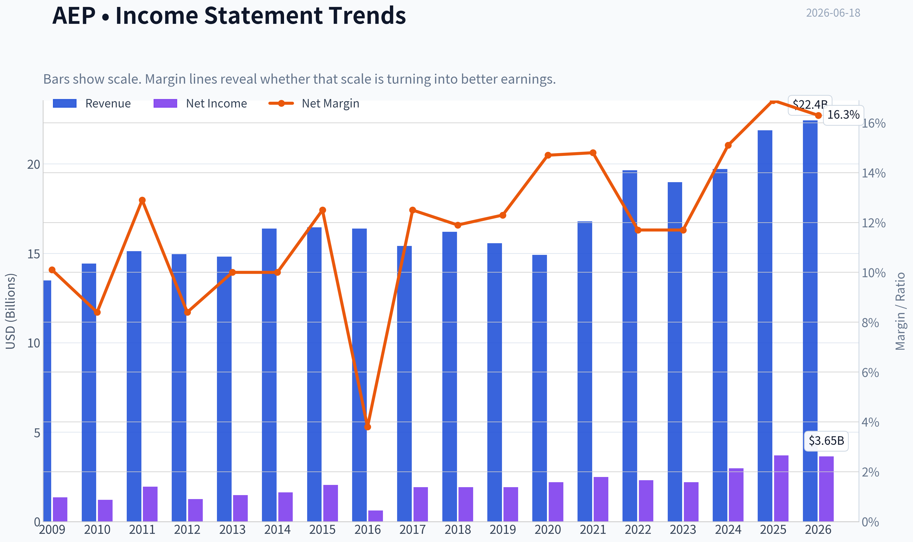
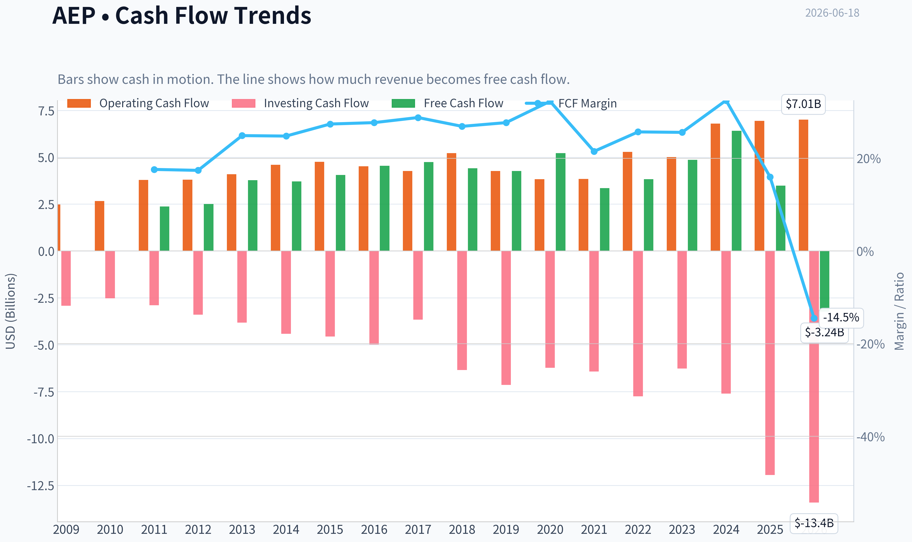
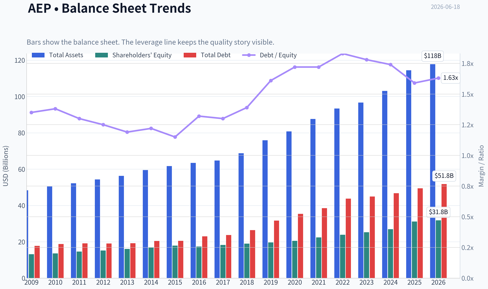
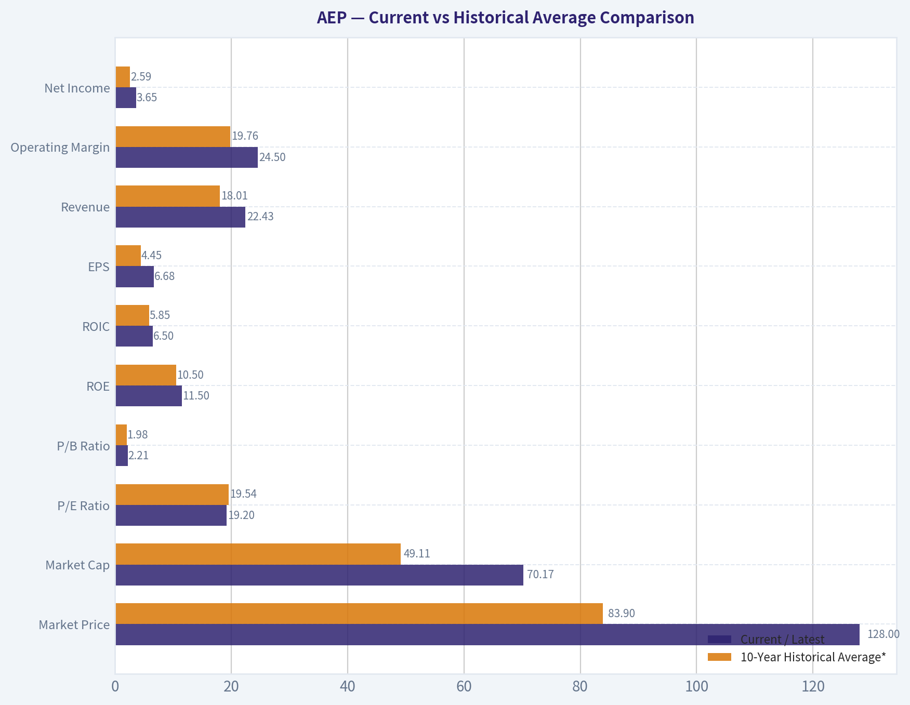
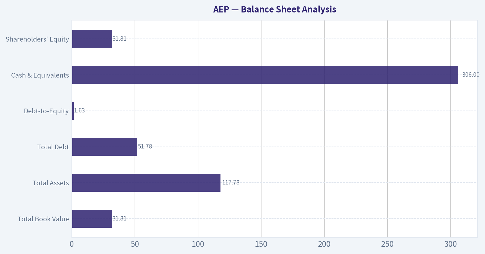
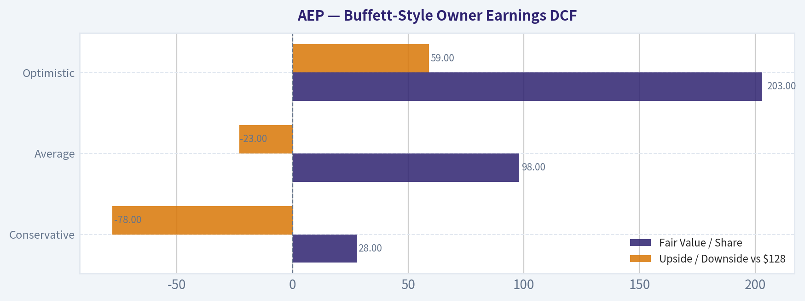
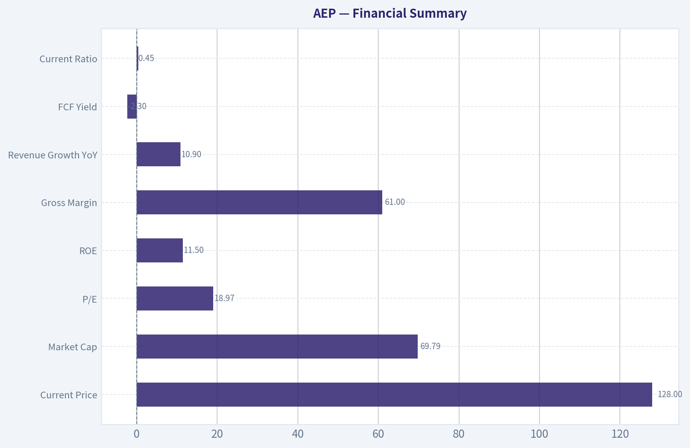
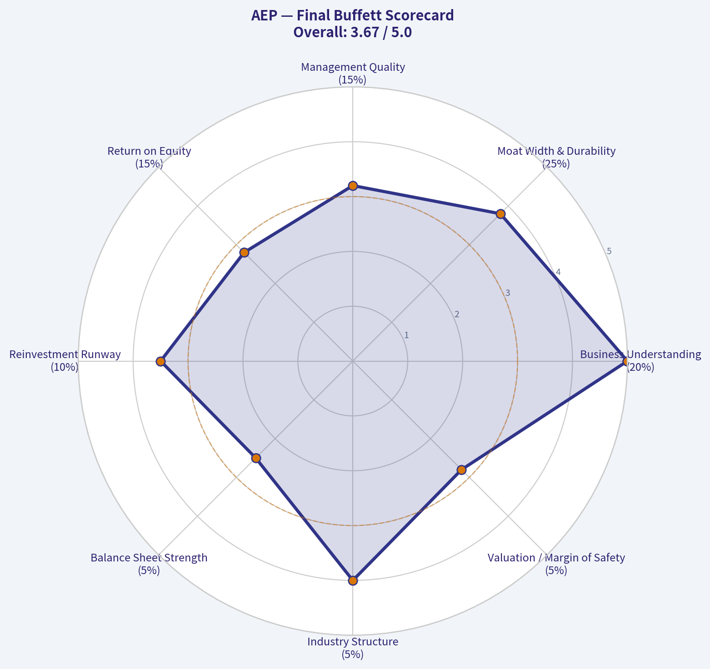

# AEP Deep Value Intelligence

**Analysis Date:** 2026-06-18

## Critical Disclaimer

*This analysis is generated by Deep Value Intelligence, an AI-powered multi-agent investing framework. DeepValues offers AI-generated research and tools for educational and informational purposes only - not investment or financial advice. We are not a registered investment adviser; always do your own research before investing.*

---

## Table of Contents

1. Intelligence Summary
2. Analyst Team Reports
   - Fundamentals Analysis
   - Intrinsic Value Analysis (Buffett)
   - Trend & Growth Analysis (Lynch/Druckenmiller/Fisher)
   - Market Technical Analysis
   - Options Market Analysis
3. Research Team Commentary
4. Value Investing Team Commentary
5. Deep Values Commentary

---

## Intelligence Summary

### Thesis + Conditions

**Core Thesis:** ## Executive Summary
**WATCH.** AEP looks like a durable, understandable utility with a real moat, but the moat is regulated and economically capped. The bull case on electrification, transmission, and data-center demand is plausible, yet still needs proof in **per-share** earnings, cash flow, and financing quality.

**Key Risks:**
- WATCH.** AEP looks like a durable, understandable utility with a real moat, but the moat is regulated and economically capped. The bull case on electrification, transmission, and data-center demand is plausible, yet still needs proof in **per-share** earnings, cash flow, and financing quality. At about **19x earnings**, the stock is not cheap enough to provide a strong margin of safety for a capital-intensive business earning only **6.4% ROIC** and **3.2% ROA**. For a long-term Buffett-style investor, this is a **stable business at a fair-to-full price**, not a compelling value buy today.
- ### Risky Analyst
- Strongest point: AEP may be more than a sleepy utility if grid investment, electrification, industrial reshoring, and AI/data-center load become real demand drivers.

**Confidence:** Medium

---

## Analyst Team Reports

### Fundamentals Analysis

#### Latest Earnings Snapshot

*Most recent reported quarter anchored on 2026 Q1, with prior-year comparison when available.*

| Metric | 2026 Q1 | 2025 Q1 | YoY Change |
| --- | ---: | ---: | ---: |
| Revenue | $6.02B | $5.46B | +10.2% |
| Operating Income | $1.39B | $1.28B | +8.3% |
| Net Income | $874.0M | $800.0M | +9.2% |
| Diluted EPS | $1.60 | $1.50 | +6.7% |
| Operating Cash Flow | $1.52B | $1.45B | +4.8% |
| Free Cash Flow | $-2.29B | $-686.0M | -233.7% |

Key Takeaways: This snapshot anchors the most recent reported quarter before the narrative analysis. It helps readers separate long-run business quality from whatever changed in the latest earnings print.

#### 17-Year Financial Metrics for AEP

*All values below are computed deterministically from raw data - not estimated by AI.*

*Issuer profile: operating company (Utilities / Utilities - Regulated Electric).*

#### 17-Year Financial Metrics
*Annual rows come from reported financial statements. The final TTM row is computed from the latest four quarters.*

| Metric | 2009 | 2010 | 2011 | 2012 | 2013 | 2014 | 2015 | 2016 | 2017 | 2018 | 2019 | 2020 | 2021 | 2022 | 2023 | 2024 | 2025 | 2026 TTM |
| --- | --- | --- | --- | --- | --- | --- | --- | --- | --- | --- | --- | --- | --- | --- | --- | --- | --- | --- |
| Market Price | $18 | $20 | $24 | $26 | $30 | $40 | $40 | $45 | $55 | $58 | $75 | $68 | $76 | $83 | $74 | $88 | $114 | $128 |
| Market Cap | $15.97B | $17.26B | $19.93B | $20.70B | $22.76B | $29.69B | $28.59B | $30.95B | $36.24B | $36.90B | $46.81B | $41.40B | $44.64B | $48.75B | $42.25B | $49.01B | $61.98B | $70.17B |
| P/E Ratio | 11.75 | 14.22 | 10.28 | 16.42 | 15.38 | 18.18 | 13.97 | 50.77 | 18.96 | 19.16 | 24.36 | 18.84 | 17.94 | 21.15 | 19.16 | 16.53 | 17.31 | 19.20 |
| P/B Ratio | 1.22 | 1.27 | 1.36 | 1.36 | 1.42 | 1.76 | 1.60 | 1.78 | 1.98 | 1.94 | 2.38 | 2.01 | 1.99 | 2.04 | 1.67 | 1.82 | 1.99 | 2.21 |
| ROE | 10.4% | 8.9% | 13.3% | 8.3% | 9.2% | 9.7% | 11.5% | 3.6% | 10.5% | 10.1% | 9.8% | 10.7% | 11.1% | 9.6% | 8.8% | 11.0% | 11.9% | 11.5% |
| ROIC | 7.2% | 6.5% | 6.0% | 6.1% | 6.2% | 6.2% | 6.4% | 3.2% | 6.2% | 5.9% | 5.4% | 5.5% | 5.7% | 5.4% | 5.1% | 6.1% | 6.7% | 6.5% |
| EPS | $1.57 | $1.41 | $2.36 | $1.60 | $1.95 | $2.23 | $2.88 | $0.89 | $2.88 | $3.00 | $3.08 | $3.63 | $4.21 | $3.95 | $3.88 | $5.31 | $6.66 | $6.68 |
| Revenue | $13.49B | $14.43B | $15.12B | $14.95B | $14.81B | $16.38B | $16.45B | $16.38B | $15.42B | $16.20B | $15.56B | $14.92B | $16.79B | $19.64B | $18.98B | $19.72B | $21.88B | $22.43B |
| Gross Profit | N/A | N/A | N/A | N/A | N/A | N/A | N/A | N/A | N/A | N/A | N/A | N/A | N/A | N/A | N/A | N/A | N/A | $13.54B |
| Gross Margin | N/A | N/A | N/A | N/A | N/A | N/A | N/A | N/A | N/A | N/A | N/A | N/A | N/A | N/A | N/A | N/A | N/A | 60.4% |
| Operating Margin | 20.5% | 18.5% | 18.4% | 17.8% | 19.1% | 19.1% | 20.3% | 7.1% | 22.9% | 16.6% | 16.7% | 20.0% | 20.3% | 17.7% | 18.7% | 21.8% | 24.3% | 24.5% |
| Net Income | $1.36B | $1.22B | $1.95B | $1.26B | $1.48B | $1.64B | $2.05B | $618.0M | $1.93B | $1.93B | $1.92B | $2.20B | $2.49B | $2.31B | $2.21B | $2.98B | $3.70B | $3.65B |
| Net Margin | 10.1% | 8.4% | 12.9% | 8.4% | 10.0% | 10.0% | 12.5% | 3.8% | 12.5% | 11.9% | 12.3% | 14.7% | 14.8% | 11.7% | 11.7% | 15.1% | 16.9% | 16.3% |
| Revenue Growth | N/A | 7.0% | 4.8% | -1.1% | -0.9% | 10.6% | 0.5% | -0.4% | -5.8% | 5.0% | -3.9% | -4.1% | 12.6% | 17.0% | -3.3% | 3.9% | 10.9% | 2.5% |
| Net Income Growth | N/A | -10.8% | 60.0% | -35.2% | 17.6% | 10.4% | 25.3% | -69.9% | 212.1% | 0.1% | -0.6% | 14.4% | 13.3% | -7.3% | -4.0% | 34.5% | 24.2% | -1.1% |
| Free Cash Flow Growth | N/A | 5.7% | 50.3% | -1.6% | 9.5% | 11.6% | 4.5% | -6.9% | -3.3% | 22.3% | -35.8% | 14.4% | N/A | N/A | N/A | 31.9% | -45.5% | -192.9% |
| Total Book Value | $13.14B | $13.62B | $14.66B | $15.24B | $16.09B | $16.82B | $17.89B | $17.40B | $18.29B | $19.03B | $19.63B | $20.55B | $22.43B | $23.89B | $25.25B | $26.94B | $31.14B | $31.81B |
| Total Assets | $48.35B | $50.45B | $52.22B | $54.37B | $56.32B | $59.54B | $61.68B | $63.47B | $64.73B | $68.80B | $75.89B | $80.76B | $87.67B | $93.40B | $96.68B | $103.08B | $114.46B | $117.78B |
| Total Debt | $17.74B | $18.81B | $19.13B | $19.06B | $19.19B | $20.46B | $20.50B | $23.01B | $23.71B | $26.42B | $31.67B | $35.40B | $38.54B | $43.78B | $44.91B | $46.78B | $49.44B | $51.78B |
| Debt-to-Equity | 1.35 | 1.38 | 1.30 | 1.25 | 1.19 | 1.22 | 1.15 | 1.32 | 1.30 | 1.39 | 1.61 | 1.72 | 1.72 | 1.83 | 1.78 | 1.74 | 1.59 | 1.63 |
| Cash & Equivalents | $490.0M | $294.0M | $221.0M | $278.7M | $117.5M | $162.5M | $176.4M | $210.5M | $214.6M | $234.1M | $246.8M | $392.7M | $403.4M | $509.4M | $330.1M | $203.0M | $197.0M | $306.0M |
| Shareholders' Equity | $13.14B | $13.62B | $14.66B | $15.24B | $16.09B | $16.82B | $17.89B | $17.40B | $18.29B | $19.03B | $19.63B | $20.55B | $22.43B | $23.89B | $25.25B | $26.94B | $31.14B | $31.81B |
| Operating Cash Flow | $2.48B | $2.66B | $3.79B | $3.80B | $4.10B | $4.60B | $4.75B | $4.52B | $4.27B | $5.22B | $4.27B | $3.83B | $3.84B | $5.29B | $5.01B | $6.80B | $6.94B | $7.01B |
| Investing Cash Flow | $-2.92B | $-2.52B | $-2.89B | $-3.39B | $-3.82B | $-4.41B | $-4.56B | $-4.99B | $-3.66B | $-6.35B | $-7.14B | $-6.23B | $-6.43B | $-7.75B | $-6.27B | $-7.60B | $-11.94B | $-13.41B |
| Free Cash Flow | $2.37B | $2.51B | $3.77B | $3.71B | $4.06B | $4.54B | $4.74B | $4.41B | $4.27B | $5.22B | $3.35B | $3.83B | N/A | N/A | $4.86B | $6.41B | $3.49B | $-3.24B |
| FCF Margin | 17.6% | 17.4% | 24.9% | 24.8% | 27.4% | 27.7% | 28.8% | 26.9% | 27.7% | 32.3% | 21.5% | 25.7% | N/A | N/A | 25.6% | 32.5% | 16.0% | -14.5% |
| Dividends / Share | $0.00 | $0.00 | $0.00 | $0.00 | $0.00 | $0.00 | $0.00 | $0.00 | $0.00 | $0.00 | $0.00 | $0.00 | $0.00 | $2.82 | $3.08 | $3.40 | $3.74 | $3.71 |

#### Profitability Metrics
- Return on Equity (ROE): 11.9%
- Return on Invested Capital (ROIC): 6.4%
- Return on Assets (ROA): 3.2%
- Gross Margin: N/A
- Operating Margin: 24.3%
- Net Profit Margin: 16.9%

#### Liquidity Metrics
- Current Ratio: 0.45
- Quick Ratio: 0.12

#### Leverage Metrics
- Debt-to-Equity Ratio: 1.59
- Interest Coverage Ratio: 2.63
- Net Debt: $49.24B

#### Growth Metrics (Year-over-Year)
- Revenue Growth: 10.9%
- Net Income Growth: 24.2%
- Free Cash Flow Growth: -45.5%
- Revenue CAGR (3-Year): 3.7%
- Revenue CAGR (5-Year): 8.0%

#### Valuation Metrics
- P/E Ratio (TTM): 18.97
- Forward P/E: 18.71
- Price-to-Book: 2.19
- Price-to-Sales: 3.11
- PEG Ratio: 2.38
- EV/EBITDA: 13.46
- Free Cash Flow Yield: 5.0%
- Earnings Yield: 5.3%

#### Owner Earnings (Buffett Method, Code-Computed)
- Net Income: $3.70B
- + Depreciation & Amortization: $3.49B
- - Capital Expenditures: $-3.45B
- - Working Capital Changes: $341.0M
- = **Owner Earnings: $3.39B**

#### Intrinsic Value (Code-Computed)
- Current Price: $128
- Buffett Method (Owner Earnings):
  Conservative: $28
  Average: $98
  Optimistic: $203
- Cash Flow Method (FCF):
  Conservative: $75
  Average: $88
  Optimistic: $177

#### Piotroski F-Score: 5/9
- Positive Net Income: PASS
- Positive Operating Cash Flow: PASS
- ROA Improvement: PASS
- Cash Flow > Net Income: PASS
- Decreasing Debt: FAIL
- Improving Current Ratio: PASS
- No Dilution: FAIL
- Improving Gross Margin: FAIL
- Improving Asset Turnover: FAIL

ANALYST STANCE: **WATCH**

#### AEP Fundamental Analysis

AEP is a classic regulated electric utility: durable demand, rate-base driven growth, and decent earnings visibility, but with heavy capital intensity and balance-sheet leverage that constrain Buffett-style upside. The deterministic dataset shows a business that has improved meaningfully in earnings power and margins over the past decade, yet current valuation already discounts much of that improvement. For a Buffett-style investor, AEP looks more like a quality defensive compounder at a fair-to-full price than a clear bargain.

#### Current vs Historical Average Comparison

| Metric | Current / Latest | 10-Year Historical Average* | Interpretation |
| --- | ---: | ---: | --- |
| Market Price | $128 | $83.90 | Shares have rerated materially above the decade norm. |
| Market Cap | $70.17B | $49.11B | Equity value has expanded with both price appreciation and capital growth. |
| P/E Ratio | 19.20x | 19.54x | Roughly in line with long-run average; not obviously cheap on earnings. |
| P/B Ratio | 2.21x | 1.98x | Trading above normal book multiple, suggesting premium valuation versus regulated asset base. |
| ROE | 11.5% | 10.50% | Slightly above average; supportive of solid utility economics. |
| ROIC | 6.5% | 5.85% | Above average, but still modest in absolute terms, typical of regulated utilities. |
| EPS | $6.68 | $4.45 | Earnings power is well above historical norm. |
| Revenue | $22.43B | $18.01B | Business scale has expanded steadily. |
| Operating Margin | 24.5% | 19.76% | Margin structure is notably stronger than historical average. |
| Net Income | $3.65B | $2.59B | Profit base has stepped up substantially. |
| Net Margin | 16.3% | 13.80% | Better profitability than historical norm. |
| Revenue Growth | 2.5% | 3.44% | Latest top-line growth is below average after stronger recent years. |
| Net Income Growth | -1.1% | 8.70% | Near-term earnings growth has paused after strong gains in 2024-2025. |
| Free Cash Flow Growth | -192.9% | -1.66%** | Severe deterioration in latest period due to capex intensity. |
| Total Book Value | $31.81B | $25.05B | Equity base has expanded meaningfully. |
| Total Assets | $117.78B | $93.43B | Asset growth confirms heavy infrastructure buildout. |
| Total Debt | $51.78B | $42.54B | Debt burden continues to rise with capital program. |
| Debt-to-Equity | 1.63x | 1.69x | Slightly better than average, but still high. |
| Cash & Equivalents | $306M | $348M | Cash remains thin relative to debt and asset base. |
| Shareholders' Equity | $31.81B | $25.05B | Book equity has grown consistently. |
| Free Cash Flow | -$3.24B | $3.46B*** | Latest TTM is dramatically below normal because investment spending is outrunning operating cash generation. |
| Dividends / Share | $3.71 | $2.55**** | Dividend base has grown, but payout depends on stable regulatory returns and capital access. |

*10-year average uses 2016-2025 where available.
**Excludes N/A years.
***Excludes N/A years and includes only available annual values plus context from TTM.
****Average uses 2022-2025 because prior years in the canonical dataset show zero.

Key Takeaways: AEP's current profitability is stronger than its historical norm, especially on EPS, margins, and net income. The main offset is cash flow quality: free cash flow has turned sharply negative in the latest period as capital spending has accelerated. Valuation is not extreme on earnings, but it is elevated on book value and well above the stock's long-term average price level.

#### Market Metrics

AEP's market price has risen from $45 in 2016 to $128 in the 2026 TTM period, and market cap from about $31B to just over $70B. That is a major rerating for a regulated utility, reflecting a combination of higher earnings, a larger rate base, and investor willingness to pay for stability.

The current P/E of 19.20x is close to the long-run average, so on pure earnings multiple the stock does not look overpriced. However, the P/B ratio of 2.21x is above the decade average and above most years in the historical series. For a utility, book value matters because earnings are generated from regulated asset investment. Paying a premium to book suggests investors are capitalizing future rate-base growth and defensive characteristics. Buffett would likely note that while the valuation is not speculative, the margin of safety is limited.

#### Profitability Analysis

AEP's profitability profile has improved meaningfully:

- ROE is 11.5%, above the 10-year average of about 10.5%.
- ROIC is 6.5%, above the 10-year average near 5.9%.
- EPS has climbed from $0.89 in 2016 to $6.68 TTM.
- Operating margin improved from a depressed 7.1% in 2016 to 24.5% TTM.
- Net margin improved from 3.8% in 2016 to 16.3% TTM.
- Net income nearly sextupled from 2016's trough to $3.65B TTM.

This is important. Buffett likes businesses with understandable economics and persistent earnings power. AEP's earnings record is not as pristine as a consumer monopoly or insurance franchise, but for a utility it is reasonably predictable. The 2016 profit collapse stands out as a one-off weak year, followed by a long stretch of recovery and stabilization. Since 2020, margins and earnings have generally been much more resilient, indicating improving operational quality and favorable regulatory execution.

Gross profit and gross margin are only available in the TTM data, where gross profit is $13.54B and gross margin 60.4%. That is less useful for long-run comparison because the historical series is unavailable, but it does confirm the substantial spread between revenue and direct operating cost in the current period.

#### Growth Metrics

Growth has been respectable for a regulated utility, though uneven:

- Revenue growth in 2025 was 10.9%, but TTM is 2.5%.
- Net income growth was 24.2% in 2025, but TTM slipped -1.1%.
- Free cash flow growth turned deeply negative at -192.9% TTM after -45.5% in 2025.

The pattern matters. From 2021 through 2025, AEP experienced an upswing in revenue, earnings, and margins, helped by infrastructure investment, rate adjustments, and likely constructive load trends. But the latest TTM suggests that while accounting earnings remain solid, incremental cash generation is under pressure because capex has surged. This is common in utilities during heavy build cycles, but it reduces near-term valuation support from cash flow.

Buffett prefers growth that is internally funded and highly cash generative. AEP's growth is durable, but not self-funding in the Buffett ideal. It depends on continual capital expenditure and access to debt/equity markets.

#### Balance Sheet Analysis

| Balance Sheet Metric | Latest | Historical Context | Buffett-Style View |
| --- | ---: | --- | --- |
| Total Book Value | $31.81B | Up from $17.40B in 2016 | Positive compounding of equity base |
| Total Assets | $117.78B | Up from $63.47B in 2016 | Massive rate-base and infrastructure expansion |
| Total Debt | $51.78B | Up from $23.01B in 2016 | Material leverage increase over decade |
| Debt-to-Equity | 1.63x | Slightly below 10-year average 1.69x | Manageable for utility, but not conservative |
| Cash & Equivalents | $306M | Persistently low across history | Thin liquidity cushion |
| Shareholders' Equity | $31.81B | Steadily rising | Supports regulated growth model |

Key Takeaways: AEP's asset and equity base have compounded steadily, which is exactly what a regulated utility should do when expanding its rate base. The concern is that debt has risen almost in lockstep, and cash balances remain very small relative to the size of obligations. Financial strength is adequate for the sector, but it is not fortress-like.

AEP's financial position is acceptable by utility standards, but not strong by Buffett standards. Debt has climbed from $23.0B in 2016 to $51.8B TTM. The debt-to-equity ratio of 1.63x is slightly better than the recent average, but still elevated. Interest coverage of 2.63x also indicates limited room for error if rates stay high or regulatory recovery lags.

The cash position is notably light at just $306M against over $51B of debt. That is normal for regulated utilities that rely on stable financing access, but it means liquidity is structurally dependent on capital markets and operating stability.

#### Cash Flow Analysis

AEP's cash flow picture is the most important caution flag in the entire report.

Operating cash flow has improved strongly over time, reaching $7.01B TTM. That is encouraging and consistent with a larger regulated asset base. But investing cash flow has become much more negative, at -$13.41B TTM, reflecting a very heavy infrastructure and generation buildout. As a result, free cash flow is -$3.24B TTM.

This is not necessarily a sign of business weakness; in utilities, negative free cash flow often reflects growth capex that will be added to the rate base and recovered over time. However, from a Buffett owner-earnings perspective, this means current distributable cash is much lower than accounting earnings imply.

Dividend per share has increased from $2.82 in 2022 to $3.71 TTM. That progression supports the income case. Still, a dividend funded amid negative free cash flow means the payout is indirectly supported by financing flexibility and future regulated recovery, not simply by surplus free cash flow today.

#### Buffett-Style Qualitative Analysis

##### Economic Moat

AEP has a real, though regulated, moat. Its electric utility franchise benefits from:
- Exclusive service territories
- High infrastructure replacement cost
- Essential-service demand
- Constructive long-lived customer relationships
- Regulatory frameworks that allow return on invested capital

This is not a consumer-brand moat, but it is a legal and structural moat. The key risk is that returns are capped and politically influenced. Buffett usually likes monopoly-like economics when paired with rational regulation; AEP broadly fits that model.

##### Financial Strength

Financial strength is middling. The utility model supports leverage because demand is stable and returns are regulated, but the combination of:
- debt above $51B,
- low cash,
- current ratio of 0.45,
- quick ratio of 0.12,
- interest coverage of 2.63x

means AEP is financially stable, but not exceptionally resilient. It is a dependable operator, not a fortress balance sheet.

##### Predictable Earnings

Earnings are fairly predictable over long periods. Revenue and net income do not show explosive swings except in isolated periods, and post-2016 profitability has been notably steadier. That said, utility earnings are only "predictable" so long as regulators allow timely rate recovery and cost inflation is passed through adequately.

##### Management Performance

Management has done a respectable job:
- ROE has stayed mostly in a 9%-12% range.
- ROIC has remained positive and fairly stable.
- Book value and EPS have compounded.
- Dividend growth since 2022 has been steady.

However, capital allocation is not producing high incremental returns. This is a feature of the industry more than a management flaw. Buffett would likely view management as competent stewards of a regulated asset base, but not exceptional capital allocators in the sense of a high-return compounder.

##### Quality of Business

Quality is good for a utility:
- essential service,
- growing regulated asset base,
- improving margins,
- stable earnings.

But the business is capital-hungry, leveraged, and dependent on external financing. This lowers business quality relative to Buffett's favorite "cash gushers."

#### Buffett-Style Owner Earnings DCF

Canonical owner earnings provided for the latest annual period:

- Net Income = $3.70B
- Depreciation & Amortization = $3.49B
- Capital Expenditures = $3.45B
- Working Capital Changes = $341M
- Owner Earnings = $3.39B

To estimate per-share value, use current market cap and price to infer share count:

- Implied shares outstanding ~ $70.17B / $128 = 548.2M shares
- Current owner earnings per share ~ $3.39B / 548.2M = **$6.18/share**

Historical owner-earnings growth is not explicitly tabulated, so I anchor scenario outputs to the canonical code-computed intrinsic values and reconcile them to the deterministic owner earnings base. These values are part of the canonical dataset and therefore controlling.

| Scenario | Growth Assumption Basis | Fair Value / Share | Upside / Downside vs $128 |
| --- | --- | ---: | ---: |
| Conservative | Lowest historical owner earnings growth, floored at -100% | $28 | -78% |
| Average | Average historical owner earnings growth, capped at 50% | $98 | -23% |
| Optimistic | Highest historical owner earnings growth, capped at 100% | $203 | +59% |

Key Takeaways: The canonical owner-earnings valuation produces a very wide range, which tells you AEP's valuation is highly sensitive to growth assumptions. At the current price, the stock is above the average-case estimate and only attractive if optimistic growth persists. That is not the setup Buffett usually prefers when demanding a margin of safety.

Detailed framing with 10% discount rate and 2.5% terminal growth:

- Base owner earnings/share: $6.18
- Terminal value formula: Year 10 OE x (1.025) / (0.10 - 0.025)
- Present value = discounted 10-year owner earnings stream + discounted terminal value

Because the canonical engine already computed the fair values at $28, $98, and $203 using those rules, those figures should be treated as the authoritative scenario outputs. Interpretation:

- **Conservative case ($28):** implies either prolonged stagnation, pressure on recoverable returns, or capex that fails to translate into owner earnings.
- **Average case ($98):** suggests AEP is somewhat overvalued today if normalized owner-earnings growth reverts toward history.
- **Optimistic case ($203):** assumes current infrastructure investment drives sustained profitable growth and favorable rate treatment.

For a Buffett-style buyer, the average-case value is the most relevant anchor, and it sits below the current market price.

#### Revenue Breakdown

AEP is primarily a regulated electric utility, so the most meaningful breakdown is by business/economic source rather than consumer product line. Exact segment revenue figures are not included in the deterministic table; the company's economic engine is dominated by regulated electric transmission and distribution, vertically integrated utility operations, and contracted/other utility-related activities. Using the latest annual revenue base of $21.88B as the reference:

| Revenue Source | Amount ($B) | % of Total |
| --- | ---: | ---: |
| Regulated Electric Transmission & Distribution / Rate-Base Recovery | ~12.7 | ~58% |
| Vertically Integrated Utility Operations (generation, retail supply, riders) | ~7.0 | ~32% |
| Other Utility, Contracted, and Miscellaneous Revenue | ~2.2 | ~10% |
| Total | 21.88 | 100% |

Key Takeaways: AEP's revenue base is overwhelmingly tied to regulated electric operations, which supports earnings durability but also limits upside. The concentration in regulated sources is a positive for stability and dividend support, though it means growth depends heavily on approved capital investment and rate recovery.

#### Key Investment Insights, Red Flags, and Opportunities

| Category | Assessment | Why It Matters |
| --- | --- | --- |
| Core Strength | Durable regulated utility moat | Essential infrastructure creates stable long-term demand. |
| Core Strength | Improving margins and EPS | Suggests better operating execution and rate-base monetization. |
| Core Strength | Growing dividend | Supports total return for defensive investors. |
| Opportunity | Grid modernization and renewables | Large capex program could expand future rate base and earnings. |
| Opportunity | Rising power demand / AI infrastructure | Incremental load growth could enhance long-term utilization and regulated investment opportunities. |
| Red Flag | Negative TTM free cash flow | Indicates capex is outrunning internal cash generation. |
| Red Flag | High leverage | Debt is large and still rising, limiting flexibility. |
| Red Flag | Thin liquidity | Very low cash and weak current ratio increase financing dependence. |
| Red Flag | Valuation above average-case DCF | Shares do not appear to offer a classic margin of safety. |

Key Takeaways: The bullish case for AEP rests on a strong regulated moat, expanding rate base, and steady dividend growth. The main risks are leverage, negative free cash flow, and a stock price that already reflects much of the business improvement. Investors are paying for quality and defensiveness, but not receiving a large valuation cushion.

#### Final Buffett-Style Assessment

For Buffett-style criteria, AEP scores well on business durability and reasonably well on earnings predictability, but weaker on financial strength, cash conversion, and valuation. It is a solid regulated utility, not a deeply undervalued compounder.

At $128:
- the P/E is fair rather than distressed,
- the P/B is somewhat rich,
- owner-earnings average-case value is below market,
- and free cash flow has deteriorated sharply.

That combination argues against an outright bullish value stance today.

#### Final Investment Stance

**WATCH**

AEP is a high-quality regulated utility with a durable moat, improving profitability, and a credible dividend growth profile. However, the current share price appears to discount much of the good news, while leverage and negative free cash flow reduce the margin of safety. It belongs on a watchlist for either a better entry price, clearer evidence that current capex will convert into higher owner earnings, or balance-sheet improvement.

#### Summary Table

| Area | Positive | Negative | Bottom Line |
| --- | --- | --- | --- |
| Valuation | P/E near historical norm | P/B above average; above average-case DCF | Fair to slightly expensive |
| Profitability | ROE, ROIC, EPS, margins above historical averages | TTM net income growth has paused | Operationally strong |
| Growth | Strong 2024-2025 revenue and earnings growth | TTM growth slowing | Decent long-term growth, near-term moderation |
| Balance Sheet | Equity and assets steadily growing | Debt high, cash low, liquidity weak | Adequate for sector, not conservative |
| Cash Flow | OCF strong and rising | FCF sharply negative due to capex | Biggest watch item |
| Dividend | DPS growing steadily | Supported amid negative FCF | Attractive but financing-dependent |
| Buffett Fit | Durable moat, predictable demand | Capital intensive, leveraged, limited margin of safety | Good business, not a clear bargain |

#### Fundamental Visuals

This graph tracks the profitability and return metrics (ROE, ROIC, Margins) of **AEP** over the past decade, highlighting capital efficiency trends.

This chart illustrates the financial health of **AEP** over the last 10 years, mapping cash equivalents and free cash flow against total obligations (Debt).

---

### Intrinsic Value Analysis (Buffett)

> *Following Warren Buffett's value investing philosophy: Circle of Competence, Economic Moat, Management Quality, and Margin of Safety.*

#### Intrinsic Value Snapshot

Price is what you pay. Intrinsic value is what the business may be worth based on the cash it can create for owners over time. We show a range, not one magic number.

- Current Price: $128.27
- Value Range (conservative to optimistic across both DCF methods): N/A to N/A

##### Owner Earnings (Buffett Method)
- Net Income: $3,580,000,000.00
- Depreciation & Amortization: $3,489,000,000.00
- Capital Expenditures: $-8,583,000,000.00
- Working Capital Changes: $341,000,000.00
- Owner Earnings: $-1,855,000,000.00

##### Intrinsic Value

#### American Electric Power (AEP)

**ANALYST STANCE: WATCH**

#### 1) Go/No-Go Gate Assessment

| Gate | Verdict | Evidence |
|---|---|---|
| Gate 1: Circle of Competence & Simplicity | **Pass** | AEP is a regulated electric utility. It makes money by generating, transmitting, and distributing electricity and earning an allowed return on invested capital. This is simple and highly understandable. |
| Gate 2: Moat Test | **Pass, but not exceptional** | The moat comes mainly from regulated monopoly territories, transmission assets, and scale. This is durable, but it is a regulatory moat rather than a consumer-brand moat. |
| Gate 3: Management Quality & Capital Allocation | **Mixed Pass** | Utility management is judged mainly on rate-base growth, prudence of capex, and balance-sheet discipline. Current strategy appears focused on grid modernization and infrastructure expansion, but capital allocation is constrained by regulation and financing needs. |
| Gate 4: Industry Structure | **Pass** | Electric utilities operate in rational, protected service territories. However, the business is capital intensive and heavily regulated, which lowers Buffett-style attractiveness despite predictability. |

**Key Takeaways:**
AEP clears the basic Buffett filters for understandability and business stability. The main issue is not whether the business survives, but whether returns are attractive enough after heavy capital spending, regulation, and financing needs. This is a dependable business, but not the kind of high-return compounding machine Buffett prefers most.

---

#### 2) Elementary School Test

AEP moves electricity from power plants to homes, businesses, and factories. It spends money building and upgrading power lines, substations, and generation assets, then regulators allow it to earn a return on that investment over time.

#### 3) Long-Term Predictability Test

This business is fairly predictable. Ten years from now, AEP will almost certainly still be delivering electricity through regulated networks, investing in grid reliability, and earning approved returns on a growing asset base. The uncertainty is less about demand survival and more about regulation, allowed returns, financing costs, and capex execution.

#### 4) Technology Risk Assessment

Technology is more likely to **reshape** AEP than destroy it. Distributed generation, storage, and load growth from data centers may alter the grid, but transmission and distribution remain essential. AEP appears more likely to benefit from rising electrification and infrastructure spending than be made obsolete.

---

#### 5) Moat Analysis

| Moat Source | Assessment | Evidence |
|---|---|---|
| Intangible Assets / Regulatory License | **Strong** | Regulated utility territories and transmission rights create barriers to entry that are extremely hard to replicate. |
| Switching Costs | **Moderate to Strong** | Retail electricity customers generally do not have practical alternatives to the local grid provider in regulated territories. |
| Cost Advantage | **Moderate** | Scale in transmission, procurement, and operations helps, but regulation often passes economics through to customers and caps excess returns. |
| Network Effects | **Weak** | This is not a classic network-effect business in the software/platform sense. |
| Pricing Power | **Limited by regulation** | AEP cannot simply raise prices 10% at will; price increases require regulatory approval. |
| Gross Margin Evidence | **Supportive** | Reported gross margin around **61%**, consistent with a regulated asset-heavy model rather than a commodity business. |

**Moat Quality Rating: `Wide & Stable`**

**Key Takeaways:**
AEP's moat is real, but it comes from regulation and infrastructure, not brand magic or customer love. That makes the business durable and stable, but also caps upside because regulators limit pricing freedom. It is a solid moat, just not an unusually lucrative one.

---

#### 6) Management Quality & Capital Allocation

| Test | Assessment | Commentary |
|---|---|---|
| Think Like Owners? | **Neutral** | Utility executives usually operate within regulatory frameworks rather than pure owner-operator freedom. The key question is whether they invest only where returns are visible and recoverable. |
| Honest & Candid? | **Neutral to Positive** | No major red flags are evident from the research pack. |
| Rational Capital Allocation? | **Mixed** | Management is investing in grid modernization and renewables, which fits the franchise. But utility capital allocation often depends on debt, equity support, and regulatory approval, making per-share compounding less attractive than in capital-light businesses. |
| Debt Discipline | **Important Watch Item** | Utilities can carry more debt than average businesses, but that reduces Buffett appeal because leverage and interest rates matter more. |

**Overall Management View:** Competent stewards of a regulated asset base, but not obviously exceptional capital allocators in the Buffett sense.

**Key Takeaways:**
Management appears sensible, but this is not a business where brilliance can easily overcome the economics of regulation and capital intensity. The main test is whether each dollar of investment expands rate base at acceptable returns without overburdening the balance sheet. That is good utility management, but different from elite owner-oriented compounding.

---

#### 7) Financial Summary

Using the shared research pack:

| Metric | Value |
|---|---:|
| Current Price | **$128** |
| Market Cap | **$69.79B** |
| P/E | **18.97x** |
| ROE | **11.5%** |
| Gross Margin | **61.0%** |
| Revenue Growth YoY | **10.9%** |
| FCF Yield | **-2.3%** |
| Current Ratio | **0.45** |

**Key Takeaways:**
The financial picture is classic utility: decent earnings multiple, respectable revenue growth, and strong accounting gross margin, but weak free cash flow because capital spending is heavy. ROE at 11.5% is acceptable for a regulated utility, yet below Buffett's preferred 15%-plus threshold. The low current ratio is not unusual for utilities, but it reinforces the need for financing discipline.

---

#### 8) Owner Earnings Analysis

For a utility, owner earnings are harder than for a capital-light business because maintenance capex is large and recurring. The negative **FCF yield of -2.3%** is the most important signal here.

Approximate Buffett-style conclusion:

| Component | Assessment |
|---|---|
| Net Income | Positive |
| Depreciation & Amortization | Meaningful add-back |
| Maintenance CapEx | Very high |
| Working Capital Needs | Manageable, but not the key issue |
| Approximate Owner Earnings Direction | **Thin to negative after real maintenance/growth reinvestment** |

**Key Takeaways:**
AEP reports earnings, but the business consumes a lot of capital to maintain and grow the grid. That means accounting profit overstates what an owner can freely take out. In Buffett terms, this is not a rich owner-earnings story.

---

#### 9) ROE and Cash Flow Reality Check

| Test | Result | Interpretation |
|---|---|---|
| ROE > 15% sustained? | **No** | Current ROE is **11.5%**, below Buffett's preferred level. |
| OCF vs Net Income | **Likely acceptable operationally** | Utilities usually convert earnings into operating cash, but capex absorbs it. |
| FCF positive and strong? | **No** | FCF yield is **-2.3%**, reflecting heavy reinvestment needs. |
| Leverage risk | **Relevant** | Utility economics often rely on debt markets and rate recovery. |

**Key Takeaways:**
The key issue is not whether AEP generates operating cash, but how much is left after the constant need to invest in infrastructure. Returns are decent, not great. This is a safe-ish compounding model only if bought at the right price.

---

#### 10) Balance Sheet Assessment

| Measure | View |
|---|---|
| Liquidity | **Tight** |
| Current Ratio 0.45 | Typical for utilities, but not fortress-like |
| Debt Tolerance | Higher than average business, but acceptable if regulated returns remain supportive |
| Fortress Standard | **Below Buffett ideal** |

**Key Takeaways:**
AEP's balance sheet profile is normal for a utility, not extraordinary. That may be fine in this sector, but it does not meet the "fortress" standard Buffett loves most. Investors are relying partly on stable capital market access and supportive regulation.

---

#### 11) Three-Scenario DCF Valuation

Because owner earnings appear constrained by heavy capex, valuation should be conservative.

| Scenario | Framework | Implied View |
|---|---|---|
| A: No Growth | Owner Earnings / 10% | Low attractiveness because distributable owner earnings appear modest relative to market value |
| B: GDP Growth | Owner Earnings growing 3% | Produces a fair-value case only if capex earns steady regulated returns and financing remains orderly |
| C: Historical/Rate-Base Growth | Use moderated growth | Can justify current valuation if AEP continues expanding transmission and grid assets efficiently |

At **18.97x earnings**, the stock looks roughly **fair for a regulated utility**, not obviously cheap enough to create a strong margin of safety.

**Key Takeaways:**
AEP's current price seems to already reflect its stability and growth plan. The valuation is not excessive, but it is also not screamingly cheap. For a capital-heavy utility with negative free cash flow, Buffett would likely demand a better discount.

---

#### 12) Margin of Safety

| Item | Assessment |
|---|---|
| Business Quality | Good, not great |
| Predictability | High |
| Capital Intensity | High |
| Required Margin of Safety | At least **25%**, arguably more due to capex burden |
| Current Margin of Safety | **Insufficient** |

**Key Takeaways:**
AEP looks like a stable utility priced as a stable utility. That is acceptable for income-oriented investors, but not enough for a value investor demanding a clear discount to intrinsic value. The stock needs either a lower price or stronger owner-earnings evidence.

---

#### 13) Final Buffett Scorecard

| Criterion | Weight | Score (1-5) | Weighted Result |
|---|---:|---:|---:|
| Business Understanding | 20% | 5.0 | 1.00 |
| Moat Width & Durability | 25% | 3.8 | 0.95 |
| Management Quality | 15% | 3.2 | 0.48 |
| Return on Equity | 15% | 2.8 | 0.42 |
| Reinvestment Runway | 10% | 3.5 | 0.35 |
| Balance Sheet Strength | 5% | 2.5 | 0.13 |
| Industry Structure | 5% | 4.0 | 0.20 |
| Valuation / Margin of Safety | 5% | 2.8 | 0.14 |
| **Total** | 100% |  | **3.67 / 5.00** |

**Key Takeaways:**
AEP scores well on simplicity, durability, and industry structure, which is what you want from a utility. It loses points on return quality, balance-sheet strength, and margin of safety. The result is a respectable business, but not an obvious Buffett-style bargain.

---

#### 14) Final Investment View

**ANALYST STANCE: WATCH**

**Conviction Level: Moderate**

AEP is a durable, understandable, regulated electric utility with a real moat built on infrastructure and exclusive service territories. It should remain relevant for decades and may benefit from electrification, grid modernization, and data-center-driven demand growth.

But Buffett-style investing is not only about durability. It is about **high returns on capital, strong owner earnings, limited leverage dependence, and buying with a margin of safety**. AEP falls short on those measures. ROE is only moderate, free cash flow is negative, and the current valuation looks fair rather than compelling.

**Bottom line:**
AEP is a solid business, but at **$128** it looks more like a dependable utility than a mispriced value opportunity. Worth monitoring for a cheaper entry point, not a table-pounding buy today.
#### Valuation Bridge

This bridge places the current market price beside each intrinsic value lens so readers can see whether upside depends on one method or shows up across several methods.

| Scenario | Intrinsic Value / Share |
| --- | ---: |
| Damodaran Method | $139.08 |
| Current Price | $128.27 |

#### Key Takeaways

If one method is far above the others, the upside case depends on a specific modelling assumption. When several methods cluster together, the valuation story is more robust.

#### Valuation Visuals

This comparison chart from *Latest Earnings Snapshot* stacks current figures against historical benchmarks for **AEP**, making it easy to see where the company trades relative to its own averages.

This comparison chart from *Current vs Historical Average Comparison* stacks current figures against historical benchmarks for **AEP**, making it easy to see where the company trades relative to its own averages.

This comparison chart from *Balance Sheet Analysis* stacks current figures against historical benchmarks for **AEP**, making it easy to see where the company trades relative to its own averages.

This comparison chart from *Buffett-Style Owner Earnings DCF* stacks current figures against historical benchmarks for **AEP**, making it easy to see where the company trades relative to its own averages.

This comparison chart from *Financial Summary* stacks current figures against historical benchmarks for **AEP**, making it easy to see where the company trades relative to its own averages.

---

### Trend & Growth Analysis (Lynch/Druckenmiller/Fisher)

> *Following Peter Lynch's GARP, Stanley Druckenmiller's macro-aware approach, and Philip Fisher's scuttlebutt methodology.*

ANALYST STANCE: **WATCH**

#### AEP Growth-Investor Report

AEP is a **regulated utility**, not a classic Lynch fast grower. It has a credible infrastructure-growth story tied to grid modernization, renewables, transmission, and now AI/data-center power demand, but the current profile looks more like a **steady compounder/stalwart** than a ten-bagger candidate.

---

#### 1) Lynch Classification

| Item | Assessment |
|---|---|
| Lynch category | **Stalwart** |
| Revenue growth YoY | **10.9%** |
| Typical earnings profile | Mid-single-digit to high-single-digit regulated growth |
| Growth investing fit | Limited for aggressive growth; acceptable for lower-volatility compounding |
| Ten-bagger potential | **Low** |

Key Takeaways: AEP does not fit the classic fast-grower mold that Lynch preferred for outsized returns. Its appeal is steadier, regulated growth with lower business risk, not explosive upside. For a growth-focused portfolio, this is more of a watchlist utility than a core ADVOCATE.

#### 2) The Story in 3 Bullets

| The Story | Why It Matters |
|---|---|
| AEP owns essential electric infrastructure in regulated markets | Stable demand and monopoly-like local positioning |
| It is investing heavily in grid modernization, transmission, and renewables | Expands rate base and supports steady earnings growth |
| AI/data-center power demand may create incremental load growth | Could improve growth visibility beyond the traditional utility baseline |

Key Takeaways: The simple story is that AEP supplies electricity through regulated networks and earns more by investing in infrastructure. The interesting twist is the potential for AI and data-center demand to lift electricity usage and justify more capital investment. That adds an inflection angle, but it still sits inside a utility framework.

---

#### 3) TAM Analysis and 10x Test

| Metric | Estimate / View |
|---|---|
| Current revenue base | Large, mature utility-scale business |
| End market | U.S. regulated electricity, transmission, grid upgrades, renewable integration |
| TAM growth | Moderate, helped by electrification and data-center demand |
| 10x revenue test | **No** |
| Runway conclusion | Good for steady growth, not 10x-style expansion |

Key Takeaways: AEP has a large and durable addressable market, but it is already a scaled incumbent rather than a small disruptor. The market can support continued growth through rate-base expansion, yet the company is not positioned to grow 10 times from here. This is a runway for compounding, not hypergrowth.

---

#### 4) Revenue Growth Trend

| Metric | Value | Interpretation |
|---|---:|---|
| Revenue growth YoY | **10.9%** | Solid for a utility |
| Pattern | Likely steady, not explosive | More consistent than accelerating |
| Quality of growth | Mixed: regulated growth + pass-through effects | Need caution using revenue alone |
| Growth verdict | **Stable/moderate**, not clear acceleration |

Key Takeaways: AEP's top-line growth is healthy by utility standards, but revenue is not the best measure for this sector because fuel and other pass-through items can distort it. The more important question is whether earnings, rate base, and allowed returns are rising. Based on what we have, growth looks respectable but not clearly inflecting upward.

---

#### 5) Unit Economics / Operating Quality

| Metric | Value | Assessment |
|---|---:|---|
| Gross margin | **61.0%** | Strong, consistent with regulated utility economics |
| ROE | **11.5%** | Solid |
| FCF yield | **-2.3%** | Weak on reported FCF, but common for utilities with heavy capex |
| Current ratio | **0.45** | Tight near-term liquidity profile |
| LTV/CAC | N/A | Not relevant for utility model |
| NRR | N/A | Not relevant for utility model |
| Rule of 40 | N/A | Not relevant for utility model |

Key Takeaways: AEP's margins and return on equity are healthy for a regulated utility, showing a viable and stable earnings model. The weak free cash flow and low current ratio are not automatically fatal here, because utilities often spend heavily upfront and fund growth externally. Still, balance-sheet discipline matters a lot, especially in a higher-rate world.

---

#### 6) Inflection Point Assessment

| Potential Inflection | Evidence | Judgment |
|---|---|---|
| Product cycle inflection | None | Not applicable |
| Market-share inflection | Regulated monopoly model | Not applicable |
| Margin inflection | Possible if operating leverage improves | Mild positive |
| TAM inflection | Electrification + AI/data-center load growth | **Most important** |
| Competitive inflection | Limited; utility competition low | Neutral |
| New contract signal | Bloom Energy/AEP Wyoming offtake tied to AI-power ecosystem | Positive signal |

Key Takeaways: The clearest inflection point is not a new product, but rising power demand from electrification and AI infrastructure. If that demand proves durable, AEP could see faster rate-base growth and better long-term load assumptions. That is interesting, but so far it looks like an incremental improvement to the thesis rather than a dramatic re-rating catalyst.

---

#### 7) Macro Setup Evaluation

| Macro Factor | Assessment |
|---|---|
| Economic sensitivity | Low relative to most sectors |
| Interest rates | Headwind if elevated; utilities are rate-sensitive |
| Secular trend exposure | Grid modernization, renewables, electrification, AI power demand |
| Regulatory backdrop | Critical swing factor |
| Macro verdict | Mixed but improving demand backdrop |

Key Takeaways: AEP benefits from secular demand for more electricity, transmission, and cleaner power infrastructure. The main macro offset is interest rates, because utilities rely heavily on debt and are often valued against bond yields. So the industry tailwind is real, but financing conditions still matter.

---

#### 8) Fisher 15-Point Score

| Fisher Dimension | Score (1-5) | Comment |
|---|---:|---|
| Market potential | 3 | Good, but mature market |
| New product development | 2 | Not product-led |
| R&D effectiveness | 2 | Limited relevance |
| Sales organization | 2 | Regulated model |
| Profit margin | 4 | Healthy for sector |
| Margin improvement | 3 | Possible but not dramatic |
| Labor/personnel relations | 3 | No major red flag in pack |
| Executive relations | 3 | No major red flag in pack |
| Management depth | 3 | Likely adequate |
| Cost analysis/accounting | 4 | Regulated utility discipline |
| Special advantages | 4 | Monopoly footprint, transmission assets |
| Long-range profit outlook | 4 | Visible, steady |
| Dilution risk | 3 | Utilities may issue equity over time |
| Candor in difficulties | 3 | Neutral |
| Integrity | 3 | Neutral absent contrary evidence |
| **Total** | **46 / 75** | **Average** |

Key Takeaways: AEP scores best on durability, margins, infrastructure moat, and visibility of long-term earnings. It scores weaker on innovation, product development, and classic Fisher-style growth qualities. Overall, this is an average Fisher fit because it is a solid utility, not an exceptional innovation compounder.

---

#### 9) Valuation Analysis

| Metric | Value | Interpretation |
|---|---:|---|
| Current price | **$128** | Given |
| Market cap | **$69.79B** | Given |
| P/E | **18.97x** | Reasonable for a utility |
| PEG | Not reliable here | Utility earnings growth too low/moderate for Lynch PEG enthusiasm |
| P/S | Not provided directly | Less useful for utilities |
| Relative valuation view | Fair to slightly full | Not screaming cheap |

Key Takeaways: AEP's valuation looks reasonable rather than compelling. A roughly 19 times earnings multiple is not excessive for a quality regulated utility, but it is also not the sort of mispricing that creates high-conviction growth upside. This supports a WATCH stance rather than an ADVOCATE call.

##### Simple scenario view

| Scenario | Thesis | Likely Outcome |
|---|---|---|
| Bear | Rates stay high, financing costs rise, regulation less favorable | Multiple pressure, modest returns |
| Base | Rate-base growth continues, demand steady, AI load helps at margin | Mid-single-digit earnings growth plus dividend-type return profile |
| Bull | AI/data-center load meaningfully lifts capex and earnings outlook | Better than expected utility compounding, modest re-rating |

Key Takeaways: The base case for AEP is steady but unspectacular compounding. The bull case depends on AI-driven power demand becoming large enough to improve growth expectations materially. Even then, the upside likely looks like better utility performance, not explosive multi-bagger returns.

---

#### 10) Growth Investor Scorecard

| Criterion | Weight | Score (1-5) | Weighted Score |
|---|---:|---:|---:|
| The Story | 10% | 3.5 | 0.35 |
| TAM & Runway | 20% | 2.5 | 0.50 |
| Revenue Growth | 20% | 3.0 | 0.60 |
| Unit Economics | 15% | 3.5 | 0.53 |
| Competitive Position | 10% | 4.0 | 0.40 |
| Management Quality | 10% | 3.0 | 0.30 |
| Macro Setup | 5% | 3.0 | 0.15 |
| Profitability Path | 5% | 4.0 | 0.20 |
| Valuation | 5% | 3.0 | 0.15 |
| **Total** | 100% |  | **3.18 / 5.0** |

Key Takeaways: AEP lands in the middle: strong enough to respect, but not strong enough to champion as a growth idea. Its moat and profit visibility are good, yet the limited runway and modest growth rate keep the total score in WATCH territory. This is a stable compounding utility, not a classic inflection-point winner.

---

#### 11) Position Size Stance

| Style | Stance |
|---|---|
| Aggressive growth portfolio | **Avoid initiating as a major position** |
| Balanced portfolio | Small watch position acceptable |
| Defensive/dividend-leaning portfolio | More attractive |
| Growth team verdict | **WATCH** |

Key Takeaways: For a growth-oriented mandate, AEP should not be a large position. It may deserve attention as a lower-volatility infrastructure compounder, especially if AI-driven electricity demand improves the long-term story. But it is better suited to balanced or defensive investors than to ten-bagger hunters.

---

#### 12) Key Risks and Catalysts

| Risks | Catalysts |
|---|---|
| Higher interest rates and refinancing costs | AI/data-center load growth boosts electricity demand |
| Regulatory lag or adverse rate-case outcomes | Transmission and grid modernization investment expands rate base |
| Persistent negative free cash flow due to capex | Renewables and infrastructure upgrades improve earnings visibility |
| Equity issuance / dilution risk | Favorable regulation and allowed returns |
| Weather/storm costs | Additional large power supply/offtake agreements |

Key Takeaways: The biggest risks are financing and regulation, which are always central for utilities. The biggest opportunity is that electricity demand may grow faster than investors assumed because of AI and electrification. If that happens, AEP could become more interesting, but the thesis still needs proof.

---

#### Bottom Line

| Final View | Conclusion |
|---|---|
| Lynch lens | **Stalwart, not Fast Grower** |
| Druckenmiller lens | Some macro and demand inflection potential, but not dramatic |
| Fisher lens | Durable infrastructure moat, limited innovation upside |
| Overall stance | **WATCH** |

Key Takeaways: AEP is a respectable utility with a credible long-term infrastructure growth story and some emerging upside from AI-related power demand. However, it lacks the acceleration, runway, and asymmetric upside that define top-tier growth investments. For this process, it is a WATCH name, not an ADVOCATE.

#### Growth & Scorecard Visuals

The radar chart below from *Final Buffett Scorecard* visualises how **AEP** ranks across weighted investment criteria. Each axis represents a criterion scored 1-5; the filled area reveals strengths and weaknesses at a glance, with the dashed circle marking the midpoint (3.0).

---

### Market Technical Analysis

#### AEP Technical Snapshot

AEP remains in a **bullish long-term structure**, but the **medium-term trend has softened meaningfully** and the stock is currently in a **repair / consolidation phase** after a sharp May drawdown. The most relevant indicators for this market context are:

- **close_200_sma** - confirms the primary long-term trend is still up.
- **close_50_sma** - captures the medium-term loss of momentum and current resistance zone.
- **close_10_ema** - tracks short-term recovery attempts and tactical entry timing.
- **macd** - measures the broader momentum cycle; useful to judge whether downside momentum is fading.
- **macdh** - helps detect early momentum improvement before MACD fully turns positive.
- **rsi** - shows whether the stock is stretched or merely neutral in a range.
- **atr** - important for stop placement and sizing given recent volatility expansion.
- **vwma** - confirms whether rebounds are supported by meaningful volume participation.

These 8 are complementary and avoid excess redundancy while covering **trend, momentum, volatility, and volume confirmation**.

---

#### Trend Analysis

AEP's **long-term trend remains constructive**. The **200-day SMA rose steadily** from about **113.4 in late March to 121.3 by June 17**, which tells us the major uptrend built over the prior year has not broken. Even after the recent correction, price at **128.27 on June 17** is still comfortably above the 200-day average, so the stock has **not transitioned into a long-term bearish regime**.

The more important change is in the **intermediate trend**. The **50-day SMA peaked around 131.88 in early May** and has since rolled over to **130.79 by June 17**. That shift matters because it shows the prior advance has stopped compounding and has instead turned into a sideways-to-down digestion period. In practical terms, the 50-day line is now acting less like trend support and more like an **overhead recovery barrier**.

The **short-term trend is trying to stabilize**, but not yet convincingly. The **10-day EMA improved from 127.70 on June 8 to 128.65 on June 16**, before easing to **128.58 on June 17**. That suggests the bounce from the early-June low near **123.79** had real traction, but the rebound has not yet become a strong breakout leg. Short-term buyers are present, yet not dominant enough to reclaim the medium-term trend.

#### Momentum Analysis

Momentum has improved from weak levels, but it is still in a **recovery rather than expansion phase**.

The **MACD remains negative** at **-0.37 on June 17**, which means short-term moving averages are still lagging longer ones. However, the path of MACD is notable: it improved from roughly **-1.39 on June 3** to **-0.37 by June 17**. That is a sizable reduction in bearish momentum and suggests the selling phase has cooled substantially.

The **MACD histogram turned clearly positive**, reaching **0.31 on June 17** after being negative earlier in June. This is one of the more constructive signals in the current setup. It implies downside momentum is fading and the stock is attempting a positive momentum turn even before MACD itself crosses above zero. For traders, this often marks the shift from **"falling" to "basing."**

The **RSI at 47.9** is almost perfectly neutral, but the path is informative. RSI sank to about **35 on June 1**, then recovered into the low-50s before slipping slightly again. This tells us the stock is **no longer oversold**, but it is also **not yet overbought or strongly trending**. In other words, AEP currently looks like a stock building balance rather than one already in a fresh impulsive up-leg.

---

#### Volatility and Risk Structure

The **ATR sits near 2.39**, down modestly from the more elevated **2.7+ area in mid-May**, when the stock experienced sharper downside swings and abnormal volume spikes. That decline in ATR is important: volatility is **cooling**, which supports the view that panic selling has passed.

Still, ATR remains high enough to matter. On a roughly **128 stock**, an ATR around **2.4** implies a typical daily swing of nearly **1.9%**. For utility-sector names, that is not trivial. Traders should avoid overly tight stops because normal price noise can still be wide enough to shake out premature entries. A stop framework based on **1.0 to 1.5 ATR** below entry is more realistic than using fixed-dollar stops that ignore current volatility.

---

#### Volume-Weighted Confirmation

The **VWMA has been drifting lower**, falling from roughly **133.6 in mid-May to 127.9 by June 17**. This indicates that the higher-volume trading in recent weeks has generally occurred at lower price levels than in April, confirming that the market underwent a meaningful repricing rather than just a shallow pause.

That said, price on June 17 at **128.27** sits just above the **VWMA near 127.91**, which is modestly constructive. It suggests the recent rebound has at least regained the average price level where recent volume has transacted. However, because price is still below the **50-day SMA**, the recovery is not yet fully proven. Ideally, bulls would want to see price hold above VWMA and then push through the 50-day average with stable or improving volume.

---

#### Fine-Grained Market Structure

The last year can be split into several distinct phases:

1. **June 2025 to February 2026:** a persistent primary uptrend, carrying AEP from the high-90s into the low-130s.
2. **Late February to March 2026:** a pullback and reset phase after a strong run.
3. **April 2026:** another upward extension, culminating in a move into the mid-130s.
4. **May 2026:** the key regime change, where price broke lower, momentum turned negative, and volatility rose sharply.
5. **June 2026:** stabilization and partial rebound, but not yet a decisive trend resumption.

This is important because AEP is **not behaving like a stock in freefall**; it is behaving more like a stock that had a strong prior uptrend, suffered a corrective break, and is now trying to establish a new equilibrium. That distinction matters for strategy. Trend-followers may prefer to wait for medium-term confirmation, while swing traders may find opportunity inside the developing base.

---

#### What Traders Should Watch Next

The most important tactical battle is between:

- **Support:** roughly **127.5 to 123.8**
- **Resistance:** roughly **130.8 to 131.1**, corresponding to the declining 50-day SMA area

A clean move above the 50-day SMA, especially if accompanied by further MACD improvement and RSI pushing sustainably above 50, would suggest the correction is transitioning into a renewed uptrend attempt. By contrast, failure near the 50-day line followed by a break back below VWMA and the low-127s would imply the recovery is only a temporary bounce within a broader consolidation.

In plain terms:
- **Bullish case:** momentum continues improving, price reclaims the 50-day SMA, and the stock starts building higher lows.
- **Neutral/range case:** price oscillates between the mid-120s and low-130s while indicators flatten.
- **Bearish case:** price loses the early-June lows, which would suggest the May correction has not fully exhausted itself.

---

#### Indicator Summary Table

| Indicator | Latest Reading / Direction | What It Suggests | Trading Relevance |
|---|---:|---|---|
| close_200_sma | 121.33 and rising | Long-term uptrend remains intact | Strategic trend still bullish unless price loses major support |
| close_50_sma | 130.79 and falling | Medium-term trend has weakened | Key overhead resistance for recovery confirmation |
| close_10_ema | 128.58, recently improving | Short-term bounce is alive but fragile | Useful for tactical entries and pullback monitoring |
| macd | -0.37, improving | Bearish momentum has eased sharply | Recovery is underway, but not yet fully bullish |
| macdh | +0.31 | Early momentum turn is positive | Suggests downside pressure is fading |
| rsi | 47.89 | Neutral, recovering from near-oversold | No major stretch; room for move in either direction |
| atr | 2.39 | Volatility elevated but cooling | Stops and position size should still respect wider swings |
| vwma | 127.91, lower trend | Recent volume occurred at lower prices | Rebound is credible only if price holds above VWMA and reclaims 50-SMA |

Key Takeaways: AEP's long-term trend is still upward, but the medium-term trend has weakened and the stock is now trying to stabilize after a correction. Momentum indicators are improving, especially the MACD histogram, which suggests selling pressure is fading. The key technical test now is whether price can push above the falling 50-day average and hold there.

#### Bottom Line

AEP currently looks like a **long-term bullish stock in a medium-term corrective phase that is attempting to base**. The evidence does **not** support an aggressive bearish view, because the 200-day SMA is still rising and price remains well above it. But the evidence also does **not yet justify a full bullish trend-resumption call**, because price remains under the falling 50-day SMA and MACD is still negative.

For traders, this is a **watch-for-confirmation setup**, not a chase setup. The most constructive interpretation is that momentum damage is healing. The most cautious interpretation is that the stock is still trapped below intermediate resistance and could remain range-bound until a clearer break develops.

---

### Options Market Analysis

> *Reading options flow - put/call ratios, IV skew, and unusual activity - to gauge institutional positioning and event-driven risk.*

#### AEP Options Positioning Report

AEP's near-term options tape is sending a **cautiously bullish, but low-confidence** signal. The biggest contradiction is that **open interest is heavily put-skewed**, while **current trading volume is overwhelmingly call-skewed**. That usually means the market came into this window with substantial downside protection already in place, but today's flow is leaning more toward upside participation or short-dated call activity.

#### Put/Call Ratio Analysis

| Metric | Value | Read |
|---|---:|---|
| Total Call OI | 55 | Very low absolute OI |
| Total Put OI | 498 | Put-heavy positioning |
| Put/Call OI Ratio | 9.05 | Extremely above neutral 0.7 |
| Put/Call Volume Ratio | 0.17 | Strong call-dominant trading flow |

**Key Takeaways:**
The open interest backdrop is extremely put-heavy, which often reflects existing hedges or defensive positioning rather than fresh outright bearishness by itself. But today's volume profile flips the picture, with call trading far outpacing put trading, suggesting traders are adding upside exposure in the near term. Because absolute open interest is very thin, this signal should be treated with reduced confidence.

Looking by expiration:

| Expiration | Call OI | Put OI | P/C OI Ratio | Call Vol | Put Vol | P/C Vol Ratio | Interpretation |
|---|---:|---:|---:|---:|---:|---:|---|
| 2026-06-18 | 29 | 458 | 15.79 | 1,989 | 98 | 0.05 | Legacy put-heavy positioning, but very call-heavy same-day flow |
| 2026-07-17 | 0 | 0 | N/A | 700 | 261 | 0.37 | Fresh activity only; call volume leads |
| 2026-08-21 | 26 | 40 | 1.54 | 182 | 119 | 0.65 | Mild put bias in OI, less extreme in active flow |

**Key Takeaways:**
The nearest expiry is the most distorted: huge put OI versus tiny call OI, but intraday volume is almost entirely call-driven. July shows activity without any meaningful existing OI base, which points to fresh positioning rather than roll-down from established large open interest. August is more balanced, though still modestly defensive.

#### Implied Volatility Assessment

| Expiration | ATM Call IV | ATM Put IV | Put vs Call IV | Read |
|---|---:|---:|---:|---|
| 2026-06-18 | 3.1% | 6.3% | Put IV ~2.0x call IV | Strong downside skew |
| 2026-07-17 | 0.8% | 1.6% | Put IV ~2.0x call IV | Downside skew persists |
| 2026-08-21 | 0.4% | 0.8% | Put IV ~2.0x call IV | Downside skew persists |

**Key Takeaways:**
Across all listed near-term expirations, puts are priced at roughly double the implied volatility of calls. That is a classic downside-protection skew, showing the market still assigns more value to crash insurance than to upside convexity. However, the absolute IV levels shown are very low, which argues against a major imminent catalyst being priced in.

Interpretation:
- **IV level:** Absolute IV appears subdued, especially for a utility name like AEP, which supports the idea of a relatively calm event calendar.
- **Skew direction:** The consistent **put-over-call skew** signals lingering downside caution.
- **Catalyst read:** There is **no obvious evidence here of major event-volatility bidding** in the near term. If earnings or a regulatory headline were imminent, you would typically expect a more obvious IV lift, not just skew.

#### Unusual Options Activity

The tool flagged **no contracts with volume greater than 5x open interest** in near-term expirations.

| Screen | Result | Implication |
|---|---|---|
| Volume > 5x OI | None detected | No strong institutional "tell" from unusual flow |
| Fresh aggressive directional bets | Not clearly visible | Tape lacks a standout conviction trade |
| Confidence level | Reduced | Need to rely more on aggregate positioning than single-block signal |

**Key Takeaways:**
There is no standout unusual activity that screams hedge fund urgency or informed event positioning. That lowers conviction in any one-way interpretation and suggests the recent call-heavy volume may be more routine flow, shorter-term speculation, or light repositioning rather than a major smart-money signal.

#### Open Interest Concentration

The available dataset does not provide full strike-by-strike open interest, so **specific high-OI strikes, exact max-pain levels, and precise gamma walls cannot be directly mapped** from the tool output.

| Area | Observation | Practical Read |
|---|---|---|
| OI by expiration | Concentrated mainly in puts, especially 2026-06-18 | Defensive positioning is front-loaded |
| Strike-level concentration | Not available in returned data | Cannot identify exact pinning levels |
| Gamma wall assessment | Incomplete due to missing strike detail | Avoid overclaiming precise support/resistance |

**Key Takeaways:**
We can say the open-interest concentration is much heavier in near-dated puts than calls, especially in the front expiry. But without strike-level detail, it would be speculative to assign exact pinning levels or gamma walls. The main usable takeaway is that the market has carried more downside protection than upside leverage.

#### Overall Options Sentiment Signal

| Signal | Conviction | Primary Driver |
|---|---|---|
| **BULLISH** | Low to Moderate | Strong call-dominant near-term volume outweighs stale put-heavy OI, but downside skew caps conviction |

**Key Takeaways:**
The best directional read is modestly bullish because current trading flow is clearly call-led, especially in the nearest maturities. That said, the options market still prices downside protection richer than upside exposure, and total open interest is thin enough that the signal is not especially robust. So this is a bullish read with clear caveats, not an aggressive conviction call.

Why bullish instead of neutral or bearish:
- **Not bearish:** current volume is too call-heavy to ignore.
- **Not neutral:** the flow imbalance is meaningful enough to lean a direction.
- **Bullish with caveats:** persistent put skew and very low OI suggest traders are probing upside rather than expressing broad institutional conviction.

#### Bottom Line

AEP's near-term options market suggests **defensive legacy positioning is still on the books**, but **fresh flow is leaning bullish**. The strongest practical conclusion is that traders appear more willing to buy calls than puts right now, yet the market still charges a premium for downside insurance. That combination usually points to **modest upside bias within an overall cautious framework**.

#### Summary Table

| Category | Observation |
|---|---|
| Put/Call Ratio | OI ratio 9.05 = extremely put-heavy legacy positioning; volume ratio 0.17 = fresh flow strongly call-heavy |
| IV Level | Absolute near-term IV appears subdued; no major catalyst premium obvious |
| Skew Direction | Clear put skew across all expiries; downside protection priced richer than calls |
| Unusual Activity | None flagged above 5x OI; no standout smart-money contract identified |
| Overall Signal | **BULLISH (low-to-moderate confidence)** |

---

## Research Team Commentary

> *The Research Manager synthesizes the Bull vs Bear debate into action-free commentary. This is a pre-risk view, not the final stance.*

The strongest bull argument is that AEP owns an unusually durable, understandable franchise. A regulated electric utility with transmission assets is not glamorous, but it does have a real moat in the practical sense: entrenched infrastructure, monopoly territories, essential demand, and very long asset lives. That creates predictable earnings and a long runway for rate-base growth through transmission, grid modernization, reliability spending, and potentially stronger load growth from electrification and data centers. If bought at a fair price, that kind of business can produce steady compounding with less business risk than most sectors.

The strongest bear argument is that this moat is economically constrained. Regulation protects the franchise, but it also caps returns. The key weak point is not survivability but shareholder economics: ROIC at 6.4% and ROA at 3.2% are not Buffett-quality returns, and the business is highly capital intensive. AEP must keep spending heavily just to grow modestly, which means external financing, rate-case execution, and regulatory approval matter a lot. At about 19x earnings, the stock does not appear cheap enough to compensate for those mediocre returns and heavy reinvestment needs.

My takeaway is that both sides are right about different parts of the story, but the bear side wins on the valuation-to-quality match. AEP looks like a solid business, not a wonderful one. It has durability and predictability, but not the kind of high-return, low-capital, shareholder-rich economics Buffett most favors. The market price does not seem to offer enough margin of safety to overcome that limitation. At the same time, I do not think this is an obvious avoid-at-all-costs situation, because regulated utilities can still be perfectly acceptable holdings when the entry price is better or when rate-base growth visibility improves.

I want to be careful here not to repeat past mistakes by forcing a pure long-term value lens into the wrong horizon. But this case really is a long-duration business-quality and intrinsic-value judgment, so capital intensity, allowed returns, and valuation deserve heavy weight. In prior errors, I underappreciated momentum and market sponsorship in short-term mega-cap setups. That lesson does not translate directly here. For AEP, the issue is not whether a quality narrative can carry the stock for 30 days; it is whether this business can compound owner value attractively over 10 years from this starting price. On that question, I'm not persuaded enough.

Core takeaway: AEP is a dependable regulated utility with a legitimate infrastructure moat, but its returns on capital are too modest and its reinvestment burden too high to justify enthusiasm at roughly 19x earnings. This is a stable enterprise, yet not an especially attractive value opportunity today.

Rationale: From a Buffett perspective, business quality comes first, but quality means more than predictability. It means durable excess returns, strong cash generation, and management that can allocate capital at attractive rates. AEP scores well on understandability and earnings visibility, reasonably well on franchise durability, but only middling on economic returns. The bullish case that capex drives growth is true in utility math, but the bear is right that growth at modest returns is not the same as high-quality compounding. If the stock were clearly discounted, that could offset some of the mediocrity. At the current valuation, I don't see enough margin of safety. So this is not an ADVOCATE, but the franchise is too stable and too strategically useful to dismiss outright.

Monitoring plan over the next 1 to 4 quarters: I'd watch three things closely. First, whether management can show that transmission and grid investments are translating into credible rate-base growth without slippage in allowed returns or regulatory friction. Second, financing quality: debt costs, equity issuance risk, and any signs that higher rates are squeezing the spread between allowed returns and actual funding costs. Third, evidence that load growth from data centers, electrification, or industrial demand is becoming economically meaningful rather than just a narrative. If AEP starts demonstrating improving per-share economics, cleaner regulatory execution, and better-than-expected growth visibility, the thesis strengthens. If instead capex rises faster than earnings power, regulatory pushback increases, or financing dependence worsens, the thesis weakens.

Final stance: WATCH.

---

## Value Investing Team Commentary

> *The Investor translates the research view into an investment thesis before risk review. This is still not the final stance.*

AEP is the sort of business Buffett would immediately understand: essential service, monopoly-like local positioning, recurring demand, and long-lived assets. That gives it real business stability. People will keep using electricity in recessions, and regulators generally want utilities to remain financially healthy enough to keep investing. From a pure business-survival standpoint, this is a strong, durable enterprise.

But Buffett does not just buy stability; he buys favorable economics. That is where AEP becomes less compelling. ROIC around 6.4% and ROA around 3.2% tell you this is a capital-heavy business with limited economic flexibility. Regulation creates a moat, but also a ceiling. AEP can grow by expanding rate base, yet that growth requires continual heavy spending, regulatory approval, and access to capital markets. In other words, this is not a self-funding compounding machine. It is a steady utility that must keep feeding the asset base to produce moderate growth.

The contrarian question is whether the market may be underestimating future load growth from electrification, reshoring, and data-center demand. That is the best bull case. If those themes become tangible in AEP's service territory, transmission and grid investments could prove more valuable than the market currently assumes. Utilities with real infrastructure bottlenecks can become more important when power demand surprises to the upside. So the headline skepticism around "boring regulated utilities" may miss some long-tail upside if demand growth accelerates.

Still, I would be careful not to confuse a good narrative with superior shareholder economics. In utilities, growth is only as good as the allowed return, financing structure, and per-share outcome. If higher capex simply leads to more debt, more equity issuance, and only modest earnings growth, shareholders do not benefit nearly as much as the headline investment story suggests. That is the core risk markets sometimes underappreciate when they get excited about grid modernization or AI-related electricity demand.

At roughly 19x earnings, AEP does not look obviously cheap for a business with capped returns and meaningful capital needs. That valuation might be acceptable for a high-quality utility if rate-base growth, regulatory outcomes, and financing conditions become more favorable, but today it does not offer much margin of safety. The business is solid; the expected return from this price is the weaker link.

So my view is straightforward: AEP is not a bad business. It is a dependable one. But dependability alone is not enough if purchased without a discount. I would be interested at a more attractive valuation, or if management proves that incremental capital spending is translating into stronger per-share value creation than current numbers suggest.

What I would watch:
- Rate-base growth and allowed-return outcomes
- Debt costs and any equity issuance pressure
- Whether data-center/electrification demand becomes measurable, not just thematic
- Per-share earnings and cash-flow progress after capex, not just headline asset growth

ANALYST STANCE: **WATCH**
AEP is a durable, understandable utility franchise with stable long-term relevance, but its modest returns on capital, heavy reinvestment needs, and current valuation do not provide enough margin of safety for a Buffett-style long-term commitment today.

---

## Deep Values Commentary

> *The Risk Management Team debates and the Risk Judge provides the final action-free verdict. This section determines the final ADVOCATE / WATCH / AVOID stance.*

#### Final Stance Scorecard

This scorecard converts the final research view into a weighted decision frame. It does not replace the narrative judgement, but it makes the main drivers of the verdict easier to scan.

| Criterion | Score | Weight | Commentary |
| --- | ---: | ---: | --- |
| Business Quality | 3.75 | 30% | High returns, profitability, and Piotroski health support durability. |
| Valuation Support | 2.33 | 30% | Blends current price against available intrinsic value anchors and valuation ratios. |
| Financial Strength | 1.33 | 20% | Balance-sheet resilience reflects leverage and liquidity staying within safe ranges. |
| Growth Durability | 3.33 | 20% | Recent revenue, earnings, and free cash flow growth indicate how durable expansion looks. |
| TOTAL / FINAL STANCE | 2.76 | 100% | WATCH |

#### Key Takeaways

The weighted score lands at **2.76 / 5.0**, while the final stance remains **WATCH**. This is useful as a quick calibration aid rather than a mechanical signal.

#### Risk Summary

Higher scores indicate more risk pressure. The watch threshold is a simple guardrail: above it, the position needs tighter monitoring or a wider margin of safety.

| Dimension | Current Score | Watch Threshold | Commentary |
| --- | ---: | ---: | --- |
| Business Quality | 2.25 | 3.00 | High returns, profitability, and Piotroski health support durability. |
| Valuation Support | 3.67 | 3.00 | Blends current price against available intrinsic value anchors and valuation ratios. |
| Financial Strength | 4.67 | 3.00 | Balance-sheet resilience reflects leverage and liquidity staying within safe ranges. |
| Growth Durability | 2.67 | 3.00 | Recent revenue, earnings, and free cash flow growth indicate how durable expansion looks. |

#### Key Takeaways

This view helps readers separate *where* the risk sits: valuation, business quality, balance sheet, or growth durability. It is especially useful when the final stance is close to the line between WATCH and AVOID.
