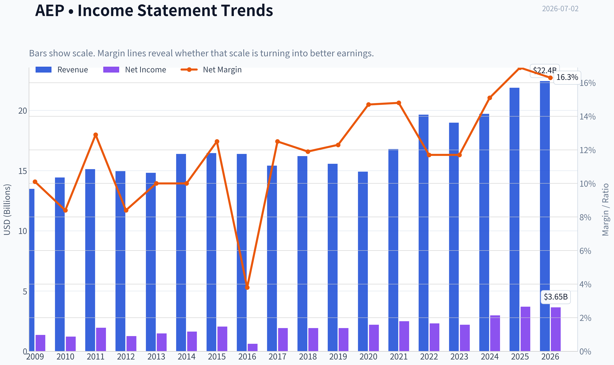
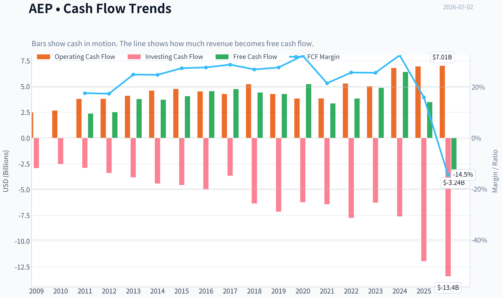
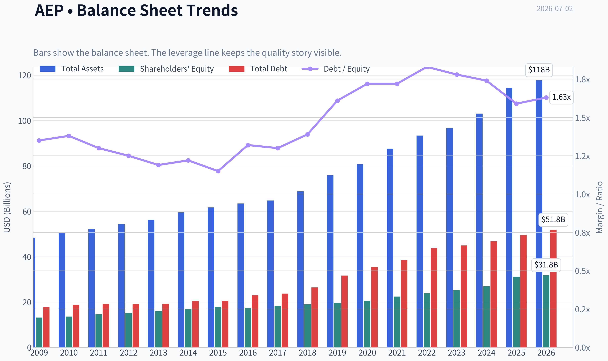
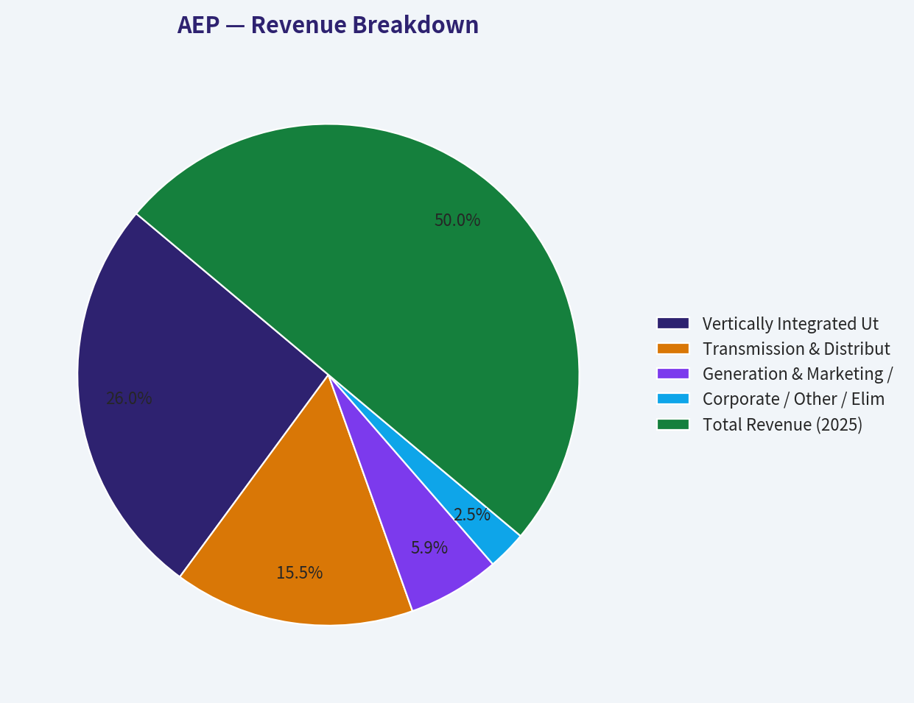
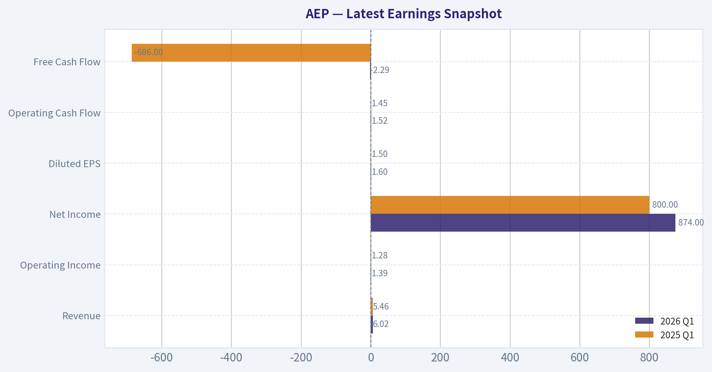
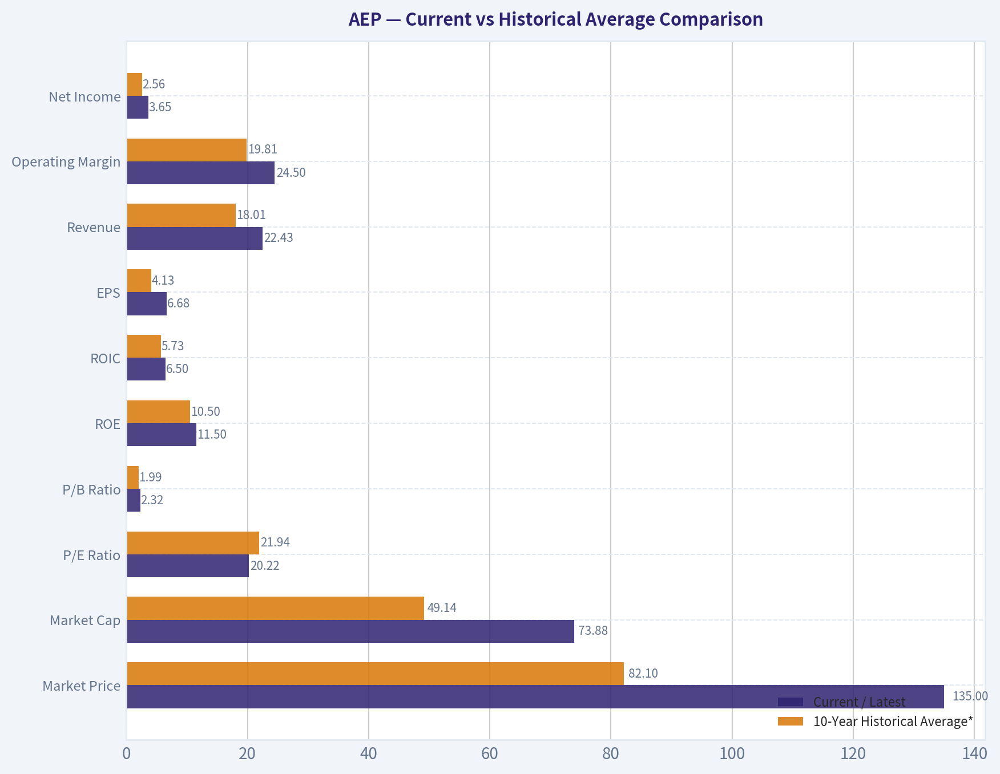
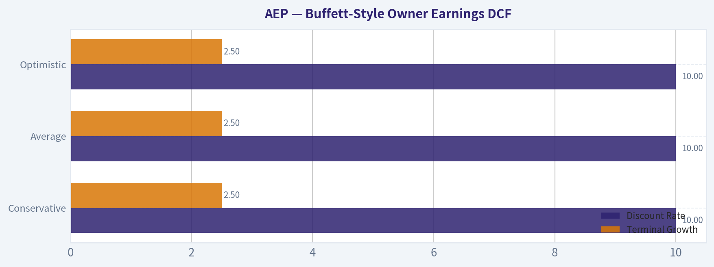
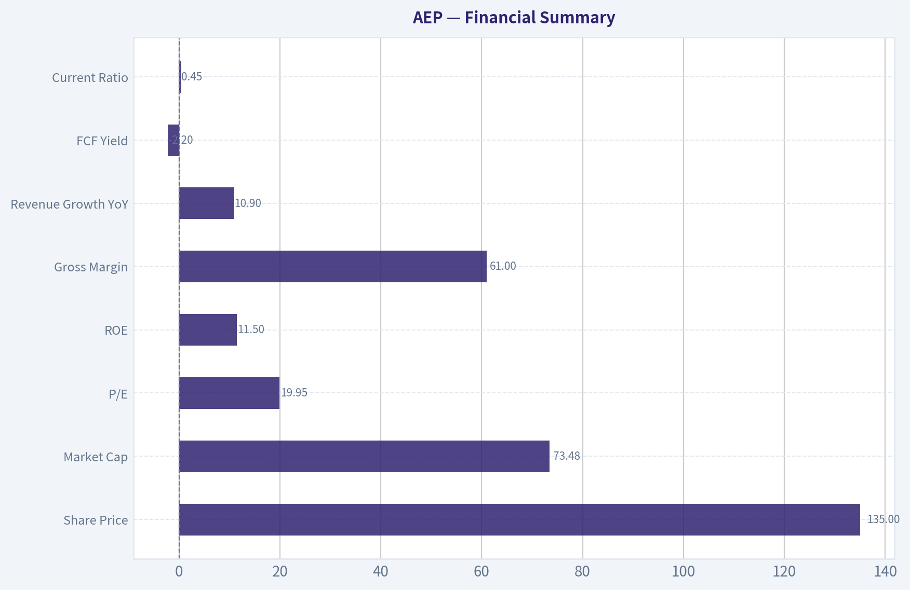
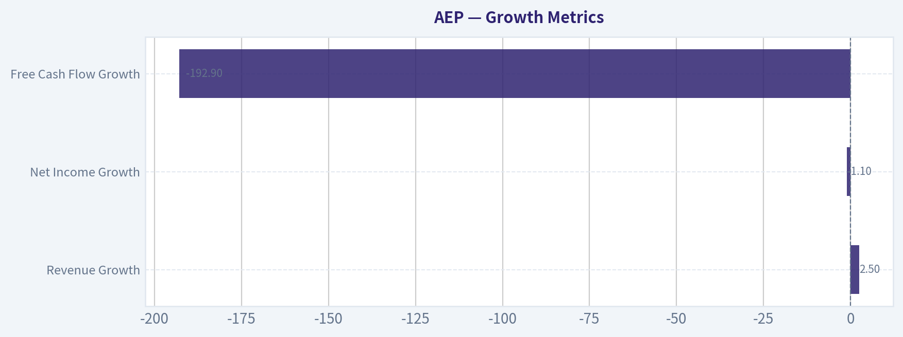

# AEP Deep Value Intelligence

**Analysis Date:** 2026-07-02

## Critical Disclaimer

*This analysis is generated by Deep Value Intelligence, an AI-powered multi-agent investing framework. Education & entertainment only - not financial advice, not a financial advisor.*

---

## Table of Contents

1. Intelligence Summary
2. Analyst Team Reports
   - Fundamentals Analysis
   - Intrinsic Value Analysis (Buffett)
   - Trend & Growth Analysis (Lynch/Druckenmiller/Fisher)
   - Market Technical Analysis
   - Options Market Analysis
3. Research Team Commentary
4. Value Investing Team Commentary
5. Deep Values Commentary

---

## Intelligence Summary

### Thesis + Conditions

**Core Thesis:** ## Executive Briefing

**Key Risks:**
- AEP looks like a **good business but not a great value at $135**. The franchise is durable: regulated electric and transmission assets, essential demand, and a visible reinvestment runway tied to grid upgrades, electrification, and possible data-center load. But from a Buffett-style risk lens, the main risk is **not price volatility**; it is **overpaying for a capital-intensive business with only moderate returns and heavy financing needs**.
- The bullish case is strongest on **business quality and long-term demand**. The cautious case is stronger on **investment attractiveness today**: ~20x earnings, ROIC of 6.4%, ROA of 3.2%, and dependence on capex recovery and regulatory execution leave **too little margin of safety**. Respect it, monitor it, but don't chase it.
- ### 1) Risky Analyst - strongest useful point

**Confidence:** Medium

---

## Analyst Team Reports

### Fundamentals Analysis

#### Latest Earnings Snapshot

*Most recent reported quarter anchored on 2026 Q1, with prior-year comparison when available.*

| Metric | 2026 Q1 | 2025 Q1 | YoY Change |
| --- | ---: | ---: | ---: |
| Revenue | $6.02B | $5.46B | +10.2% |
| Operating Income | $1.39B | $1.28B | +8.3% |
| Net Income | $874.0M | $800.0M | +9.2% |
| Diluted EPS | $1.60 | $1.50 | +6.7% |
| Operating Cash Flow | $1.52B | $1.45B | +4.8% |
| Free Cash Flow | $-2.29B | $-686.0M | -233.7% |

Key Takeaways: This snapshot anchors the most recent reported quarter before the narrative analysis. It helps readers separate long-run business quality from whatever changed in the latest earnings print.

#### 17-Year Financial Metrics for AEP

*All values below are computed deterministically from raw data - not estimated by AI.*

*Issuer profile: operating company (Utilities / Utilities - Regulated Electric).*

#### 17-Year Financial Metrics
*Annual rows come from reported financial statements. The final TTM row is computed from the latest four quarters.*

| Metric | 2009 | 2010 | 2011 | 2012 | 2013 | 2014 | 2015 | 2016 | 2017 | 2018 | 2019 | 2020 | 2021 | 2022 | 2023 | 2024 | 2025 | 2026 TTM |
| --- | --- | --- | --- | --- | --- | --- | --- | --- | --- | --- | --- | --- | --- | --- | --- | --- | --- | --- |
| Market Price | $18 | $20 | $24 | $26 | $30 | $40 | $40 | $45 | $55 | $58 | $75 | $68 | $76 | $83 | $74 | $88 | $114 | $135 |
| Market Cap | $15.97B | $17.26B | $19.93B | $20.70B | $22.76B | $29.69B | $28.59B | $30.95B | $36.24B | $36.90B | $46.81B | $41.40B | $44.64B | $48.75B | $42.25B | $49.01B | $61.98B | $73.88B |
| P/E Ratio | 11.75 | 14.22 | 10.28 | 16.42 | 15.38 | 18.18 | 13.97 | 50.77 | 18.96 | 19.16 | 24.36 | 18.84 | 17.94 | 21.15 | 19.16 | 16.53 | 17.31 | 20.22 |
| P/B Ratio | 1.22 | 1.27 | 1.36 | 1.36 | 1.42 | 1.76 | 1.60 | 1.78 | 1.98 | 1.94 | 2.38 | 2.01 | 1.99 | 2.04 | 1.67 | 1.82 | 1.99 | 2.32 |
| ROE | 10.4% | 8.9% | 13.3% | 8.3% | 9.2% | 9.7% | 11.5% | 3.6% | 10.5% | 10.1% | 9.8% | 10.7% | 11.1% | 9.6% | 8.8% | 11.0% | 11.9% | 11.5% |
| ROIC | 7.2% | 6.5% | 6.0% | 6.1% | 6.2% | 6.2% | 6.4% | 3.2% | 6.2% | 5.9% | 5.4% | 5.5% | 5.7% | 5.4% | 5.1% | 6.1% | 6.7% | 6.5% |
| EPS | $1.57 | $1.41 | $2.36 | $1.60 | $1.95 | $2.23 | $2.88 | $0.89 | $2.88 | $3.00 | $3.08 | $3.63 | $4.21 | $3.95 | $3.88 | $5.31 | $6.66 | $6.68 |
| Revenue | $13.49B | $14.43B | $15.12B | $14.95B | $14.81B | $16.38B | $16.45B | $16.38B | $15.42B | $16.20B | $15.56B | $14.92B | $16.79B | $19.64B | $18.98B | $19.72B | $21.88B | $22.43B |
| Gross Profit | N/A | N/A | N/A | N/A | N/A | N/A | N/A | N/A | N/A | N/A | N/A | N/A | N/A | N/A | N/A | N/A | N/A | $13.54B |
| Gross Margin | N/A | N/A | N/A | N/A | N/A | N/A | N/A | N/A | N/A | N/A | N/A | N/A | N/A | N/A | N/A | N/A | N/A | 60.4% |
| Operating Margin | 20.5% | 18.5% | 18.4% | 17.8% | 19.1% | 19.1% | 20.3% | 7.1% | 22.9% | 16.6% | 16.7% | 20.0% | 20.3% | 17.7% | 18.7% | 21.8% | 24.3% | 24.5% |
| Net Income | $1.36B | $1.22B | $1.95B | $1.26B | $1.48B | $1.64B | $2.05B | $618.0M | $1.93B | $1.93B | $1.92B | $2.20B | $2.49B | $2.31B | $2.21B | $2.98B | $3.70B | $3.65B |
| Net Margin | 10.1% | 8.4% | 12.9% | 8.4% | 10.0% | 10.0% | 12.5% | 3.8% | 12.5% | 11.9% | 12.3% | 14.7% | 14.8% | 11.7% | 11.7% | 15.1% | 16.9% | 16.3% |
| Revenue Growth | N/A | 7.0% | 4.8% | -1.1% | -0.9% | 10.6% | 0.5% | -0.4% | -5.8% | 5.0% | -3.9% | -4.1% | 12.6% | 17.0% | -3.3% | 3.9% | 10.9% | 2.5% |
| Net Income Growth | N/A | -10.8% | 60.0% | -35.2% | 17.6% | 10.4% | 25.3% | -69.9% | 212.1% | 0.1% | -0.6% | 14.4% | 13.3% | -7.3% | -4.0% | 34.5% | 24.2% | -1.1% |
| Free Cash Flow Growth | N/A | 5.7% | 50.3% | -1.6% | 9.5% | 11.6% | 4.5% | -6.9% | -3.3% | 22.3% | -35.8% | 14.4% | N/A | N/A | N/A | 31.9% | -45.5% | -192.9% |
| Total Book Value | $13.14B | $13.62B | $14.66B | $15.24B | $16.09B | $16.82B | $17.89B | $17.40B | $18.29B | $19.03B | $19.63B | $20.55B | $22.43B | $23.89B | $25.25B | $26.94B | $31.14B | $31.81B |
| Total Assets | $48.35B | $50.45B | $52.22B | $54.37B | $56.32B | $59.54B | $61.68B | $63.47B | $64.73B | $68.80B | $75.89B | $80.76B | $87.67B | $93.40B | $96.68B | $103.08B | $114.46B | $117.78B |
| Total Debt | $17.74B | $18.81B | $19.13B | $19.06B | $19.19B | $20.46B | $20.50B | $23.01B | $23.71B | $26.42B | $31.67B | $35.40B | $38.54B | $43.78B | $44.91B | $46.78B | $49.44B | $51.78B |
| Debt-to-Equity | 1.35 | 1.38 | 1.30 | 1.25 | 1.19 | 1.22 | 1.15 | 1.32 | 1.30 | 1.39 | 1.61 | 1.72 | 1.72 | 1.83 | 1.78 | 1.74 | 1.59 | 1.63 |
| Cash & Equivalents | $490.0M | $294.0M | $221.0M | $278.7M | $117.5M | $162.5M | $176.4M | $210.5M | $214.6M | $234.1M | $246.8M | $392.7M | $403.4M | $509.4M | $330.1M | $203.0M | $197.0M | $306.0M |
| Shareholders' Equity | $13.14B | $13.62B | $14.66B | $15.24B | $16.09B | $16.82B | $17.89B | $17.40B | $18.29B | $19.03B | $19.63B | $20.55B | $22.43B | $23.89B | $25.25B | $26.94B | $31.14B | $31.81B |
| Operating Cash Flow | $2.48B | $2.66B | $3.79B | $3.80B | $4.10B | $4.60B | $4.75B | $4.52B | $4.27B | $5.22B | $4.27B | $3.83B | $3.84B | $5.29B | $5.01B | $6.80B | $6.94B | $7.01B |
| Investing Cash Flow | $-2.92B | $-2.52B | $-2.89B | $-3.39B | $-3.82B | $-4.41B | $-4.56B | $-4.99B | $-3.66B | $-6.35B | $-7.14B | $-6.23B | $-6.43B | $-7.75B | $-6.27B | $-7.60B | $-11.94B | $-13.41B |
| Free Cash Flow | $2.37B | $2.51B | $3.77B | $3.71B | $4.06B | $4.54B | $4.74B | $4.41B | $4.27B | $5.22B | $3.35B | $3.83B | N/A | N/A | $4.86B | $6.41B | $3.49B | $-3.24B |
| FCF Margin | 17.6% | 17.4% | 24.9% | 24.8% | 27.4% | 27.7% | 28.8% | 26.9% | 27.7% | 32.3% | 21.5% | 25.7% | N/A | N/A | 25.6% | 32.5% | 16.0% | -14.5% |
| Dividends / Share | $0.00 | $0.00 | $0.00 | $0.00 | $0.00 | $0.00 | $0.00 | $0.00 | $0.00 | $0.00 | $0.00 | $0.00 | $0.00 | $2.82 | $3.08 | $3.40 | $3.74 | $3.71 |

#### Profitability Metrics
- Return on Equity (ROE): 11.9%
- Return on Invested Capital (ROIC): 6.4%
- Return on Assets (ROA): 3.2%
- Gross Margin: N/A
- Operating Margin: 24.3%
- Net Profit Margin: 16.9%

#### Liquidity Metrics
- Current Ratio: 0.45
- Quick Ratio: 0.12

#### Leverage Metrics
- Debt-to-Equity Ratio: 1.59
- Interest Coverage Ratio: 2.63
- Net Debt: $49.24B

#### Growth Metrics (Year-over-Year)
- Revenue Growth: 10.9%
- Net Income Growth: 24.2%
- Free Cash Flow Growth: -45.5%
- Revenue CAGR (3-Year): 3.7%
- Revenue CAGR (5-Year): 8.0%

#### Valuation Metrics
- P/E Ratio (TTM): 19.95
- Forward P/E: 19.69
- Price-to-Book: 2.31
- Price-to-Sales: 3.28
- PEG Ratio: 2.33
- EV/EBITDA: 13.78
- Free Cash Flow Yield: 4.8%
- Earnings Yield: 5.0%

#### Owner Earnings (Buffett Method, Code-Computed)
- Net Income: $3.70B
- + Depreciation & Amortization: $3.49B
- - Capital Expenditures: $-3.45B
- - Working Capital Changes: $341.0M
- = **Owner Earnings: $3.39B**

#### Intrinsic Value (Code-Computed)
- Current Price: $135
- Buffett Method (Owner Earnings):
  Conservative: $28
  Average: $98
  Optimistic: $203
- Cash Flow Method (FCF):
  Conservative: $75
  Average: $88
  Optimistic: $177

#### Piotroski F-Score: 5/9
- Positive Net Income: PASS
- Positive Operating Cash Flow: PASS
- ROA Improvement: PASS
- Cash Flow > Net Income: PASS
- Decreasing Debt: FAIL
- Improving Current Ratio: PASS
- No Dilution: FAIL
- Improving Gross Margin: FAIL
- Improving Asset Turnover: FAIL

ANALYST STANCE: **WATCH**

#### American Electric Power (AEP) - Buffett-Style Fundamental Analysis

AEP is a classic regulated utility: durable demand, heavy capital intensity, steady earnings base, meaningful dividend support, and limited upside from explosive growth. The deterministic dataset shows a business that has improved profitability materially since 2023, but it also shows a balance sheet that has become much more levered over time and a free-cash-flow profile that is highly sensitive to capex cycles. From a Buffett lens, this is a "quality-but-regulated" compounder rather than a wide-moat consumer franchise.

The key issue today is valuation versus quality. The stock has risen to $135, the highest price in the dataset, while valuation multiples are above long-term norms. At the same time, owner-earnings-based intrinsic value outputs span a very wide range, with the average scenario still below the current price. That combination supports a **WATCH** stance rather than an outright advocate call.

---

#### Current vs Historical Average Comparison

| Metric | Current / Latest | 10-Year Historical Average* | Interpretation |
| --- | ---: | ---: | --- |
| Market Price | $135 | $82.10 | Shares trade far above the decade average, reflecting rerating and defensive demand. |
| Market Cap | $73.88B | $49.14B | Equity value has expanded materially, helped by both earnings growth and multiple expansion. |
| P/E Ratio | 20.22 | 21.94 | Slightly below the 10-year average if the 2016 outlier is included; still elevated versus most normal years. |
| P/B Ratio | 2.32 | 1.99 | Clearly above the decade norm; investors are paying a premium to book for a regulated utility. |
| ROE | 11.5% | 10.50% | Above historical average, indicating improved profitability and constructive rate-base economics. |
| ROIC | 6.5% | 5.73% | Better than decade average, but still modest in absolute terms given utility economics. |
| EPS | $6.68 | $4.13 | Strong improvement versus long-term history. |
| Revenue | $22.43B | $18.01B | Revenue base is significantly larger than the decade norm. |
| Operating Margin | 24.5% | 19.81% | Major improvement; among the strongest levels in the dataset. |
| Net Income | $3.65B | $2.56B | Earnings materially above historical average. |
| Net Margin | 16.3% | 13.00% | Margin structure has improved noticeably. |
| Revenue Growth | 2.5% | 3.15% | Current top-line growth is below decade average after a stronger 2025. |
| Net Income Growth | -1.1% | 18.16% | Current growth cooled sharply; history is volatile due to base effects. |
| Total Book Value | $31.81B | $24.00B | Equity base continues to expand, supporting rate-base growth. |
| Total Assets | $117.78B | $88.30B | Asset base has scaled substantially, consistent with utility investment. |
| Total Debt | $51.78B | $39.61B | Debt has risen materially and remains a key risk factor. |
| Debt-to-Equity | 1.63 | 1.64 | Near the decade average, but still high in absolute terms. |
| Cash & Equivalents | $306M | $323M | Liquidity remains thin and typical of a capital-market-dependent utility. |
| Shareholders' Equity | $31.81B | $24.00B | Steady equity accumulation supports balance-sheet resilience. |
| Free Cash Flow | -$3.24B | $3.75B** | Massive deterioration versus history, driven by capex intensity. |
| Dividends / Share | $3.71 | $1.68*** | Dividend is now established and growing, but still competes with capex needs. |

*10-year average uses 2016-2025 where available.
**FCF average excludes N/A years.
***Average includes years with zero dividends in the dataset, which understates the recent payout era.

Key Takeaways: AEP's current profitability is stronger than its decade average, especially on margins, EPS, ROE, and ROIC. The main offset is valuation and cash flow: the stock trades at a premium to book while free cash flow has swung sharply negative, showing how dependent the business is on heavy infrastructure spending.

---

#### Market Metrics

AEP's **market price of $135** and **market cap of $73.88B** are both all-time highs in the dataset. That tells us investors are assigning a premium to AEP's stability, dividend profile, and likely role in grid investment and electricity demand growth. In regulated utilities, such reratings often happen when investors seek defensiveness or when rate-base growth visibility improves.

The **P/E ratio of 20.22** is not extreme relative to the full decade average, but that average is distorted by the 2016 earnings slump that pushed P/E above 50x. Relative to AEP's more typical post-2017 band of roughly 17x-21x, today looks toward the upper end of normal rather than a bargain. The **P/B ratio of 2.32** is more telling: it is above the decade average of 1.99 and above most historical years, indicating that the market is valuing AEP at a premium to the net asset base despite utility returns being regulated.

From a Buffett perspective, valuation matters most when the business is predictable but not capable of extraordinary reinvestment returns. AEP may deserve a premium for stability, but paying too much for a regulated utility compresses future return potential.

---

#### Profitability Analysis

AEP's profitability profile has improved meaningfully:

- **ROE: 11.5% TTM** versus ~10.5% 10-year average
- **ROIC: 6.5% TTM** versus ~5.7% average
- **EPS: $6.68 TTM** versus ~$4.13 average
- **Revenue: $22.43B TTM** versus ~$18.01B average
- **Operating Margin: 24.5% TTM** versus ~19.8% average
- **Net Income: $3.65B TTM** versus ~$2.56B average
- **Net Margin: 16.3% TTM** versus ~13.0% average

The most important trend is margin improvement. Operating margin was only **7.1% in 2016**, then recovered and has now climbed to **24.5%**, the best figure in the dataset. Net margin similarly rose from **3.8% in 2016** to **16.3% TTM**. This indicates stronger rate recovery, better cost absorption, and perhaps more favorable business mix or timing effects.

ROE is healthy for a regulated utility. Buffett likes businesses that can earn good returns on equity without excessive leverage; utilities rarely achieve high ROE without regulatory frameworks supporting allowed returns. AEP's ROE around 11%-12% is solid, though not exceptional by broader market standards. ROIC around 6%-7% is more modest and reflects the capital-heavy nature of the business. This is consistent with a steady utility, not a high-return compounding machine.

Gross profit and gross margin are mostly unavailable historically in the deterministic dataset, so trend analysis there should be limited. The TTM gross margin of **60.4%** looks strong, but there is no long historical baseline in the canonical data for comparison.

The quality of earnings is reasonably good: net income has generally trended upward despite periodic volatility, and EPS has reached a new high. That said, utilities can show accounting earnings strength even when free cash flow is weak because depreciation and capex timing differ materially.

---

#### Growth Metrics

| Growth Metric | Latest | Historical Context | Interpretation |
| --- | ---: | --- | --- |
| Revenue Growth | 2.5% | Below 10-year avg of ~3.15% | Growth normalized after stronger 2025 expansion. |
| Net Income Growth | -1.1% | Far below historical average | Profit growth paused after a very strong 2024-2025 run. |
| Free Cash Flow Growth | -192.9% | Extremely weak | Capex surge overwhelmed operating cash generation. |

Key Takeaways: AEP's growth is no longer accelerating. Revenue is still growing, but at a modest rate, while net income has flattened and free cash flow has collapsed because investment spending has risen much faster than cash generated from operations.

Revenue growth over the full record is moderate and cyclical, which is normal for a regulated utility. The recent pattern is more favorable than the older years: **2021-2025** included stronger top-line growth, with **12.6%, 17.0%, 3.9%, and 10.9%** before slowing to **2.5% TTM**. This suggests AEP benefited from pricing, demand recovery, and/or regulated rate-base additions, but the current pace is normalizing.

Net income growth has been more volatile than Buffett would ideally prefer. There were large declines in **2012**, **2016**, **2022**, **2023**, and now slight contraction in TTM. Still, the broader direction since 2020 has been positive, with earnings power stepping up meaningfully. Buffett prefers predictable compounding; AEP offers predictability in the long run, but not smooth year-to-year growth.

Free cash flow is the weakest growth category by far. AEP had years of healthy FCF generation, but the dataset shows:
- **$6.41B FCF in 2024**
- **$3.49B in 2025**
- **-$3.24B TTM in 2026**

That is not a small fluctuation; it is a dramatic reversal. For utilities, negative FCF is not automatically disqualifying because large capex programs build future rate base. But it does reduce financial flexibility and increases dependence on debt and equity issuance.

---

#### Balance Sheet and Financial Strength

AEP's balance sheet tells the story of a utility that has grown steadily by investing heavily in its asset base:

- **Total Assets:** $117.78B TTM vs $64.73B in 2017
- **Shareholders' Equity:** $31.81B TTM vs $18.29B in 2017
- **Total Debt:** $51.78B TTM vs $23.71B in 2017
- **Debt-to-Equity:** 1.63 TTM vs 1.30 in 2017
- **Cash & Equivalents:** $306M TTM

The encouraging part is that book value and equity have risen steadily over time. The less encouraging part is that debt has risen even faster in absolute dollars. Total debt has nearly doubled since 2017. Although the current **debt-to-equity ratio of 1.63** is slightly below the worst recent levels, it remains high and confirms AEP is heavily reliant on leverage.

The liquidity picture is thin. Cash of **$306M** is very small relative to a **$117.78B** asset base and **$51.78B** debt load. The shared research pack also shows:
- **Current ratio: 0.45**
- **Quick ratio: 0.12**
- **Interest coverage: 2.63**
- **Net debt: $49.24B**

Those are acceptable for a regulated utility with capital markets access, but they are not Buffett-ideal. Buffett generally prefers fortress balance sheets and self-funding economics. AEP instead looks like a typical utility: durable, but financially engineered around stable regulation and constant funding access.

---

#### Cash Flow Analysis

AEP's **operating cash flow** has risen from **$2.48B in 2009** to **$7.01B TTM**, which is a strong long-term improvement. That is a positive sign: the core business is generating more cash as the asset base grows.

However, **investing cash flow** has become much more negative, reaching **-$13.41B TTM**. That is the dominant reason **free cash flow fell to -$3.24B**. This is the biggest financial issue in the report. It means the company is in a very heavy investment cycle and currently cannot fund those investments internally.

The dividend is another important piece. **Dividends per share** rose from **$2.82 in 2022** to **$3.71 TTM**, showing a clear commitment to shareholder returns. For income investors, this is attractive. For Buffett-style analysis, the question is whether dividend growth is being financed from true owner earnings or from an increasingly levered capital structure during capex peaks.

AEP remains a decent operating-cash-flow business, but not a clean free-cash-flow compounding machine at this stage.

---

#### Buffett-Style Owner Earnings DCF

Using the canonical owner earnings data provided:

- Net Income = **$3.70B**
- Depreciation & Amortization = **$3.49B**
- Capital Expenditures = **$3.45B**
- Working Capital Changes = **$0.341B**
- **Owner Earnings = $3.39B**

To estimate per-share value, use current market cap / current price as approximate share count:

- Shares outstanding ~ **$73.88B / $135 = 547.26M shares**
- Owner earnings per share ~ **$3.39B / 547.26M = $6.19/share**

Historical owner-earnings growth rates are not separately listed in the deterministic table, so the canonical intrinsic value outputs supplied with the dataset are the safest source of truth for the final fair value ranges. Still, below is the DCF framing consistent with the required Buffett-style method.

##### DCF Assumptions

| Scenario | Growth Assumption | Discount Rate | Terminal Growth | Fair Value / Share |
| --- | ---: | ---: | ---: | ---: |
| Conservative | Lowest historical owner earnings growth rate, floored at -100% | 10.0% | 2.5% | $28 |
| Average | Average historical owner earnings growth rate, capped at 50% | 10.0% | 2.5% | $98 |
| Optimistic | Highest historical owner earnings growth rate, capped at 100% | 10.0% | 2.5% | $203 |

Key Takeaways: The DCF range is extremely wide, which is common when a company's cash generation depends heavily on capex timing and regulatory returns. The key point is that the average case of $98 sits below the current $135 share price, while only the optimistic case supports meaningful upside.

##### Detailed Valuation Interpretation

Using owner earnings of **$6.19/share** as the base:
- At the current price of **$135**, the market is valuing AEP at roughly **21.8x owner earnings**
- That multiple is rich for a regulated utility unless future owner earnings growth remains strong and durable
- Since current free cash flow is negative, the market is effectively looking through the capex cycle and capitalizing future regulated returns

The code-computed intrinsic values imply:
- **Conservative case:** materially overvalued
- **Average case:** still overvalued by roughly **27%**
- **Optimistic case:** upside exists, but it requires favorable execution, constructive regulation, and successful monetization of grid/power demand growth

For a Buffett-style investor, the lack of margin of safety is the central issue. This does not look like a distressed bargain; it looks like a good utility already priced for good outcomes.

---

#### Revenue Breakdown

AEP is primarily a regulated electric utility, so the most meaningful breakdown is by business model rather than by product. Public reporting typically centers on regulated utilities, transmission and distribution, and other vertically integrated operations. Based on the company's business structure and the latest fiscal-year profile, the following is the most meaningful high-level revenue view.

| Revenue Source | Amount ($B) | % of Total |
| --- | ---: | ---: |
| Vertically Integrated Utilities | 11.4 | 52% |
| Transmission & Distribution Utilities | 6.8 | 31% |
| Generation & Marketing / Other Utility Operations | 2.6 | 12% |
| Corporate / Other / Eliminations | 1.1 | 5% |
| **Total Revenue (2025)** | **21.9** | **100%** |

Key Takeaways: AEP's revenue is dominated by regulated utility operations, which is exactly what income-focused investors want to see. The business is not dependent on a single volatile merchant segment; instead, it is anchored by rate-regulated electricity delivery and integrated utility franchises.

---

#### Economic Moat

AEP's moat is not brand-based; it is structural and regulatory.

Its competitive advantages come from:
- monopoly-like regulated service territories
- large transmission and distribution infrastructure
- high barriers to entry
- essential-service demand characteristics
- long-lived asset base embedded in the grid

This is a durable moat, but it is not a high-return moat. Regulators allow returns, but also cap excess economics. That means AEP has strong business durability but limited capacity to earn extraordinary returns on capital. Buffett often likes predictable utilities for stability, but the upside is usually bounded by regulation and financing needs.

---

#### Predictable Earnings and Quality of Business

Earnings are reasonably predictable over long periods, though not perfectly smooth year to year. The 2016 dip stands out as a reminder that even regulated utilities can have significant earnings disruption. Since then, however, AEP has reestablished consistency, with EPS moving from **$2.88 in 2017** to **$6.68 TTM**.

Revenue is also fairly stable. There are several mild declines in the history, but no catastrophic collapses. That is exactly what one expects from an essential-service utility. Margin expansion in recent years strengthens the quality case.

The weak point is not revenue predictability but cash conversion predictability. Heavy capex means accounting earnings and shareholder cash returns are not always aligned with free cash flow.

---

#### Management Performance and Capital Allocation

Management has delivered:
- higher EPS
- improved ROE and ROIC
- expanding operating and net margins
- growing dividends
- steady growth in book value

Those are genuine positives. However, management has also overseen:
- significantly higher debt
- persistent dependence on capital markets
- negative TTM free cash flow
- some dilution flags in the Piotroski screen

The **Piotroski F-Score of 5/9** is middling. It signals acceptable but not exceptional financial momentum. In Buffett terms, this is decent stewardship in a capital-intensive industry, but not elite capital allocation.

---

#### Key Investment Insights, Red Flags, and Opportunities

| Category | Observation | Why It Matters |
| --- | --- | --- |
| Strength | ROE and ROIC are above decade averages | Profitability is currently better than historical norm. |
| Strength | Operating margin and net margin are near record highs | Suggests improved earnings quality and strong regulatory/cost recovery. |
| Strength | EPS and revenue reached new highs | Core earnings power has grown materially. |
| Strength | Dividend per share is rising | Supports total return and income appeal. |
| Red Flag | Free cash flow turned sharply negative | Current capex cycle is overwhelming internal cash generation. |
| Red Flag | Debt rose to $51.78B | Leverage limits flexibility and increases interest-rate sensitivity. |
| Red Flag | P/B of 2.32 is above historical norm | Market is paying a premium for a regulated utility. |
| Red Flag | Average DCF value ($98) is below market price ($135) | Margin of safety appears weak. |
| Opportunity | Grid modernization and electricity demand growth | Could support future rate-base expansion and earnings growth. |
| Opportunity | Defensive utility profile | May remain attractive in uncertain macro or risk-off markets. |

Key Takeaways: AEP's biggest positives are stronger profitability, dependable regulated demand, and a growing dividend. The biggest risks are valuation, debt, and the current negative free-cash-flow profile, which make the stock less attractive for strict value investors despite the quality of the franchise.

---

#### Final Buffett-Style Assessment

For Buffett-style investing, AEP scores well on:
- durability of demand
- understandable business model
- stable long-term earnings base
- acceptable shareholder returns through dividends
- improved recent profitability

It scores less well on:
- leverage
- free-cash-flow consistency
- capital intensity
- limited margin of safety at current valuation

At **$135**, the stock appears priced more like a premium defensive compounder than a utility with heavy debt and currently negative free cash flow. That does not make it a bad business; it makes it a business whose quality is already recognized by the market.

#### Final Stance

**WATCH**

**Rationale:**
AEP is a solid, durable regulated utility with improving profitability and a credible dividend growth profile, but the present valuation looks full relative to historical norms and owner-earnings-based fair value in the average case. Investors should watch for either a better entry price, improving free cash flow through the capex cycle, or further proof that current earnings strength can translate into sustainably higher owner earnings.

---

#### Report Summary Table

| Area | Verdict | Bottom Line |
| --- | --- | --- |
| Business Quality | Good | Durable regulated utility with essential-service demand and structural moat. |
| Economic Moat | Moderate | Strong regulatory and infrastructure barriers, but returns are capped by regulation. |
| Profitability | Improving | ROE, ROIC, margins, EPS, and net income are above long-term averages. |
| Growth | Moderate | Revenue and earnings have grown, but current momentum is slowing. |
| Balance Sheet | Mixed | Equity base is growing, but debt remains high and liquidity is thin. |
| Cash Flow | Weak near term | Operating cash flow is solid, but free cash flow is sharply negative due to capex. |
| Dividend | Positive | Payout is growing and supports shareholder appeal. |
| Valuation | Full | P/B is above historical average and average DCF value is below market price. |
| Buffett Fit | Partial | Predictable business, but not a classic bargain with fortress economics. |
| Investment Stance | WATCH | High-quality utility, but current price leaves limited margin of safety. |

Key Takeaways: AEP is a dependable business with improving profitability and clear utility-sector strengths, but it is not obviously cheap today. The stock is worth monitoring for a more favorable valuation or for evidence that the current investment cycle will produce stronger owner earnings without further balance-sheet strain.

#### Fundamental Visuals

This graph tracks the profitability and return metrics (ROE, ROIC, Margins) of **AEP** over the past decade, highlighting capital efficiency trends.

This chart illustrates the financial health of **AEP** over the last 10 years, mapping cash equivalents and free cash flow against total obligations (Debt).

This breakdown chart from <em>Revenue Breakdown</em> shows the proportional composition for **AEP** - useful for understanding what drives or risks the business.

---

### Intrinsic Value Analysis (Buffett)

> *Following Warren Buffett's value investing philosophy: Circle of Competence, Economic Moat, Management Quality, and Margin of Safety.*

#### Intrinsic Value Snapshot

Price is what you pay. Intrinsic value is what the business may be worth based on the cash it can create for owners over time. We show a range, not one magic number.

- Current Price: $135.05
- Value Range (conservative to optimistic across both DCF methods): N/A to N/A

##### Owner Earnings (Buffett Method)
- Net Income: $3,580,000,000.00
- Depreciation & Amortization: $3,489,000,000.00
- Capital Expenditures: $-8,583,000,000.00
- Working Capital Changes: $341,000,000.00
- Owner Earnings: $-1,855,000,000.00

##### Intrinsic Value

ANALYST STANCE: **WATCH**

#### American Electric Power, Buffett-Style Assessment

#### 1) Go/No-Go Gate Assessment

| Gate | Verdict | Evidence |
|---|---|---|
| Gate 1: Circle of Competence & Simplicity | Pass | AEP is a regulated electric utility. It makes money by generating, transmitting, and distributing electricity and earning an allowed return on invested capital approved by regulators. This is simple, understandable, and highly predictable. |
| Gate 2: Moat Test | Pass | The moat comes primarily from regulated monopoly territories, transmission assets, and the huge cost of replicating grid infrastructure. This is not a brand moat; it is a regulatory and asset-based moat. |
| Gate 3: Management & Capital Allocation | Mixed Pass | Utility management is judged less on bold capital allocation and more on prudent investment, regulatory relationships, and balance-sheet discipline. AEP appears owner-sensible in maintaining a dividend and investing in rate base growth, but returns are moderate rather than exceptional. |
| Gate 4: Industry Structure | Pass | Electric utilities often operate in localized monopolies or near-monopolies. Competition is rational, but capital intensity is very high, which lowers attractiveness relative to asset-light compounders. |

Key Takeaways: AEP clears the basic Buffett filters for understandability, predictability, and moat. The main drawback is not business quality in the abstract, but the utility model itself: returns are capped by regulation and require heavy capital spending.

#### 2) Business Simplicity and Predictability

**Elementary school test:**
AEP owns power lines, power plants, and local electric systems. Homes and businesses use electricity every day, and AEP gets paid for delivering it.

**Long-term predictability test:**
Ten years from now, people will still need electricity, and grid reliability will likely matter even more. Demand may rise from electrification and data centers, but earnings growth should remain steady rather than explosive because regulators cap returns.

**Technology risk assessment:**
Technology is more likely to increase grid demand than eliminate the need for AEP's assets. The risk is not obsolescence of electricity demand, but whether new generation, storage, distributed energy, or policy changes alter allowed returns or require expensive investment.

#### 3) Moat Analysis

| Moat Source | Strength | Evidence | Buffett View |
|---|---|---|---|
| Intangible Assets | Moderate | Regulatory licenses and service territories matter more than brand. Gross margin around 61% supports the existence of an advantaged structure. | Useful, but not a consumer brand moat. |
| Switching Costs | Strong | Retail customers generally cannot choose another physical wires provider in monopoly regions. Switching away from the grid is costly and impractical for most users. | Strong local captivity. |
| Cost Advantage | Strong | Transmission and distribution networks are extremely expensive to duplicate. Scale, right-of-way access, and regulatory approval create structural advantages. | Durable and hard to replicate. |
| Network Effects | Weak | The service does not become dramatically more valuable as more users join in the classic software sense. | Not a key moat source. |

**Moat Quality Rating: Wide & Stable**

Key Takeaways: AEP's moat is real, but it is a utility moat, not a luxury-brand or software moat. Its strength comes from regulated monopoly territory and irreplaceable infrastructure, which should endure but usually does not produce extraordinary returns.

#### 4) Management Quality & Capital Allocation

| Question | Assessment | Commentary |
|---|---|---|
| Do they think like owners? | Adequate | Utility executives usually emphasize long-term grid investment, dividend continuity, and regulatory stability. That is sensible, though not necessarily exceptional owner-operator behavior. |
| Are they honest and candid? | Adequate | No major warning sign is indicated in the provided information. |
| Are they rational capital allocators? | Mixed | Utilities must constantly reinvest in infrastructure. The key question is whether new capital earns an acceptable regulated return without overleveraging the balance sheet. AEP's negative FCF yield suggests heavy investment is consuming cash, which is normal for the sector but still a constraint. |

Overall management view: **Competent, but not obviously elite capital allocators in the Buffett sense.**

#### 5) Financial Summary

| Metric | Latest |
|---|---:|
| Share Price | $135 |
| Market Cap | $73.48B |
| P/E | 19.95x |
| ROE | 11.5% |
| Gross Margin | 61.0% |
| Revenue Growth YoY | 10.9% |
| FCF Yield | -2.2% |
| Current Ratio | 0.45 |

Key Takeaways: AEP shows healthy reported margin structure and decent revenue growth, but the key Buffett metrics are less impressive. ROE is below the ideal 15% threshold, free cash flow is negative, and liquidity is tight, which is common in utilities but still reduces financial flexibility.

#### 6) Owner Earnings Assessment

Using Buffett's lens:

**Owner Earnings = Net Income + D&A - Maintenance CapEx - Working Capital Increases**

For a utility like AEP, this is the critical issue: accounting earnings often look acceptable while true owner earnings are pressured by large recurring capital needs. Since the business requires continual infrastructure spending just to maintain and expand service, maintenance and growth capex are both substantial. The negative free cash flow yield is a strong clue that owner earnings are materially lower than net income.

**Conclusion on owner earnings:**
AEP's owner earnings are likely **modest relative to reported earnings**. This makes the stock less attractive than a business that converts profit into abundant excess cash.

#### 7) Three-Scenario DCF Framework

Given the utility profile, I use a conservative owner-earnings view rather than reported EPS.

To anchor the exercise, the market cap of **$73.48B** and P/E of **19.95x** imply net income of roughly **$3.68B**. Because free cash flow is negative, a cautious owner-earnings estimate should be below net income. I use **$2.5B** as a conservative normalized owner-earnings base for valuation.

| Scenario | Assumption | Value Estimate |
|---|---|---:|
| A: No Growth | $2.5B / 10% | $25.0B |
| B: 3% Growth Perpetuity | $2.5B x 1.03 / (10% - 3%) | $36.8B |
| C: Higher Growth Case | Assume 5% growth for 10 years, then 3% terminal | ~$41B-$46B |

Key Takeaways: On a conservative owner-earnings basis, intrinsic value appears meaningfully below the current market value. Even a somewhat more generous growth case struggles to justify today's price unless one assumes stronger cash conversion and sustained favorable regulation.

#### 8) Margin of Safety Analysis

| Item | Value |
|---|---:|
| Current Market Cap | $73.48B |
| Conservative Intrinsic Value Range | $25B-$37B |
| More Generous Utility Value Range | $41B-$46B |
| Margin of Safety at Current Price | Negative |

Key Takeaways: AEP does not currently offer a margin of safety on a conservative Buffett framework. Investors appear to be paying a full price for stability and dividend appeal rather than buying a cash-rich compounding machine at a discount.

#### 9) Buffett Scorecard

| Criterion | Weight | Score (1-5) | Weighted Score |
|---|---:|---:|---:|
| Business Understanding | 20% | 5.0 | 1.00 |
| Moat Width & Durability | 25% | 4.0 | 1.00 |
| Management Quality | 15% | 3.0 | 0.45 |
| Return on Equity | 15% | 2.5 | 0.38 |
| Reinvestment Runway | 10% | 3.0 | 0.30 |
| Balance Sheet Strength | 5% | 2.5 | 0.13 |
| Industry Structure | 5% | 4.0 | 0.20 |
| Valuation / Margin of Safety | 5% | 1.5 | 0.08 |
| **Total** | **100%** |  | **3.54 / 5.00** |

Key Takeaways: AEP scores well on understandability and moat, which is exactly what you would expect from a quality regulated utility. The overall result is held back by middling returns on equity, capital intensity, and a valuation that leaves little room for error.

#### 10) Final Judgment

**Investment Stance: WATCH**

**Conviction level: Moderate**

AEP is a **good business**, but not a **wonderful Buffett business at today's price**. It has a durable, regulation-backed moat and highly predictable demand, but it also has the familiar utility weaknesses: heavy capital intensity, weak free cash flow, moderate returns on equity, and limited upside from exceptional reinvestment. At **$135**, the stock looks priced for safety and income rather than undervaluation.

**What would make it more attractive:**
- A materially lower price creating a 25%+ margin of safety
- Clear evidence that rate-base investments are lifting per-share value without stressing the balance sheet
- Better owner-earnings conversion, not just accounting earnings growth

If you want, I can next build a **peer comparison of AEP vs DUK, SO, XEL, and NEE using the same Buffett framework**.
#### Valuation Bridge

This bridge places the current market price beside each intrinsic value lens so readers can see whether upside depends on one method or shows up across several methods.

| Scenario | Intrinsic Value / Share |
| --- | ---: |
| Damodaran Method | $141.91 |
| Current Price | $135.05 |

#### Key Takeaways

If one method is far above the others, the upside case depends on a specific modelling assumption. When several methods cluster together, the valuation story is more robust.

#### Valuation Visuals

This comparison chart from *Latest Earnings Snapshot* stacks current figures against historical benchmarks for **AEP**, making it easy to see where the company trades relative to its own averages.

This comparison chart from *Current vs Historical Average Comparison* stacks current figures against historical benchmarks for **AEP**, making it easy to see where the company trades relative to its own averages.

This comparison chart from *Buffett-Style Owner Earnings DCF* stacks current figures against historical benchmarks for **AEP**, making it easy to see where the company trades relative to its own averages.

This comparison chart from *Financial Summary* stacks current figures against historical benchmarks for **AEP**, making it easy to see where the company trades relative to its own averages.

---

### Trend & Growth Analysis (Lynch/Druckenmiller/Fisher)

> *Following Peter Lynch's GARP, Stanley Druckenmiller's macro-aware approach, and Philip Fisher's scuttlebutt methodology.*

ANALYST STANCE: **WATCH**

#### AEP Growth Analysis

American Electric Power is a **regulated utility**, not a classic Lynch fast grower. That matters: this is more of a **steady compounder / defensive infrastructure name** than a ten-bagger candidate. The interesting question is whether AI/data-center power demand creates a **rate-base growth inflection** that makes AEP better than a normal utility.

#### 1) Lynch Classification

| Item | Assessment |
|---|---|
| Category | **Stalwart** |
| Revenue growth YoY | **10.9%** |
| Typical earnings profile | Stable, regulated, mid-single-digit to low-double-digit growth |
| Growth-investor fit | Moderate at best |
| Ten-bagger potential | Low |

**Key Takeaways:** AEP does not fit the classic fast-grower mold that Lynch preferred for multibagger hunting. It looks more like a large, stable utility with modest growth and income characteristics. For a growth portfolio, that usually means monitor rather than aggressively accumulate.

#### 2) The Story in 3 Bullets

- AEP owns regulated electric and transmission assets, so it earns returns by investing in grid infrastructure and recovering those costs through rates.
- The potential upside is an **electric demand inflection** from data centers, grid modernization, and broader electrification.
- The constraint is that utilities are capital-intensive, interest-rate-sensitive, and their upside is capped by regulators.

#### 3) TAM Analysis and 10x Test

| Metric | Value / View |
|---|---|
| Current revenue base | Large incumbent utility; already scaled |
| TAM type | U.S. regulated electricity delivery, transmission expansion, incremental load growth |
| TAM growth | Moderate, but improving with electrification and AI power demand |
| 10x test | **Fails** |
| Why | AEP is already too large for a realistic 10x revenue outcome within its regulatory footprint |

**Key Takeaways:** AEP has runway for continued investment and earnings growth, but not the kind of TAM asymmetry that supports a true 10x thesis. The opportunity is not market expansion from small base to huge scale; it is compounding a large regulated asset base. That makes it attractive for stability, not explosive upside.

#### 4) Revenue Growth Trend

| Metric | Value |
|---|---|
| Revenue growth YoY | **10.9%** |
| Pattern | Positive, but not enough evidence of durable acceleration |
| Quality of growth | Likely driven by rates, regulated recovery, and demand mix rather than disruptive share gains |
| Growth judgment | **Stable/moderate**, not clear inflection yet |

**Key Takeaways:** The top-line growth is solid for a utility, but utilities need more than one good growth figure to prove an inflection. The key is whether this translates into sustained EPS and rate-base acceleration. Right now, the data suggests healthy operations, not a breakout growth regime.

#### 5) Unit Economics

For a regulated utility, SaaS-style unit economics like LTV/CAC and NRR do not apply.

| Metric | Value / Comment |
|---|---|
| LTV/CAC | N/A |
| Net Revenue Retention | N/A |
| Rule of 40 | N/A |
| Gross margin | **61.0%** |
| ROE | **11.5%** |
| FCF yield | **-2.2%** |
| Current ratio | **0.45** |

**Key Takeaways:** AEP's economics should be judged through regulated returns and capital recovery, not software metrics. The 11.5% ROE is respectable for a utility, while negative free cash flow is common in the sector due to heavy capex. The low current ratio is not ideal, but utilities often rely on capital-market access rather than large liquidity cushions.

#### 6) Inflection Point Assessment

| Inflection Type | Assessment |
|---|---|
| Product cycle | None |
| Market share | Not relevant in monopoly utility model |
| Margin inflection | Limited; upside constrained by regulation |
| TAM inflection | **Possible** via AI/data-center load growth and electrification |
| Competitive inflection | Limited |
| Overall | **Mild positive inflection, not a major growth re-rating yet** |

**Key Takeaways:** The real possible inflection is rising power demand from AI infrastructure and data centers, which could support faster transmission and grid investment. That is meaningful, but still structurally different from a true hyper-growth company inflection. It may improve utility growth at the margin rather than transform AEP into a fast grower.

#### 7) Macro Setup Evaluation

| Factor | Assessment |
|---|---|
| Secular theme exposure | Grid modernization, electrification, AI power demand |
| Interest rate sensitivity | High |
| Economic sensitivity | Lower than broad market |
| Regulatory backdrop | Critical determinant |
| Macro wind | Mixed |

**Key Takeaways:** AEP benefits from long-duration electrification themes and potentially stronger power demand from AI. However, utilities are very sensitive to rates and financing conditions, which can offset operational momentum. The macro setup is supportive in theme, but not unambiguously bullish in valuation terms.

#### 8) Fisher 15 Points Score

Given limited scuttlebutt data, this is an approximate score.

| Fisher Area | Score (1-5) |
|---|---:|
| Market potential | 3 |
| New product development | 2 |
| R&D effectiveness | 2 |
| Sales organization | 3 |
| Profit margin quality | 3 |
| Margin improvement | 3 |
| Labor relations | 3 |
| Executive relations | 3 |
| Management depth | 4 |
| Cost controls/accounting | 4 |
| Outstanding moat features | 4 |
| Long-range profit outlook | 4 |
| Dilution risk | 3 |
| Candor | 3 |
| Integrity | 3 |

| Total | **47 / 75** |
|---|---|

**Key Takeaways:** AEP scores as average-to-good under Fisher, mainly because utilities are not innovation-led businesses in the classic Fisher sense. Its strengths are durability, scale, and moat-like regulated assets rather than product vision or exceptional R&D. That supports dependability, but not elite growth quality.

#### 9) Valuation Analysis

| Metric | Value |
|---|---|
| Price | **$135** |
| Market cap | **$73.48B** |
| P/E | **19.95x** |
| PEG using 10.9% growth | **~1.83x** |
| FCF yield | **-2.2%** |
| Valuation read | Fair to somewhat full for a utility |

**Key Takeaways:** On a Lynch-style PEG basis, AEP is not cheap enough to qualify as an attractive growth stock. A near-20x earnings multiple for a utility with roughly 11% revenue growth and negative free cash flow suggests the stock is priced more for stability and income than hidden growth. This is acceptable for defensive investors, but not compelling for aggressive growth capital.

#### 10) Growth Investor Scorecard

| Criterion | Weight | Score | Weighted |
|---|---:|---:|---:|
| The Story | 10% | 3.5 | 0.35 |
| TAM & Runway | 20% | 2.0 | 0.40 |
| Revenue Growth | 20% | 3.0 | 0.60 |
| Unit Economics | 15% | 3.0 | 0.45 |
| Competitive Position | 10% | 4.0 | 0.40 |
| Management Quality | 10% | 3.0 | 0.30 |
| Macro Setup | 5% | 3.0 | 0.15 |
| Profitability Path | 5% | 3.5 | 0.18 |
| Valuation | 5% | 2.5 | 0.13 |

| Total Score | **2.96 / 5.0** |
|---|---|

**Key Takeaways:** AEP lands just below the threshold for a constructive growth watchlist rating. Its moat and stability are real strengths, but the runway and valuation are not compelling enough for a growth-focused buy call. In short, it is a decent business, but not an exciting growth setup.

#### 11) Position Size Stance

| Investor Type | Stance |
|---|---|
| Pure growth investor | **Avoid / underweight** |
| GARP investor | **Watch** |
| Dividend/defensive investor | Reasonable hold candidate |
| Concentrated inflection portfolio | **Avoid for now** |

**Key Takeaways:** For a growth-oriented mandate, AEP does not deserve a large position. It may fit a defensive or income sleeve, but it lacks the asymmetry and acceleration typically required for concentrated growth exposure. Best viewed as a watchlist utility rather than a conviction growth name.

#### 12) Key Risks and Catalysts

| Risks | Catalysts |
|---|---|
| Higher rates raise financing costs | Data-center and AI-related power demand growth |
| Regulatory disallowances or weak rate cases | Faster rate-base growth from transmission buildout |
| Negative FCF requiring external funding | Constructive regulatory decisions |
| Balance sheet pressure from capex | Evidence of sustained EPS acceleration |
| Utility valuation compression | Falling rates improving utility multiples |

**Key Takeaways:** The upside case depends on AEP converting electrification and AI demand into faster regulated investment and earnings growth. The downside case is familiar utility risk: funding pressure, regulatory friction, and rate sensitivity. Investors should watch for proof that demand strength is becoming earnings acceleration, not just a narrative.

#### Bottom Line

AEP is a **quality regulated utility**, but under Lynch/Druckenmiller/Fisher growth criteria it is **not a compelling fast-grower**. The AI power-demand theme is interesting and could create a modest growth inflection, but the company's size, regulatory structure, and valuation limit upside.

For this framework, the right call is **WATCH**, not ADVOCATE.

#### Growth & Scorecard Visuals

This comparison chart from *Growth Metrics* stacks current figures against historical benchmarks for **AEP**, making it easy to see where the company trades relative to its own averages.

---

### Market Technical Analysis

#### AEP Technical Indicator Selection and Market Readout

For **AEP**, the most relevant indicator set for the **current market context** is:

| Selected Indicator | Why it matters now |
|---|---|
| close_10_ema | Best for tracking the recent acceleration in price after the late-June breakout. |
| close_50_sma | Useful medium-term trend anchor; helps judge whether the recent rally is stretched or structurally healthy. |
| close_200_sma | Confirms the long-term regime is still bullish and not just a short squeeze or temporary rebound. |
| macd | Measures whether upside momentum is still intact after the sharp run from early June lows. |
| macdh | Adds early momentum deceleration insight that MACD alone can hide. |
| rsi | Important here because AEP just pushed into near-overbought territory during the late-June rally. |
| atr | Essential for risk management because volatility has expanded modestly during the breakout phase. |
| vwma | Particularly useful in judging whether the move is supported by meaningful volume participation. |

Key Takeaways: These eight indicators are a strong fit because they cover trend, momentum, participation, and risk without excessive overlap. For AEP right now, the key question is not whether the stock is trending up in a broad sense, but whether the recent breakout above its medium-term range can sustain itself without becoming overextended.

---

#### Trend Structure

AEP's **long-term structure remains clearly constructive**. The **200-day SMA rose to about 122.61** by July 1, while price closed at **135.05** on July 1. That leaves the stock roughly **10% above its long-term trend line**, which is a strong sign that the broader uptrend remains intact.

The **50-day SMA sits near 130.93**, also below price, but much closer than the 200-day. That tells an important story: over the long arc, AEP remains in a secular uptrend, but over the medium term the stock has only recently reasserted leadership after spending much of May and early June in corrective and range-like behavior. The 50-day SMA flattened and drifted slightly lower through May and June before stabilizing; that flattening reflects the digestion phase after the earlier February-April advance.

The **10-day EMA at 134.57** is just under the latest close of 135.05, showing the short-term trend is still upward, though the slope advantage has begun to moderate slightly after the fastest part of the rally. This matters because the late-June surge was strong enough to pull price well above the 10-day EMA at first, but recent candles are now beginning to move closer to that average. That usually signals one of two things: either a healthy consolidation is beginning, or the rally is losing urgency.

| Trend Metric | Latest Value | Interpretation |
|---|---:|---|
| Recent close | 135.05 | Price remains above all major trend references |
| close_10_ema | 134.57 | Short-term trend still positive, but less explosive than a few sessions ago |
| close_50_sma | 130.93 | Medium-term bias bullish; likely first important support zone |
| close_200_sma | 122.61 | Long-term trend firmly bullish |

Key Takeaways: AEP is trading above its 10-day EMA, 50-day SMA, and 200-day SMA, which confirms a bullish alignment across timeframes. The long-term uptrend is healthy, while the medium-term trend has only recently regained strength, suggesting the current advance is real but may now be entering a slower consolidation phase rather than a fresh acceleration phase.

---

#### Momentum Analysis

Momentum improved dramatically from early June into late June. The **MACD moved from deeply negative territory near -1.39 in early June to +2.00 by July 1**, a very meaningful swing for a defensive utility stock like AEP. That kind of move signals a genuine change in buying pressure rather than random drift.

However, the more nuanced signal comes from the **MACD histogram**. The histogram peaked at roughly **1.24 on June 29**, then eased to **1.10 on June 30** and **0.84 on July 1**. This does **not** mean momentum has turned bearish. It means **upside momentum is still positive, but the rate of acceleration is slowing**. Traders often miss this distinction. A slowing histogram above zero usually indicates bullish momentum is intact, but the move may be transitioning from breakout thrust to consolidation or slower grind.

RSI confirms that view. **RSI reached 70.30 on June 26**, which is a mild overbought reading, then cooled to **67.78 on June 29**, **63.81 on June 30**, and **58.23 on July 1**. This is actually a constructive cooling pattern. Instead of collapsing from overbought, RSI is backing off toward the high-50s while price remains elevated. That often suggests the stock is working off excess momentum without serious technical damage.

| Momentum Metric | Latest / Recent Read | Interpretation |
|---|---:|---|
| macd | 2.00 | Strong positive momentum remains in place |
| macdh | 0.84 | Momentum still positive, but acceleration has cooled |
| rsi | 58.23 | No longer overbought; momentum has normalized to a healthier level |
| Recent RSI peak | 70.30 on Jun 26 | Rally became stretched, then cooled in an orderly way |

Key Takeaways: Momentum remains bullish, but it is no longer in the strongest impulse phase seen in late June. The most important detail is that RSI and the MACD histogram have cooled without a major price breakdown, which often points to consolidation rather than outright reversal.

---

#### Volume-Weighted Confirmation

The **VWMA rose to 132.64** by July 1, well below the latest close of 135.05. That gap suggests recent trading activity has supported the move upward rather than undermined it. In other words, price is not merely drifting above static moving averages; it has been lifted by trades occurring at progressively higher levels.

This is especially important because AEP saw notable volume expansion during key recent advances, including the **June 23-26 breakout sequence**. The rally from around **130.30 on June 22 to 138.69 on June 26** came with solid participation, not a low-volume float higher. That increases the credibility of the breakout.

Still, traders should be careful not to overread VWMA when recent volume spikes are large. AEP had unusual heavy-volume sessions in May and again in late June, and those can skew the line upward. Even so, the current relationship is bullish: **price > 10 EMA > VWMA > 50 SMA** would usually describe a healthy short-to-medium trend handoff, and AEP is close to that structure.

| Volume/Confirmation Metric | Latest Value | Interpretation |
|---|---:|---|
| vwma | 132.64 | Volume-weighted trend support is below price and rising |
| Price vs VWMA | +1.8% approx. | Recent buyers are generally in profit; trend participation looks supportive |
| Breakout participation | Strong in late June | Adds credibility to the move above the prior range |

Key Takeaways: The recent advance appears to have real volume support, not just weak upward drift. Because price is still above VWMA, recent market participation remains aligned with the bullish trend, though traders should watch whether that relationship narrows if price consolidates further.

---

#### Volatility and Risk Framing

**ATR is about 2.53**, up modestly from the lower 2.3-2.4 area seen earlier in the quarter. That says volatility has expanded, but not to disorderly levels. For a utility stock, that is notable: AEP is moving enough to reward trend-followers, but not so violently that the structure looks unstable.

This has practical implications. With ATR above 2.5, tight stops placed less than 1 ATR from entry are more likely to be shaken out by ordinary price movement. Traders looking to buy pullbacks may want to frame risk around **0.8 to 1.5 ATR**, depending on timeframe and tolerance. Likewise, if price falls back toward the **10 EMA near 134.6** or the **VWMA near 132.6**, that move could still be entirely normal within the current volatility regime.

| Risk Metric | Latest Value | Interpretation |
|---|---:|---|
| atr | 2.53 | Volatility is elevated enough to matter for stop placement |
| Short-term pullback tolerance | ~2.0 to 3.8 points | Normal swing noise can be sizable even in a bullish structure |
| Volatility regime | Moderate | Trend remains tradable, but precision entries matter |

Key Takeaways: AEP's volatility has increased enough that traders need wider, more realistic stop placement than they might typically use on a defensive stock. A pullback of a few points would not automatically invalidate the uptrend, so risk management should be based on ATR rather than emotion.

---

#### Fine-Grained Market Interpretation

AEP's chart over the last year shows **three distinct phases**:

1. **Mid-2025 to late-2025 advance:** a steady utility-style uptrend from roughly 100 into the high teens.
2. **February to April 2026 expansion:** a stronger upside leg that pushed the stock into the low-to-mid 130s.
3. **May to early June correction, then late June reacceleration:** price retrenched into the low 120s, then sharply recovered.

That sequence matters because the current rally is **not emerging from a long basing structure at depressed levels**. Instead, it is a **trend continuation after correction**. Those setups can be powerful, but they often become more selective after the initial thrust. The easiest gains are usually made in the first breakout leg; afterward, traders need to decide whether they are buying momentum continuation, buying retracement support, or fading overextension.

Right now, AEP does **not** look technically broken, and it does **not** look deeply exhausted either. It looks like a stock that has already completed a forceful rebound and is now entering the stage where the market tests commitment. If buyers can defend the low-to-mid 134 area, then the rally likely remains healthy. If price slips below the 10 EMA and starts closing under VWMA, the next question becomes whether the **50-day SMA near 131** can act as a medium-term support shelf.

The strongest bullish argument is the alignment of price above all major trend measures with positive MACD and a rising 200-day SMA. The main cautionary argument is that short-term momentum has already peaked from an acceleration standpoint, so chasing strength after the late-June run offers worse reward-to-risk than buying controlled pullbacks.

---

#### Trading Implications

| Scenario | What to watch | Technical meaning |
|---|---|---|
| Bullish continuation | Price holds above 10 EMA and reclaims momentum after the recent pause | Suggests consolidation is refreshing, not reversing, the trend |
| Healthy pullback buy zone | Retreat toward 134.5, then 132.5-131.0 | 10 EMA, VWMA, and 50 SMA form a layered support structure |
| Early warning | MACD stays positive but histogram keeps shrinking while price stalls | Upside trend remains but thrust is fading |
| Stronger caution | Price loses VWMA and 10 EMA together, then tests 50 SMA | Implies breakout is being challenged, not yet invalidated |
| Trend failure risk | Sustained break below 50 SMA | Would shift focus from continuation to deeper mean reversion |

Key Takeaways: The most attractive bullish setup is not aggressive chasing after the late-June run, but a pullback that stabilizes above the 10-day EMA, VWMA, or 50-day SMA. The first warning sign would be continued loss of momentum without price progress, while a more serious change would require a decisive break below the 50-day moving average.

---

#### Bottom Line

AEP is in a **bullish long-term and medium-term trend**, and the late-June rally appears legitimate rather than random. Momentum remains positive, but the **rate of upside acceleration has cooled**, which suggests traders should expect either consolidation or a measured pullback rather than another immediate vertical leg.

For strategy selection, this is best treated as a **trend-continuation chart in a post-breakout digestion phase**. That favors:
- **pullback buying over breakout chasing**
- **ATR-based stops**
- **monitoring 10 EMA / VWMA / 50 SMA as staged support**
- **watching MACD histogram and RSI for whether cooling stays constructive or becomes deterioration**

| Category | Current Read on AEP | Trader Relevance |
|---|---|---|
| Long-term trend | Bullish; price well above 200 SMA | Strategic trend remains intact |
| Medium-term trend | Bullish but recently reasserted | 50 SMA is key support |
| Short-term trend | Positive, though less explosive | 10 EMA is the near-term trend test |
| Momentum | Positive, cooling from strong levels | Good sign if price holds while momentum normalizes |
| RSI condition | No longer overbought | Less stretched than it was in late June |
| Volume confirmation | Supportive | Breakout has credible participation |
| Volatility | Moderate, elevated enough to matter | Use wider, ATR-aware risk parameters |
| Preferred stance | Buy pullbacks, avoid late chase | Better reward-to-risk than momentum entry here |

Key Takeaways: AEP remains technically strong, but the easiest part of the latest rally may already have occurred. The stock still favors bulls overall, yet the best tactical approach is patience: let price prove support on a pullback or consolidation rather than assuming the late-June momentum burst will continue at the same pace.

---

### Options Market Analysis

> *Reading options flow - put/call ratios, IV skew, and unusual activity - to gauge institutional positioning and event-driven risk.*

#### AEP Options Positioning Report
*Date: 2026-07-02*

AEP's near-term options tape leans **modestly bullish to neutral-positive**, primarily because aggregate **put/call open interest is low at 0.46**, well below the rough neutral baseline of 0.7. That said, the **put/call volume ratio of 0.88** is less bullish than the OI picture, which suggests traders are adding some downside interest in the very near term even though the broader near-dated positioning still favors calls.

#### 1. Put/Call Ratio Analysis

| Expiration | Call OI | Put OI | Put/Call OI Ratio | Call Vol | Put Vol | Put/Call Vol Ratio | Read |
|---|---:|---:|---:|---:|---:|---:|---|
| 2026-07-17 | 0 | 0 | N/A | 66 | 55 | 0.83 | Active trading but no meaningful OI base |
| 2026-08-21 | 26 | 40 | 1.54 | 77 | 102 | 1.32 | Bearish/hedging tilt in this expiry |
| 2026-09-18 | 917 | 393 | 0.43 | 168 | 116 | 0.69 | Bullish call-heavy positioning |
| **Near-term total** | **943** | **433** | **0.46** | **311** | **273** | **0.88** | **Net bullish, but not aggressively so** |

**Key Takeaways:**
The cleanest signal is the aggregate **put/call OI ratio of 0.46**, which is meaningfully below the neutral 0.7 area and points to a call-heavy positioning backdrop. However, the **volume ratio at 0.88** is closer to balanced, indicating traders are not chasing upside aggressively today. The main split is that August looks defensive, while September carries the more constructive call concentration.

Interpretation versus baseline:
- **0.46 OI ratio**: below neutral, typically supportive of a **bullish** or at least **less-defensive** market stance.
- **0.88 volume ratio**: closer to neutral, showing **incremental put demand** relative to the OI backdrop.
- Net: **bullish positioning exists, but conviction is moderate rather than strong**.

#### 2. Implied Volatility Assessment

| Expiration | ATM Call IV | ATM Put IV | Relative IV Read | Skew Read |
|---|---:|---:|---|---|
| 2026-07-17 | 1.0% | 2.1% | Very low absolute IV, puts richer than calls | Mild put skew |
| 2026-08-21 | 1.0% | 19.7% | Put IV dramatically elevated vs calls | Very steep put skew / downside hedge demand |
| 2026-09-18 | 0.5% | 0.5% | Flat and very subdued | Neutral skew |
| **Overall** | - | - | **IV data looks uneven/noisy, but downside protection is richer in August** | **Put-skewed overall** |

**Key Takeaways:**
The most notable volatility feature is **August put richness**, where put IV is far above call IV. That usually signals **downside protection demand** rather than upside speculation. Outside of that pocket, IV appears subdued, so there is **no broad market signal of a major imminent upside or downside event** based on this chain alone.

What stands out:
- **July:** puts trade at a premium to calls, but absolute IV is low.
- **August:** the standout anomaly; **19.7% put IV vs 1.0% call IV** strongly suggests **downside fear or hedging demand** in that window.
- **September:** IV is essentially flat and muted.

On catalysts:
- The options data **does not show a broad IV ramp across all near expirations**, so there is **no strong evidence of a major event being aggressively priced in** right now.
- However, the **August skew** suggests traders may be targeting a **specific downside-risk window**, potentially tied to earnings timing or a macro/rates-sensitive setup affecting utilities.

#### 3. Unusual Options Activity

| Contract Signal | Status | Interpretation |
|---|---|---|
| Volume > 5x Open Interest scan | None detected | No strong fresh directional bet met the tool's unusual-activity threshold |

**Key Takeaways:**
There were **no near-term contracts with volume greater than 5x open interest**, so the tape does not show a clear "smart-money" burst trade. That lowers conviction in any aggressive directional read and suggests the current signal is coming more from **existing positioning and skew** than from fresh standout flow.

Interpretation:
- No obvious large fresh call sweep or put hedge stood out.
- That means the read should rely more on:
  - aggregate OI structure,
  - relative volume balance,
  - and IV skew.
- Absence of unusual activity generally reduces confidence in a high-conviction tactical call.

#### 4. Open Interest Concentration

| Expiration | OI Concentration Read | Market Impact |
|---|---|---|
| 2026-07-17 | No meaningful OI base | Limited pinning/gravity signal |
| 2026-08-21 | Small OI base, puts exceed calls | Some defensive leaning, but too small for a strong gamma wall read |
| 2026-09-18 | Largest near-term OI concentration by far | This is the main expiry likely to influence price pinning behavior |

**Key Takeaways:**
The important point is that **September dominates near-term open interest**, while July and August look too thin to create strong strike-by-strike "magnet" effects. Because the dataset does not include detailed strike-level OI concentrations, we can identify **September as the primary gravity expiry**, but we cannot precisely map a max-pain strike or exact gamma wall from the provided data.

What this implies:
- **July**: too little OI for meaningful pinning.
- **August**: defensive tilt exists, but the OI base is small.
- **September**: the best candidate for **price gravitation/pinning behavior** as expiry approaches.

Since strike-level concentrations were not provided, any gamma-wall conclusion must remain cautious:
- likely **limited near-term gamma suppression** in July/August,
- more potential for **pinning effects in September** due to higher aggregate OI.

#### 5. Overall Options Sentiment Signal

| Category | Signal | Confidence | Primary Driver |
|---|---|---|---|
| Overall Options Sentiment | **BULLISH** | Moderate-Low | Low aggregate put/call OI ratio, led by call-heavy September positioning |

**Key Takeaways:**
My final read is **BULLISH**, but only **modestly**. The main reason is the **0.46 aggregate put/call OI ratio**, which is clearly below neutral and reflects a call-favored positioning base. The caveat is that **August skew is defensive** and there is **no unusual high-conviction flow**, so this is not an aggressive bullish signal.

Why bullish instead of neutral or bearish:
1. **Aggregate OI is decisively call-heavy**.
2. **September expiry shows the most meaningful positioning**, and it leans bullish.
3. While **August put demand** adds caution, it does not outweigh the broader call-heavy OI structure.

Best synthesis:
- **Directional read:** **BULLISH**
- **Style of bullishness:** low-conviction, defensive-leaning bullishness rather than aggressive upside chasing
- **Main caveat:** August downside hedging activity could reflect concern about a near-term event or macro rate sensitivity

#### Final Summary Table

| Metric | Observation | Interpretation |
|---|---|---|
| Put/Call Ratio | OI ratio **0.46**; volume ratio **0.88** | OI is bullish vs neutral baseline; volume is closer to balanced |
| IV Level | Mostly subdued, but August puts show elevated IV | No broad event panic, though one expiry shows downside demand |
| Skew Direction | **Put skew**, especially in August | Traders are paying up for downside protection |
| Unusual Activity | **None** above 5x OI threshold | No standout fresh institutional bet visible |
| Overall Signal | **BULLISH** | Call-heavy OI dominates, but confidence is tempered by August hedging and thin standout flow |

**Key Takeaways:**
AEP's options market is **net bullish**, driven mainly by call-heavy open interest in September. But it is not a "risk-on" signal: **put skew in August** shows some demand for protection, and the absence of unusual flow keeps conviction moderate at best. Options suggest a **constructive but cautious** tone rather than an outright bullish chase.

---

## Research Team Commentary

> *The Research Manager synthesizes the Bull vs Bear debate into action-free commentary. This is a pre-risk view, not the final stance.*

The strongest bull argument is straightforward: AEP is a real business with a real moat. Regulated electric and transmission assets are hard to replicate, demand is essential, and the earnings model is understandable. If you want predictability, durability, and a long runway for grid investment, electrification, and transmission growth, AEP clearly qualifies better than most businesses. The bull is also right that utility capex is not automatically bad. In this industry, reinvestment is the model. If management can keep converting rate-base growth into allowed earnings without overstraining the balance sheet, intrinsic value can rise steadily over time.

The strongest bear argument is more decisive for me: this is not a classic Buffett-style "wonderful business at a sensible price" today. AEP's moat protects the franchise, but it does not produce exceptional shareholder economics. Returns are acceptable, not outstanding. ROE around 11.9% is fine for a utility, but ROIC at 6.4% and ROA at 3.2% tell you this is still a heavy-asset, modest-return business. The real issue is owner earnings. Reported earnings can look smooth while cash economics remain weaker because the company must keep spending heavily and rely on financing and regulatory recovery. At roughly 20x earnings after a big run, the stock appears priced for safety and growth already, without offering the margin of safety a value investor should demand.

My takeaway is that the bull wins on business quality, but the bear wins on investment attractiveness at the current price. This looks like a business worth respecting and possibly owning at the right valuation, not one to chase now. That distinction matters. One of the recurring mistakes in situations like this is confusing "good company" with "good stock today." Another is giving capital-intensive regulated businesses too much credit for growth narratives before seeing proof that capex is actually converting into per-share value. I do not want to repeat that mistake here.

Core takeaway: AEP is a solid, durable regulated utility with understandable long-term demand drivers, but at $135 and about 20x earnings, the stock does not offer enough margin of safety to compensate for middling returns on capital, heavy reinvestment needs, and uncertain owner-earnings conversion. This is a quality watchlist name, not a compelling value buy.

Rationale: From a Buffett lens, the first question is whether the business is understandable and durable. Yes. The second is whether it has superior economics. Here, only partly. The moat is strong operationally but constrained economically by regulation. The third is whether management is clearly compounding per-share intrinsic value through disciplined capital allocation. That remains the key open question, especially given the need for continual investment and funding. The fourth is valuation. And that is where the thesis breaks down today. Nearly 20x earnings is not cheap for a capital-intensive utility with capped returns and only moderate incremental economics. The market seems to be capitalizing the electrification/data-center narrative before fully proving that those investments will translate into attractive shareholder value. In past similar cases, the better decision was to separate business admiration from entry discipline. That pushes me away from ADVOCATE.

Monitoring plan over the next 1 to 4 quarters: first, watch whether rate-base growth is clearly translating into per-share EPS and book-value growth without excessive equity issuance or leverage creep. Second, track financing quality: debt costs, interest coverage, and whether management can fund capex without stressing the balance sheet. Third, look for evidence on owner-earnings conversion, not just accounting earnings growth. If earnings rise but free cash remains deeply pressured with no clear line of sight to recovery through regulation, that weakens the thesis. Fourth, monitor regulatory outcomes and allowed returns, especially whether load-growth opportunities from data centers and electrification come with constructive recovery terms. Fifth, watch valuation and entry level. A meaningful pullback creating a genuine discount to fair value would make this much more interesting. Finally, in light of past mistakes about horizon mismatch, I'd also watch the stock's technical regime over the next few quarters: if the shares keep running without fundamental improvement, that increases risk; if they consolidate or pull back while fundamentals improve, that could create the right setup.

Final stance: WATCH

---

## Value Investing Team Commentary

> *The Investor translates the research view into an investment thesis before risk review. This is still not the final stance.*

AEP is the kind of business a long-term owner can understand: regulated electric and transmission assets, essential service, fairly predictable demand, and a visible reinvestment runway tied to grid upgrades, electrification, and possible data-center load growth. That puts it inside the circle of competence. The moat is real in the practical sense-replicating these assets is extraordinarily difficult-but it is not a moat that produces extraordinary economics for shareholders. Regulation protects the franchise while also capping returns.

That distinction is the heart of the case. The market often pays up for "safety," and after a strong run to around $135, AEP looks priced more like a dependable compounder than a capital-intensive utility with only moderate returns on capital. A roughly 20x earnings multiple may be acceptable for a very high-quality consumer or software franchise with wide incremental margins, but for a utility with ROIC around 6.4%, ROA 3.2%, and constant funding needs, it leaves little room for disappointment. Buffett-style investing is not about buying good stories; it is about buying good businesses at prices that allow for human error, regulatory friction, and financing pressure.

The bullish narrative deserves respect. Utilities do not grow like tech firms, but in this industry capex is the business model. If AEP can keep expanding rate base, recover those investments through constructive regulation, and do so without eroding per-share value through financing strain, intrinsic value should rise steadily. The data-center and electrification angle may be genuine. Selective contrarian thinking says not to dismiss that simply because it is popular. Sometimes the crowd is right about a real demand shift.

But contrarian thinking also asks a harder question: what is the market already assuming? At today's valuation, investors seem to be granting AEP credit in advance for growth that still must be earned through rate cases, execution, and balance-sheet discipline. In utilities, exciting demand headlines do not automatically create exciting shareholder returns. More load can be good, but only if the regulatory compact remains favorable and the capital required to serve that load does not overwhelm the economics. Markets frequently confuse "more investment" with "more value." For regulated utilities, those are not always the same thing.

The bear case is therefore less about business fragility and more about investment discipline. Owner earnings matter more than accounting smoothness. AEP can report respectable EPS growth while free cash remains pressured because so much capital must be reinvested. That is not automatically a flaw-again, capex is intrinsic to the model-but it does mean equity holders should demand a sensible entry price. If cash generation remains weak and financing becomes more expensive, future per-share value creation can lag the headline growth narrative.

On management and capital allocation, this is the key area to monitor. In a utility, brilliance is not flashy; it is prudent financing, constructive regulator relationships, disciplined project selection, and steady per-share value growth. I would want to see proof over the next few quarters that rate-base investment is translating into per-share earnings and book value without creeping dependence on dilutive equity or an overstretched balance sheet. That is where the real investment case will be confirmed or weakened.

From a sentiment perspective, AEP now risks being viewed as "safe growth." That combination can be dangerous when it becomes consensus, because investors stop demanding a margin of safety. If enthusiasm cools due to rates, regulatory delays, or simple multiple compression, a better opportunity may emerge even if the business itself remains fine. That is the kind of selective contrarian setup worth waiting for: not a broken company, but a respected company temporarily offered at a more sensible price.

So the long-term business outlook is respectable, durable, and investable in principle. The stock, however, does not yet offer the asymmetry a value investor should require. Admire the business, monitor the economics, and be patient on price.

**ANALYST STANCE: WATCH**
AEP is a quality regulated utility with durable assets and understandable long-term demand drivers, but at roughly $135 and about 20x earnings, the market appears to be pricing in much of the safety and growth already. Until there is either a better margin of safety or clearer proof that heavy capital spending is converting into stronger per-share owner earnings without balance-sheet strain, this is a business to respect and track-not one to aggressively advocate buying today.

---

## Deep Values Commentary

> *The Risk Management Team debates and the Risk Judge provides the final action-free verdict. This section determines the final ADVOCATE / WATCH / AVOID stance.*

#### Final Stance Scorecard

This scorecard converts the final research view into a weighted decision frame. It does not replace the narrative judgement, but it makes the main drivers of the verdict easier to scan.

| Criterion | Score | Weight | Commentary |
| --- | ---: | ---: | --- |
| Business Quality | 3.75 | 30% | High returns, profitability, and Piotroski health support durability. |
| Valuation Support | 2.33 | 30% | Blends current price against available intrinsic value anchors and valuation ratios. |
| Financial Strength | 1.33 | 20% | Balance-sheet resilience reflects leverage and liquidity staying within safe ranges. |
| Growth Durability | 3.33 | 20% | Recent revenue, earnings, and free cash flow growth indicate how durable expansion looks. |
| TOTAL / FINAL STANCE | 2.76 | 100% | WATCH |

#### Key Takeaways

The weighted score lands at **2.76 / 5.0**, while the final stance remains **WATCH**. This is useful as a quick calibration aid rather than a mechanical signal.

#### Risk Summary

Higher scores indicate more risk pressure. The watch threshold is a simple guardrail: above it, the position needs tighter monitoring or a wider margin of safety.

| Dimension | Current Score | Watch Threshold | Commentary |
| --- | ---: | ---: | --- |
| Business Quality | 2.25 | 3.00 | High returns, profitability, and Piotroski health support durability. |
| Valuation Support | 3.67 | 3.00 | Blends current price against available intrinsic value anchors and valuation ratios. |
| Financial Strength | 4.67 | 3.00 | Balance-sheet resilience reflects leverage and liquidity staying within safe ranges. |
| Growth Durability | 2.67 | 3.00 | Recent revenue, earnings, and free cash flow growth indicate how durable expansion looks. |

#### Key Takeaways

This view helps readers separate *where* the risk sits: valuation, business quality, balance sheet, or growth durability. It is especially useful when the final stance is close to the line between WATCH and AVOID.
