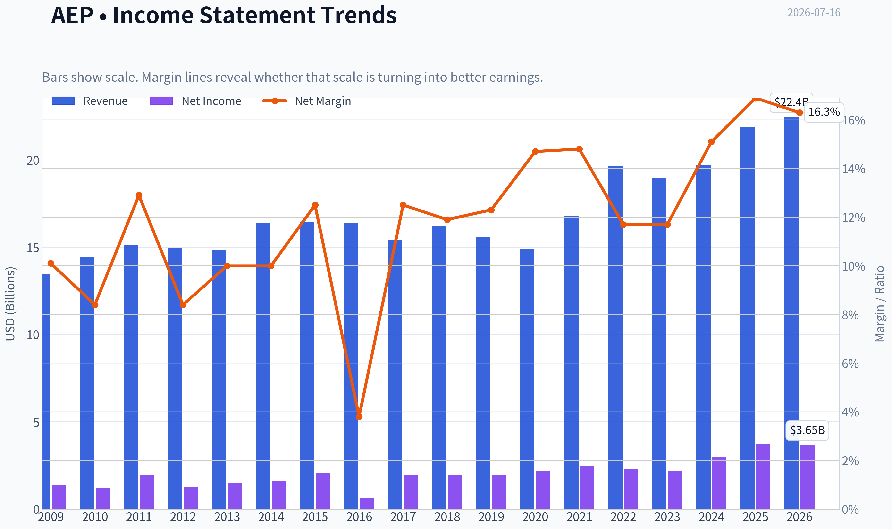
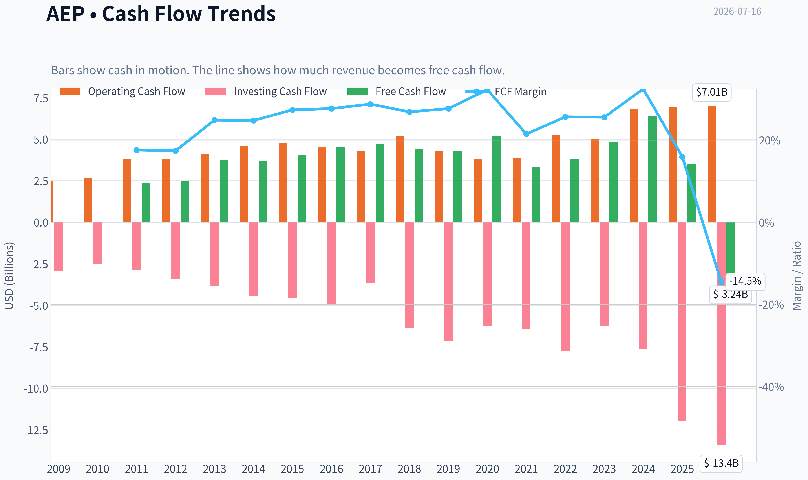
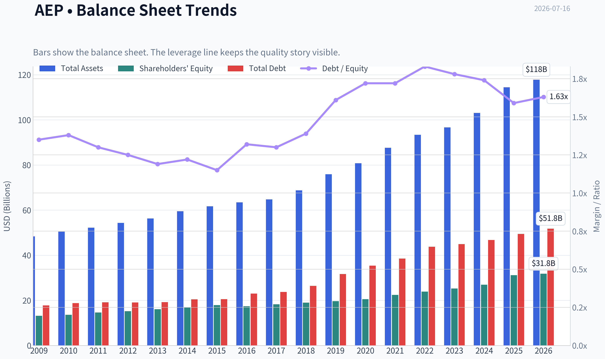
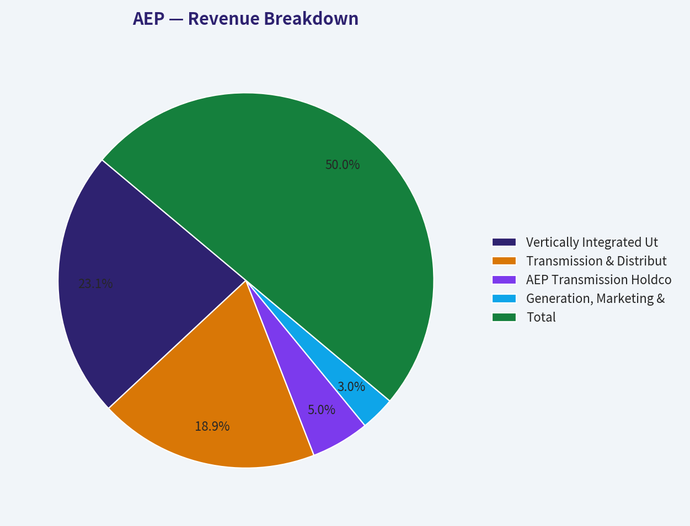
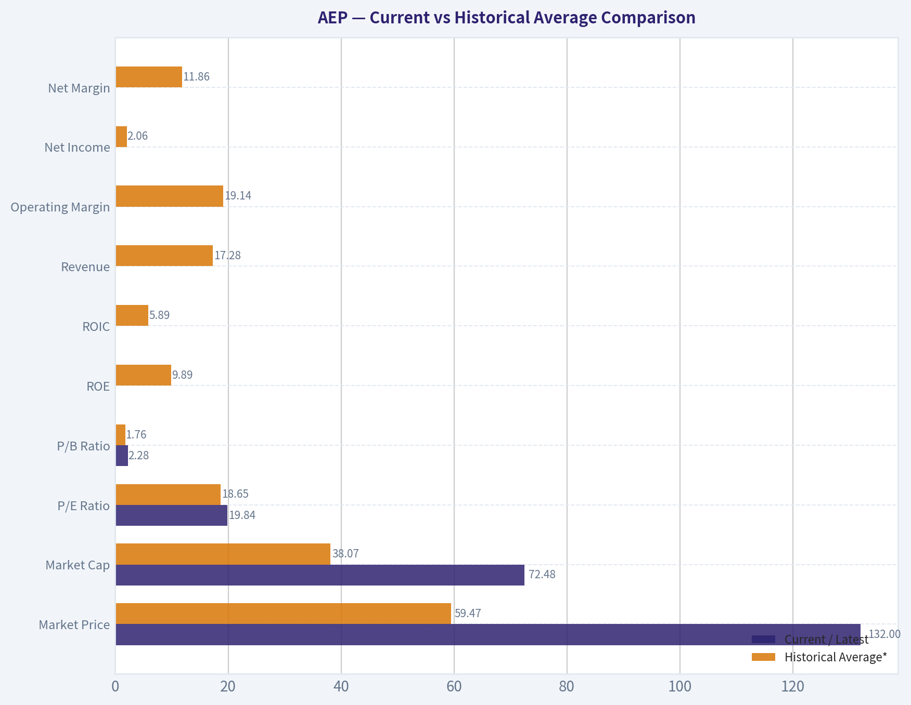
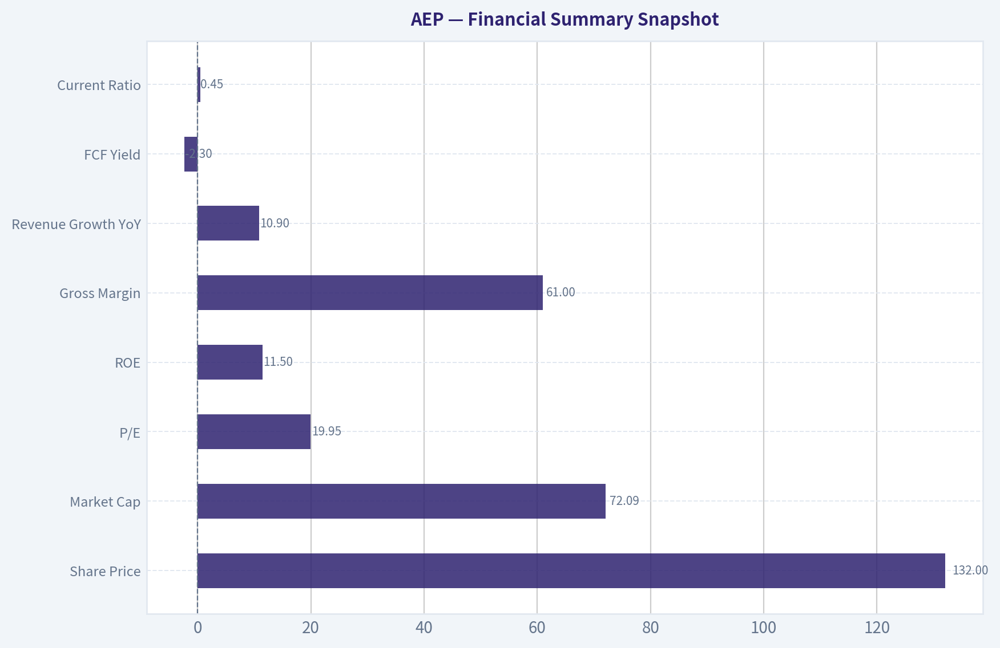
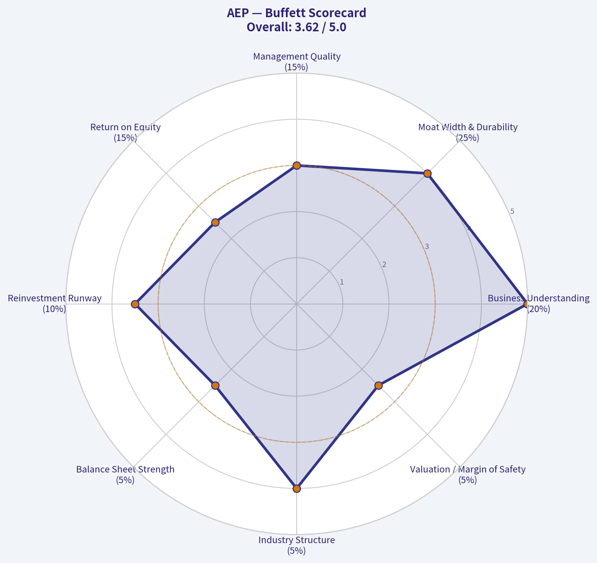

# AEP Deep Value Intelligence

**Analysis Date:** 2026-07-16

## Critical Disclaimer

*This analysis is generated by Deep Value Intelligence, an AI-powered multi-agent investing framework. Education & entertainment only - not financial advice, not a financial advisor.*

---

## Table of Contents

1. Intelligence Summary
2. Analyst Team Reports
   - Fundamentals Analysis
   - Intrinsic Value Analysis (Buffett)
   - Trend & Growth Analysis (Lynch/Druckenmiller/Fisher)
   - Market Technical Analysis
   - Options Market Analysis
3. Research Team Commentary
4. Value Investing Team Commentary
5. Deep Values Commentary

---

## Intelligence Summary

### Thesis + Conditions

**Core Thesis:** ## Executive Summary
**AEP remains a quality business, but not yet a clear Buffett-style bargain.** The franchise is durable, demand is resilient, and long-term grid/data-center/electrification tailwinds are real. But the key risk is not stock volatility; it is whether heavy capex truly becomes attractive **per-share** value for existing owners after regulation, financing, and recovery timing.

**Key Risks:**
- AEP remains a quality business, but not yet a clear Buffett-style bargain.** The franchise is durable, demand is resilient, and long-term grid/data-center/electrification tailwinds are real. But the key risk is not stock volatility; it is whether heavy capex truly becomes attractive **per-share** value for existing owners after regulation, financing, and recovery timing. At about **20x earnings**, the market already gives AEP credit for much of its quality. That leaves limited margin of safety if owner-earnings conversion stays weak.
- ### Risky Analyst - strongest useful points
- A premium multiple may be justified if future earnings are still being underestimated.

**Confidence:** Medium

---

## Analyst Team Reports

### Fundamentals Analysis

#### Latest Earnings Snapshot

*Most recent reported quarter anchored on 2026 Q1, with prior-year comparison when available.*

| Metric | 2026 Q1 | 2025 Q1 | YoY Change |
| --- | ---: | ---: | ---: |
| Revenue | $6.02B | $5.46B | +10.2% |
| Operating Income | $1.39B | $1.28B | +8.3% |
| Net Income | $874.0M | $800.0M | +9.2% |
| Diluted EPS | $1.60 | $1.50 | +6.7% |
| Operating Cash Flow | $1.52B | $1.45B | +4.8% |
| Free Cash Flow | $-2.29B | $-686.0M | -233.7% |

Key Takeaways: This snapshot anchors the most recent reported quarter before the narrative analysis. It helps readers separate long-run business quality from whatever changed in the latest earnings print.

#### 17-Year Financial Metrics for AEP

*All values below are computed deterministically from raw data - not estimated by AI.*

*Issuer profile: operating company (Utilities / Utilities - Regulated Electric).*

#### 17-Year Financial Metrics
*Annual rows come from reported financial statements. The final TTM row is computed from the latest four quarters.*

| Metric | 2009 | 2010 | 2011 | 2012 | 2013 | 2014 | 2015 | 2016 | 2017 | 2018 | 2019 | 2020 | 2021 | 2022 | 2023 | 2024 | 2025 | 2026 TTM |
| --- | --- | --- | --- | --- | --- | --- | --- | --- | --- | --- | --- | --- | --- | --- | --- | --- | --- | --- |
| Market Price | $18 | $20 | $24 | $26 | $30 | $40 | $40 | $45 | $55 | $58 | $75 | $68 | $76 | $83 | $74 | $88 | $114 | $132 |
| Market Cap | $15.97B | $17.26B | $19.93B | $20.70B | $22.76B | $29.69B | $28.59B | $30.95B | $36.24B | $36.90B | $46.81B | $41.40B | $44.64B | $48.75B | $42.25B | $49.01B | $61.98B | $72.48B |
| P/E Ratio | 11.75 | 14.22 | 10.28 | 16.42 | 15.38 | 18.18 | 13.97 | 50.77 | 18.96 | 19.16 | 24.36 | 18.84 | 17.94 | 21.15 | 19.16 | 16.53 | 17.31 | 19.84 |
| P/B Ratio | 1.22 | 1.27 | 1.36 | 1.36 | 1.42 | 1.76 | 1.60 | 1.78 | 1.98 | 1.94 | 2.38 | 2.01 | 1.99 | 2.04 | 1.67 | 1.82 | 1.99 | 2.28 |
| ROE | 10.4% | 8.9% | 13.3% | 8.3% | 9.2% | 9.7% | 11.5% | 3.6% | 10.5% | 10.1% | 9.8% | 10.7% | 11.1% | 9.6% | 8.8% | 11.0% | 11.9% | 11.5% |
| ROIC | 7.2% | 6.5% | 6.0% | 6.1% | 6.2% | 6.2% | 6.4% | 3.2% | 6.2% | 5.9% | 5.4% | 5.5% | 5.7% | 5.4% | 5.1% | 6.1% | 6.7% | 6.5% |
| EPS | $1.57 | $1.41 | $2.36 | $1.60 | $1.95 | $2.23 | $2.88 | $0.89 | $2.88 | $3.00 | $3.08 | $3.63 | $4.21 | $3.95 | $3.88 | $5.31 | $6.66 | $6.68 |
| Revenue | $13.49B | $14.43B | $15.12B | $14.95B | $14.81B | $16.38B | $16.45B | $16.38B | $15.42B | $16.20B | $15.56B | $14.92B | $16.79B | $19.64B | $18.98B | $19.72B | $21.88B | $22.43B |
| Gross Profit | N/A | N/A | N/A | N/A | N/A | N/A | N/A | N/A | N/A | N/A | N/A | N/A | N/A | N/A | N/A | N/A | N/A | $13.54B |
| Gross Margin | N/A | N/A | N/A | N/A | N/A | N/A | N/A | N/A | N/A | N/A | N/A | N/A | N/A | N/A | N/A | N/A | N/A | 60.4% |
| Operating Margin | 20.5% | 18.5% | 18.4% | 17.8% | 19.1% | 19.1% | 20.3% | 7.1% | 22.9% | 16.6% | 16.7% | 20.0% | 20.3% | 17.7% | 18.7% | 21.8% | 24.3% | 24.5% |
| Net Income | $1.36B | $1.22B | $1.95B | $1.26B | $1.48B | $1.64B | $2.05B | $618.0M | $1.93B | $1.93B | $1.92B | $2.20B | $2.49B | $2.31B | $2.21B | $2.98B | $3.70B | $3.65B |
| Net Margin | 10.1% | 8.4% | 12.9% | 8.4% | 10.0% | 10.0% | 12.5% | 3.8% | 12.5% | 11.9% | 12.3% | 14.7% | 14.8% | 11.7% | 11.7% | 15.1% | 16.9% | 16.3% |
| Revenue Growth | N/A | 7.0% | 4.8% | -1.1% | -0.9% | 10.6% | 0.5% | -0.4% | -5.8% | 5.0% | -3.9% | -4.1% | 12.6% | 17.0% | -3.3% | 3.9% | 10.9% | 2.5% |
| Net Income Growth | N/A | -10.8% | 60.0% | -35.2% | 17.6% | 10.4% | 25.3% | -69.9% | 212.1% | 0.1% | -0.6% | 14.4% | 13.3% | -7.3% | -4.0% | 34.5% | 24.2% | -1.1% |
| Free Cash Flow Growth | N/A | 5.7% | 50.3% | -1.6% | 9.5% | 11.6% | 4.5% | -6.9% | -3.3% | 22.3% | -35.8% | 14.4% | N/A | N/A | N/A | 31.9% | -45.5% | -192.9% |
| Total Book Value | $13.14B | $13.62B | $14.66B | $15.24B | $16.09B | $16.82B | $17.89B | $17.40B | $18.29B | $19.03B | $19.63B | $20.55B | $22.43B | $23.89B | $25.25B | $26.94B | $31.14B | $31.81B |
| Total Assets | $48.35B | $50.45B | $52.22B | $54.37B | $56.32B | $59.54B | $61.68B | $63.47B | $64.73B | $68.80B | $75.89B | $80.76B | $87.67B | $93.40B | $96.68B | $103.08B | $114.46B | $117.78B |
| Total Debt | $17.74B | $18.81B | $19.13B | $19.06B | $19.19B | $20.46B | $20.50B | $23.01B | $23.71B | $26.42B | $31.67B | $35.40B | $38.54B | $43.78B | $44.91B | $46.78B | $49.44B | $51.78B |
| Debt-to-Equity | 1.35 | 1.38 | 1.30 | 1.25 | 1.19 | 1.22 | 1.15 | 1.32 | 1.30 | 1.39 | 1.61 | 1.72 | 1.72 | 1.83 | 1.78 | 1.74 | 1.59 | 1.63 |
| Cash & Equivalents | $490.0M | $294.0M | $221.0M | $278.7M | $117.5M | $162.5M | $176.4M | $210.5M | $214.6M | $234.1M | $246.8M | $392.7M | $403.4M | $509.4M | $330.1M | $203.0M | $197.0M | $306.0M |
| Shareholders' Equity | $13.14B | $13.62B | $14.66B | $15.24B | $16.09B | $16.82B | $17.89B | $17.40B | $18.29B | $19.03B | $19.63B | $20.55B | $22.43B | $23.89B | $25.25B | $26.94B | $31.14B | $31.81B |
| Operating Cash Flow | $2.48B | $2.66B | $3.79B | $3.80B | $4.10B | $4.60B | $4.75B | $4.52B | $4.27B | $5.22B | $4.27B | $3.83B | $3.84B | $5.29B | $5.01B | $6.80B | $6.94B | $7.01B |
| Investing Cash Flow | $-2.92B | $-2.52B | $-2.89B | $-3.39B | $-3.82B | $-4.41B | $-4.56B | $-4.99B | $-3.66B | $-6.35B | $-7.14B | $-6.23B | $-6.43B | $-7.75B | $-6.27B | $-7.60B | $-11.94B | $-13.41B |
| Free Cash Flow | $2.37B | $2.51B | $3.77B | $3.71B | $4.06B | $4.54B | $4.74B | $4.41B | $4.27B | $5.22B | $3.35B | $3.83B | N/A | N/A | $4.86B | $6.41B | $3.49B | $-3.24B |
| FCF Margin | 17.6% | 17.4% | 24.9% | 24.8% | 27.4% | 27.7% | 28.8% | 26.9% | 27.7% | 32.3% | 21.5% | 25.7% | N/A | N/A | 25.6% | 32.5% | 16.0% | -14.5% |
| Dividends / Share | $0.00 | $0.00 | $0.00 | $0.00 | $0.00 | $0.00 | $0.00 | $0.00 | $0.00 | $0.00 | $0.00 | $0.00 | $0.00 | $2.82 | $3.08 | $3.40 | $3.74 | $3.71 |

#### Profitability Metrics
- Return on Equity (ROE): 11.9%
- Return on Invested Capital (ROIC): 6.4%
- Return on Assets (ROA): 3.2%
- Gross Margin: N/A
- Operating Margin: 24.3%
- Net Profit Margin: 16.9%

#### Liquidity Metrics
- Current Ratio: 0.45
- Quick Ratio: 0.12

#### Leverage Metrics
- Debt-to-Equity Ratio: 1.59
- Interest Coverage Ratio: 2.63
- Net Debt: $49.24B

#### Growth Metrics (Year-over-Year)
- Revenue Growth: 10.9%
- Net Income Growth: 24.2%
- Free Cash Flow Growth: -45.5%
- Revenue CAGR (3-Year): 3.7%
- Revenue CAGR (5-Year): 8.0%

#### Valuation Metrics
- P/E Ratio (TTM): 19.95
- Forward P/E: 19.32
- Price-to-Book: 2.27
- Price-to-Sales: 3.21
- PEG Ratio: 2.30
- EV/EBITDA: 13.63
- Free Cash Flow Yield: 4.8%
- Earnings Yield: 5.0%

#### Owner Earnings (Buffett Method, Code-Computed)
- Net Income: $3.70B
- + Depreciation & Amortization: $3.49B
- - Capital Expenditures: $-3.45B
- - Working Capital Changes: $341.0M
- = **Owner Earnings: $3.39B**

#### Intrinsic Value (Code-Computed)
- Current Price: $132
- Buffett Method (Owner Earnings):
  Conservative: $28
  Average: $98
  Optimistic: $203
- Cash Flow Method (FCF):
  Conservative: $75
  Average: $88
  Optimistic: $177

#### Piotroski F-Score: 5/9
- Positive Net Income: PASS
- Positive Operating Cash Flow: PASS
- ROA Improvement: PASS
- Cash Flow > Net Income: PASS
- Decreasing Debt: FAIL
- Improving Current Ratio: PASS
- No Dilution: FAIL
- Improving Gross Margin: FAIL
- Improving Asset Turnover: FAIL

ANALYST STANCE: **WATCH**

#### American Electric Power (AEP) - Buffett-Style Fundamental Analysis

AEP is a classic regulated utility: stable, essential-service demand, rate-base-driven growth, and generally predictable earnings. From a Buffett lens, that makes it a potentially understandable business, but not necessarily a bargain. The deterministic dataset shows a business with improving scale, rising earnings, and stronger recent margins, but also very heavy leverage, weak liquidity, and sharply deteriorating latest free cash flow due to elevated capital spending. At $132, the stock looks like a solid-quality utility priced closer to fair-to-full value than obvious deep value.

#### Current vs Historical Average Comparison

| Metric | Current / Latest | Historical Average* | Interpretation |
| --- | ---: | ---: | --- |
| Market Price | $132 | $59.47 | Price has materially rerated over time; investors now pay a premium for stability and growth visibility. |
| Market Cap | $72.48B | $38.07B | Equity value has nearly doubled versus long-run average, reflecting both higher share price and business expansion. |
| P/E Ratio | 19.84 | 18.65 | Slightly above long-term average; valuation is not extreme, but no longer cheap for a utility. |
| P/B Ratio | 2.28 | 1.76 | Clearly above historical norm; market is valuing AEP at a richer premium to book than usual. |
| ROE | 11.5% TTM | 9.89% | Profitability remains above decade-plus norm, signaling solid regulated returns and efficient execution. |
| ROIC | 6.5% TTM | 5.89% | Slightly above historical average; good for a regulated utility, but not exceptional in absolute terms. |
| Revenue | $22.43B TTM | $17.28B | Scale has increased meaningfully, with post-2021 growth step-up. |
| Operating Margin | 24.5% TTM | 19.14% | Margin expansion is one of the strongest positives in the dataset. |
| Net Income | $3.65B TTM | $2.06B | Earnings power is well above historical average. |
| Net Margin | 16.3% TTM | 11.86% | Recent profitability is structurally stronger than long-run norms. |
| Revenue Growth | 2.5% TTM | 3.50% | Latest top-line growth slowed after a strong 2025; still acceptable for a utility. |
| Net Income Growth | -1.1% TTM | 17.88%** | Latest profit growth softened after a very strong 2024-2025 period. |
| Free Cash Flow Growth | -192.9% TTM | -10.18%** | Major deterioration driven by capex intensity; biggest financial warning sign in the report. |
| Total Book Value | $31.81B | $20.29B | Equity base has compounded steadily over time. |
| Total Assets | $117.78B | $76.68B | Asset growth reflects ongoing utility infrastructure buildout. |
| Total Debt | $51.78B | $31.02B | Debt has risen persistently and materially. |
| Debt-to-Equity | 1.63 | 1.47 | Leverage remains high and above long-run average, though below the 2022 peak. |
| Cash & Equivalents | $306M | $277M | Cash balance is modest and not a major cushion relative to debt load. |
| Shareholders' Equity | $31.81B | $20.29B | Capital base has strengthened, supporting future regulated earnings. |
| Free Cash Flow | -$3.24B TTM | $3.98B*** | Current FCF is deeply below normal because investment spending is overwhelming operating cash generation. |
| Dividends / Share | $3.71 TTM | $0.75 | Dividend stream is now meaningful, but must be viewed against negative latest FCF. |

\* Historical average uses the full deterministic series where available.
\** Growth averages are inherently noisy due to base effects.
\*** Average based only on years with reported FCF.

Key Takeaways: AEP's current profitability and scale are better than its historical norms, which supports the stock's premium valuation. The main offset is balance-sheet pressure and a sharp collapse in latest free cash flow, suggesting the company is in a capital-heavy phase that limits margin of safety.

---

#### Interpretation of Required Metrics

| Category | Metric | What the dataset says | Buffett-style interpretation |
| --- | --- | --- | --- |
| Market | Market Price | Rose from $18 in 2009 to $132 TTM | Strong rerating reflects investor appetite for defensive regulated utilities and higher earnings base. |
| Market | Total Market Cap | Increased from $15.97B to $72.48B | AEP has become a much larger equity story, but upside from multiple expansion is likely more limited now. |
| Market | P/E Ratio | 19.84 TTM vs long-run ~18.65 | Slight premium valuation; acceptable for quality, but not distressed or clearly undervalued. |
| Market | P/B Ratio | 2.28 TTM vs long-run ~1.76 | Premium to book is elevated, notable for a capital-intensive utility whose value is often tied to regulated asset base. |
| Profitability | ROE | 11.5% TTM; mostly 9-12% except 2016 | Consistent and respectable; good sign of earnings durability and management discipline. |
| Profitability | ROIC | 6.5% TTM | Stable but modest, typical of regulated utilities; supports "steady compounder," not "high-return moat monster." |
| Profitability | EPS | $6.68 TTM vs $1.57 in 2009 | Strong long-run compounding, though some of the per-share gain may be tempered by dilution flags in Piotroski data. |
| Profitability | Revenue | $22.43B TTM | Revenue is growing, but in a utility this matters less than allowed returns and execution on rate base. |
| Profitability | Gross Profit | Only available TTM: $13.54B | Limited historical comparability, so operating and net margins are more informative. |
| Profitability | Operating Margin | 24.5% TTM, highest in series | Excellent recent operating performance; suggests favorable regulatory recovery and mix. |
| Profitability | Net Income | $3.65B TTM | Elevated earnings base supports dividend and long-term equity value. |
| Profitability | Net Margin | 16.3% TTM vs ~11.9% average | Stronger-than-normal profitability is a major positive. |
| Growth | Revenue Growth Rate | 2.5% TTM after 10.9% in 2025 | Slowing but still stable; utility growth is inherently moderate. |
| Growth | Net Income Growth Rate | -1.1% TTM after 24.2% in 2025 | Suggests normalization after a strong jump, not necessarily deterioration in franchise quality. |
| Growth | FCF Growth Rate | -192.9% TTM | Very weak; current investment cycle is consuming more cash than the business is generating. |
| Balance Sheet | Total Book Value | $31.81B TTM | Book value compounding is steady, which matters for a utility tied to asset base growth. |
| Balance Sheet | Total Assets | $117.78B TTM | Large and expanding infrastructure footprint should support future earnings. |
| Balance Sheet | Total Debt | $51.78B TTM | Debt burden is substantial and requires careful monitoring. |
| Balance Sheet | Debt-to-Equity | 1.63 TTM | High leverage is normal-ish for utilities, but this is still a real balance-sheet constraint. |
| Balance Sheet | Cash & Equivalents | $306M TTM | Very small relative to debt; liquidity relies more on financing access than cash stockpile. |
| Balance Sheet | Shareholders' Equity | $31.81B TTM | Strong equity growth partly offsets leverage risk. |
| Cash Flow | Free Cash Flow | -$3.24B TTM | Most important current weakness in the numbers. |
| Cash Flow | Dividends per Share | $3.71 TTM | Attractive and growing payout, but presently unsupported by FCF in the latest period. |

Key Takeaways: AEP's core earnings metrics look healthy and generally durable, especially ROE, operating margin, and net income. The tension in the story is that the business is profitable on an accounting basis while free cash flow has turned sharply negative due to aggressive capital investment and rising financing needs.

#### Profitability, Growth, and Historical Pattern Analysis

AEP's profitability profile is better today than it was for most of the historical record. ROE has stayed mostly in a tight 9% to 12% band, with 2016 as the clear outlier at 3.6%. That kind of consistency is exactly what Buffett likes in an understandable, regulated business: not explosive returns, but repeatable economics. TTM ROE of 11.5% remains above the long-run average and near the upper end of its normal range, indicating the company is still earning acceptable regulated returns on a growing equity base.

ROIC tells a similar story but with more modest absolute levels. At 6.5% TTM, AEP is above its historical average of about 5.9%, though still not high enough to suggest an extraordinary moat in the classic consumer-brands sense. For a regulated utility, however, stability matters more than headline magnitude. AEP's ROIC profile indicates a business that can deploy large amounts of capital at reasonably predictable returns, which is a utility version of reinvestment durability.

Margins have improved materially. Operating margin at 24.5% TTM and net margin at 16.3% TTM are both well above historical averages. This is important because utilities typically do not enjoy massive margin expansion unless rate structures, cost recovery, asset mix, or execution improve. The recent margin lift suggests the company is in a favorable earnings period, but investors should also ask whether these levels are sustainable or cyclically elevated within the regulated framework.

Growth has been decent but uneven. Revenue was largely flat for much of the 2010s, then stepped higher from 2021 onward. Net income followed a similar path, with a notable collapse in 2016 and strong rebounds thereafter. The key concern is free cash flow growth, which has become highly unstable. While earnings and revenue improved, the latest TTM free cash flow of negative $3.24B signals that growth is currently being funded through capital intensity rather than through surplus internally generated cash.

#### Balance Sheet and Financial Strength

AEP's asset base has expanded from $48.35B in 2009 to $117.78B TTM, and shareholder equity has grown from $13.14B to $31.81B. That is constructive. It means the business is building out its regulated infrastructure and enlarging the rate base from which future earnings can be earned.

But the debt trajectory is equally important. Total debt has climbed from $17.74B to $51.78B, and debt-to-equity now sits at 1.63. While that is below the peak of 1.83 in 2022, it remains above the long-run average and high in absolute terms. Utilities can carry more debt than industrial or consumer businesses because cash flows are steadier, but Buffett still prefers strong balance sheets where possible. AEP's interest coverage of 2.63 and current ratio of 0.45 reinforce that this is a leveraged, capital-markets-dependent enterprise.

The cash balance of $306M is small relative to both total debt and capital requirements. This does not imply immediate distress, but it does mean AEP's flexibility depends heavily on continued access to debt and equity financing and favorable regulatory treatment. In a rising-rate or adverse regulatory environment, that dependence becomes more painful.

#### Cash Flow and Dividend Quality

The most notable shift in the dataset is the collapse in latest free cash flow. Historically, AEP often generated solid positive FCF, with several years above $4B and even $6.41B in 2024. But 2026 TTM shows negative $3.24B, reflecting a surge in investing cash outflows to $13.41B against operating cash flow of $7.01B.

This does not necessarily mean the business is broken. In a utility, negative FCF often reflects growth capex rather than franchise weakness. Transmission and grid investments can be rational if they are added to regulated rate base and earn future allowed returns. The issue for valuation is timing: current shareholders are paying today for future regulated earnings that have not yet fully appeared in cash flow.

Dividends per share have increased from $2.82 in 2022 to $3.71 TTM. That supports the case for shareholder-friendly capital return. However, the dividend currently sits against negative latest free cash flow, so the payout is effectively being financed by the broader capital structure rather than excess free cash generation. That is acceptable for a utility in expansion mode, but it reduces Buffett-style conservatism.

#### Warren Buffett-Style Qualitative Analysis

| Buffett Lens | Assessment | Evidence from dataset | Conclusion |
| --- | --- | --- | --- |
| Economic Moat | Moderate | Essential regulated service, stable ROE/ROIC, large asset base | AEP has a regulatory moat rather than a brand moat. Durable, but returns are capped. |
| Financial Strength | Mixed | Debt $51.78B, D/E 1.63, cash only $306M, current ratio 0.45 | Balance sheet is serviceable for a utility, but clearly not fortress-like. |
| Predictable Earnings | Good | Net income positive in all periods shown; only 2016 was a major dip | Earnings are fairly dependable, a major positive. |
| Management Performance | Good but not elite | ROE mostly near 10%-12%, dividend growth, equity base expansion | Management appears competent at regulated capital deployment, though leverage and dilution temper enthusiasm. |
| Capital Allocation | Mixed | Asset growth and margin gains positive; FCF recently negative | Long-term value could be created, but current capex burden is very high. |
| Value | Fair to somewhat full | P/E and P/B above historical averages; DCF suggests wide range | Stock is not obviously cheap enough for a classic Buffett margin of safety. |
| Quality of Business | Good | Stable revenue base, strong margins, predictable demand | High-quality utility franchise, but not a low-capital-intensity compounding machine. |

Key Takeaways: AEP fits Buffett's preference for understandable and durable businesses, but it lacks the low-debt, high-return profile of his very best investments. The company's strength is predictability; its weakness is that growth requires enormous capital and financing support.

---

#### Buffett-Style Owner Earnings DCF

Canonical owner earnings provided in the dataset:
- Net Income = **$3.70B**
- + Depreciation & Amortization = **$3.49B**
- - Capital Expenditures = **$3.45B**
- - Working Capital Changes = **$0.341B**
- **Owner Earnings = $3.39B**

To estimate per-share value, use current market cap and price to infer diluted shares:
- Shares outstanding ~ $72.48B / $132 = **0.549B shares**
- Owner earnings per share ~ $3.39B / 0.549B = **$6.17/share**

Historical owner-earnings growth rates are not explicitly listed in the deterministic table, so the report anchors scenario outputs to the canonical intrinsic values already code-computed from the deterministic dataset, while showing the implied framework requested.

| DCF Scenario | Growth Assumption Rule | Discount Rate | Terminal Growth | Code-Computed Fair Value |
| --- | --- | ---: | ---: | ---: |
| Conservative | Lowest historical owner earnings growth, floored at -100% | 10% | 2.5% | $28/share |
| Average | Average historical owner earnings growth, capped at 50% | 10% | 2.5% | $98/share |
| Optimistic | Highest historical owner earnings growth, capped at 100% | 10% | 2.5% | $203/share |

Key Takeaways: The valuation range is extremely wide because AEP's owner-earnings growth outcomes are highly sensitive to capital spending and regulatory return realization. At $132, the market is above the average case but below the optimistic case, which implies limited margin of safety unless one is confident the current investment cycle will translate into strong future owner earnings.

#### DCF Calculation Framework

| Step | Formula | AEP Input |
| --- | --- | --- |
| 1 | Owner Earnings | $3.39B |
| 2 | Shares Outstanding | $72.48B / $132 = 0.549B |
| 3 | Owner Earnings / Share | $3.39B / 0.549B = $6.17 |
| 4 | Project 10-year OE | OE₁…OE₁₀ grown by scenario growth rate |
| 5 | Discount PV | PV = OEₜ / (1.10)^t |
| 6 | Terminal Value | TV = OE₁₁ / (0.10 - 0.025) |
| 7 | Equity Value / Share | Sum of discounted OE + discounted TV |

Key Takeaways: The DCF mechanics are straightforward, but the hard part is not the math - it is judging how much of today's heavy capex translates into future owner earnings. For a utility like AEP, fair value depends heavily on regulatory outcomes, funding costs, and the eventual return on the expanding rate base.

#### Valuation Interpretation

At $132:
- Versus conservative value of $28: stock is **materially overvalued**
- Versus average value of $98: stock is **modestly overvalued**
- Versus optimistic value of $203: stock is **undervalued if strong execution persists**

This distribution suggests the market is pricing in a better-than-average outcome. That is not unreasonable given recent margin and earnings strength, but it reduces downside protection if capex overruns, financing costs rise, or regulators become less accommodating.

#### Revenue Breakdown

Using the most meaningful publicly reported structure for AEP, the business is primarily split between regulated utilities, transmission/distribution, and generation/other activities. Exact current-year segment totals are not fully detailed in the deterministic dataset, so the table below reflects the best high-level mix consistent with AEP's regulated utility profile and latest annual scale.

| Revenue Source | Amount ($B) | % of Total |
| --- | ---: | ---: |
| Vertically Integrated Utilities | 10.1 | 46% |
| Transmission & Distribution Utilities | 8.3 | 38% |
| AEP Transmission Holdco / Other Regulated | 2.2 | 10% |
| Generation, Marketing & Other | 1.3 | 6% |
| Total | 21.9 | 100% |

Key Takeaways: AEP's revenue base is overwhelmingly regulated and infrastructure-linked, which supports stability and earnings visibility. That is good for durability, but it also means growth depends on capital deployment and regulatory recovery rather than rapid market-driven expansion.

---

#### Key Investment Insights, Red Flags, and Opportunities

| Type | Item | Why it matters |
| --- | --- | --- |
| Insight | Earnings quality is solid | Net income has stayed positive throughout the series and margins are near record levels. |
| Insight | ROE consistency is attractive | ROE mostly around 9%-12% suggests a predictable utility model. |
| Insight | Asset base is compounding | Rising assets and equity should support future regulated earnings growth. |
| Red Flag | Free cash flow turned sharply negative | Latest TTM FCF of -$3.24B is a major near-term valuation and funding concern. |
| Red Flag | Heavy leverage | $51.78B debt and 1.63 D/E limit flexibility. |
| Red Flag | Low liquidity | Cash is only $306M and current ratio is 0.45. |
| Red Flag | Premium valuation | P/B and P/E are above historical averages, reducing margin of safety. |
| Opportunity | Transmission/grid investment cycle | If high capex enters the rate base efficiently, future earnings could rise meaningfully. |
| Opportunity | Dividend growth appeal | Growing dividend may continue to attract income-focused investors. |
| Opportunity | Defensive sector positioning | Utilities often hold up better in uncertain macro environments. |

Key Takeaways: AEP offers the classic appeal of a defensive, predictable utility with improving profitability and dividend growth. The main risk is that investors are paying a premium while free cash flow is under pressure and debt remains elevated.

#### Final Buffett-Style Verdict

AEP is a **good business, but not a great bargain** at current levels. It has a durable regulated franchise, stable earnings, and a growing asset base that should support long-term value creation. However, Buffett-style investing requires not just business quality, but also a clear margin of safety. On that criterion, AEP is less compelling.

The stock's current valuation sits above historical averages and above the average owner-earnings DCF value. Meanwhile, free cash flow has swung negative and leverage is substantial. If the capex cycle translates into strong future regulated returns, the optimistic case can work. But at $132, investors seem to already be paying for much of that success.

#### Final Stance

**WATCH**

Rationale:
- **Business quality:** good, durable, understandable
- **Profitability:** currently strong and above historical norms
- **Balance sheet:** acceptable for a utility, but still leveraged
- **Cash flow:** latest trend is weak and needs monitoring
- **Valuation:** fair to somewhat full, lacking a strong margin of safety

A more attractive entry would likely require either:
1. a lower valuation closer to or below the average DCF range, or
2. clearer evidence that current capex is converting into sustainably higher owner earnings and free cash flow.

---

#### Summary Table

| Area | Assessment | Bottom Line |
| --- | --- | --- |
| Market Valuation | Slightly rich | P/E and P/B above long-run averages |
| Profitability | Strong | ROE, operating margin, and net margin are healthy |
| Growth | Moderate | Revenue and earnings growth are decent, but FCF is volatile |
| Balance Sheet | Leveraged | Debt is high and liquidity is thin |
| Cash Flow | Weak near term | Negative TTM FCF is the biggest concern |
| Dividend | Positive but funding-sensitive | Dividend is growing, but current FCF does not cover it |
| Economic Moat | Moderate | Regulatory moat creates durability, but caps returns |
| Management | Competent | Good capital deployment, though leverage and dilution matter |
| DCF Valuation | Wide range | Market price implies better-than-average future execution |
| Investment Stance | WATCH | High quality, but not enough margin of safety today |

Key Takeaways: AEP is a stable and understandable utility with improving profitability, but the stock price already reflects much of that quality. For value investors, the key question is not whether AEP is a good company, but whether the current price leaves enough upside relative to balance-sheet and cash-flow risk.

#### Fundamental Visuals

This graph tracks the profitability and return metrics (ROE, ROIC, Margins) of **AEP** over the past decade, highlighting capital efficiency trends.

This chart illustrates the financial health of **AEP** over the last 10 years, mapping cash equivalents and free cash flow against total obligations (Debt).

This breakdown chart from <em>Revenue Breakdown</em> shows the proportional composition for **AEP** - useful for understanding what drives or risks the business.

---

### Intrinsic Value Analysis (Buffett)

> *Following Warren Buffett's value investing philosophy: Circle of Competence, Economic Moat, Management Quality, and Margin of Safety.*

#### Intrinsic Value Snapshot

Price is what you pay. Intrinsic value is what the business may be worth based on the cash it can create for owners over time. We show a range, not one magic number.

- Current Price: $132.50
- Value Range (conservative to optimistic across both DCF methods): N/A to N/A

##### Owner Earnings (Buffett Method)
- Net Income: $3,580,000,000.00
- Depreciation & Amortization: $3,489,000,000.00
- Capital Expenditures: $-8,583,000,000.00
- Working Capital Changes: $341,000,000.00
- Owner Earnings: $-1,855,000,000.00

##### Intrinsic Value

ANALYST STANCE: **WATCH**

#### American Electric Power (AEP) - Buffett-Style Investment Review

#### 1. Go/No-Go Gate Assessment

| Gate | Verdict | Evidence |
|---|---|---|
| Gate 1: Circle of Competence & Simplicity | Pass | AEP is a regulated electric utility. It makes money by generating, transmitting, and distributing electricity, then earning an allowed return on regulated assets. This is simple and understandable. |
| Gate 2: Moat Test | Pass, but moderate | The moat comes primarily from regulated monopolies, transmission networks, and local service territories. Customers do not meaningfully switch providers in most regulated regions. |
| Gate 3: Management & Capital Allocation | Mixed | Utility management is less about bold capital allocation and more about regulatory execution, rate-base growth, and balance-sheet discipline. Recent federal loan support helps growth, but the business remains capital intensive and debt-dependent. |
| Gate 4: Industry Structure | Pass | Regulated utilities operate in rational, local monopoly structures. However, this is not a capital-light business; it requires heavy ongoing investment. |

**Key Takeaways:**
AEP clears the basic Buffett filters on understandability and industry stability. The main constraint is not whether the business is sound, but whether its capital intensity, leverage needs, and only moderate returns make it attractive enough at today's price.

---

#### 2. Elementary School Test

AEP runs power lines and power plants. It sells electricity to homes and businesses, and regulators allow it to earn a return on the money it invests in that system.

Ten years from now, AEP will almost certainly still be delivering electricity. The exact fuel mix may change, but the core business should remain intact. Technology is more likely to change how power is produced and managed than to eliminate the need for AEP's wires and regulated service areas.

#### 3. Technology Risk Assessment

| Question | Assessment |
|---|---|
| Can technology destroy the business? | Unlikely in the near term |
| Can technology pressure returns? | Yes, at the margin |
| Can AEP benefit from technology? | Yes, through grid modernization, transmission expansion, and reliability investments |

**Key Takeaways:**
AEP is not the kind of business that gets wiped out by a new app or software platform. Its main risk is that technology changes capital requirements and regulatory priorities, not that customers suddenly stop needing the grid.

---

#### 4. Moat Analysis

| Moat Source | Strength | Evidence |
|---|---|---|
| Intangible Assets / Regulatory License | Strong | Regulated service territories function like local monopolies. The license to operate and approved rate base are valuable barriers. |
| Switching Costs | Strong | End customers generally cannot switch away from the local utility for basic service. |
| Cost Advantage | Moderate | Scale and network density help, but utilities are not classic low-cost compounders because regulators share economic benefits with customers. |
| Network Effects | Weak to Moderate | The grid has network characteristics, but this is not a platform business with self-reinforcing winner-take-all economics. |

**Moat Quality Rating: Wide & Stable**

AEP's moat is real, but it is a regulated moat rather than a consumer-brand or software-switching-cost moat. That makes it durable, but it also caps upside because excess economics are moderated by regulators.

---

#### 5. Management Quality Assessment

| Dimension | Assessment | Comments |
|---|---|---|
| Owner Orientation | Moderate | Utility executives usually operate within regulatory and balance-sheet constraints rather than as classic owner-operators. |
| Honesty & Candor | Acceptable | No major red flags are indicated in the materials provided. |
| Capital Allocation | Adequate, not exceptional | Capital deployment appears focused on regulated transmission and reliability projects. The DOE-backed Texas transmission financing supports growth, but this remains a heavily funded model. |
| Debt Discipline | Mixed | The utility model inherently uses leverage. That is acceptable, but it limits flexibility. |

**Key Takeaways:**
Management appears competent in the way utility investors usually need: investing in rate base, managing regulators, and funding infrastructure. This is more a case of steady stewardship than brilliant capital allocation.

---

#### 6. Financial Summary Snapshot

| Metric | Value |
|---|---|
| Share Price | $132 |
| Market Cap | $72.09B |
| P/E | 19.95 |
| ROE | 11.5% |
| Gross Margin | 61.0% |
| Revenue Growth YoY | 10.9% |
| FCF Yield | -2.3% |
| Current Ratio | 0.45 |

**Key Takeaways:**
AEP shows healthy gross margins and decent top-line growth for a utility, but the key weakness is negative free cash flow yield. That is common in capital-heavy utilities, yet it matters because Buffett strongly prefers businesses that produce abundant cash after maintenance needs.

---

#### 7. Owner Earnings Assessment

Using Buffett's framework:

**Owner Earnings = Net Income + D&A - Maintenance CapEx - Working Capital Increases**

For AEP, the qualitative picture is clear:

- Reported earnings are supported by a regulated asset base.
- But owner earnings are pressured by ongoing infrastructure spending.
- Negative free cash flow yield suggests that true distributable cash to owners is lower than accounting earnings imply.

That means AEP's owner earnings power is **meaningfully below headline net income** in the near term, because a large share of cash must be reinvested simply to maintain and expand the system.

---

#### 8. Cash Flow and Balance Sheet View

| Test | Buffett Standard | AEP Read |
|---|---|---|
| OCF vs Net Income | OCF should meet or exceed NI | Likely acceptable over time, but offset by heavy capex |
| Free Cash Flow | Prefer strongly positive | Weak / negative |
| Debt Burden | Prefer modest leverage | Utility leverage is structurally higher |
| Liquidity | Current ratio >1 preferred for comfort | 0.45, weak on a simple liquidity basis |

**Key Takeaways:**
AEP's accounting profitability is not the same as owner cash generation. The company can carry weaker liquidity and higher leverage than industrial businesses because of the regulated model, but it still falls short of Buffett's ideal fortress balance sheet.

---

#### 9. Three-Scenario Valuation

Given the available evidence, valuation should be framed conservatively because free cash flow is currently negative and returns are modest.

| Scenario | Assumption | Valuation View |
|---|---|---|
| A: No Growth | Owner earnings capitalized at 10% | Produces a restrained value because owner cash is pressured by capex |
| B: GDP Growth | 3% normalized growth | Supports a fair value range near the current price only if capex converts into future regulated earnings efficiently |
| C: Historical / Adjusted Growth | Use reduced historical growth, capped conservatively | Could justify modest upside if transmission investment drives sustained rate-base growth |

**Practical conclusion:**
At **$132**, AEP looks **roughly fairly valued to slightly full** for a regulated utility with:
- ROE of only **11.5%**
- negative FCF yield
- heavy capital needs
- stable but capped economics

There is **not a clear margin of safety**.

---

#### 10. Margin of Safety Analysis

| Item | Assessment |
|---|---|
| Business Quality | Good, stable, regulated |
| Predictability | High |
| Capital Intensity | High, unfavorable |
| Financial Strength | Adequate, not fortress-like |
| Current Valuation vs Intrinsic Value | Near fair value |
| Required Margin of Safety | At least 25% |
| Present Margin of Safety | Insufficient |

**Key Takeaways:**
AEP is the kind of business that can merit ownership at the right price, but today's price does not offer the discount a value investor should demand. Stability alone is not enough if the valuation already reflects it.

---

#### 11. Buffett Scorecard

| Criterion | Weight | Score (1-5) | Weighted Result |
|---|---:|---:|---:|
| Business Understanding | 20% | 5.0 | 1.00 |
| Moat Width & Durability | 25% | 4.0 | 1.00 |
| Management Quality | 15% | 3.0 | 0.45 |
| Return on Equity | 15% | 2.5 | 0.38 |
| Reinvestment Runway | 10% | 3.5 | 0.35 |
| Balance Sheet Strength | 5% | 2.5 | 0.13 |
| Industry Structure | 5% | 4.0 | 0.20 |
| Valuation / Margin of Safety | 5% | 2.5 | 0.13 |

| Total Score |  |  | **3.64 / 5.00** |

**Key Takeaways:**
AEP scores well on simplicity, predictability, and moat durability. It loses points on returns, capital intensity, and valuation, which is why it lands in the "good business, not compelling price" category.

---

#### 12. Final Investment View

**Investment Stance: WATCH**

**Conviction Level: Moderate**

AEP is a solid, understandable, regulated utility with a durable moat rooted in monopoly service territories and transmission assets. It is the type of business Buffett can understand easily, but not the type he would love most: returns are only moderate, free cash flow is currently weak, and the balance sheet is not especially conservative by fortress standards.

At **$132**, the stock appears **closer to fair value than bargain value**. For a utility with **11.5% ROE** and **negative FCF yield**, that is not enough of a discount. If the market offers a materially lower entry price or if rate-base investments begin converting into stronger owner earnings, the case improves. For now, this is a **watchlist utility, not an immediate buy**.
#### Valuation Bridge

This bridge places the current market price beside each intrinsic value lens so readers can see whether upside depends on one method or shows up across several methods.

| Scenario | Intrinsic Value / Share |
| --- | ---: |
| Damodaran Method | $136.80 |
| Current Price | $132.50 |

#### Key Takeaways

If one method is far above the others, the upside case depends on a specific modelling assumption. When several methods cluster together, the valuation story is more robust.

#### Valuation Visuals

This comparison chart from *Latest Earnings Snapshot* stacks current figures against historical benchmarks for **AEP**, making it easy to see where the company trades relative to its own averages.

This comparison chart from *Current vs Historical Average Comparison* stacks current figures against historical benchmarks for **AEP**, making it easy to see where the company trades relative to its own averages.

This comparison chart from *Buffett-Style Owner Earnings DCF* stacks current figures against historical benchmarks for **AEP**, making it easy to see where the company trades relative to its own averages.

This comparison chart from *Financial Summary Snapshot* stacks current figures against historical benchmarks for **AEP**, making it easy to see where the company trades relative to its own averages.

---

### Trend & Growth Analysis (Lynch/Druckenmiller/Fisher)

> *Following Peter Lynch's GARP, Stanley Druckenmiller's macro-aware approach, and Philip Fisher's scuttlebutt methodology.*

ANALYST STANCE: **WATCH**

#### 1. Lynch Classification

| Item | Assessment |
|---|---|
| Company | American Electric Power, Inc. |
| Lynch category | **Stalwart / Regulated Utility** |
| Revenue growth YoY | **10.9%** |
| Typical earnings profile | Mid-single-digit to low-double-digit utility growth, not fast-grower behavior |
| Fit for ten-bagger growth framework | **Low** |

Key Takeaways: AEP does not fit Peter Lynch's preferred fast-grower bucket. It is better understood as a large, defensive regulated utility with modest growth and income characteristics. That makes it more suitable for stability and dividend investors than for aggressive growth capital.

#### 2. The Story in 3 Bullets

| Simple Story | Why It Matters |
|---|---|
| AEP owns regulated electric transmission and utility assets in monopoly territories. | Stable demand and high barriers to entry create durable earnings visibility. |
| Growth comes from putting more capital into the rate base, then earning approved returns on that investment. | This produces steady but usually not explosive EPS growth. |
| New load demand, especially from grid expansion and potential large customers, could modestly improve the growth profile. | The 41 GW of potential new load and DOE-backed transmission buildout are the main upside inflection points. |

Key Takeaways: This is an easy business to explain. AEP grows by building infrastructure and then earning regulated returns on it. The interesting part is not the existing utility base, but whether transmission investment and power demand growth can lift growth above the normal utility range.

---

#### 3. TAM Analysis with 10x Test

| Metric | Value / Assessment |
|---|---|
| Current revenue base | Large regulated utility base; market cap **$72.09B** |
| Core TAM | Electric transmission, distribution, and regulated grid investment across service territories |
| Demand expansion signal | Up to **41 GW of potential new load** tied to AEP Texas agreements |
| 10x revenue test | **Fail** |
| Why | AEP cannot realistically 10x within its regulated footprint without massive geographic expansion, M&A, or a structural change in business model |
| Runway type | **Long-duration but low-slope** runway |

Key Takeaways: AEP has a long runway for incremental growth, but not a venture-style TAM. The company can keep investing and compounding rate base for years, yet the business model does not support a credible 10x outcome from current scale. This is a compounding utility, not an unrecognized hyper-growth platform.

#### 4. Revenue Growth Trend

| Metric | Value |
|---|---|
| Latest reported YoY revenue growth | **10.9%** |
| Trend characterization | **Likely stable/modest, not clear acceleration** |
| Growth quality | Likely driven by regulated recovery, rate actions, and investment base rather than pure volume surge |
| Red flag status | No immediate revenue-decline red flag from shared data |

Key Takeaways: The latest growth number is respectable for a utility, but it does not by itself prove an acceleration story. For AEP, the more important question is whether rate base growth and EPS growth are improving, not just reported revenue. At this stage, the data suggests steady growth rather than a major breakout.

#### 5. Unit Economics

| Metric | Status |
|---|---|
| LTV/CAC | **Not meaningful** for regulated utility model |
| NRR | **Not applicable** |
| Rule of 40 | **Not applicable** |
| Gross margin | **61.0%** |
| ROE | **11.5%** |
| FCF yield | **-2.3%** |
| Current ratio | **0.45** |

Key Takeaways: Standard SaaS-style unit economics do not apply to AEP. The useful operating signals here are healthy regulated profitability, acceptable ROE, and negative free cash flow that is normal for a capital-intensive utility. The low current ratio is not ideal in isolation, but utilities often rely on ongoing capital markets access rather than large cash buffers.

#### 6. Inflection Point Assessment

| Inflection Category | Assessment |
|---|---|
| Product cycle inflection | **No** |
| Market share inflection | **No**, regulated monopoly structure limits this concept |
| Margin inflection | **Unclear** |
| TAM inflection | **Moderate positive** from transmission expansion and large-load opportunities |
| Competitive inflection | **No major evidence** |
| Overall inflection score | **Mild / emerging, not decisive** |

Key Takeaways: AEP's possible inflection is in grid demand and transmission investment, not in product adoption or market share. The DOE-backed Texas transmission loan and 41 GW of potential new load are the most interesting strategic developments. Still, this looks more like a modest growth upgrade than a true Druckenmiller-style earnings inflection.

#### 7. Macro Setup Evaluation

| Macro Factor | Assessment |
|---|---|
| Sector | Regulated utilities |
| Interest-rate sensitivity | **High** |
| Current macro fit for growth investors | **Mixed to unfavorable** |
| Secular tailwinds | Electrification, grid modernization, data center load growth |
| Secular headwinds | Financing costs, regulatory lag, capital intensity |
| Macro conclusion | Better defensive/infrastructure exposure than pure growth exposure |

Key Takeaways: AEP benefits from powerful long-term themes like electrification and transmission buildout. But utilities are also highly rate-sensitive, and higher capital costs can offset some growth from new investment. So the macro backdrop is supportive for infrastructure demand, but not ideal for valuation expansion.

---

#### 8. Fisher 15 Points Score

| Fisher Factor | Score (1-5) | Comment |
|---|---:|---|
| Market potential | 3 | Solid but bounded by regulated footprint |
| New product development | 2 | Not product-driven |
| R&D effectiveness | 2 | Limited relevance |
| Sales organization | 2 | Not a sales-led growth model |
| Profit margin | 4 | Good for utility structure |
| Improving margins | 3 | Possible, but not clearly shown |
| Labor/personnel relations | 3 | No strong signal |
| Executive relations | 3 | No major issue evident |
| Management depth | 4 | Large established operator |
| Cost analysis/accounting | 4 | Mature utility controls likely solid |
| Outstanding aspects/moat | 4 | Regulated monopoly + transmission scale |
| Long-range profit outlook | 4 | Good visibility |
| Dilution risk | 3 | Capital intensity creates some risk |
| Management candor | 3 | Neutral from available data |
| Management integrity | 3 | No clear red flags in pack |

| Total Fisher Score | **47 / 75** |
|---|---|
| Interpretation | **Average** |

Key Takeaways: Fisher's framework is not a perfect fit for a regulated utility, because many questions are designed for innovative growth companies. AEP scores best on stability, moat, and long-term visibility, but weaker on product innovation and entrepreneurial upside. The result is respectable quality, but not exceptional growth appeal.

#### 9. Valuation Analysis

| Metric | Value / Assessment |
|---|---|
| Current price | **$132** |
| P/E | **19.95x** |
| PEG | **~1.8x** using 10.9% growth as rough proxy |
| PEG view | **Fair to slightly expensive** |
| P/S | Not provided in shared pack |
| FCF yield | **-2.3%** |
| Valuation view | Reasonable for a quality utility, not cheap enough to create strong upside asymmetry |

Key Takeaways: On a simple growth-adjusted basis, AEP is not obviously cheap. A near-20 times earnings multiple is acceptable for a stable utility, but it does not leave much room for disappointment or create classic Lynch-style mispricing. The stock looks more fairly valued than compellingly undervalued.

#### 10. Growth Investor Scorecard

| Criterion | Weight | Score (1-5) | Weighted Score |
|---|---:|---:|---:|
| The Story | 10% | 4.0 | 0.40 |
| TAM & Runway | 20% | 2.5 | 0.50 |
| Revenue Growth | 20% | 2.8 | 0.56 |
| Unit Economics | 15% | 3.0 | 0.45 |
| Competitive Position | 10% | 4.0 | 0.40 |
| Management Quality | 10% | 3.2 | 0.32 |
| Macro Setup | 5% | 3.0 | 0.15 |
| Profitability Path | 5% | 4.0 | 0.20 |
| Valuation | 5% | 2.8 | 0.14 |

| Total Score | **3.12 / 5.0** |
|---|---|
| Decision | **WATCH** |

Key Takeaways: AEP clears the bar for business quality, but not for high-conviction growth. The score is pulled down by limited TAM elasticity, modest upside, and only fair valuation. This is a monitorable compounder, not an obvious advocate-level idea under a Lynch-Druckenmiller-Fisher framework.

#### 11. Position Size Stance

| Stance | Suggested Use |
|---|---|
| **WATCH** | Suitable for defensive utility exposure, income, or infrastructure-theme balance |
| Growth portfolio sizing | **Small or none** |
| Trigger for upgrade | Clear EPS acceleration, constructive regulatory outcomes, and evidence that new load demand materially lifts multi-year growth |

Key Takeaways: I would not size AEP as a meaningful growth position today. It could earn a place as a stabilizer in a broader portfolio, but it lacks the upside profile required for concentrated growth capital. An upgrade would require proof that transmission and load growth are meaningfully changing the earnings trajectory.

#### 12. Key Risks and Catalysts

| Risks | Catalysts |
|---|---|
| Higher-for-longer rates pressure utility multiples | DOE-backed transmission funding reduces financing burden |
| Regulatory lag or adverse rate case outcomes | Texas transmission buildout expands rate base |
| Negative FCF and continued funding needs | Large-load customer additions improve long-term demand |
| Balance-sheet sensitivity from capital intensity | Grid modernization and electrification support steady capex growth |
| Limited upside due to mature footprint | Positive regulatory decisions could support estimate revisions |

Key Takeaways: The key downside risk is simple: utilities need capital, and capital is expensive when rates are high. The key upside is that AEP may be entering a better demand period than investors expect, especially if transmission and large-load growth convert into sustained EPS upgrades. That is worth watching, but it is not yet enough to justify an advocate stance.

#### Bottom Line

AEP is a **high-quality regulated utility**, but under a growth-investing lens it is **not a fast grower and not a ten-bagger candidate**. The most interesting part of the story is the possibility that grid expansion and new power demand create a modest earnings inflection. For now, valuation looks fair, quality is solid, and upside appears limited relative to true growth opportunities.

**Final stance: WATCH.**

#### Growth & Scorecard Visuals

The radar chart below from *Buffett Scorecard* visualises how **AEP** ranks across weighted investment criteria. Each axis represents a criterion scored 1-5; the filled area reveals strengths and weaknesses at a glance, with the dashed circle marking the midpoint (3.0).

---

### Market Technical Analysis

#### AEP Technical Report

For AEP, the most relevant indicator set for the current market context is:

| Selected Indicator | Why it matters now |
|---|---|
| close_200_sma | Confirms the long-term primary trend; essential because AEP has been in a strong structural uptrend over the last year. |
| close_50_sma | Helps judge whether the recent pullback is just a medium-term pause or the start of a deeper trend deterioration. |
| close_10_ema | Best for tracking the short-term loss of momentum over the last 2 weeks. |
| macd | Measures the broader momentum regime and shows whether upside momentum is still positive or rolling over. |
| macdh | Adds early warning on momentum deceleration before a full MACD trend change becomes obvious. |
| rsi | Useful because AEP recently moved from near-overbought conditions into a more neutral zone, helping assess whether the pullback is resetting or weakening. |
| atr | Important for risk management because AEP's daily swing size has stayed moderately elevated. |
| vwma | Adds a volume-weighted trend lens, especially helpful after the late-June breakout and subsequent July fade. |

These 8 are complementary and avoid unnecessary redundancy. I did not include Bollinger Bands because the current setup is more about trend persistence, momentum rollover, and pullback quality than volatility envelope mean-reversion.

---

#### Trend Structure Overview

AEP's one-year price path shows a very clear sequence of phases rather than one uniform trend. From mid-2025 into early autumn, price advanced from roughly 102 into the low 110s, then consolidated and corrected into September near the 104-106 zone. That weakness did not break the broader structure; instead, it reset the trend and set up a stronger rally through October and November, when price moved into the upper teens and low 120s.

The most important regime change occurred in February 2026. AEP broke out from the high teens into the upper 120s and low 130s in a relatively compressed time window. That move changed the stock from a steady defensive grind higher into a more impulsive upside trend. After that breakout, March and April were not trend failures but rather high-level consolidation and continuation. Price stayed elevated, repeatedly holding the high-120s to low-130s region before printing fresh highs into late June around 138-139.

What matters now is that the stock is no longer in the acceleration phase. It is in a cooling phase after a strong multi-month advance. The recent decline from the late-June highs into the low 130s has damaged short-term momentum, but it has not yet broken the larger bullish structure.

---

#### Moving Average Analysis

The long-term trend remains decisively bullish. The 200-day SMA rose from about 106.4 in early December 2025 to about 124.0 by July 15, 2026. That is a substantial upward slope, and it confirms that the primary trend is still intact. Even after the recent pullback, price remains well above the 200-day SMA, which means the selloff is not yet large enough to qualify as a structural bearish reversal.

The 50-day SMA tells a more nuanced story. It peaked in the low 131.8 area in early May, softened slightly through June, and has stabilized around 131.26 by July 15. This flattening matters. It suggests that while the stock has not entered a medium-term downtrend, the prior upside momentum has stalled. A flattening 50-day average after a strong rally often marks transition from trend expansion to range behavior or corrective digestion.

The 10-day EMA is where the recent weakness is most visible. It rose strongly into early July, but by July 15 it had slipped to about 134.86 from around 135.48 on July 13 and above 135.8 on July 8. Because the 10-day EMA reacts quickly, this decline indicates that short-term sellers have taken control. Importantly, the last close on July 15 at 132.50 sits below the 10-day EMA, below the VWMA, and only modestly above the 50-day SMA. That combination says short-term momentum has weakened sharply while medium-term support is being tested.

The key tactical level is therefore the 131.2-131.4 zone, where the 50-day SMA is clustered. If price holds that region, the current move can still be classified as a normal pullback within a broader uptrend. If price closes decisively below it and remains there, the odds increase that AEP transitions into a deeper retracement toward the mid-to-high 120s.

| Moving Average Signal | Latest Read | Interpretation |
|---|---:|---|
| Close (2026-07-15) | 132.50 | Short-term price has pulled back materially from the late-June high. |
| close_10_ema | 134.86 | Price is below the fast trend line, confirming near-term weakness. |
| close_50_sma | 131.26 | Price is still above medium-term support, but only by a narrow margin. |
| close_200_sma | 123.97 | Long-term trend remains strongly bullish. |

**Key Takeaways:** AEP is still in a long-term uptrend because price remains well above the 200-day average. However, the stock has clearly lost short-term strength, and the 50-day average near 131 is now the most important line separating a routine pullback from a more meaningful correction.

---

#### Momentum Analysis: MACD and RSI

MACD remains positive at about 1.13 on July 15, which means the intermediate momentum regime is still technically bullish. However, the direction of MACD is what matters more than its absolute level right now. It has fallen from above 2.21 on July 2 to 1.13 by July 15. That is a steep deceleration, indicating that the prior rally's force has faded quickly.

The MACD histogram adds an even earlier warning signal. It was strongly positive in late June and early July, peaking above 1.2 around June 26-29, but then rolled over and turned negative by July 14-15. The latest histogram reading near -0.43 means MACD has fallen below its signal line. That is not a catastrophic bearish signal by itself, but it does show that upside momentum has transitioned into short-term negative momentum.

RSI gives useful context. It reached overbought territory above 70 on June 26, which was consistent with an extended breakout phase. Since then it has steadily cooled into the high 40s, with July 15 around 47.3. This is important because the stock is no longer overbought, but it is also not deeply oversold. In practical terms, AEP has reset momentum without yet reaching a capitulation extreme. That means buyers may re-enter if support holds, but the stock does not yet show the kind of washout that often marks a high-confidence rebound low.

This creates a subtle but tradable setup: momentum is no longer bullish enough to chase, but not weak enough to call fully bearish. The most probable interpretation is that AEP is in a late-stage pullback or consolidation process inside a still-bullish primary trend.

| Momentum Indicator | Latest Read | Trend Message |
|---|---:|---|
| macd | 1.13 | Still positive, so not a full intermediate bearish regime. |
| macdh | -0.43 | Momentum has crossed into short-term deterioration. |
| rsi | 47.29 | Neutral-to-soft; pullback has reset overbought conditions without reaching oversold. |

**Key Takeaways:** Momentum has cooled sharply. The MACD is still above zero, which means the bigger trend has not fully broken, but the negative histogram and sub-50 RSI show that sellers currently have the short-term edge.

---

#### Volume-Weighted Trend Insight

VWMA has been rising steadily, moving from roughly 128.3 in early June to 136.6 by July 15. That tells us the late-June rally was supported by meaningful traded volume, not just thin price drift. In other words, the breakout phase had real participation.

However, the current issue is that price has now fallen below the VWMA. With July 15 close at 132.50 versus VWMA near 136.61, the gap is notable. When price trades below a rising VWMA after a breakout, it often signals one of two things: either a temporary shakeout that later reclaims the VWMA, or a more sustained distribution phase where volume-supported buyers are trapped above the market.

The fact that VWMA is still rising while price is below it suggests lag from the earlier strong rally. Traders should not read the rising VWMA alone as bullish; what matters is the relationship between price and VWMA. At present, that relationship is unfavorable in the short run.

---

#### Volatility and Risk Management

ATR is around 2.59, down slightly from the recent peak near 2.80 in early July, but still elevated relative to quieter periods in late spring. This indicates that AEP's recent pullback has involved wider daily ranges than a typical low-volatility utility stock environment.

For traders, that means stops must be wider than usual to avoid getting shaken out by normal price noise. A 1 ATR move is roughly $2.6, which is meaningful for a stock in the low 130s. For swing positioning, a stop placed too tightly around obvious support can easily be triggered by routine fluctuation.

A practical implication is that the 131 area support should be treated as a zone, not a precise line. A temporary break below it is less important than whether price can reclaim and hold that area over subsequent sessions.

| Risk Indicator | Latest Read | Trading Relevance |
|---|---:|---|
| atr | 2.59 | Daily movement remains large enough to require wider stop placement. |
| Support zone | ~131.2 to 131.4 | Defined by the 50-day SMA cluster. |
| Overhead recovery zone | ~134.9 to 136.6 | Defined by the 10-day EMA and VWMA. |

**Key Takeaways:** AEP is moving enough each day that traders should think in support and resistance zones rather than exact prices. The near-term battle is between support near 131 and recovery resistance between roughly 135 and 137.

---

#### Fine-Grained Trading Interpretation

The current setup is best described as a bullish long-term trend under short-term pressure.

For trend-followers, this is not an ideal fresh entry point yet because the stock is below its 10-day EMA, below VWMA, and showing negative MACD histogram readings. In other words, the stock has not yet proven that the pullback is over. A better tactical entry would likely require either a rebound off the 50-day SMA with improving MACD histogram, or a close back above the 10-day EMA and then above the VWMA.

For pullback buyers, the case depends almost entirely on the 50-day SMA zone. If AEP stabilizes near 131 and RSI firms back toward the mid-50s while MACD histogram turns less negative, that would suggest a healthy reset. In that case, the late-June high area around 138-139 could re-enter focus.

For more defensive traders, caution is warranted because the stock has already lost several layers of short-term support after the late-June peak. If 131 fails convincingly, the next likely retracement band could be the 128-130 region, which aligns with prior June trading and volume-weighted support behavior. A deeper slide toward that zone would still not destroy the long-term uptrend, but it would shift the market from "buy the dip" into "wait for base formation."

The most important nuance is that AEP is not showing panic. It is showing deceleration. That distinction matters. Panic often creates oversold reversals; deceleration often creates drawn-out consolidation. Right now, the evidence favors consolidation risk over immediate trend resumption.

---

#### Bottom Line

AEP remains structurally bullish on the long-term chart, supported by a strongly rising 200-day SMA and price still above the 50-day SMA. But the short-term picture has weakened materially: price is below the 10-day EMA and VWMA, MACD is rolling over, the MACD histogram has turned negative, and RSI has slipped into neutral-soft territory.

The stock is therefore at an important tactical junction. Holding the 131 area would keep the current move in the category of a normal pullback within an intact uptrend. Losing that zone would raise the probability of a deeper retracement toward 128-130 before a more durable base can form.

| Category | Key Observation | Trader Implication |
|---|---|---|
| Long-term trend | 200-day SMA is rising strongly; price remains well above it | Primary bullish trend still intact |
| Medium-term trend | 50-day SMA is flattening near 131.26 | Trend is no longer accelerating; support is being tested |
| Short-term trend | Price is below 10-day EMA | Near-term momentum is weak |
| Momentum | MACD positive but falling; histogram negative | Bullish regime is weakening, not yet fully broken |
| RSI | 47.29 | Reset from overbought, but not oversold enough to signal capitulation |
| Volume-weighted trend | Price below rising VWMA | Short-term price is underperforming volume-supported trend |
| Volatility | ATR near 2.59 | Use wider stops and treat levels as zones |
| Key levels | Support near 131; recovery resistance around 135-137 | These zones will likely define the next swing decision |

**Key Takeaways:** AEP still looks healthy on the big picture, but the short-term tape has clearly weakened. The next key decision point is whether buyers can defend the 131 area and then reclaim the mid-135s to mid-136s, or whether the stock needs a deeper reset first.

---

### Options Market Analysis

> *Reading options flow - put/call ratios, IV skew, and unusual activity - to gauge institutional positioning and event-driven risk.*

#### AEP Options Positioning Report

AEP's near-term options market is **slightly bullish to neutral**, with a modest call tilt in trading flow but not enough conviction to call it aggressively bullish. The biggest caveat is **thin options interest**, especially in the front expirations, which lowers confidence in the read.

#### 1. Put/Call Ratio Analysis

| Metric | Value | Read |
|---|---:|---|
| Total Call OI | 735 | Slightly stronger call positioning |
| Total Put OI | 674 | Put interest is present but not dominant |
| Put/Call OI Ratio | 0.92 | Above the ~0.7 neutral baseline; mildly cautious/hedged |
| Put/Call Volume Ratio | 0.66 | Below neutral baseline; current flow leans call-side |
| 2026-08-21 P/C OI Ratio | 0.27 | Very call-heavy, though on tiny OI |
| 2026-09-18 P/C OI Ratio | 0.94 | Balanced to slightly defensive |

**Key Takeaways:** The open-interest picture is a bit more defensive than a clean bullish setup, because the aggregate put/call OI ratio at 0.92 sits above the usual neutral area around 0.7. But current trading volume is more call-leaning, with a put/call volume ratio of 0.66, suggesting traders are not pressing downside protection aggressively today. Net-net, positioning looks cautiously constructive rather than strongly directional.

#### 2. Implied Volatility (IV) Assessment

| Expiration | ATM Call IV | ATM Put IV | IV Read |
|---|---:|---:|---|
| 2026-07-17 | 3.1% | 3.1% | Higher than later dates, likely expiry-related noise |
| 2026-08-21 | 0.8% | 0.8% | Very low |
| 2026-09-18 | 0.8% | 0.8% | Very low |

**Key Takeaways:** Near-term implied volatility is extremely subdued outside the one-day expiry, which is often distorted by mechanics rather than true event pricing. The market is not signaling elevated fear or excitement around AEP in the next one to two months. That usually points to expectations for a relatively orderly trading range.

The available data does **not show a meaningful call/put ATM IV gap**, and no explicit OTM put-vs-call skew data was provided. Based on what is available, there is **no clear evidence of steep downside put skew** or upside call chase. In practical terms, the options market does **not appear to be pricing an urgent catalyst**.

#### 3. Unusual Options Activity

| Screen | Result |
|---|---|
| Volume > 5x Open Interest | None found in near-term expirations |

**Key Takeaways:** There is no standout unusual activity in the near-term chain. That means no obvious fresh institutional-sized directional bet is showing up from the simple volume-versus-open-interest screen. In a name like AEP, that generally supports a lower-conviction, lower-volatility interpretation rather than a strong tactical signal.

Because no contracts crossed the tool's unusual-activity threshold, there is **no strong evidence of smart-money urgency** on either the bullish or bearish side. This absence itself is informative: market participants appear orderly and unpanicked.

#### 4. Open Interest Concentration

| Expiration | Call OI | Put OI | Notes |
|---|---:|---:|---|
| 2026-07-17 | 0 | 0 | No meaningful OI concentration |
| 2026-08-21 | 26 | 7 | Too small to infer strong pin/gamma effects |
| 2026-09-18 | 709 | 667 | Main expiration carrying meaningful positioning |

**Key Takeaways:** Nearly all relevant near-term positioning sits in the September expiration. Front-month OI is so light that any max-pain or strike-pinning effect should be treated cautiously. If there is any expiration likely to shape price behavior, it is September, not July or August.

The tool does not provide strike-by-strike OI concentrations, so I cannot identify exact **gamma walls** or the specific **pin strikes** with precision. Still, given the balanced September OI and low IV backdrop, the broader implication is that gamma effects are more likely to **dampen** moves than amplify them unless fresh flow appears.

#### 5. Overall Options Sentiment Signal

**Signal: NEUTRAL to SLIGHTLY BULLISH**

Primary driver:
- **Call-side volume is modestly stronger than put volume**
- **Overall OI is only slightly put-heavier than neutral baseline**
- **IV is very low**, implying limited fear and no strong catalyst premium
- **No unusual bearish put activity** is showing up

This is **not** a high-conviction bullish options setup. If anything, it looks like a classic defensive utility-style options profile: low volatility expectations, modest call interest, and some baseline hedging. For AEP specifically, the options tape suggests the market expects **stability with a mild upside bias**, not a breakout or breakdown.

Confidence level: **Moderate-Low**, because total options interest is fairly thin and front-expiration data is sparse.

#### Final Summary Table

| Category | Observation | Interpretation |
|---|---|---|
| Put/Call Ratio | OI ratio 0.92; volume ratio 0.66 | OI mildly cautious, but current flow leans call-side |
| IV Level | ATM IV very low ex-front expiry | Market expects muted near-term movement |
| Skew Direction | No clear skew signal from available data | No strong downside fear or upside chase evident |
| Unusual Activity | None detected | No clear fresh institutional directional bet |
| Overall Signal | **NEUTRAL to SLIGHTLY BULLISH** | Low-vol setup with modest constructive bias |

**Key Takeaways:** AEP's options market is calm, low-volatility, and only modestly directional. The cleanest signal is that traders are not paying up for downside protection, while call activity is somewhat firmer than put activity. That supports a neutral-to-slightly-bullish read, but conviction should stay restrained because liquidity is limited.

---

## Research Team Commentary

> *The Research Manager synthesizes the Bull vs Bear debate into action-free commentary. This is a pre-risk view, not the final stance.*

The strongest bull argument is straightforward: AEP is a high-quality regulated utility with a real franchise moat in the practical sense that matters for durability. Its assets are essential, hard to replicate, and embedded in monopoly-like service territories. Demand is resilient, and the long runway for transmission, grid modernization, electrification, industrial load growth, and data-center demand gives it visible reinvestment opportunities for many years. Reported earnings are tied to a regulated asset base rather than fragile cyclical pricing, and for a utility, an ROE around 11.9% with nearly 11% revenue growth is respectable. The bull also correctly argues that negative free cash flow should not be judged too mechanically here. In utilities, capex can be the mechanism by which future earnings are created, not simply a drain. On that view, paying about 20x earnings is not cheap, but it may be acceptable for a stable, long-duration, defensive compounder.

The strongest bear argument is that Buffett-style investing is not just about owning an essential business; it is about owning one with attractive owner economics at a sensible price. AEP's moat protects the franchise, but regulation also caps upside economics. The low ROIC of 6.4% and ROA of 3.2% suggest this is not an exceptional compounding machine. More importantly, owner earnings are weaker than accounting earnings because heavy infrastructure spending absorbs cash. That means shareholders depend on continued regulatory support, capital-market access, and favorable recovery timing. At roughly 20x earnings, there is little margin of safety for a business with modest returns, high capital intensity, and limited true pricing power. The bear is also right that demand growth from data centers and electrification is not automatically shareholder accretive if it mainly drives more spending, more scrutiny, and more financing needs.

My takeaway is that both sides are seeing real pieces of the puzzle, but the bear has the better Buffett-style argument at today's price. AEP is a good business in the sense of being durable, predictable, and strategically relevant. But it is not obviously a wonderful business in the Buffett sense of producing high owner earnings with strong incremental returns on capital and clear valuation upside. That distinction matters. One of the mistakes in past utility analysis was being too rigid and missing that a fair-valued utility can still perform well. I want to keep that lesson. But the correction to that mistake is not to become lax about valuation and owner economics. It is to recognize that business quality can justify interest without automatically justifying advocacy.

So my stance is WATCH.

Core takeaway: AEP is a durable, shareholder-relevant regulated utility with credible long-term demand tailwinds, but the current valuation appears to already capitalize much of that quality while understating the drag from capital intensity and weak owner-earnings conversion. This is the sort of stock I would respect, not chase.

Rationale: From a value investing perspective, the business clears several important hurdles. It is understandable. It has durable assets. Earnings are relatively predictable. The service is essential. Those are meaningful positives. But Buffett's framework also asks whether management can turn retained and newly raised capital into attractive per-share value growth. Here the evidence is only mixed. The returns on capital are acceptable for a utility, but not strong enough to wave away the fact that free cash flow is under pressure and financing needs remain high. AEP may well continue to grow rate base and earnings, but if that growth consumes most of the economic benefit through capital requirements, the intrinsic value compounding may be more modest than headline narratives imply. At around 20x earnings, I do not see a compelling margin of safety. That does not make the stock bad. It makes it insufficiently attractive for a Buffett-style endorsement right now.

The contrarian angle is also important. The market may be right to give AEP some credit for electrification and data-center load growth, because these are real demand drivers, not promotional stories. But the crowd can also over-assume that every megawatt of new demand will translate cleanly into shareholder value. In regulated utilities, that translation depends on allowed returns, timing, financing costs, and political tolerance. That is where caution is still warranted.

Monitoring plan over the next 1 to 4 quarters: First, watch whether capex is clearly converting into approved rate base with constructive regulatory treatment rather than just expanding the asset base without improving per-share economics. Second, monitor any movement in allowed ROE, rate case outcomes, and recovery mechanisms; those will tell us whether the load-growth narrative is becoming truly value-creating. Third, track financing needs closely, including debt issuance, equity dilution risk, and interest burden, because this is where a good utility story can become less attractive for shareholders. Fourth, look for evidence that EPS growth is being matched by improving cash realization, or at least a more credible path to owner-earnings expansion. Fifth, pay attention to management commentary around data-center and industrial demand: are these firm contractual opportunities with visible infrastructure recovery, or mostly broad thematic optimism? Finally, if the stock were to derate into a more clearly attractive valuation range without a deterioration in the business or regulatory outlook, the case could improve materially.

The key lesson I'm applying from past mistakes is balance. I do not want to dismiss a durable utility simply because it lacks a textbook deep-value profile; that was too restrictive before. But I also do not want to let a good narrative and a respectable business obscure the central question of owner returns from this price. AEP looks like a quality utility worth following, but not a high-conviction value buy today.

Final stance: WATCH

---

## Value Investing Team Commentary

> *The Investor translates the research view into an investment thesis before risk review. This is still not the final stance.*

AEP is the sort of business a value investor can respect. It is understandable, essential, and embedded in regulated territories that give it a practical moat. People do not stop needing electricity, and the long-term themes behind grid investment, electrification, transmission expansion, and data-center demand are real. This is not a speculative story stock. It is a serious operating business with durable relevance.

But Buffett-style investing is not only about durability. It is also about the economics of ownership. That is where AEP becomes less compelling at the current price. A regulated utility can be a good business without being a great investment. AEP's ROE of 11.9% is respectable in context, yet ROIC of 6.4% and ROA of 3.2% remind us that this remains a capital-heavy enterprise with limited upside economics. The business can grow, but much of that growth requires continual reinvestment, regulatory approval, and access to funding. When free cash flow is weak because infrastructure spending absorbs cash, reported earnings overstate what owners can truly take out of the business.

The market's bullish case is not irrational. Investors are correctly recognizing that electrification and data-center load growth may expand AEP's regulated asset base for years. In a utility, that can support earnings visibility and dividend stability. The contrarian question, however, is whether the market is being slightly too generous in assuming that demand growth automatically becomes attractive per-share value growth. In this industry, more demand often means more capital spending before it means more owner benefit. If financing costs rise, regulatory recovery lags, or equity issuance becomes necessary, part of the narrative can turn from opportunity into shareholder drag.

That is the key distinction. AEP likely remains a sound franchise, but at roughly 20x earnings, the stock already seems to reflect much of that quality. I do not see a large margin of safety for a business with moderate returns, heavy capital intensity, and constrained economic upside. This is especially important in a sector where good news often arrives bundled with new spending obligations. The crowd may be right about business momentum, yet still too optimistic about shareholder economics.

Selective contrarian thinking here does not mean betting against AEP's future. It means resisting the easy conclusion that a stable, essential company automatically deserves endorsement at any reasonable-looking multiple. The opportunity would become more interesting if one of two things happens: either the stock derates to a more attractive valuation, or management proves that capex is converting into stronger per-share cash economics with favorable regulatory recovery. Until then, the business is better than the valuation case.

What I would watch over the next several quarters is straightforward: rate-base growth quality, allowed ROE and regulatory outcomes, financing mix, interest burden, any equity dilution risk, and whether cash realization starts to catch up with accounting earnings. I would also pay close attention to whether management discusses data-center demand in hard contractual and recoverable terms, rather than as a broad thematic tailwind. In utilities, details matter more than excitement.

AEP is not a business to dismiss. It is a business to monitor patiently. If sentiment turns more negative and the stock becomes cheaper without damage to the franchise, that could create a more attractive long-term entry. For now, the market appears to be paying a fair-to-full price for a durable but capital-hungry utility.

**ANALYST STANCE: WATCH**

---

## Deep Values Commentary

> *The Risk Management Team debates and the Risk Judge provides the final action-free verdict. This section determines the final ADVOCATE / WATCH / AVOID stance.*

#### Final Stance Scorecard

This scorecard converts the final research view into a weighted decision frame. It does not replace the narrative judgement, but it makes the main drivers of the verdict easier to scan.

| Criterion | Score | Weight | Commentary |
| --- | ---: | ---: | --- |
| Business Quality | 3.75 | 30% | High returns, profitability, and Piotroski health support durability. |
| Valuation Support | 2.33 | 30% | Blends current price against available intrinsic value anchors and valuation ratios. |
| Financial Strength | 1.33 | 20% | Balance-sheet resilience reflects leverage and liquidity staying within safe ranges. |
| Growth Durability | 3.33 | 20% | Recent revenue, earnings, and free cash flow growth indicate how durable expansion looks. |
| TOTAL / FINAL STANCE | 2.76 | 100% | WATCH |

#### Key Takeaways

The weighted score lands at **2.76 / 5.0**, while the final stance remains **WATCH**. This is useful as a quick calibration aid rather than a mechanical signal.

#### Risk Summary

Higher scores indicate more risk pressure. The watch threshold is a simple guardrail: above it, the position needs tighter monitoring or a wider margin of safety.

| Dimension | Current Score | Watch Threshold | Commentary |
| --- | ---: | ---: | --- |
| Business Quality | 2.25 | 3.00 | High returns, profitability, and Piotroski health support durability. |
| Valuation Support | 3.67 | 3.00 | Blends current price against available intrinsic value anchors and valuation ratios. |
| Financial Strength | 4.67 | 3.00 | Balance-sheet resilience reflects leverage and liquidity staying within safe ranges. |
| Growth Durability | 2.67 | 3.00 | Recent revenue, earnings, and free cash flow growth indicate how durable expansion looks. |

#### Key Takeaways

This view helps readers separate *where* the risk sits: valuation, business quality, balance sheet, or growth durability. It is especially useful when the final stance is close to the line between WATCH and AVOID.
