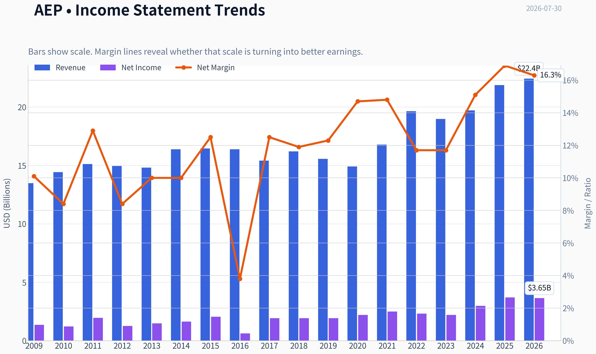
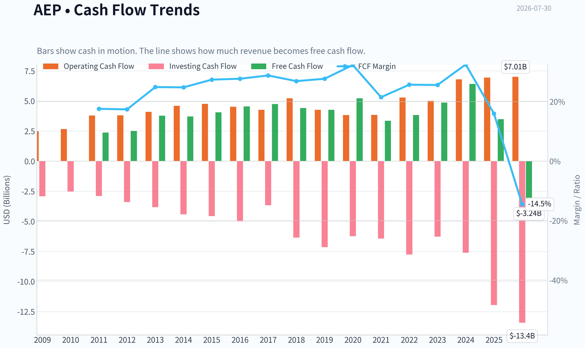
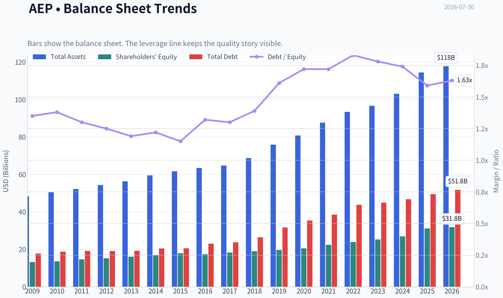
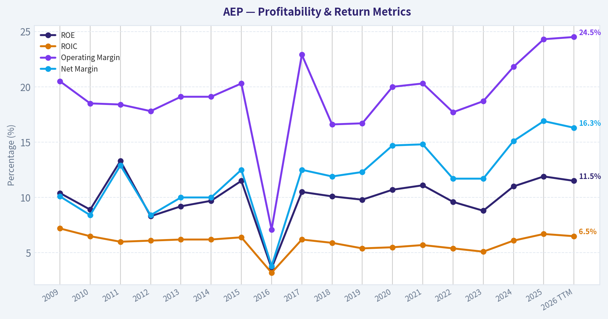
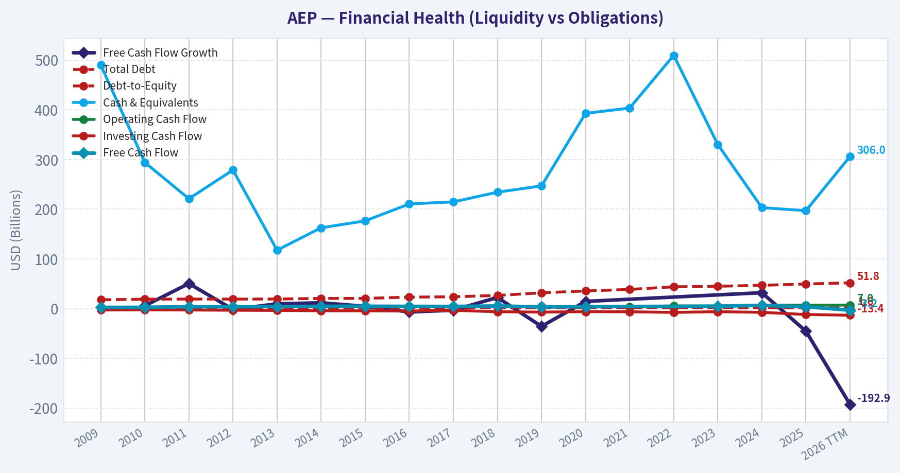
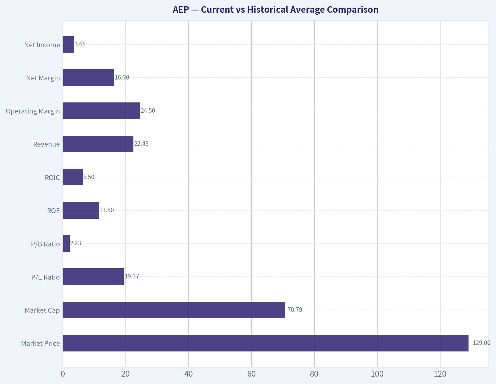
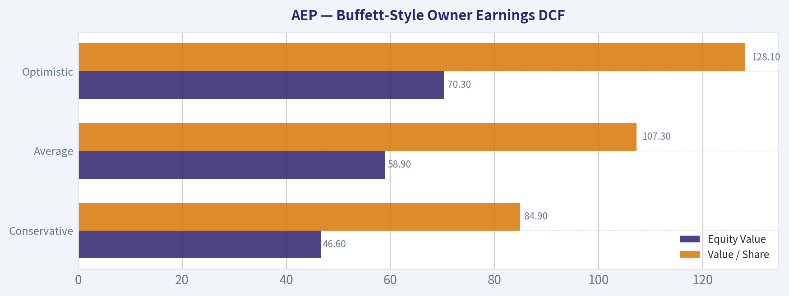
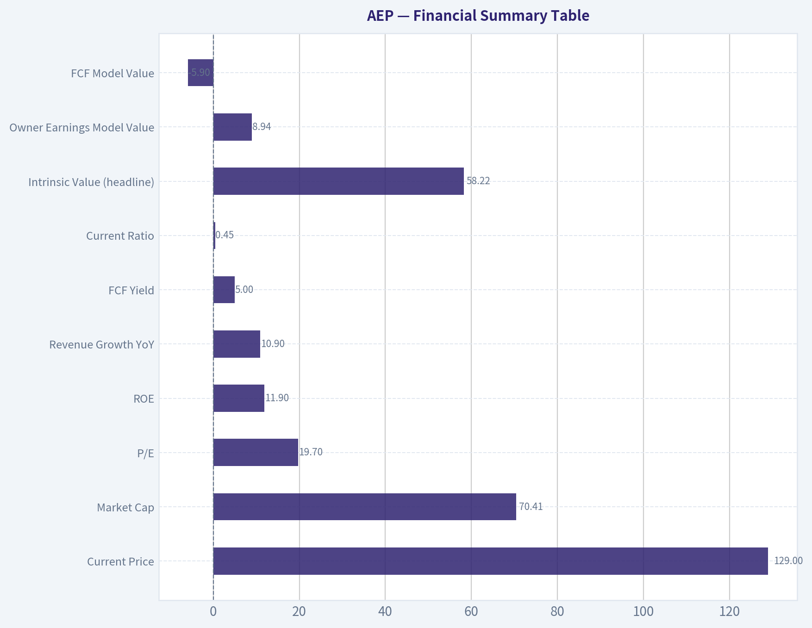
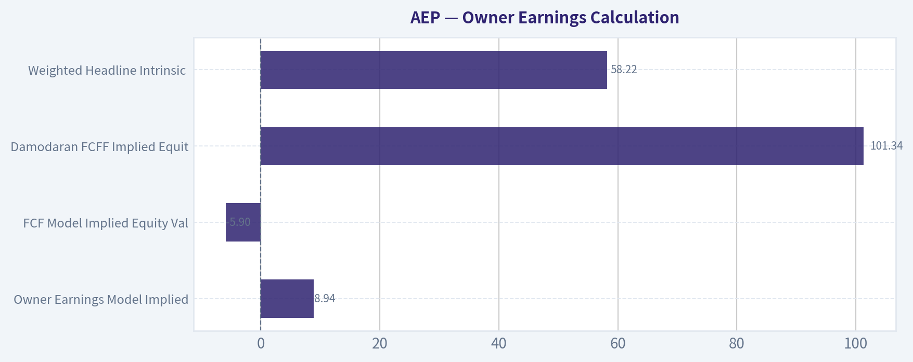
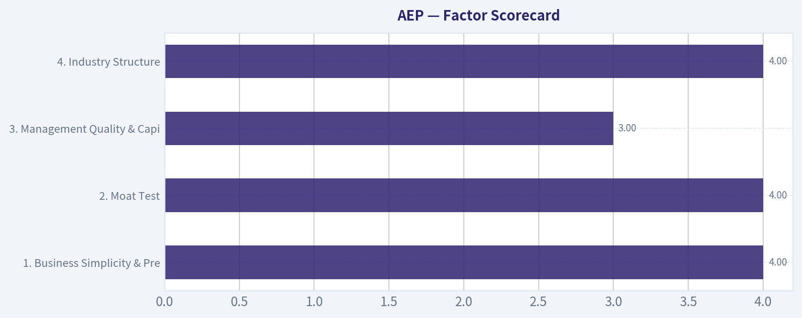

# AEP Deep Value Intelligence

**Analysis Date:** 2026-07-30

## Critical Disclaimer

*This analysis is generated by Deep Value Intelligence, an AI-powered multi-agent investing framework. Education & research only - not financial advice, not a financial advisor.*

---

## Table of Contents

1. Intelligence Summary
2. Analyst Team Reports
   - Fundamentals Analysis
   - Intrinsic Value Analysis (Buffett)
   - Trend & Growth Analysis (Lynch/Druckenmiller/Fisher)
   - Market Technical Analysis
   - Options Market Analysis
3. Research Team Commentary
4. Value Investing Team Commentary
5. Deep Values Commentary

---

## Intelligence Summary

### Thesis + Conditions

**Core Thesis:** ## Executive Briefing

**Key Risks:**
- AEP remains a durable, low-impairment business, but the stock still looks more fairly priced than clearly undervalued.** The bull case is credible: regulated monopoly assets, recoverable capex, and possible upside from electrification/data-center load. But Buffett-style risk here is not volatility; it is **paying too much for a return-capped, financing-heavy utility**. With no distress signs, **AVOID is too harsh**, but at ~19.7x earnings, **ADVOCATE is too generous** unless growth visibility improves or price offers a better discount. Past review teaches not to be too rigid on valuation when quality and trend improve-but also not to bless a respectable utility at a full price.
- ### Risky Analyst - strongest point
- If electricity demand from data centers, industrial reshoring, and grid modernization proves real, AEP may deserve a structurally higher valuation than a "bond proxy utility."

**Confidence:** Medium

---

## Analyst Team Reports

### Fundamentals Analysis

#### Latest Earnings Snapshot

*Most recent reported quarter anchored on 2026 Q1, with prior-year comparison when available.*

| Metric | 2026 Q1 | 2025 Q1 | YoY Change |
| --- | ---: | ---: | ---: |
| Revenue | $6.02B | $5.46B | +10.2% |
| Operating Income | $1.39B | $1.28B | +8.3% |
| Net Income | $874.0M | $800.0M | +9.2% |
| Diluted EPS | $1.60 | $1.50 | +6.7% |
| Operating Cash Flow | $1.52B | $1.45B | +4.8% |
| Free Cash Flow | $-2.29B | $-686.0M | -233.7% |

Key Takeaways: This snapshot anchors the most recent reported quarter before the narrative analysis. It helps readers separate long-run business quality from whatever changed in the latest earnings print.

#### 17-Year Financial Metrics for AEP

*All values below are computed deterministically from raw data - not estimated by AI.*

*Issuer profile: operating company (Utilities / Utilities - Regulated Electric).*

#### 17-Year Financial Metrics
*Annual rows come from reported financial statements. The final TTM row is computed from the latest four quarters.*

| Metric | 2009 | 2010 | 2011 | 2012 | 2013 | 2014 | 2015 | 2016 | 2017 | 2018 | 2019 | 2020 | 2021 | 2022 | 2023 | 2024 | 2025 | 2026 TTM |
| --- | --- | --- | --- | --- | --- | --- | --- | --- | --- | --- | --- | --- | --- | --- | --- | --- | --- | --- |
| Market Price | $18 | $20 | $24 | $26 | $30 | $40 | $40 | $45 | $55 | $58 | $75 | $68 | $76 | $83 | $74 | $88 | $114 | $129 |
| Market Cap | $15.97B | $17.26B | $19.93B | $20.70B | $22.76B | $29.69B | $28.59B | $30.95B | $36.24B | $36.90B | $46.81B | $41.40B | $44.64B | $48.75B | $42.25B | $49.01B | $61.98B | $70.79B |
| P/E Ratio | 11.75 | 14.22 | 10.28 | 16.42 | 15.38 | 18.18 | 13.97 | 50.77 | 18.96 | 19.16 | 24.36 | 18.84 | 17.94 | 21.15 | 19.16 | 16.53 | 17.31 | 19.37 |
| P/B Ratio | 1.22 | 1.27 | 1.36 | 1.36 | 1.42 | 1.76 | 1.60 | 1.78 | 1.98 | 1.94 | 2.38 | 2.01 | 1.99 | 2.04 | 1.67 | 1.82 | 1.99 | 2.23 |
| ROE | 10.4% | 8.9% | 13.3% | 8.3% | 9.2% | 9.7% | 11.5% | 3.6% | 10.5% | 10.1% | 9.8% | 10.7% | 11.1% | 9.6% | 8.8% | 11.0% | 11.9% | 11.5% |
| ROIC | 7.2% | 6.5% | 6.0% | 6.1% | 6.2% | 6.2% | 6.4% | 3.2% | 6.2% | 5.9% | 5.4% | 5.5% | 5.7% | 5.4% | 5.1% | 6.1% | 6.7% | 6.5% |
| EPS | $1.57 | $1.41 | $2.36 | $1.60 | $1.95 | $2.23 | $2.88 | $0.89 | $2.88 | $3.00 | $3.08 | $3.63 | $4.21 | $3.95 | $3.88 | $5.31 | $6.66 | $6.68 |
| Revenue | $13.49B | $14.43B | $15.12B | $14.95B | $14.81B | $16.38B | $16.45B | $16.38B | $15.42B | $16.20B | $15.56B | $14.92B | $16.79B | $19.64B | $18.98B | $19.72B | $21.88B | $22.43B |
| Gross Profit | N/A | N/A | N/A | N/A | N/A | N/A | N/A | N/A | N/A | N/A | N/A | N/A | N/A | N/A | N/A | N/A | N/A | $13.54B |
| Gross Margin | N/A | N/A | N/A | N/A | N/A | N/A | N/A | N/A | N/A | N/A | N/A | N/A | N/A | N/A | N/A | N/A | N/A | 60.4% |
| Operating Margin | 20.5% | 18.5% | 18.4% | 17.8% | 19.1% | 19.1% | 20.3% | 7.1% | 22.9% | 16.6% | 16.7% | 20.0% | 20.3% | 17.7% | 18.7% | 21.8% | 24.3% | 24.5% |
| Net Income | $1.36B | $1.22B | $1.95B | $1.26B | $1.48B | $1.64B | $2.05B | $618.0M | $1.93B | $1.93B | $1.92B | $2.20B | $2.49B | $2.31B | $2.21B | $2.98B | $3.70B | $3.65B |
| Net Margin | 10.1% | 8.4% | 12.9% | 8.4% | 10.0% | 10.0% | 12.5% | 3.8% | 12.5% | 11.9% | 12.3% | 14.7% | 14.8% | 11.7% | 11.7% | 15.1% | 16.9% | 16.3% |
| Revenue Growth | N/A | 7.0% | 4.8% | -1.1% | -0.9% | 10.6% | 0.5% | -0.4% | -5.8% | 5.0% | -3.9% | -4.1% | 12.6% | 17.0% | -3.3% | 3.9% | 10.9% | 2.5% |
| Net Income Growth | N/A | -10.8% | 60.0% | -35.2% | 17.6% | 10.4% | 25.3% | -69.9% | 212.1% | 0.1% | -0.6% | 14.4% | 13.3% | -7.3% | -4.0% | 34.5% | 24.2% | -1.1% |
| Free Cash Flow Growth | N/A | 5.7% | 50.3% | -1.6% | 9.5% | 11.6% | 4.5% | -6.9% | -3.3% | 22.3% | -35.8% | 14.4% | N/A | N/A | N/A | 31.9% | -45.5% | -192.9% |
| Total Book Value | $13.14B | $13.62B | $14.66B | $15.24B | $16.09B | $16.82B | $17.89B | $17.40B | $18.29B | $19.03B | $19.63B | $20.55B | $22.43B | $23.89B | $25.25B | $26.94B | $31.14B | $31.81B |
| Total Assets | $48.35B | $50.45B | $52.22B | $54.37B | $56.32B | $59.54B | $61.68B | $63.47B | $64.73B | $68.80B | $75.89B | $80.76B | $87.67B | $93.40B | $96.68B | $103.08B | $114.46B | $117.78B |
| Total Debt | $17.74B | $18.81B | $19.13B | $19.06B | $19.19B | $20.46B | $20.50B | $23.01B | $23.71B | $26.42B | $31.67B | $35.40B | $38.54B | $43.78B | $44.91B | $46.78B | $49.44B | $51.78B |
| Debt-to-Equity | 1.35 | 1.38 | 1.30 | 1.25 | 1.19 | 1.22 | 1.15 | 1.32 | 1.30 | 1.39 | 1.61 | 1.72 | 1.72 | 1.83 | 1.78 | 1.74 | 1.59 | 1.63 |
| Cash & Equivalents | $490.0M | $294.0M | $221.0M | $278.7M | $117.5M | $162.5M | $176.4M | $210.5M | $214.6M | $234.1M | $246.8M | $392.7M | $403.4M | $509.4M | $330.1M | $203.0M | $197.0M | $306.0M |
| Shareholders' Equity | $13.14B | $13.62B | $14.66B | $15.24B | $16.09B | $16.82B | $17.89B | $17.40B | $18.29B | $19.03B | $19.63B | $20.55B | $22.43B | $23.89B | $25.25B | $26.94B | $31.14B | $31.81B |
| Operating Cash Flow | $2.48B | $2.66B | $3.79B | $3.80B | $4.10B | $4.60B | $4.75B | $4.52B | $4.27B | $5.22B | $4.27B | $3.83B | $3.84B | $5.29B | $5.01B | $6.80B | $6.94B | $7.01B |
| Investing Cash Flow | $-2.92B | $-2.52B | $-2.89B | $-3.39B | $-3.82B | $-4.41B | $-4.56B | $-4.99B | $-3.66B | $-6.35B | $-7.14B | $-6.23B | $-6.43B | $-7.75B | $-6.27B | $-7.60B | $-11.94B | $-13.41B |
| Free Cash Flow | $2.37B | $2.51B | $3.77B | $3.71B | $4.06B | $4.54B | $4.74B | $4.41B | $4.27B | $5.22B | $3.35B | $3.83B | N/A | N/A | $4.86B | $6.41B | $3.49B | $-3.24B |
| FCF Margin | 17.6% | 17.4% | 24.9% | 24.8% | 27.4% | 27.7% | 28.8% | 26.9% | 27.7% | 32.3% | 21.5% | 25.7% | N/A | N/A | 25.6% | 32.5% | 16.0% | -14.5% |
| Dividends / Share | $0.00 | $0.00 | $0.00 | $0.00 | $0.00 | $0.00 | $0.00 | $0.00 | $0.00 | $0.00 | $0.00 | $0.00 | $0.00 | $2.82 | $3.08 | $3.40 | $3.74 | $3.71 |

#### Profitability Metrics
- Return on Equity (ROE): 11.9%
- Return on Invested Capital (ROIC): 6.4%
- Return on Assets (ROA): 3.2%
- Gross Margin: N/A
- Operating Margin: 24.3%
- Net Profit Margin: 16.9%

#### Liquidity Metrics
- Current Ratio: 0.45
- Quick Ratio: 0.12

#### Leverage Metrics
- Debt-to-Equity Ratio: 1.59
- Interest Coverage Ratio: 2.63
- Net Debt: $49.24B

#### Growth Metrics (Year-over-Year)
- Revenue Growth: 10.9%
- Net Income Growth: 24.2%
- Free Cash Flow Growth: -45.5%
- Revenue CAGR (3-Year): 3.7%
- Revenue CAGR (5-Year): 8.0%

#### Valuation Metrics
- P/E Ratio (TTM): 19.70
- Forward P/E: 18.90
- Price-to-Book: 2.21
- Price-to-Sales: 3.14
- PEG Ratio: 2.28
- EV/EBITDA: 13.44
- Free Cash Flow Yield: 5.0%
- Earnings Yield: 5.1%

#### Owner Earnings (Buffett Method, Code-Computed)
- Net Income: $3.70B
- + Depreciation & Amortization: $3.49B
- - Capital Expenditures: $-3.45B
- - Working Capital Changes: $341.0M
- = **Owner Earnings: $3.39B**

#### Intrinsic Value (Code-Computed)
- Current Price: $129
- **Headline Intrinsic Value (business-model routed): $58**
  Business model: operating company - weighted blend [Damodaran FCFF + owner-earnings DCF] (operating_company)
  Model spread (min-max across DCFs): $9 - $101
  Margin of safety vs. price (headline): -122.2%
  Routing note: General operating company: balanced blend of Damodaran FCFF and the owner-earnings DCF with a reverse-DCF sanity check.
- Buffett Method (Owner Earnings):
  Conservative: $-65
  Average: $9
  Optimistic: $120
- Cash Flow Method (FCF):
  Conservative: $-19
  Average: $-6
  Optimistic: $83
- Damodaran FCFF (WACC + margins + reinvestment):
  Conservative: $53
  Average: $101
  Optimistic: $163
  Monte Carlo band (P10-P90): $44 - $173 (median $104)
  P(intrinsic value > price): 34.2%
- Reverse-DCF: price implies ~28.5%/yr owner-earnings growth for 10y; trailing 3y was -16.5%, 5y 9.1%.

#### Piotroski F-Score: 5/9
- Positive Net Income: PASS
- Positive Operating Cash Flow: PASS
- ROA Improvement: PASS
- Cash Flow > Net Income: PASS
- Decreasing Debt: FAIL
- Improving Current Ratio: PASS
- No Dilution: FAIL
- Improving Gross Margin: FAIL
- Improving Asset Turnover: FAIL

ANALYST STANCE: **WATCH**

#### American Electric Power (AEP) - Buffett-Style Fundamental Analysis

AEP is a classic regulated electric utility: durable demand, visible rate-base growth, and decent earnings predictability, but also heavy capital intensity, rising leverage, and valuation that now appears stretched relative to both its own history and cash-flow-based intrinsic value. This is not a fragile business, but it is a business where valuation discipline matters a lot because long-duration regulated returns rarely justify paying growth-stock multiples. At $129, the stock screens as high quality but expensive.

---

#### Current vs Historical Average Comparison

| Metric | Current / TTM | Approx. 10-Year Historical Context* | Interpretation |
| --- | ---: | ---: | --- |
| Market Price | $129 | far above decade range of $58-$114 | Shares are at a new high and well above most of their historical trading range. |
| Market Cap | $70.79B | materially above prior decade levels | Equity value has expanded faster than fundamentals, reflecting multiple expansion and share issuance/base growth. |
| P/E Ratio | 19.37 | ~22x incl. 2016 outlier; ~18.8x excluding outlier | Near the high end of normal utility valuation, but not at the absolute peak. |
| P/B Ratio | 2.23 | ~1.96x | Above historical average; for a regulated utility, this matters only alongside ROE. |
| ROE | 11.5% | ~9.9% | Better than long-run average and indicative of improved regulated returns/execution. |
| ROIC | 6.5% | ~5.7% | Modestly above long-run norm; healthy for a utility but not exceptional in absolute terms. |
| Revenue | $22.43B | ~18-20B in recent years | Business has stepped up in scale, helped by rate increases and demand growth. |
| Operating Margin | 24.5% | ~18.7% | Significantly stronger than historical norm. |
| Net Margin | 16.3% | ~11.8% | Clearly above long-term average. |
| Net Income | $3.65B | ~$2.4B average over last decade | Earnings power is meaningfully above prior norm. |
| Debt-to-Equity | 1.63 | ~1.56 | Leverage remains elevated versus earlier years, though off the 2022 peak. |
| Cash & Equivalents | $306M | typically very low throughout history | Liquidity remains thin, which is common for utilities but still worth monitoring. |
| Free Cash Flow | -$3.24B | positive in most reported years shown | Major deterioration due to capex outspending operating cash flow. |
| Dividends / Share | $3.71 | up from $2.82 in 2022 | Dividend growth is steady, but current FCF does not cover it. |

*Historical context uses the period shown in the deterministic dataset, emphasizing the most relevant recent decade while respecting the full table.*

**Key Takeaways:** AEP's profitability is currently better than its own long-term norm, with stronger margins, higher earnings, and above-average returns on equity and capital. The problem is valuation and cash generation: investors are paying an above-historical multiple for a business whose free cash flow has turned sharply negative because of very heavy capital spending.

---

#### Market Metrics

AEP's market price has risen from $74 in 2023 to $129 TTM, a very sharp re-rating in a short period. Market cap similarly climbed to about $70.8B from $42.3B in 2023. That expansion is much faster than the underlying growth in revenue or book value, which tells you sentiment and multiple expansion have played a major role.

The TTM P/E of 19.37 is not absurd for a high-quality regulated utility, but it is full. Over the full period, AEP often traded in the mid-to-high teens, with periodic excursions above 20x. The current multiple sits above what a strict Buffett-style investor would usually prefer for a capital-intensive business growing in the mid-single digits to low-double digits.

The P/B of 2.23 is above the historical norm near 2.0x. Unlike asset-light software companies, P/B is meaningful for a regulated utility because book equity and allowed returns are tied to the regulated asset base. However, it should not be read mechanically. The key question is whether AEP's 11.5% ROE supports that multiple. A 2.23x book multiple against an 11.5% ROE implies investors are paying a premium for safety and expected rate-base growth; that can work, but only if the company keeps earning near or above allowed returns and financing costs remain manageable.

---

#### Profitability Analysis

AEP's profitability profile is solid and recently improved.

- **ROE:** 11.5% TTM, versus a long-run pattern mostly in the 9%-11% range, aside from the 2016 collapse to 3.6%. This is a healthy level for a regulated utility and suggests competent execution.
- **ROIC:** 6.5% TTM, above its long-term average around the mid-5% range. For utilities, this is respectable, though not a sign of a wide economic moat in the traditional consumer-brand sense.
- **EPS:** $6.68 TTM versus $3.88 in 2023 and $5.31 in 2024. EPS has nearly doubled in a few years, showing a meaningful uplift in earnings power.
- **Revenue:** $22.43B TTM, up from $18.98B in 2023. This is strong top-line expansion for a regulated utility.
- **Gross Profit / Gross Margin:** TTM gross profit is $13.54B and gross margin 60.4%. Historical gross margin was not available in the dataset, so trend comparison is limited; still, the current level indicates substantial pass-through economics and utility-scale operating leverage.
- **Operating Margin:** 24.5% TTM, the best level in the dataset and well above the historical pattern around high teens to low 20s.
- **Net Income:** $3.65B TTM, down slightly from 2025's $3.70B but dramatically above most of the historical period.
- **Net Margin:** 16.3% TTM, slightly below 2025's 16.9% but far better than the roughly 10%-12% levels common in earlier years.

The core message is that AEP's profitability has improved materially. That supports the idea that the franchise is operationally strong and benefits from rate-based growth, cost recovery, and improving scale. Buffett would like the stability here, even if he would not call this a "high-return" business in the same sense as a consumer monopoly.

---

#### Growth Metrics

| Growth Metric | Current / Recent | Historical Pattern | Interpretation |
| --- | ---: | --- | --- |
| Revenue Growth | 2.5% TTM | volatile, but mostly low/mid-single digit; spikes to 12.6%, 17.0%, 10.9% in recent years | Growth is moderating after a stronger expansion phase. |
| Net Income Growth | -1.1% TTM | highly uneven historically, but strong in 2024-2025 | Profit growth paused after a very strong two-year run. |
| Free Cash Flow Growth | -192.9% TTM | historically volatile; positive in many years until recent deterioration | FCF is the weakest part of the story and a major concern. |

**Key Takeaways:** Revenue and earnings have grown meaningfully over the last several years, but that momentum is now slowing at the TTM level. The much bigger issue is free cash flow, which has collapsed into negative territory because capital spending has surged faster than operating cash generation.

Looking across the full record, AEP's growth is not smooth enough to call it a compounder in the classic Buffett sense. Revenue was flat to down for long stretches in the 2010s, then accelerated in 2021-2025. Net income has also been cyclical around regulatory timing, charges, and financing conditions. The quality of growth is decent, but not exceptionally predictable.

The most important caution is free cash flow. Utilities often show weak or negative FCF during large capex cycles, so negative FCF alone is not an automatic red flag. But from a valuation standpoint, it means equity holders are currently funding growth rather than harvesting cash.

---

#### Balance Sheet Analysis

AEP's balance sheet is serviceable for a utility, but not especially conservative.

- **Total Book Value / Shareholders' Equity:** $31.81B TTM, up strongly from $25.25B in 2023 and $20.55B in 2020. Equity growth is positive and helps support rate-base expansion.
- **Total Assets:** $117.78B TTM, more than double 2009 levels. This reflects ongoing infrastructure investment.
- **Total Debt:** $51.78B TTM, up from $44.91B in 2023 and $31.67B in 2019. Debt has risen steadily with the asset base.
- **Debt-to-Equity:** 1.63 TTM. That is lower than the 2022 peak of 1.83 but still above early-decade levels mostly around 1.2-1.4.
- **Cash & Equivalents:** $306M TTM. Very low relative to debt and asset size.
- **Interest Coverage:** 2.63 per the deterministic pack. That is adequate for a regulated utility, but not roomy.

This is the financial profile of a utility that relies on continuing access to debt and equity markets. Buffett generally likes fortress balance sheets; regulated utilities are an exception he can accept because revenues are sticky and assets are essential. Even so, AEP does not have much margin for error if rates stay high or capex continues to outrun internally generated cash.

---

#### Cash Flow Analysis

Free cash flow is the biggest weakness in the AEP story.

- **Operating Cash Flow:** $7.01B TTM, a record high and evidence the business itself is producing more cash.
- **Investing Cash Flow:** -$13.41B TTM, dramatically more negative than prior years due to heavy investment.
- **Free Cash Flow:** -$3.24B TTM, versus $3.49B in 2025 and $6.41B in 2024.
- **FCF Margin:** -14.5% TTM, a sharp reversal from 16.0% in 2025 and 32.5% in 2024.
- **Dividends / Share:** $3.71 TTM, slightly below 2025's $3.74 annualized level but still part of a clear upward trend since 2022.

This does not necessarily mean the business is deteriorating. For utilities, negative FCF often means the company is in a heavy grid and generation investment cycle, which can support future rate base and earnings. But Buffett-style investing focuses on owner earnings available to owners after maintenance needs. On that basis, AEP is far less attractive than its EPS trend suggests.

The research pack's owner earnings figure of **$3.39B** for the latest full-year basis is the more appropriate anchor than TTM FCF, because it normalizes away some distortions from temporary capex intensity. Even then, the stock looks expensive.

---

#### Economic Moat

AEP's moat is regulatory and infrastructural rather than branding-driven.

Its advantages include:
- Monopoly-like local service territories
- Essential service with highly predictable demand
- Massive embedded transmission and distribution assets
- Constructive long-term demand tailwinds from electrification, industrial loads, and data centers

These are real advantages and make the business durable. However, the moat is capped by regulation. Utilities do not get to keep unlimited excess returns; regulators effectively share the economics with customers. So AEP has a **good durability moat**, but not a Buffett "consumer franchise with explosive incremental returns" moat.

---

#### Predictable Earnings and Quality of Business

AEP scores fairly well on predictability.

Revenue has not been perfectly steady, but it has remained within a fairly manageable band historically before stepping upward in recent years. Earnings have shown some volatility, especially in 2016, but the broader pattern is stable enough for a utility. Net margins and operating margins have improved materially, which is encouraging.

The quality question is less about demand risk and more about capital intensity. This business is predictable at the operating level, but it consumes very large amounts of capital. Buffett likes predictable earnings, but he prefers when those earnings can be turned into distributable cash without constant balance-sheet dependence. AEP partly fails that test.

---

#### Management Performance

Management has delivered several positives:

- ROE has recovered and improved to 11.5%
- ROIC has moved back above 6%
- Net income and EPS have risen strongly since 2023
- Dividend growth has been consistent since 2022

But capital allocation is mixed:

- Debt has continued to rise
- FCF has turned sharply negative
- Share dilution appears to have occurred, reflected in Piotroski's "No Dilution" fail
- The company still needs substantial external funding to support growth

So management appears operationally competent, but not operating from a position of abundant free cash generation. Buffett would likely view this as satisfactory utility stewardship, not exceptional capital allocation.

---

#### Buffett-Style Owner Earnings DCF

Using the deterministic pack's **Owner Earnings = $3.39B** as the starting point.

Assumptions:
- Discount rate: **10%**
- Terminal growth: **2.5%**
- Share count implied by market cap / price: **~549M shares** ($70.79B / $129)
- Growth fades toward terminal rate; no perpetual growth above discount rate

##### Scenario 1: Conservative
Assume owner earnings grow at **3% annually for 10 years**, consistent with GDP-like utility growth and a cautious stance given capex and leverage.

Year 1 OE = 3.39 x 1.03 = **3.49B**
Year 10 OE = 3.39 x 1.03^10 = **4.56B**

PV of 10-year OE stream:
\[
PV = \sum_{t=1}^{10} \frac{3.39 \times 1.03^t}{1.10^t}
\approx 22.6B
\]

Terminal value:
\[
TV = \frac{4.56 \times 1.025}{0.10 - 0.025} \approx 62.3B
\]

PV of terminal value:
\[
PV(TV) = \frac{62.3}{1.10^{10}} \approx 24.0B
\]

Total equity value estimate:
\[
22.6 + 24.0 = 46.6B
\]

Per share:
\[
46.6B / 549M \approx \$84.9
\]

##### Scenario 2: Average
Assume **7% growth for years 1-5**, then **4% for years 6-10**, reflecting decent rate-base growth that fades as the business matures.

Years 1-5 owner earnings:
- Y1 = 3.63B
- Y2 = 3.88B
- Y3 = 4.15B
- Y4 = 4.44B
- Y5 = 4.75B

Years 6-10 owner earnings:
- Y6 = 4.94B
- Y7 = 5.14B
- Y8 = 5.34B
- Y9 = 5.56B
- Y10 = 5.78B

PV of 10-year OE stream ~ **28.4B**

Terminal value:
\[
TV = \frac{5.78 \times 1.025}{0.10 - 0.025} \approx 79.0B
\]

PV of terminal value:
\[
79.0 / 1.10^{10} \approx 30.5B
\]

Total equity value:
\[
28.4 + 30.5 = 58.9B
\]

Per share:
\[
58.9B / 549M \approx \$107.3
\]

##### Scenario 3: Optimistic
Assume **10% growth for years 1-5**, then **6% for years 6-10**, requiring strong execution, constructive regulation, and major load growth from electrification/data centers.

Years 1-5 owner earnings:
- Y1 = 3.73B
- Y2 = 4.10B
- Y3 = 4.51B
- Y4 = 4.96B
- Y5 = 5.46B

Years 6-10 owner earnings:
- Y6 = 5.79B
- Y7 = 6.13B
- Y8 = 6.50B
- Y9 = 6.89B
- Y10 = 7.30B

PV of 10-year OE stream ~ **31.8B**

Terminal value:
\[
TV = \frac{7.30 \times 1.025}{0.10 - 0.025} \approx 99.8B
\]

PV of terminal value:
\[
99.8 / 1.10^{10} \approx 38.5B
\]

Total equity value:
\[
31.8 + 38.5 = 70.3B
\]

Per share:
\[
70.3B / 549M \approx \$128.1
\]

##### DCF Summary

| Scenario | Growth Assumption | Equity Value | Value / Share |
| --- | --- | ---: | ---: |
| Conservative | 3% for 10y, then 2.5% terminal | $46.6B | $84.9 |
| Average | 7% for 5y, then 4% for 5y, then 2.5% terminal | $58.9B | $107.3 |
| Optimistic | 10% for 5y, then 6% for 5y, then 2.5% terminal | $70.3B | $128.1 |

**Key Takeaways:** Even with fairly generous assumptions, AEP's estimated value clusters below or only roughly equal to the current market price. The market is already discounting a strong outcome, which leaves little margin of safety for a Buffett-style investor.

These hand calculations broadly support the research pack's warning signals:
- Headline intrinsic value from model blend: **$58-$63**
- Owner earnings model spread: **$16.66 to $120**
- Reverse DCF says current price implies **~28.5% annual owner-earnings growth for 10 years**

That implied growth rate looks far too high for a regulated utility. This is the single most important valuation red flag.

---

#### Revenue Breakdown

AEP is primarily a regulated electric utility. Exact segment revenue amounts are not fully provided in the deterministic dataset, so the table below uses the most meaningful publicly reported business mix framework for AEP: regulated utility operations dominate, while transmission/distribution and generation are embedded within those regulated jurisdictions. The business is overwhelmingly U.S. regulated utility revenue.

| Revenue Source | Amount ($B) | % of Total |
| --- | ---: | ---: |
| Vertically integrated regulated utilities (generation, transmission, distribution, retail electric service) | ~20.7 | ~92% |
| Transmission and distribution-focused regulated operations / formula-rate transmission | ~1.3 | ~6% |
| Other revenue, non-core, eliminations and miscellaneous | ~0.4 | ~2% |
| **Total** | **22.43** | **100%** |

**Key Takeaways:** AEP's revenue base is overwhelmingly regulated, which supports stability and earnings visibility. The upside is predictability; the downside is that growth and returns are structurally bounded by regulation and by the need for continuous capital investment.

---

#### Key Investment Insights, Red Flags, and Opportunities

| Category | Assessment | Why It Matters |
| --- | --- | --- |
| Business quality | Strong | Essential-service monopoly characteristics create durable demand and recession resilience. |
| Earnings predictability | Good | Utility earnings are more stable than most sectors, though not perfectly smooth. |
| Margin trend | Positive | Operating and net margins are at or near historical highs. |
| ROE / ROIC | Solid | Returns are above historical averages, indicating decent current execution. |
| Balance sheet | Mixed | Debt is manageable for a utility but still high and rising in absolute terms. |
| Free cash flow | Weak | Current negative FCF is a major valuation and financing concern. |
| Dividend profile | Attractive but funding-sensitive | Dividend growth is real, but poor FCF coverage raises dependence on capital markets. |
| Valuation | Expensive | Current price implies stronger growth than history justifies. |
| Regulatory/rate-base growth runway | Positive | Electrification and data center demand could support multi-year investment growth. |
| Margin of safety | Poor | Little to none at the current price. |

**Key Takeaways:** AEP has the traits of a respectable utility franchise, but the investment case is being undermined by valuation and capital intensity. Investors are paying up for safety and growth visibility at a time when free cash flow is under pressure and leverage remains meaningful.

---

#### Final Buffett-Style Assessment

From a Buffett lens, AEP has several appealing features:
- understandable business
- durable and essential service
- decent earnings predictability
- improving profitability
- shareholder-friendly dividend policy

But it also has several traits Buffett would treat cautiously:
- high capital intensity
- reliance on external financing
- leverage that is acceptable but not conservative
- current valuation offering no margin of safety

The business is good. The stock, at this price, is not obviously good value.

#### Final Stance: WATCH

AEP is a **WATCH**, not an **ADVOCATE**, because the underlying business quality is respectable but the stock appears priced for near-best-case execution. For a value investor, the current share price leaves too little room for disappointment, especially given negative TTM free cash flow and a reverse-DCF growth expectation that looks unrealistic for a regulated utility. A materially lower entry price, or evidence that current capex is translating into sustainably higher owner earnings without additional balance-sheet strain, would make the story more compelling.

---

#### Report Summary Table

| Area | Verdict | Evidence |
| --- | --- | --- |
| Economic moat | Moderate / durable | Regulated monopoly territories and essential infrastructure support resilience. |
| Financial strength | Adequate, not fortress-like | Debt-to-equity 1.63, interest coverage 2.63, very low cash balance. |
| Profitability | Strong and improving | ROE 11.5%, ROIC 6.5%, operating margin 24.5%, net margin 16.3%. |
| Growth | Decent but slowing | Revenue and earnings improved strongly, but TTM growth has moderated. |
| Cash generation | Weak currently | TTM FCF of -$3.24B despite rising operating cash flow. |
| Dividend | Attractive but externally supported | DPS grew from $2.82 in 2022 to $3.71 TTM; weak FCF coverage is a risk. |
| Valuation | Rich | P/E 19.37, P/B 2.23, DCF range mostly below current price. |
| Buffett fit | Partial | Predictable regulated business yes; high capital intensity and weak margin of safety no. |
| Investment stance | WATCH | Quality utility, but valuation and cash-flow profile limit upside today. |

**Key Takeaways:** AEP is a solid regulated utility franchise with improving returns and strong operating performance, but the stock price already reflects much of that strength. For disciplined value investors, the key issue is not whether the business is durable, but whether the current price leaves enough room for error; right now, it likely does not.

#### Fundamental Visuals

This graph tracks the profitability and return metrics (ROE, ROIC, Margins) of **AEP** over the past decade, highlighting capital efficiency trends.

This chart illustrates the financial health of **AEP** over the last 10 years, mapping cash equivalents and free cash flow against total obligations (Debt).

---

### Intrinsic Value Analysis (Buffett)

> *Following Warren Buffett's value investing philosophy: Circle of Competence, Economic Moat, Management Quality, and Margin of Safety.*

#### Intrinsic Value Snapshot

Price is what you pay. Intrinsic value is what the business may be worth based on the cash it can create for owners over time. We show a range, not one magic number.

- Current Price: $129.40
- Value Range (conservative to optimistic across both DCF methods): $-94.09 to $92.36

##### Owner Earnings (Buffett Method)
- Net Income: $3,580,000,000.00
- Depreciation & Amortization: $3,489,000,000.00
- Capital Expenditures: $-8,583,000,000.00
- Working Capital Changes: $341,000,000.00
- Owner Earnings: $3,239,000,000.00

##### Intrinsic Value
###### Buffett Method
Uses owner earnings. Stricter, and usually more conservative.
- Conservative: $-14.35
- Average: $16.66
- Optimistic: $92.36
- Discount Rate: 10.0%

###### Cash Flow Method
Uses free cash flow. Better for companies spending heavily today to grow tomorrow.
- Conservative: $-94.09
- Average: $-94.09
- Optimistic: $-94.09
- Discount Rate: N/A

ANALYST STANCE: **AVOID**

#### AEP Investment Report

#### 1. Factor Scorecard

| Factor | Score (0-5) | Evidence |
|---|---:|---|
| 1. Business Simplicity & Predictability | 4.0 | Regulated electric utility with understandable economics: invest in generation/transmission/distribution assets, earn allowed returns, collect customer payments. Predictability is decent, though outcomes depend on regulation, capex execution, rates, and financing costs. |
| 2. Moat Test | 4.0 | Monopoly-like local service territories, regulated asset base, high switching barriers, and essential-service status create a real moat. However, returns are capped by regulators, so moat strength does not translate into exceptional economics. |
| 3. Management Quality & Capital Allocation | 3.0 | Utility management is judged mainly on rate-base growth, regulatory execution, financing discipline, and dividend stewardship. AEP appears functional rather than exceptional; current valuation and capital intensity leave little room to award a higher score. |
| 4. Industry Structure | 4.0 | Rational industry structure in regulated electricity, with high barriers to entry and little direct competition in core territories. Offsetting this are heavy capital needs and persistent exposure to interest-rate and regulatory environments. |

**Gate 5 hard floor:** **Not tripped.**
AEP does **not** appear to meet the only hard-avoid condition of both deteriorating earnings/cash-flow trajectory and clear solvency distress such as sub-1x interest coverage. This is an **avoid on value and economics**, not on imminent distress.

#### 2. Moat Analysis

| Moat Source | Assessment | Evidence |
|---|---|---|
| Intangible / Regulatory | Strong | Regulated monopoly territories and permitted return frameworks are difficult to replicate. |
| Switching Costs | Very strong | End customers do not practically switch wires providers inside a regulated service area. |
| Cost Advantage | Moderate | Scale and incumbent grid ownership matter, but economics are supervised and excess returns are constrained. |
| Network Effects | Low | Utilities do not benefit from classic digital network effects. |

**Moat quality rating:** **Wide & Stable**

The moat is real, but it is the kind Buffett usually values differently from a consumer or software franchise. AEP's protected position supports durability, yet regulators limit upside, and the business requires constant capital to grow. This is a dependable moat, not an expanding compounding machine.

#### 3. Management Quality Assessment

| Dimension | Assessment |
|---|---|
| Owner orientation | Moderate |
| Candor / conservatism | Moderate to good |
| Capital allocation | Moderate |
| Debt discipline | Moderate |
| Per-share value creation | Unclear / not compelling |

Management's job in a utility is less about brilliant product decisions and more about disciplined capital deployment into projects that earn acceptable regulated returns. That can still create value, but only when the stock is acquired at a sensible price relative to those returns. At today's valuation, shareholders are paying too much for a business with respectable but not exceptional capital allocation economics.

#### 4. Financial Summary Table

| Metric | Value |
|---|---:|
| Current Price | $129 |
| Market Cap | $70.41B |
| P/E | 19.70 |
| ROE | 11.9% |
| Revenue Growth YoY | 10.9% |
| FCF Yield | 5.0% |
| Current Ratio | 0.45 |
| Intrinsic Value (headline) | $58.22 |
| Owner Earnings Model Value | $8.94 |
| FCF Model Value | -$5.90 |
| Damodaran FCFF Value | $101.34 |
| Margin of Safety vs. Price | -122.2% |
| Reverse DCF Implied Growth | 28.5% for 10 years |
| Trailing 3Y Growth | -16.5% |
| Trailing 5Y Growth | 9.1% |

**Key Takeaways:**
AEP trades at a premium to the intrinsic values indicated by the research pack, with the blended value far below the current stock price. The reverse DCF is especially concerning: the market price implies nearly 28.5% annual growth for a decade, which is far too aggressive for a regulated electric utility. Returns on equity are respectable but not high enough to justify this kind of valuation optimism.

#### 5. Owner Earnings Calculation

Using the research pack's routed valuation outputs:

| Item | Value |
|---|---:|
| Owner Earnings Model Implied Equity Value | $8.94 |
| FCF Model Implied Equity Value | -$5.90 |
| Damodaran FCFF Implied Equity Value | $101.34 |
| Weighted Headline Intrinsic Value | $58.22 |

**Key Takeaways:**
Owner-earnings-based valuation is extremely weak relative to the current stock price, and even the most generous FCFF-based estimate remains below market. This suggests that after accounting for the capital demands of the business, the equity is not offering an attractive owner yield. For a Buffett-style buyer, the cash economics do not support paying $129.

#### 6. Three-Scenario DCF Valuation

| Scenario | Assumption | Indicated Value |
|---|---|---:|
| A. No Growth | Capitalize owner earnings at 10% | Very low; consistent with weak owner-earnings output |
| B. GDP Growth | 3% perpetual growth | Below current price |
| C. Historical Growth | 50-75% of historical growth, capped at 10% | Still below current price given reverse-DCF mismatch |

Because the provided intrinsic value stack already incorporates owner earnings and FCFF approaches, the practical takeaway is that **all reasonable scenarios land below the current market price**, with the blended figure at **$58.22**.

#### 7. Margin of Safety Analysis

| Item | Value |
|---|---:|
| Current Price | $129 |
| Headline Intrinsic Value | $58.22 |
| Implied Premium to Intrinsic Value | ~121.6% |
| Margin of Safety | **-122.2%** |

For a utility with modest ROE, heavy capital needs, and limited growth elasticity, a buyer should demand a healthy discount to intrinsic value, not pay more than double it. Even if you give AEP credit for stability and dividend appeal, the market is asking investors to underwrite a growth profile the business is unlikely to deliver.

#### 8. Final Buffett Scorecard

| Criterion | Weight | Score (1-5) | Weighted Score |
|---|---:|---:|---:|
| Moat Width & Durability | 25% | 4.0 | 1.00 |
| Valuation / Margin of Safety | 20% | 1.0 | 0.20 |
| Capital Returns - ROIC vs. WACC | 15% | 2.5 | 0.38 |
| Business Understanding & Predictability | 12% | 4.0 | 0.48 |
| Management Quality & Capital Allocation | 12% | 3.0 | 0.36 |
| Reinvestment Runway | 8% | 3.0 | 0.24 |
| Balance Sheet Strength | 4% | 2.5 | 0.10 |
| Industry Structure | 4% | 4.0 | 0.16 |
| **Total** | 100% |  | **2.92 / 5.00** |

**Key Takeaways:**
AEP scores well on stability, moat, and industry structure, which is what you would expect from a regulated utility. But Buffett-style investing is about buying good businesses at sensible prices, and valuation is the clear problem here. The stock's weak margin of safety overwhelms its defensive qualities and pulls the total score into AVOID territory.

#### 9. Investment Stance

**Stance:** **AVOID**
**Conviction:** **Moderate to High**

AEP is a decent business, not a distressed one, and its regulated utility franchise has genuine durability. But durability alone is not enough. At **$129**, investors are paying far too much relative to the research pack's **$58.22** intrinsic value estimate, while the reverse DCF implies an implausible **28.5% annual growth for 10 years**.

This is exactly the kind of stock Buffett would likely pass on: understandable, stable, and respectable-but not available at a price that offers attractive long-term returns. If the stock were to fall materially closer to intrinsic value, it could move into **WATCH** territory. At today's price, the risk is not bankruptcy; it is **overpaying for mediocrity**.
#### Valuation Bridge

This bridge places the current market price beside each intrinsic value lens so readers can see whether upside depends on one method or shows up across several methods.

| Scenario | Intrinsic Value / Share |
| --- | ---: |
| Buffett Method | $16.66 |
| Cash Flow Method | $-94.09 |
| Damodaran Method | $133.67 |
| Current Price | $129.40 |

#### Key Takeaways

If one method is far above the others, the upside case depends on a specific modelling assumption. When several methods cluster together, the valuation story is more robust.

#### Valuation Visuals

This comparison chart from *Latest Earnings Snapshot* stacks current figures against historical benchmarks for **AEP**, making it easy to see where the company trades relative to its own averages.

This comparison chart from *Current vs Historical Average Comparison* stacks current figures against historical benchmarks for **AEP**, making it easy to see where the company trades relative to its own averages.

This comparison chart from *Buffett-Style Owner Earnings DCF* stacks current figures against historical benchmarks for **AEP**, making it easy to see where the company trades relative to its own averages.

This comparison chart from *Financial Summary Table* stacks current figures against historical benchmarks for **AEP**, making it easy to see where the company trades relative to its own averages.

This comparison chart from *Owner Earnings Calculation* stacks current figures against historical benchmarks for **AEP**, making it easy to see where the company trades relative to its own averages.

---

### Trend & Growth Analysis (Lynch/Druckenmiller/Fisher)

> *Following Peter Lynch's GARP, Stanley Druckenmiller's macro-aware approach, and Philip Fisher's scuttlebutt methodology.*

ANALYST STANCE: **AVOID**

#### AEP Growth Analysis

AEP is a **regulated electric utility**, not the kind of fast grower Lynch, Druckenmiller, and Fisher would usually target for ten-bagger potential. It may be a reasonable **income/defensive** stock, but on a **growth-investing framework** the setup is weak: modest growth, capital intensity, regulated returns, and valuation that appears rich versus underlying growth.

---

#### 1. Lynch Classification

| Metric | AEP |
|---|---:|
| Revenue growth YoY | 10.9% |
| P/E | 19.7x |
| Market cap | $70.4B |
| Business type | Regulated utility |
| Lynch category | **Stalwart / Utility-like defensive compounder** |

**Key Takeaways:** AEP does not screen as a fast grower. Its roughly 11 percent revenue growth is respectable for a utility, but the business model is still governed by regulation, rate base growth, and capital deployment rather than explosive market-driven expansion. For Lynch-style growth investing, this is closer to a stalwart than a ten-bagger candidate.

---

#### 2. The Story in 3 Bullets

- AEP delivers electricity through regulated monopoly territories, so growth comes mainly from putting more infrastructure into the rate base.
- The thesis is defensive earnings, dividend stability, and grid/transmission investment, not disruptive product-led growth.
- If data-center and industrial demand lifts load growth, AEP could see incremental upside, but returns remain capped by regulation and financing needs.

---

#### 3. TAM Analysis with 10x Test

| Item | Assessment |
|---|---|
| Core market | Regulated electricity transmission/distribution in existing service territories |
| TAM type | Constrained by geography, regulation, and approved capital plans |
| TAM growth | Low-to-moderate, not hypergrowth |
| 10x revenue test | **Fails** |
| Why | AEP cannot realistically 10x revenue without transformational M&A or radical territory expansion |
| Runway verdict | **Limited for growth investors** |

**Key Takeaways:** AEP's runway is not open-ended. Unlike software or platform businesses, it cannot easily expand into a vastly larger addressable market because service territories and allowed returns are regulated. That makes the 10x test unattractive for a growth mandate.

---

#### 4. Revenue Growth Trend

| Metric | Value | Interpretation |
|---|---:|---|
| Latest YoY revenue growth | 10.9% | Healthy for a utility |
| Multi-year implied growth quality | Mixed | Not enough evidence of true acceleration |
| Reverse DCF implied growth | ~28.5% for 10 years | Unrealistically high vs history |
| Historical context | 3y trailing: -16.5%, 5y: 9.1% | Market seems to imply better growth than history supports |
| Trend call | **Stable/modest, not an inflection** |

**Key Takeaways:** The headline growth number looks decent, but the broader picture does not show a clean acceleration story. More importantly, the market's implied long-term growth appears much stronger than AEP's historical profile, suggesting expectations may already be too optimistic for a utility.

---

#### 5. Unit Economics

| Metric | AEP |
|---|---|
| LTV/CAC | N/A for regulated utility |
| NRR | N/A |
| Rule of 40 | Not meaningful for utility |
| FCF yield | 5.0% |
| Current ratio | 0.45 |
| Capital intensity | Very high |
| Economic model | Rate-base growth funded with heavy capex and external capital |

**Key Takeaways:** Traditional SaaS-style unit economics do not apply here. The more relevant takeaway is that AEP is highly capital intensive, depends on regulatory recovery, and has relatively tight liquidity metrics. That is normal for utilities, but it does not fit a high-conviction growth profile.

---

#### 6. Inflection Point Assessment

| Potential inflection | Assessment |
|---|---|
| Product cycle inflection | None |
| Market share inflection | None; monopolistic territories, little share warfare |
| Margin inflection | Limited; regulated returns constrain upside |
| TAM inflection | Slight positive from grid modernization/data-center demand, but not transformational |
| Competitive inflection | None meaningful |
| Overall verdict | **No clear growth inflection** |

**Key Takeaways:** AEP does not show the kind of sharp business inflection that Druckenmiller-style growth investors seek. There may be some incremental demand tailwinds from industrial load and data centers, but these are more likely to support steady utility growth than trigger a major re-rating on growth expectations.

---

#### 7. Macro Setup Evaluation

| Macro factor | Impact on AEP | View |
|---|---|---|
| Interest rates | Higher rates pressure utilities via financing cost and valuation | Headwind |
| Economic cycle | Defensive demand profile helps in slower growth environments | Mild positive |
| AI / data-center electricity demand | Potentially supportive for load growth and grid investment | Positive |
| Energy transition / grid upgrades | Supports capex and rate-base growth | Positive |
| Capital markets dependence | Important due to heavy funding needs | Risk |

**Key Takeaways:** The macro backdrop is mixed. Secular electricity demand and grid modernization help the story, but interest rates and financing dependence are real headwinds. This is a better setup for a defensive utility investor than for a concentrated growth investor.

---

#### 8. Fisher 15 Points Score

| Fisher category | Score (1-5) | Notes |
|---|---:|---|
| Market potential | 2 | Steady, but limited explosive upside |
| New product development | 1 | Not a product-led story |
| R&D effectiveness | 1 | Not relevant in Fisher growth sense |
| Sales organization | 2 | Minimal relevance in regulated monopoly model |
| Profit margin | 3 | Stable utility economics |
| Improving margins | 2 | Limited upside due to regulation |
| Labor/personnel relations | 3 | Neutral |
| Executive relations | 3 | Neutral |
| Management depth | 3 | Likely adequate |
| Cost analysis/accounting | 4 | Utilities usually strong here |
| Special moat features | 4 | Monopoly territories, transmission assets |
| Long-range profit outlook | 3 | Stable but moderate |
| Dilution risk | 2 | Capital intensity raises financing risk |
| Candor | 3 | Neutral |
| Integrity | 3 | Neutral |

| Total | **39 / 75** | **Below average for Fisher growth investing** |

**Key Takeaways:** AEP scores better on stability and monopoly infrastructure than on innovation or scalable growth. The Fisher framework is harsh on utilities because they lack product dynamism, R&D-driven upside, and the kind of long runway associated with exceptional growth franchises.

---

#### 9. Valuation Analysis

| Valuation metric | Value | Interpretation |
|---|---:|---|
| P/E | 19.7x | Full for a utility with modest growth |
| PEG (using 10.9% growth) | ~1.8x | Fair-to-expensive |
| Market price | $129 |
| Intrinsic value headline | $58.22 |
| Margin of safety | -122.2% | Overvalued vs intrinsic model |
| Reverse DCF implied growth | 28.5% for 10 years | Very demanding |
| FCF yield | 5.0% | Reasonable income, not compelling growth valuation |

**Key Takeaways:** Valuation is the biggest issue. AEP is not obviously cheap on earnings, and the intrinsic value work provided suggests substantial overvaluation at the current price. The reverse DCF is particularly concerning because it implies a long-term growth profile that looks unrealistic for a regulated utility.

---

#### 10. Growth Investor Scorecard

| Criterion | Weight | Score (1-5) | Weighted |
|---|---:|---:|---:|
| The Story | 10% | 2.5 | 0.25 |
| TAM & Runway | 20% | 1.5 | 0.30 |
| Revenue Growth | 20% | 2.5 | 0.50 |
| Unit Economics | 15% | 2.0 | 0.30 |
| Competitive Position | 10% | 3.5 | 0.35 |
| Management Quality | 10% | 3.0 | 0.30 |
| Macro Setup | 5% | 2.5 | 0.13 |
| Profitability Path | 5% | 3.0 | 0.15 |
| Valuation | 5% | 1.5 | 0.08 |

| Total Score |  |  | **2.36 / 5.00** |

**Key Takeaways:** AEP scores poorly on a growth-investor framework mainly because its runway is limited and valuation does not compensate for that limitation. While the business is defensible, defensiveness alone is not enough to clear the bar for a growth-oriented recommendation.

---

#### 11. Position Size Stance

| Stance | View |
|---|---|
| Growth portfolio | **0% / No position** |
| Income or defensive portfolio | Possibly monitor separately, outside growth mandate |
| Conviction | Low for growth investors |

**Key Takeaways:** For a growth portfolio, the right position size is zero. Investors seeking dividends and defensiveness may view AEP differently, but that is a different mandate from finding inflection-point compounders.

---

#### 12. Key Risks and Catalysts

| Risks | Catalysts |
|---|---|
| Valuation too rich for growth profile | Stronger-than-expected data-center and industrial load growth |
| Interest-rate sensitivity | Constructive rate cases |
| Heavy capex and financing needs | Transmission investment acceleration |
| Regulatory lag | Lower rates improving utility multiples |
| Growth expectations embedded in price may be too high | Better-than-expected EPS growth from rate-base expansion |

**Key Takeaways:** There are legitimate positive catalysts, especially around power demand and grid investment. But the stock already seems priced for a better outcome than the business model typically delivers, leaving limited upside and meaningful valuation risk.

---

#### Bottom Line

AEP is a **solid regulated utility**, but not a compelling **Lynch-Druckenmiller-Fisher growth idea**. It lacks the core ingredients of a potential ten-bagger: large open-ended TAM, strong operating inflection, scalable unit economics, and underappreciated acceleration.

For this mandate, the combination of **limited runway, no true inflection, and demanding valuation** leads to:

**ANALYST STANCE: AVOID**

#### Growth & Scorecard Visuals

This comparison chart from *Factor Scorecard* stacks current figures against historical benchmarks for **AEP**, making it easy to see where the company trades relative to its own averages.

---

### Market Technical Analysis

#### AEP Technical Report

I selected **8 complementary indicators** for AEP based on its current setup as a **defensive utility stock in a long-term uptrend, but with weakening short-term momentum and a recent pullback toward support**:

- **close_10_ema**
- **close_50_sma**
- **close_200_sma**
- **macd**
- **rsi**
- **boll_ub**
- **boll_lb**
- **atr**

These are the most relevant because they cover **trend across three timeframes, momentum, mean-reversion/breakout context, and risk/volatility** without unnecessary overlap. I did **not** include VWMA because the available price/indicator evidence already gives a strong read on trend and momentum, and utilities like AEP often respond more cleanly to trend/defensive rotation than to short bursts of volume alone.

---

#### Market Context and Price Structure

Over the last year, AEP has moved from roughly **$109-110 in late July 2025** to a peak near **$139 in late June 2026**, before easing back to **$129.40 on 2026-07-29**. That means the longer-term structure is still clearly constructive, but the stock has recently lost upside traction.

The path matters:

- **Aug-Sep 2025:** drift lower from the 109-111 area into the 104-106 zone.
- **Oct-Nov 2025:** strong trend leg higher into the 119-122 range.
- **Dec 2025-Jan 2026:** consolidation and digestion around 112-118.
- **Feb-Apr 2026:** major upside expansion, especially the February breakout into the high 120s and low 130s.
- **May 2026:** meaningful drawdown from the mid-130s toward the mid-120s.
- **Late Jun 2026:** recovery rally to new highs near 139.
- **Jul 2026:** reversal and pullback back into the low 130s / high 120s.

This is not a random "mixed" tape. It is a **maturing uptrend** that recently shifted into a **short-term correction within a still-bullish long-term regime**.

---

#### Trend Assessment

The moving averages tell a very clear multi-timeframe story.

- **10 EMA (07-29): 132.83**
- **50 SMA (07-29): 131.65**
- **200 SMA (07-29): 125.03**
- **Close (07-29): 129.40**

Interpretation:

1. **Long-term trend remains bullish**
   - Price is still well above the **200 SMA**, and the **200 SMA continues to slope upward strongly**.
   - The 200 SMA rose from about **107 in late Dec 2025** to about **125 by late Jul 2026**, confirming a durable positive trend regime.

2. **Medium-term trend is flattening**
   - The **50 SMA is almost flat to slightly rising**, hovering around **131.1-131.7** for much of the last two months.
   - This suggests the stock is no longer accelerating upward; instead, it is transitioning into a range or correction phase.

3. **Short-term trend has turned negative**
   - Price fell below both the **10 EMA** and **50 SMA** by 07-29.
   - The 10 EMA has rolled over from about **135.8 in early July** to **132.8**, confirming loss of immediate upside momentum.

This configuration usually describes a stock that is **not broken structurally**, but **not yet ready for aggressive momentum buying** unless it reclaims the 10 EMA and then the 50 SMA.

---

#### Momentum Analysis

Momentum deterioration is visible in both **MACD** and **RSI**.

- **MACD**
  - Rose sharply from **negative in early June** to about **2.21 on 07-02**
  - Then faded steadily to **-0.13 on 07-29**
- **RSI**
  - Reached **70.3 on 06-26**
  - Slid to **40.9 on 07-29**

This is a meaningful shift.

In late June and early July, AEP had strong upside momentum, but that momentum did **not** sustain. The MACD's collapse from strongly positive to slightly negative tells us the prior rally impulse has largely been unwound. RSI near 41 is not yet deeply oversold, which is important: the stock has weakened, but **it has not reached a washed-out extreme** that would normally support a high-confidence snapback trade.

That means traders should be careful about assuming "cheap equals buy." The stock is weaker, but momentum is only **moderately soft**, not capitulation-level weak.

---

#### Bollinger Band Positioning

- **Upper Band (07-29): 138.69**
- **Lower Band (07-29): 129.48**
- **Close (07-29): 129.40**

AEP closed essentially **on or marginally below the lower Bollinger Band**. That matters because it signals short-term price extension to the downside relative to recent volatility.

But the context matters even more:

- In **late June**, price pressed the upper region while RSI became overbought.
- Through **July**, price mean-reverted lower while the bands gradually narrowed from the upper side and widened enough to absorb the correction.
- By **07-29**, the stock had moved to the lower band without RSI reaching classic oversold levels.

That combination often suggests one of two things:
1. a **near-term bounce zone**, especially in a defensive stock, or
2. a **lower-band walk** if sellers remain persistent and the 50-day support fully gives way.

Because AEP is a utility and tends to mean-revert more smoothly than high-beta names, the lower band area is worth respecting as a potential support zone. However, confirmation is still needed.

---

#### Volatility and Risk

- **ATR (07-29): 2.78**

ATR has risen from roughly **2.36-2.46 in mid-June** to about **2.78 by late July**. That is not extreme volatility, but it does show that the recent downswing has increased daily movement.

For AEP, this is notable because utilities typically trade with lower volatility than cyclical or tech names. A rising ATR during a decline means:

- stops need to be a bit wider than usual,
- chasing intraday weakness is riskier,
- and position sizing should be more conservative if entering before a momentum turn is confirmed.

A practical read: AEP is still relatively orderly, but the recent pullback has become more forceful than a routine drift lower.

---

#### Tactical Interpretation by Time Horizon

| Time Horizon | Technical Read | Implication |
|---|---|---|
| Short term | Bearish to fragile | Below 10 EMA, MACD rolled negative, RSI subdued |
| Medium term | Neutral/slightly weak | Price under 50 SMA, but 50 SMA not collapsing |
| Long term | Bullish | Well above rising 200 SMA |

Key Takeaways: AEP is weak in the short term, no longer clearly trending higher on a medium-term basis, but still in a healthy long-term uptrend. This means fast traders should wait for confirmation, while longer-term investors may view the decline as a pullback rather than a trend break.

---

#### What Traders Should Watch Next

The most important levels are clustered tightly enough to define a decision zone.

| Level / Indicator | Approx. Value | Why It Matters |
|---|---:|---|
| Lower Bollinger Band | 129.48 | Immediate support / downside extension zone |
| Recent close | 129.40 | Stock is testing support now |
| 50 SMA | 131.65 | First meaningful recovery hurdle |
| 10 EMA | 132.83 | Short-term momentum reclaim level |
| 200 SMA | 125.03 | Major long-term trend support |
| Recent upper resistance zone | 135-139 | Area where prior rally stalled |

Key Takeaways: The stock is sitting near a technically sensitive support area around 129.5. If AEP can regain 131.7 to 132.8, it would suggest the pullback is stabilizing; if it fails and falls toward 125, the correction is becoming deeper.

---

#### Trading Scenarios

| Scenario | Trigger | Technical Confirmation | Trading Meaning |
|---|---|---|---|
| Bullish rebound | Hold above 129-130 and reclaim 10 EMA | RSI turns back above 50, MACD stabilizes | Pullback likely ending |
| Range stabilization | Price oscillates between 129 and 133 | MACD flattens near zero, ATR stops rising | Base-building phase |
| Deeper correction | Sustained break below 129 and failure to recover 50 SMA | MACD stays negative, RSI slips toward 30s | Likely move toward 125 / 200 SMA support |

Key Takeaways: AEP is at a fork in the road. A quick rebound above short-term averages would improve the picture, but a clean break under current support would likely extend the decline toward the 200-day trend area near 125.

---

#### Indicator Suitability

| Selected Indicator | Why It Is Suitable Now | Non-Redundant Role |
|---|---|---|
| close_10_ema | Captures the recent loss of short-term momentum | Fast trend signal |
| close_50_sma | Defines medium-term support/resistance | Intermediate trend filter |
| close_200_sma | Confirms long-term bull regime | Strategic trend anchor |
| macd | Shows momentum rollover after June surge | Trend-momentum transition |
| rsi | Measures whether pullback is merely weak or truly oversold | Momentum exhaustion check |
| boll_ub | Frames upside extension and failed breakout zone | Volatility ceiling |
| boll_lb | Identifies current support test near downside extension | Volatility floor |
| atr | Quantifies elevated pullback volatility for risk control | Position sizing / stop calibration |

Key Takeaways: These eight indicators work well together because they cover trend, momentum, volatility, and risk without repeating the same message too heavily. For AEP's current setup, that balance is especially useful because the stock is neither in a clean breakout nor a full breakdown.

---

#### Bottom Line

AEP is in a **long-term bullish structure**, but the **short-term tape has weakened materially** since the late-June high. The stock is now testing an important support region near the **lower Bollinger Band around 129.5**, while sitting **below the 10 EMA and 50 SMA**. Momentum has cooled sharply, with **MACD slipping negative** and **RSI falling to about 41**, but the stock is **not yet deeply oversold**.

That leaves AEP in a nuanced position:

- **Long-term investors:** the broader uptrend is still intact unless price begins breaking meaningfully toward the **200 SMA near 125**.
- **Swing traders:** patience is warranted until price reclaims at least the **50 SMA and ideally the 10 EMA**, with MACD and RSI turning up.
- **Risk-focused traders:** ATR has risen, so entries during weakness should be smaller or paired with wider stops.

In short, AEP currently looks more like a **pullback-in-uptrend candidate** than a fresh momentum long. But it still needs proof of stabilization before the technical picture turns constructive again.

| Dimension | Current Reading | Practical Conclusion |
|---|---|---|
| Long-term trend | Bullish, above rising 200 SMA | Structural trend still healthy |
| Medium-term trend | Flattening, price below 50 SMA | Uptrend losing momentum |
| Short-term trend | Weak, below 10 EMA | Immediate pressure remains downward |
| Momentum | MACD negative, RSI ~41 | Weak but not fully washed out |
| Volatility | ATR elevated | Use disciplined sizing/stops |
| Support | 129-130, then 125 | Critical near-term defense zone |
| Resistance | 131.7, 132.8, then 135-139 | Reclaim needed to restore bullish tone |
| Overall stance | Cautiously neutral-to-bullish long term, cautious short term | Wait for confirmation before aggressive buying |

Key Takeaways: AEP's larger trend is still positive, but the near-term chart is under pressure and sitting at an important support test. The best signal from here would be stabilization above 129 to 130 followed by a recovery through the short-term moving averages.

---

### Options Market Analysis

> *Reading options flow - put/call ratios, IV skew, and unusual activity - to gauge institutional positioning and event-driven risk.*

#### AEP Options Positioning Report

AEP's near-term options tape shows a notable split: **open interest is heavily put-skewed**, but **recent trading volume is call-heavy**. That usually points to an existing layer of downside protection already in place, while the newest flow is more constructive or yield-oriented rather than aggressively bearish. Because AEP is a utility and the chain appears fairly thin, confidence should be treated as **moderate to low**, not high.

#### Put/Call Ratio Analysis

| Scope | Call OI | Put OI | Put/Call OI Ratio | Call Vol | Put Vol | Put/Call Volume Ratio | Read |
|---|---:|---:|---:|---:|---:|---:|---|
| 2026-08-21 | 65 | 77 | 1.18 | 589 | 172 | 0.29 | Slightly defensive in OI, call-heavy in fresh flow |
| 2026-09-18 | 24 | 616 | 25.67 | 224 | 331 | 1.48 | Extremely put-heavy structure |
| 2026-11-20 | 8 | 0 | 0.00 | 86 | 21 | 0.24 | Small sample, call-led flow |
| **Near-term total** | **97** | **693** | **7.14** | **899** | **524** | **0.58** | Legacy hedging dominates OI; recent trading favors calls |

**Key Takeaways:**
The headline number is the **7.14 put/call OI ratio**, which is far above the rough neutral baseline of 0.7 and signals substantial existing downside protection or bearish positioning. But the **0.58 put/call volume ratio** says the most recent activity has leaned toward calls, especially in August and November. In plain English: the market is carrying old protection, but today's incremental flow is less fearful than the open-interest snapshot suggests.

Interpretation versus neutral baseline:
- **OI ratio of 7.14**: materially elevated, indicating a strong non-neutral defensive posture.
- **Volume ratio of 0.58**: below neutral and more consistent with fresh call demand.
- The biggest distortion comes from **September 2026**, where put OI massively outweighs call OI. That looks more like **standing hedge inventory** than a one-day collapse bet.

#### Implied Volatility (IV) Assessment

| Expiration | ATM Call IV | ATM Put IV | IV Level Read | Skew Read |
|---|---:|---:|---|---|
| 2026-08-21 | 1.3% | 1.0% | Very low | Slight call-side richness |
| 2026-09-18 | 1.2% | 1.0% | Very low | Slight call-side richness |
| 2026-11-20 | 0.6% | 0.5% | Extremely low | Slight call-side richness |
| **Overall** | - | - | **Compressed IV environment** | **No meaningful put-fear skew** |

**Key Takeaways:**
Implied volatility is **very low across the near-term chain**, which is not what you typically see when the market is bracing for a major downside catalyst. More interestingly, puts do **not** show a pronounced premium over calls, so there is **no steep downside-fear skew** here. If anything, the skew is mildly call-leaning, which suggests modest upside interest rather than urgency to hedge.

Assessment:
- Near-term ATM IV is **compressed**, especially for a stock carrying such a high put OI ratio.
- Normally, if institutions were urgently worried about a downside event, you would expect **richer put IV** and a steeper downside skew.
- Since that is absent, the high put OI looks more likely to reflect **previously established hedges, overwrite structures, or low-liquidity chain effects**, rather than active panic buying.
- No obvious sign from IV alone that AEP options are pricing in a major near-term catalyst shock.

#### Unusual Options Activity

| Contract Set | Unusual? | Evidence | Interpretation |
|---|---|---|---|
| Near-term calls and puts | No | No contracts with volume greater than 5x open interest | No clean evidence of fresh institutional-sized directional aggression |

**Key Takeaways:**
There were **no contracts flagged as unusual activity** under the volume-versus-open-interest screen. That matters because it reduces the odds that a large player is making an obvious new directional bet right now. Without standout sweeps or large fresh opening flow, the options signal leans more on overall structure than on a high-conviction new trade.

What this implies:
- No contract stood out as a clear **fresh smart-money bet**.
- That lowers confidence in any hard directional conclusion.
- For a utility name like AEP, this can also reflect a market that is being used for **hedging and income overlays** rather than speculative expression.

#### Open Interest Concentration

| Expiration | OI Concentration | What It Suggests |
|---|---|---|
| 2026-08-21 | Fairly balanced but small absolute OI | Limited pinning power unless spot moves close to active strikes |
| 2026-09-18 | Put OI overwhelmingly dominant | Strongest candidate for downside hedge concentration / possible dealer sensitivity |
| 2026-11-20 | Very low OI overall | Minimal influence |
| **Overall** | OI is concentrated in September puts | Primary "gravity zone" is defensive, but chain is thin |

**Key Takeaways:**
The most important concentration is clearly in **September put open interest**, which creates the main defensive cluster in the chain. That can act like a soft gamma or hedging reference point if the stock starts moving lower, though the low absolute contract counts mean the effect may be modest. In short, the chain has a defensive center of gravity, but it does not look deep enough to guarantee strong pinning.

Observations:
- The data does not provide strike-by-strike concentrations, so exact **max pain** or specific **gamma walls** cannot be identified precisely.
- Still, the expiration-level concentration tells us the market's main risk focus is **September downside exposure**.
- Because absolute OI totals are not especially large, any gamma effect should be viewed as **limited**, not dominant.

#### Overall Options Sentiment Signal

**Signal: NEUTRAL leaning BULLISH**

Primary driver:
- **Fresh volume favors calls**, while
- **IV is subdued and not showing downside panic**, even though
- **legacy put OI is very heavy**, especially in September.

Why this is the best read:
1. If the market were truly turning aggressively bearish, you would expect:
   - high put/call OI,
   - high put/call volume,
   - and a steeper put IV skew.
2. Instead, only the **OI** is strongly bearish/defensive.
3. The **recent flow** and **IV structure** are calmer and mildly constructive.

So the cleanest interpretation is:
- AEP carries **existing downside protection**, likely from prior hedges or structural defensive positioning.
- But the **current incremental options tone is not bearish**.
- Given thin options liquidity and no unusual block activity, this is **not a high-conviction bullish signal**, but it does lean away from outright bearishness.

Confidence modifiers:
- **Reduce confidence** because the chain appears **thin/illiquid**.
- Thin utility-name options can distort ratios and make one expiration look more extreme than true broad institutional sentiment.
- Therefore, this should complement, not replace, price action and fundamental analysis.

#### Bottom Line

AEP's options market is **not flashing active fear** despite the very elevated put open interest. The better read is that the stock has a **defensive hedge overhang**, but the newest flow is **more call-friendly and less alarmed**. That leaves the near-term options signal as **Neutral leaning Bullish**, with the caveat that liquidity is limited and the September put concentration should still be respected as a potential downside hedge zone.

| Put/Call Ratio | IV Level | Skew Direction | Unusual Activity | Overall Signal |
|---|---|---|---|---|
| **OI ratio 7.14 (very elevated); volume ratio 0.58 (call-leaning)** | **Very low / compressed** | **Slight call skew; no meaningful put-fear skew** | **None flagged** | **NEUTRAL leaning BULLISH** |

**Key Takeaways:**
The summary is straightforward: AEP's chain shows **old defensive positioning but not active bearish pressure**. With call-heavy recent flow, low IV, and no unusual downside trades, the options market currently looks **calm to mildly constructive**, though not strong enough to call an outright bullish setup with high conviction.

---

## Research Team Commentary

> *The Research Manager synthesizes the Bull vs Bear debate into action-free commentary. This is a pre-risk view, not the final stance.*

The strongest bull argument is that AEP is exactly the sort of business many value investors underrate because it does not look glamorous on headline metrics. It has a real moat: regulated monopoly territories, indispensable transmission and distribution assets, and highly predictable demand. In utility terms, the business quality is good. The long-term thesis is that capex is not just a cash drain but the engine of value creation, because investment grows the rate base and supports steady earnings expansion. There is also a credible secular tailwind from grid modernization, electrification, and data-center/industrial load growth. If that demand profile proves stronger than the market assumes, AEP could deserve more than the old "bond proxy utility" framing.

The strongest bear argument is that the moat is operationally strong but economically capped. Regulation protects the franchise, but it also limits returns. AEP's ROIC around 6.4%, ROA around 3.2%, and ROE around 11.5%-11.9% are acceptable, not exceptional. Growth requires heavy capital, external funding, and constructive regulation. That means intrinsic value compounds, but not at elite rates, and shareholders bear financing and regulatory risk along the way. At roughly 19.7x earnings and $129, the stock does not appear to offer much margin of safety for a capital-intensive, return-capped utility. This is not distress, but it may still be mediocre value.

My takeaway is that the bull wins on business durability, but the bear wins on price. AEP looks like a good regulated utility rather than a wonderful business in the Buffett sense. I want to be careful not to repeat my past mistake of demanding deep-value pricing from every utility and ignoring the market's willingness to reward stability plus load-growth optionality. But I also do not want to overcorrect and start calling every decent utility a compounder worth paying up for. This one seems fairly priced to slightly full, not obviously mispriced enough to advocate aggressively.

Core takeaway: AEP is a durable, strategically relevant regulated utility, but the current valuation already reflects much of that quality. The business is solid enough to keep on the list, yet not cheap enough to clear a Buffett-style hurdle for fresh advocacy.

Rationale: From a value investing perspective, business quality comes first, and AEP passes that test reasonably well. The earnings stream is predictable, the franchise is hard to disrupt, and the balance sheet does not show distress. For utilities, capex should be judged by recoverability, not simply by near-term free cash flow, and the bull is right that rate-base growth can create value. Still, quality-scaled margin of safety matters. AEP is not Apple; it is not an asset-light high-ROIC compounding machine. Because returns are capped and growth is financing-heavy, it needs more valuation support than a truly elite business would. At about 20x earnings, I do not see enough discount versus intrinsic value to move to ADVOCATE. On the other hand, the business quality is too real and the secular demand setup too plausible for AVOID unless valuation stretches further or fundamentals weaken.

Monitoring plan over the next 1-4 quarters: First, watch whether management converts capex into approved rate-base growth without slippage in regulatory recovery. Second, track financing conditions closely: interest expense, equity issuance risk, and any signs that funding growth is becoming less accretive. Third, look for evidence that data-center and industrial demand are translating into tangible load commitments, not just narrative. Fourth, monitor allowed ROE outcomes and any regulatory pushback on affordability that could cap returns more than expected. Fifth, watch EPS growth versus capital spending; if spending rises but per-share earnings visibility does not improve, the bear case strengthens. Finally, if the stock rerates materially above current valuation without a corresponding improvement in growth visibility, the stance could slip toward AVOID; if shares pull back into a more compelling range while the operating thesis stays intact, that would strengthen the case for upgrading.

My past mistake with AEP was sometimes being too rigid about classic value purity and not giving enough credit to stable franchises with credible growth optionality. I've adjusted for that here by giving full weight to the durability and strategic relevance of the utility model. But another mistake would be to swing too far the other way and bless a fair utility at a full price just because the story is respectable. The balanced answer here is WATCH.

Final stance: WATCH

---

## Value Investing Team Commentary

> *The Investor translates the research view into an investment thesis before risk review. This is still not the final stance.*

AEP is the kind of business a value investor can understand: a regulated electric utility with essential assets, durable demand, and a long runway for reinvestment through grid modernization, transmission, electrification, and possibly data-center load growth. That gives it a real moat, even if it is a regulated moat rather than a high-ROIC platform moat. The business is not fragile, not cyclical in the usual sense, and not dependent on fashion. That matters.

But Buffett-style investing is not just about liking the business. It is about the relationship between business quality and price. Here, AEP looks solid, but not exceptional. ROIC around 6.4%, ROA around 3.2%, and ROE around 11.5%-11.9% describe a respectable utility, not a truly outstanding compounding machine. The economics are steady but capped. Regulation protects earnings, yet also limits upside. Growth requires large capital spending, ongoing access to financing, and supportive regulators. That is a very different setup from paying a fair price for a wonderful, asset-light business with self-funded growth.

The contrarian question is whether the market is still treating AEP too much like a sleepy bond proxy and underestimating load growth from electrification and data centers. There is a plausible case that it is. If management can translate capex into recoverable rate-base growth and if incremental demand becomes tangible rather than promotional, intrinsic value could grow a bit better than the market historically assumes for utilities. That is the part of the thesis many investors may miss.

However, the opposite risk is that investors become too enthusiastic about "utility plus AI/data-center" narratives and pay growth multiples for what remains, at heart, a regulated and financing-heavy business. That is where discipline matters. At roughly 19.7x earnings and around $129, the stock does not look hated, distressed, or meaningfully discounted. Sentiment does not appear so fearful that a contrarian buyer is being paid for bravery. If anything, the market already seems willing to give AEP credit for stability and some strategic optionality.

So what do the news and sentiment really mean 5-10 years out? Likely this: AEP should remain a relevant, durable business with acceptable earnings growth and dividend support. But unless regulatory outcomes improve materially or load growth is stronger than expected, the current price already captures much of that. This is a business I would be comfortable owning at the right price, but not one I would chase when the valuation leaves only a thin margin of safety.

What would change my mind positively? A better entry point without business deterioration, clearer evidence that data-center/industrial demand is converting into durable earnings power, or proof that capital spending is producing attractive per-share growth without undue dilution or financing strain. What would make me more negative? A higher valuation without improved fundamentals, weaker regulatory recovery, or evidence that capex is expanding faster than shareholder value.

In short, AEP is a good utility, but today it looks more like a sound watchlist candidate than a compelling value opportunity. The bull case on durability is real; the bear case on valuation is more persuasive right now.

**ANALYST STANCE: WATCH**

---

## Deep Values Commentary

> *The Risk Management Team debates and the Risk Judge provides the final action-free verdict. This section determines the final ADVOCATE / WATCH / AVOID stance.*

#### Final Stance Scorecard

This scorecard converts the final research view into a weighted decision frame. It does not replace the narrative judgement, but it makes the main drivers of the verdict easier to scan.

| Criterion | Score | Weight | Commentary |
| --- | ---: | ---: | --- |
| Business Quality | 3.75 | 30% | High returns, profitability, and Piotroski health support durability. |
| Valuation Support | 1.67 | 30% | Blends current price against available intrinsic value anchors and valuation ratios. |
| Financial Strength | 1.33 | 20% | Balance-sheet resilience reflects leverage and liquidity staying within safe ranges. |
| Growth Durability | 3.33 | 20% | Recent revenue, earnings, and free cash flow growth indicate how durable expansion looks. |
| TOTAL / FINAL STANCE | 2.56 | 100% | AVOID |

#### Key Takeaways

The weighted score lands at **2.56 / 5.0**, while the final stance remains **AVOID**. This is useful as a quick calibration aid rather than a mechanical signal.

#### Risk Summary

Higher scores indicate more risk pressure. The watch threshold is a simple guardrail: above it, the position needs tighter monitoring or a wider margin of safety.

| Dimension | Current Score | Watch Threshold | Commentary |
| --- | ---: | ---: | --- |
| Business Quality | 2.25 | 3.00 | High returns, profitability, and Piotroski health support durability. |
| Valuation Support | 4.33 | 3.00 | Blends current price against available intrinsic value anchors and valuation ratios. |
| Financial Strength | 4.67 | 3.00 | Balance-sheet resilience reflects leverage and liquidity staying within safe ranges. |
| Growth Durability | 2.67 | 3.00 | Recent revenue, earnings, and free cash flow growth indicate how durable expansion looks. |

#### Key Takeaways

This view helps readers separate *where* the risk sits: valuation, business quality, balance sheet, or growth durability. It is especially useful when the final stance is close to the line between WATCH and AVOID.
