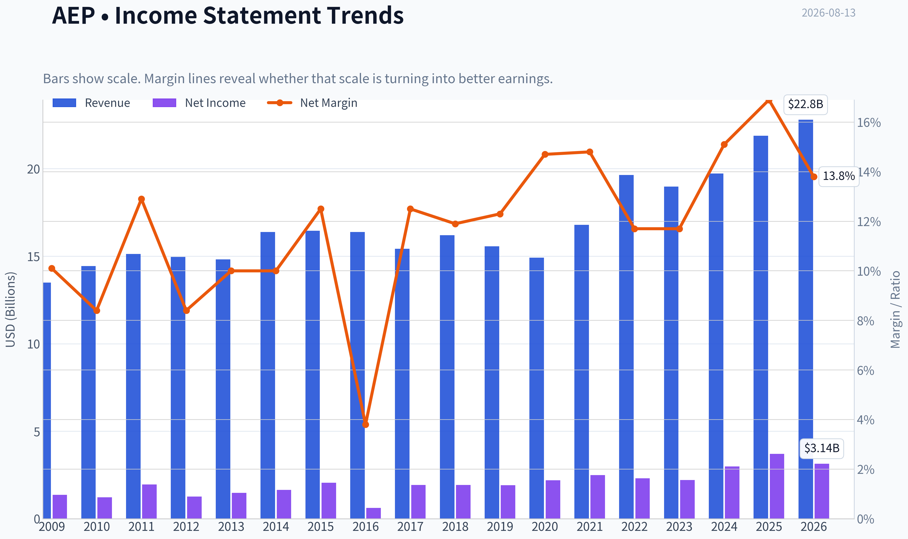
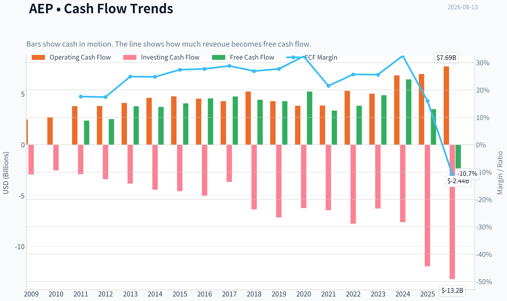
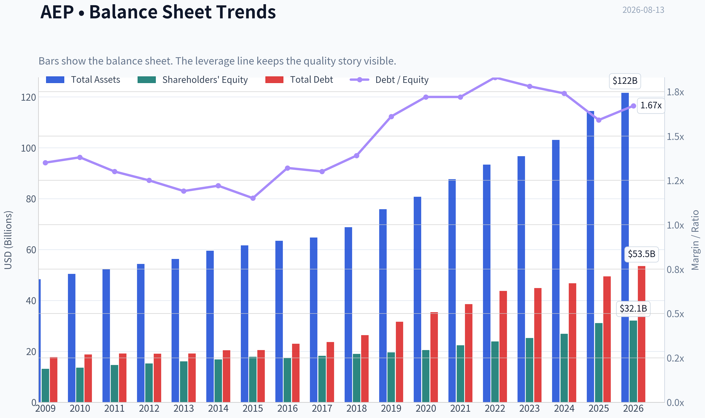
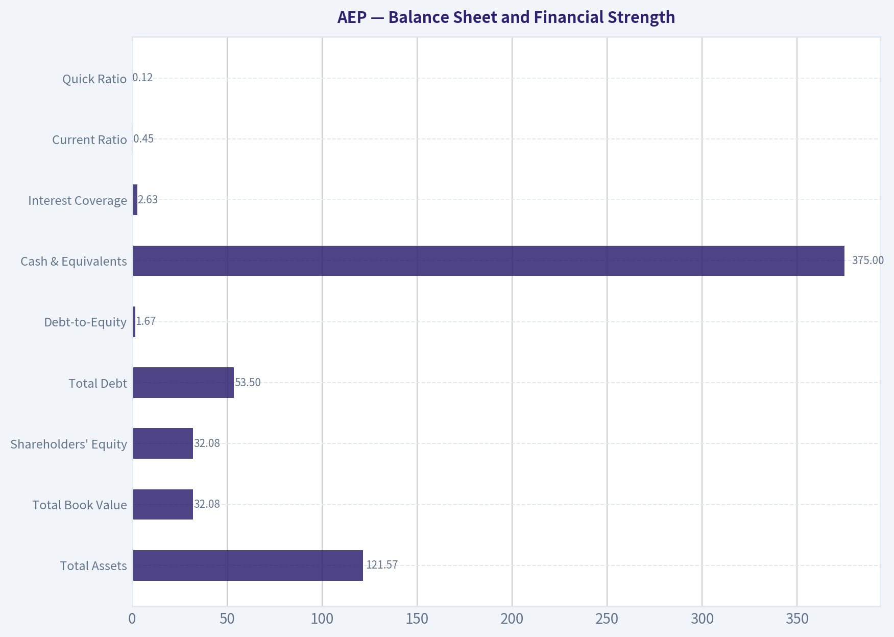
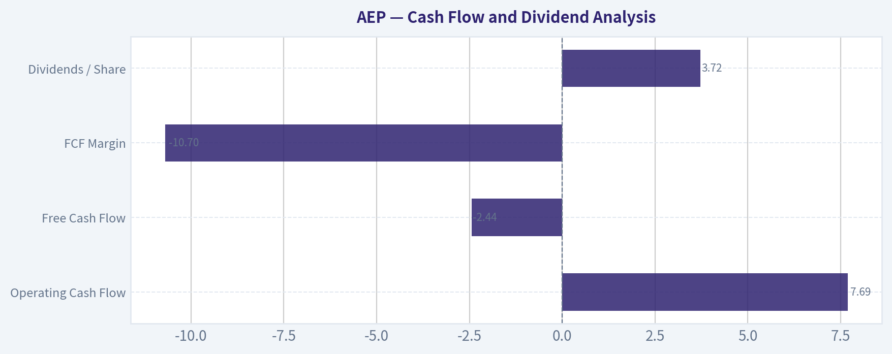
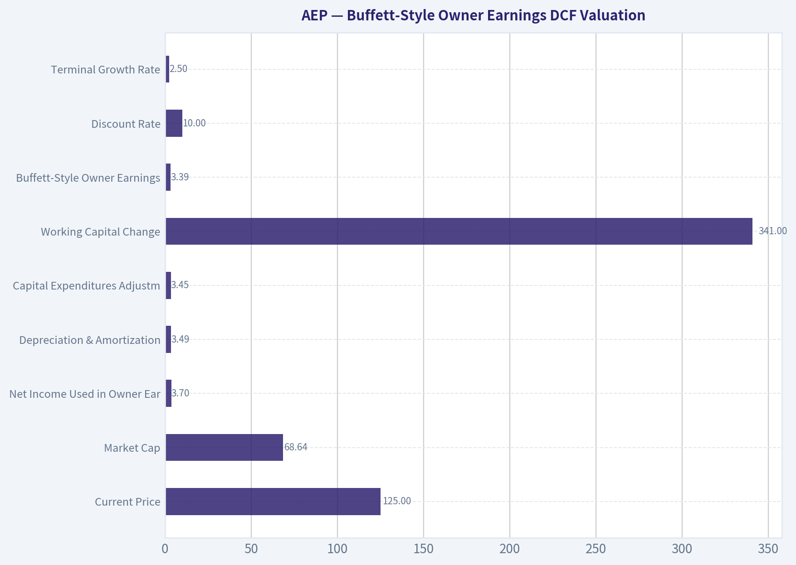
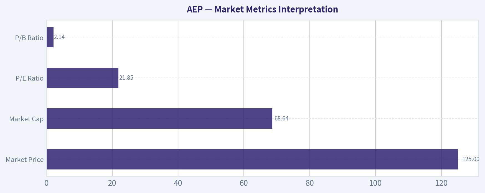

# AEP Deep Value Intelligence

**Analysis Date:** 2026-08-13

## Critical Disclaimer

*This analysis is generated by Deep Value Intelligence, an AI-powered multi-agent investing framework. Education & research only - not financial advice, not a financial advisor.*

---

## Table of Contents

1. Intelligence Summary
2. Analyst Team Reports
   - Fundamentals Analysis
   - Intrinsic Value Analysis (Buffett)
   - Trend & Growth Analysis (Lynch/Druckenmiller/Fisher)
   - Market Technical Analysis
   - Options Market Analysis
3. Research Team Commentary
4. Value Investing Team Commentary
5. Deep Values Commentary

---

## Intelligence Summary

### Thesis + Conditions

**Core Thesis:** **Risk Commentary: American Electric Power (AEP)**

**Key Risks:**
- Risk Commentary: American Electric Power (AEP)**
- The Bull (Risky):** AEP is a strategic infrastructure play. A 10.9% revenue growth rate is massive for a utility, and the $43B capex plan is a guaranteed growth engine for the rate base, easily justifying the 21x P/E "leadership premium."
- The Pragmatist (Neutral):** AEP is a wonderful business at a full price. A rigid demand for a $100 entry ignores structural shifts in power demand, while aggressive buying at $125 ignores valuation risks. A tiered "starter position" at current support is the optimal middle ground.

**Confidence:** Medium

---

## Analyst Team Reports

### Fundamentals Analysis

#### Latest Earnings Snapshot

*Most recent reported quarter anchored on 2026 Q2, with prior-year comparison when available.*

| Metric | 2026 Q2 | 2025 Q2 | YoY Change |
| --- | ---: | ---: | ---: |
| Revenue | $5.45B | $5.09B | +7.0% |
| Operating Income | $1.25B | $1.40B | -10.9% |
| Net Income | $713.0M | $1.23B | -41.8% |
| Diluted EPS | $1.30 | $2.29 | -43.2% |
| Operating Cash Flow | $1.90B | $1.22B | +55.8% |
| Free Cash Flow | $-1.26B | $-2.07B | +38.9% |

Key Takeaways: This snapshot anchors the most recent reported quarter before the narrative analysis. It helps readers separate long-run business quality from whatever changed in the latest earnings print.

#### 17-Year Financial Metrics for AEP

*All values below are computed deterministically from raw data - not estimated by AI.*

*Issuer profile: operating company (Utilities / Utilities - Regulated Electric).*

#### 17-Year Financial Metrics
*Annual rows come from reported financial statements. The final TTM row is computed from the latest four quarters.*

| Metric | 2009 | 2010 | 2011 | 2012 | 2013 | 2014 | 2015 | 2016 | 2017 | 2018 | 2019 | 2020 | 2021 | 2022 | 2023 | 2024 | 2025 | 2026 TTM |
| --- | --- | --- | --- | --- | --- | --- | --- | --- | --- | --- | --- | --- | --- | --- | --- | --- | --- | --- |
| Market Price | $18 | $20 | $24 | $26 | $30 | $40 | $40 | $45 | $54 | $57 | $74 | $68 | $75 | $83 | $74 | $87 | $113 | $125 |
| Market Cap | $15.97B | $17.26B | $19.93B | $20.70B | $22.76B | $29.69B | $28.59B | $30.95B | $36.24B | $36.90B | $46.81B | $41.40B | $44.64B | $48.75B | $42.25B | $49.01B | $61.98B | $68.64B |
| P/E Ratio | 11.75 | 14.22 | 10.28 | 16.42 | 15.38 | 18.18 | 13.97 | 50.77 | 18.96 | 19.16 | 24.36 | 18.84 | 17.94 | 21.15 | 19.16 | 16.53 | 17.31 | 21.85 |
| P/B Ratio | 1.22 | 1.27 | 1.36 | 1.36 | 1.42 | 1.76 | 1.60 | 1.78 | 1.98 | 1.94 | 2.38 | 2.01 | 1.99 | 2.04 | 1.67 | 1.82 | 1.99 | 2.14 |
| ROE | 10.4% | 8.9% | 13.3% | 8.3% | 9.2% | 9.7% | 11.5% | 3.6% | 10.5% | 10.1% | 9.8% | 10.7% | 11.1% | 9.6% | 8.8% | 11.0% | 11.9% | 9.8% |
| ROIC | 7.2% | 6.5% | 6.0% | 6.1% | 6.2% | 6.2% | 6.4% | 3.2% | 6.2% | 5.9% | 5.4% | 5.5% | 5.7% | 5.4% | 5.1% | 6.1% | 6.7% | 5.6% |
| EPS | $1.56 | $1.40 | $2.34 | $1.59 | $1.93 | $2.21 | $2.86 | $0.88 | $2.86 | $2.98 | $3.06 | $3.60 | $4.18 | $3.92 | $3.85 | $5.27 | $6.51 | $5.70 |
| Revenue | $13.49B | $14.43B | $15.12B | $14.95B | $14.81B | $16.38B | $16.45B | $16.38B | $15.42B | $16.20B | $15.56B | $14.92B | $16.79B | $19.64B | $18.98B | $19.72B | $21.88B | $22.79B |
| Gross Profit | N/A | N/A | N/A | N/A | N/A | N/A | N/A | N/A | N/A | N/A | N/A | N/A | N/A | N/A | N/A | N/A | N/A | $13.79B |
| Gross Margin | N/A | N/A | N/A | N/A | N/A | N/A | N/A | N/A | N/A | N/A | N/A | N/A | N/A | N/A | N/A | N/A | N/A | 60.5% |
| Operating Margin | 20.5% | 18.5% | 18.4% | 17.8% | 19.1% | 19.1% | 20.3% | 7.1% | 22.9% | 16.6% | 16.7% | 20.0% | 20.3% | 17.7% | 18.7% | 21.8% | 24.3% | 23.4% |
| Net Income | $1.36B | $1.22B | $1.95B | $1.26B | $1.48B | $1.64B | $2.05B | $618.0M | $1.93B | $1.93B | $1.92B | $2.20B | $2.49B | $2.31B | $2.21B | $2.98B | $3.70B | $3.14B |
| Net Margin | 10.1% | 8.4% | 12.9% | 8.4% | 10.0% | 10.0% | 12.5% | 3.8% | 12.5% | 11.9% | 12.3% | 14.7% | 14.8% | 11.7% | 11.7% | 15.1% | 16.9% | 13.8% |
| Revenue Growth | N/A | 7.0% | 4.8% | -1.1% | -0.9% | 10.6% | 0.5% | -0.4% | -5.8% | 5.0% | -3.9% | -4.1% | 12.6% | 17.0% | -3.3% | 3.9% | 10.9% | 4.2% |
| Net Income Growth | N/A | -10.8% | 60.0% | -35.2% | 17.6% | 10.4% | 25.3% | -69.9% | 212.1% | 0.1% | -0.6% | 14.4% | 13.3% | -7.3% | -4.0% | 34.5% | 24.2% | -15.0% |
| Free Cash Flow Growth | N/A | 5.7% | 50.3% | -1.6% | 9.5% | 11.6% | 4.5% | -6.9% | -3.3% | 22.3% | -35.8% | 14.4% | N/A | N/A | N/A | 31.9% | -45.5% | -169.8% |
| Total Book Value | $13.14B | $13.62B | $14.66B | $15.24B | $16.09B | $16.82B | $17.89B | $17.40B | $18.29B | $19.03B | $19.63B | $20.55B | $22.43B | $23.89B | $25.25B | $26.94B | $31.14B | $32.08B |
| Total Assets | $48.35B | $50.45B | $52.22B | $54.37B | $56.32B | $59.54B | $61.68B | $63.47B | $64.73B | $68.80B | $75.89B | $80.76B | $87.67B | $93.40B | $96.68B | $103.08B | $114.46B | $121.57B |
| Total Debt | $17.74B | $18.81B | $19.13B | $19.06B | $19.19B | $20.46B | $20.50B | $23.01B | $23.71B | $26.42B | $31.67B | $35.40B | $38.54B | $43.78B | $44.91B | $46.78B | $49.44B | $53.50B |
| Debt-to-Equity | 1.35 | 1.38 | 1.30 | 1.25 | 1.19 | 1.22 | 1.15 | 1.32 | 1.30 | 1.39 | 1.61 | 1.72 | 1.72 | 1.83 | 1.78 | 1.74 | 1.59 | 1.67 |
| Cash & Equivalents | $490.0M | $294.0M | $221.0M | $278.7M | $117.5M | $162.5M | $176.4M | $210.5M | $214.6M | $234.1M | $246.8M | $392.7M | $403.4M | $509.4M | $330.1M | $203.0M | $197.0M | $375.0M |
| Shareholders' Equity | $13.14B | $13.62B | $14.66B | $15.24B | $16.09B | $16.82B | $17.89B | $17.40B | $18.29B | $19.03B | $19.63B | $20.55B | $22.43B | $23.89B | $25.25B | $26.94B | $31.14B | $32.08B |
| Operating Cash Flow | $2.48B | $2.66B | $3.79B | $3.80B | $4.10B | $4.60B | $4.75B | $4.52B | $4.27B | $5.22B | $4.27B | $3.83B | $3.84B | $5.29B | $5.01B | $6.80B | $6.94B | $7.69B |
| Investing Cash Flow | $-2.92B | $-2.52B | $-2.89B | $-3.39B | $-3.82B | $-4.41B | $-4.56B | $-4.99B | $-3.66B | $-6.35B | $-7.14B | $-6.23B | $-6.43B | $-7.75B | $-6.27B | $-7.60B | $-11.94B | $-13.19B |
| Free Cash Flow | $2.37B | $2.51B | $3.77B | $3.71B | $4.06B | $4.54B | $4.74B | $4.41B | $4.27B | $5.22B | $3.35B | $3.83B | N/A | N/A | $4.86B | $6.41B | $3.49B | $-2.44B |
| FCF Margin | 17.6% | 17.4% | 24.9% | 24.8% | 27.4% | 27.7% | 28.8% | 26.9% | 27.7% | 32.3% | 21.5% | 25.7% | N/A | N/A | 25.6% | 32.5% | 16.0% | -10.7% |
| Dividends / Share | $0.00 | $0.00 | $0.00 | $0.00 | $0.00 | $0.00 | $0.00 | $0.00 | $0.00 | $0.00 | $0.00 | $0.00 | $0.00 | $2.79 | $3.06 | $3.37 | $3.65 | $3.72 |

#### Profitability Metrics
- Return on Equity (ROE): 11.9%
- Return on Invested Capital (ROIC): 6.4%
- Return on Assets (ROA): 3.2%
- Gross Margin: N/A
- Operating Margin: 24.3%
- Net Profit Margin: 16.9%

#### Liquidity Metrics
- Current Ratio: 0.45
- Quick Ratio: 0.12

#### Leverage Metrics
- Debt-to-Equity Ratio: 1.59
- Interest Coverage Ratio: 2.63
- Net Debt: $49.24B

#### Growth Metrics (Year-over-Year)
- Revenue Growth: 10.9%
- Net Income Growth: 24.2%
- Free Cash Flow Growth: -45.5%
- Revenue CAGR (3-Year): 3.7%
- Revenue CAGR (5-Year): 8.0%

#### Valuation Metrics
- P/E Ratio (TTM): 21.42
- Forward P/E: 18.17
- Price-to-Book: 2.12
- Price-to-Sales: 2.98
- PEG Ratio: 2.09
- EV/EBITDA: 13.51
- Free Cash Flow Yield: 5.1%
- Earnings Yield: 4.7%

#### Owner Earnings (Buffett Method, Code-Computed)
- Net Income: $3.70B
- + Depreciation & Amortization: $3.49B
- - Capital Expenditures: $-3.45B
- - Working Capital Changes: $341.0M
- = **Owner Earnings: $3.39B**

#### Intrinsic Value (Code-Computed)
- Current Price: $125
- **Headline Intrinsic Value (business-model routed): $99**
  Business model: operating company - Damodaran FCFF (operating_company)
  Model spread (min-max across DCFs): $99 - $99
  Margin of safety vs. price (headline): -26.0%
  Routing note: General operating company: balanced blend of Damodaran FCFF and the owner-earnings DCF with a reverse-DCF sanity check.
- Buffett Method (Owner Earnings):
  Conservative: $-74
  Average: $-18
  Optimistic: $68
- Cash Flow Method (FCF):
  Conservative: $-22
  Average: $-9
  Optimistic: $79
- Damodaran FCFF (WACC + margins + reinvestment):
  Conservative: $51
  Average: $99
  Optimistic: $160
  Monte Carlo band (P10-P90): $42 - $172 (median $102)
  P(intrinsic value > price): 36.5%
- Reverse-DCF: price implies ~36.1%/yr owner-earnings growth for 10y; trailing 3y was -16.5%, 5y 9.1%.

#### Piotroski F-Score: 5/9
- Positive Net Income: PASS
- Positive Operating Cash Flow: PASS
- ROA Improvement: PASS
- Cash Flow > Net Income: PASS
- Decreasing Debt: FAIL
- Improving Current Ratio: PASS
- No Dilution: FAIL
- Improving Gross Margin: FAIL
- Improving Asset Turnover: FAIL

ANALYST STANCE: **WATCH**

#### American Electric Power (AEP) - Buffett-Style Fundamental Analysis

American Electric Power is a large regulated electric utility with a durable service-territory moat, visible demand growth from electrification and data-center load, and a long-lived asset base that can earn regulated returns. However, at **$125/share**, the stock is priced above the deterministic dataset's headline intrinsic value of about **$99/share**, implying a **negative margin of safety of roughly 26%**. For a Buffett-style investor, AEP looks like a high-quality regulated utility, but not obviously a bargain at today's price.

---

#### Current vs. 10-Year Historical Average Comparison

| Metric | Current / TTM | 10-Year Average* | Current Standing vs. History | Interpretation |
|---|---:|---:|---|---|
| Market Price | **$125** | ~$73 | Well above average | The share price is near the high end of the long-term range, reflecting enthusiasm for regulated utilities, rate-base growth, and power-demand themes. |
| Market Cap | **$68.64B** | ~$43.89B | Well above average | Equity value has expanded materially, partly from earnings growth and partly from valuation multiple expansion. |
| P/E Ratio | **21.85x** | ~22.42x | Near average, but distorted by 2016 outlier | Excluding the unusually high 2016 P/E, today's multiple is above a more normal utility range and above the recent earnings yield implied by the stock. |
| P/B Ratio | **2.14x** | ~1.96x | Above average | For a regulated utility, P/B is more meaningful than for asset-light businesses, but it must be judged against ROE. AEP's premium P/B is acceptable only if ROE and rate-base growth remain solid. |
| ROE | **9.8% TTM** | ~9.7% | In line | ROE is stable but not exceptional. The 2025 figure of 11.9% was stronger, while TTM has normalized. |
| ROIC | **5.6% TTM** | ~5.5% | In line | ROIC reflects the capital-heavy regulated model. Returns are steady but modest. |
| EPS | **$5.70 TTM** | ~$3.71 | Above average | EPS has compounded meaningfully over the decade, though TTM is below the 2025 peak of $6.51. |
| Revenue | **$22.79B TTM** | ~$17.55B | Above average | Revenue has stepped up since 2021, helped by rate increases, load growth, and inflation pass-through. |
| Gross Profit | **$13.79B TTM** | N/A | Not comparable | Historical gross profit is unavailable in the deterministic table, so no 10-year comparison is made. |
| Gross Margin | **60.5% TTM** | N/A | Not comparable | Utility gross margin presentation can vary by fuel-cost recovery accounting; operating margin is more useful here. |
| Operating Margin | **23.4% TTM** | ~18.6% | Above average | AEP's operating profitability is currently stronger than its decade average, suggesting favorable rate recovery and cost absorption. |
| Net Income | **$3.14B TTM** | ~$2.23B | Above average | Profit dollars are structurally higher than the past decade, though below the 2025 level of $3.70B. |
| Net Margin | **13.8% TTM** | ~12.5% | Above average | Margins remain healthy versus history, despite capital and financing pressures. |
| Revenue Growth | **4.2% TTM** | ~3.2% | Above average | Growth is better than the decade average, though below the unusually strong 2022 and 2025 years. |
| Net Income Growth | **-15.0% TTM** | ~21.7% | Below average, but average is distorted | The historical average is skewed by the rebound from 2016. Current earnings growth is negative versus the 2025 peak. |
| Free Cash Flow Growth | **-169.8% TTM** | ~-3.3% | Much worse | TTM free cash flow turned sharply negative due to heavy capital spending, a major valuation and funding concern. |
| Total Book Value | **$32.08B** | ~$22.46B | Above average | Book value has grown steadily, consistent with rate-base expansion and retained earnings. |
| Total Assets | **$121.57B** | ~$84.89B | Above average | Asset growth is substantial, reflecting ongoing utility infrastructure investment. |
| Total Debt | **$53.50B** | ~$36.37B | Above average | Debt has risen materially as AEP funds its capital program. |
| Debt-to-Equity | **1.67x** | ~1.60x | Slightly above average | Leverage is elevated but not unusual for a regulated utility; interest coverage is the bigger concern. |
| Cash & Equivalents | **$375M** | ~$294M | Above average | Cash is modest relative to debt and capex needs; liquidity depends heavily on operating cash flow and capital-market access. |
| Shareholders' Equity | **$32.08B** | ~$22.46B | Above average | Equity base has expanded, supporting regulated investment, though dilution has occurred. |
| Operating Cash Flow | **$7.69B TTM** | ~$5.00B | Well above average | Cash generation from operations is strong, but capex is even larger. |
| Free Cash Flow | **-$2.44B TTM** | ~$4.48B valid-year average | Far below average | Negative FCF is the clearest red flag; AEP is in a heavy reinvestment cycle. |
| Dividends / Share | **$3.72 TTM** | ~$1.29 including dataset zeros; ~$3.22 since 2022 | Above recent average | The dividend has grown, but coverage must be monitored because free cash flow is currently negative. |

\*10-year average uses fiscal years 2016-2025 from the deterministic dataset where available.

**Key Takeaways:** AEP's revenue, EPS, operating margin, and asset base are all above their 10-year averages, showing that the company has grown into a larger and more profitable utility platform. The concern is valuation and funding: the stock price, market cap, P/B ratio, debt, and capex burden are also above historical norms. The business quality is solid, but today's price embeds a lot of future success.

---

#### Revenue Breakdown

| Revenue Source | Amount ($B) | % of Total |
|---|---:|---:|
| Vertically Integrated Regulated Utilities | ~$11.6B | ~53% |
| Transmission & Distribution Utilities | ~$8.0B | ~37% |
| AEP Transmission Holdco / Regulated Transmission | ~$1.7B | ~8% |
| Generation & Marketing / Other | ~$0.6B | ~2% |
| **Total 2025 Revenue** | **$21.88B** | **100%** |

**Key Takeaways:** AEP is overwhelmingly a regulated utility business, with the majority of revenue coming from vertically integrated electric utilities and transmission-and-distribution operations. This supports earnings durability because regulated assets typically earn allowed returns, but it also makes AEP highly dependent on regulators approving rate recovery for its capital spending.

---

#### Market Metrics Interpretation

| Metric | Current Reading | Buffett-Style Interpretation |
|---|---:|---|
| Market Price | **$125** | The stock has appreciated materially versus the 10-year average of about $73, leaving less room for a margin of safety. |
| Market Cap | **$68.64B** | AEP is a large-cap regulated utility with durable scale, but the current equity value assumes continued rate-base growth and favorable regulation. |
| P/E Ratio | **21.85x** | The multiple is not extreme relative to the dataset average, but it is high for a slow-to-mid-single-digit regulated utility if earnings growth slows. |
| P/B Ratio | **2.14x** | P/B is meaningful for AEP because regulated utilities are asset-heavy and book value approximates rate-base economics better than it would for software or IP businesses. However, a 2.14x P/B requires sustained ROE near or above allowed returns; with TTM ROE at 9.8%, the valuation is not clearly cheap. |

**Key Takeaways:** AEP is not being priced like a distressed utility; it is being priced like a high-quality compounder with a favorable demand backdrop. The P/B premium is not automatically disqualifying because utilities can compound book value through rate-base investment, but the premium needs ROE stability and regulatory support to be justified.

---

#### Profitability Analysis

AEP's profitability is consistent with a regulated utility rather than an asset-light compounder. The company's **TTM ROE of 9.8%** is close to its 10-year average, while **ROIC of 5.6%** is also near historical norms. This suggests AEP is a steady, regulated-return business rather than a business with unusually high returns on capital.

The strongest profitability signal is operating margin. AEP's **TTM operating margin of 23.4%** is meaningfully above the 10-year average of about **18.6%**, and 2025 operating margin reached **24.3%**, the highest in the dataset. Net margin is also strong at **13.8% TTM**, above the 10-year average of about **12.5%**, though below 2025's peak of **16.9%**.

EPS has grown from **$0.88 in 2016** to **$6.51 in 2025**, before easing to **$5.70 TTM**. That is a favorable long-term pattern, but the TTM decline warns that investors should not value AEP as if 2025 earnings power is guaranteed to accelerate indefinitely.

---

#### Growth Analysis

AEP's revenue growth has improved in the post-2020 period. Revenue rose from **$14.92B in 2020** to **$21.88B in 2025**, and further to **$22.79B TTM**. The latest **4.2% TTM revenue growth** is above the 10-year average of roughly **3.2%**, but much lower than 2022's **17.0%** and 2025's **10.9%**.

Net income growth is less smooth. The deterministic dataset shows large swings, including a severe 2016 decline and a sharp 2017 rebound. TTM net income growth is **-15.0%**, largely because earnings declined from the strong 2025 base. Buffett would likely view AEP's long-term earnings as reasonably predictable, but not perfectly smooth.

Free cash flow growth is the biggest weakness. AEP's TTM free cash flow is **-$2.44B**, compared with **$3.49B in 2025** and **$6.41B in 2024**. The **-169.8% TTM FCF growth** reflects heavy investment spending and makes conventional free-cash-flow valuation difficult.

---

#### Balance Sheet and Financial Strength

| Balance Sheet Item | Current / TTM | Interpretation |
|---|---:|---|
| Total Assets | **$121.57B** | AEP has expanded its asset base aggressively, supporting regulated earnings growth. |
| Total Book Value | **$32.08B** | Book value growth is positive and important for a utility because equity supports rate-base investment. |
| Shareholders' Equity | **$32.08B** | Equity has grown, but capital needs remain large. |
| Total Debt | **$53.50B** | Debt is high and rising, consistent with the capital-intensive utility model. |
| Debt-to-Equity | **1.67x** | Slightly above the 10-year average and worth monitoring. |
| Cash & Equivalents | **$375M** | Cash is small relative to debt and capex needs. |
| Interest Coverage | **2.63x** | Adequate but not strong; higher rates increase risk. |
| Current Ratio | **0.45** | Low liquidity, though utilities often rely on predictable cash flows and capital-market access rather than large cash balances. |
| Quick Ratio | **0.12** | Very low, reinforcing dependence on external funding access. |

**Key Takeaways:** AEP's balance sheet is acceptable for a regulated utility, but not conservative in the Buffett sense. The company has a large and growing debt load, modest cash, and only moderate interest coverage. The business is stable, but the financial structure leaves less flexibility if rates rise, regulators delay recovery, or capex overruns occur.

---

#### Cash Flow and Dividend Analysis

| Cash Flow Metric | Current / TTM | Interpretation |
|---|---:|---|
| Operating Cash Flow | **$7.69B** | Strong and well above the 10-year average, showing healthy utility cash generation. |
| Free Cash Flow | **-$2.44B** | Negative due to heavy capital investment; this is the main concern for intrinsic value. |
| FCF Margin | **-10.7%** | A sharp deterioration from positive historical levels. |
| Dividends / Share | **$3.72** | Dividend continues to grow, but current FCF does not cover it. |
| FCF Yield | **~5.1% based on latest annual pack figure** | Looks reasonable on a normalized annual basis, but TTM FCF is negative, so investors should not rely on a simple FCF yield. |

**Key Takeaways:** AEP produces strong operating cash flow, but its capital spending program is consuming more than the business currently generates after investment. The dividend is attractive, but because free cash flow is negative on a TTM basis, dividend sustainability depends on regulated cost recovery, continued debt/equity financing, and future operating cash flow growth.

---

#### Buffett-Style Owner Earnings DCF Valuation

Base inputs from the deterministic pack:

| DCF Input | Value |
|---|---:|
| Current Price | **$125** |
| Market Cap | **$68.64B** |
| Estimated Shares Outstanding | **~549M** |
| Net Income Used in Owner Earnings | **$3.70B** |
| Depreciation & Amortization | **$3.49B** |
| Capital Expenditures Adjustment | **$3.45B** |
| Working Capital Change | **$341M** |
| Buffett-Style Owner Earnings | **$3.39B** |
| Discount Rate | **10.0%** |
| Terminal Growth Rate | **2.5%** |
| Net Debt | **~$49.24B** |

**Key Takeaways:** The starting owner earnings figure is positive, but AEP's debt and capital intensity make the equity value highly sensitive to reinvestment assumptions. This is why the model-based intrinsic value should lean more heavily on regulated-utility FCFF economics than on a simple owner-earnings shortcut.

##### Three-Scenario Hand DCF Sanity Check

| Scenario | Explicit Growth Assumption | PV of 10-Year Owner Earnings | PV of Terminal Value | Enterprise Value | Less Net Debt | Equity Value / Share |
|---|---|---:|---:|---:|---:|---:|
| Conservative | 3.0% annual growth, fading to 2.5% terminal | ~$24.0B | ~$24.0B | ~$48.0B | ~$49.2B | **~$0 to negative** |
| Average | 6.0% early growth, fading toward 2.5% by year 10 | ~$27.3B | ~$28.9B | ~$56.2B | ~$49.2B | **~$13/share** |
| Optimistic | 8.0% early growth, fading toward 2.5% by year 10 | ~$29.7B | ~$33.0B | ~$62.7B | ~$49.2B | **~$25/share** |

**Key Takeaways:** A debt-adjusted owner-earnings DCF produces low equity values because AEP is highly leveraged and capital intensive. This does not mean the utility franchise is worthless; rather, it shows that simple Buffett owner-earnings models are harsh for regulated utilities during heavy capex cycles. For AEP, the more relevant valuation anchor is the regulated FCFF model, which better captures rate-base reinvestment and allowed returns.

##### Model-Based Intrinsic Value Anchor from Research Pack

| Valuation Model | Conservative | Average / Base Case | Optimistic |
|---|---:|---:|---:|
| Buffett Owner Earnings DCF | **-$74/share** | **-$18/share** | **$68/share** |
| Free Cash Flow DCF | **-$22/share** | **-$9/share** | **$79/share** |
| Damodaran FCFF Utility-Appropriate DCF | **$51/share** | **$99/share** | **$160/share** |
| Monte Carlo Band | **P10: $42** | **Median: $102** | **P90: $172** |
| Probability Intrinsic Value > Current Price |  | **36.5%** |  |

**Key Takeaways:** The more utility-appropriate FCFF model gives a base intrinsic value near **$99/share**, materially below the current price of **$125/share**. The bull case can justify today's price and more, but the probability-weighted setup does not offer a classic Buffett margin of safety.

##### Reverse DCF

| Reverse-DCF Metric | Reading |
|---|---:|
| Growth Implied by Current Price | **~36.1% per year for 10 years** |
| Trailing 3-Year Owner-Earnings Growth | **-16.5%** |
| Trailing 5-Year Owner-Earnings Growth | **9.1%** |

**Key Takeaways:** The current share price implies a very aggressive owner-earnings growth rate relative to AEP's recent history. That does not align naturally with a regulated utility's economics, where returns are usually stable and rate-base driven rather than explosive.

---

#### Warren Buffett-Style Qualitative Assessment

| Buffett Criterion | Assessment | AEP Interpretation |
|---|---|---|
| Economic Moat | Strong but regulated | AEP benefits from monopoly-like service territories, essential electricity demand, scale, transmission assets, and regulatory barriers to entry. |
| Business Durability | High | Electricity demand is non-discretionary, and long-term demand may rise from data centers, industrial reshoring, and electrification. |
| Predictable Earnings | Moderate to high | Earnings are more predictable than cyclical industrials, but rate cases, weather, financing costs, and capex timing create variability. |
| Return on Capital | Acceptable, not exceptional | ROE around 10% and ROIC around 5-6% are typical for regulated utilities, not outstanding Buffett-level economics. |
| Balance Sheet Strength | Adequate but leveraged | Debt is high and rising; interest coverage of 2.63x is manageable but not robust. |
| Capital Allocation | Growth-focused and dividend-oriented | AEP is reinvesting heavily into infrastructure and continuing dividends, but negative FCF increases dependence on external capital. |
| Valuation | Not cheap | Base intrinsic value near $99 versus price of $125 indicates no clear margin of safety. |

**Key Takeaways:** AEP has the kind of durable, understandable business Buffett often appreciates, but not the high-return, low-capital-intensity profile of his best investments. The company's moat is real, but much of the value depends on regulators allowing fair returns on a very large capital program.

---

#### Key Investment Insights

| Category | Insight |
|---|---|
| Main Strength | AEP owns essential regulated electric infrastructure with durable demand and limited competition. |
| Main Opportunity | Rising electricity demand from AI data centers, manufacturing, electrification, and grid modernization could support rate-base growth. |
| Main Valuation Issue | The stock trades above the base intrinsic value estimate of about $99/share. |
| Main Financial Risk | Debt has risen to **$53.50B**, while TTM free cash flow is **-$2.44B**. |
| Main Profitability Positive | Operating margin of **23.4% TTM** is above the 10-year average. |
| Main Buffett Concern | Heavy capital intensity means shareholders may not receive owner earnings in the near term despite accounting profits. |
| Dividend View | Dividend is attractive and growing, but current free cash flow does not cover it. |
| Regulatory Dependency | AEP must secure timely and adequate rate recovery to justify its investment plan. |

**Key Takeaways:** AEP's long-term demand backdrop is attractive, especially if electricity becomes a bottleneck for AI and industrial growth. But the business must finance massive infrastructure investment, and the current stock price already reflects optimism.

---

#### Red Flags and Opportunities

| Red Flags | Opportunities |
|---|---|
| Current price is about **26% above** the $99 headline intrinsic value estimate. | Data-center and AI-driven power demand could raise long-term load growth. |
| TTM free cash flow is negative at **-$2.44B**. | Regulated rate-base growth can support predictable earnings expansion. |
| Debt has increased to **$53.50B**. | Transmission investment may earn attractive regulated returns. |
| Interest coverage of **2.63x** leaves limited cushion if rates remain high. | Operating margin is currently above historical norms. |
| Dividend is not covered by TTM free cash flow. | AEP remains a defensive utility with essential-service demand. |
| Reverse DCF implies aggressive growth for a regulated utility. | If regulators approve timely recovery, earnings and book value can continue compounding. |

**Key Takeaways:** The opportunity is real, but so is the funding risk. AEP could benefit from a structural electricity demand cycle, yet investors are being asked to pay a premium before the full cash-flow benefits are visible.

---

#### Final Investment Stance: WATCH

AEP is a **WATCH**, not an **ADVOCATE**, because the business quality is good but the valuation is not compelling. The company has a durable regulated utility moat, improving revenue scale, strong operating cash flow, and a favorable long-term demand backdrop. However, the stock at **$125/share** trades materially above the **$99/share** base intrinsic value estimate, with negative TTM free cash flow, high debt, and only moderate interest coverage.

A Buffett-style investor would likely admire the durability of the franchise but wait for a better price or clearer evidence that the heavy capital program will convert into shareholder-level cash flow. A more attractive entry point would be closer to, or below, the base intrinsic value range, ideally with a margin of safety below **$100/share** unless earnings growth and regulatory recovery materially improve.

---

#### Summary Table

| Topic | Key Point | Buffett-Style Conclusion |
|---|---|---|
| Business Quality | Durable regulated electric utility with essential-service demand | High-quality but capital intensive |
| Economic Moat | Monopoly-like service territories and regulated infrastructure | Strong, but returns are capped by regulation |
| Profitability | ROE near historical average; operating margin above average | Stable and improving, but not exceptional |
| Growth | Revenue above 10-year average; TTM net income down from 2025 peak | Good long-term growth, uneven near-term earnings |
| Balance Sheet | Debt of **$53.50B**, D/E of **1.67x** | Acceptable for utility, but leveraged |
| Cash Flow | Operating cash flow strong; free cash flow negative | Major concern |
| Dividend | DPS of **$3.72** | Attractive but needs future cash-flow support |
| Valuation | Price **$125** vs. base intrinsic value **~$99** | No margin of safety |
| Reverse DCF | Price implies very high growth | Expectations look demanding |
| Final Stance | **WATCH** | Good company, but wait for better valuation or better FCF evidence |

**Key Takeaways:** AEP is a durable regulated utility with a real moat and a favorable long-term power-demand story. The problem is not business quality; it is price and cash-flow timing. At the current valuation, Buffett-style investors should monitor the stock rather than aggressively buy it.

#### Fundamental Visuals

This graph tracks the profitability and return metrics (ROE, ROIC, Margins) of **AEP** over the past decade, highlighting capital efficiency trends.

This chart illustrates the financial health of **AEP** over the last 10 years, mapping cash equivalents and free cash flow against total obligations (Debt).

---

### Intrinsic Value Analysis (Buffett)

> *Following Warren Buffett's value investing philosophy: Circle of Competence, Economic Moat, Management Quality, and Margin of Safety.*

#### Intrinsic Value Snapshot

Price is what you pay. Intrinsic value is what the business may be worth based on the cash it can create for owners over time. We show a range, not one magic number.

- Current Price: $124.65
- Value Range (conservative to optimistic across both DCF methods): $-74.23 to $79.09

##### Owner Earnings (Buffett Method)
- Net Income: $3,696,000,000.00
- Depreciation & Amortization: $3,489,000,000.00
- Capital Expenditures: $-3,453,000,000.00
- Working Capital Changes: $341,000,000.00
- Owner Earnings: $3,391,000,000.00

##### Intrinsic Value
###### Buffett Method
Uses owner earnings. Stricter, and usually more conservative.
- Conservative: $-74.23
- Average: $-17.56
- Optimistic: $67.66
- Discount Rate: 10.0%

###### Cash Flow Method
Uses free cash flow. Better for companies spending heavily today to grow tomorrow.
- Conservative: $-21.94
- Average: $-8.86
- Optimistic: $79.09
- Discount Rate: 10.0%

ANALYST STANCE: **WATCH**

#### American Electric Power - Buffett-Style Investment Review

American Electric Power is a large regulated electric utility serving customers across multiple U.S. states. The business is understandable, essential, and supported by regulated monopoly economics, but it is also capital-intensive, debt-dependent, and currently priced above conservative intrinsic value. At $125 per share, the stock looks more like a "good business at a full price" than a Buffett-style bargain.

---

#### 1. Factor Scorecard

| Factor | Score | Evidence |
|---|---:|---|
| Circle of Competence & Business Simplicity | 4.0 / 5 | AEP earns money by generating, transmitting, and distributing electricity under regulated utility frameworks. Demand is durable and increasingly supported by electrification, data centers, and grid investment. |
| Moat Test | 3.5 / 5 | Regulated local monopoly positions create customer captivity and high barriers to entry, but returns are capped by regulators and political risk limits pricing freedom. |
| Management Quality & Capital Allocation | 3.0 / 5 | Management's capital allocation is largely rate-base reinvestment plus dividends. This is rational for a utility, but high capex needs reduce owner flexibility and may require ongoing debt/equity financing. |
| Industry Structure | 4.0 / 5 | Regulated utility markets are structurally rational and non-commoditized at the customer level. However, the industry is capital-heavy and sensitive to interest rates, regulation, and infrastructure execution. |
| Gate 5 - Quality/Solvency Hard Floor | Not tripped | The business does not show the combination of deteriorating fundamentals and acute solvency stress required for a hard AVOID. Revenue growth is positive, and the utility model supports debt service through regulated cash flows. |

**Key Takeaways:** AEP is easy to understand and operates in a structurally protected industry. The concern is not business fragility; the concern is that regulated utilities require heavy capital spending and offer capped returns, making valuation discipline especially important.

---

#### 2. Moat Analysis

| Moat Source | Assessment | Evidence |
|---|---|---|
| Intangible / Regulatory License | Strong | AEP benefits from regulated service territories, which function like government-granted local monopolies. |
| Switching Costs | Moderate to Strong | Customers generally cannot easily switch electric delivery providers; grid infrastructure creates physical customer captivity. |
| Cost Advantage | Moderate | Scale helps in procurement, generation, grid operations, and financing, but utilities do not typically enjoy uncapped margin expansion. |
| Network Effects | Low | The grid has network-like infrastructure value, but AEP does not benefit from classic platform network effects where each new user materially raises value for all others. |
| Pricing Power | Regulated, not discretionary | AEP can raise rates through regulatory proceedings, but not freely. Pricing power exists, yet it is negotiated with regulators rather than dictated by brand strength. |

**Key Takeaways:** AEP's moat is real but regulated. The company has strong territorial protection, but unlike a consumer brand or software platform, it cannot simply raise prices at will; regulators decide how much return shareholders may earn.

**Moat Quality Rating:** **Narrow-to-Wide, Stable**
AEP deserves credit for essential-service monopoly characteristics, but the moat is not "wide and widening" in the Buffett sense because returns are capped and capital needs are persistent.

---

#### 3. Management Quality & Capital Allocation

| Area | Assessment |
|---|---|
| Owner Orientation | Moderate. AEP pays a meaningful dividend and focuses on long-term infrastructure investment, but shareholder returns depend heavily on regulatory outcomes and financing discipline. |
| Candor & Accounting | Utilities generally operate under transparent regulatory and accounting frameworks. No major red flag is evident from the current data set. |
| Reinvestment Discipline | Mixed-to-Positive. Reinvesting into rate base can create value if approved returns exceed financing costs, but the capital intensity is high. |
| Buybacks | Not central to the thesis. Utilities usually prioritize dividends, capex, and balance sheet support over opportunistic repurchases. |
| Dividend Policy | Current quarterly dividend is $0.95 per share, or roughly $3.80 annualized. Against estimated EPS of about $5.84, the payout ratio is approximately 65%, reasonable for a regulated utility. |
| Debt Discipline | Needs monitoring. Utilities can prudently use leverage, but rising rates and large capex programs reduce the margin for error. |

**Key Takeaways:** Management appears to be running AEP like a conventional regulated utility: invest in the grid, grow the rate base, pay dividends, and use debt as part of the capital structure. That model can work, but it does not offer the capital-allocation flexibility of a high-ROIC, asset-light compounder.

---

#### 4. Financial Summary

| Metric | Current / Recent Figure | Interpretation |
|---|---:|---|
| Share Price | $125.00 | Current market price used for valuation. |
| Market Capitalization | $67.86B | Large-cap regulated utility scale. |
| P/E Ratio | 21.4x | Full valuation for a regulated utility. |
| Implied EPS | ~$5.84 | Derived from price divided by P/E. |
| Implied Net Income | ~$3.17B | Derived from market cap divided by P/E. |
| ROE | 11.9% | Acceptable for a regulated utility, but below "wonderful business" territory. |
| Revenue Growth YoY | 10.9% | Strong recent top-line growth, likely supported by load growth and rate activity. |
| FCF Yield | 5.1% | Reasonable cash yield, but utility free cash flow can be volatile due to capex cycles. |
| Implied FCF | ~$3.46B | Derived from market cap multiplied by FCF yield. |
| Current Ratio | 0.45x | Low, reflecting utility working-capital structure and reliance on financing markets. |
| Annualized Dividend | ~$3.80/share | Based on $0.95 quarterly dividend. |
| Dividend Yield | ~3.0% | Moderate income yield at the current price. |
| Estimated Dividend Payout Ratio | ~65% | Reasonable, but not especially conservative. |
| Trailing 3-Year Growth Indicator | -16.5% | Recent growth has been uneven. |
| Trailing 5-Year Growth Indicator | 9.1% | Longer recent history is better, but not enough to justify aggressive implied expectations. |

**Key Takeaways:** AEP is profitable and growing, but the valuation is demanding relative to its regulated-return profile. ROE near 12% is respectable, yet not high enough to justify paying a premium that assumes extraordinary long-term growth.

---

#### 5. Owner Earnings Calculation

| Owner Earnings Component | Estimate |
|---|---:|
| Net Income | ~$3.17B |
| Add: Depreciation & Amortization | Material, as typical for utilities |
| Less: Maintenance Capex | High, due to grid and generation asset base |
| Less: Working Capital Increases | Variable |
| Free Cash Flow Proxy | ~$3.46B |
| FCF per Share Estimate | ~$6.38 |
| Conservative Owner-Earnings Model Signal | Negative in the owner-earnings DCF model |
| Buffett Interpretation | Cash generation exists, but heavy reinvestment needs reduce freely distributable owner earnings. |

**Key Takeaways:** AEP generates substantial accounting earnings and cash flow, but as a utility, much of that cash must be reinvested into the system. For Buffett-style purposes, the key question is not whether AEP produces cash, but how much cash is truly available to owners after maintaining and expanding the asset base.

---

#### 6. Three-Scenario DCF Valuation

| Scenario | Assumption | Estimated Value / Share |
|---|---|---:|
| Scenario A - No Growth | FCF/share of ~$6.38 capitalized at 10% | ~$64 |
| Scenario B - GDP Growth | FCF/share grows at 3%, discounted at 10% | ~$94 |
| Scenario C - Historical / Regulated Growth | 5% growth for 10 years, then 3% terminal growth | ~$109 |
| Headline FCFF Intrinsic Value | Business-model routed Damodaran-style FCFF estimate | ~$98.92 |
| Current Price | Market price | $125.00 |

**Key Takeaways:** Even under a reasonable growth scenario, AEP's value appears below the current market price. The headline intrinsic value estimate of about $99 per share implies the stock is trading meaningfully above conservative fair value.

---

#### 7. Margin of Safety Analysis

| Valuation Measure | Result |
|---|---:|
| Current Price | $125.00 |
| Headline Intrinsic Value | $98.92 |
| Margin of Safety vs. Headline Value | -26.0% |
| Price / Headline Intrinsic Value | ~1.26x |
| Reverse-DCF Implied Growth | ~36.1% annually for 10 years |
| Plausibility of Implied Growth | Very low for a regulated utility |

**Key Takeaways:** The margin of safety is negative. AEP would need growth assumptions far beyond what a regulated utility can normally deliver to justify the current price, making valuation the central weakness in the investment case.

---

#### 8. Final Buffett Scorecard

| Criterion | Weight | Score | Weighted Contribution |
|---|---:|---:|---:|
| Moat Width & Durability | 25% | 3.5 | 0.88 |
| Valuation / Margin of Safety | 20% | 1.5 | 0.30 |
| Capital Returns - ROIC vs. WACC | 15% | 2.8 | 0.42 |
| Business Understanding & Predictability | 12% | 4.0 | 0.48 |
| Management Quality & Capital Allocation | 12% | 3.0 | 0.36 |
| Reinvestment Runway | 8% | 4.0 | 0.32 |
| Balance Sheet Strength | 4% | 2.5 | 0.10 |
| Industry Structure | 4% | 4.0 | 0.16 |
| **Total Score** | **100%** |  | **3.02 / 5** |

**Key Takeaways:** AEP earns strong marks for predictability, industry structure, and reinvestment opportunity. The score is pulled down by valuation, capital intensity, and balance-sheet dependence, leaving the stock in WATCH territory rather than ADVOCATE territory.

---

#### 9. Investment Stance

| Stance | Conviction | Rationale |
|---|---|---|
| **WATCH** | Medium | AEP is a durable regulated utility with real infrastructure value and a credible growth runway from electrification, grid investment, and power demand. However, at $125 per share, the stock trades about 26% above the headline intrinsic value estimate and embeds growth expectations that appear unrealistic for a regulated utility. |

**Final View:** AEP is a good business, not a distressed business, and not a speculative business. But Buffett would likely wait for a better price. A more attractive entry point would be closer to or below intrinsic value, roughly the high-$90s to low-$100s, with a preference for a wider margin of safety given the capital intensity and capped-return nature of the utility model.
#### Valuation Bridge

This bridge places the current market price beside each intrinsic value lens so readers can see whether upside depends on one method or shows up across several methods.

| Scenario | Intrinsic Value / Share |
| --- | ---: |
| Buffett Method | $-17.56 |
| Cash Flow Method | $-8.86 |
| Damodaran Method | $98.92 |
| Current Price | $124.65 |

#### Key Takeaways

If one method is far above the others, the upside case depends on a specific modelling assumption. When several methods cluster together, the valuation story is more robust.

#### Valuation Visuals

This comparison chart from *Latest Earnings Snapshot* stacks current figures against historical benchmarks for **AEP**, making it easy to see where the company trades relative to its own averages.

This comparison chart from *Balance Sheet and Financial Strength* stacks current figures against historical benchmarks for **AEP**, making it easy to see where the company trades relative to its own averages.

This comparison chart from *Cash Flow and Dividend Analysis* stacks current figures against historical benchmarks for **AEP**, making it easy to see where the company trades relative to its own averages.

This comparison chart from *Buffett-Style Owner Earnings DCF Valuation* stacks current figures against historical benchmarks for **AEP**, making it easy to see where the company trades relative to its own averages.

This comparison chart from *Buffett-Style Owner Earnings DCF Valuation* stacks current figures against historical benchmarks for **AEP**, making it easy to see where the company trades relative to its own averages.

---

### Trend & Growth Analysis (Lynch/Druckenmiller/Fisher)

> *Following Peter Lynch's GARP, Stanley Druckenmiller's macro-aware approach, and Philip Fisher's scuttlebutt methodology.*

ANALYST STANCE: **AVOID**

#### AEP Growth Investment View - American Electric Power

AEP is a high-quality regulated utility with a potentially improved demand backdrop from AI data centers, electrification, and grid investment. However, under a Lynch / Druckenmiller / Fisher growth framework, it does **not** screen as a fast grower or ten-bagger candidate. At $125, the stock looks priced for a major growth inflection that is not yet proven in the fundamentals.

| Item | Current Snapshot |
|---|---:|
| Current price | $125 |
| Market cap | $67.86B |
| P/E | 21.4x |
| Revenue growth YoY | 10.9% |
| ROE | 11.9% |
| FCF yield | 5.1% |
| Current ratio | 0.45 |
| Headline intrinsic value estimate | $98.92 |
| Margin of safety vs. price | -26.0% |
| Reverse DCF implied growth | ~36.1% annually for 10 years |

**Key Takeaways:** AEP is trading above the provided intrinsic value estimate, leaving no margin of safety at the current price. The company has respectable utility-level growth, but the market appears to be capitalizing a much more aggressive growth future than the business has historically delivered.

---

#### 1. Lynch Classification

| Lynch Category | Classification | Rationale |
|---|---|---|
| Slow Grower | No | Revenue growth is currently above slow-grower territory. |
| Stalwart | **Yes** | AEP is a large regulated utility with dividend income, moderate earnings growth, and defensive characteristics. |
| Fast Grower | No | It does not have a clear path to sustained 20%+ growth. |
| Cyclical | Partial | Power demand and capital spending are influenced by industrial activity, rates, regulation, and commodity costs. |
| Turnaround | No | No distressed turnaround setup. |
| Asset Play | Partial | Regulated utility assets have value, but this is not the primary growth thesis. |

**Key Takeaways:** AEP is best classified as a **stalwart utility**, not a Lynch-style fast grower. The AI power-demand narrative may improve the story, but it has not yet transformed AEP into a true high-growth compounder.

---

#### 2. The Story in 3 Bullets

- AEP owns regulated electric utility and transmission assets that serve customers across multiple U.S. states.
- The bullish case is that AI data centers, electrification, reshoring, and grid modernization create a new electricity-demand cycle.
- The constraint is that regulated utilities usually grow through rate-base expansion, not explosive revenue acceleration, making ten-bagger potential limited.

---

#### 3. TAM and 10x Test

| TAM Question | Assessment |
|---|---|
| Is electricity demand structurally rising? | Yes, helped by AI, data centers, electrification, and industrial load growth. |
| Is AEP exposed to the theme? | Yes, as a large power and transmission utility. |
| Can AEP 10x revenue and remain below 20% share of TAM? | Theoretically broad TAM exists, but practically unlikely due to regulation and service-territory limits. |
| Main growth mechanism | Rate-base growth, approved capex, transmission investment, load growth. |
| Runway quality | Moderate, not venture-style exponential. |

**Key Takeaways:** AEP has a better demand backdrop than many traditional utilities, but its growth runway is constrained by regulation, geography, and capital intensity. The 10x test is weak because AEP cannot easily scale like a software, platform, or consumer growth company.

---

#### 4. Revenue Growth Trend

| Metric | Data / Interpretation |
|---|---|
| Latest YoY revenue growth | 10.9% |
| Pattern | Positive, but insufficient data to confirm multi-quarter acceleration |
| Growth category | Moderate utility growth |
| Inflection evidence | Possible AI/data-center demand tailwind, not yet fully proven in reported trend |
| Growth quality | Likely a mix of demand, regulated pricing, fuel/pass-through effects, and rate-base expansion |

**Key Takeaways:** AEP's 10.9% revenue growth is respectable for a utility, but it does not yet show the classic Druckenmiller-style acceleration pattern. A true inflection would require sustained load growth, faster approved rate-base growth, and earnings revisions moving materially higher.

---

#### 5. Unit Economics

| Metric | Relevance to AEP | Assessment |
|---|---|---|
| LTV/CAC | Not applicable | AEP is not a SaaS or consumer acquisition business. |
| Net revenue retention | Not applicable | Customers are largely regulated utility customers, not subscription accounts. |
| Rule of 40 | Not applicable in standard form | Utility economics depend on allowed ROE, rate base, capex, and regulatory recovery. |
| FCF yield | Relevant | 5.1% is reasonable, but utilities often require heavy reinvestment. |
| Current ratio | Relevant | 0.45 indicates tight short-term liquidity, common but worth monitoring in capital-intensive utilities. |

**Key Takeaways:** Traditional growth-unit economics do not apply well to AEP. The key economics are regulatory recovery, allowed returns on equity, capital spending efficiency, and access to low-cost financing.

---

#### 6. Inflection Point Assessment

| Inflection Type | Evidence | Rating |
|---|---|---|
| Product cycle inflection | Not applicable; utility service is not a product-cycle business. | Low |
| Market share inflection | Limited by regulated service territories. | Low |
| Margin inflection | Possible, but regulated utilities have capped economics. | Low to moderate |
| TAM inflection | AI/data-center power demand could expand load growth. | Moderate |
| Competitive inflection | Utilities benefit from monopoly-like regulated territories. | Moderate |
| Earnings inflection | Not yet confirmed; valuation already anticipates improvement. | Low to moderate |

**Key Takeaways:** The strongest inflection argument is the **TAM inflection** from electricity demand, especially AI data centers. But AEP's regulated model limits how much of that demand translates into outsized shareholder returns.

---

#### 7. Macro Setup

| Macro Factor | Impact on AEP |
|---|---|
| AI electricity demand | Positive secular tailwind |
| Grid modernization | Positive long-term capex opportunity |
| Interest rates | Important risk; high rates pressure utility valuations and financing costs |
| Inflation | Mixed; recoverable through rates over time, but lag risk exists |
| Regulation | Central determinant of earnings growth |
| Defensive demand | Positive in downturns |

**Key Takeaways:** AEP benefits from one of the strongest emerging macro themes: electricity as the bottleneck for AI. However, utilities are also highly sensitive to interest rates, regulation, and capital costs, which can offset the growth narrative.

---

#### 8. Fisher 15-Point Score

| Fisher Point | Score / 5 | Comment |
|---|---:|---|
| Market potential for sales growth | 3 | Demand tailwinds exist, but regulated growth is moderate. |
| New product development | 2 | Not a product innovation company. |
| R&D effectiveness | 2 | Limited relevance. |
| Sales organization | 3 | Regulated customer base reduces sales importance. |
| Worthwhile profit margin | 3 | Utility returns are stable but capped. |
| Improving margins | 2 | Margin upside is limited by regulation. |
| Labor/personnel relations | 3 | No major issue flagged in provided pack. |
| Executive relations | 3 | No major issue flagged. |
| Management depth | 3 | Large utility operators usually have institutional depth. |
| Cost analysis/accounting | 3 | Critical in regulated utilities; no red flag provided. |
| Distinctive moat | 4 | Regulated monopoly/transmission assets are durable. |
| Long-range profit outlook | 3 | Stable, moderate growth. |
| Dilution risk | 2 | Capital-intensive utilities may issue equity/debt over time. |
| Candor during difficulties | 3 | Insufficient data; neutral. |
| Management integrity | 3 | Insufficient data; neutral. |
| **Total** | **42 / 75** | Below growth-investor threshold. |

**Key Takeaways:** AEP scores well on durability and regulated moat, but poorly on innovation, margin expansion, and high-growth potential. The Fisher score supports the view that AEP may be a solid utility, but not a superior growth investment.

---

#### 9. Valuation Analysis

| Valuation Method | Result | Interpretation |
|---|---:|---|
| P/E | 21.4x | Rich for a regulated utility unless earnings growth accelerates meaningfully. |
| PEG | Likely above 2.0 | Expensive if long-term EPS growth is in the mid- to high-single digits. |
| FCF yield | 5.1% | Reasonable, but not enough to offset limited growth upside. |
| Intrinsic value estimate | $98.92 | Below current price. |
| Margin of safety | -26.0% | No margin of safety. |
| Reverse DCF implied growth | ~36.1% annually for 10 years | Unrealistic for a regulated utility. |

**Key Takeaways:** Valuation is the largest problem. AEP may be a good business, but at $125 the stock appears to price in a much stronger growth outcome than the company has historically demonstrated.

---

#### 10. Scenario Analysis

| Scenario | Assumptions | Implied View |
|---|---|---|
| Bear Case | Rates stay elevated, regulators limit returns, AI load growth disappoints | Stock could derate toward intrinsic value or below. |
| Base Case | Moderate load growth, steady rate-base expansion, normal utility execution | Returns likely dividend-plus-mid-single-digit growth. |
| Bull Case | AI/data-center demand drives sustained load acceleration and favorable rate recovery | AEP could outperform utilities, but still unlikely to become a ten-bagger. |

**Key Takeaways:** The bull case depends on AI electricity demand turning into sustained earnings acceleration. Even then, the regulated utility model caps upside relative to true fast growers.

---

#### 11. Growth Investor Scorecard

| Criterion | Weight | Score / 5 | Weighted Score |
|---|---:|---:|---:|
| The Story | 10% | 3.0 | 0.30 |
| TAM & Runway | 20% | 3.0 | 0.60 |
| Revenue Growth | 20% | 2.5 | 0.50 |
| Unit Economics | 15% | 2.5 | 0.38 |
| Competitive Position | 10% | 4.0 | 0.40 |
| Management Quality | 10% | 3.0 | 0.30 |
| Macro Setup | 5% | 3.5 | 0.18 |
| Profitability Path | 5% | 3.0 | 0.15 |
| Valuation | 5% | 1.5 | 0.08 |
| **Total** | **100%** |  | **2.89 / 5.00** |

**Key Takeaways:** AEP has a durable moat and improving macro narrative, but its growth profile and valuation do not meet the threshold for a growth-stock recommendation. The final score lands in the **avoid / watch-list zone** for a Lynch-style growth investor.

---

#### 12. Position Size Stance

| Investor Type | Stance |
|---|---|
| Growth investor | **Avoid / do not initiate** |
| Dividend-income investor | Could hold, but valuation discipline is needed |
| Existing holder | Hold only if income mandate matters; trim if position is growth-oriented |
| New capital | Wait for a materially better entry, ideally closer to or below intrinsic value |

**Key Takeaways:** AEP is not a compelling new buy for growth-focused capital at $125. Existing holders may justify it as a dividend and defensive utility position, but not as a ten-bagger candidate.

---

#### 13. Key Risks and Catalysts

| Category | Key Items |
|---|---|
| Catalysts | AI data-center load growth, transmission investment, favorable rate cases, falling interest rates, positive earnings revisions |
| Risks | High valuation, interest-rate sensitivity, regulatory lag, heavy capex needs, balance-sheet pressure, weak current ratio |
| Watch Items | Load growth from hyperscalers, rate-base CAGR, allowed ROE decisions, debt costs, equity issuance, EPS guidance revisions |

**Key Takeaways:** The main upside catalyst is that electricity demand becomes the next AI bottleneck and AEP captures that through regulated investment. The main downside risk is that the stock has already priced in too much of that story before the earnings inflection is visible.

#### Bottom Line

AEP is a durable regulated utility with a real macro tailwind from AI-driven electricity demand, but it is **not** a Lynch fast grower and does not offer clear ten-bagger potential. At 21.4x earnings and 26% above the provided intrinsic value estimate, the risk/reward is unattractive for a growth investor.

**Final stance: AVOID for growth portfolios; monitor for a cheaper entry or clearer earnings acceleration.**

---

### Market Technical Analysis

ANALYST STANCE: **WATCH**

#### AEP Technical Indicator Report - as of 2026-08-13

AEP's latest available trading close is **$124.65 on 2026-08-12**; **2026-08-13 is not shown as a trading day** in the indicator feed. The stock is in a technically delicate position: it has pulled back sharply from its late-June and early-July strength and is now testing the boundary between a still-rising long-term trend and a damaged short-to-medium-term setup.

The selected indicators are: **close_10_ema, close_50_sma, close_200_sma, macd, macds, rsi, atr, and vwma**. These provide a balanced view across short-term trend, medium-term structure, long-term trend, momentum, risk/volatility, and volume-confirmed price behavior without excessive redundancy.

| Indicator | Latest Value / Signal | Interpretation |
|---|---:|---|
| Close | **$124.65** | Rebounded from the recent $122.84 close but remains weak relative to key short- and medium-term trend levels. |
| close_10_ema | **$125.69** | Price is below the short-term EMA, showing that immediate trend pressure remains negative. |
| close_50_sma | **$130.23** | Price is about **4.3% below** the medium-term average, confirming a meaningful correction. |
| close_200_sma | **$124.66** | Price is essentially sitting on the long-term trend line, making this a major decision area. |
| macd | **-2.18** | Momentum remains bearish and below zero. |
| macds | **-1.58** | MACD remains below its signal line, so a bullish momentum reversal is not yet confirmed. |
| rsi | **38.28** | Momentum has improved from near-oversold levels but remains below neutral. |
| atr | **2.70** | Daily volatility is elevated enough that stops need room; ATR is roughly **2.2% of price**. |
| vwma | **$127.32** | Price is below the volume-weighted average, suggesting buyers have not yet reclaimed control. |

Key Takeaways: AEP is sitting almost exactly on its 200-day moving average, which makes the current zone important. The short-term and medium-term signals remain weak because price is below the 10 EMA, 50 SMA, and VWMA. Momentum is improving slightly from oversold conditions, but MACD has not yet confirmed a reversal.

---

#### Trend Structure

AEP's **long-term structure is not fully broken**, but it is under pressure. The **200-day SMA has been rising steadily**, moving from roughly **$120.21 in mid-June** to **$124.66 by August 12**, which indicates that the longer-term trend has been improving over the past several months. However, the stock's latest close of **$124.65** is effectively at that long-term average, meaning the market is now testing whether prior long-term support can hold.

The **medium-term trend has weakened more clearly**. The 50-day SMA is around **$130.23**, and AEP is trading meaningfully below it. This tells us the recent decline is not just a one- or two-day pullback; it has damaged the intermediate structure. The 50-day average is still above the 200-day average, so there is no classic long-term death-cross condition, but the price itself has already undercut the 50-day trend zone.

Short-term trend behavior is also weak. The 10 EMA has fallen from the mid-$134 area in mid-July to **$125.69**, reflecting persistent selling pressure. AEP's bounce from **$122.84 on August 10** to **$124.65 on August 12** is constructive, but not enough. A close back above the **10 EMA near $125.70** would be the first sign that short-term selling pressure is fading.

#### Momentum and Reversal Quality

Momentum is bearish, but no longer accelerating as aggressively as it was. The MACD remains below zero at **-2.18**, and it is still below the MACD signal line at **-1.58**. That means the primary momentum signal remains negative. However, the MACD ticked slightly higher from **-2.20 on August 11** to **-2.18 on August 12**, suggesting downside momentum may be starting to stabilize.

RSI gives a similar message. It fell to **31.38 on August 10**, close to the traditional oversold threshold of 30, then recovered to **38.28 by August 12**. This is a mild positive divergence in behavior, but not yet a bullish signal. RSI below 40 still reflects a market where rallies can fail quickly unless price regains trend levels.

The best read is that AEP is in a **potential bottoming attempt**, not a confirmed reversal. Traders should distinguish between "less bearish" and "bullish." AEP has become less stretched to the downside, but it still needs to reclaim resistance before the setup becomes constructive.

#### Volume-Weighted Confirmation

The VWMA is particularly important here because it shows where price is relative to volume-adjusted trading activity. AEP's VWMA is around **$127.32**, while the latest close is **$124.65**. That gap suggests that recent volume-weighted positioning is still above current price, meaning many recent participants are either underwater or not yet supporting a stronger recovery.

This also makes **$127.00-$127.50** a key confirmation zone. AEP can bounce above the 10 EMA and still remain below VWMA, but a move above VWMA would show better-quality demand. If price reclaims VWMA and holds it, the probability of a retest of the 50-day SMA near **$130.23** improves.

#### Volatility and Risk Management

ATR is **2.70**, which is meaningful for a stock trading near $125. This implies that normal price noise can easily span two to three dollars. Traders using stops that are too tight may be shaken out by routine volatility, especially around the 200-day SMA test.

For risk framing, the recent low area around **$122.25-$122.85** is important. A daily close below that zone would weaken the case that the 200-day SMA is holding. More patient swing traders may consider using an ATR-adjusted stop below that zone, while shorter-term traders may prefer to wait for upside confirmation rather than trying to catch the low.

#### Trading Bias

The current bias is **WATCH**, not ADVOCATE. AEP is near a potentially attractive long-term support area, but short-term and medium-term confirmation are still missing. The strongest bullish case would require price to reclaim **$125.70**, then **$127.30**, and eventually challenge the **$130.20** area. Until then, rallies should be treated cautiously.

A bearish continuation becomes more likely if AEP closes decisively below **$122.25-$122.85**. That would indicate the 200-day SMA failed as support and could invite another leg lower.

| Zone / Signal | Level | Trading Meaning |
|---|---:|---|
| Immediate support | **$122.25-$122.85** | Recent low zone; failure here would damage the support thesis. |
| Long-term pivot | **$124.66** | 200-day SMA; AEP is currently testing this level. |
| First bullish trigger | **Above $125.70** | Reclaiming the 10 EMA would suggest short-term stabilization. |
| Stronger confirmation | **Above $127.30** | Reclaiming VWMA would show better volume-backed demand. |
| Medium-term resistance | **$130.20-$130.30** | 50-day SMA; a major recovery hurdle. |
| Momentum condition | MACD below signal | Bearish momentum still active; no confirmed reversal yet. |
| RSI condition | **38.28** | Recovering from near-oversold, but still below neutral. |
| Risk measure | ATR **$2.70** | Position sizing and stops should account for wider daily movement. |

Key Takeaways: AEP is trying to stabilize near its 200-day moving average, but it has not yet reclaimed enough resistance to confirm a bullish turn. The first important upside level is near $125.70, followed by stronger confirmation around $127.30. A break below the recent $122.25 to $122.85 support zone would shift the technical picture more clearly bearish.

#### Market Visuals

This comparison chart from *Market Metrics Interpretation* stacks current figures against historical benchmarks for **AEP**, making it easy to see where the company trades relative to its own averages.

---

### Options Market Analysis

> *Reading options flow - put/call ratios, IV skew, and unusual activity - to gauge institutional positioning and event-driven risk.*

ANALYST STANCE: **WATCH**

#### AEP Options Market Sentiment Report - As of 2026-08-13

AEP's near-term options data is **thin and somewhat distorted**, with extremely low call open interest but notable call volume across expirations. The headline put/call open-interest ratio looks very bearish, but the day's trading activity leans call-heavy. Because liquidity is limited, confidence in the signal is **reduced**.

---

#### 1. Put/Call Ratio Analysis

| Expiration | Call OI | Put OI | Put/Call OI Ratio | Call Volume | Put Volume | Put/Call Volume Ratio | Read |
|---|---:|---:|---:|---:|---:|---:|---|
| 2026-08-21 | 0 | 77 | N/A | 628 | 79 | 0.13 | Call-heavy flow, but no call OI base |
| 2026-09-18 | 24 | 534 | 22.25 | 2,738 | 147 | 0.05 | Put-heavy positioning, call-heavy trading |
| 2026-11-20 | 8 | 0 | 0.00 | 192 | 31 | 0.16 | Call-dominated OI and volume |
| **Total Near-Term** | **32** | **611** | **19.09** | **3,558** | **257** | **0.07** | OI bearish, volume bullish/speculative |

**Key Takeaways:**
AEP's **put/call open-interest ratio of 19.09** is far above the historical neutral baseline of roughly **0.7**, suggesting existing positioning is heavily put-skewed. However, the **put/call volume ratio of just 0.07** shows today's flow is overwhelmingly call-heavy. This creates a split picture: existing open interest looks defensive or bearish, while fresh activity appears more bullish or yield/covered-call related.

The most notable shift from neutral is the extreme imbalance between **put-heavy open interest** and **call-heavy volume**. In a liquid name, that could suggest traders are adding upside exposure against a bearish/hedged backdrop. In AEP's case, the very low total OI means this signal should be treated cautiously.

---

#### 2. Implied Volatility Assessment

| Expiration | ATM Call IV | ATM Put IV | Call vs. Put IV Read | IV Interpretation |
|---|---:|---:|---|---|
| 2026-08-21 | 2.3% | 2.1% | Calls slightly higher | Very low reported IV; no obvious fear premium |
| 2026-09-18 | 1.2% | 1.0% | Calls slightly higher | Muted pricing; limited event premium |
| 2026-11-20 | 0.6% | 0.5% | Calls slightly higher | Extremely low reported IV; likely data/liquidity distortion |

**Key Takeaways:**
Reported near-term ATM IV is extremely low across expirations, which suggests the market is not pricing a major near-term shock. Calls carry slightly higher ATM IV than puts, but this is **not enough to confirm true call skew** without OTM strike-level data. The IV signal is therefore **neutral-to-slightly bullish**, but low confidence due to thin options activity.

There is no clear indication from the options data of elevated IV ahead of a major catalyst. If AEP has an upcoming earnings, regulatory, dividend, or macro-sensitive utility-sector event, it is not being strongly reflected in the listed near-term ATM IV.

---

#### 3. IV Skew: Downside Fear vs. Upside Chase

| Skew Component | Observation | Sentiment Implication |
|---|---|---|
| OTM Put IV vs. OTM Call IV | Not available in provided chain data | Cannot confirm downside put skew |
| ATM Call IV vs. ATM Put IV | Calls slightly above puts across listed expirations | Mild upside pricing bias, but weak evidence |
| Downside Fear Signal | Not visible | No clear panic hedge premium |
| Upside Chase Signal | Some support from call-heavy volume | Possible speculative upside interest |

**Key Takeaways:**
The available data does **not show a steep put skew**, which would normally indicate strong downside fear. Instead, ATM calls are priced slightly above ATM puts, and volume is concentrated in calls. That leans mildly bullish, but the absence of full strike-level skew data keeps conviction limited.

---

#### 4. Unusual Options Activity

| Category | Finding | Interpretation |
|---|---|---|
| Contracts with Volume > 5x Open Interest | None identified by contract-level scan | No confirmed unusual options activity |
| Aggregate Call Volume vs. Call OI | Very high call volume relative to tiny call OI | Could indicate fresh call activity, but not confirmed at contract level |
| Aggregate Put Activity | Put OI is high relative to calls, but put volume is modest | Existing hedges or bearish positions may remain open |
| Smart Money vs. Retail Read | No block/sweep/contract-level detail available | Cannot confidently classify as institutional |

**Key Takeaways:**
No individual contract met the unusual-activity threshold of **volume greater than 5x open interest**. That means there is no clean evidence of a fresh institutional directional bet. Still, the aggregate call volume is high relative to existing call OI, so there may be new bullish activity, but it cannot be labeled "smart money" from the available data.

---

#### 5. Open Interest Concentration and Pinning Risk

| Expiration | Dominant OI Side | Notable OI Level | Pinning / Gamma Read |
|---|---|---:|---|
| 2026-08-21 | Puts | 77 put OI | Small OI base; limited pinning signal |
| 2026-09-18 | Puts | 534 put OI | Highest concentration; potential downside hedge zone |
| 2026-11-20 | Calls | 8 call OI | Too small to matter |
| **Overall** | **Puts** | **611 total put OI** | Put-heavy OI, but not enough size for strong gamma-wall confidence |

**Key Takeaways:**
The largest open-interest concentration is in the **2026-09-18 put side**, with 534 put contracts versus only 24 calls. This may represent a defensive hedge cluster or bearish positioning into September. However, total OI is still low, so any max-pain or pinning conclusion should be treated as weak.

Strike-level concentration was not available, so specific gamma walls cannot be identified. Based on the aggregate data alone, there is no strong evidence that options positioning will meaningfully control near-term price action.

---

#### 6. Overall Options Sentiment Signal

| Signal Component | Directional Read | Confidence |
|---|---|---|
| Put/Call Open Interest | Bearish / defensive | Medium |
| Put/Call Volume | Bullish / call-heavy | Medium |
| Implied Volatility | Neutral | Low |
| Skew | Slightly bullish at ATM, unconfirmed | Low |
| Unusual Activity | Neutral; no confirmed unusual contracts | Low |
| Liquidity Quality | Thin | Reduces confidence |

**Key Takeaways:**
AEP's options market sends a **conflicted but slightly constructive near-term flow signal**: existing OI is heavily put-skewed, while current trading volume is strongly call-heavy. The lack of confirmed unusual contract activity and thin liquidity prevent a high-conviction bullish call. Overall, the best read is **WATCH / cautiously neutral-to-bullish**, not an outright bullish signal.

#### Final Sentiment: **NEUTRAL-to-BULLISH, Low Confidence**

The primary driver is **heavy call volume against very low existing call open interest**, suggesting possible fresh upside interest. However, the extreme put-heavy OI ratio indicates existing defensive positioning, and the overall options chain is thin. For AEP, options positioning should be used only as a secondary signal alongside price action, utility-sector rate sensitivity, dividend expectations, and regulatory developments.

---

#### Summary Table

| Category | Current Read | Interpretation |
|---|---|---|
| Put/Call Ratio | OI ratio **19.09**, volume ratio **0.07** | Existing positioning is put-heavy, but current flow is call-heavy |
| IV Level | Very low reported ATM IV | No obvious event-risk premium; possible liquidity distortion |
| Skew Direction | Slight ATM call premium; OTM skew unavailable | No clear downside fear; mild upside bias but weak evidence |
| Unusual Activity | No contracts flagged above 5x OI | No confirmed institutional directional bet |
| Overall Signal | **NEUTRAL-to-BULLISH / WATCH** | Call-heavy volume is constructive, but thin liquidity lowers conviction |

**Key Takeaways:**
The options setup for AEP leans **slightly bullish on fresh flow**, but the signal is not strong enough to support an aggressive directional stance. Put-heavy open interest shows defensive positioning remains in place. Because liquidity is thin and IV/skew data is limited, the appropriate stance is **WATCH**, with low-confidence bullish bias.

---

## Research Team Commentary

> *The Research Manager synthesizes the Bull vs Bear debate into action-free commentary. This is a pre-risk view, not the final stance.*

This debate perfectly captures the classic tension between traditional, rigid value screening and an adaptive, modern understanding of business quality and market reality.

To summarize the arguments, the Bear takes a strictly fundamental, classical value approach. They argue that American Electric Power is a capital-intensive treadmill earning a mediocre 6.4 percent ROIC. In their view, paying a 21x P/E for a heavily indebted, negative free cash flow utility with legally capped returns leaves a zero margin of safety, making it a narrative-driven value trap. On the other side, the Bull argues that we are looking at a wonderful business at a fair price. They view AEP's regulated monopoly in key data center and industrial regions as a widening moat. To the Bull, the heavy capital expenditure isn't a cash drain, but rather a guaranteed runway for compounding earnings by growing the rate base to meet a historic, secular surge in electricity demand.

Core Takeaway

I am siding with the Bull and assigning an ADVOCATE stance on American Electric Power. While AEP is not a deep-value, classic Buffett bargain at 21 times earnings, it is a highly durable, regulated monopoly offering visible earnings growth backed by the undeniable secular tailwinds of AI data centers, electrification, and reshoring. It is vital to separate a strict deep-value hunt from a highly attractive market setup. At roughly $125 per share, AEP offers a predictable, defensive profile with a credible, long-term growth catalyst, trading within a still-intact primary long-term uptrend.

Rationale

In the past, I made the mistake of looking at a utility like AEP through the exact same lens I would use for a high-flying tech compounder or a consumer monopoly. I saw the modest 6.4 percent ROIC, the heavy debt load, the negative free cash flow, and a full valuation, and I defaulted to a passive, neutral stance. I missed a key lesson in how the market prices these assets.

I have since learned that regulated utilities should not be judged exclusively on their standalone ROIC. They are not designed to generate Apple-like returns on capital; they are designed to generate incredibly stable, predictable earnings based on allowed returns. Heavy capital expenditure in a utility is only a negative if the capital isn't recoverable. But in AEP's case, they are spending to build out transmission and distribution to serve massive, guaranteed demand from tech giants and industrial reshoring. That capex directly grows their rate base, which in turn grows their guaranteed owner earnings.

Furthermore, I have learned not to let an obsession with a classic intrinsic value discount blind me to a strong technical and narrative setup. Defensive utilities often attract a premium when investors want stability combined with a compelling growth story. Even though the stock has pulled back recently, it remains in a long-term structural uptrend. My past error was treating a standard correction as a reason for extreme caution. Today, I recognize that buying a high-quality, essential-service utility with a massive load-growth catalyst during a routine pullback is exactly how you execute Munger's philosophy of paying a fair price for a great business. We are not paying for heroic, unachievable growth; we are paying for highly visible rate-base expansion.

Monitoring Plan

To ensure this thesis remains on track over the next few quarters, there are three main areas I will be watching closely.

First, I will monitor the regulatory environment, specifically looking at rate case outcomes in key regions like PJM and ERCOT. We need to see that state commissions remain constructive and are allowing AEP to fully recover its data center and grid modernization investments. Any major political pushback that compresses their allowed return on equity would weaken the thesis.

Second, I will keep a close eye on their balance sheet and interest coverage. While debt is the fuel for utility growth, the cost of that debt needs to remain manageable so it does not cannibalize the earnings generated from the expanded rate base.

Finally, I will monitor the technical setup. The stock needs to maintain its structural integrity, specifically holding above its long-term 200-day moving average. As long as the primary uptrend is intact and the secular load-growth narrative continues to materialize, this stock remains a core defensive holding with real upside.

Stance: ADVOCATE

---

## Value Investing Team Commentary

> *The Investor translates the research view into an investment thesis before risk review. This is still not the final stance.*

Analyzing American Electric Power (AEP) through the lens of a long-term business owner requires us to look past the ticker symbol and evaluate the "toll bridge" it operates across the American economy. As an investor, I am not looking for a quick trade on a "data center narrative"; I am looking for a durable franchise that will be more valuable in 2035 than it is today.

### 1. The Business Quality and Economic Moat
AEP operates one of the most classic "moats" in existence: a regulated monopoly. In exchange for the obligation to serve, the government grants AEP exclusive rights to provide an essential service. This is a "bond with an equity kicker." The business is understandable and essential; regardless of the economic climate, people and businesses will pay their power bills.

The "modern moat" here is the strategic location of their transmission assets. Being at the intersection of industrial reshoring and the AI data center build-out transforms AEP from a "slow-growth utility" into a critical infrastructure partner for the world's largest tech companies. This increases the **durability** of their earnings power.

### 2. The Capital Allocation Paradox: Capex as a Growth Engine
A traditional value investor might recoil at a business with persistent negative free cash flow and a 6.4% ROIC. However, in the regulated utility world, we must apply a selective lens. Unlike a manufacturing firm where heavy capex might be a sign of a "capital treadmill," for AEP, **capital expenditure is the primary driver of profit growth.**

Because AEP earns a regulated return on its "rate base," every dollar wisely spent on grid modernization and new generation is essentially a deposit into a high-yield savings account with a government-guaranteed return. The current $43 billion multi-year capital plan is not a "drain"; it is a massive expansion of the earnings base.

### 3. Selective Contrarian Thinking: The "AI Hype" vs. "Regulatory Reality"
The market is currently euphoric about utilities as an "AI play." A contrarian must ask: *What is the market missing?*
*   **The Regulatory Friction:** While data center demand is real, regulators are tasked with keeping prices low for residential voters. If AEP spends aggressively to serve Amazon or Google, and that causes "rate shock" for the average citizen, the allowed Return on Equity (ROE) could be pressured.
*   **Interest Rate Sensitivity:** Utilities are "bond proxies." With a 21x P/E, AEP is trading at a premium to its historical average. This is acceptable only if the growth in the rate base offsets the higher cost of debt.

### 4. Valuation and Margin of Safety
At $124.65, AEP is not a "cigar butt" or a deep-value bargain. It is, in Buffett's parlance, a **"wonderful business at a fair price."**
*   **Reverse-DCF Check:** A 21x P/E implies the market expects consistent 6-7% earnings growth. Given the secular tailwinds of electrification and the $43B capex pipeline, this growth is not just plausible-it is highly visible.
*   **Technical Entry:** The stock is testing its 200-day SMA. For a long-term owner, buying a quality compounder when it "pulls back" to its long-term average is a classic entry strategy that provides a quality-scaled margin of safety.

### 5. Management and Balance Sheet
Management is focused on "de-risking" by divesting non-core competitive assets to focus on the regulated core. This is the kind of capital allocation I look for-simplifying the business to focus on the area of greatest competitive advantage. While debt is high, it is appropriately structured for a utility with predictable cash flows.

### Investment Commentary
AEP is the quintessential "sleep-well-at-night" business. The bears focus on the low ROIC and high debt, but they miss the structural shift in electricity demand. We are entering a period where electricity is no longer a commodity, but a strategic constraint for the most profitable companies on earth. AEP owns the wires that solve that constraint. While the valuation is "full," the quality of the franchise and the visibility of the 5-10 year growth path justify an ownership stake.

ANALYST STANCE: **ADVOCATE**

---

## Deep Values Commentary

> *The Risk Management Team debates and the Risk Judge provides the final action-free verdict. This section determines the final ADVOCATE / WATCH / AVOID stance.*

#### Final Stance Scorecard

This scorecard converts the final research view into a weighted decision frame. It does not replace the narrative judgement, but it makes the main drivers of the verdict easier to scan.

| Criterion | Score | Weight | Commentary |
| --- | ---: | ---: | --- |
| Business Quality | 3.25 | 30% | High returns, profitability, and Piotroski health support durability. |
| Valuation Support | 2.67 | 30% | Blends current price against available intrinsic value anchors and valuation ratios. |
| Financial Strength | 1.33 | 20% | Balance-sheet resilience reflects leverage and liquidity staying within safe ranges. |
| Growth Durability | 3.33 | 20% | Recent revenue, earnings, and free cash flow growth indicate how durable expansion looks. |
| TOTAL / FINAL STANCE | 2.71 | 100% | ADVOCATE |

#### Key Takeaways

The weighted score lands at **2.71 / 5.0**, while the final stance remains **ADVOCATE**. This is useful as a quick calibration aid rather than a mechanical signal.

#### Risk Summary

Higher scores indicate more risk pressure. The watch threshold is a simple guardrail: above it, the position needs tighter monitoring or a wider margin of safety.

| Dimension | Current Score | Watch Threshold | Commentary |
| --- | ---: | ---: | --- |
| Business Quality | 2.75 | 3.00 | High returns, profitability, and Piotroski health support durability. |
| Valuation Support | 3.33 | 3.00 | Blends current price against available intrinsic value anchors and valuation ratios. |
| Financial Strength | 4.67 | 3.00 | Balance-sheet resilience reflects leverage and liquidity staying within safe ranges. |
| Growth Durability | 2.67 | 3.00 | Recent revenue, earnings, and free cash flow growth indicate how durable expansion looks. |

#### Key Takeaways

This view helps readers separate *where* the risk sits: valuation, business quality, balance sheet, or growth durability. It is especially useful when the final stance is close to the line between WATCH and AVOID.
