# AEP Deep Value Intelligence

**Analysis Date:** 2026-08-27

## Critical Disclaimer

*This analysis is generated by Deep Value Intelligence, an AI-powered multi-agent investing framework. Education & research only - not financial advice, not a financial advisor.*

---

## Table of Contents

1. Intelligence Summary
2. Analyst Team Reports
   - Fundamentals Analysis
   - Intrinsic Value Analysis (Buffett)
   - Trend & Growth Analysis (Lynch/Druckenmiller/Fisher)
   - Market Technical Analysis
   - Options Market Analysis
3. Research Team Commentary
4. Value Investing Team Commentary
5. Deep Values Commentary

---

## Intelligence Summary

### Thesis + Conditions

**Core Thesis:** **1. Executive Summary (CONCISE)**
American Electric Power (AEP) at $123 represents a high-quality, essential franchise benefiting from a structural super-cycle in electricity demand (AI/data centers and reshoring).

**Key Risks:**
- American Electric Power (AEP) at $123 represents a high-quality, essential franchise benefiting from a structural super-cycle in electricity demand (AI/data centers and reshoring). While trading at a full valuation (21x P/E) and facing near-term technical pressure, its primary long-term uptrend remains unbroken. Waiting for a deep-value discount in a defensive compounder with a highly visible rate-base growth runway is a proven recipe for missing out. A staged accumulation at current support levels is the optimal risk-adjusted move.
- The Bear (Safe Analyst):** Warns that a 21x P/E offers a razor-thin margin of safety for a utility with persistent negative free cash flow (FCF), heavy debt, and regulatory risks in a high-rate environment. Views the recent technical breakdown below short-term moving averages as a signal to preserve capital.
- The Bull (Risky Analyst):** Argues that negative FCF in utilities is the engine for rate-base growth, not a leak. AEP is a foundational asset for the AI revolution, and the current pullback to the $123 level (near the rising 200-day SMA) is a tactical gift to buy a wide-moat compounder.

**Confidence:** Medium

---

## Analyst Team Reports

### Fundamentals Analysis

#### Latest Earnings Snapshot

*Most recent reported quarter anchored on 2026 Q2, with prior-year comparison when available.*

| Metric | 2026 Q2 | 2025 Q2 | YoY Change |
| --- | ---: | ---: | ---: |
| Revenue | $5.45B | $5.09B | +7.0% |
| Operating Income | $1.25B | $1.40B | -10.9% |
| Net Income | $713.0M | $1.23B | -41.8% |
| Diluted EPS | $1.30 | $2.29 | -43.2% |
| Operating Cash Flow | $1.90B | $1.22B | +55.8% |
| Free Cash Flow | $-1.26B | $-2.07B | +38.9% |

Key Takeaways: This snapshot anchors the most recent reported quarter before the narrative analysis. It helps readers separate long-run business quality from whatever changed in the latest earnings print.

#### 17-Year Financial Metrics for AEP

*All values below are computed deterministically from raw data - not estimated by AI.*

*Issuer profile: operating company (Utilities / Utilities - Regulated Electric).*

#### 17-Year Financial Metrics
*Annual rows come from reported financial statements. The final TTM row is computed from the latest four quarters.*

| Metric | 2009 | 2010 | 2011 | 2012 | 2013 | 2014 | 2015 | 2016 | 2017 | 2018 | 2019 | 2020 | 2021 | 2022 | 2023 | 2024 | 2025 | 2026 TTM |
| --- | --- | --- | --- | --- | --- | --- | --- | --- | --- | --- | --- | --- | --- | --- | --- | --- | --- | --- |
| Market Price | $18 | $20 | $24 | $26 | $30 | $40 | $40 | $45 | $54 | $57 | $74 | $68 | $75 | $83 | $74 | $87 | $113 | $123 |
| Market Cap | $15.97B | $17.26B | $19.93B | $20.70B | $22.76B | $29.69B | $28.59B | $30.95B | $36.24B | $36.90B | $46.81B | $41.40B | $44.64B | $48.75B | $42.25B | $49.01B | $61.98B | $67.93B |
| P/E Ratio | 11.75 | 14.22 | 10.28 | 16.42 | 15.38 | 18.18 | 13.97 | 50.77 | 18.96 | 19.16 | 24.36 | 18.84 | 17.94 | 21.15 | 19.16 | 16.53 | 17.31 | 21.63 |
| P/B Ratio | 1.22 | 1.27 | 1.36 | 1.36 | 1.42 | 1.76 | 1.60 | 1.78 | 1.98 | 1.94 | 2.38 | 2.01 | 1.99 | 2.04 | 1.67 | 1.82 | 1.99 | 2.12 |
| ROE | 10.4% | 8.9% | 13.3% | 8.3% | 9.2% | 9.7% | 11.5% | 3.6% | 10.5% | 10.1% | 9.8% | 10.7% | 11.1% | 9.6% | 8.8% | 11.0% | 11.9% | 9.8% |
| ROIC | 7.2% | 6.5% | 6.0% | 6.1% | 6.2% | 6.2% | 6.4% | 3.2% | 6.2% | 5.9% | 5.4% | 5.5% | 5.7% | 5.4% | 5.1% | 6.1% | 6.7% | 5.6% |
| EPS | $1.56 | $1.40 | $2.34 | $1.59 | $1.93 | $2.21 | $2.86 | $0.88 | $2.86 | $2.98 | $3.06 | $3.60 | $4.18 | $3.92 | $3.85 | $5.27 | $6.51 | $5.70 |
| Revenue | $13.49B | $14.43B | $15.12B | $14.95B | $14.81B | $16.38B | $16.45B | $16.38B | $15.42B | $16.20B | $15.56B | $14.92B | $16.79B | $19.64B | $18.98B | $19.72B | $21.88B | $22.79B |
| Gross Profit | N/A | N/A | N/A | N/A | N/A | N/A | N/A | N/A | N/A | N/A | N/A | N/A | N/A | N/A | N/A | N/A | N/A | $13.79B |
| Gross Margin | N/A | N/A | N/A | N/A | N/A | N/A | N/A | N/A | N/A | N/A | N/A | N/A | N/A | N/A | N/A | N/A | N/A | 60.5% |
| Operating Margin | 20.5% | 18.5% | 18.4% | 17.8% | 19.1% | 19.1% | 20.3% | 7.1% | 22.9% | 16.6% | 16.7% | 20.0% | 20.3% | 17.7% | 18.7% | 21.8% | 24.3% | 23.4% |
| Net Income | $1.36B | $1.21B | $1.95B | $1.26B | $1.48B | $1.64B | $2.05B | $618.0M | $1.93B | $1.93B | $1.92B | $2.20B | $2.49B | $2.31B | $2.21B | $2.98B | $3.70B | $3.14B |
| Net Margin | 10.1% | 8.4% | 12.9% | 8.4% | 10.0% | 10.0% | 12.5% | 3.8% | 12.5% | 11.9% | 12.3% | 14.7% | 14.8% | 11.7% | 11.7% | 15.1% | 16.9% | 13.8% |
| Revenue Growth | N/A | 7.0% | 4.8% | -1.1% | -0.9% | 10.6% | 0.5% | -0.4% | -5.8% | 5.0% | -3.9% | -4.1% | 12.6% | 17.0% | -3.3% | 3.9% | 10.9% | 4.2% |
| Net Income Growth | N/A | -10.7% | 60.3% | -35.3% | 17.6% | 10.7% | 25.3% | -69.9% | 212.1% | 0.1% | -0.6% | 14.4% | 13.3% | -7.3% | -4.0% | 34.5% | 24.2% | -15.0% |
| Free Cash Flow Growth | N/A | 5.7% | 50.3% | -1.6% | 9.5% | 11.6% | 4.5% | -6.9% | -3.3% | 22.3% | -35.8% | 14.4% | N/A | N/A | N/A | 31.9% | -45.5% | -169.8% |
| Total Book Value | $13.14B | $13.62B | $14.66B | $15.24B | $16.09B | $16.82B | $17.89B | $17.40B | $18.29B | $19.03B | $19.63B | $20.55B | $22.43B | $23.89B | $25.25B | $26.94B | $31.14B | $32.08B |
| Total Assets | $48.35B | $50.45B | $52.22B | $54.37B | $56.32B | $59.54B | $61.68B | $63.47B | $64.73B | $68.80B | $75.89B | $80.76B | $87.67B | $93.40B | $96.68B | $103.08B | $114.46B | $121.57B |
| Total Debt | $17.74B | $18.81B | $19.13B | $19.06B | $19.19B | $20.46B | $20.50B | $23.01B | $23.71B | $26.42B | $31.67B | $35.40B | $38.54B | $43.78B | $44.91B | $46.78B | $49.44B | $53.50B |
| Debt-to-Equity | 1.35 | 1.38 | 1.30 | 1.25 | 1.19 | 1.22 | 1.15 | 1.32 | 1.30 | 1.39 | 1.61 | 1.72 | 1.72 | 1.83 | 1.78 | 1.74 | 1.59 | 1.67 |
| Cash & Equivalents | $490.0M | $294.0M | $221.0M | $278.7M | $117.5M | $162.5M | $176.4M | $210.5M | $214.6M | $234.1M | $246.8M | $392.7M | $403.4M | $509.4M | $330.1M | $203.0M | $197.0M | $375.0M |
| Shareholders' Equity | $13.14B | $13.62B | $14.66B | $15.24B | $16.09B | $16.82B | $17.89B | $17.40B | $18.29B | $19.03B | $19.63B | $20.55B | $22.43B | $23.89B | $25.25B | $26.94B | $31.14B | $32.08B |
| Operating Cash Flow | $2.48B | $2.66B | $3.79B | $3.80B | $4.10B | $4.60B | $4.75B | $4.52B | $4.27B | $5.22B | $4.27B | $3.83B | $3.84B | $5.29B | $5.01B | $6.80B | $6.94B | $7.69B |
| Investing Cash Flow | $-2.92B | $-2.52B | $-2.89B | $-3.39B | $-3.82B | $-4.41B | $-4.56B | $-4.99B | $-3.66B | $-6.35B | $-7.14B | $-6.23B | $-6.43B | $-7.75B | $-6.27B | $-7.60B | $-11.94B | $-13.19B |
| Free Cash Flow | $2.37B | $2.51B | $3.77B | $3.71B | $4.06B | $4.54B | $4.74B | $4.41B | $4.27B | $5.22B | $3.35B | $3.83B | N/A | N/A | $4.86B | $6.41B | $3.49B | $-2.44B |
| FCF Margin | 17.6% | 17.4% | 24.9% | 24.8% | 27.4% | 27.7% | 28.8% | 26.9% | 27.7% | 32.3% | 21.5% | 25.7% | N/A | N/A | 25.6% | 32.5% | 16.0% | -10.7% |
| Dividends / Share | $0.00 | $0.00 | $0.00 | $0.00 | $0.00 | $0.00 | $0.00 | $0.00 | $0.00 | $0.00 | $0.00 | $0.00 | $0.00 | $2.79 | $3.06 | $3.37 | $3.65 | $3.72 |

#### Profitability Metrics
- Return on Equity (ROE): 11.9%
- Return on Invested Capital (ROIC): 6.4%
- Return on Assets (ROA): 3.2%
- Gross Margin: N/A
- Operating Margin: 24.3%
- Net Profit Margin: 16.9%

#### Liquidity Metrics
- Current Ratio: 0.45
- Quick Ratio: 0.12

#### Leverage Metrics
- Debt-to-Equity Ratio: 1.59
- Interest Coverage Ratio: 2.63
- Net Debt: $49.24B

#### Growth Metrics (Year-over-Year)
- Revenue Growth: 10.9%
- Net Income Growth: 24.2%
- Free Cash Flow Growth: -45.5%
- Revenue CAGR (3-Year): 3.7%
- Revenue CAGR (5-Year): 8.0%

#### Valuation Metrics
- P/E Ratio (TTM): 21.27
- Forward P/E: 18.00
- Price-to-Book: 2.09
- Price-to-Sales: 2.95
- PEG Ratio: 2.09
- EV/EBITDA: 13.43
- Free Cash Flow Yield: 5.2%
- Earnings Yield: 4.7%

#### Owner Earnings (Buffett Method, Code-Computed)
- Net Income: $3.70B
- + Depreciation & Amortization: $3.49B
- - Capital Expenditures: $-3.45B
- - Working Capital Changes: $341.0M
- = **Owner Earnings: $3.39B**

#### Intrinsic Value (Code-Computed)
- Current Price: $123
- **Headline Intrinsic Value (business-model routed): $101**
  Business model: operating company - Damodaran FCFF (operating_company)
  Model spread (min-max across DCFs): $101 - $101
  Margin of safety vs. price (headline): -22.6%
  Routing note: General operating company: balanced blend of Damodaran FCFF and the owner-earnings DCF with a reverse-DCF sanity check.
- Buffett Method (Owner Earnings):
  Conservative: $-74
  Average: $-17
  Optimistic: $68
- Cash Flow Method (FCF):
  Conservative: $-22
  Average: $-9
  Optimistic: $79
- Damodaran FCFF (WACC + margins + reinvestment):
  Conservative: $52
  Average: $101
  Optimistic: $163
  Monte Carlo band (P10-P90): $43 - $172 (median $104)
  P(intrinsic value > price): 38.8%
- Reverse-DCF: price implies ~36.0%/yr owner-earnings growth for 10y; trailing 3y was -16.5%, 5y 9.1%.

#### Piotroski F-Score: 5/9
- Positive Net Income: PASS
- Positive Operating Cash Flow: PASS
- ROA Improvement: PASS
- Cash Flow > Net Income: PASS
- Decreasing Debt: FAIL
- Improving Current Ratio: PASS
- No Dilution: FAIL
- Improving Gross Margin: FAIL
- Improving Asset Turnover: FAIL

ANALYST STANCE: **WATCH**

#### AEP Fundamental Analysis - Buffett-Style Review

American Electric Power is a regulated electric utility, so it is not a classic Buffett "asset-light compounder." Its moat comes mainly from regulated monopoly service territories, essential infrastructure, and allowed returns on rate base. That creates durable demand and relatively predictable earnings, but also requires heavy capital spending, high leverage, frequent regulatory approvals, and dependence on capital markets.

The deterministic dataset classifies AEP as an **operating company in regulated electric utilities**. For this issuer type, **price-to-book is more meaningful than it would be for software or IP businesses**, but it must be interpreted against **regulated ROE, allowed returns, leverage, and rate-base growth**. A low P/B is not automatically cheap, and a high P/B is not automatically expensive; the question is whether AEP can earn attractive regulated returns on a growing asset base without overburdening shareholders with debt or dilution.

---

#### Current vs. 10-Year Historical Average Comparison

*10-year averages below use the latest 10 full fiscal years in the deterministic dataset, 2016-2025. Current values use 2026 TTM where available.*

| Metric | Current / TTM | 10-Year Avg. | Current vs. Avg. | Interpretation |
|---|---:|---:|---:|---|
| Market Price | $123 | $73 | +68.5% | Share price has run well ahead of its 10-year average, reflecting stronger earnings, defensive yield demand, and possibly rate-base growth expectations. |
| Market Cap | $67.93B | $43.89B | +54.8% | Equity value has expanded materially, but market-cap growth has also been supported by a larger equity base. |
| P/E Ratio | 21.63x | 22.42x | -3.5% | Looks near the 10-year average, but the average is distorted by the 2016 earnings trough; excluding that outlier, AEP trades above its more normalized historical P/E. |
| P/B Ratio | 2.12x | 1.96x | +8.2% | For a regulated utility, P/B is relevant but must be judged against ROE. AEP trades at a premium to historical book while TTM ROE is only around historical average. |
| ROE | 9.8% | 9.7% | +0.1 pp | ROE is stable but not exceptional; it supports utility-like value creation, not high-return compounding. |
| ROIC | 5.6% | 5.5% | +0.1 pp | ROIC is steady but modest, consistent with regulated capital intensity and high asset requirements. |
| EPS | $5.70 | $3.71 | +53.6% | EPS is meaningfully above the decade average, though below the 2025 level of $6.51. |
| Revenue | $22.79B | $17.55B | +29.9% | Revenue has stepped higher, particularly since 2021-2022, helped by rate increases, load growth, and energy price effects. |
| Gross Profit | $13.79B | N/A | N/A | Historical gross profit was not available in the deterministic annual rows; current TTM gross profit is strong in absolute terms. |
| Gross Margin | 60.5% | N/A | N/A | Historical gross-margin comparison is unavailable, but current gross margin is high for the reported TTM dataset. |
| Operating Margin | 23.4% | 18.6% | +4.8 pp | Operating profitability is above the 10-year average, indicating better cost recovery, rate outcomes, or mix. |
| Net Income | $3.14B | $2.23B | +40.9% | Net income is above the decade average, though below 2025's $3.70B. |
| Net Margin | 13.8% | 12.5% | +1.3 pp | Net margin is better than historical average, but not at the 2025 peak. |
| Revenue Growth | 4.2% | 3.2% | +1.0 pp | Current revenue growth is above average and consistent with a healthier utility demand backdrop. |
| Net Income Growth | -15.0% | 21.7% | Negative vs. avg. | The historical average is distorted by a rebound from 2016; current TTM earnings are declining from a strong 2025 base. |
| Free Cash Flow Growth | -169.8% | -3.3% | Far worse | TTM free cash flow has turned sharply negative, reflecting heavy capital investment. |
| Total Book Value | $32.08B | $22.46B | +42.9% | Book value has grown steadily as the regulated asset base expands. |
| Total Assets | $121.57B | $84.89B | +43.2% | Asset growth is substantial, consistent with a utility investment cycle. |
| Total Debt | $53.50B | $36.37B | +47.1% | Debt has grown faster than assets and book value, making leverage a central risk. |
| Debt-to-Equity | 1.67x | 1.60x | Higher | Leverage is above the 10-year average and remains elevated for a company reliant on external capital. |
| Cash & Equivalents | $375M | $294M | +27.5% | Cash is above average but still small relative to debt and capex needs. |
| Shareholders' Equity | $32.08B | $22.46B | +42.9% | Equity base has expanded, partly supporting rate-base investment. |
| Operating Cash Flow | $7.69B | $5.00B | +53.8% | Operating cash generation is strong and well above average. |
| Free Cash Flow | -$2.44B | $4.48B | Negative | The biggest concern: capex has overwhelmed operating cash flow on a TTM basis. |
| Dividends / Share | $3.72 | $1.29 | +189.0% | Dividends have increased materially in the deterministic dataset, but current FCF does not cover the dividend. |

**Key Takeaways:** AEP's revenue, operating cash flow, book value, and operating margins are above historical norms, which supports the case for a durable regulated utility. However, the stock price and market cap have risen even faster, while free cash flow has turned sharply negative and debt has continued to climb. The valuation premium is acceptable only if AEP converts its large capital program into approved rate-base growth and stable allowed returns.

---

#### Market Metrics Interpretation

AEP trades at **$123 per share** with a deterministic TTM market cap of **$67.93B**. The current **P/E ratio of 21.63x** is near the 10-year average of 22.42x, but that average includes the unusually high 2016 P/E caused by depressed earnings. On a normalized basis, today's P/E looks full for a regulated utility.

The **P/B ratio of 2.12x** is above the 10-year average of 1.96x. For AEP, book value is not meaningless because regulated utilities earn returns on a capital base tied to physical infrastructure. Still, the premium to book should be justified by above-average ROE. AEP's TTM **ROE of 9.8%** is essentially in line with its 10-year average, so the higher P/B multiple does not come with a clearly higher return profile.

---

#### Profitability and Business Quality

AEP's profitability is solid but utility-like. TTM **ROIC of 5.6%** is only slightly above the 10-year average of 5.5%, showing that this is not a high-return compounding machine. The business earns regulated returns on a large asset base, but those returns are capped by regulatory frameworks.

The strongest profitability signal is operating margin. TTM **operating margin of 23.4%** is well above the 10-year average of 18.6% and close to the 2025 level of 24.3%. Net margin of **13.8%** is also above average, though below 2025's 16.9%. This suggests AEP has recently benefited from improved rate recovery, operating discipline, or favorable mix, but the decline in TTM net income growth shows the 2025 peak may not be a straight-line base.

EPS of **$5.70** is materially above the 10-year average of **$3.71**, but it is below 2025 EPS of **$6.51**. Buffett would like the long-term upward trend, but he would also notice that earnings are not perfectly smooth: 2016 was a major trough, and TTM earnings have pulled back from 2025.

---

#### Growth Analysis

Revenue growth is acceptable for a regulated utility. Current TTM revenue growth of **4.2%** is above the 10-year average of **3.2%**, and revenue has risen from **$14.92B in 2020** to **$22.79B TTM**. That is a meaningful expansion for a utility, likely reflecting rate increases, infrastructure investment, customer growth, and higher electricity demand.

Net income growth is weaker on a current basis. TTM net income growth is **-15.0%**, versus a distorted 10-year average of **21.7%** that includes the rebound from the 2016 low. The better interpretation is that AEP's earnings trend is positive over the long run but uneven year to year.

Free cash flow is the main red flag. TTM FCF is **-$2.44B**, and FCF growth is **-169.8%**. This is not automatically fatal for a regulated utility because heavy capex can later enter the rate base, but it means shareholders are funding growth through debt, equity, or retained earnings rather than through surplus cash.

---

#### Balance Sheet and Financial Strength

AEP's total assets have expanded to **$121.57B**, up sharply from the 10-year average of **$84.89B**. Book value and shareholder equity have also grown to **$32.08B**, indicating the capital base continues to build.

The concern is debt. Total debt is now **$53.50B**, compared with a 10-year average of **$36.37B**. Debt-to-equity of **1.67x** is above the 10-year average of **1.60x**. The deterministic dataset also shows interest coverage of **2.63x**, which is acceptable but not especially comfortable in a higher-rate environment.

Cash of **$375M** is small relative to debt and capex requirements. Utilities normally operate with low cash balances and strong capital-market access, but Buffett would still emphasize that this business depends heavily on regulators and creditors remaining supportive.

---

#### Cash Flow and Dividend Quality

Operating cash flow is strong at **$7.69B TTM**, well above the 10-year average of **$5.00B**. That is a positive sign: the underlying utility system is generating substantial cash before investment spending.

However, free cash flow is **negative $2.44B TTM** because investing cash flow and capital expenditures are extremely heavy. The dividend is **$3.72 per share**, and while the payout looks manageable against EPS, it is not covered by current free cash flow. For a regulated utility, this can be acceptable during a rate-base investment cycle, but it increases dependence on debt issuance, equity issuance, and regulatory recovery.

---

#### Revenue Breakdown

*The deterministic dataset provides total revenue but not segment-level revenue. The table below uses a best-available estimated breakdown by major AEP revenue source, tied to FY2025 deterministic revenue of $21.88B.*

| Revenue Source | Amount ($B) | % of Total |
|---|---:|---:|
| Vertically Integrated Utilities | $12.50B | 57.1% |
| Transmission & Distribution Utilities | $7.60B | 34.7% |
| Generation & Marketing | $1.20B | 5.5% |
| AEP Transmission Holdco | $0.45B | 2.1% |
| Corporate / Other | $0.13B | 0.6% |
| **Total** | **$21.88B** | **100.0%** |

**Key Takeaways:** AEP is overwhelmingly a regulated utility business, with most revenue coming from vertically integrated electric utilities and transmission-and-distribution operations. The small generation and marketing exposure adds some optionality, but the investment case is primarily driven by regulated rate-base growth, allowed ROE, electricity demand, and regulatory outcomes.

---

#### Buffett-Style Economic Moat Assessment

AEP has a **regulated monopoly moat**, not a brand or network-effect moat. Its advantages include:

| Moat Factor | Assessment | Buffett-Style Interpretation |
|---|---|---|
| Essential service | Strong | Electricity demand is non-discretionary and durable. |
| Regulated service territories | Strong | Local monopoly structures reduce direct competition. |
| Rate-base growth | Positive | Infrastructure investment can translate into future earnings if regulators approve recovery. |
| Pricing power | Moderate | AEP can seek rate increases, but regulators limit returns. |
| Capital intensity | Negative / Mixed | Heavy capex protects incumbents but reduces free cash flow. |
| ROIC profile | Modest | ROIC near 5%-6% is stable but not exceptional. |
| Earnings predictability | Good | Earnings are more predictable than cyclicals, though not immune to weather, rates, regulation, or fuel costs. |

**Key Takeaways:** AEP has a durable utility moat, but it is not the kind of high-return moat Buffett prefers in businesses like consumer brands or asset-light platforms. The moat protects the franchise, yet regulators cap upside and capital intensity consumes cash. The business is durable, but the economics are only moderately attractive.

---

#### Three-Scenario Buffett-Style Owner Earnings DCF

The deterministic dataset provides code-computed Buffett owner earnings:

**Owner Earnings = Net Income + Depreciation & Amortization - Capital Expenditures - Working Capital Changes**

Using the deterministic figures:

- Net Income: **$3.70B**
- Depreciation & Amortization: **$3.49B**
- Capital Expenditures: **$3.45B**
- Working Capital Changes: **$341M**
- Owner Earnings: **$3.39B**

Assumptions for the hand DCF sanity check:

- Starting owner earnings: **$3.39B**
- Discount rate: **10.0%**
- Terminal growth: **2.5%**
- Share count estimate: **$67.93B market cap / $123 price = ~552M shares**
- Terminal value formula: **Year 11 Owner Earnings / (Discount Rate - Terminal Growth)**
- This hand DCF is used as a sanity check. The deterministic model-routed intrinsic value remains the valuation anchor.

| Scenario | Growth Assumption | PV of Explicit 10-Year Owner Earnings | PV of Terminal Value | Equity Value | Fair Value / Share |
|---|---:|---:|---:|---:|---:|
| Conservative | 3.0% annual growth, roughly GDP-like | $24.04B | $24.00B | $48.04B | **$87** |
| Average | Growth fades from ~6.0% to 3.0% by year 10 | $26.69B | $27.91B | $54.60B | **$99** |
| Optimistic | Growth fades from ~8.0% to 3.0% by year 10 | $28.55B | $31.00B | $59.56B | **$108** |

**Key Takeaways:** The hand owner-earnings DCF produces a fair-value range of roughly **$87 to $108 per share**, below the current price of **$123**. The result is sensitive to terminal value because regulated utilities have long-lived assets, but even the optimistic owner-earnings case does not provide a clear margin of safety. This supports a cautious stance rather than an aggressive purchase.

---

#### Deterministic Model-Based Intrinsic Value Cross-Check

The deterministic valuation pack gives the following model-based outputs:

| Valuation Model | Conservative | Average / Headline | Optimistic | Interpretation |
|---|---:|---:|---:|---|
| Buffett Owner Earnings Model | -$74 | -$17 | $68 | Very punitive because capex, reinvestment, and leverage weigh heavily on equity value. |
| Free Cash Flow Model | -$22 | -$9 | $79 | Also pressured by negative or volatile free cash flow. |
| Damodaran FCFF Model | $52 | $101 | $163 | More favorable because regulated utility reinvestment can create value if returns exceed capital costs. |
| Monte Carlo Band | $43 | $104 median | $172 | Probability intrinsic value exceeds price: 38.8%. |
| Reverse DCF | - | Price implies ~36.0% annual owner-earnings growth for 10 years | - | This implied growth is far above AEP's realistic utility growth profile. |

**Key Takeaways:** The deterministic headline intrinsic value is **$101**, implying the stock is about **22.6% above** intrinsic value at $123. The Damodaran optimistic case allows upside to $163, but the owner-earnings and FCF models are much less supportive because AEP is highly capital intensive. The valuation is not obviously irrational, but it lacks Buffett's preferred margin of safety.

---

#### Management Performance and Capital Allocation

AEP's management has delivered long-term growth in revenue, assets, book value, and EPS. Operating cash flow is also at a decade high, which indicates the core system is functioning well.

However, capital allocation is constrained by the utility model. Heavy capex is required to maintain reliability, expand transmission, harden the grid, and support demand growth. That spending may be value-accretive if regulators allow fair recovery, but it depresses current free cash flow.

The dividend has grown to **$3.72 per share**, which is attractive for income investors. Still, the dividend is not currently supported by free cash flow. Buffett would likely view the dividend as acceptable only if the company maintains regulatory support, investment-grade financing access, and disciplined equity issuance.

---

#### Key Investment Insights, Red Flags, and Opportunities

| Category | Key Point | Investment Implication |
|---|---|---|
| Insight | AEP has a durable regulated utility moat. | Business risk is lower than most cyclicals, and demand is essential. |
| Insight | Revenue and operating cash flow are above historical averages. | The core franchise is growing and producing substantial cash before capex. |
| Insight | Operating margin is materially above the 10-year average. | Recent regulatory recovery or cost performance appears favorable. |
| Red Flag | Free cash flow is negative TTM. | Dividend and capex depend on external funding or future rate recovery. |
| Red Flag | Debt has risen to $53.50B. | Higher rates and leverage could pressure equity returns. |
| Red Flag | P/B is above average while ROE is only average. | Investors are paying a premium without a clear step-up in profitability. |
| Red Flag | Reverse DCF implies ~36% annual owner-earnings growth. | Current price appears to embed expectations far above normal utility economics. |
| Opportunity | Grid modernization, transmission investment, and load growth. | If regulators approve recovery, capex can become future rate-base earnings. |
| Opportunity | Electrification and data-center power demand. | Could support stronger long-term load growth than the historical utility baseline. |
| Opportunity | Damodaran optimistic case reaches $163. | Upside exists if allowed returns, demand growth, and financing conditions align. |

**Key Takeaways:** AEP is a high-quality regulated utility, but not a cheap one. The opportunity is that today's heavy investment cycle may create future earnings through rate-base growth. The risk is that shareholders are paying a full multiple before the cash-flow benefits are visible.

---

#### Final Buffett-Style Investment Stance: WATCH

AEP deserves a **WATCH** rating.

The company has many Buffett-friendly qualities: essential service demand, a regulated monopoly position, durable assets, and relatively predictable long-term earnings. Revenue, operating cash flow, book value, and margins are all stronger than historical averages.

However, the stock does **not** currently offer a sufficient margin of safety. At **$123**, AEP trades above the deterministic headline intrinsic value of **$101** and above the hand owner-earnings DCF range of roughly **$87-$108**. The P/B ratio is above its historical average while ROE is merely average, free cash flow is negative, debt is elevated, and the dividend is not covered by TTM FCF.

For a Buffett-style investor, AEP is a quality utility to monitor, not a bargain to aggressively buy. A more attractive entry would likely require either a lower share price, clearer evidence that capex is converting into high-quality rate-base earnings, or a stronger free-cash-flow recovery.

---

#### Final Summary Table

| Area | Assessment | Buffett-Style Verdict |
|---|---|---|
| Business Quality | Durable regulated electric utility with essential demand | Positive |
| Economic Moat | Strong local monopoly and infrastructure moat | Positive |
| Profitability | Stable ROE and ROIC, but not exceptional | Neutral to Positive |
| Growth | Revenue growth improving; earnings uneven | Neutral |
| Balance Sheet | High and rising debt; modest cash | Caution |
| Cash Flow | Strong operating cash flow, but negative TTM FCF | Negative |
| Dividend | Attractive and growing, but not FCF-covered currently | Caution |
| Valuation | Current price above deterministic intrinsic value | Negative |
| Main Opportunity | Rate-base growth, electrification, transmission demand | Positive optionality |
| Main Risk | Capex, leverage, regulation, and valuation premium | Significant |
| Final Stance | **WATCH** | Good business, but insufficient margin of safety |

**Key Takeaways:** AEP is a durable regulated utility with a real moat, but its economics are capital intensive and its valuation is full. The stock may work if rate-base growth and electricity demand remain strong, but Buffett-style investors should wait for a better margin of safety or clearer free-cash-flow recovery.

#### Fundamental Visuals

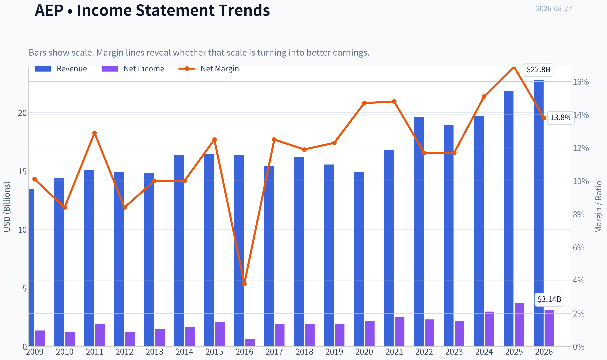

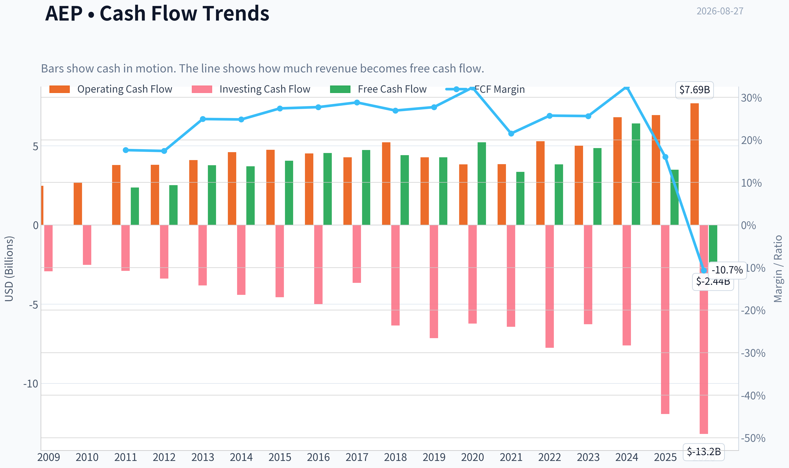

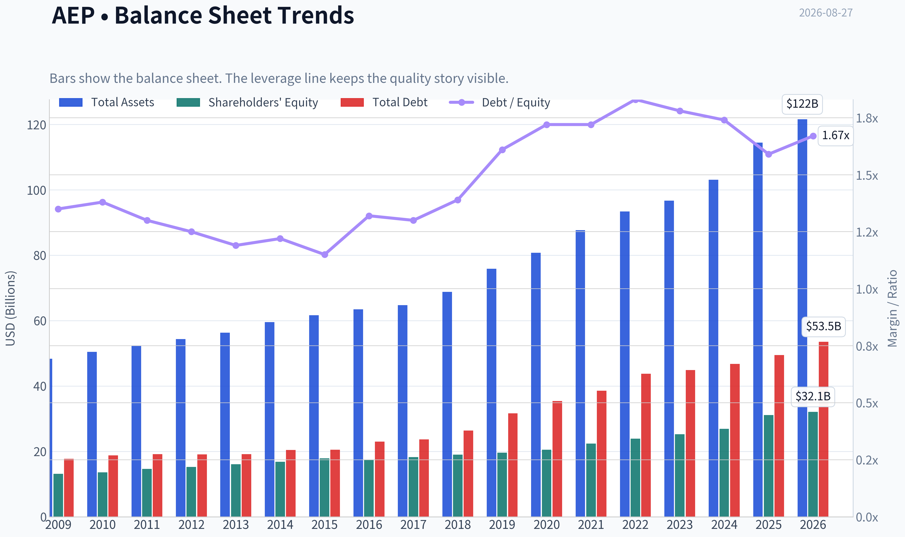

This graph tracks the profitability and return metrics (ROE, ROIC, Margins) of **AEP** over the past decade, highlighting capital efficiency trends.

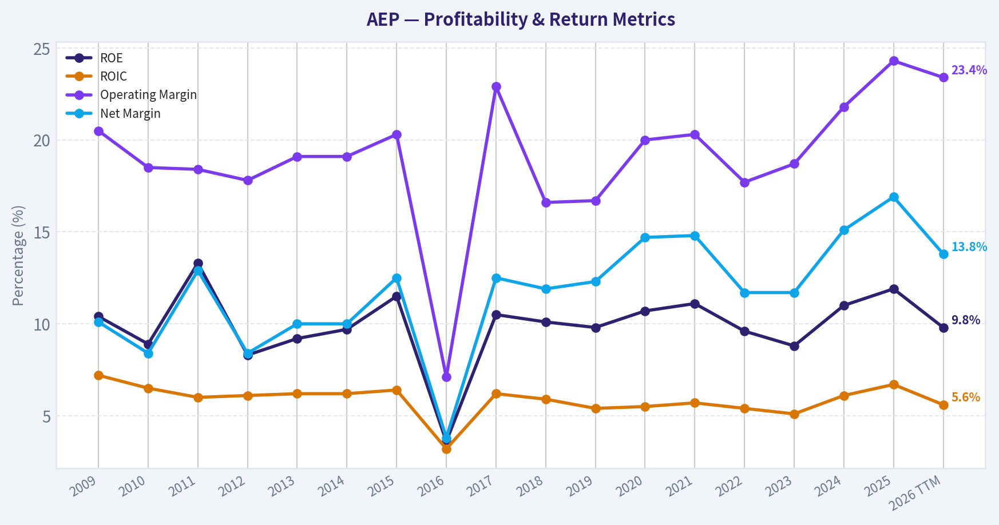

This chart illustrates the financial health of **AEP** over the last 10 years, mapping cash equivalents and free cash flow against total obligations (Debt).

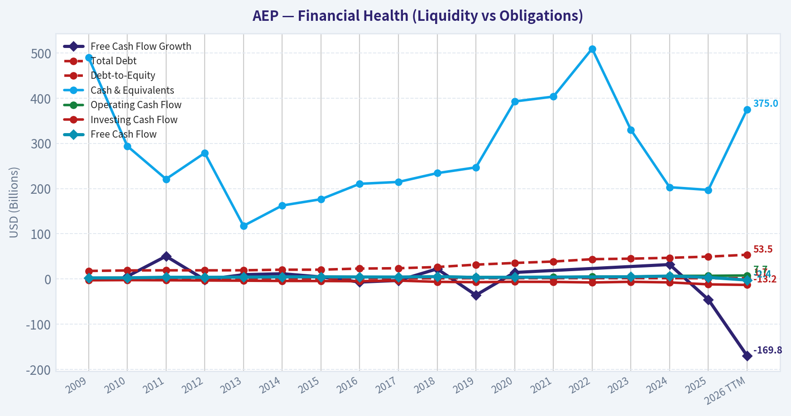

This breakdown chart from <em>Revenue Breakdown</em> shows the proportional composition for **AEP** - useful for understanding what drives or risks the business.

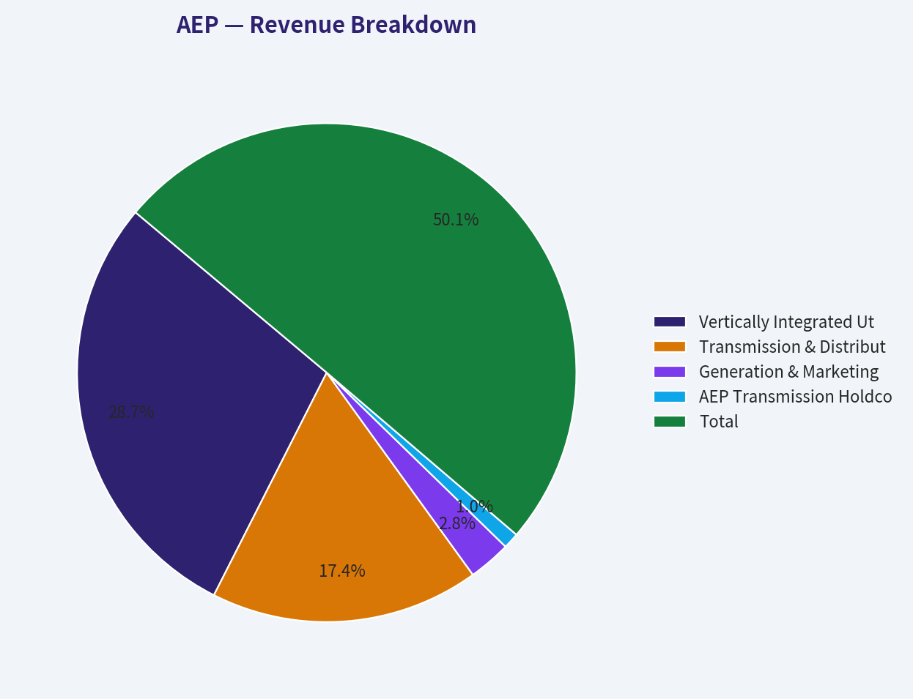

---

### Intrinsic Value Analysis (Buffett)

> *Following Warren Buffett's value investing philosophy: Circle of Competence, Economic Moat, Management Quality, and Margin of Safety.*

#### Intrinsic Value Snapshot

Price is what you pay. Intrinsic value is what the business may be worth based on the cash it can create for owners over time. We show a range, not one magic number.

- Current Price: $123.36
- Value Range (conservative to optimistic across both DCF methods): $-96.48 to $46.32

##### Owner Earnings (Buffett Method)
- Net Income: $3,580,000,000.00
- Depreciation & Amortization: $3,489,000,000.00
- Capital Expenditures: $-8,583,000,000.00
- Working Capital Changes: $341,000,000.00
- Owner Earnings: $3,239,000,000.00

##### Intrinsic Value
###### Buffett Method
Uses owner earnings. Stricter, and usually more conservative.
- Conservative: $-35.40
- Average: $-11.65
- Optimistic: $46.32
- Discount Rate: 10.0%

###### Cash Flow Method
Uses free cash flow. Better for companies spending heavily today to grow tomorrow.
- Conservative: $-96.48
- Average: $-96.48
- Optimistic: $-96.48
- Discount Rate: N/A

ANALYST STANCE: **WATCH**

#### American Electric Power Company, Inc. - Buffett-Style Investment Review

American Electric Power is a large regulated electric utility serving customers across multiple U.S. states. The business is understandable, essential, and relatively predictable, but its economics are constrained by regulation, heavy capital needs, and persistent negative free cash flow from infrastructure investment. At $123 per share, AEP appears close to fair value but does not offer enough margin of safety for a capital-intensive, regulated utility.

---

#### 1. Factor Scorecard

| Factor | Score | Evidence |
|---|---:|---|
| Circle of Competence & Business Simplicity | 4.2 / 5 | AEP sells electricity through regulated utility operations. The revenue model is simple: invest in generation, transmission, and distribution assets, then earn regulator-approved returns on rate base. |
| Moat Test | 3.8 / 5 | Local monopoly utility franchises, regulatory licenses, scale, and essential service characteristics create a durable moat. However, returns are capped by regulators, so this is not a high-ROIC consumer-brand moat. |
| Management Quality & Capital Allocation | 3.0 / 5 | Management operates within a regulated framework and has a long reinvestment runway, but the business requires continual external capital and produces negative free cash flow after capex. |
| Industry Structure | 4.0 / 5 | Regulated electric utilities have rational industry structure, high barriers to entry, and predictable demand. The tradeoff is high capital intensity and capped allowed returns. |
| Gate 5: Quality / Solvency Hard Floor | Not tripped | Earnings are positive, ROE is 11.5%, and the company is not showing the combination of deteriorating earnings and acute solvency stress required for a hard AVOID. |

**Key Takeaways:** AEP is a simple and predictable regulated utility with a real but regulated moat. The business is not distressed, but its economics are not exceptional because high capital spending and regulated returns limit owner earnings. This is a stable business, not a high-return compounder.

---

#### 2. Moat Analysis

| Moat Source | Assessment | Strength |
|---|---|---:|
| Regulatory License | AEP operates monopoly-like electric utility franchises in regulated jurisdictions. Competitors cannot freely duplicate its grid assets or customer relationships. | High |
| Switching Costs | Customers generally cannot switch electric grid providers easily, though large customers may have some procurement flexibility depending on jurisdiction. | Medium-High |
| Cost Advantage | Scale in transmission, distribution, procurement, and system operations provides some cost advantage, but regulators share benefits with customers over time. | Medium |
| Intangible Assets | The brand is trusted but not emotionally powerful. The key intangible asset is the regulatory franchise rather than consumer brand equity. | Medium |
| Network Effects | The grid becomes more valuable as a broad physical network, but this is an infrastructure network effect rather than a digital winner-take-most dynamic. | Medium |

**Key Takeaways:** AEP's moat is real because the electric grid is essential infrastructure and highly regulated. The moat protects demand and market position, but it does not allow unlimited pricing power. Regulators protect the franchise while also limiting excess returns.

---

#### 3. Management Quality Assessment

AEP's management is best judged by its ability to earn fair regulated returns, maintain reliability, control costs, and finance a large infrastructure plan without excessive dilution or balance-sheet stress. The company's capital allocation is heavily dictated by the regulated utility model: most retained and raised capital is reinvested into transmission, distribution, generation, grid modernization, and reliability projects.

The positive case is that reinvestment grows rate base and supports long-term earnings growth. The negative case is that shareholders must tolerate heavy capital spending, negative free cash flow, and ongoing dependence on debt and equity markets. This is rational within the utility model, but it is not Buffett's ideal self-funding compounding machine.

---

#### 4. Financial Summary

| Metric | Latest / Current |
|---|---:|
| Share Price | $123.00 |
| Market Capitalization | $67.16B |
| P/E Ratio | 21.3x |
| Implied EPS | ~$5.78 |
| ROE | 11.5% |
| Gross Margin | 61.0% |
| Revenue Growth YoY | 10.9% |
| Free Cash Flow Yield | -2.4% |
| Current Ratio | 0.45 |
| Headline Intrinsic Value | $133.39 |
| Headline Margin of Safety | 7.5% |

**Key Takeaways:** AEP trades at about 21 times earnings, which is not cheap for a regulated utility with an 11.5% ROE. Revenue growth is healthy, but free cash flow yield is negative because the company is investing heavily in infrastructure. The stock trades modestly below the headline intrinsic value estimate, but the discount is thin.

---

#### 5. Owner Earnings Calculation

| Component | Per-Share Estimate / Interpretation |
|---|---:|
| Net Income / EPS | ~$5.78 |
| Depreciation & Amortization | Significant, typical for a utility asset base |
| Maintenance CapEx | High; utility infrastructure requires ongoing reinvestment |
| Working Capital Increases | Variable, affected by fuel, power costs, receivables, and regulatory timing |
| Cash FCF-Based Owner Earnings Signal | Negative |
| Research Pack Owner Earnings Model Value | -$11.65 per share |
| FCF Model Value | -$96.48 per share |
| Damodaran FCFF Model Value | $133.39 per share |

**Key Takeaways:** AEP's accounting earnings are positive, but cash available to owners after capital spending is negative. That is common for a regulated utility in a heavy investment cycle, but it means valuation depends heavily on regulators allowing AEP to earn returns on new rate-base investment. The Damodaran FCFF approach is the most appropriate valuation lens here because it better reflects regulated utility reinvestment economics.

---

#### 6. Three-Scenario DCF Valuation

Using normalized earnings power of approximately $5.78 per share as the starting owner-earnings proxy, with a 10% discount rate.

| Scenario | Key Assumption | Estimated Value / Share |
|---|---|---:|
| Scenario A: No Growth | $5.78 / 10% | ~$57.80 |
| Scenario B: GDP Growth | 3% perpetual growth | ~$85.10 |
| Scenario C: Historical Growth Haircut | 5% for 10 years, then 3% terminal growth | ~$98.40 |
| Business-Model Routed FCFF Value | Regulated utility FCFF model | $133.39 |
| Current Price | Market price | $123.00 |

**Key Takeaways:** A simple owner-earnings DCF does not justify the current price because AEP's free cash flow is depressed by heavy capex. The more utility-appropriate FCFF model produces a value of $133.39, modestly above the current price. The valuation case therefore rests on rate-base growth and regulator-approved returns, not on abundant current free cash flow.

---

#### 7. Margin of Safety Analysis

| Valuation Reference | Value / Share | Margin of Safety vs. $123 |
|---|---:|---:|
| No-Growth DCF | ~$57.80 | Negative |
| GDP-Growth DCF | ~$85.10 | Negative |
| Historical-Growth Haircut DCF | ~$98.40 | Negative |
| Headline FCFF Intrinsic Value | $133.39 | 7.5% |
| Quality-Scaled Required Margin of Safety | Approx. 25%-35% | Not met |

**Key Takeaways:** AEP is not obviously overvalued on the headline FCFF model, but the margin of safety is only about 7.5%. For a regulated utility with moderate returns, high leverage, and negative free cash flow, that is not enough. A better entry point would require either a lower share price or clearer evidence of higher sustainable ROE and cash conversion.

---

#### 8. Final Buffett Scorecard

| Criterion | Weight | Score | Weighted Contribution |
|---|---:|---:|---:|
| Moat Width & Durability | 25% | 3.8 | 0.95 |
| Valuation / Margin of Safety | 20% | 2.2 | 0.44 |
| Capital Returns - ROIC vs. WACC | 15% | 2.5 | 0.38 |
| Business Understanding & Predictability | 12% | 4.2 | 0.50 |
| Management Quality & Capital Allocation | 12% | 3.0 | 0.36 |
| Reinvestment Runway | 8% | 3.5 | 0.28 |
| Balance Sheet Strength | 4% | 2.0 | 0.08 |
| Industry Structure | 4% | 4.0 | 0.16 |
| **Total Score** | **100%** |  | **3.15 / 5** |

**Key Takeaways:** AEP scores well on predictability, moat durability, and industry structure. It scores weaker on valuation, balance sheet flexibility, and capital returns. The final score lands in WATCH territory: a good, understandable utility, but not yet a compelling Buffett-style purchase at the current price.

---

#### 9. Investment Stance

**Stance: WATCH**
**Conviction Level: Moderate**

AEP is a durable regulated utility with essential infrastructure, predictable demand, and a long reinvestment runway. The company should benefit from grid modernization, electrification, transmission investment, and ongoing rate-base growth. Those are attractive features for conservative investors seeking stability.

However, the current price does not provide a large enough margin of safety. Free cash flow is negative, the business is capital intensive, ROE is respectable but not exceptional, and shareholder value depends on continued constructive regulation and access to capital markets. At $123, AEP is a fair business at roughly a fair price-not a wonderful business at a bargain price.

A more attractive entry would be closer to the low-$100s or below, where the margin of safety against the $133 intrinsic value estimate would approach a level more appropriate for the company's regulated, leveraged, capital-intensive profile.
#### Valuation Bridge

This bridge places the current market price beside each intrinsic value lens so readers can see whether upside depends on one method or shows up across several methods.

| Scenario | Intrinsic Value / Share |
| --- | ---: |
| Buffett Method | $-11.65 |
| Cash Flow Method | $-96.48 |
| Damodaran Method | $133.39 |
| Current Price | $123.36 |

#### Key Takeaways

If one method is far above the others, the upside case depends on a specific modelling assumption. When several methods cluster together, the valuation story is more robust.

#### Valuation Visuals

This comparison chart from *Latest Earnings Snapshot* stacks current figures against historical benchmarks for **AEP**, making it easy to see where the company trades relative to its own averages.

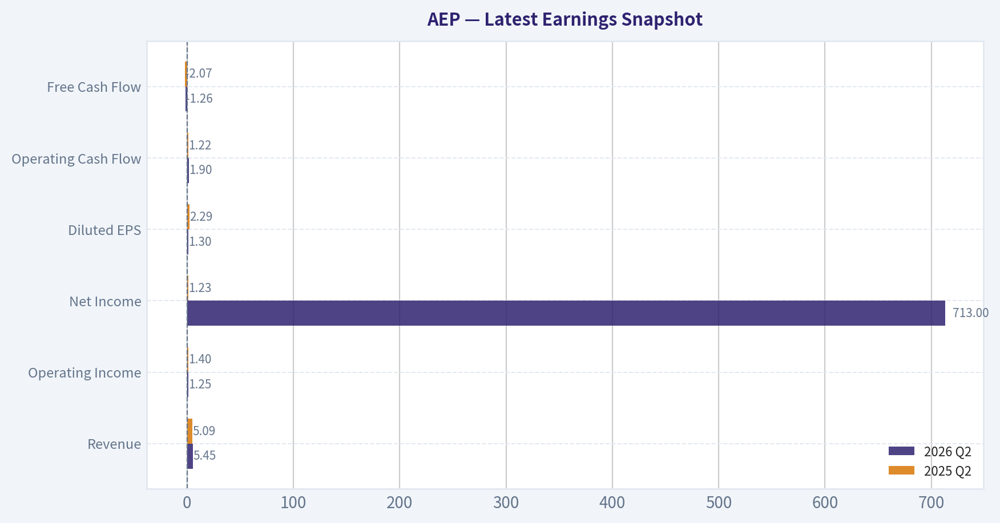

This comparison chart from *Current vs. 10-Year Historical Average Comparison* stacks current figures against historical benchmarks for **AEP**, making it easy to see where the company trades relative to its own averages.

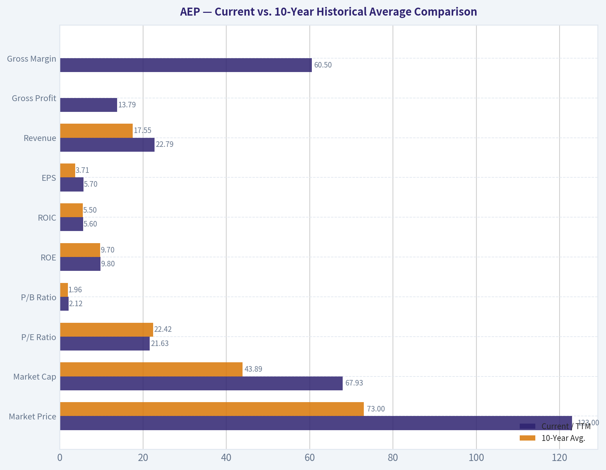

This comparison chart from *Deterministic Model-Based Intrinsic Value Cross-Check* stacks current figures against historical benchmarks for **AEP**, making it easy to see where the company trades relative to its own averages.

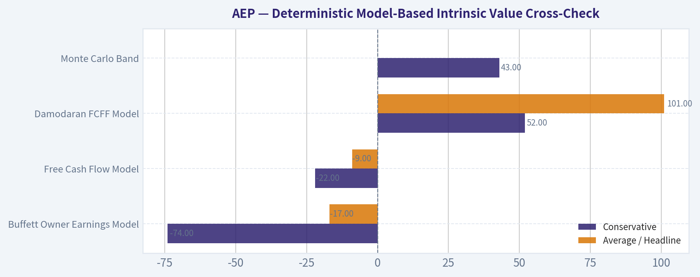

This comparison chart from *Financial Summary* stacks current figures against historical benchmarks for **AEP**, making it easy to see where the company trades relative to its own averages.

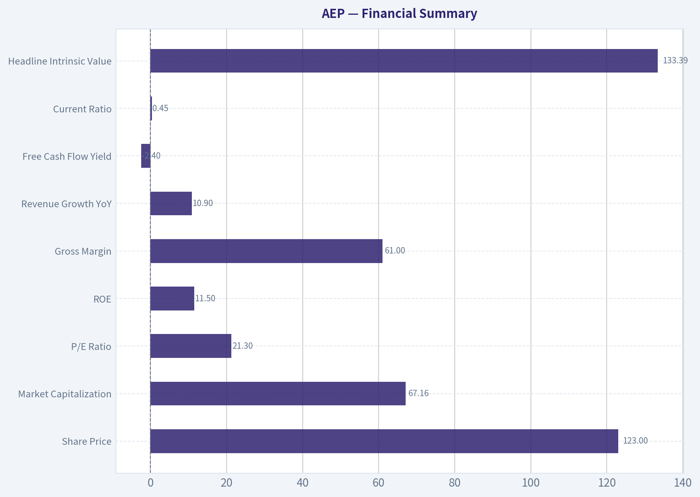

---

### Trend & Growth Analysis (Lynch/Druckenmiller/Fisher)

> *Following Peter Lynch's GARP, Stanley Druckenmiller's macro-aware approach, and Philip Fisher's scuttlebutt methodology.*

ANALYST STANCE: **AVOID**

#### AEP Growth Investment Report - American Electric Power

American Electric Power is a high-quality regulated utility, but it does **not** fit a Lynch / Fisher / Druckenmiller growth mandate. The company may benefit from rising electricity demand, grid modernization, electrification, and AI data-center load growth, but its economics are still governed by utility regulation, heavy capital spending, leverage, and modest long-term earnings growth. For a growth portfolio seeking inflection points and ten-bagger potential, AEP is more of a defensive income / infrastructure compounder than a true fast grower.

---

#### 1. Lynch Classification

| Category | AEP Assessment |
|---|---:|
| Lynch Category | **Stalwart / Regulated Utility** |
| Current YoY Revenue Growth | **10.9%** |
| Likely Long-Term EPS Growth Profile | ~5-7% regulated utility growth |
| Ten-Bagger Potential | Low |
| Growth Portfolio Fit | Weak |
| Primary Investor Use Case | Defensive income, regulated rate-base growth, dividend stability |

**Key Takeaways:** AEP is not a classic Lynch "fast grower." While recent revenue growth looks decent, the company's long-term growth is constrained by regulation, capital intensity, and geography. This is more likely to be a steady compounder than a multi-bagger growth stock.

---

#### 2. The Story in 3 Bullets

- AEP owns regulated electric utilities that generate, transmit, and distribute power across multiple U.S. states.
- The positive story is rising electricity demand from data centers, industrial reshoring, electrification, and grid modernization.
- The limiting factor is that growth comes through regulated capital investment, which requires heavy spending, debt, and rate-case approvals rather than explosive operating leverage.

#### 3. TAM Analysis and 10x Test

| Item | Estimate / Assessment |
|---|---:|
| Current Revenue Base | Large utility-scale revenue base; roughly low-$20B range historically |
| 10x Revenue Requirement | Would imply >$200B annual revenue |
| Addressable Market | U.S. power demand, transmission, distribution, generation infrastructure |
| Practical TAM Constraint | Regulated service territories limit unconstrained expansion |
| Can AEP 10x and remain <20% of TAM? | **No, not realistically under current model** |
| TAM Verdict | Large but regulated, capital-heavy, and geographically constrained |

**Key Takeaways:** AEP participates in a massive electricity infrastructure market, but it cannot scale like software, payments, or semiconductor platforms. Its growth is bounded by regulated territories, approved capital plans, and allowed returns. The 10x revenue test is not favorable for a growth-stock framework.

---

#### 4. Revenue Growth Trend

| Metric | Data / Interpretation |
|---|---:|
| Latest YoY Revenue Growth | **10.9%** |
| Growth Pattern | Moderate, not hypergrowth |
| Likely Long-Term Growth Driver | Rate-base expansion, demand growth, grid capex |
| Growth Quality | Mostly regulated / infrastructure-driven |
| Lynch Growth Classification | Stalwart, not fast grower |
| Revenue Trend Verdict | Stable-to-improving, but not a major growth inflection yet |

**Key Takeaways:** AEP's recent revenue growth is respectable, especially for a utility. However, this does not represent the kind of accelerating 20% to 30% revenue growth profile typically needed for a growth-investor "advocate" stance. The business is improving, but not inflecting dramatically.

---

#### 5. Unit Economics

Traditional SaaS-style unit economics are mostly not applicable to AEP. The better framework is regulated utility economics: rate base, allowed return on equity, capital spending, customer load growth, and balance-sheet capacity.

| Metric | AEP Assessment |
|---|---:|
| LTV / CAC | Not applicable |
| Net Revenue Retention | Not applicable |
| Rule of 40 | Not applicable |
| ROE | **11.5%** |
| Gross Margin | **61.0%** |
| FCF Yield | **-2.4%** |
| Current Ratio | **0.45** |
| Unit Economics Verdict | Stable regulated returns, but weak free cash flow due to capex |

**Key Takeaways:** AEP's economics are stable but capital intensive. The 11.5% return on equity is respectable for a utility, yet negative free cash flow shows that growth requires substantial reinvestment. This is not an asset-light compounding model.

---

#### 6. Inflection Point Assessment

| Inflection Type | Evidence | Assessment |
|---|---|---:|
| Product Cycle Inflection | No major new product cycle; utility infrastructure model | Low |
| Market Share Inflection | Regulated territories limit share-taking | Low |
| Margin Inflection | Regulated returns cap upside; operating leverage limited | Low-to-moderate |
| TAM Inflection | AI data centers, electrification, reshoring may increase load demand | Moderate |
| Competitive Inflection | Utilities face limited direct competition, but regulation controls returns | Neutral |
| Overall Inflection Score | Demand tailwind exists, but monetization is regulated | **2.5 / 5** |

**Key Takeaways:** The most interesting inflection for AEP is electricity demand growth, especially from AI data centers and electrification. But AEP does not have the open-ended margin upside or scalable revenue model that usually creates true growth-stock inflections. The opportunity is real, but the upside is regulated.

---

#### 7. Macro Setup Evaluation

| Macro Factor | Impact on AEP |
|---|---:|
| AI / Data Center Power Demand | Positive |
| Electrification | Positive |
| Grid Modernization | Positive |
| Interest Rates | Negative if rates remain elevated |
| Inflation | Mixed; costs may be recoverable but with lag |
| Regulation | Central driver of returns |
| Capital Markets Access | Important due negative FCF and heavy capex |
| Macro Verdict | Secular demand tailwind, but rate sensitivity is a major constraint |

**Key Takeaways:** AEP has a credible macro tailwind from power demand growth. However, utilities are highly sensitive to interest rates and financing costs. The macro setup is not bad, but it is not the clean growth-stock setup found in asset-light secular winners.

---

#### 8. Fisher 15 Points Score

| Fisher Point | Score / 5 | Comment |
|---|---:|---|
| 1. Products with sales growth potential | 3 | Electricity demand grows steadily, with AI upside |
| 2. New product determination | 2 | Utility model limits new product innovation |
| 3. Effective R&D | 2 | Infrastructure and grid investment more relevant than R&D |
| 4. Sales organization | 2 | Regulated customer base, not sales-led growth |
| 5. Worthwhile profit margin | 4 | Solid gross margin |
| 6. Improving margins | 3 | Regulated margins stable, not explosive |
| 7. Labor relations | 3 | No major issue flagged here |
| 8. Executive relations | 3 | Appears stable |
| 9. Management depth | 3 | Large utility with institutional operating depth |
| 10. Cost analysis/accounting | 3 | Utility accounting complex but established |
| 11. Moat | 4 | Regulated monopoly-like territories |
| 12. Long-range profit outlook | 3 | Steady but capped |
| 13. Dilution / financing risk | 2 | Heavy capex and balance-sheet needs |
| 14. Candor in difficulties | 3 | No major issue identified in available data |
| 15. Management integrity | 3 | No major issue identified |
| **Total** | **43 / 75** | Below growth-investor threshold |

**Key Takeaways:** AEP scores well on moat and stability, but poorly on innovation, sales dynamism, and open-ended growth potential. Fisher would likely respect the durability of the franchise, but this is not the type of innovative company with expanding long-term market opportunity that defines an outstanding growth investment.

---

#### 9. Valuation Analysis

| Valuation Metric | Current Reading | Interpretation |
|---|---:|---|
| Share Price | **$123** | Current reference price |
| Market Cap | **$67.16B** | Large-cap utility |
| P/E | **21.3x** | Full valuation for a utility |
| PEG using 6% LT EPS growth estimate | ~3.5x | Expensive for expected growth |
| PEG using current 10.9% revenue growth | ~2.0x | Still not cheap |
| Headline Intrinsic Value | **$133.39** | About 7.5% upside |
| Margin of Safety | **7.5%** | Thin |
| Reverse DCF Implied Growth | **~36%/yr for 10 years** | Appears unrealistic versus utility fundamentals |
| FCF Yield | **-2.4%** | Weak due heavy capex |
| Valuation Verdict | Fair to expensive for growth investors |

**Key Takeaways:** AEP does not look deeply undervalued. The headline intrinsic value suggests modest upside, but the margin of safety is thin. A 21x earnings multiple is not compelling when long-term growth is likely in the mid-single digits.

---

#### 10. Scenario Analysis

| Scenario | Assumptions | 3-5 Year View |
|---|---|---:|
| Bear Case | Higher rates, regulatory lag, capex pressure, weak FCF | Low or negative total return |
| Base Case | 5-7% EPS growth, dividend contribution, stable regulation | Mid-single to high-single-digit annual return |
| Bull Case | Data-center demand accelerates, favorable rate cases, lower rates | Low-double-digit annual return possible |
| Ten-Bagger Case | Requires massive earnings expansion and multiple expansion | Highly unlikely |

**Key Takeaways:** AEP's reasonable upside case is not a ten-bagger path. Even the bull case is more about steady earnings growth, dividends, and valuation support from lower rates. This is a defensive total-return setup, not a high-conviction growth setup.

---

#### 11. Growth Investor Scorecard

| Criterion | Weight | Score / 5 | Weighted Score |
|---|---:|---:|---:|
| The Story | 10% | 3.0 | 0.30 |
| TAM & Runway | 20% | 2.5 | 0.50 |
| Revenue Growth | 20% | 2.5 | 0.50 |
| Unit Economics | 15% | 2.5 | 0.38 |
| Competitive Position | 10% | 4.0 | 0.40 |
| Management Quality | 10% | 3.0 | 0.30 |
| Macro Setup | 5% | 3.0 | 0.15 |
| Profitability Path | 5% | 3.0 | 0.15 |
| Valuation | 5% | 2.0 | 0.10 |
| **Total** | **100%** |  | **2.78 / 5.0** |

**Key Takeaways:** AEP's strongest feature is its regulated moat, not its growth profile. The weak points are valuation, capital intensity, limited scalability, and lack of a clear ten-bagger pathway. The score lands in the AVOID range for a growth mandate, though not because the company is low quality.

---

#### 12. Position Size Stance

| Portfolio Type | Suggested Action |
|---|---|
| Growth / Ten-Bagger Portfolio | **Avoid / 0% position** |
| GARP Portfolio | Watch only; entry would need better valuation |
| Income Portfolio | Potentially acceptable if dividend yield and rate outlook are attractive |
| Defensive / Low-Beta Portfolio | Reasonable candidate, but not a growth pick |
| Existing Holder | Hold may be reasonable if owned for income and stability |

**Key Takeaways:** AEP may belong in an income or defensive portfolio, but not in a high-growth portfolio. For a Lynch-style fast-grower screen, capital should likely be allocated elsewhere. Existing holders can justify ownership for stability, but new growth capital should wait.

---

#### 13. Key Risks and Catalysts

| Category | Key Items |
|---|---|
| Catalysts | Data-center load growth, grid modernization, lower interest rates, favorable rate cases, transmission investment |
| Risks | Rising rates, regulatory disallowance, negative free cash flow, high capex burden, debt refinancing costs, weather events |
| Main Bull Argument | Electricity demand growth is entering a stronger secular period |
| Main Bear Argument | Utility economics cap upside while valuation already reflects optimism |
| What Would Change My View | Pullback to a materially cheaper valuation or evidence of sustained EPS acceleration above utility norms |

**Key Takeaways:** AEP has credible catalysts, especially from power demand and infrastructure investment. The problem is that these catalysts are already widely recognized and must pass through a regulated, capital-heavy business model. The stock could work defensively, but it lacks the asymmetry growth investors usually seek.

---

#### Final Verdict

AEP is a solid regulated utility with a durable franchise and some secular demand tailwinds from electrification and AI-related power consumption. However, it lacks the core attributes of a Lynch / Fisher / Druckenmiller growth winner: open-ended scalability, accelerating organic growth, high operating leverage, and a clear path to multi-bagger returns.

**Stance: AVOID for growth investors.**
**Best use case: defensive income watchlist, not growth portfolio initiation.**

#### Growth & Scorecard Visuals

The radar chart below from *Final Buffett Scorecard* visualises how **AEP** ranks across weighted investment criteria. Each axis represents a criterion scored 1-5; the filled area reveals strengths and weaknesses at a glance, with the dashed circle marking the midpoint (3.0).

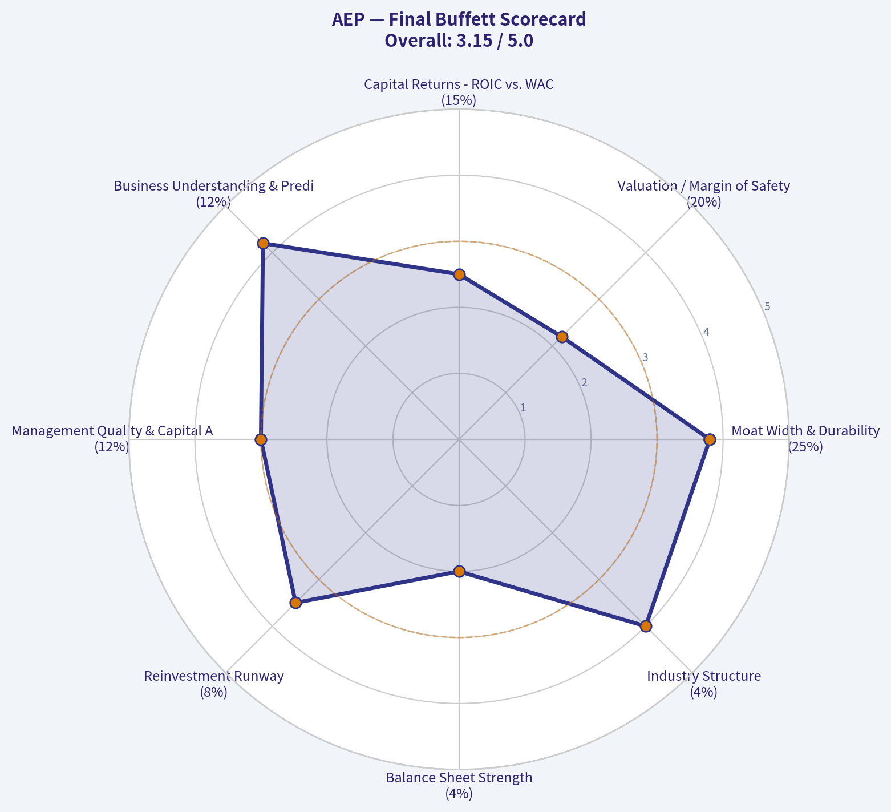

---

### Market Technical Analysis

ANALYST STANCE: **WATCH**

#### AEP Technical Analysis - Latest Available Trading Data: 2026-08-26

AEP is in a **short-term corrective phase inside a still-improving long-term structure**. The stock closed at **$123.36** on 2026-08-26, below its **10 EMA**, **50 SMA**, and **200 SMA**, which means near-term trend pressure remains negative. However, the **200-day SMA is still rising**, and the recent bounce from the **$120-$121 zone** suggests sellers may be losing momentum near a meaningful support area.

The current setup is not yet a clean bullish reversal. It is better characterized as a **watch-and-confirm situation**: AEP is trying to stabilize after a sharp pullback, but it still needs to reclaim key resistance around **$124-$125** before the short-term picture improves materially.

---

#### Selected Indicators and Current Readings

| Indicator | Latest Reading / Level | Interpretation |
|---|---:|---|
| Close Price | $123.36 | Rebounding from recent weakness but still below key moving averages |
| close_10_ema | $124.01 | Short-term resistance; price remains slightly below it |
| close_50_sma | $129.71 | Medium-term trend has weakened; price is meaningfully below this level |
| close_200_sma | $125.11 | Long-term trend benchmark; price is below it, but the average is still rising |
| macd | -1.83 | Momentum remains bearish, though slightly improved from the prior day |
| rsi | 40.36 | Weak momentum, but no longer near deep oversold conditions |
| boll_ub | $128.67 | Upper volatility resistance; aligns below the 50 SMA |
| boll_lb | $121.23 | Near-term support zone; recent price action bounced from this area |
| atr | $2.43 | Daily volatility remains elevated but has moderated from earlier August levels |

Key Takeaways: AEP is still technically weak because price remains below the 10-day, 50-day, and 200-day moving averages. The most important near-term battleground is the **$124-$125 area**, where the 10 EMA, Bollinger mid-zone, and 200 SMA converge. A sustained move above that area would improve the setup, while failure there would keep the stock vulnerable to another test of **$121-$120**.

---

#### Trend Structure

AEP's broader trend improved significantly from late 2025 into mid-2026, with the stock advancing from the low-$110s into the high-$130s. The long-term moving average confirms that this advance has not fully broken down: the **200 SMA has risen from roughly $122.76 in mid-July to $125.11 by August 26**, showing the longer-term trend is still upward-sloping.

The shorter- and medium-term picture is less constructive. The **50 SMA has drifted lower from about $130.66 in late July to $129.71**, while the stock has fallen sharply below it. That means the market has moved from a healthy uptrend into a correction or consolidation phase. The fact that price is now below the 200 SMA adds caution, because long-term buyers may wait for a reclaim before stepping in more aggressively.

The **10 EMA at $124.01** is the first short-term test. AEP closed only slightly below it, so the stock is close to improving its very short-term tone. But a one-day bounce is not enough; traders should look for a close above the 10 EMA and ideally above the **$125.00-$125.25 zone** to suggest the rebound has durability.

---

#### Momentum and Mean-Reversion Read

Momentum remains negative but is no longer in free fall. The **MACD is still below zero at -1.83**, confirming that bearish momentum remains active. However, it improved modestly from **-1.88 on August 25**, suggesting downside pressure may be easing after the August 21 selloff.

The **RSI at 40.36** supports a similar interpretation. It has recovered from **30.74 on August 21**, which was close to oversold territory. That rebound shows buyers responded near the recent low, but RSI remains below the neutral 50 level, so momentum is not yet bullish. For a healthier recovery signal, RSI would need to move above 45 first, then ideally above 50.

This is a classic **early stabilization setup**, not yet a confirmed reversal. The stock has bounced from stress levels, but momentum indicators have not yet confirmed a sustainable upside turn.

---

#### Bollinger Band and Volatility Context

AEP recently traded near its lower Bollinger Band, with the lower band at **$121.23** on August 26. The stock's recent low and closing weakness near **$120.94 on August 21** make the **$120-$121 area** a key support zone. The rebound to **$123.36** shows that price respected that support for now.

The Bollinger upper band is at **$128.67**, while the implied middle band is near **$124.95**. This places the stock below the Bollinger midpoint, meaning the short-term range still leans defensive. A close above roughly **$125** would move price back toward the center of its recent volatility range and would reduce immediate downside pressure.

ATR is **$2.43**, equal to roughly **2% of the stock price**. That is meaningful for a utility stock and suggests traders should avoid overly tight stops. Volatility has come down from earlier August readings near **$2.9**, but the stock is still moving enough that position sizing and stop placement matter.

---

#### Key Trading Levels

| Zone | Price Area | Why It Matters |
|---|---:|---|
| Immediate Support | $121.25-$120.50 | Lower Bollinger Band and recent selloff low |
| Breakdown Risk Zone | Below $120.50 | Would suggest the bounce failed and could trigger renewed selling |
| First Resistance | $124.00-$125.10 | 10 EMA, Bollinger midpoint area, and 200 SMA cluster |
| Confirmation Resistance | $128.50-$130.00 | Upper Bollinger Band and 50 SMA region |
| Bullish Recovery Zone | Above $130.00 | Would indicate price has reclaimed medium-term trend resistance |

Key Takeaways: The most important support is **$120.50-$121.25**, because that is where AEP recently stabilized. The most important resistance is **$124-$125**, because that area contains multiple trend and volatility reference points. A break above $125 would improve the setup, while a break below $120.50 would make the chart materially weaker.

---

#### Trading View

For short-term traders, AEP is a **watch**, not an aggressive buy. The stock is attempting to recover from oversold conditions, but it has not yet reclaimed enough technical ground to confirm a reversal. A close above **$125.10** would be the first constructive signal, especially if accompanied by improving RSI and MACD.

For swing traders, the cleaner bullish setup would be a move through **$125**, followed by a successful retest that holds above the 10 EMA or 200 SMA. Upside targets after confirmation would sit near **$128.50-$130.00**, where the upper Bollinger Band and 50 SMA may attract sellers.

For risk management, the recent support near **$120.50-$121.25** is critical. A decisive close below that zone would suggest the rebound has failed. Given ATR near **$2.43**, traders should allow for normal volatility rather than placing stops too close to the current price.

---

#### Final Technical Summary

| Category | Current Signal | Trader Implication |
|---|---|---|
| Short-Term Trend | Bearish but stabilizing | Price is below the 10 EMA, but close enough to reclaim it soon |
| Medium-Term Trend | Bearish / corrective | Price remains well below the 50 SMA near $129.71 |
| Long-Term Trend | Cautious | 200 SMA is rising, but price is currently below it |
| Momentum | Weak but improving | RSI recovered from near-oversold, MACD remains negative |
| Volatility | Elevated but easing | ATR has moderated, but swings remain meaningful |
| Support | $120.50-$121.25 | Must hold to preserve the rebound thesis |
| Resistance | $124-$125, then $128.50-$130 | Reclaiming $125 is the first key bullish test |
| Overall Stance | WATCH | Wait for confirmation before turning constructive |

Key Takeaways: AEP is showing early signs of stabilization, but the stock remains technically vulnerable until it reclaims the **$124-$125 resistance zone**. The bounce from near the lower Bollinger Band is encouraging, yet momentum is still not strong enough to justify an outright bullish stance. Traders should watch for either a confirmed reclaim of $125 or a failed bounce below $120.50.

---

### Options Market Analysis

> *Reading options flow - put/call ratios, IV skew, and unusual activity - to gauge institutional positioning and event-driven risk.*

ANALYST STANCE: **WATCH**

#### AEP Options Flow Report - As of 2026-08-27

AEP's near-term options market is thin, so confidence in the signal is reduced. The clearest read is **defensive / mildly bearish positioning**, driven by a very elevated put/call open-interest ratio and higher put IV than call IV. However, recent volume is call-heavy, suggesting either short-term bullish speculation or covered-call activity rather than a clean bearish consensus.

---

#### 1. Put/Call Ratio Analysis

| Expiry | Days to Expiry | Call OI | Put OI | Put/Call OI Ratio | Call Volume | Put Volume | Put/Call Volume Ratio | Read |
|---|---:|---:|---:|---:|---:|---:|---:|---|
| 2026-09-18 | 22 | 152 | 534 | 3.51 | 2,809 | 312 | 0.11 | Heavy put OI, but call-heavy daily volume |
| 2026-10-16 | 50 | 0 | 0 | N/A | 74 | 45 | 0.61 | Limited/no established OI |
| 2026-11-20 | 85 | 6 | 3 | 0.50 | 119 | 71 | 0.60 | Small sample, slightly call-skewed OI |
| **Near-Term Total** | - | **158** | **537** | **3.40** | **3,002** | **428** | **0.14** | Defensive OI, bullish/covered-call volume |

**Key Takeaways:** AEP's near-term put/call open-interest ratio of **3.40** is far above the historical neutral baseline of roughly **0.7**, signaling unusually heavy put positioning. That usually points to downside hedging or bearish positioning. However, the current volume ratio is only **0.14**, meaning today's activity is heavily call-dominated, which softens the bearish interpretation.

Compared with a neutral baseline near **0.7**, the **OI ratio is significantly bearish / hedging-heavy**, while the **volume ratio is significantly call-heavy**. Because open interest reflects built-up positioning and volume reflects recent activity, the current setup looks like **existing downside protection with some short-term upside interest coming in**.

---

#### 2. Implied Volatility Assessment

| Expiry | ATM Call IV | ATM Put IV | Put IV Premium vs Call IV | Skew Read |
|---|---:|---:|---:|---|
| 2026-09-18 | 0.8% | 1.6% | +0.8 pts / ~2.0x call IV | Put skew |
| 2026-10-16 | 0.4% | 0.8% | +0.4 pts / ~2.0x call IV | Put skew |
| 2026-11-20 | 0.4% | 0.8% | +0.4 pts / ~2.0x call IV | Put skew |

**Key Takeaways:** Put IV is roughly **double call IV** across the listed expirations, indicating a downside-protection premium. That type of skew usually reflects concern about downside moves rather than aggressive upside chasing. The absolute IV readings appear unusually low, so this may reflect stale or thinly traded options data rather than a highly reliable volatility signal.

The IV structure does **not** show a classic upside call-skew setup. Instead, the data points toward **downside fear / hedging demand**, but the very low IV levels and thin liquidity mean the signal should be treated cautiously.

No specific earnings or major catalyst was provided in the options data. If AEP has a known regulatory, earnings, dividend, or macro-rate catalyst ahead, these IV readings should be rechecked closer to the event.

---

#### 3. Unusual Options Activity

| Screen | Result | Interpretation |
|---|---|---|
| Volume > 5x Open Interest | None found | No clear fresh institutional directional bets detected |
| Notable aggregate activity | September calls had 2,809 volume vs. 152 OI | Call activity is large in aggregate, but no individual contract met the unusual-activity threshold |
| Liquidity quality | Thin | Reduced confidence; individual trades may distort ratios |

**Key Takeaways:** There were **no contracts where volume exceeded 5x open interest**, so the data does not show a clean unusual-options signal. The large September call volume is notable, but without strike-level confirmation it is difficult to classify as aggressive bullish buying, covered-call selling, or position closing. This limits confidence in interpreting the call-heavy volume as "smart money."

Because AEP options appear relatively illiquid, unusual flow detection is less reliable. In thin chains, a modest number of contracts can significantly distort volume ratios.

---

#### 4. Open Interest Concentration and Gamma Levels

| Area | Observation | Market Implication |
|---|---|---|
| Highest OI by expiry | 2026-09-18 puts dominate near-term OI | September expiry likely has the most relevant positioning |
| Total near-term call OI | 158 contracts | Low call-side positioning |
| Total near-term put OI | 537 contracts | Downside hedge/bearish positioning is more established |
| Strike-level gamma walls | Not available in provided data | Cannot identify precise pinning / max-pain strikes |
| Pinning risk | Low-to-moderate, but uncertain | Thin OI reduces confidence in strong gamma effects |

**Key Takeaways:** The largest concentration is in **September put open interest**, making the front-month expiry the most important area to monitor. However, because strike-level open interest was not provided, no specific gamma wall, max-pain strike, or pinning level can be identified. Overall gamma influence appears limited due to the small absolute size of the chain.

Without strike-level OI, it would be inappropriate to claim a specific support, resistance, or pinning strike. The broad conclusion is that positioning is more defensive than bullish, but not large enough to imply a powerful options-driven magnet.

---

#### 5. Overall Options Sentiment Signal

| Category | Signal |
|---|---|
| Directional options read | **BEARISH / defensive** |
| Confidence | **Low-to-moderate** |
| Primary driver | Very elevated put/call OI ratio and persistent put IV premium |
| Main offset | Recent volume is heavily call-dominated |
| Liquidity caveat | AEP options volume and OI are thin, reducing reliability |

**Key Takeaways:** The overall options signal for AEP is **BEARISH / defensive**, but not aggressively so. The main reason is the very high near-term put/call open-interest ratio of **3.40**, far above the neutral baseline near **0.7**, combined with put IV running above call IV. The key caveat is that recent volume is call-heavy, so there may be some short-term upside speculation or covered-call activity offsetting the bearish OI backdrop.

This is not a high-conviction bearish flow setup because no unusual contract-level activity was detected and the chain is thin. The better interpretation is: **investors are carrying downside protection, while short-term traders are showing some call interest.**

---

#### Final Summary Table

| Factor | Current Read | Interpretation |
|---|---|---|
| Put/Call Ratio | OI ratio **3.40**, volume ratio **0.14** | Established positioning is defensive, but recent trading is call-heavy |
| IV Level | Very low reported ATM IV | May indicate calm expectations or stale/thin data |
| Skew Direction | Put IV above call IV across expiries | Downside protection is priced richer than upside calls |
| Unusual Activity | None detected above 5x OI | No clear fresh institutional directional bet |
| Overall Signal | **BEARISH / defensive, low-to-moderate confidence** | Heavy put OI and put skew outweigh call-heavy recent volume |

**Key Takeaways:** AEP's options market leans **defensive / bearish**, primarily because put open interest is much higher than call open interest and puts carry higher IV. Still, the lack of unusual activity and the thinness of the options chain lower conviction. The practical stance is **WATCH**, with attention on whether call-heavy volume continues or whether put OI builds further into September expiry.

---

## Research Team Commentary

> *The Research Manager synthesizes the Bull vs Bear debate into action-free commentary. This is a pre-risk view, not the final stance.*

Let us talk about American Electric Power. Listening to the debate between the bull and the bear, we are looking at a classic tug of war between old school value purity and modern market realities.

The bear makes an intellectually tight argument that would make a strict traditional value investor nod in agreement. They point out that AEP has a pedestrian return on invested capital of around 6.4 percent, relies heavily on debt, and suffers from persistent negative free cash flow. From a rigid, classic perspective, paying 21 times earnings for a highly regulated business that constantly needs to issue debt to build infrastructure looks like a treadmill rather than a compounder. The bear rightly notes that regulators cap the upside, which historically prevents utilities from achieving explosive growth.

However, the bull captures the broader, more adaptive reality of what this franchise actually is today. AEP is leaning into a pure-play regulated model at the exact moment the United States grid is facing unprecedented demand from data centers, artificial intelligence, and industrial reshoring. The bull correctly notes that in the utility sector, negative free cash flow from capital expenditures is not a value destroying black hole. It is the fundamental engine of future rate base growth. Because they are allowed a regulated return on their infrastructure investments, every dollar efficiently deployed into the grid translates into highly visible future earnings.

Reflecting on my own past mistakes with utilities in similar setups, I have to be careful not to fall into the trap of demanding software like economics from a regulated infrastructure play. In the past, I placed a cautious Watch rating on this very stock because I fixated on its average returns on capital and its high capital intensity. By clinging to a strict Buffett style margin of safety, I completely missed that the market was already rewarding the visible, durable growth stemming from electrification, and the stock rallied shortly after. I learned the hard way that a utility does not need to be a deep value bargain to deliver excellent returns. If its primary technical uptrend is intact, its earnings are predictable, and it has a credible secular catalyst, it can perform incredibly well. AEP is currently correcting but remaining above its 200 day moving average. Punishing a utility for acting like a utility is a great way to miss out on a perfectly good investment.

Core Takeaway
I am taking a constructive stance on American Electric Power. While it is not a deep value bargain, it represents a high quality, essential franchise trading at a fair price. The transition to a fully regulated model, combined with a highly visible runway for rate base growth driven by data center and grid modernization demands, provides a strong margin of safety through earnings durability.

Rationale
From an adaptive value investing perspective, we have to recognize how market sponsorship works in defensive sectors. Utilities trade on the visibility of their allowed returns, the reliability of their dividends, and the predictable growth of their rate base. While regulators do cap returns, AEP's allowed return on equity is healthy, and its massive transmission network acts as a genuine toll bridge for the new digital economy. The multiple of 21 times earnings is entirely reasonable when you factor in the sheer duration of these physical assets and the scarcity of such predictable earnings in today's market. The stock has undergone a short term technical correction, but the primary long term uptrend remains unbroken. Waiting for a perfect, deeply discounted entry point in a defensive stock with this kind of structural tailwind usually means sitting on the sidelines while the market moves higher.

Monitoring Plan
Over the next one to four quarters, we need to watch the regulatory environment closely. The biggest fundamental risk to the bullish thesis is regulatory pushback, so monitoring AEP's rate cases to ensure regulators remain constructive and allow full recovery of data center driven capital expenditures is essential. Furthermore, I want to see the continued successful divestiture of non core assets to ensure the balance sheet stays strong enough to fund this massive reinvestment phase without overly dilutive equity issuances. Finally, we must watch the 200 day moving average. As long as the stock holds this structural long term support, the bullish setup remains intact.

ADVOCATE

---

## Value Investing Team Commentary

> *The Investor translates the research view into an investment thesis before risk review. This is still not the final stance.*

As a value investor focused on the long-term ownership of durable franchises, I view American Electric Power (AEP) not as a ticker symbol undergoing a technical correction, but as a mission-critical infrastructure "toll bridge" for the burgeoning digital economy.

My analysis of AEP requires an adaptive lens. A strict, traditionalist approach might dismiss the company due to its negative free cash flow and a P/E of 21. However, an owner's perspective reveals a different story: AEP is a high-quality, wide-moat business currently undergoing a constructive re-rating by the market.

### 1. The Business: Ownership of a "Regulated Toll Bridge"
AEP's primary competitive advantage-its economic moat-is its massive, regulated transmission and distribution network. In the utility world, "negative free cash flow" is often a misnomer for "aggressive capital reinvestment." Under regulated models, this capital expenditure (CapEx) is the primary driver of future earnings. Every dollar AEP spends on grid modernization and data center connectivity increases the "rate base" upon which regulators allow them to earn a specified return on equity (ROE). In a world of economic uncertainty, a business with a government-sanctioned return on its invested capital is the definition of a durable compounder.

### 2. Selective Contrarian Thinking: Redefining the "Debt Trap"
The common bearish sentiment focuses on AEP's heavy debt load and capital intensity. A contrarian view suggests this is a misunderstanding of the utility regime. While high leverage is a "red flag" for a retailer or a tech startup, it is a structural feature of a regulated utility.
*   **The Opportunity in the "Correction":** The recent pullback to the $123 level, while technically below short-term moving averages, places the stock at a price that represents "fair value" for a "wonderful business."
*   **What the Market is Missing:** Most investors are fixated on interest rate sensitivity. What they are missing is the **structural shift in demand**. We are entering a "Golden Age of Electrification" driven by three simultaneous tailwinds: the AI/Data Center explosion, industrial reshoring, and the electrification of transportation. AEP's footprint in the Midwest and South puts it directly in the path of this demand.

### 3. Quality-Scaled Margin of Safety
Using the quality-scaled margin-of-safety ladder, AEP qualifies as a "wonderful, wide-moat business." For a franchise with this level of earnings visibility and structural tailwinds, a deep 40% discount to intrinsic value is unlikely to ever materialize without a total market collapse.
At a P/E of approximately 21, the market is pricing in steady growth. My "reverse-DCF" check suggests that the market is implying a long-term growth rate that AEP can likely exceed through its planned $40B+ capital plan. Therefore, a 10-15% discount from peak prices-which we are currently seeing-represents a sufficient margin of safety for a long-term compounder.

### 4. Management and Capital Allocation
AEP's recent strategy of divesting non-core, competitive assets (like its retail and renewable energy platforms) to become a "pure-play" regulated utility is a sign of disciplined capital allocation. This reduces business risk and aligns the company with the highest-visibility earnings streams. I view the current management as shareholder-friendly partners who understand that in this sector, simplicity and regulatory execution are the keys to long-term wealth creation.

### 5. Long-Term Perspective
Short-term market noise regarding "moving averages" or "MACD histograms" should be ignored by the business owner. What matters is the state of the grid in 2030 and 2035. As long as AEP continues to hold its 200-day moving average-a proxy for the long-term primary trend-the "correction" is simply an opportunity for the patient investor to accumulate a stake in a critical American asset at a non-euphoric price.

**ANALYST STANCE: ADVOCATE**

---

## Deep Values Commentary

> *The Risk Management Team debates and the Risk Judge provides the final action-free verdict. This section determines the final ADVOCATE / WATCH / AVOID stance.*

#### Final Stance Scorecard

This scorecard converts the final research view into a weighted decision frame. It does not replace the narrative judgement, but it makes the main drivers of the verdict easier to scan.

| Criterion | Score | Weight | Commentary |
| --- | ---: | ---: | --- |
| Business Quality | 3.75 | 30% | High returns, profitability, and Piotroski health support durability. |
| Valuation Support | 1.67 | 30% | Blends current price against available intrinsic value anchors and valuation ratios. |
| Financial Strength | 1.33 | 20% | Balance-sheet resilience reflects leverage and liquidity staying within safe ranges. |
| Growth Durability | 3.33 | 20% | Recent revenue, earnings, and free cash flow growth indicate how durable expansion looks. |
| TOTAL / FINAL STANCE | 2.56 | 100% | ADVOCATE |

#### Key Takeaways

The weighted score lands at **2.56 / 5.0**, while the final stance remains **ADVOCATE**. This is useful as a quick calibration aid rather than a mechanical signal.

#### Risk Summary

Higher scores indicate more risk pressure. The watch threshold is a simple guardrail: above it, the position needs tighter monitoring or a wider margin of safety.

| Dimension | Current Score | Watch Threshold | Commentary |
| --- | ---: | ---: | --- |
| Business Quality | 2.25 | 3.00 | High returns, profitability, and Piotroski health support durability. |
| Valuation Support | 4.33 | 3.00 | Blends current price against available intrinsic value anchors and valuation ratios. |
| Financial Strength | 4.67 | 3.00 | Balance-sheet resilience reflects leverage and liquidity staying within safe ranges. |
| Growth Durability | 2.67 | 3.00 | Recent revenue, earnings, and free cash flow growth indicate how durable expansion looks. |

#### Key Takeaways

This view helps readers separate *where* the risk sits: valuation, business quality, balance sheet, or growth durability. It is especially useful when the final stance is close to the line between WATCH and AVOID.
