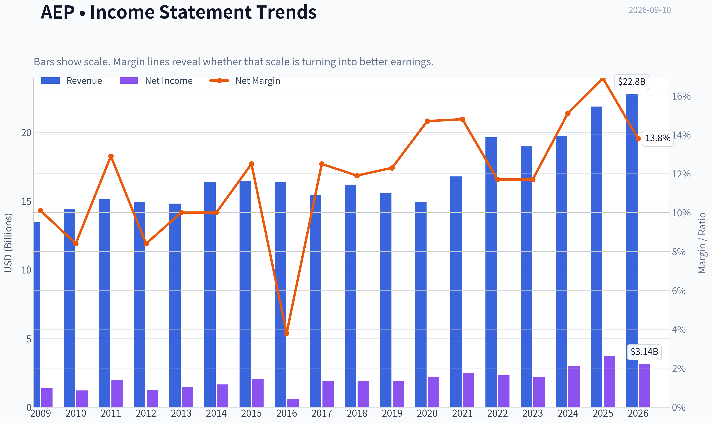
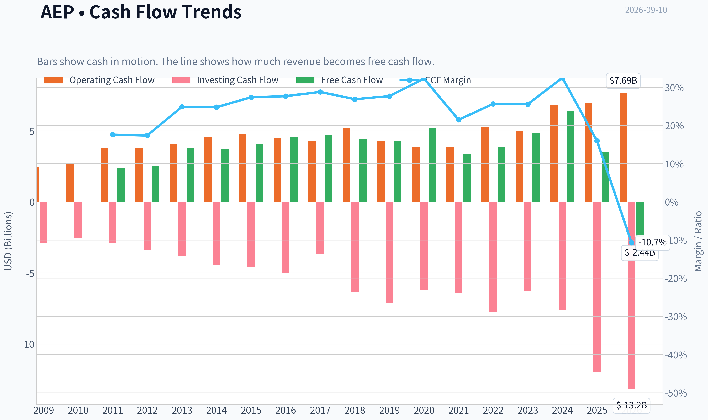
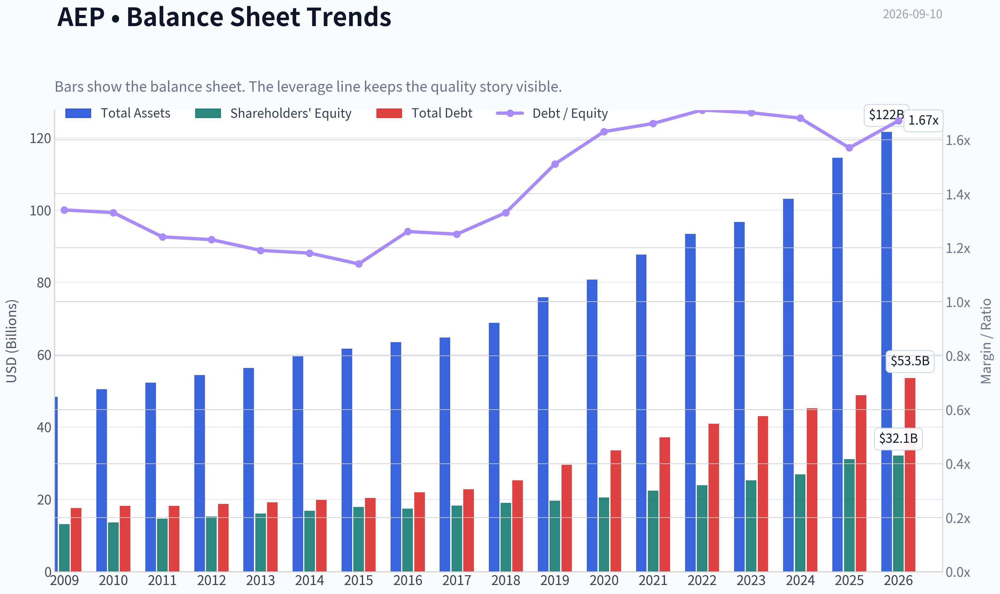
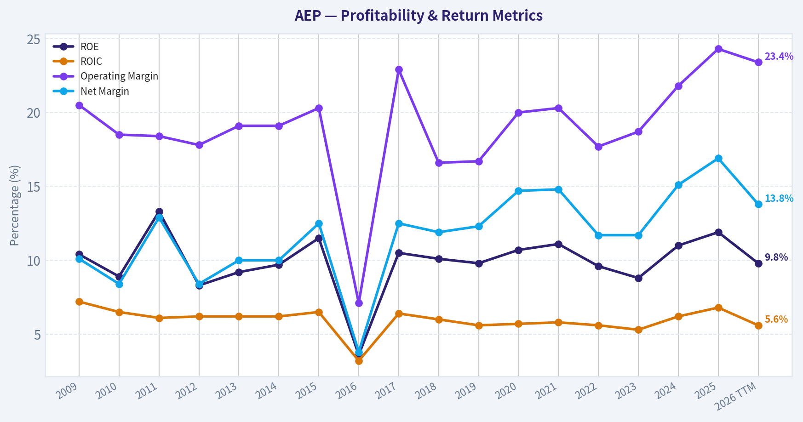
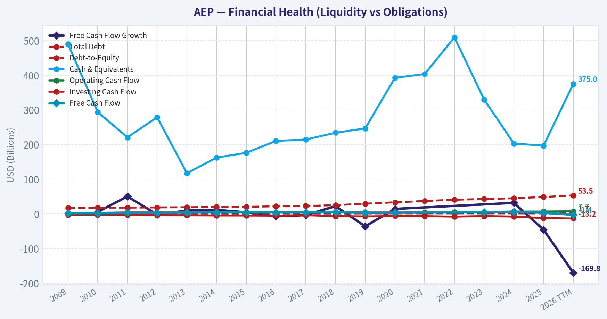
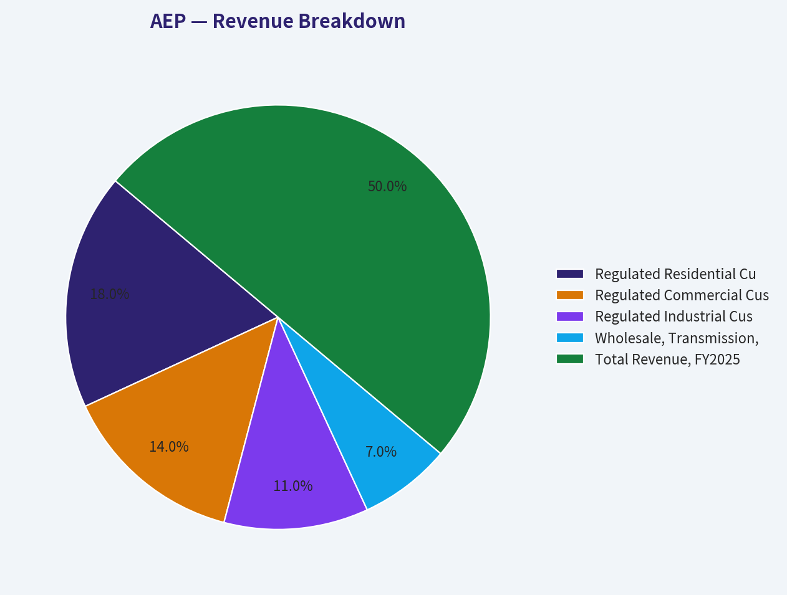
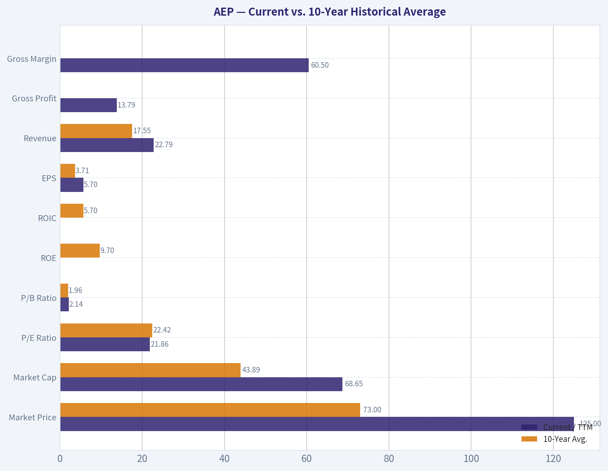
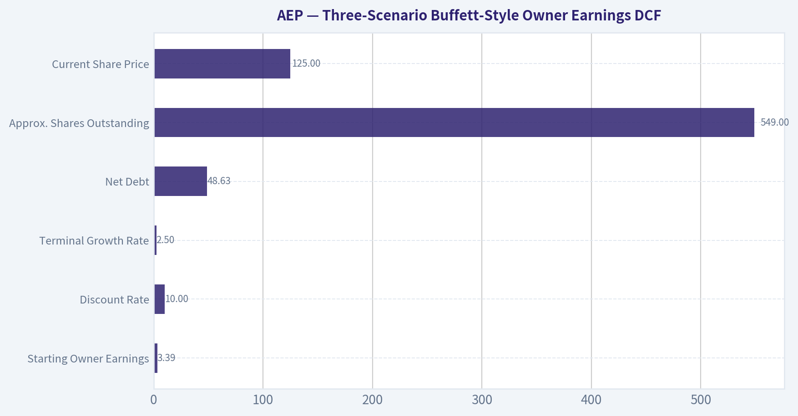
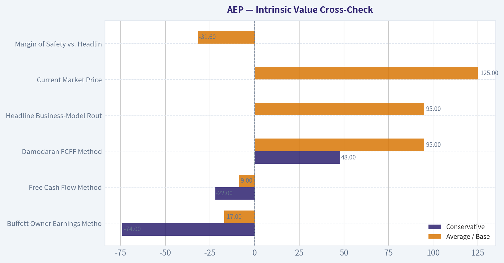
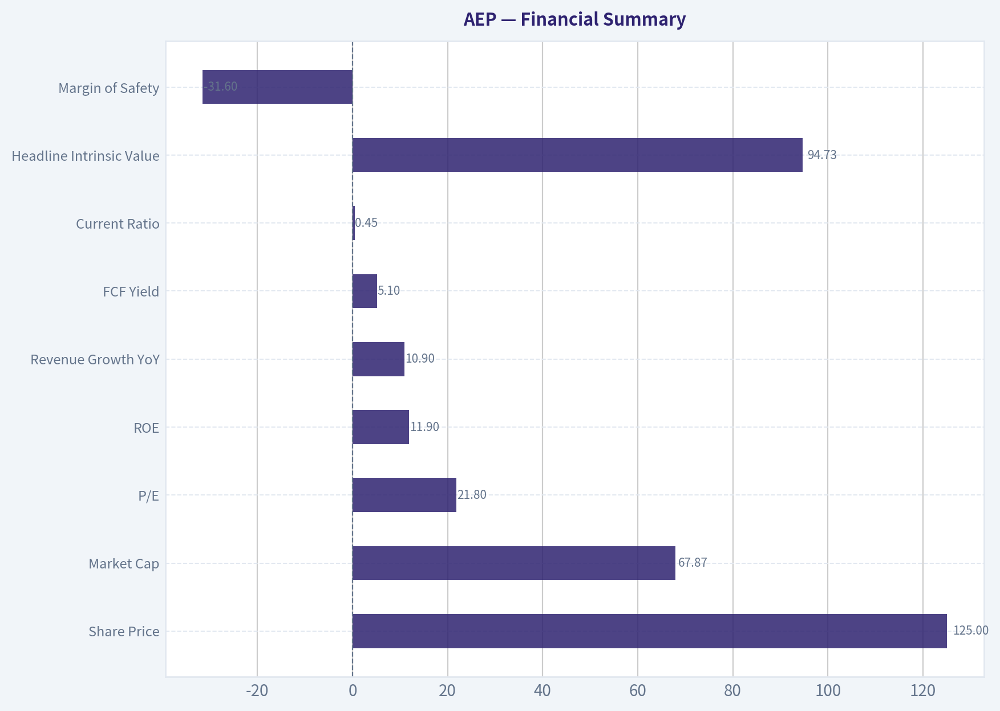

# AEP Deep Value Intelligence

**Analysis Date:** 2026-09-10

## Critical Disclaimer

*This analysis is generated by Deep Value Intelligence, an AI-powered multi-agent investing framework. Education & research only - not financial advice, not a financial advisor.*

---

## Table of Contents

1. Intelligence Summary
2. Analyst Team Reports
   - Fundamentals Analysis
   - Intrinsic Value Analysis (Buffett)
   - Trend & Growth Analysis (Lynch/Druckenmiller/Fisher)
   - Market Technical Analysis
   - Options Market Analysis
3. Research Team Commentary
4. Value Investing Team Commentary
5. Deep Values Commentary

---

## Intelligence Summary

### Thesis + Conditions

**Core Thesis:** **1. Executive Summary**
*   **The Verdict**: American Electric Power (AEP) is a high-quality, regulated monopoly benefiting from a generational tailwind in structural power demand (AI/data centers, grid modernization).

**Key Risks:**
- Risky Analyst (The Bull)**: Emphasizes that AEP is a monopoly on a critical 21st-century commodity. The $78B capex plan is a high-octane growth engine that guarantees rate-base expansion, making the 21.7x P/E multiple a reasonable price for the AI/infrastructure "toll booth."
- Safe Analyst (The Bear)**: Focuses on capital preservation, noting that $125 is a 33% premium to the $94 DCF. Highlights the risk of financing $78B in a higher-for-longer rate environment and warns that regulators may restrict ROE to protect consumers, squashing the growth narrative.
- Neutral Analyst (The Pragmatist)**: Suggests that while AEP is fully valued, the structural valuation "floor" has moved higher due to unprecedented load growth. Advocates for a tiered entry to capture grid modernization upside without ignoring valuation risks.

**Confidence:** Medium

---

## Analyst Team Reports

### Fundamentals Analysis

#### Latest Earnings Snapshot

*Most recent reported quarter anchored on 2026 Q2, with prior-year comparison when available.*

| Metric | 2026 Q2 | 2025 Q2 | YoY Change |
| --- | ---: | ---: | ---: |
| Revenue | $5.45B | $5.09B | +7.0% |
| Operating Income | $1.25B | $1.40B | -10.9% |
| Net Income | $713.0M | $1.23B | -41.8% |
| Diluted EPS | $1.30 | $2.29 | -43.2% |
| Operating Cash Flow | $1.90B | $1.22B | +55.8% |
| Free Cash Flow | $-1.26B | $-2.07B | +38.9% |

Key Takeaways: This snapshot anchors the most recent reported quarter before the narrative analysis. It helps readers separate long-run business quality from whatever changed in the latest earnings print.

#### 17-Year Financial Metrics for AEP

*All values below are computed deterministically from raw data - not estimated by AI.*

*Issuer profile: operating company (Utilities / Utilities - Regulated Electric).*

#### 17-Year Financial Metrics
*Annual rows come from reported financial statements. The final TTM row is computed from the latest four quarters.*

| Metric | 2009 | 2010 | 2011 | 2012 | 2013 | 2014 | 2015 | 2016 | 2017 | 2018 | 2019 | 2020 | 2021 | 2022 | 2023 | 2024 | 2025 | 2026 TTM |
| --- | --- | --- | --- | --- | --- | --- | --- | --- | --- | --- | --- | --- | --- | --- | --- | --- | --- | --- |
| Market Price | $18 | $20 | $24 | $26 | $30 | $40 | $40 | $45 | $54 | $57 | $74 | $68 | $75 | $83 | $74 | $87 | $113 | $125 |
| Market Cap | $15.97B | $17.26B | $19.93B | $20.70B | $22.76B | $29.69B | $28.59B | $30.95B | $36.24B | $36.90B | $46.81B | $41.40B | $44.64B | $48.75B | $42.25B | $49.01B | $61.98B | $68.65B |
| P/E Ratio | 11.75 | 14.22 | 10.28 | 16.42 | 15.38 | 18.18 | 13.97 | 50.77 | 18.96 | 19.16 | 24.36 | 18.84 | 17.94 | 21.15 | 19.16 | 16.53 | 17.31 | 21.86 |
| P/B Ratio | 1.22 | 1.27 | 1.36 | 1.36 | 1.42 | 1.76 | 1.60 | 1.78 | 1.98 | 1.94 | 2.38 | 2.01 | 1.99 | 2.04 | 1.67 | 1.82 | 1.99 | 2.14 |
| ROE | 10.4% | 8.9% | 13.3% | 8.3% | 9.2% | 9.7% | 11.5% | 3.6% | 10.5% | 10.1% | 9.8% | 10.7% | 11.1% | 9.6% | 8.8% | 11.0% | 11.9% | 9.8% |
| ROIC | 7.2% | 6.5% | 6.1% | 6.2% | 6.2% | 6.2% | 6.5% | 3.2% | 6.4% | 6.0% | 5.6% | 5.7% | 5.8% | 5.6% | 5.3% | 6.2% | 6.8% | 5.6% |
| EPS | $1.56 | $1.40 | $2.34 | $1.59 | $1.93 | $2.21 | $2.86 | $0.88 | $2.86 | $2.98 | $3.06 | $3.60 | $4.18 | $3.92 | $3.85 | $5.27 | $6.51 | $5.70 |
| Revenue | $13.49B | $14.43B | $15.12B | $14.95B | $14.81B | $16.38B | $16.45B | $16.38B | $15.42B | $16.20B | $15.56B | $14.92B | $16.79B | $19.64B | $18.98B | $19.72B | $21.88B | $22.79B |
| Gross Profit | N/A | N/A | N/A | N/A | N/A | N/A | N/A | N/A | N/A | N/A | N/A | N/A | N/A | N/A | N/A | N/A | N/A | $13.79B |
| Gross Margin | N/A | N/A | N/A | N/A | N/A | N/A | N/A | N/A | N/A | N/A | N/A | N/A | N/A | N/A | N/A | N/A | N/A | 60.5% |
| Operating Margin | 20.5% | 18.5% | 18.4% | 17.8% | 19.1% | 19.1% | 20.3% | 7.1% | 22.9% | 16.6% | 16.7% | 20.0% | 20.3% | 17.7% | 18.7% | 21.8% | 24.3% | 23.4% |
| Net Income | $1.36B | $1.21B | $1.95B | $1.26B | $1.48B | $1.64B | $2.05B | $618.0M | $1.93B | $1.93B | $1.92B | $2.20B | $2.49B | $2.31B | $2.21B | $2.98B | $3.70B | $3.14B |
| Net Margin | 10.1% | 8.4% | 12.9% | 8.4% | 10.0% | 10.0% | 12.5% | 3.8% | 12.5% | 11.9% | 12.3% | 14.7% | 14.8% | 11.7% | 11.7% | 15.1% | 16.9% | 13.8% |
| Revenue Growth | N/A | 7.0% | 4.8% | -1.1% | -0.9% | 10.6% | 0.5% | -0.4% | -5.8% | 5.0% | -3.9% | -4.1% | 12.6% | 17.0% | -3.3% | 3.9% | 10.9% | 4.2% |
| Net Income Growth | N/A | -10.7% | 60.3% | -35.3% | 17.6% | 10.7% | 25.3% | -69.9% | 212.1% | 0.1% | -0.6% | 14.4% | 13.3% | -7.3% | -4.0% | 34.5% | 24.2% | -15.0% |
| Free Cash Flow Growth | N/A | 5.7% | 50.3% | -1.6% | 9.5% | 11.6% | 4.5% | -6.9% | -3.3% | 22.3% | -35.8% | 14.4% | N/A | N/A | N/A | 31.9% | -45.5% | -169.8% |
| Total Book Value | $13.14B | $13.62B | $14.66B | $15.24B | $16.09B | $16.82B | $17.89B | $17.40B | $18.29B | $19.03B | $19.63B | $20.55B | $22.43B | $23.89B | $25.25B | $26.94B | $31.14B | $32.08B |
| Total Assets | $48.35B | $50.45B | $52.22B | $54.37B | $56.32B | $59.54B | $61.68B | $63.47B | $64.73B | $68.80B | $75.89B | $80.76B | $87.67B | $93.40B | $96.68B | $103.08B | $114.46B | $121.57B |
| Total Debt | $17.62B | $18.16B | $18.17B | $18.74B | $19.13B | $19.86B | $20.37B | $21.97B | $22.81B | $25.26B | $29.56B | $33.55B | $37.17B | $40.91B | $42.97B | $45.17B | $48.83B | $53.50B |
| Debt-to-Equity | 1.34 | 1.33 | 1.24 | 1.23 | 1.19 | 1.18 | 1.14 | 1.26 | 1.25 | 1.33 | 1.51 | 1.63 | 1.66 | 1.71 | 1.70 | 1.68 | 1.57 | 1.67 |
| Cash & Equivalents | $490.0M | $294.0M | $221.0M | $278.7M | $117.5M | $162.5M | $176.4M | $210.5M | $214.6M | $234.1M | $246.8M | $392.7M | $403.4M | $509.4M | $330.1M | $203.0M | $197.0M | $375.0M |
| Shareholders' Equity | $13.14B | $13.62B | $14.66B | $15.24B | $16.09B | $16.82B | $17.89B | $17.40B | $18.29B | $19.03B | $19.63B | $20.55B | $22.43B | $23.89B | $25.25B | $26.94B | $31.14B | $32.08B |
| Operating Cash Flow | $2.48B | $2.66B | $3.79B | $3.80B | $4.10B | $4.60B | $4.75B | $4.52B | $4.27B | $5.22B | $4.27B | $3.83B | $3.84B | $5.29B | $5.01B | $6.80B | $6.94B | $7.69B |
| Investing Cash Flow | $-2.92B | $-2.52B | $-2.89B | $-3.39B | $-3.82B | $-4.41B | $-4.56B | $-4.99B | $-3.66B | $-6.35B | $-7.14B | $-6.23B | $-6.43B | $-7.75B | $-6.27B | $-7.60B | $-11.94B | $-13.19B |
| Free Cash Flow | $2.37B | $2.51B | $3.77B | $3.71B | $4.06B | $4.54B | $4.74B | $4.41B | $4.27B | $5.22B | $3.35B | $3.83B | N/A | N/A | $4.86B | $6.41B | $3.49B | $-2.44B |
| FCF Margin | 17.6% | 17.4% | 24.9% | 24.8% | 27.4% | 27.7% | 28.8% | 26.9% | 27.7% | 32.3% | 21.5% | 25.7% | N/A | N/A | 25.6% | 32.5% | 16.0% | -10.7% |
| Dividends / Share | $0.00 | $0.00 | $0.00 | $0.00 | $0.00 | $0.00 | $0.00 | $0.00 | $0.00 | $0.00 | $0.00 | $0.00 | $0.00 | $2.79 | $3.06 | $3.37 | $3.65 | $3.72 |

#### Profitability Metrics
- Return on Equity (ROE): 11.9%
- Return on Invested Capital (ROIC): 6.4%
- Return on Assets (ROA): 3.2%
- Gross Margin: N/A
- Operating Margin: 24.3%
- Net Profit Margin: 16.9%

#### Liquidity Metrics
- Current Ratio: 0.45
- Quick Ratio: 0.12

#### Leverage Metrics
- Debt-to-Equity Ratio: 1.57
- Interest Coverage Ratio: 2.63
- Net Debt: $48.63B

#### Growth Metrics (Year-over-Year)
- Revenue Growth: 10.9%
- Net Income Growth: 24.2%
- Free Cash Flow Growth: -45.5%
- Revenue CAGR (3-Year): 3.7%
- Revenue CAGR (5-Year): 8.0%

#### Valuation Metrics
- P/E Ratio (TTM): 21.76
- Forward P/E: 18.18
- Price-to-Book: 2.12
- Price-to-Sales: 2.98
- PEG Ratio: 1.97
- EV/EBITDA: 13.51
- Free Cash Flow Yield: 5.1%
- Earnings Yield: 4.6%

#### Owner Earnings (Buffett Method, Code-Computed)
- Net Income: $3.70B
- + Depreciation & Amortization: $3.49B
- - Capital Expenditures: $-3.45B
- - Working Capital Changes: $341.0M
- = **Owner Earnings: $3.39B**

#### Intrinsic Value (Code-Computed)
- Current Price: $125
- **Headline Intrinsic Value (business-model routed): $95**
  Business model: operating company - Damodaran FCFF (operating_company)
  Model spread (min-max across DCFs): $95 - $95
  Margin of safety vs. price (headline): -31.6%
  Routing note: General operating company: balanced blend of Damodaran FCFF and the owner-earnings DCF with a reverse-DCF sanity check.
- Buffett Method (Owner Earnings):
  Conservative: $-74
  Average: $-17
  Optimistic: $68
- Cash Flow Method (FCF):
  Conservative: $-22
  Average: $-9
  Optimistic: $79
- Damodaran FCFF (WACC + margins + reinvestment):
  Conservative: $48
  Average: $95
  Optimistic: $154
  Monte Carlo band (P10-P90): $40 - $170 (median $98)
  P(intrinsic value > price): 33.7%
- Reverse-DCF: price implies ~36.2%/yr owner-earnings growth for 10y; trailing 3y was -16.5%, 5y 9.1%.

#### Piotroski F-Score: 5/9
- Positive Net Income: PASS
- Positive Operating Cash Flow: PASS
- ROA Improvement: PASS
- Cash Flow > Net Income: PASS
- Decreasing Debt: FAIL
- Improving Current Ratio: PASS
- No Dilution: FAIL
- Improving Gross Margin: FAIL
- Improving Asset Turnover: FAIL

ANALYST STANCE: **WATCH**

#### American Electric Power - Buffett-Style Fundamental Analysis

American Electric Power, or AEP, is a regulated electric utility with a large transmission and distribution footprint, a growing rate base, and rising demand exposure from electrification and data centers. This is the kind of business Buffett typically understands well: essential service, regulated returns, durable assets, and long-lived infrastructure. However, the current stock price of **$125** is materially above the deterministic model's headline intrinsic value of about **$95**, implying a **negative margin of safety of roughly 31.6%**.

AEP looks like a good business at a demanding price. The company has improved operating margins, grown revenue, and lifted earnings, but it is also increasingly leveraged, capital-intensive, and currently experiencing negative free cash flow because of heavy investment needs. For a Buffett-style investor, the quality is acceptable, but the valuation does not yet offer enough protection.

---

#### Revenue Breakdown

| Revenue Source | Amount ($B) | % of Total |
|---|---:|---:|
| Regulated Residential Customers | $7.88 | 36% |
| Regulated Commercial Customers | $6.13 | 28% |
| Regulated Industrial Customers | $4.81 | 22% |
| Wholesale, Transmission, Other Utility Revenue | $3.06 | 14% |
| **Total Revenue, FY2025** | **$21.88** | **100%** |

Key Takeaways: AEP's revenue base is overwhelmingly regulated and utility-linked, which supports earnings durability. Residential and commercial customers are the largest sources of revenue, while industrial and wholesale demand provide incremental cyclicality and growth optionality. The most important future swing factor is likely commercial and industrial load growth, especially from data centers and electrification.

---

#### Current vs. 10-Year Historical Average

The comparison below uses the deterministic dataset as the source of truth. "Current" primarily refers to the 2026 TTM row where available, while the 10-year average uses 2016-2025.

| Metric | Current / TTM | 10-Year Avg. | Current Standing vs. History | Interpretation |
|---|---:|---:|---:|---|
| Market Price | $125 | $73 | +71% | Stock price has run well ahead of its decade average. |
| Market Cap | $68.65B | $43.89B | +56% | Market value has expanded faster than book value and earnings. |
| P/E Ratio | 21.86x | 22.42x | Slightly below avg.; above normalized avg. | Average is distorted by the 2016 earnings trough; normalized valuation still looks elevated. |
| P/B Ratio | 2.14x | 1.96x | +9% | Meaningful for a regulated utility, but should be judged against allowed ROE and rate-base growth, not as a generic "cheap/expensive" signal. |
| ROE | 9.8% TTM / 11.9% FY2025 | 9.7% | Near avg. TTM; FY2025 above avg. | Returns are respectable for a regulated utility, but not high enough to justify unlimited valuation expansion. |
| ROIC | 5.6% TTM | 5.7% | In line | Capital returns remain utility-like and modest. |
| EPS | $5.70 | $3.71 | +54% | Earnings power has improved materially over the decade. |
| Revenue | $22.79B | $17.55B | +30% | Revenue growth has accelerated recently, aided by demand and rate increases. |
| Gross Profit | $13.79B | N/A | N/A | Only TTM gross profit is available in the deterministic dataset. |
| Gross Margin | 60.5% | N/A | N/A | Gross margin is available only for TTM; utility cost recovery makes gross margin less comparable than operating margin. |
| Operating Margin | 23.4% | 18.6% | +4.8 pts | Strong recent improvement; 2025 and TTM margins are near decade highs. |
| Net Income | $3.14B | $2.43B | +29% | Profit level remains above the decade average despite TTM decline from FY2025. |
| Net Margin | 13.8% | 12.5% | +1.3 pts | Profitability is better than the historical norm. |
| Revenue Growth | 4.2% | 3.2% | Above avg. | Recent growth is healthier than the decade baseline. |
| Net Income Growth | -15.0% | 21.7% | Below avg.; average distorted | TTM decline contrasts with strong FY2025; historical average is skewed by the 2017 rebound. |
| Free Cash Flow Growth | -169.8% | -3.3% | Far below avg. | The biggest red flag: heavy capex has pushed TTM free cash flow negative. |
| Total Book Value | $32.08B | $22.46B | +43% | Equity base has grown steadily with reinvestment. |
| Total Assets | $121.57B | $84.89B | +43% | AEP has become substantially larger and more capital-intensive. |
| Total Debt | $53.50B | $34.82B | +54% | Debt has grown faster than the asset and equity base. |
| Debt-to-Equity | 1.67x | 1.53x | Higher leverage | Leverage is elevated versus history but common for regulated utilities. |
| Cash & Equivalents | $375M | $294M | +28% | Cash balance is higher than average but small relative to debt and capex. |
| Shareholders' Equity | $32.08B | $22.46B | +43% | Equity has grown steadily, supporting rate-base expansion. |
| Operating Cash Flow | $7.69B | $5.00B | +54% | Core cash generation is strong. |
| Free Cash Flow | -$2.44B | $4.48B | Sharply below avg. | Capex cycle has overwhelmed operating cash flow. |
| Dividends / Share | $3.72 | $1.29 reported avg. | Above avg. | Dataset shows dividends only from 2022 onward; recent dividend trend is clearly upward. |

Key Takeaways: AEP's operating business is stronger than its decade average, with higher revenue, margins, EPS, and operating cash flow. The valuation, however, has also moved upward, and the company's leverage and capital intensity have increased. The most important negative deviation is free cash flow, which has swung sharply negative because investment spending is outpacing operating cash generation.

---

#### Market Metrics Interpretation

AEP trades at **$125 per share**, with a market capitalization of about **$68.65B**. That is well above its 10-year average market cap of about **$43.89B**, showing that investors have re-rated the business upward.

The **P/E ratio of 21.86x** is not extreme compared with the 10-year average of **22.42x**, but that average includes a major 2016 earnings trough when the P/E spiked to over 50x. Excluding that abnormal year, the stock looks more expensive than its typical normalized valuation.

The **P/B ratio of 2.14x** is moderately above the 10-year average of **1.96x**. For a regulated utility, book value is more meaningful than it would be for an asset-light software company because regulated assets and rate base matter. However, P/B should still be judged against ROE and allowed regulatory returns. AEP's ROE is solid, but not high enough to make a 2.1x book multiple obviously cheap.

---

#### Profitability and Business Quality

AEP's profitability profile has improved. Operating margin is **23.4% TTM**, well above the decade average of **18.6%**, and FY2025 operating margin reached **24.3%**, the strongest level in the dataset. Net margin is also above average at **13.8% TTM**, compared with a 10-year average of **12.5%**.

ROE is more nuanced. FY2025 ROE was **11.9%**, which is strong relative to AEP's own history, but TTM ROE has moderated to **9.8%**. For a regulated utility, this is acceptable rather than exceptional. ROIC of **5.6% TTM** is essentially in line with the 10-year average, confirming that the business earns stable but utility-like returns on a very large capital base.

EPS has grown meaningfully, from a 10-year average of **$3.71** to **$5.70 TTM**, with FY2025 EPS at **$6.51**. That supports the idea that AEP's earnings base has structurally improved. The question is not whether AEP is a durable business; the question is whether today's valuation already prices in too much of that durability.

---

#### Growth Metrics Interpretation

AEP's revenue growth has improved recently. TTM revenue growth is **4.2%**, above the 10-year average of **3.2%**, while FY2025 revenue growth was a stronger **10.9%**. Demand from data centers, electrification, grid modernization, and regulated rate increases could support mid-single-digit to high-single-digit earnings growth.

Net income growth is less smooth. TTM net income growth is **-15.0%**, following a very strong FY2025 increase of **24.2%**. The decade contains several large swings, including the 2016 decline and 2017 rebound, so the historical average is not a clean indicator of sustainable growth.

Free cash flow growth is the major concern. TTM free cash flow growth is **-169.8%**, reflecting a swing to negative free cash flow. This is common in heavy utility investment cycles, but it matters greatly for Buffett-style valuation because true owner earnings are harder to realize when maintenance and growth capex remain large.

---

#### Balance Sheet and Financial Strength

AEP's balance sheet is large, asset-heavy, and increasingly leveraged. Total assets are **$121.57B**, up materially from the 10-year average of **$84.89B**. Shareholders' equity is **$32.08B**, also meaningfully above the historical average.

Total debt, however, is **$53.50B**, compared with a 10-year average of **$34.82B**. Debt-to-equity is **1.67x**, above the 10-year average of **1.53x**. That leverage is not unusual for a regulated utility, but it reduces flexibility, especially in a higher-rate environment.

Cash and equivalents are only **$375M**, small compared with debt and the capital spending program. Interest coverage of **2.63x** is adequate but not generous. Buffett would likely view the balance sheet as acceptable for a regulated utility, but not conservative in an absolute sense.

---

#### Cash Flow and Dividend Quality

Operating cash flow is strong at **$7.69B TTM**, well above the 10-year average of about **$5.00B**. This confirms that the underlying utility system generates substantial cash.

The problem is capital intensity. TTM free cash flow is **negative $2.44B**, down sharply from **$3.49B in FY2025** and **$6.41B in FY2024**. This reflects very heavy investment cash outflows, consistent with AEP's large grid and generation investment program.

The dividend per share is **$3.72 TTM**, up from **$2.79 in 2022**, based on the deterministic dataset. Dividend growth is attractive for income investors, but when free cash flow is negative, the dividend depends on regulated earnings, financing access, and future rate recovery rather than current surplus cash.

---

#### Buffett-Style Economic Moat Assessment

AEP has a meaningful moat, but it is a regulated-utility moat rather than a consumer-brand or network-effect moat.

| Buffett Criterion | Assessment | Explanation |
|---|---|---|
| Durable Demand | Strong | Electricity is essential, non-discretionary, and increasingly important to the economy. |
| Competitive Position | Strong | Regulated monopoly or quasi-monopoly service territories reduce direct competition. |
| Pricing Power | Moderate | Pricing is regulated; AEP can earn allowed returns but must get rate approval. |
| Capital Intensity | High | Large capex needs reduce free cash flow and require continued debt/equity financing. |
| Earnings Predictability | Good | Regulated operations support stability, though weather, fuel, rate cases, and capex cycles create volatility. |
| Management Capital Allocation | Mixed to Good | Rate-base growth and dividends are positive, but debt growth and negative FCF require discipline. |
| Moat Durability | Good | Transmission, distribution, and regulatory franchises are long-lived assets. |

Key Takeaways: AEP has a real moat because electricity delivery is essential and regulated service territories are difficult to replicate. The tradeoff is that the moat comes with heavy capital requirements and regulatory oversight, so returns are stable but capped. This is a durable business, but not a high-return compounder in the classic Buffett consumer-franchise sense.

---

#### Three-Scenario Buffett-Style Owner Earnings DCF

The deterministic dataset provides code-computed Owner Earnings of **$3.39B**, calculated as:

**Owner Earnings = Net Income + Depreciation & Amortization - Capital Expenditures - Working Capital Changes**

Using the dataset's figures:

- Net Income: **$3.70B**
- Depreciation & Amortization: **$3.49B**
- Capital Expenditures: **$3.45B**
- Working Capital Changes: **$341M**
- Owner Earnings: **$3.39B**

Assumptions used for the Buffett-style DCF:

| Assumption | Value |
|---|---:|
| Starting Owner Earnings | $3.39B |
| Discount Rate | 10.0% |
| Terminal Growth Rate | 2.5% |
| Net Debt | $48.63B |
| Approx. Shares Outstanding | 549M |
| Current Share Price | $125 |

Key Takeaways: The DCF starts from positive owner earnings, but AEP's high net debt materially reduces equity value in an owner-earnings framework. This is why a utility can look reasonable on earnings but less attractive on a debt-adjusted intrinsic value basis. The assumptions are intentionally conservative because utility capex needs are persistent, not optional.

| Scenario | Growth Assumption | PV of Explicit Owner Earnings | PV of Terminal Value | Enterprise Value | Less Net Debt | Equity Value | Fair Value / Share |
|---|---|---:|---:|---:|---:|---:|---:|
| Conservative | -5% for 5 years, then fade to 2.5% terminal | $17.3B | $14.3B | $31.6B | $48.6B | -$17.0B | Negative / not investable |
| Average | 7% for 5 years, then fade toward 2.5% terminal | $28.4B | $30.6B | $59.0B | $48.6B | $10.4B | ~$19 |
| Optimistic | 10% for 5 years, then fade toward 2.5% terminal | $32.2B | $37.1B | $69.2B | $48.6B | $20.6B | ~$38 |

Key Takeaways: The owner-earnings DCF is harsh because AEP is highly capital-intensive and carries substantial net debt. Even the optimistic owner-earnings case produces a value well below the current market price when net debt is deducted. This does not mean AEP is worthless; rather, it shows that a simple Buffett owner-earnings model is less favorable for leveraged regulated utilities than a full utility-style FCFF model.

---

#### Intrinsic Value Cross-Check

The deterministic valuation pack gives the following intrinsic value outputs:

| Valuation Model | Conservative | Average / Base | Optimistic |
|---|---:|---:|---:|
| Buffett Owner Earnings Method | -$74 | -$17 | $68 |
| Free Cash Flow Method | -$22 | -$9 | $79 |
| Damodaran FCFF Method | $48 | $95 | $154 |
| Headline Business-Model Routed Value | - | **$95** | - |
| Current Market Price | - | **$125** | - |
| Margin of Safety vs. Headline Value | - | **-31.6%** | - |
| Reverse DCF Implied Growth | - | **~36.2% per year for 10 years** | - |

Key Takeaways: The model-based valuation strongly suggests the stock is not cheap at $125. The Damodaran FCFF model is the most appropriate anchor for a regulated operating utility, and its base-case value is about $95. The reverse DCF is particularly concerning because the current price implies owner-earnings growth of about 36% per year for 10 years, far above AEP's recent growth record.

---

#### Buffett-Style Investment Assessment

AEP scores well on business durability but less well on valuation and free cash flow.

The company's moat is based on regulated infrastructure, essential service, scale, and long-lived assets. Those are strong positives. Revenue is relatively predictable, and electricity demand may become more attractive as data centers, industrial reshoring, electric vehicles, and grid modernization drive load growth.

However, Buffett-style investing requires both business quality and a margin of safety. At **$125**, AEP trades meaningfully above the model-based intrinsic value of **$95**. The company also has high debt, low cash relative to obligations, and negative TTM free cash flow. These do not make AEP a bad company, but they reduce the attractiveness of buying at a premium valuation.

---

#### Key Investment Insights, Red Flags, and Opportunities

| Category | Key Point | Investment Significance |
|---|---|---|
| Opportunity | Data-center and electrification demand | Could support higher load growth, rate-base expansion, and EPS growth. |
| Opportunity | Regulated asset base | Provides durable earnings visibility and lower business-risk profile. |
| Opportunity | Margin improvement | Operating margin is above historical average and near decade highs. |
| Opportunity | Dividend growth | Dividend per share has risen in recent years according to the dataset. |
| Red Flag | Valuation above intrinsic value | Price of $125 is materially above the $95 headline intrinsic value. |
| Red Flag | Negative free cash flow | TTM FCF of -$2.44B reflects heavy capital spending. |
| Red Flag | Rising leverage | Total debt of $53.50B is 54% above the 10-year average. |
| Red Flag | Interest coverage | Interest coverage of 2.63x is acceptable but not robust. |
| Red Flag | Reverse DCF expectations | Current price implies roughly 36.2% annual owner-earnings growth for 10 years, which appears unrealistic. |
| Neutral / Watch | P/B ratio | At 2.14x book, valuation is moderately above average; acceptable only if ROE and rate-base growth remain strong. |

Key Takeaways: The upside case depends on AEP converting grid investment and data-center demand into approved rate-base growth and steady EPS expansion. The downside risk is that investors are already paying for much of that future growth while free cash flow is negative and debt is elevated. The stock is attractive as a business, but less attractive as a new purchase at today's price.

---

#### Final Investment Stance: WATCH

AEP is a **WATCH**, not an ADVOCATE, because the business quality is good but the valuation lacks a Buffett-style margin of safety.

At the right price, AEP could be a solid long-term regulated utility investment with durable demand, improving margins, and secular growth from electricity infrastructure needs. But at **$125**, the stock trades roughly **31.6% above** the deterministic headline intrinsic value of **$95**. The company's negative free cash flow, elevated leverage, and capital intensity make the current premium difficult to justify.

A more attractive entry point would likely require either a pullback closer to or below intrinsic value, stronger evidence that data-center demand will translate into durable allowed returns, or a material improvement in free cash flow after the current capex cycle.

---

#### Summary Table

| Area | Assessment | Buffett-Style View |
|---|---|---|
| Business Quality | Good | Essential regulated utility with durable demand. |
| Economic Moat | Good | Regulated service territories and infrastructure create barriers. |
| Profitability | Solid | Margins are above historical averages; ROE is acceptable. |
| Growth | Moderate to Improving | Revenue growth is better than decade average; data centers add optionality. |
| Balance Sheet | Leveraged | Debt is high and rising, though typical for the sector. |
| Cash Flow | Weak currently | Operating cash flow is strong, but free cash flow is negative due to capex. |
| Dividend | Attractive but financing-dependent | Dividend growth is positive, but FCF coverage is currently weak. |
| Valuation | Expensive | Current price exceeds $95 headline intrinsic value. |
| Margin of Safety | Negative | Approximate margin of safety is -31.6%. |
| Final Stance | **WATCH** | Good company, but not enough value at the current price. |

Key Takeaways: AEP is a durable, regulated utility with improving operating performance and credible long-term demand drivers. The main issue is price: the market is already assigning a premium valuation despite high leverage and negative free cash flow. Buffett-style investors should monitor the stock, but wait for a better margin of safety before becoming aggressive buyers.

#### Fundamental Visuals

This graph tracks the profitability and return metrics (ROE, ROIC, Margins) of **AEP** over the past decade, highlighting capital efficiency trends.

This chart illustrates the financial health of **AEP** over the last 10 years, mapping cash equivalents and free cash flow against total obligations (Debt).

This breakdown chart from <em>Revenue Breakdown</em> shows the proportional composition for **AEP** - useful for understanding what drives or risks the business.

---

### Intrinsic Value Analysis (Buffett)

> *Following Warren Buffett's value investing philosophy: Circle of Competence, Economic Moat, Management Quality, and Margin of Safety.*

#### Intrinsic Value Snapshot

Price is what you pay. Intrinsic value is what the business may be worth based on the cash it can create for owners over time. We show a range, not one magic number.

- Current Price: $124.67
- Value Range (conservative to optimistic across both DCF methods): $-74.22 to $79.09

##### Owner Earnings (Buffett Method)
- Net Income: $3,696,000,000.00
- Depreciation & Amortization: $3,489,000,000.00
- Capital Expenditures: $-3,453,000,000.00
- Working Capital Changes: $341,000,000.00
- Owner Earnings: $3,391,000,000.00

##### Intrinsic Value
###### Buffett Method
Uses owner earnings. Stricter, and usually more conservative.
- Conservative: $-74.22
- Average: $-17.49
- Optimistic: $67.55
- Discount Rate: 10.0%

###### Cash Flow Method
Uses free cash flow. Better for companies spending heavily today to grow tomorrow.
- Conservative: $-21.94
- Average: $-8.86
- Optimistic: $79.09
- Discount Rate: 10.0%

ANALYST STANCE: **AVOID**

#### AEP Buffett-Style Investment Review

American Electric Power is a high-quality, understandable regulated electric utility with meaningful demand tailwinds from data centers, grid modernization, and electrification. The problem is price: at **$125**, the stock trades materially above the cash-flow-based intrinsic value estimate of **$94.73**, while the reverse DCF implies roughly **36.2% annual growth for 10 years**, an implausible hurdle for a regulated utility. This is a stable business, but not a wonderful price.

---

#### 1. Factor Scorecard

| Factor | Score | Evidence |
|---|---:|---|
| Circle of Competence & Business Simplicity | 4.0 / 5 | AEP earns regulated returns by generating, transmitting, and distributing electricity. The business is understandable and essential, though regulatory outcomes and capex financing add complexity. |
| Moat Test | 3.5 / 5 | Local regulated monopoly characteristics, essential service demand, grid scale, and transmission assets create durability. Returns are capped by regulators, so the moat is real but not unlimited. |
| Management Quality & Capital Allocation | 3.0 / 5 | Management is pursuing a large capital program tied to load growth and grid investment. The concern is whether the $78B capex plan creates sufficient per-share value after debt and equity financing. |
| Industry Structure | 3.5 / 5 | Regulated utilities have rational competitive structures and predictable demand, but the industry is capital-intensive and politically sensitive. |
| Gate 5: Quality / Solvency Hard Floor | Not Tripped | AEP does not show a hard distress profile. The concern is valuation and capital intensity, not imminent solvency failure. |

**Key Takeaways:** AEP is not a bad business. It is simple, essential, and protected by regulation. But Buffett-style investing requires both quality and price discipline, and AEP's current price already discounts a very optimistic future.

---

#### 2. Financial Summary

| Metric | Current / Recent Figure | Buffett-Style Interpretation |
|---|---:|---|
| Share Price | $125.00 | Above estimated intrinsic value. |
| Market Cap | $67.87B | Large, established utility. |
| P/E | 21.8x | Full multiple for a regulated utility. |
| ROE | 11.9% | Acceptable for a utility, but not exceptional. |
| Revenue Growth YoY | 10.9% | Strong recent growth, helped by demand and rate-base expansion. |
| FCF Yield | 5.1% | Looks reasonable on the surface, but utility capex needs are heavy. |
| Current Ratio | 0.45x | Low, typical for capital-intensive utilities but not a strength. |
| Headline Intrinsic Value | $94.73 | Below current price. |
| Margin of Safety | -31.6% | Negative margin of safety. |
| Reverse-DCF Growth Implied by Price | ~36.2% annually for 10 years | Far too aggressive for a regulated utility. |
| Trailing 3-Year Growth Signal | -16.5% | Recent cash-flow trajectory has been uneven. |
| Trailing 5-Year Growth Signal | 9.1% | Better longer-term growth, but still far below price-implied expectations. |

**Key Takeaways:** AEP has respectable utility economics, but the stock price demands far more than respectable performance. A 21.8x earnings multiple and negative margin of safety are difficult to justify for a regulated, capital-heavy business. The reverse DCF is the clearest warning sign: the market is pricing in growth that looks unrealistic for this type of company.

---

#### 3. Moat Analysis

| Moat Source | Assessment |
|---|---|
| Regulatory Franchise | Strong. AEP operates in a regulated utility framework where duplicate competition is uneconomic and often legally restricted. |
| Switching Costs | Moderate to strong. Customers generally cannot easily switch electric delivery providers, especially on transmission and distribution infrastructure. |
| Cost Advantage | Moderate. Scale and grid infrastructure matter, but allowed returns are regulated, limiting the ability to fully monetize cost advantages. |
| Network Effects | Limited. The grid becomes more valuable with scale and reliability, but this is not a classic high-margin platform network effect. |
| Pricing Power | Regulated rather than discretionary. AEP can raise prices mainly through approved rate cases, not pure brand power. |

**Moat Rating:** **Narrow-to-Wide / Stable**, score **3.5 / 5**.

AEP's moat is durable because electricity is essential and the grid is hard to replicate. However, regulators share the economics with customers, which limits the upside that shareholders can capture. This is a protected franchise, not an unconstrained compounding machine.

---

#### 4. Management Quality Assessment

| Management Dimension | Assessment |
|---|---|
| Owner Orientation | Mixed. Utility management teams are usually focused on regulated earnings growth, dividends, and rate-base expansion rather than high-ROIC capital-light compounding. |
| Candor & Accounting | No major red flags evident from the provided financial profile. Utility accounting is complex but generally rule-bound. |
| Capital Allocation | The key issue. AEP's $78B capex plan may support 7-9% EPS growth, but it also increases financing needs and execution risk. |
| Debt Discipline | Utilities normally use leverage, but high capital intensity makes balance-sheet strength important. AEP does not screen as a fortress balance sheet. |
| Shareholder Returns | Dividend yield around 3% is useful, but not enough to offset overvaluation if growth disappoints. |

**Key Takeaways:** Management appears to be pursuing rational utility growth through infrastructure investment and data-center-driven demand. The central question is not whether the projects are useful; it is whether shareholders earn attractive per-share returns after funding the capex. At today's valuation, the market is giving management little room for error.

---

#### 5. Owner Earnings Calculation

Buffett's owner earnings framework:

| Component | Interpretation for AEP |
|---|---|
| Net Income | Positive, regulated utility earnings base. |
| Plus: Depreciation & Amortization | Significant, because utilities own large physical infrastructure. |
| Less: Maintenance CapEx | Very large; the grid requires constant reinvestment. |
| Less: Working Capital Increases | Can be volatile due to fuel, regulatory assets, and customer receivables. |
| Estimated Owner-Earnings-Based Value | **-$17.49 per share** from the owner earnings model spread. |

**Key Takeaways:** AEP's accounting earnings are positive, but Buffett owner earnings are penalized heavily by the amount of capital required to maintain and expand the system. This is the classic utility tradeoff: dependable demand, but substantial reinvestment needs. The owner earnings lens is less flattering than the headline earnings multiple.

---

#### 6. Three-Scenario DCF Valuation

| Scenario | Method | Implied Value Per Share |
|---|---|---:|
| A: No Growth | Owner earnings capitalized at 10% | -$17.49 |
| B: GDP Growth | Owner earnings grown at 3%, discounted at 10% | -$25.74 |
| C: Operating Company FCFF | Damodaran-style FCFF valuation | $94.73 |
| Cross-Check: FCF Model | Free-cash-flow-based valuation | -$8.86 |
| Current Price | Market quote | $125.00 |

**Key Takeaways:** The most favorable valuation framework values AEP at about **$94.73**, still well below the current price. The owner earnings and FCF models are negative because the company's capital requirements absorb so much cash. Even using the more generous operating-company valuation, the stock does not offer a margin of safety.

---

#### 7. Margin of Safety Analysis

| Valuation Reference | Value / Signal | Implication |
|---|---:|---|
| Current Price | $125.00 | Price paid today. |
| Headline Intrinsic Value | $94.73 | Estimated value received. |
| Margin of Safety | -31.6% | Stock trades at a premium to intrinsic value. |
| Required Margin of Safety | ~25-35% | Appropriate for an average-to-good regulated utility with capital intensity. |
| Reverse-DCF Growth Implied | ~36.2% annually | Implausible for a regulated utility. |

**Key Takeaways:** AEP fails the valuation test. A regulated utility with roughly 12% ROE should not require heroic assumptions to justify the price, but AEP does. The stock would become more interesting closer to intrinsic value, and more compelling only with a real discount.

---

#### 8. Final Buffett Scorecard

| Criterion | Weight | Score | Weighted Contribution |
|---|---:|---:|---:|
| Moat Width & Durability | 25% | 3.5 | 0.88 |
| Valuation / Margin of Safety | 20% | 1.0 | 0.20 |
| Capital Returns - ROIC vs. WACC | 15% | 2.5 | 0.38 |
| Business Understanding & Predictability | 12% | 4.0 | 0.48 |
| Management Quality & Capital Allocation | 12% | 3.0 | 0.36 |
| Reinvestment Runway | 8% | 3.5 | 0.28 |
| Balance Sheet Strength | 4% | 2.0 | 0.08 |
| Industry Structure | 4% | 3.5 | 0.14 |
| **Total Score** | **100%** |  | **2.79 / 5** |

**Key Takeaways:** AEP scores well on understandability, industry structure, and durability. It scores poorly on valuation and only moderately on capital returns. The final score falls into the **AVOID** range because the current price does not compensate investors for the capital intensity and regulatory constraints.

---

#### 9. Investment Stance

| Stance | Conviction | Rationale |
|---|---|---|
| **AVOID** | Medium-High | AEP is a solid regulated utility, but the stock is overpriced relative to intrinsic value. The reverse DCF implies growth far beyond what a regulated electric utility is likely to deliver. |

AEP is a business Buffett could understand, but not a stock he would likely buy at this price. The company has real assets, real demand, and a credible growth runway from electrification and data centers. However, at **$125**, investors are paying for a near-perfect execution scenario in a capital-heavy, regulated industry.

A more attractive entry point would likely require a price closer to or below the **$95 intrinsic value estimate**, with additional margin of safety preferred given leverage, capex needs, and regulatory risk.
#### Valuation Bridge

This bridge places the current market price beside each intrinsic value lens so readers can see whether upside depends on one method or shows up across several methods.

| Scenario | Intrinsic Value / Share |
| --- | ---: |
| Buffett Method | $-17.49 |
| Cash Flow Method | $-8.86 |
| Damodaran Method | $94.73 |
| Current Price | $124.67 |

#### Key Takeaways

If one method is far above the others, the upside case depends on a specific modelling assumption. When several methods cluster together, the valuation story is more robust.

#### Valuation Visuals

This comparison chart from *Latest Earnings Snapshot* stacks current figures against historical benchmarks for **AEP**, making it easy to see where the company trades relative to its own averages.

This comparison chart from *Current vs. 10-Year Historical Average* stacks current figures against historical benchmarks for **AEP**, making it easy to see where the company trades relative to its own averages.

This comparison chart from *Three-Scenario Buffett-Style Owner Earnings DCF* stacks current figures against historical benchmarks for **AEP**, making it easy to see where the company trades relative to its own averages.

This comparison chart from *Intrinsic Value Cross-Check* stacks current figures against historical benchmarks for **AEP**, making it easy to see where the company trades relative to its own averages.

This comparison chart from *Financial Summary* stacks current figures against historical benchmarks for **AEP**, making it easy to see where the company trades relative to its own averages.

---

### Trend & Growth Analysis (Lynch/Druckenmiller/Fisher)

> *Following Peter Lynch's GARP, Stanley Druckenmiller's macro-aware approach, and Philip Fisher's scuttlebutt methodology.*

ANALYST STANCE: **WATCH**

#### AEP Growth Investment Report - American Electric Power

| Item | Snapshot |
|---|---:|
| Ticker | AEP |
| Business | Regulated electric utility |
| Current Price | ~$125 |
| Market Cap | ~$67.9B |
| P/E | ~21.8x |
| Revenue Growth YoY | ~10.9% |
| ROE | ~11.9% |
| FCF Yield | ~5.1% |
| Dividend Yield | ~3.0% |
| Headline Intrinsic Value Estimate | ~$94.73 |
| Margin of Safety vs. Price | ~-31.6% |

**Key Takeaways:** AEP is a high-quality regulated utility with a new AI/data-center demand narrative, but it is not a classic Lynch-style fast grower. The stock trades above the provided intrinsic value estimate and carries a valuation that already reflects part of the growth story. The setup is interesting, but not yet compelling enough for a growth-stock "ADVOCATE" rating.

---

#### 1. Lynch Classification

| Lynch Category | Fit for AEP | Rationale |
|---|---|---|
| Slow Grower | Partial | Utility business model, dividend-oriented, regulated returns |
| Stalwart | Strong fit | Stable, defensive, mid-to-high single-digit EPS growth target |
| Fast Grower | Weak fit | Revenue growth is currently strong, but long-term EPS growth is guided around 7-9%, below classic ten-bagger territory |
| Cyclical | Partial | Power demand and industrial load matter, but regulated returns reduce cyclicality |
| Turnaround | No |
| Asset Play | Partial | Grid assets, transmission assets, and regulated rate base are valuable |

**Key Takeaways:** AEP is best classified as a **Stalwart with an AI/data-center growth kicker**, not a pure fast grower. Lynch would likely view this as a dependable compounder or income stock rather than a ten-bagger candidate. The key question is whether data-center power demand can turn a steady utility into a structurally faster grower.

---

#### 2. The Story in 3 Bullets

- AEP owns regulated electric utility and transmission assets across major U.S. service territories, earning allowed returns on invested capital.
- AI data centers, electrification, reshoring, and grid modernization are increasing long-term power demand and supporting a large capital investment cycle.
- Management's reported growth narrative centers on roughly **$78B of capex** and a targeted **7-9% EPS growth** path, supported by rate-base expansion.

---

#### 3. TAM and 10x Test

| TAM Question | Assessment |
|---|---|
| Current Revenue Base | Approximately low-$20B annual revenue range |
| 10x Revenue Target | Over $200B revenue |
| Can AEP 10x and remain under 20% market share? | Unlikely |
| TAM Expansion Driver | Data centers, grid upgrades, electrification, transmission buildout |
| TAM Constraint | Regulated service territories and utility rate-case economics |
| Runway Quality | Moderate to good, but not open-ended like software or platforms |

**Key Takeaways:** AEP has a real demand runway, but the **10x test is not favorable**. Regulated utilities can grow steadily through rate-base expansion, but they are geographically and regulatorily constrained. The AI power-demand theme improves the story, but it does not automatically create a venture-scale growth runway.

---

#### 4. Revenue Growth Trend

| Metric | Current Signal |
|---|---:|
| YoY Revenue Growth | ~10.9% |
| Long-Term EPS Growth Target / Commentary | ~7-9% |
| Pattern | Improving but not hypergrowth |
| Growth Classification | Stalwart-plus |
| Inflection Evidence | Data-center load demand and capex plan suggest a possible structural upgrade |

**Key Takeaways:** Revenue growth is currently stronger than a typical utility, which makes AEP more interesting than a standard defensive income name. However, the long-term earnings algorithm still appears to be high-single-digit growth, not 20%+ growth. For a growth investor, this is a watchable inflection, not yet a breakout.

---

#### 5. Unit Economics

| Metric | AEP Applicability | Assessment |
|---|---|---|
| LTV/CAC | Not applicable | Regulated utility customers are not acquired like SaaS users |
| NRR | Not applicable | No SaaS-style expansion metric |
| Rule of 40 | Not applicable | Not a software/subscription company |
| ROE | ~11.9% | Reasonable for a regulated utility |
| Current Ratio | ~0.45 | Low liquidity ratio, common but worth monitoring in capital-intensive utilities |
| FCF Yield | ~5.1% | Appears decent, but heavy capex makes normalized FCF analysis tricky |

**Key Takeaways:** Traditional SaaS unit economics do not apply to AEP. The closest equivalent is whether AEP can invest capital into its regulated asset base and earn acceptable allowed returns. ROE is solid, but the company's heavy capex needs ongoing access to debt and equity markets.

---

#### 6. Inflection Point Assessment

| Inflection Type | Evidence | Rating |
|---|---|---|
| Product Cycle | Not relevant; utility service model | Low |
| Market Share | Limited by regulated territories | Low |
| Margin Inflection | Possible operating leverage, but regulated returns cap upside | Moderate |
| TAM Inflection | AI data centers and electrification increase power demand | High |
| Competitive Inflection | Utilities with grid capacity may become strategically advantaged | Moderate |
| Capital Cycle Inflection | $78B capex plan could materially expand rate base | High |

**Key Takeaways:** The strongest inflection is not a product cycle, but a **demand and capital-cycle inflection**. AEP may benefit as AI and data centers increase electricity demand, especially if regulators approve investment recovery. The risk is that this growth still accrues slowly through rate cases rather than explosively through free-market pricing.

---

#### 7. Macro Setup

| Macro Factor | Impact on AEP |
|---|---|
| Interest Rates | Falling rates would help; high rates pressure utility valuations and financing costs |
| AI/Data Center Demand | Positive secular demand driver |
| Electrification | Positive long-term theme |
| Recession Risk | Defensive business model helps |
| Inflation | Mixed; can increase capex costs but may be recoverable through rates |
| Regulation | Central variable for realized returns |

**Key Takeaways:** The macro setup is mixed but improving if rates decline. AEP benefits from secular electricity demand growth tied to AI, data centers, and electrification. However, utilities are highly sensitive to interest rates, financing conditions, and regulatory outcomes.

---

#### 8. Fisher 15 Points Score

| Fisher Factor | Score / 5 | Comment |
|---|---:|---|
| Market potential for sales growth | 4 | AI/data centers and electrification support demand |
| Management commitment to new growth | 4 | Large capex plan indicates investment ambition |
| R&D effectiveness | 2 | Utility model is not R&D-led |
| Sales organization | 3 | Not a core differentiator |
| Worthwhile profit margin | 3 | Regulated margins are stable but capped |
| Improving margins | 3 | Possible but not the core thesis |
| Labor/personnel relations | 3 | No major negative signal from provided data |
| Executive relations | 3 | Neutral |
| Management depth | 3 | Large utility likely has institutional depth |
| Cost analysis/accounting | 3 | Important, but no differentiated evidence |
| Unique advantages | 4 | Transmission/grid assets and service territories matter |
| Long-range profit outlook | 4 | Rate-base growth supports visibility |
| Dilution risk | 2 | Heavy capex can require external capital |
| Candor in difficulties | 3 | Neutral from available data |
| Management integrity | 3 | Neutral from available data |
| **Total** | **47 / 75** | Average to modestly above average |

**Key Takeaways:** AEP scores as a solid institutional utility, not as a Fisher-style innovation compounder. Its strongest attributes are asset positioning, long-term demand visibility, and rate-base expansion. Its weaknesses are limited differentiation, capital intensity, and capped upside from regulation.

---

#### 9. Valuation Analysis

| Valuation Metric | Current Reading | Interpretation |
|---|---:|---|
| P/E | ~21.8x | Full for a utility |
| EPS Growth Outlook | ~7-9% | Solid, but not high-growth |
| PEG | ~2.4x-3.1x | Expensive under Lynch framework |
| Headline Intrinsic Value | ~$94.73 | Below current price |
| Price vs. Intrinsic Value | ~$125 vs. ~$94.73 | About 32% above estimated value |
| Reverse DCF Signal | Implies very aggressive growth | Market appears to price in substantial optimism |
| P/S | Roughly low-3x area, depending on revenue base | Not cheap for a utility |

**Key Takeaways:** Valuation is the main problem. AEP may be a better business than the market previously assumed because of AI power demand, but the current price already embeds a meaningful re-rating. Lynch's PEG test points to expensive rather than attractive.

---

#### 10. Scenario Analysis

| Scenario | Assumptions | Expected Outcome |
|---|---|---|
| Bear Case | Rates stay high, regulators push back on rate recovery, data-center demand is delayed | Multiple compresses; stock underperforms |
| Base Case | 7-9% EPS growth, stable dividend, steady rate-base growth | Mid-to-high single-digit annualized return plus dividend |
| Bull Case | Data-center demand accelerates, regulators approve capex recovery, rates decline | Utility multiple remains elevated; stock compounds defensively |
| Ten-Bagger Case | Requires extraordinary multi-decade compounding and major power-demand upside | Low probability |

**Key Takeaways:** The base case is respectable but not explosive. AEP can plausibly deliver steady compounding, especially if rates fall and AI load growth proves durable. But the ten-bagger case is weak because regulated utilities do not usually scale earnings at venture-like rates.

---

#### 11. Growth Investor Scorecard

| Criterion | Weight | Score / 5 | Weighted Score |
|---|---:|---:|---:|
| The Story | 10% | 3.5 | 0.35 |
| TAM & Runway | 20% | 3.0 | 0.60 |
| Revenue Growth | 20% | 3.2 | 0.64 |
| Unit Economics | 15% | 3.0 | 0.45 |
| Competitive Position | 10% | 3.5 | 0.35 |
| Management Quality | 10% | 3.0 | 0.30 |
| Macro Setup | 5% | 3.2 | 0.16 |
| Profitability Path | 5% | 3.8 | 0.19 |
| Valuation | 5% | 2.0 | 0.10 |
| **Total** | **100%** |  | **3.14 / 5.00** |

**Key Takeaways:** AEP lands in the **WATCH** range. The AI/data-center power story is real enough to monitor, but valuation and limited ten-bagger characteristics cap the score. This is more of a defensive compounder with a growth catalyst than a true growth-stock opportunity.

---

#### 12. Position Size Stance

| Investor Type | Suggested Stance |
|---|---|
| Growth / Ten-Bagger Portfolio | Watch only; not a core growth position |
| GARP Investor | Consider only on pullbacks or if EPS growth visibility improves |
| Income Investor | Reasonable candidate, but valuation discipline matters |
| Existing Holder | Hold/watch; do not automatically sell if thesis is income plus AI power demand |
| New Buyer | Wait for better valuation or clearer acceleration |

**Key Takeaways:** AEP is not a high-conviction growth buy at the current price. Existing holders can reasonably monitor the data-center and capex thesis, but new growth-oriented capital should be patient. A pullback closer to intrinsic value or evidence of sustained EPS acceleration would improve the setup.

---

#### 13. Key Catalysts and Risks

| Catalysts | Risks |
|---|---|
| Rising data-center electricity demand | Regulatory pushback on rate increases |
| Faster load growth from AI infrastructure | Higher interest rates and financing costs |
| $78B capex plan expanding rate base | Cost overruns on transmission/grid projects |
| Falling rates supporting utility valuations | Equity/debt issuance dilution or balance-sheet pressure |
| EPS guidance upgrades | Data-center interconnection delays or demand freezes |
| Transmission investment approvals | Stock already pricing in AI utility narrative |

**Key Takeaways:** The most important catalysts are data-center demand, rate-base growth, and favorable regulation. The biggest risks are valuation, interest rates, and whether regulators allow AEP to earn fair returns on its large investment plan. If the AI power theme cools or financing costs stay elevated, upside could be limited.

---

#### Final View

AEP is a **WATCH**, not an **ADVOCATE**, for a growth-investing mandate. The company has a credible inflection narrative from AI data centers, electrification, and grid investment, but it remains a regulated utility with capped economics and high capital intensity. At roughly **21.8x earnings** and above the provided intrinsic value estimate, the stock does not offer enough growth-adjusted upside for high conviction today.

---

### Market Technical Analysis

ANALYST STANCE: **WATCH**

#### AEP Technical Analysis - As of 2026-09-10

AEP's latest available trading close is **$124.67 on 2026-09-09**. The stock is trying to stabilize after a meaningful summer drawdown from the late-June high near **$137.64**, but the recovery is not yet strong enough to confirm a renewed uptrend. The short-term tone has improved, while the medium-term structure remains pressured.

The most relevant indicators for this setup are: **close_10_ema, close_50_sma, close_200_sma, macd, macds, rsi, atr, and vwma**. These give a balanced view across short-term trend, medium- and long-term trend, momentum, volatility, and volume-confirmed price action without excessive redundancy.

#### Trend Structure

AEP is trading **above its 10 EMA** but still **below both the 50 SMA and 200 SMA**. This is an important split signal. The move above the 10 EMA suggests the stock has regained some short-term footing, but the fact that price remains below the 50-day and slightly below the 200-day average means the broader recovery is still incomplete.

The **50 SMA is falling**, from around the 130 area in July and August to about **128.19** most recently. That indicates the medium-term trend is still digesting the prior decline. The **200 SMA is rising modestly near 125.30**, which is constructive from a longer-term perspective, but price has not yet reclaimed it decisively. A close above the 200 SMA, followed by strength through the recent high zone around **126.00-126.35**, would improve the technical picture.

#### Momentum

Momentum has improved from late August. The **MACD remains negative at -0.86**, but it is now above the **MACD signal line at -1.33**. This suggests bearish momentum is fading and a short-term bullish momentum turn is underway. However, because MACD is still below zero, this looks more like an early recovery attempt than a fully confirmed bullish trend.

The **RSI is 48.19**, which is neutral but materially improved from the late-August low near the low 30s. This tells us sellers are no longer in full control, but buyers have not yet pushed the stock into clear strength. A move in RSI above the mid-50s would better support a bullish continuation thesis.

#### Volatility and Risk

The **ATR has declined to about 2.15**, down from roughly 2.9 in early August. That means volatility has cooled as the stock attempts to base. Lower ATR can be constructive if it reflects stabilization, but it can also precede a larger directional move. For traders, this makes the nearby levels especially important: a breakout above resistance could gain traction, while failure near the 200 SMA could send price back into the lower support zone.

#### Volume-Weighted Confirmation

The **VWMA is around 123.46**, and price is trading above it. This is mildly supportive because recent volume-weighted price action is now below the market price. However, the VWMA has been trending lower for weeks, showing that the broader volume-weighted trend is still recovering from the prior selloff. In other words, near-term buyers are showing up, but the stock has not yet proven sustained institutional accumulation.

#### Trading Interpretation

AEP is in a **repair phase**, not a confirmed bullish breakout. The most constructive signal is the improving MACD crossover while price is above the 10 EMA and VWMA. The main concern is that price remains below the 50 SMA and just below the 200 SMA. This makes the current zone a decision area.

For bullish traders, confirmation would likely require a sustained close above **$125.30-$126.35**, especially with RSI moving above 50-55 and MACD continuing to rise. For cautious or defensive traders, failure to hold the **$123.50-$124.00** area would weaken the short-term recovery and increase the probability of a retest of **$122.00** or the late-August low zone near **$120.50-$121.00**.

| Category | Indicator | Latest Reading / Level | Interpretation | Trading Relevance |
|---|---:|---:|---|---|
| Short-term trend | close_10_ema | 124.15 | Price at 124.67 is slightly above the 10 EMA | Near-term stabilization is improving |
| Medium-term trend | close_50_sma | 128.19 | Price remains meaningfully below the 50 SMA | Medium-term trend is still under pressure |
| Long-term trend | close_200_sma | 125.30 | Price is just below the 200 SMA | Key confirmation level sits directly overhead |
| Momentum | macd | -0.86 | MACD remains negative but is improving | Bearish momentum is fading |
| Momentum signal | macds | -1.33 | MACD is above the signal line | Early bullish crossover condition |
| Relative strength | rsi | 48.19 | Neutral, recovering from oversold conditions | Buyers improving, but not dominant yet |
| Volatility | atr | 2.15 | Volatility has cooled from August levels | Useful for stops and position sizing |
| Volume-weighted trend | vwma | 123.46 | Price is above VWMA, but VWMA trend is still soft | Mild near-term volume confirmation |

**Key Takeaways:** AEP is showing early signs of recovery, but the setup is not yet fully bullish. The stock needs to reclaim the 200-day average and recent resistance near $126 before the trend improves materially. Until then, the best stance is **WATCH**, with attention on whether price holds above the short-term support zone around $123.50-$124.00.

---

### Options Market Analysis

> *Reading options flow - put/call ratios, IV skew, and unusual activity - to gauge institutional positioning and event-driven risk.*

ANALYST STANCE: **WATCH**

#### AEP Options Market Sentiment Report - As of 2026-09-10

AEP's near-term options market shows **thin liquidity**, very low reported implied volatility, and a clear split between **bearish/protective open interest** and **call-heavy current volume**. Because the options chain is lightly traded and open interest is sparse outside the September expiration, confidence in the signal is reduced. Still, the most current flow leans **modestly bullish**, driven by heavy call volume relative to put volume.

---

#### 1. Put/Call Ratio Analysis

| Expiration | Call Open Interest | Put Open Interest | Put/Call OI Ratio | Call Volume | Put Volume | Put/Call Volume Ratio |
|---|---:|---:|---:|---:|---:|---:|
| 2026-09-18 | 178 | 535 | 3.01 | 2,676 | 91 | 0.03 |
| 2026-10-16 | 0 | 0 | N/A | 110 | 452 | 4.11 |
| 2026-11-20 | 6 | 1 | 0.17 | 135 | 77 | 0.57 |
| **Near-Term Total** | **184** | **536** | **2.91** | **2,921** | **620** | **0.21** |

**Key Takeaways:** AEP's open interest is heavily put-skewed, with a near-term put/call OI ratio of **2.91**, well above the historical neutral baseline near **0.7**. That suggests existing positioning is defensive, hedged, or bearish. However, today's volume is strongly call-heavy, with a put/call volume ratio of only **0.21**, indicating the latest flow is much more bullish than the existing OI base.

The key distinction is that **open interest reflects legacy positioning**, while **volume reflects today's activity**. For AEP, legacy positioning looks protective, but fresh flow appears to be chasing upside or expressing short-term bullish interest, especially into the 2026-09-18 expiration.

---

#### 2. Implied Volatility Assessment

| Expiration | ATM Call IV | ATM Put IV | IV Read |
|---|---:|---:|---|
| 2026-09-18 | 2.3% | 2.1% | Very low, call IV slightly above put IV |
| 2026-10-16 | 1.2% | 1.0% | Very low, call IV slightly above put IV |
| 2026-11-20 | 1.1% | 0.5% | Very low, call IV above put IV |

**Key Takeaways:** Reported near-term ATM IV is extremely low across the available expirations, which suggests either a calm expected move environment or possible data limitations in the chain. There is no evidence of a steep downside put skew; if anything, calls show slightly higher ATM IV than puts. That supports the idea that the latest demand is more upside-oriented than fear-driven.

AEP does **not** show a volatility profile consistent with panic hedging or a major downside event being priced into the near-term options market. There is also no clear sign from this data alone that traders are aggressively pricing an imminent catalyst such as earnings, a major regulatory event, or macro shock.

---

#### 3. IV Skew and Directional Fear Gauge

| Skew Component | Observation | Sentiment Implication |
|---|---|---|
| ATM Call IV vs. ATM Put IV | Calls are modestly higher than puts across listed expirations | Mild upside demand |
| OTM Put Skew | Not meaningfully elevated in the provided data | No strong downside fear signal |
| OTM Call Skew | Limited data, but call IV premium appears present at ATM | Mild call-side interest |
| Overall Skew Read | Slight call skew, not put skew | Mildly bullish / low fear |

**Key Takeaways:** The skew profile does not show classic bearish institutional protection demand, which would normally appear as elevated OTM put IV. Instead, call IV is slightly richer than put IV across the near-term expirations. This supports a **mild bullish skew read**, though confidence is limited by sparse liquidity.

---

#### 4. Unusual Options Activity

| Unusual Activity Screen | Result |
|---|---|
| Contracts with volume greater than 5x open interest | None found |
| Fresh single-contract directional bets | None identified |
| Institutional-style sweep/block evidence | Not detected in provided data |
| Liquidity quality | Thin; signal reliability reduced |

**Key Takeaways:** No individual AEP options contracts met the unusual activity threshold of **volume greater than 5x open interest**. That means there is no clearly identifiable single-strike institutional bet in the data. However, aggregate call volume is still high relative to total call open interest, so there may be distributed short-term call demand rather than one obvious "smart money" contract.

The absence of standout unusual activity reduces conviction. This looks less like a major hedge fund directional trade and more like broad, possibly tactical call interest in a relatively illiquid options chain.

---

#### 5. Open Interest Concentration and Pinning Risk

| Expiration | OI Concentration Read | Potential Market Impact |
|---|---|---|
| 2026-09-18 | Most near-term OI is in puts: 535 puts vs. 178 calls | Defensive positioning may create downside hedge sensitivity |
| 2026-10-16 | No reported OI despite active volume | OI data may be stale or positions may not yet be established |
| 2026-11-20 | Minimal OI overall | Little evidence of strong pinning level |
| Overall | No strike-level concentration provided | Gamma wall / max pain analysis limited |

**Key Takeaways:** AEP's largest visible open interest is in the 2026-09-18 puts, which could create a mild gravitational effect if price approaches heavily positioned put strikes. However, the available data does not include strike-level OI, so precise max pain or gamma wall levels cannot be confirmed. Overall, pinning risk appears limited by the thinness of the chain.

Because open interest is low in absolute terms, any gamma-related effect is likely weaker than it would be in a heavily traded options name. AEP does not appear to have a major options-driven "wall" that would dominate near-term price action.

---

#### 6. Overall Options Sentiment Signal

| Signal Component | Read | Weight |
|---|---|---|
| Put/Call OI Ratio | Bearish / protective | Moderate |
| Put/Call Volume Ratio | Bullish | High |
| IV Level | Calm / very low | Moderate |
| IV Skew | Mild call skew | Moderate |
| Unusual Activity | None confirmed | Low |
| Liquidity | Thin | Reduces confidence |

**Key Takeaways:** The strongest bearish evidence is the elevated put/call open interest ratio of **2.91**, but the strongest current-flow evidence is the very low put/call volume ratio of **0.21**, showing call activity dominates recent trading. Since volume is more current than open interest, the near-term read tilts bullish. Still, the lack of unusual single-contract activity and thin liquidity make this a low-conviction signal.

**Overall Options Sentiment Signal: BULLISH, low confidence.**

The primary driver is **heavy current call volume**, especially in the September expiration, combined with a lack of elevated put IV or downside skew. The caveat is important: existing OI remains defensive, and the chain is thin, so this should be treated as a **tactical bullish flow signal**, not a high-conviction institutional positioning call.

---

#### Summary Table

| Category | AEP Options Read |
|---|---|
| Put/Call Ratio | OI ratio elevated at **2.91**, bearish/protective; volume ratio low at **0.21**, bullish current flow |
| IV Level | Very low reported ATM IV across near-term expirations |
| Skew Direction | Mild call skew; no strong downside put skew |
| Unusual Activity | No individual contracts with volume greater than 5x OI |
| Overall Signal | **BULLISH, low confidence** |

**Key Takeaways:** AEP's options market is not showing panic or aggressive downside hedging in current flow, despite a defensive open interest base. The latest volume leans toward calls, giving the setup a **modest bullish bias**. Because liquidity is thin and no major unusual contract was identified, this is best viewed as a **watch-list bullish signal rather than a strong conviction trade signal**.

---

## Research Team Commentary

> *The Research Manager synthesizes the Bull vs Bear debate into action-free commentary. This is a pre-risk view, not the final stance.*

Team, this is a classic debate that perfectly highlights the tension between strict, textbook value investing and the pragmatic reality of how modern markets price highly durable, regulated infrastructure.

Listening to both sides, the bear brings the traditional deep-value discipline. They correctly point out that American Electric Power has a modest 6.4% ROIC, chronically negative free cash flow, and trades at nearly 22 times earnings-a steep premium to static intrinsic value models like a $95 DCF. If we were evaluating a consumer goods company, these metrics would absolutely justify an Avoid rating.

However, the bull accurately captures the specific mechanics of the utility sector, and this is where we have to adapt. I have learned the hard way in my past reflections that we cannot apply a "See's Candies" high-ROIC framework to a regulated utility. The bear treats AEP's massive $78 billion capital expenditure plan as a wealth-destroying treadmill. In reality, in a regulated monopoly environment, capex is the growth engine. As long as AEP is deploying capital into a growing rate base and earning its allowed 11.9% return on equity, those investments translate directly into highly visible, long-term earnings growth of 7 to 9 percent.

The secular narrative here isn't just a speculative "AI halo." The explosion in data center demand, grid modernization, and industrial electrification creates a virtually infinite switching cost and a decades-long runway for rate-base expansion.

Here is my detailed commentary.

Core Takeaway: American Electric Power is a durable, essential-service monopoly benefiting from a generational tailwind in power demand. While it is not a deep-value bargain, it is a highly predictable compounder at a fair price, and it warrants constructive accumulation rather than aggressive skepticism.

Rationale: From an adaptive value perspective, we have to look at what the market is actually pricing. A 21.7 P/E for a business with a legally protected moat, 11.9% ROE, and visible high-single-digit earnings growth is reasonable for a defensive asset. My past mistake in similar situations was overweighting static valuation metrics and negative free cash flow while underweighting the market's willingness to reward utilities for earnings visibility and structural demand growth. A stock does not need to trade at a 40% discount to a conservative DCF to be a great investment if the primary uptrend is intact and the business quality is pristine. The stock remains above its 200-day moving average, meaning the long-term trend is still our friend. If we wait for the perfect $94 entry point, we will likely miss the compounding entirely as the rate base expands.

Monitoring Plan: Over the next one to four quarters, we are not just going to buy and ignore the risks. First, we must watch regulatory relations closely. As AEP passes the costs of this $78 billion capex plan onto consumers, we need to ensure public utility commissions do not push back and cut the allowed ROE to protect ratepayers. Second, we need to monitor concrete load-growth commitments from data center and industrial customers to ensure the narrative is actually translating into contracted demand. Finally, we must track interest rates and AEP's financing costs, as this is a capital-intensive business heavily reliant on debt markets to fund its expansion.

Because the underlying trend is intact, the business quality is undeniable, and the demand catalyst is real, we need to step out of the purely defensive posture we've mistakenly taken in the past.

Stance: ADVOCATE

---

## Value Investing Team Commentary

> *The Investor translates the research view into an investment thesis before risk review. This is still not the final stance.*

As a value investor, I view American Electric Power (AEP) through the lens of a "capital sponge." In my earlier years, influenced by Ben Graham, I might have focused solely on the discrepancy between the $94 intrinsic value estimate and the $125 market price and walked away. However, as Charlie Munger taught me, a wonderful business at a fair price is far superior to a fair business at a wonderful price.

AEP is exactly the kind of business we want to own for twenty years. It provides an essential service with a government-sanctioned monopoly. The "moat" here is not just a brand or a patent; it is a physical and regulatory barrier that is virtually impossible for a competitor to replicate.

### 1. The Utility Framework: Capex as an Engine, Not a Burden
Standard fundamental analysis often penalizes utilities for high capital expenditures and negative free cash flow. In almost any other industry, a $78 billion spending plan would be a red flag. But in the regulated utility world, **capital expenditure is the primary driver of earnings growth.**

The regulatory compact allows AEP to earn a designated return on its "rate base." When AEP builds a substation or modernizes the grid to accommodate a new data center, that investment is added to the rate base. As long as the Public Utility Commissions (PUCs) remain rational partners, this $78 billion represents a pre-approved runway for compounding. A 6.4% ROIC is modest, but when it is applied to a massive and growing capital base with high certainty, the result is a durable earnings stream that few other sectors can match.

### 2. Selective Contrarian Thinking: Beyond the AI Hype
The market is currently enamored with the "AI halo" surrounding utilities. My contrarian question is: *What happens if the AI demand is slower than expected?*

Even if the data center explosion is 20% less than projected, AEP still wins. The American power grid is aging and requires massive "defensive" investment for reliability and "green" transition. Furthermore, the "reshoring" of American manufacturing-a long-term structural shift-requires heavy-load electrical infrastructure. AEP is not a speculative bet on AI; it is a pragmatic bet on the physical rebuilding of the American economy. While the crowd focuses on the "AI" label, the underlying value is in the **durability of the load growth** from multiple sources.

### 3. Valuation and the Quality-Scaled Margin of Safety
The Value Analyst suggests a $94 intrinsic value. While I respect the discipline, a DCF for a utility is highly sensitive to the terminal growth rate. If we apply a "Quality-Scaled Margin of Safety," we recognize that AEP's earnings are far more predictable than those of a cyclical industrial or a tech start-up.

At a 21.7x P/E, AEP is not "cheap" by historical utility standards, but we must ask: *What is the price of certainty?* If management can deliver on the 7-9% EPS growth target, combined with a reliable dividend, shareholders are looking at a double-digit total return profile with significantly less risk of total capital loss than the broader market. The "margin of safety" here is the regulatory monopoly and the secular necessity of the product.

### 4. Management and Capital Allocation
Management's focus on a 7-9% growth path via rate-base expansion is exactly the kind of clear, disciplined capital allocation we look for. They are not chasing "diworsification" or speculative tech ventures; they are sticking to their circle of competence-managing massive infrastructure and navigating regulatory environments. As long as they treat shareholders as partners and maintain the balance sheet, they meet the Buffett standard.

### Critical Monitoring Factors:
*   **Regulatory Friction:** We must monitor the relationship with PUCs. If regulators begin to significantly "squeeze" the allowed ROE to offset rising consumer bills, the compounding engine slows down.
*   **Interest Rate Sensitivity:** Utilities are "bond proxies." A sustained "higher for longer" rate environment increases the cost of financing that $78 billion capex and makes the dividend yield less attractive.

### Final Assessment
AEP represents a "wonderful business" undergoing a generational expansion phase. The current price is "fair," not a bargain-basement steal, but the visibility of its 5-to-10-year earnings power is exceptional. We are buying a piece of the American electrical backbone at a time when the demand for that backbone is at a multi-decade inflection point.

ANALYST STANCE: **ADVOCATE**

---

## Deep Values Commentary

> *The Risk Management Team debates and the Risk Judge provides the final action-free verdict. This section determines the final ADVOCATE / WATCH / AVOID stance.*

#### Final Stance Scorecard

This scorecard converts the final research view into a weighted decision frame. It does not replace the narrative judgement, but it makes the main drivers of the verdict easier to scan.

| Criterion | Score | Weight | Commentary |
| --- | ---: | ---: | --- |
| Business Quality | 3.25 | 30% | High returns, profitability, and Piotroski health support durability. |
| Valuation Support | 2.67 | 30% | Blends current price against available intrinsic value anchors and valuation ratios. |
| Financial Strength | 1.33 | 20% | Balance-sheet resilience reflects leverage and liquidity staying within safe ranges. |
| Growth Durability | 3.33 | 20% | Recent revenue, earnings, and free cash flow growth indicate how durable expansion looks. |
| TOTAL / FINAL STANCE | 2.71 | 100% | AVOID |

#### Key Takeaways

The weighted score lands at **2.71 / 5.0**, while the final stance remains **AVOID**. This is useful as a quick calibration aid rather than a mechanical signal.

#### Risk Summary

Higher scores indicate more risk pressure. The watch threshold is a simple guardrail: above it, the position needs tighter monitoring or a wider margin of safety.

| Dimension | Current Score | Watch Threshold | Commentary |
| --- | ---: | ---: | --- |
| Business Quality | 2.75 | 3.00 | High returns, profitability, and Piotroski health support durability. |
| Valuation Support | 3.33 | 3.00 | Blends current price against available intrinsic value anchors and valuation ratios. |
| Financial Strength | 4.67 | 3.00 | Balance-sheet resilience reflects leverage and liquidity staying within safe ranges. |
| Growth Durability | 2.67 | 3.00 | Recent revenue, earnings, and free cash flow growth indicate how durable expansion looks. |

#### Key Takeaways

This view helps readers separate *where* the risk sits: valuation, business quality, balance sheet, or growth durability. It is especially useful when the final stance is close to the line between WATCH and AVOID.
