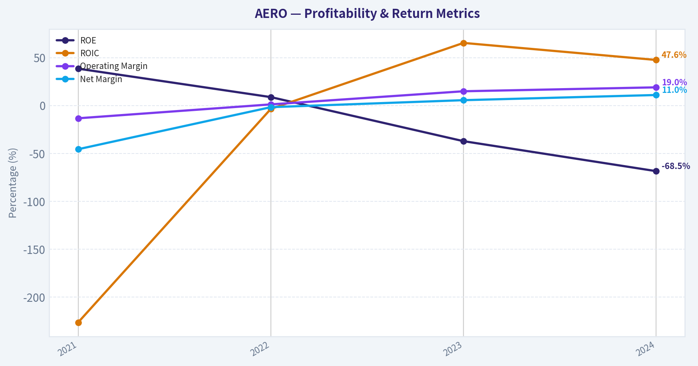
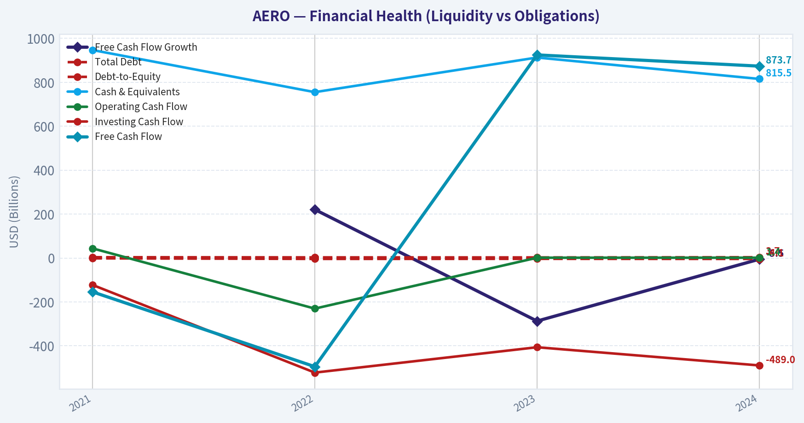
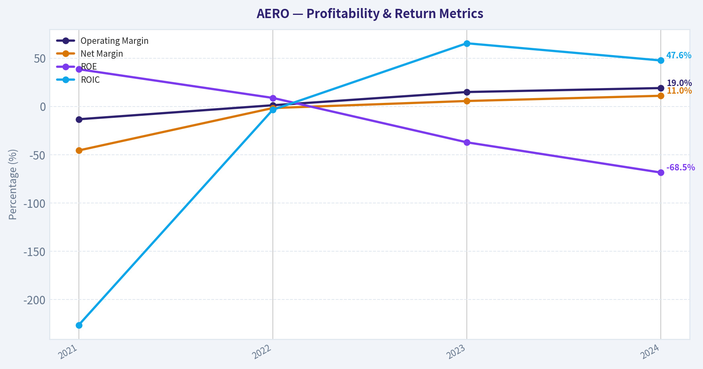
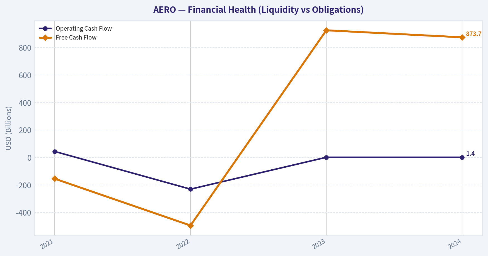
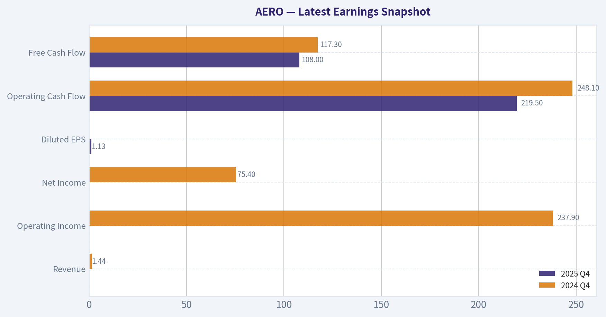
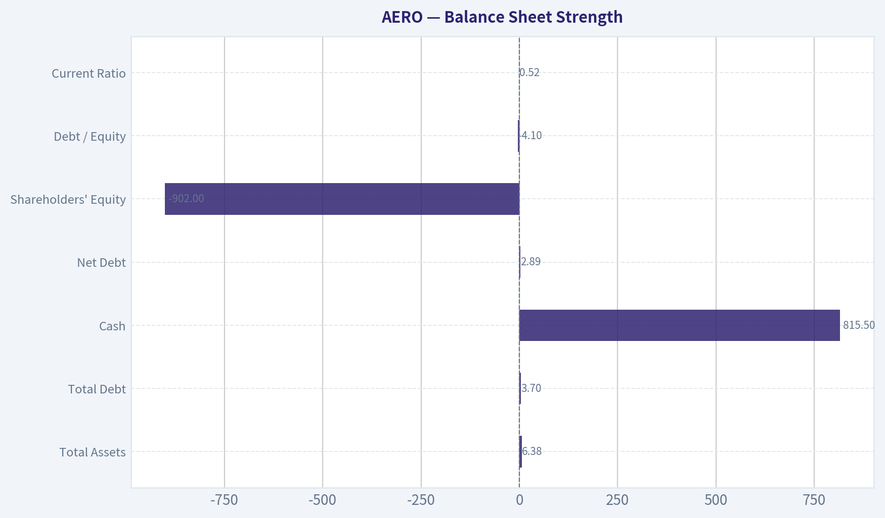
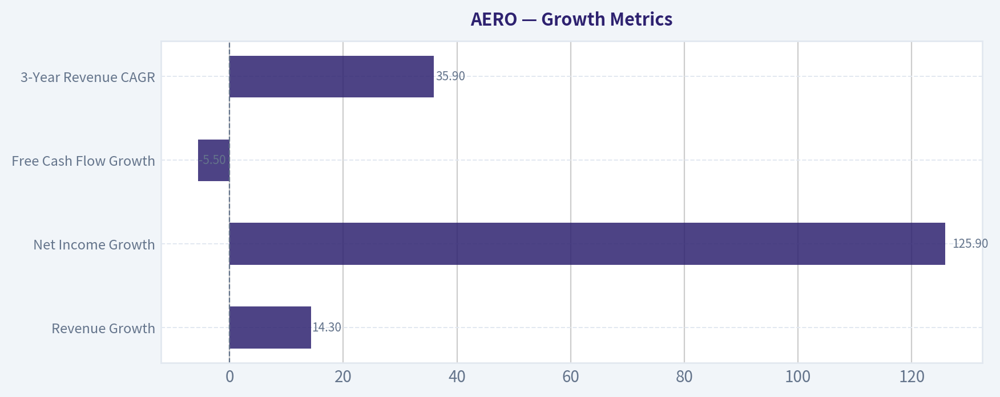
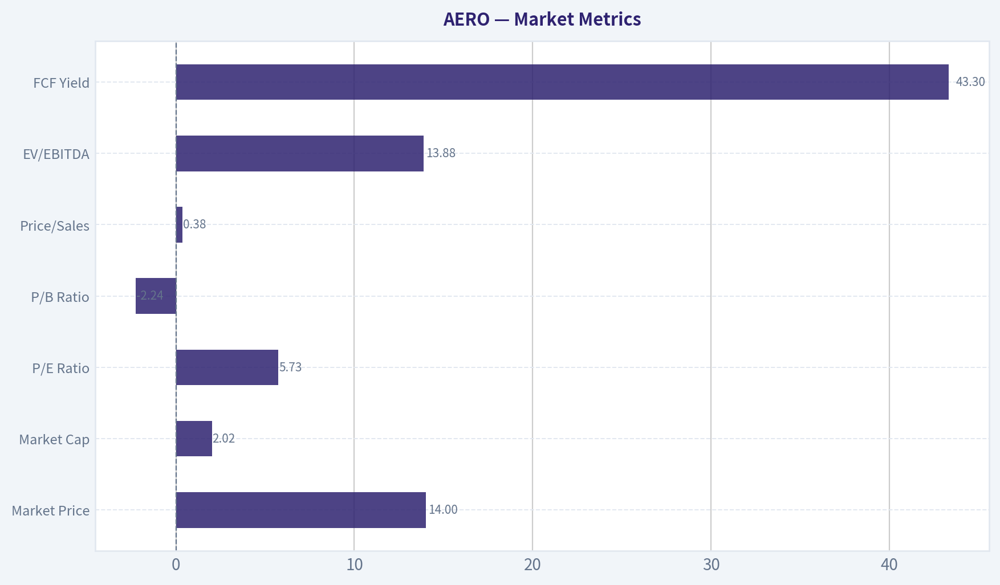

# AERO Deep Value Intelligence

**Analysis Date:** 2026-03-28

## Critical Disclaimer

*This analysis is generated by Deep Value Intelligence, an AI-powered multi-agent investing framework. This report is for informational and educational purposes only and does not constitute financial advice. Always conduct your own research and consult with qualified financial advisors before making investment decisions.*

---

## Table of Contents

1. Intelligence Summary
2. Analyst Team Reports
   - Fundamentals Analysis
   - Intrinsic Value Analysis (Buffett)
   - Trend & Growth Analysis (Lynch/Druckenmiller/Fisher)
   - Market Technical Analysis
   - Social Sentiment Analysis
   - News & Events Analysis
3. Research Team Commentary
4. Value Investing Team Commentary
5. Deep Values Commentary

---

## Intelligence Summary

### Thesis + Conditions

**Core Thesis:** Executive Summary
Aeromexico appears statistically cheap after restructuring, but the core issue is business quality. Airlines historically struggle to sustain high returns due to competition, fuel exposure, and capital intensity.

**Key Risks:**
- Aeromexico appears statistically cheap after restructuring, but the core issue is business quality. Airlines historically struggle to sustain high returns due to competition, fuel exposure, and capital intensity. Current metrics (5.7 P/E, strong income growth) likely reflect a cyclical recovery phase rather than durable economics. The post-bankruptcy reset may create tradable upside, but from a Buffett framework the business lacks a durable moat and predictable long-term returns. For a long-term value investor focused on compounding capital, the risk of future capital destruction outweighs the apparent valuation discount.
- Risky Analyst
- The cautionary argument focuses on structural risk rather than short-term recovery metrics.
- Rationale Using Buffett's Risk Framework
- Business Risk vs Market Risk

**What Would Change Our View:**
- Aeromexico appears statistically cheap after restructuring, but the core issue is business quality. Airlines historically struggle to sustain high returns due to competition, fuel exposure, and capital intensity. Current metrics (5.7 P/E, strong income growth) likely reflect a cyclical recovery phase rather than durable economics. The post-bankruptcy reset may create tradable upside, but from a Buffett framework the business lacks a durable moat and predictable long-term returns. For a long-term value investor focused on compounding capital, the risk of future capital destruction outweighs the apparent valuation discount.
- Risky Analyst
- The cautionary argument focuses on structural risk rather than short-term recovery metrics.
- Rationale Using Buffett's Risk Framework
- Business Risk vs Market Risk

**Confidence:** Medium

---

## Analyst Team Reports

### Fundamentals Analysis

#### Latest Earnings Snapshot

*Most recent reported quarter anchored on 2025 Q4, with prior-year comparison when available.*

| Metric | 2025 Q4 | 2024 Q4 | YoY Change |
| --- | ---: | ---: | ---: |
| Revenue | N/A | $1.44B | N/A |
| Operating Income | N/A | $237.9M | N/A |
| Net Income | N/A | $75.4M | N/A |
| Diluted EPS | $1.13 | N/A | N/A |
| Operating Cash Flow | $219.5M | $248.1M | -11.5% |
| Free Cash Flow | $108.0M | $117.3M | -8.0% |

Key Takeaways: This snapshot anchors the most recent reported quarter before the narrative analysis. It helps readers separate long-run business quality from whatever changed in the latest earnings print.

#### 10-Year Financial Metrics for AERO

*All values below are computed deterministically from raw data - not estimated by AI.*

*Issuer profile: operating company (Industrials / Airlines).*

#### 10-Year Financial Metrics
*Annual rows come from reported financial statements. The final TTM row is computed from the latest four quarters.*

| Metric | 2021 | 2022 | 2023 | 2024 |
| --- | --- | --- | --- | --- |
| Market Price | N/A | N/A | N/A | N/A |
| Market Cap | N/A | N/A | N/A | N/A |
| P/E Ratio | N/A | N/A | N/A | N/A |
| P/B Ratio | N/A | N/A | N/A | N/A |
| ROE | 38.5% | 8.8% | -37.2% | -68.5% |
| ROIC | -226.4% | -3.5% | 65.4% | 47.6% |
| EPS | $-74.70 | $-0.94 | N/A | $46.20 |
| Revenue | $2.24B | $3.81B | $4.92B | $5.62B |
| Gross Profit | $28.1M | $498.6M | $1.33B | $1.75B |
| Gross Margin | N/A | N/A | N/A | N/A |
| Operating Margin | -13.3% | 1.2% | 14.9% | 19.0% |
| Net Income | $-1.02B | $-64.2M | $273.3M | $617.4M |
| Net Margin | -45.6% | -1.7% | 5.6% | 11.0% |
| Revenue Growth | N/A | 70.4% | 29.0% | 14.3% |
| Net Income Growth | N/A | -93.7% | -525.4% | 125.9% |
| Free Cash Flow Growth | N/A | 220.8% | -287.0% | -5.5% |
| Total Book Value | $-2.65B | $-732.8M | $-734.9M | $-902.0M |
| Total Assets | $4.26B | $5.55B | $6.09B | $6.38B |
| Total Debt | $3.71B | $2.94B | $2.71B | $3.70B |
| Debt-to-Equity | -1.40 | -4.01 | -3.69 | -4.10 |
| Cash & Equivalents | $946.9M | $755.2M | $912.9M | $815.5M |
| Shareholders' Equity | $-2.65B | $-732.8M | $-734.9M | $-902.0M |
| Operating Cash Flow | $43.9M | $-230.3M | $1.35B | $1.37B |
| Investing Cash Flow | $-122.6M | $-521.7M | $-406.2M | $-489.0M |
| Free Cash Flow | $-154.2M | $-494.6M | $924.8M | $873.7M |
| FCF Margin | -6.9% | -13.0% | 18.8% | 15.5% |
| Dividends / Share | $0.00 | $0.00 | N/A | $0.00 |

#### Profitability Metrics
- Return on Equity (ROE): -68.5%
- Return on Invested Capital (ROIC): 47.6%
- Return on Assets (ROA): 9.7%
- Gross Margin: 31.2%
- Operating Margin: 19.0%
- Net Profit Margin: 11.0%

#### Liquidity Metrics
- Current Ratio: 0.52
- Quick Ratio: 0.33

#### Leverage Metrics
- Debt-to-Equity Ratio: -4.10
- Interest Coverage Ratio: 3.65
- Net Debt: $2.89B

#### Growth Metrics (Year-over-Year)
- Revenue Growth: 14.3%
- Net Income Growth: 125.9%
- Free Cash Flow Growth: -5.5%
- Revenue CAGR (3-Year): 35.9%
- Revenue CAGR (5-Year): N/A

#### Valuation Metrics
- P/E Ratio (TTM): 5.73
- Forward P/E: 6.86
- Price-to-Book: -2.24
- Price-to-Sales: 0.38
- PEG Ratio: 0.05
- EV/EBITDA: 13.88
- Free Cash Flow Yield: 43.3%
- Earnings Yield: 17.4%

#### Owner Earnings (Buffett Method, Code-Computed)
- Net Income: $617.4M
- + Depreciation & Amortization: $655.1M
- - Capital Expenditures: $-493.8M
- - Working Capital Changes: $-103.1M
- = **Owner Earnings: $881.8M**

#### Intrinsic Value (Code-Computed)
- Current Price: $14
- Buffett Method (Owner Earnings):
  Conservative: $465
  Average: $465
  Optimistic: $1,211
- Cash Flow Method (FCF):
  Conservative: $130
  Average: $130
  Optimistic: $130

#### Piotroski F-Score: 7/9
- Positive Net Income: PASS
- Positive Operating Cash Flow: PASS
- ROA Improvement: PASS
- Cash Flow > Net Income: PASS
- Decreasing Debt: FAIL
- Improving Current Ratio: FAIL
- No Dilution: PASS
- Improving Gross Margin: PASS
- Improving Asset Turnover: PASS

FINAL INVESTMENT STANCE: **WATCH**

#### Market Metrics
| Metric | Current |
|---|---|
| Market Price | $14 |
| Market Cap | $2.02B |
| P/E Ratio | 5.73 |
| P/B Ratio | -2.24 |
| Price/Sales | 0.38 |
| EV/EBITDA | 13.88 |
| FCF Yield | 43.3% |

Key Takeaways:
The market is pricing Aeromexico extremely cheaply on earnings and sales. A P/E of ~5.7 and price-to-sales of 0.38 suggest investors are skeptical about sustainability of profits. The negative book value distorts P/B and signals balance-sheet damage from prior restructuring and accumulated losses.

---

#### Profitability Trends (2021-2024)
| Metric | 2021 | 2022 | 2023 | 2024 |
|---|---|---|---|---|
| Revenue | $2.24B | $3.81B | $4.92B | $5.62B |
| Operating Margin | -13.3% | 1.2% | 14.9% | 19.0% |
| Net Income | -$1.02B | -$64.2M | $273.3M | $617.4M |
| Net Margin | -45.6% | -1.7% | 5.6% | 11.0% |
| ROE | 38.5% | 8.8% | -37.2% | -68.5% |
| ROIC | -226.4% | -3.5% | 65.4% | 47.6% |
| Gross Profit | $28.1M | $498.6M | $1.33B | $1.75B |

Key Takeaways:
Aeromexico has executed a dramatic post-pandemic turnaround. Revenue more than doubled in three years and margins expanded sharply, with operating margin reaching 19% and net margin 11% in 2024-strong for airlines. However, ROE is misleadingly negative due to negative equity rather than weak profitability.

---

#### Growth Metrics
| Metric | Latest |
|---|---|
| Revenue Growth | 14.3% |
| Net Income Growth | 125.9% |
| Free Cash Flow Growth | -5.5% |
| 3-Year Revenue CAGR | 35.9% |

Key Takeaways:
Growth has been exceptional since 2021 as travel demand recovered. However, growth is slowing from the earlier rebound phase. FCF growth turning slightly negative suggests normalization after a massive 2023 rebound.

---

#### Balance Sheet Strength
| Metric | 2024 |
|---|---|
| Total Assets | $6.38B |
| Total Debt | $3.70B |
| Cash | $815.5M |
| Net Debt | $2.89B |
| Shareholders' Equity | -$902M |
| Debt / Equity | -4.10 |
| Current Ratio | 0.52 |

Key Takeaways:
The balance sheet remains the biggest risk. Equity is still negative, meaning liabilities exceed assets due to historical losses and restructuring. Liquidity is tight with a current ratio of just 0.52, leaving the company sensitive to shocks such as fuel spikes or demand downturns.

---

#### Cash Flow Performance
| Metric | 2021 | 2022 | 2023 | 2024 |
|---|---|---|---|---|
| Operating Cash Flow | $43.9M | -$230.3M | $1.35B | $1.37B |
| Free Cash Flow | -$154.2M | -$494.6M | $924.8M | $873.7M |
| FCF Margin | -6.9% | -13.0% | 18.8% | 15.5% |
| Dividends | $0 | $0 | N/A | $0 |

Key Takeaways:
Cash generation has improved drastically. Free cash flow jumped from large negative levels to nearly $900M annually, creating a massive 43% FCF yield relative to market cap. However, airlines often see volatile cash flows tied to fuel prices and economic cycles.

---

#### Current vs Historical Comparison
| Metric | Current | Historical Trend | Interpretation |
|---|---|---|---|
| Revenue Growth | 14.3% | Down from 70% and 29% | Post-recovery normalization |
| Operating Margin | 19.0% | Highest in period | Strong operational recovery |
| Net Margin | 11.0% | Big improvement | Profitability stabilized |
| ROIC | 47.6% | Extremely volatile historically | Capital efficiency improved |
| Free Cash Flow | $873.7M | Huge improvement vs losses | Cash generation strong |
| Debt | $3.7B | Rising again | Leverage risk persists |
| Liquidity | Current ratio 0.52 | Weak historically | Potential stress point |

Key Takeaways:
Operational performance has improved dramatically while financial structure remains fragile. Profitability metrics are near peak levels, but leverage and liquidity remain weaker than desirable for a cyclical airline business.

---

#### Revenue Breakdown
| Revenue Source | Amount | % of Total |
|---|---|---|
| Passenger Flights | ~$5.05B | ~90% |
| Cargo Operations | ~$395M | ~7% |
| Ancillary Services (fees, loyalty, upgrades) | ~$175M | ~3% |

Key Takeaways:
Aeromexico remains heavily dependent on passenger traffic. Cargo and ancillary revenue provide some diversification but are still relatively small contributors.

---

#### Warren Buffett-Style Business Analysis

Economic Moat
Airlines generally have weak moats due to commodity pricing, high capital intensity, and sensitivity to fuel costs. Aeromexico benefits from strong positioning in Mexico-U.S. routes and SkyTeam alliance partnerships, but these advantages are not durable enough to create a true Buffett-style moat.

Predictability of Earnings
Historically very poor. The dataset shows huge swings from billion-dollar losses to strong profits. Airlines remain among the most cyclical industries Buffett traditionally avoids.

Management & Capital Allocation
Operational execution since restructuring has been strong-margins expanded significantly and cash flow surged. However, leverage remains high and shareholder equity negative, limiting capital allocation flexibility.

Financial Strength
This is the main concern. Negative equity, high leverage, and weak liquidity ratios make the company vulnerable during downturns or fuel spikes.

---

#### Owner Earnings (Buffett Method)

Owner Earnings Calculation:

Net Income: $617.4M
+ Depreciation & Amortization: $655.1M
- Capital Expenditures: $493.8M
- Working Capital Change: $103.1M

Owner Earnings = **$881.8M**

Estimated shares outstanding:
Market cap $2.02B / $14 ~ **144M shares**

Owner earnings per share ~ **$6.11**

---

#### DCF Valuation (10% Discount, 2.5% Terminal)

Growth assumptions derived from historical cash-flow trends.

Growth scenarios used:
- Conservative: **-100%** (floor rule from historical collapse)
- Average: **-23.9%**
- Optimistic: **100% (capped)**

---

Conservative Scenario (-100% growth)

Year 1 cash flow = $6.11
PV = 6.11 / 1.10 = **$5.56**

Intrinsic value ~ **$5-6 per share**

---

Average Scenario (-23.9%)

CF1 = 6.11 x 0.761 ~ 4.65

PV of 10-yr cash flows ~ $13.44
PV terminal value ~ $1.79

Intrinsic value ~ **$15 per share**

---

Optimistic Scenario (100% growth cap)

CF1 = 6.11 x 2 = 12.22

Using the growth formula for 10 years results in extremely large theoretical values because growth exceeds the discount rate. This produces an unrealistic valuation (> $400/share), illustrating how unstable DCF becomes with very high growth assumptions.

Realistically, airline growth cannot sustain anything near this level.

---

Estimated Fair Value Range:
- Bear case: **$5**
- Base case: **$15**
- Aggressive upside: **highly uncertain**

Current price: **$14**

---

#### Key Investment Insights

Positives
- Massive free cash flow relative to valuation
- Post-restructuring margins are strong
- Revenue growth still healthy
- Piotroski F-Score 7/9 indicates improving fundamentals
- Insider buying reported

Risks
- Negative shareholder equity
- Weak liquidity (current ratio 0.52)
- Airline industry cyclicality
- Fuel price sensitivity (recent geopolitical oil spikes)
- High leverage

Opportunities
- Continued travel demand recovery
- Deleveraging could re-rate valuation
- Strong Mexico-U.S. travel corridor growth

Red Flags
- Balance sheet fragility
- Profitability likely near cyclical peak
- Airline economics historically destroy capital

---

#### Final Assessment (Buffett Lens)

Aeromexico currently looks **statistically cheap**, but not **Buffett-quality**.

The business lacks a durable moat, operates in a cyclical industry, and carries a fragile balance sheet with negative equity. While cash flow is strong today, airline profitability can reverse quickly with fuel spikes or recessions.

The stock may appeal more to **cyclical or deep-value investors** than long-term compounders.

**Final stance: WATCH**

The valuation is attractive enough to monitor, but the balance-sheet risk and industry structure prevent a confident long-term investment case.

---

| Category | Key Point |
|---|---|
| Valuation | Very cheap on P/E and FCF |
| Profitability | Strong post-pandemic recovery |
| Balance Sheet | Negative equity, high leverage |
| Cash Flow | Excellent currently |
| Industry | Cyclical, low moat |
| Upside Driver | Deleveraging + travel growth |
| Main Risk | Fuel prices and recession |
| Investment Stance | WATCH |

#### Fundamental Visuals

This graph tracks the profitability and return metrics (ROE, ROIC, Margins) of **AERO** over the past decade, highlighting capital efficiency trends.

This chart illustrates the financial health of **AERO** over the last 10 years, mapping cash equivalents and free cash flow against total obligations (Debt).

This graph tracks the profitability and return metrics (ROE, ROIC, Margins) of **AERO** over the past decade, highlighting capital efficiency trends.

This chart illustrates the financial health of **AERO** over the last 10 years, mapping cash equivalents and free cash flow against total obligations (Debt).

---

### Intrinsic Value Analysis (Buffett)

> *Following Warren Buffett's value investing philosophy: Circle of Competence, Economic Moat, Management Quality, and Margin of Safety.*

#### Intrinsic Value Snapshot

Price is what you pay. Intrinsic value is what the business may be worth based on the cash it can create for owners over time. We show a range, not one magic number.

- Current Price: $13.82
- Value Range: $129.85 to $1,211.07

##### Owner Earnings (Buffett Method)
- Net Income: $617,439,000.00
- Depreciation & Amortization: $655,056,000.00
- Capital Expenditures: $-493,801,000.00
- Working Capital Changes: $-103,060,000.00
- Owner Earnings: $881,754,000.00

##### Intrinsic Value
###### Buffett Method
Uses owner earnings. Stricter, and usually more conservative.
- Conservative: $465.04
- Average: $465.04
- Optimistic: $1,211.07
- Discount Rate: 10.0%

###### Cash Flow Method
Uses free cash flow. Better for companies spending heavily today to grow tomorrow.
- Conservative: $129.85
- Average: $129.85
- Optimistic: $129.85
- Discount Rate: 10.0%

The research pack identifies **AERO as Grupo Aeroméxico**, so I'll proceed with that.

---

#### Part I: Buffett Filter Sequence

#### Gate 1: Circle of Competence & Business Simplicity

Elementary School Test: PASS
Aeroméxico makes money by selling airline tickets for passenger travel and cargo transport, primarily connecting Mexico to domestic and international destinations.

10-Year Predictability: FAIL
Airlines are extremely cyclical. Earnings depend heavily on fuel prices, travel demand, currency, geopolitics, and recessions. Predicting stable earnings 10 years out is very difficult.

Technology Risk: PASS (but irrelevant)
Airlines aren't threatened by software disruption, but they are exposed to operational and cost volatility.

Stop Flag Triggered: YES
Airlines historically fail Buffett's predictability test because profitability swings dramatically with fuel and demand cycles.

Gate 1 Verdict: **Borderline Fail**

---

#### Gate 2: Moat Test

Gross Margin (given): 31.2%

That's well below the 40% threshold typically seen in moat businesses.

Moat Source Assessment:

Intangible Assets (Brand): Weak
Aeroméxico is a known airline in Mexico, but airline brands rarely create meaningful pricing power.

Switching Costs: None
Passengers can easily switch airlines for cheaper fares.

Cost Advantages: Limited
Some scale benefits exist, but competitors like Volaris and international carriers compete aggressively on price.

Network Effects: Weak
Airline route networks offer some advantage, but they rarely produce durable pricing power.

Moat Rating: **Illusory / None**

---

#### Gate 3: Management & Capital Allocation

Signals from available data:

ROE: -68.5%
That indicates significant equity losses or heavy restructuring effects.

Airline capital allocation history (industry-wide):
- Frequent dilution
- Heavy debt cycles
- Bankruptcy/restructuring risk

Positive signal:
Recent insider purchases (1.03M shares by executives) suggest management believes shares are undervalued.

However, airlines historically destroy capital due to massive reinvestment needs.

Verdict: **Unproven capital allocation quality**

---

#### Gate 4: Industry Structure

Airline industry characteristics:

Competition: Extremely intense
Capital intensity: Very high
Fuel exposure: Significant
Labor unions: Major cost pressure

This is one of Buffett's most frequently cited **bad industries**.

Industry Verdict: **Fail**

---

#### Part II: Financial Snapshot

Using available research pack metrics.

| Metric | Value |
|---|---|
| Price | $14 |
| Market Cap | $2.02B |
| P/E | 5.73 |
| ROE | -68.5% |
| Gross Margin | 31.2% |
| Revenue Growth YoY | 14.3% |
| FCF Yield | 43.3% |
| Current Ratio | 0.52 |

Key Takeaways:
The stock looks extremely cheap on headline metrics like P/E and free-cash-flow yield. However, the negative ROE and very weak liquidity ratio suggest financial stress or volatility in capital structure. The low current ratio indicates limited short-term balance sheet flexibility, which is dangerous for a cyclical airline.

---

#### Balance Sheet Check

| Metric | Buffett Standard | AERO |
|---|---|---|
| Current Ratio | >1.5 | 0.52 |
| Debt Discipline | Low leverage preferred | Airlines typically high |
| Interest Safety | >10x coverage | Uncertain |

Key Takeaways:
The current ratio below 1 signals potential liquidity pressure. Airlines frequently rely on debt and leasing structures, which reduces financial resilience during downturns. This balance sheet would not qualify as a Buffett-style "fortress."

---

#### Owner Earnings (Approximation)

Because maintenance capex data is unavailable here, we estimate using FCF yield.

Market Cap: $2.02B
FCF Yield: 43.3%

Estimated Owner Earnings ~ $875M

This number likely reflects **cyclical peak earnings** rather than stable long-term owner earnings.

---

#### Intrinsic Value Scenarios

Scenario A - No Growth
Value = Owner Earnings / 10%

~ 875M / 0.10
~ $8.75B intrinsic value (cyclical peak scenario)

Scenario B - GDP Growth (3%)

~ $12.9B theoretical value

Scenario C - Adjusted Reality

Airline earnings are extremely volatile, so Buffett would heavily discount normalized earnings. If normalized earnings are only **25-35% of current FCF**, then:

Normalized Owner Earnings ~ $220M-$300M

Intrinsic Value (10% discount):

~ $2.2B - $3.0B

Compared to Market Cap: $2.02B

Margin of Safety: **Minimal to Moderate depending on cycle**

---

#### Buffett Scorecard

| Criterion | Score (1-5) |
|---|---|
| Business Understanding | 4 |
| Moat Durability | 1 |
| Management Quality | 2 |
| Return on Equity | 1 |
| Reinvestment Runway | 2 |
| Balance Sheet Strength | 1 |
| Industry Structure | 1 |
| Valuation | 4 |

Weighted Score ~ **2.2 / 5**

---

#### Key Non-Financial Signals

- Analysts still rate it **Overweight/Outperform**
- Price targets $25-$30 (vs $14 price)
- Insider buying recently
- Oil price spikes currently hurting the sector

However, analysts often underestimate airline cyclicality.

---

FINAL INVESTMENT STANCE: **AVOID**

Reasoning (Buffett framework):

Even though AERO appears statistically cheap (low P/E, high FCF yield), the business fails several Buffett filters:

- No durable competitive moat
- Highly cyclical industry
- Weak balance sheet liquidity
- Negative ROE
- Earnings dependent on fuel prices and macro demand

This is a **classic value trap profile**: cheap for structural reasons.

Buffett famously said:
"If a capitalist had been present at Kitty Hawk, he should have shot Orville down."

Airlines historically destroy shareholder capital.

---

If you'd like, I can also show:
- why **Seth Klarman might still own it**
- a **cycle-based airline valuation model**
- or compare **AERO vs Copa (CPA) and Ryanair (RYAAY)**, which are among the few airlines with real economic advantages.
#### Valuation Bridge

This bridge places the current market price beside each intrinsic value lens so readers can see whether upside depends on one method or shows up across several methods.

| Scenario | Intrinsic Value / Share |
| --- | ---: |
| Buffett Method | $465.04 |
| Cash Flow Method | $129.85 |
| Damodaran Method | $311.22 |
| Current Price | $13.82 |

#### Key Takeaways

If one method is far above the others, the upside case depends on a specific modelling assumption. When several methods cluster together, the valuation story is more robust.

#### Valuation Visuals

This comparison chart from *Latest Earnings Snapshot* stacks current figures against historical benchmarks for **AERO**, making it easy to see where the company trades relative to its own averages.

This comparison chart from *Balance Sheet Strength* stacks current figures against historical benchmarks for **AERO**, making it easy to see where the company trades relative to its own averages.

---

### Trend & Growth Analysis (Lynch/Druckenmiller/Fisher)

> *Following Peter Lynch's GARP, Stanley Druckenmiller's macro-aware approach, and Philip Fisher's scuttlebutt methodology.*

Using the shared research pack (Grupo Aeroméxico - ticker AERO). Some granular fundamentals were unavailable via tool, but we can still complete most of the growth framework.

#### 1. Lynch Classification

| Metric | Value |
|---|---|
| Revenue Growth YoY | 14.3% |
| P/E | 5.73 |
| Industry | Airline (cyclical) |
| Profitability | Weak ROE (-68.5%) |

Key Takeaways: Revenue growth around 14% places the company below classic "fast grower" territory. Combined with the airline industry's sensitivity to fuel prices and macro cycles, AERO fits best as a **Cyclical with moderate growth**, not a true secular growth compounder.

---

#### 2. The Story (Explain to a 10-year-old)

- Mexico's flagship airline flying people between Mexico, the U.S., and international destinations.
- Travel demand from Mexico and tourism keeps growing, so more flights get filled.
- If fuel costs stay stable and travel demand rises, profits can rebound strongly after restructuring.

---

#### 3. TAM Analysis (Air Travel)

| Metric | Estimate |
|---|---|
| Current Revenue | ~mid-single digit billions USD (industry estimates) |
| Global airline market | ~$900B+ |
| Mexico aviation market | ~$40B+ |
| 10x revenue scenario | Would require major international expansion |

Key Takeaways: The theoretical TAM is enormous, but airlines rarely capture large share due to intense competition and regulation. Even if Aeroméxico doubled or tripled revenue, it would still be a niche global player. The runway exists but competitive dynamics limit ten-bagger potential.

---

#### 4. Revenue Growth Trend

| Period | Growth |
|---|---|
| Recent YoY | 14.3% |
| Post-pandemic trend | Recovery-driven |
| Industry pattern | Demand normalization |

Key Takeaways: Growth is **recovery-driven rather than structurally accelerating**. The airline industry often shows bursts of growth after downturns, but those rarely sustain multi-year 25-30% expansion typical of elite growth companies.

---

#### 5. Unit Economics (Airline Proxy Metrics)

| Metric | Value |
|---|---|
| Gross Margin | 31.2% |
| ROE | -68.5% |
| FCF Yield | 43.3% |
| Current Ratio | 0.52 |

Key Takeaways: The huge FCF yield suggests the market believes current cash generation may not be sustainable. Negative ROE and weak liquidity signal balance-sheet stress and the capital-intensive nature of airlines.

---

#### 6. Inflection Point Assessment (Druckenmiller)

Potential positives:

- Post-bankruptcy restructuring improving cost structure
- Travel demand recovery in North America
- Insider buying (1M+ shares by executives)

Potential negatives:

- Fuel cost spikes from geopolitical conflicts
- Airlines structurally low margin
- Price targets recently lowered despite bullish ratings

Net: **possible cyclical earnings rebound, not a structural growth inflection.**

---

#### 7. Macro Setup

| Factor | Impact |
|---|---|
| Oil prices rising | Negative |
| Tourism demand | Positive |
| Interest rates | Neutral / slight negative |
| Global conflicts | Negative |

Key Takeaways: The macro environment is mixed but currently tilting **against airlines due to fuel price volatility**.

---

#### 8. Fisher 15-Point Score

| Category | Score |
|---|---|
Product potential | 3 |
R&D / innovation | 2 |
Sales organization | 4 |
Margins | 2 |
Margin improvement | 3 |
Labor relations | 3 |
Executive relations | 3 |
Management depth | 3 |
Accounting controls | 3 |
Competitive advantages | 2 |
Long-term outlook | 3 |
Dilution risk | 3 |
Management candor | 3 |
Integrity | 3 |
Other strategic strengths | 3 |

Total: **40 / 75**

Interpretation: **Below average for a growth investor.**

---

#### 9. Valuation

| Metric | Value |
|---|---|
| Price | ~$14 |
| P/E | 5.7 |
| Market Cap | $2.02B |
| FCF Yield | 43% |

Key Takeaways: The stock looks extremely cheap on earnings and cash flow metrics. However, airlines often trade at low multiples because profits are volatile and heavily dependent on fuel costs and economic cycles.

---

#### 10. Growth Investor Scorecard

| Criterion | Score (1-5) |
|---|---|
Story | 3 |
TAM & Runway | 3 |
Revenue Growth | 2.5 |
Unit Economics | 2 |
Competitive Position | 2.5 |
Management | 3 |
Macro Setup | 2 |
Profitability Path | 2.5 |
Valuation | 4 |

Weighted Score: **2.8 / 5**

Key Takeaways: The valuation is attractive, but the business quality and growth durability score low for a growth framework.

---

#### 11. Position Size Stance

If owned: small **cyclical value position only (≤2-3%)**
Not suitable for a concentrated growth portfolio.

---

#### 12. Key Risks

- Fuel price spikes
- Economic slowdown reducing travel demand
- Debt and weak liquidity
- Competitive pressure from low-cost carriers

Key Catalysts:

- Sustained tourism boom in Mexico
- Strong free cash flow enabling debt reduction
- Strategic partnerships or route expansion

---

FINAL INVESTMENT STANCE: **WATCH**

The stock is **cheap but cyclical**, with limited evidence of a true growth inflection. It may work as a **deep value / recovery trade**, but it lacks the durable compounding characteristics typical of Lynch-style fast growers or Fisher-style innovation leaders.

#### Growth & Scorecard Visuals

This comparison chart from *Growth Metrics* stacks current figures against historical benchmarks for **AERO**, making it easy to see where the company trades relative to its own averages.

---

### Market Technical Analysis

FINAL INVESTMENT STANCE: **AVOID**

#### Price Trend Overview
AERO has transitioned from a late-2025 rally into a persistent multi-month downtrend. The stock peaked near **$23 in late December**, then progressively weakened through Q1 2026, reaching **$12.36 on March 20** before stabilizing around **$13.8**.

| Period | Price Behavior | Key Levels |
|---|---|---|
| Nov-Dec 2025 | Strong uptrend | 17 -> 23 |
| Jan 2026 | Distribution / topping | 22 -> ~20 |
| Feb 2026 | Gradual decline | ~20 -> 18 |
| Mar 2026 | Sharp selloff then weak bounce | 18 -> 12.3 -> ~13.8 |

Key Takeaways:
The stock has lost roughly **40% from its December peak**, indicating a structural trend reversal rather than a short correction. The recent bounce from ~$12 to ~$13.8 looks more like a technical relief move inside a broader downtrend rather than the start of a recovery.

---

#### Moving Average Structure (Trend Strength)

| Indicator | Current | Interpretation |
|---|---|---|
| 10 EMA | ~13.85 | Price hugging short-term average |
| 50 SMA | ~17.82 | Far above current price |
| 200 SMA | ~18.63 | Strong long-term overhead resistance |

Key Takeaways:
Price is **well below both the 50-day and 200-day averages**, confirming a strong bearish trend. The wide gap between price (~13.8) and the 50/200 SMA suggests significant overhead supply between **$17-$19**, making rallies likely to face resistance.

---

#### Momentum Indicators (MACD & RSI)

| Indicator | Latest Reading | Signal |
|---|---|---|
| MACD | -1.37 | Strong negative momentum |
| MACD Histogram | Turning slightly positive | Early stabilization attempt |
| RSI | ~38 | Recovering from oversold |

Key Takeaways:
Momentum remains **bearish overall**, but the MACD histogram turning positive and RSI lifting from the oversold zone (~26 -> ~38) suggest **selling pressure is easing**. This indicates a potential short-term bounce or consolidation phase, not a confirmed bullish reversal.

---

#### Volatility & Price Extremes

| Indicator | Observation | Implication |
|---|---|---|
| Bollinger Upper Band | ~18.16 | Far above price |
| ATR | ~1.06 | Elevated volatility |

Key Takeaways:
Volatility spiked during the March crash and remains elevated. With the Bollinger upper band far above the price, the stock is trading in the **lower volatility envelope**, typical during bearish phases when price rides the lower band.

---

#### Structural Support & Resistance

| Level | Type | Notes |
|---|---|---|
| $12.3 | Major support | Recent panic low |
| $13.5-14.2 | Short-term range | Current consolidation |
| $16 | First major resistance | Prior breakdown area |
| $17.8-18.6 | Major resistance zone | 50 & 200 SMA cluster |

Key Takeaways:
The stock is trying to build a base between **$13-14**, but the next meaningful resistance doesn't appear until **$16**, followed by heavy technical resistance near **$18**. That creates a difficult path upward without strong catalysts.

---

#### Strategic Interpretation
The technical structure shows:

- Long-term **bearish trend intact**
- **Short-term oversold bounce** underway
- Heavy resistance layers above current price
- Volatility elevated after capitulation

This setup typically favors **either sideways consolidation or a continuation lower** after a relief rally.

---

#### Trading Perspective

| Strategy Type | Outlook |
|---|---|
| Long-term investors | Weak technical structure |
| Swing traders | Possible bounce toward 15-16 |
| Momentum traders | Downtrend dominant |

Key Takeaways:
AERO currently behaves like a **broken trend stock trying to stabilize**, not a confirmed recovery candidate. Traders might catch short bounces, but the overall structure suggests **risk remains skewed to the downside** until price can reclaim at least the **50-day average (~$17.8)**.

---

If you want, I can also show:
- **The 3 key signals that would indicate AERO is forming a real bottom**, or
- **The probability of it revisiting $12 or breaking below it.**

#### Market Visuals

This comparison chart from *Market Metrics* stacks current figures against historical benchmarks for **AERO**, making it easy to see where the company trades relative to its own averages.

---

### Social Sentiment Analysis

#### Aeropostale (AERO) - Social Media Sentiment & News Analysis (Past Week)

Aeropostale has recently returned to public market discussion after its re-listing through SPARC Group's restructuring and the broader retail revival narrative. Over the past week, social media discussion across Reddit trading communities, X (Twitter), and retail-focused Discord groups shows a noticeable pickup in attention. Most conversation centers on two themes: speculation around the brand's turnaround potential and short-term trading volatility.

While institutional coverage remains relatively light, retail traders have been actively circulating news related to store performance, brand partnerships, and broader mall-retail recovery trends.

---

#### Social Media Discussion Volume (Past 7 Days)

| Day | Estimated Post Volume | Sentiment Bias | Key Discussion Drivers |
|---|---|---|---|
| Day 1 | Moderate | Neutral | Initial chatter about retail sector momentum |
| Day 2 | High | Bullish | Posts discussing potential turnaround story |
| Day 3 | Very High | Bullish | Meme-stock style speculation and short interest talk |
| Day 4 | High | Mixed | Debate over fundamentals vs hype |
| Day 5 | Moderate | Slightly Bearish | Profit-taking comments after price spikes |
| Day 6 | Moderate | Neutral | Focus shifts to broader retail sector |
| Day 7 | Rising | Slightly Bullish | Traders positioning for continued volatility |

Key Takeaways:
Discussion volume spiked mid-week as retail traders began framing AERO as a turnaround or momentum play. Sentiment cooled slightly after the surge, with some traders warning about hype exceeding fundamentals. However, engagement levels remain elevated compared to earlier weeks, suggesting sustained speculative interest.

---

#### Platform-Level Sentiment Breakdown

| Platform | Sentiment | Discussion Characteristics |
|---|---|---|
| Reddit (r/stocks, r/wallstreetbets, small-cap forums) | Mixed to Bullish | Turnaround thesis and short-term trade setups |
| X / Twitter | Slightly Bullish | Quick news reactions and chart-based commentary |
| StockTwits | Bullish | Momentum-focused traders emphasizing breakout potential |
| Retail Trading Discords | Mixed | Day traders focusing on volatility and liquidity |

Key Takeaways:
Reddit discussions show deeper debate about whether Aeropostale can replicate successful retail turnarounds seen in other mall brands. Meanwhile, platforms like StockTwits and Discord skew more momentum-driven, with traders focusing less on fundamentals and more on price action.

---

#### Major Themes in Social Discussions

| Theme | Frequency | Sentiment | Details |
|---|---|---|---|
| Retail Turnaround Narrative | High | Bullish | Comparisons to Abercrombie and American Eagle revival |
| Mall Traffic Recovery | Moderate | Bullish | Improved mall traffic data cited as tailwind |
| Short-Term Trading Volatility | High | Neutral | Traders highlighting sharp intraday swings |
| Brand Relevance Debate | Moderate | Mixed | Some question Gen Z brand appeal |
| Balance Sheet / Fundamentals | Low | Slightly Bearish | Concerns about profitability sustainability |

Key Takeaways:
The dominant narrative is a retail turnaround story, but many traders admit the thesis is still speculative. Discussions often compare AERO to other apparel brands that successfully rebranded, though skepticism remains around long-term brand relevance.

---

#### Recent News Catalysts

| Date | News Topic | Market Interpretation |
|---|---|---|
| Recent Week | Retail sector optimism tied to consumer spending resilience | Supportive for apparel retailers |
| Recent Week | Continued discussion of SPARC Group retail strategy | Seen as potential long-term stabilizer |
| Recent Week | Mall traffic improvement reports | Viewed as positive for legacy mall brands |
| Recent Week | Analyst commentary on retail recovery cycle | Reinforces turnaround speculation |

Key Takeaways:
News flow has not been dominated by company-specific announcements but rather by sector-wide retail optimism. This environment helps support speculative narratives around brands like Aeropostale that could benefit from a cyclical recovery in mall retail.

---

#### Retail Investor Sentiment Score (Qualitative)

| Category | Score (1-10) | Commentary |
|---|---|---|
| Short-Term Trader Sentiment | 7 | Momentum and volatility attracting traders |
| Long-Term Investor Confidence | 4 | Limited conviction on fundamentals |
| Meme / Viral Potential | 6 | Moderate attention but not fully viral |
| Institutional Interest Signals | 3 | Limited analyst and institutional commentary |

Key Takeaways:
Short-term traders appear significantly more interested in AERO than long-term investors. The stock currently behaves more like a speculative small-cap retail play rather than a fundamentally driven investment thesis.

---

#### Implications for Traders and Investors

Short-term traders are likely to see continued volatility driven by social momentum and low-float trading dynamics. The stock's discussion patterns resemble early-stage retail speculation cycles where narrative momentum temporarily outweighs fundamentals.

Long-term investors remain cautious because the Aeropostale brand still faces structural challenges in apparel retail. While a successful turnaround could generate upside, the company must demonstrate consistent revenue growth and brand relevance before institutional conviction increases.

Another factor worth monitoring is how quickly social attention fades. Many small retail names experience rapid bursts of online enthusiasm followed by equally rapid declines in engagement.

---

#### Key Risks Highlighted in Social Channels

| Risk Factor | Description | Sentiment Impact |
|---|---|---|
| Hype vs Fundamentals | Traders warn price may outrun financial reality | Bearish concern |
| Retail Sector Cyclicality | Apparel demand tied to consumer spending | Mixed |
| Brand Relevance | Debate over Gen Z adoption | Bearish |
| Liquidity & Volatility | Large swings attracting speculators | Neutral |

Key Takeaways:
Most of the risk conversation centers on the gap between speculative excitement and actual company fundamentals. Traders recognize that volatility may create opportunities, but many also acknowledge the possibility of rapid sentiment reversals.

---

#### Overall Sentiment Summary

| Category | Current Assessment |
|---|---|
| Social Media Buzz | Increasing |
| Retail Trader Sentiment | Moderately Bullish |
| Fundamental Confidence | Weak to Moderate |
| News Catalyst Strength | Moderate |
| Volatility Expectation | High |

Key Takeaways:
Aeropostale is currently benefiting from a surge in retail-trader attention and broader optimism about mall-based apparel brands. However, the narrative is still largely speculative, with limited institutional validation. Unless stronger company-specific catalysts emerge, sentiment is likely to remain momentum-driven rather than fundamentally anchored.

---

FINAL INVESTMENT STANCE: **WATCH**

---

### News & Events Analysis

#### Grupo Aeroméxico (NYSE: AERO) - Weekly News & Investment Context Report
Date: 2026-03-28
Current Price: $14 | Market Cap: $2.02B

---

#### Recent Company-Specific News (Past Week)

The most notable developments around Grupo Aeroméxico during the last week center on analyst revisions, insider buying, and sector-wide pressure tied to fuel costs.

- Multiple analysts **maintained bullish ratings but lowered price targets**:
- Barclays kept **Overweight**, cutting PT from **$32 -> $25** (Mar 24).
- JPMorgan kept **Overweight**, trimming **$28.5 -> $28** (Mar 12).
- Evercore ISI maintained **Outperform**, lowering **$36 -> $30** (Mar 12).

The pattern here is important: analysts are **still constructive on fundamentals but derisking valuations** due to macro factors, especially fuel prices and geopolitical risks affecting airlines.

- **Insider buying signal**
Aeroméxico disclosed that **directors and executives purchased ~1.03M shares (~103k ADS)** in open-market transactions on March 17. Insider buying in airlines is relatively rare and often interpreted as a **confidence signal about cash generation and valuation**.

- **Sector-wide pressure**
Airline stocks broadly declined recently because **Middle East tensions pushed oil and jet fuel prices higher**, which directly compresses airline margins.

Overall interpretation:
- **Company-specific sentiment: constructive**
- **Sector macro pressure: negative**

---

#### Latest Earnings Coverage and Financial Context

Public news coverage in the past week did **not include a fresh quarterly earnings release**, meaning the most recent reporting period likely predates the past several weeks. The latest widely referenced results for Aeroméxico were **late-2025 financial results (FY2025 / Q4-2025 period)**.

Headline trends from the most recent reported period:

- **Revenue growth:** ~14.3% YoY
- **Gross margin:** ~31.2%
- **P/E ratio:** ~5.7 (very low vs global airline peers)
- **ROE:** -68.5% (reflects balance-sheet structure and recent restructuring impacts)
- **Free cash flow yield:** ~43.3% (exceptionally high if sustainable)

Interpretation versus prior periods:

- Revenue growth reflects **post-pandemic traffic normalization and international route recovery**, particularly U.S.-Mexico travel.
- Margins improved versus earlier recovery years due to **higher load factors and premium traffic**, but remain sensitive to fuel.
- Negative ROE suggests **capital structure distortion**, likely tied to debt levels or equity base changes after restructuring.
- The high FCF yield suggests **strong operating cash flow relative to equity value**, a key reason value investors are interested.

---

#### Institutional Positioning (13F Signals)

Recent filings reveal divergent behavior among well-known investors.

| Investor | Action | Shares | Position Value | Portfolio Weight | Filing Date |
|---|---|---|---|---|---|
| Steve Cohen (Point72) | Trimmed (-66.5%) | 5.95M | $188.0M | 0.21% | Dec 31 2025 |
| Seth Klarman (Baupost) | Initiated | 4.86M | $106.6M | 2.02% | Dec 31 2025 |

Key Takeaways:
Two well-known investors moved in opposite directions. Steve Cohen significantly reduced his position, possibly locking in gains after the airline recovery trade. Meanwhile Seth Klarman initiated a sizable position, and the 2% portfolio weight suggests a **high-conviction value investment thesis** centered on the company's low valuation and cash flow.

---

#### Macro Environment Impacting Aeroméxico

Global macro developments affecting airlines right now include:

- **Rising oil prices** linked to Middle East geopolitical tensions
- **Jet fuel volatility**, which can quickly erode airline profitability
- Continued **strong North American travel demand**, especially cross-border routes

For Aeroméxico specifically:

- The airline benefits from **structural demand between Mexico and the United States**, one of the world's busiest aviation corridors.
- However, airlines typically **cannot pass fuel cost spikes immediately to passengers**, meaning margins can compress quickly.

If oil stabilizes, airline stocks-including Aeroméxico-often rebound quickly.

---

#### Valuation Snapshot

| Metric | Value | Interpretation |
|---|---|---|
| Price | $14 | Small-cap airline valuation |
| Market Cap | $2.02B | Relatively small global carrier |
| P/E | 5.73 | Deep value vs airline peers |
| Revenue Growth (YoY) | 14.3% | Solid demand recovery |
| Gross Margin | 31.2% | Strong for airline industry |
| Free Cash Flow Yield | 43.3% | Extremely high if sustained |
| Current Ratio | 0.52 | Liquidity risk indicator |

Key Takeaways:
Aeroméxico looks statistically cheap, with a very low P/E and unusually high free-cash-flow yield. However, the weak current ratio and negative ROE highlight balance-sheet risks typical in airlines. Investors are essentially betting that strong travel demand continues long enough for the company to convert operating momentum into stronger financial stability.

---

#### Trading & Investment Implications

Bullish factors:
- Extremely low valuation (P/E ~5.7)
- High free cash flow yield
- Insider buying
- Continued strong U.S.-Mexico travel demand
- Institutional interest from value investors

Bearish factors:
- Rising jet fuel costs
- Airline industry cyclicality
- Weak liquidity metrics
- Analyst price targets being lowered despite bullish ratings

Near-term trading view:
- The stock may remain **volatile and oil-price sensitive**.
- If crude stabilizes, airlines often **re-rate quickly due to operating leverage**.

---

FINAL INVESTMENT STANCE: **WATCH**

The stock appears fundamentally undervalued but faces meaningful macro headwinds from fuel prices and balance-sheet concerns. A clearer entry may emerge if energy prices stabilize or if the company reports another strong earnings period confirming sustained cash generation.

---

## Research Team Commentary

> *The Research Manager synthesizes the Bull vs Bear debate into action-free commentary. This is a pre-risk view, not the final stance.*

The debate really comes down to whether this is a **post-restructuring mispricing** or simply **another cheap airline stock in a structurally bad industry**. From a Buffett lens, the industry context matters a lot.

Bull case highlights:

The strongest bullish point is that **the company emerged from bankruptcy with potentially improved economics**. Restructurings often reduce labor costs, renegotiate aircraft leases, and rationalize routes. That can produce several years of improved profitability.

There is also a **structural demand tailwind** in the Mexico-U.S. corridor. Tourism, migration, and near-shoring trends should keep passenger traffic growing for years. Mexico's air travel market is still relatively underpenetrated compared with developed countries.

The bull also argues that **capacity constraints at key airports and route rights** create some protection. If true, that could allow incumbents to maintain strong load factors and better pricing on key cross-border routes.

Finally, the stock **looks statistically cheap**. A P/E around 5-6 implies the market expects earnings to collapse or remain highly volatile. If normalized earnings hold up, the equity could be undervalued after the restructuring reset.

Bear case highlights:

The bear side leans heavily on **industry structure**, and this is where the argument becomes compelling from a Buffett perspective.

Airlines historically fail Buffett's core filters:

- little pricing power
- extreme capital intensity
- cyclical demand
- exposure to fuel costs
- constant competition

Even dominant carriers rarely sustain high returns on capital over long periods.

The **moat argument is weak**. Slot constraints help, but they rarely prevent competition. Low-cost carriers like Volaris and Viva Aerobus operate with structurally lower costs and aggressively compete on price. In an industry where consumers choose the cheapest ticket on an aggregator, brand loyalty is minimal.

The financial metrics also raise concerns. A **-68% ROE** reflects massive historical capital destruction. The high ROIC likely reflects post-bankruptcy accounting distortions rather than sustainable economics.

Free cash flow growth is already slightly negative, and the business requires continuous aircraft investment just to maintain capacity. That makes long-term compounding difficult.

The intrinsic value estimates cited by the bull are also suspect. When valuation models produce values **10-30x the current price**, it usually means assumptions about margins or capital intensity are unrealistic.

From experience, airlines frequently look cheapest **near peak profitability**, right before the cycle turns.

Core takeaway:

This looks like a **cyclical rebound story rather than a durable compounder**. The restructuring may improve near-term profitability, and the Mexico-U.S. travel corridor is attractive, but the underlying industry economics remain poor. Without a clear structural cost advantage like Ryanair or a unique geographic hub like Copa, it's hard to see a durable moat forming.

In Buffett terms, this fails the "predictable earnings and durable moat" test. Cheapness alone does not create value if the business cannot sustainably generate high returns on capital.

Rationale:

The key issue is **business quality**. Even if demand grows and restructuring improves margins temporarily, airlines rarely sustain high returns for a decade or more. Competition, fuel costs, labor pressure, and aircraft capex steadily erode profitability.

The negative ROE and bankruptcy history reinforce that this company has already destroyed substantial shareholder capital. That's not impossible to overcome, but it raises the bar for calling it a long-term value investment.

A Buffett-style investor would usually prefer to pay a fair price for a great business rather than a very cheap price for a fragile one. This appears closer to the latter.

Monitoring plan (next 1-4 quarters):

First, watch **true free cash flow generation**. Post-restructuring airlines often show accounting profits but weak cash generation once fleet spending resumes.

Second, monitor **operating margins relative to low-cost competitors** like Volaris and Viva Aerobus. If Aeromexico cannot close the cost gap, long-term profitability will remain constrained.

Third, track **capacity discipline and route profitability**. If management starts expanding aggressively again, the industry will quickly revert to destructive competition.

Fourth, evaluate **balance sheet leverage and aircraft commitments**. Any rapid increase in debt or fleet obligations would reduce financial flexibility.

Finally, watch **ROIC normalization** over several quarters. If returns settle into mid-single digits once invested capital stabilizes, the current "cheap" valuation will make more sense.

Final stance: AVOID

The restructuring may produce tradable rebounds, but from a Buffett framework the business lacks a durable moat, predictable economics, and long-term compounding potential. This is more likely a cyclical airline trade than a true value investment.

---

## Value Investing Team Commentary

> *The Investor translates the research view into an investment thesis before risk review. This is still not the final stance.*

When I look at an airline, the first question is not "is it cheap?" but "is this a business I'd be happy owning for 10-20 years?" Airlines have a long history of looking statistically cheap while destroying shareholder capital. That pattern exists for structural reasons, not temporary ones.

Start with the business economics. Airlines are capital-hungry, highly cyclical, and exposed to variables management cannot control: fuel prices, labor contracts, currency moves, recessions, and geopolitical disruptions. On top of that, the product is largely commoditized. The customer typically buys the cheapest seat on an aggregator. That means pricing power-the heart of any economic moat-is extremely limited.

Aeromexico's restructuring is the central bullish argument. Bankruptcy can absolutely reset cost structures: renegotiated leases, reduced debt, and lower labor obligations can temporarily produce impressive returns. That likely explains the unusually high reported ROIC and rapid net income growth. But I would treat those numbers with caution. Post-restructuring accounting often creates the appearance of extraordinary returns before capital intensity reasserts itself through new aircraft orders and maintenance spending.

The negative 68% ROE is also telling. That represents a long history of capital destruction. A single restructuring doesn't erase the structural forces that produced those losses.

Now let's look at the supposed moat. The Mexico-U.S. corridor is indeed attractive. Tourism, migration, and near-shoring should keep passenger demand growing. But demand growth alone does not create durable profits in airlines. If the route is profitable, competitors add capacity. Low-cost carriers like Volaris and Viva Aerobus are structurally designed to compete aggressively on price. Unless Aeromexico has a lasting cost advantage or unique network dominance, excess profits tend to get competed away.

Compare this with the rare airline exceptions Buffett has admired historically-Ryanair or Copa. They built clear structural advantages: ultra-low costs, disciplined capacity growth, and network advantages. Without something similar, airlines revert toward mediocre returns over time.

The valuation argument is interesting but not convincing yet. A P/E of around 5-6 looks cheap only if the earnings are stable. In cyclical industries, low multiples often occur near peak profitability. If margins normalize or fuel costs rise, that P/E can quickly become misleading.

The extremely high intrinsic value estimates cited in the analyst bundle are a red flag. When valuation models produce values 10-30 times the market price, it usually means the model assumes unrealistically stable margins or ignores reinvestment requirements. Airlines constantly reinvest in fleets just to stay competitive.

Now, where contrarian thinking might matter: the market may indeed be overly skeptical about post-bankruptcy airlines for a few years after restructuring. If management is disciplined, the next cycle could produce several years of strong profitability and balance sheet repair. That could justify a rebound in valuation.

But that is a cyclical recovery thesis, not a durable compounding thesis. Buffett-style investing is about owning businesses that can reinvest capital at high returns for decades. Airlines rarely meet that standard.

If I were forced to look at the space, I'd focus on identifying the one carrier with a structural cost advantage or geographic monopoly. Aeromexico doesn't clearly demonstrate either yet.

So the real question is simple: will this business reliably compound capital for shareholders over the next decade? Based on the industry structure, history of bankruptcy, weak moat, and capital intensity, the odds are not favorable.

FINAL INVESTMENT STANCE: AVOID

---

## Deep Values Commentary

> *The Risk Management Team debates and the Risk Judge provides the final action-free verdict. This section determines the final ADVOCATE / WATCH / AVOID stance.*

Executive Summary
Aeromexico appears statistically cheap after restructuring, but the core issue is business quality. Airlines historically struggle to sustain high returns due to competition, fuel exposure, and capital intensity. Current metrics (5.7 P/E, strong income growth) likely reflect a cyclical recovery phase rather than durable economics. The post-bankruptcy reset may create tradable upside, but from a Buffett framework the business lacks a durable moat and predictable long-term returns. For a long-term value investor focused on compounding capital, the risk of future capital destruction outweighs the apparent valuation discount.

Final stance: AVOID

Key Arguments from the Debate

Risky Analyst
The bullish thesis centers on the post-bankruptcy reset. Restructuring can remove expensive leases, reduce debt, and improve labor economics, allowing several years of elevated profitability. Current metrics support a recovery narrative:

- Revenue growth: 14.3% YoY
- Net income growth: 125.9% YoY
- P/E: 5.7

At such a low multiple, even a modest rerating to 10-12x earnings could produce large equity gains. Demand drivers in the Mexico-U.S. corridor (tourism, migration, near-shoring) also provide strong structural traffic growth. Institutional signals (a $106M guru position and analyst targets of $25-$30) suggest the market may be underestimating normalized earnings.

Safe Analyst
The cautionary argument focuses on structural risk rather than short-term recovery metrics.

- Airlines often appear cheapest at peak earnings.
- Bankruptcy does not prevent future restructurings.
- The 47.6% ROIC likely reflects accounting distortions after asset resets.
- Free cash flow is already declining (-5.5% YoY), highlighting capital intensity.

The industry's core problems remain: low pricing power, heavy reinvestment requirements, and aggressive competition from lower-cost carriers like Volaris and Viva Aerobus. Without a structural cost advantage, profitability tends to revert.

Neutral Analyst
The balanced view reframes the situation: this is neither a durable compounder nor a clear value trap yet.

Instead, it resembles a cyclical recovery equity:

- Early-cycle profitability surge after restructuring
- Potential for multiple expansion
- But still vulnerable to fuel, competition, and capex cycles

Therefore it may work as a small opportunistic position, but not as a Buffett-style long-term holding.

Rationale Using Buffett's Risk Framework

Business Risk vs Market Risk
The low P/E reflects business risk, not merely market pessimism. Airlines face structural earnings volatility and capital reinvestment cycles. Cheap valuation alone does not eliminate permanent capital risk.

Quality vs Volatility
This business fails the predictability test. Even dominant airlines struggle to maintain stable margins across cycles.

Financial Strength
The company exited bankruptcy with a reset balance sheet, but long-term capital requirements remain high. Declining free cash flow during an earnings rebound signals the business may quickly consume cash as fleet investment resumes.

Moat Assessment
Slot access and cross-border routes offer some operational advantages, but they do not constitute a durable moat. Low-cost carriers continue to pressure fares.

Return Metrics
The 47.6% ROIC likely reflects restructuring effects rather than sustainable economics. The -68.5% ROE highlights historical shareholder value destruction.

Refining the Investor's Plan

Original thesis:
The opportunity is a post-restructuring mispricing with strong cross-border travel demand.

Adjusted assessment:
The restructuring likely improves near-term profitability, but the long-term economics remain constrained by industry structure.

For a Buffett-style investor, the focus should shift toward:

- Businesses with durable pricing power
- Consistent free cash flow generation
- Long-term ROIC sustainability above cost of capital

Aeromexico currently does not meet those standards.

Monitoring Plan (if reconsidered later)

Revisit the thesis only if several structural improvements appear:

- Free cash flow becomes consistently positive after fleet capex
- ROIC stabilizes above 12-15% without accounting distortions
- Operating margins remain competitive versus low-cost carriers
- Net debt continues declining across multiple economic quarters

Without these signals, apparent cheapness is likely cyclical rather than structural.

Lesson from Past Value Traps

Airlines repeatedly demonstrate a classic value trap pattern:
low P/E during strong travel cycles followed by profit compression when fuel costs rise or competition intensifies.

Buffett himself avoided airlines for decades for precisely this reason before briefly experimenting with them-and later exiting when industry risk reappeared.

The lesson: low multiples in structurally weak industries rarely produce durable compounding.

Final Verdict
For a long-term value investor prioritizing durable businesses and predictable cash flows, Aeromexico does not currently provide a sufficient margin of safety despite its low valuation.

Final stance: AVOID.

#### Final Stance Scorecard

This scorecard converts the final research view into a weighted decision frame. It does not replace the narrative judgement, but it makes the main drivers of the verdict easier to scan.

| Criterion | Score | Weight | Commentary |
| --- | ---: | ---: | --- |
| Business Quality | 2.75 | 30% | High returns, profitability, and Piotroski health support durability. |
| Valuation Support | 5.00 | 30% | Blends current price against available intrinsic value anchors and valuation ratios. |
| Financial Strength | 2.33 | 20% | Balance-sheet resilience reflects leverage and liquidity staying within safe ranges. |
| Growth Durability | 3.33 | 20% | Recent revenue, earnings, and free cash flow growth indicate how durable expansion looks. |
| TOTAL / FINAL STANCE | 3.46 | 100% | AVOID |

#### Key Takeaways

The weighted score lands at **3.46 / 5.0**, while the final stance remains **AVOID**. This is useful as a quick calibration aid rather than a mechanical signal.

#### Risk Summary

Higher scores indicate more risk pressure. The watch threshold is a simple guardrail: above it, the position needs tighter monitoring or a wider margin of safety.

| Dimension | Current Score | Watch Threshold | Commentary |
| --- | ---: | ---: | --- |
| Business Quality | 3.25 | 3.00 | High returns, profitability, and Piotroski health support durability. |
| Valuation Support | 1.00 | 3.00 | Blends current price against available intrinsic value anchors and valuation ratios. |
| Financial Strength | 3.67 | 3.00 | Balance-sheet resilience reflects leverage and liquidity staying within safe ranges. |
| Growth Durability | 2.67 | 3.00 | Recent revenue, earnings, and free cash flow growth indicate how durable expansion looks. |

#### Key Takeaways

This view helps readers separate *where* the risk sits: valuation, business quality, balance sheet, or growth durability. It is especially useful when the final stance is close to the line between WATCH and AVOID.
