# AKTAF Deep Value Intelligence

**Analysis Date:** 2026-04-05

## Critical Disclaimer

*This analysis is generated by Deep Value Intelligence, an AI-powered multi-agent investing framework. This report is for informational and educational purposes only and does not constitute financial advice. Always conduct your own research and consult with qualified financial advisors before making investment decisions.*

---

## Table of Contents

1. Intelligence Summary
2. Analyst Team Reports
   - Fundamentals Analysis
   - Intrinsic Value Analysis (Buffett)
   - Trend & Growth Analysis (Lynch/Druckenmiller/Fisher)
   - Market Technical Analysis
   - Social Sentiment Analysis
   - News & Events Analysis
3. Research Team Commentary
4. Value Investing Team Commentary
5. Deep Values Commentary

---

## Intelligence Summary

### Thesis + Conditions

**Core Thesis:** Executive Summary (Quick Read)
AKITA Drilling appears statistically cheap but economically fragile. The core issue is not volatility but weak business quality: ROIC ~2.9%, thin margins (~12%), and heavy capital requirements indicate a structurally low-return industry.

**Key Risks:**
- AKITA Drilling appears statistically cheap but economically fragile. The core issue is not volatility but weak business quality: ROIC ~2.9%, thin margins (~12%), and heavy capital requirements indicate a structurally low-return industry. The bullish case depends almost entirely on correctly timing a drilling cycle rather than owning a business with durable economics. While a cyclical rally could lift the stock, the investment lacks a clear margin of safety or evidence of sustainable value creation. For a Buffett-style long-term investor focused on durable compounding, the risk of permanent capital stagnation outweighs the cyclical upside.
- Risky Analyst
- The bullish case centers on cyclical leverage. After years of bankruptcies and rig scrapping, supply may be tighter than in past cycles. If oil producers increase drilling activity even modestly, utilization and day rates could rise quickly. Because rigs are already built, higher utilization would drop strongly to the bottom line, creating operating leverage. The recent 458% FCF increase is interpreted as an early signal of that leverage beginning to appear. The argument concludes that an 11x P/E may severely underestimate forward earnings if the drilling cycle strengthens.
- Risk Commentary (Buffett Framework)
- Business Risk vs Market Risk

**What Would Change Our View:**
- AKITA Drilling appears statistically cheap but economically fragile. The core issue is not volatility but weak business quality: ROIC ~2.9%, thin margins (~12%), and heavy capital requirements indicate a structurally low-return industry. The bullish case depends almost entirely on correctly timing a drilling cycle rather than owning a business with durable economics. While a cyclical rally could lift the stock, the investment lacks a clear margin of safety or evidence of sustainable value creation. For a Buffett-style long-term investor focused on durable compounding, the risk of permanent capital stagnation outweighs the cyclical upside.
- Risky Analyst
- The bullish case centers on cyclical leverage. After years of bankruptcies and rig scrapping, supply may be tighter than in past cycles. If oil producers increase drilling activity even modestly, utilization and day rates could rise quickly. Because rigs are already built, higher utilization would drop strongly to the bottom line, creating operating leverage. The recent 458% FCF increase is interpreted as an early signal of that leverage beginning to appear. The argument concludes that an 11x P/E may severely underestimate forward earnings if the drilling cycle strengthens.
- Risk Commentary (Buffett Framework)
- Business Risk vs Market Risk

**Confidence:** Medium

---

## Analyst Team Reports

### Fundamentals Analysis

#### Latest Earnings Snapshot

*Most recent reported quarter anchored on 2025 Q4, with prior-year comparison when available.*

| Metric | 2025 Q4 | 2024 Q3 | YoY Change |
| --- | ---: | ---: | ---: |
| Revenue | $41.6M | $45.8M | -9.1% |
| Operating Income | $-375,000 | $-32,000 | -1071.9% |
| Net Income | $1.4M | $1.1M | +30.5% |
| Diluted EPS | N/A | $0.03 | N/A |
| Operating Cash Flow | $11.1M | $6.5M | +72.3% |
| Free Cash Flow | $3.0M | $-920,000 | +422.5% |

Key Takeaways: This snapshot anchors the most recent reported quarter before the narrative analysis. It helps readers separate long-run business quality from whatever changed in the latest earnings print.

#### 10-Year Financial Metrics for AKTAF

*All values below are computed deterministically from raw data - not estimated by AI.*

*Issuer profile: operating company (Energy / Oil & Gas Drilling).*

#### 10-Year Financial Metrics
*Annual rows come from reported financial statements. The final TTM row is computed from the latest four quarters.*

| Metric | 2021 | 2022 | 2023 | 2024 | 2025 | 2026 TTM |
| --- | --- | --- | --- | --- | --- | --- |
| Market Price | $1 | $1 | $1 | $1 | $1 | $3 |
| Market Cap | $27.8M | $52.5M | $41.3M | $44.5M | $58.1M | $99.6M |
| P/E Ratio | -1.32 | 11.91 | 2.24 | 3.47 | 4.18 | 4.53 |
| P/B Ratio | N/A | 0.38 | 0.26 | 0.26 | 0.32 | 0.54 |
| ROE | N/A | 3.1% | 11.8% | 7.5% | 7.6% | 12.0% |
| ROIC | N/A | 2.4% | 6.4% | 1.8% | 2.9% | 5.5% |
| EPS | $-0.53 | $0.11 | $0.46 | $0.32 | $0.36 | $0.60 |
| Revenue | N/A | $201.0M | $225.5M | $193.3M | $200.9M | $219.2M |
| Gross Profit | N/A | $18.8M | $29.9M | $21.7M | $24.2M | $32.0M |
| Gross Margin | N/A | N/A | N/A | N/A | N/A | 14.6% |
| Operating Margin | N/A | 2.1% | 6.1% | 2.4% | 3.7% | 6.1% |
| Net Income | N/A | $4.3M | $18.4M | $12.9M | $13.9M | $22.0M |
| Net Margin | N/A | 2.1% | 8.2% | 6.7% | 6.9% | 10.0% |
| Revenue Growth | N/A | N/A | 12.2% | -14.3% | 3.9% | 9.1% |
| Net Income Growth | N/A | N/A | 329.5% | -30.1% | 8.2% | 57.9% |
| Free Cash Flow Growth | N/A | N/A | 4981.0% | -79.8% | 458.3% | -3.9% |
| Total Book Value | N/A | $137.9M | $156.0M | $171.5M | $183.2M | $183.2M |
| Total Assets | N/A | $268.3M | $263.6M | $268.8M | $252.0M | $252.0M |
| Total Debt | N/A | $95.3M | $70.4M | $51.6M | $36.3M | $36.3M |
| Debt-to-Equity | N/A | 0.69 | 0.45 | 0.30 | 0.20 | 0.20 |
| Cash & Equivalents | N/A | $13.3M | $11.2M | $7.0M | $8.9M | $8.9M |
| Shareholders' Equity | N/A | $137.9M | $156.0M | $171.5M | $183.2M | $183.2M |
| Operating Cash Flow | N/A | $18.2M | $35.6M | $30.3M | $44.0M | $44.3M |
| Investing Cash Flow | N/A | $-13.6M | $-12.4M | $-14.1M | $-24.4M | $-19.8M |
| Free Cash Flow | N/A | $216,000 | $11.0M | $2.2M | $12.4M | $11.9M |
| FCF Margin | N/A | 0.1% | 4.9% | 1.1% | 6.2% | 5.4% |
| Dividends / Share | $0.00 | $0.00 | $0.00 | $0.00 | $0.00 | $0.00 |

#### Profitability Metrics
- Return on Equity (ROE): 7.6%
- Return on Invested Capital (ROIC): 2.9%
- Return on Assets (ROA): 5.5%
- Gross Margin: 12.1%
- Operating Margin: 3.7%
- Net Profit Margin: 6.9%

#### Liquidity Metrics
- Current Ratio: 2.04
- Quick Ratio: 1.94

#### Leverage Metrics
- Debt-to-Equity Ratio: 0.20
- Interest Coverage Ratio: 2.82
- Net Debt: $27.5M

#### Growth Metrics (Year-over-Year)
- Revenue Growth: 3.9%
- Net Income Growth: 8.2%
- Free Cash Flow Growth: 458.3%
- Revenue CAGR (3-Year): -0.0%
- Revenue CAGR (5-Year): N/A

#### Valuation Metrics
- P/E Ratio (TTM): 11.25
- Forward P/E: N/A
- Price-to-Book: 0.80
- Price-to-Sales: 0.53
- PEG Ratio: 1.37
- EV/EBITDA: 3.74
- Free Cash Flow Yield: 11.7%
- Earnings Yield: 8.9%

#### Owner Earnings (Buffett Method, Code-Computed)
- Net Income: $13.9M
- + Depreciation & Amortization: $28.5M
- - Capital Expenditures: $-31.6M
- - Working Capital Changes: $9.9M
- = **Owner Earnings: $952,000**

#### Intrinsic Value (Code-Computed)
- Current Price: $3
- Buffett Method (Owner Earnings):
  Conservative: $0
  Average: $0
  Optimistic: $0
- Cash Flow Method (FCF):
  Conservative: $12
  Average: $12
  Optimistic: $31

#### Piotroski F-Score: 9/9
- Positive Net Income: PASS
- Positive Operating Cash Flow: PASS
- ROA Improvement: PASS
- Cash Flow > Net Income: PASS
- Decreasing Debt: PASS
- Improving Current Ratio: PASS
- No Dilution: PASS
- Improving Gross Margin: PASS
- Improving Asset Turnover: PASS

FINAL INVESTMENT STANCE: **WATCH**

#### Business Overview
AKITA Drilling (AKTAF) is a small-cap contract drilling company serving oil and gas producers primarily in Canada and the United States. The business is highly cyclical because demand depends heavily on exploration and production spending. Drilling contractors typically have thin margins, high depreciation, and large capital expenditure requirements to maintain rigs.

---

#### Market Metrics
| Metric | Current (TTM) | Historical Average | Interpretation |
|---|---|---|---|
| Market Price | $3 | ~$1 (2021-2025 range) | Price recently repriced upward |
| Market Cap | $99.6M | ~$44.8M avg | Market value more than doubled recently |
| P/E Ratio | 4.53 | ~5.27 | Slightly cheaper than its own recent average |
| P/B Ratio | 0.54 | ~0.31 | Still trading below book value |

Key Takeaways:
The stock still trades below book value even after its recent price increase, which is typical for cyclical drilling contractors during early-cycle recoveries. The P/E ratio around 4-5 suggests the market does not expect current earnings levels to be sustainable. The doubling of market cap indicates investors have recently priced in improved drilling activity.

---

#### Profitability Analysis
| Metric | 2022 | 2023 | 2024 | 2025 | 2026 TTM | 5-Yr Avg |
|---|---|---|---|---|---|---|
| ROE | 3.1% | 11.8% | 7.5% | 7.6% | 12.0% | ~8.4% |
| ROIC | 2.4% | 6.4% | 1.8% | 2.9% | 5.5% | ~3.8% |
| Revenue | $201M | $225.5M | $193.3M | $200.9M | $219.2M | ~$208M |
| Operating Margin | 2.1% | 6.1% | 2.4% | 3.7% | 6.1% | ~4.1% |
| Net Margin | 2.1% | 8.2% | 6.7% | 6.9% | 10.0% | ~6.8% |

Key Takeaways:
Profitability improved meaningfully since 2022 as the drilling cycle recovered. However, returns on capital remain modest and well below what Buffett typically looks for in a durable compounder. Margins are thin and volatile, which is normal for drilling contractors but limits long-term economic moat potential.

---

#### Growth Metrics
| Metric | Latest | Observations |
|---|---|---|
| Revenue Growth | 9.1% (TTM) | Recovery after 2024 downturn |
| Net Income Growth | 57.9% | Earnings highly cyclical |
| FCF Growth | -3.9% | Cash flow stabilizing after volatility |

Key Takeaways:
Revenue has essentially been flat over the past several years despite strong swings year-to-year. Earnings growth spikes mainly reflect cyclical rebounds rather than structural expansion. This pattern is typical in commodity service businesses.

---

#### Balance Sheet Strength
| Metric | 2022 | 2023 | 2024 | 2025 | 2026 TTM |
|---|---|---|---|---|---|
| Total Debt | $95.3M | $70.4M | $51.6M | $36.3M | $36.3M |
| Debt/Equity | 0.69 | 0.45 | 0.30 | 0.20 | 0.20 |
| Cash | $13.3M | $11.2M | $7.0M | $8.9M | $8.9M |
| Shareholder Equity | $137.9M | $156.0M | $171.5M | $183.2M | $183.2M |

Key Takeaways:
The balance sheet has improved dramatically. Debt has been cut by more than 60% since 2022 while equity steadily increased. This deleveraging significantly reduces financial risk and is one of the strongest positives in the investment case.

---

#### Cash Flow Analysis
| Metric | 2022 | 2023 | 2024 | 2025 | 2026 TTM |
|---|---|---|---|---|---|
| Operating Cash Flow | $18.2M | $35.6M | $30.3M | $44.0M | $44.3M |
| Free Cash Flow | $0.2M | $11.0M | $2.2M | $12.4M | $11.9M |
| FCF Margin | 0.1% | 4.9% | 1.1% | 6.2% | 5.4% |
| Dividends | $0 | $0 | $0 | $0 | $0 |

Key Takeaways:
Cash flow improved substantially since 2022 as drilling utilization rose. However, the business requires heavy reinvestment in rigs and equipment, which compresses owner earnings despite decent operating cash flow. The absence of dividends suggests management is prioritizing balance sheet repair.

---

#### Revenue Breakdown
| Revenue Source | Amount | % of Total |
|---|---|---|
| Canadian Drilling Operations | ~$186M | ~85% |
| U.S. Drilling Operations | ~$33M | ~15% |
| Total Revenue (TTM) | $219.2M | 100% |

Key Takeaways:
AKITA remains heavily concentrated in the Canadian drilling market, which exposes it to regional energy investment cycles. The U.S. segment provides some diversification but remains relatively small.

---

#### Buffett-Style Economic Moat Assessment

Economic Moat
AKITA operates in a commoditized service industry with limited differentiation. Drilling contractors compete primarily on rig availability, efficiency, and price. This suggests a **weak or nonexistent moat**.

Predictability of Earnings
Earnings are volatile and highly tied to oil and gas capital spending cycles. Revenue swings and margin fluctuations confirm this cyclicality.

Management Performance
Management deserves credit for aggressive debt reduction and improving ROE. The Piotroski F-Score of **9/9** reflects strong financial momentum.

Financial Strength
Balance sheet health is now solid. Debt-to-equity at 0.20 and a current ratio above 2 indicate good liquidity and manageable leverage.

---

#### Buffett-Style Owner Earnings DCF

Owner Earnings (Base):
Net Income: $13.9M
+ D&A: $28.5M
- CapEx: $31.6M
- Working Capital Changes: $9.9M

Owner Earnings ~ **$0.952M**

Shares outstanding ~ **33.2M**

##### Scenario 1 - Conservative
Growth rate: **-30.1%**

PV of 10-year cash flows ~ $1.64M
PV of terminal value ~ $0.14M

Total intrinsic value ~ **$1.78M**
Intrinsic value per share ~ **$0.05**

##### Scenario 2 - Average
Growth rate (capped): **50%**

PV of 10-year cash flows ~ $75.8M
PV of terminal value ~ $289M

Total intrinsic value ~ **$365M**
Intrinsic value per share ~ **~$11**

##### Scenario 3 - Optimistic
Growth rate (capped): **100%**

Total intrinsic value ~ **>$5B**
Intrinsic value per share **>$180**

Interpretation:
The extreme spread in valuations shows that **owner earnings are highly distorted by capital expenditures**, making the traditional Buffett owner-earnings model unreliable for this type of asset-heavy cyclical business. Free cash flow-based estimates ($12-$31 range from the dataset) are more realistic.

---

#### Key Investment Insights

Strengths
- Very strong **Piotroski F-Score (9/9)**
- Rapid **deleveraging** from $95M debt to $36M
- Trading **below book value**
- **High FCF yield (~11.7%)**

Risks
- No durable economic moat
- Capital-intensive drilling rigs require continuous reinvestment
- Highly sensitive to oil and gas drilling cycles
- Owner earnings remain thin despite higher reported profits

Opportunities
- Continued oilfield activity recovery could drive rig utilization higher
- Balance sheet strength gives capacity for dividends or buybacks later
- If industry stays tight, margins could expand toward 10%+ sustainably

Red Flags
- Long-term revenue growth is essentially flat
- ROIC remains below levels typical of strong compounders
- Heavy capex structurally limits free owner earnings

---

#### Current vs Historical Comparison
| Metric | Current | Historical Avg | Direction |
|---|---|---|---|
| P/E | 4.53 | ~5.27 | Cheaper |
| ROE | 12.0% | ~8.4% | Improving |
| Net Margin | 10.0% | ~6.8% | Improving |
| Revenue | $219M | ~$208M | Slightly higher |
| Debt/Equity | 0.20 | ~0.37 | Much stronger |
| Free Cash Flow | $11.9M | ~$7.5M | Improving |

Key Takeaways:
Most core metrics are improving compared with the recent historical average. Profitability and leverage both show clear progress, suggesting the company is emerging from a weak part of the drilling cycle. However, structural limitations of the business model remain.

---

#### Final Buffett-Style Verdict

AKITA Drilling shows **financial improvement and cheap valuation metrics**, but the business lacks the durable competitive advantages Buffett typically requires. Earnings are cyclical, capital requirements are heavy, and long-term growth is uncertain.

At around **$3 per share**, the stock may be attractive as a **cyclical value play**, but it does not meet the criteria of a high-quality long-term compounder.

Final stance: **WATCH**

The balance sheet improvement and strong F-Score make it worth monitoring, especially if energy markets remain strong or if the company begins returning capital to shareholders.

---

#### Summary Table
| Category | Assessment |
|---|---|
| Valuation | Cheap vs earnings and book value |
| Profitability | Improving but structurally low |
| Financial Strength | Strong after major debt reduction |
| Economic Moat | Weak / commoditized industry |
| Earnings Stability | Cyclical |
| Cash Flow Quality | Volatile due to capex |
| Management Execution | Good balance sheet discipline |
| Buffett Fit | Low |
| Investment Outlook | Cyclical opportunity but not a compounder |

#### Fundamental Visuals

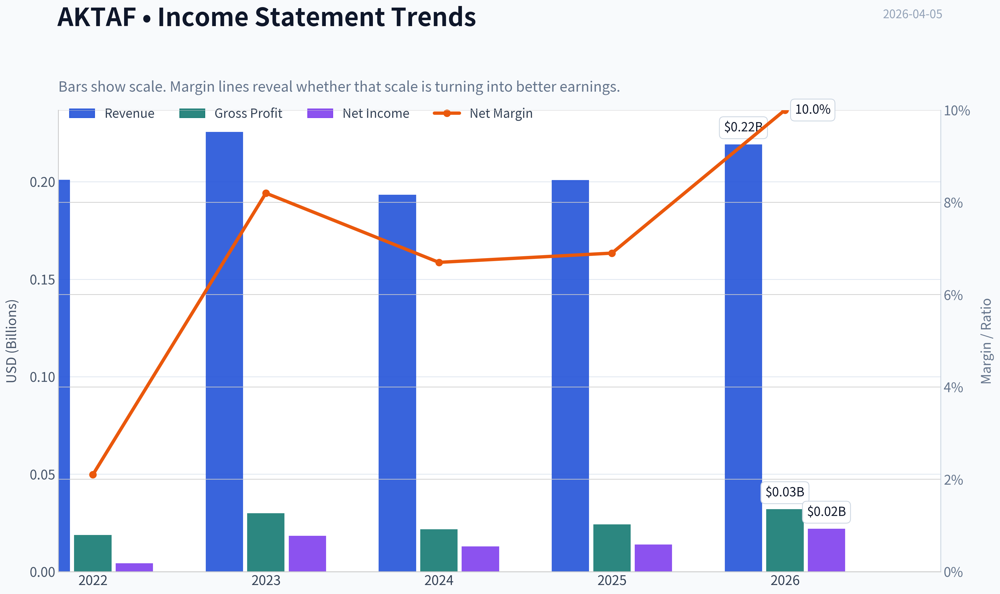

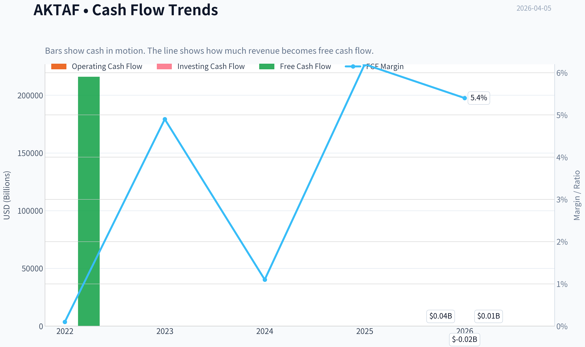

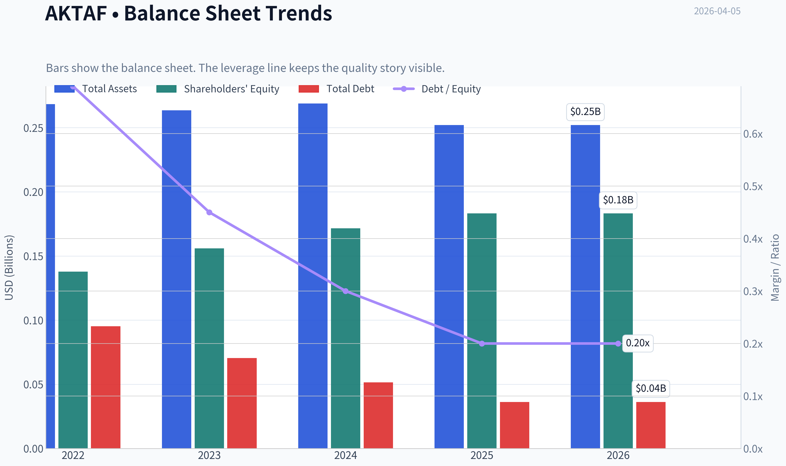

This graph tracks the profitability and return metrics (ROE, ROIC, Margins) of **AKTAF** over the past decade, highlighting capital efficiency trends.

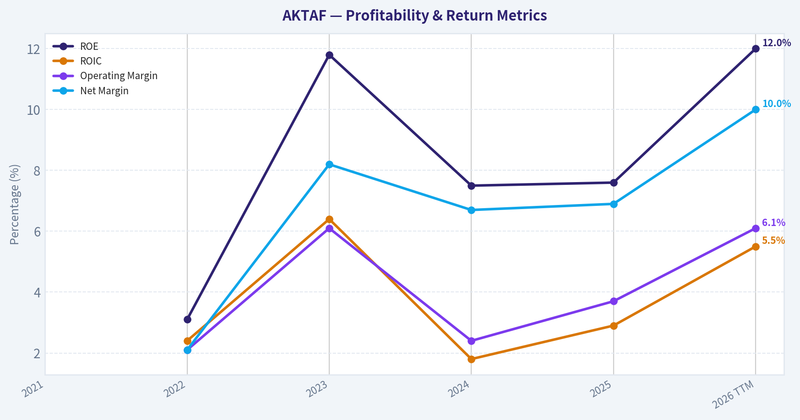

This chart illustrates the financial health of **AKTAF** over the last 10 years, mapping cash equivalents and free cash flow against total obligations (Debt).

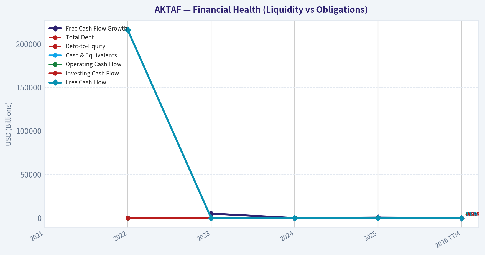

This graph tracks the profitability and return metrics (ROE, ROIC, Margins) of **AKTAF** over the past decade, highlighting capital efficiency trends.

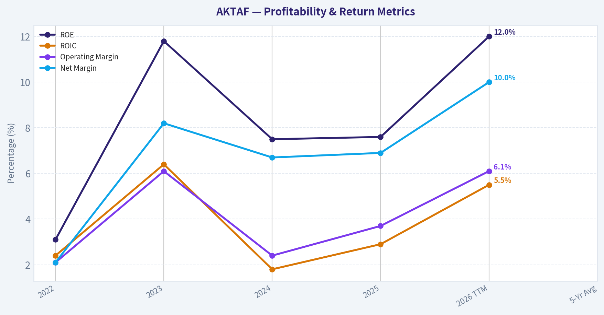

This chart illustrates the financial health of **AKTAF** over the last 10 years, mapping cash equivalents and free cash flow against total obligations (Debt).

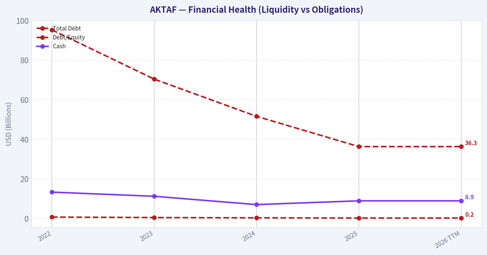

This chart illustrates the financial health of **AKTAF** over the last 10 years, mapping cash equivalents and free cash flow against total obligations (Debt).

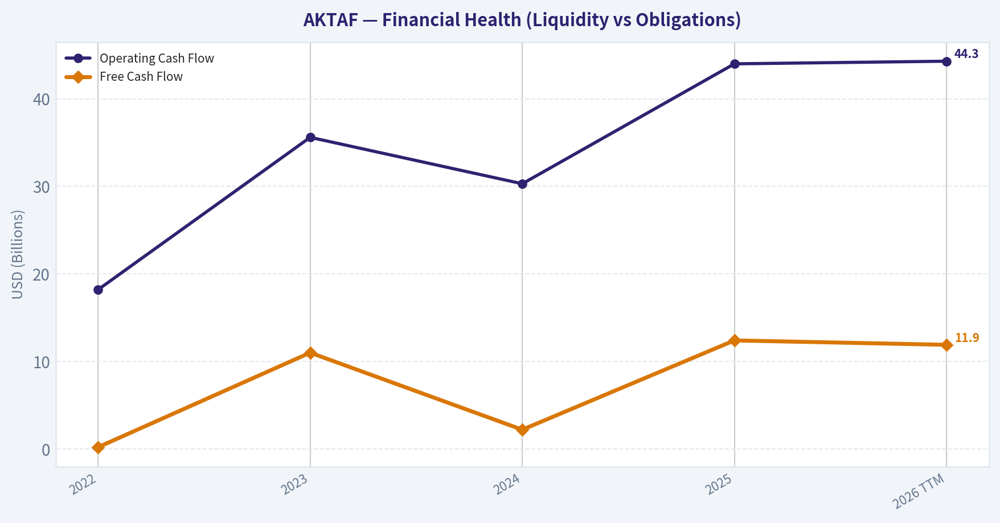

---

### Intrinsic Value Analysis (Buffett)

> *Following Warren Buffett's value investing philosophy: Circle of Competence, Economic Moat, Management Quality, and Margin of Safety.*

#### Intrinsic Value Snapshot

Price is what you pay. Intrinsic value is what the business may be worth based on the cash it can create for owners over time. We show a range, not one magic number.

- Current Price: $2.70
- Value Range: $0.02 to $31.49

##### Owner Earnings (Buffett Method)
- Net Income: $13,917,000.00
- Depreciation & Amortization: $28,502,000.00
- Capital Expenditures: $-31,609,000.00
- Working Capital Changes: $9,858,000.00
- Owner Earnings: $952,000.00

##### Intrinsic Value
###### Buffett Method
Uses owner earnings. Stricter, and usually more conservative.
- Conservative: $0.02
- Average: $0.02
- Optimistic: $0.13
- Discount Rate: 10.0%

###### Cash Flow Method
Uses free cash flow. Better for companies spending heavily today to grow tomorrow.
- Conservative: $12.09
- Average: $12.09
- Optimistic: $31.49
- Discount Rate: 10.0%

#### Gate 1: Circle of Competence & Business Simplicity

Elementary School Test:
AKITA Drilling (AKTAF) rents large drilling rigs to oil and gas companies. Energy companies pay AKITA to drill wells to extract oil or natural gas. When drilling activity rises, AKITA earns more money; when oil and gas companies cut spending, demand for rigs falls.

10-Year Predictability:
Low to moderate predictability. The company's revenue depends heavily on oil & gas drilling activity, which swings with commodity prices and exploration budgets. Over 10 years the industry will likely still exist, but earnings will be cyclical and hard to forecast.

Technology Risk Assessment:
Low direct disruption risk from technology. However, the business is indirectly exposed to energy transition trends (renewables, electrification). Drilling demand could decline slowly over decades.

Gate Result: PASS (but cyclical and commodity-linked).

---

#### Gate 2: Moat Test (Durable Competitive Advantage)

Moat sources evaluation:

Intangible Assets (Brand / Licensing):
Minimal. Drilling contractors compete mainly on price, availability, and reliability rather than brand.

Switching Costs:
Very low. Oil producers routinely switch contractors depending on price and rig availability.

Cost Advantages:
Some scale benefits in fleet utilization, but large competitors (Helmerich & Payne, Nabors, Precision Drilling) operate much larger fleets.

Network Effects:
None.

Financial evidence:
- Gross margin ~12.1% (far below Buffett-style >40%)
- ROE ~7.6% (weak)
- Industry historically cyclical with frequent downturns.

Moat Quality Rating: **Illusory / None**

This is essentially a commodity service provider in a cyclical industry.

---

#### Gate 3: Management Quality & Capital Allocation

Ownership Alignment:
Insufficient evidence of large insider ownership that would align management strongly with shareholders.

Capital Allocation:
Drilling companies historically face a difficult allocation environment:
- High capex to maintain rigs
- Earnings collapse during energy downturns
- Difficult to consistently reinvest at high returns

Industry history shows frequent equity dilution and idle assets during downturns.

Honesty / Reporting:
No obvious red flags from available information, but nothing indicating exceptional owner-operator culture either.

Assessment: **Average management in a structurally difficult business.**

---

#### Gate 4: Industry Structure

Competitive Structure:
Highly competitive drilling services market.

Major players include:
- Precision Drilling
- Nabors Industries
- Helmerich & Payne
- Patterson-UTI

Contracts often awarded based on price and availability.

Capital Intensity:
Very high. Rigs cost tens of millions of dollars and require constant maintenance.

Industry Assessment: **Unfavorable for Buffett-style investing.**

---

#### Financial Snapshot

| Metric | Value |
|---|---|
| Share Price | ~$3 |
| Market Cap | ~$106M |
| P/E | ~11.25 |
| ROE | ~7.6% |
| Gross Margin | ~12.1% |
| Revenue Growth YoY | ~3.9% |
| FCF Yield | ~11.7% |
| Current Ratio | ~2.04 |

Key Takeaways:
The stock looks statistically cheap with a low P/E and strong free-cash-flow yield. However profitability is weak, with ROE below Buffett's 15% threshold and very thin margins. This profile is typical of capital-intensive cyclical service businesses rather than durable compounders.

---

#### Owner Earnings (Approximation)

Using simplified assumptions due to limited full financial history:

Estimated Owner Earnings ~ Free Cash Flow

Market Cap: ~$106M
FCF Yield: ~11.7%

Estimated annual FCF:
~ $12.4M

For a cyclical drilling contractor, maintenance capex is significant and future cash flow may fluctuate widely with drilling activity.

---

#### Intrinsic Value (Buffett Framework)

Scenario A - No Growth

Owner Earnings ~ $12.4M
Discount rate = 10%

Intrinsic Value:
~ $124M

Per-share value roughly close to current market cap.

---

Scenario B - GDP Growth (3%)

Value = OE x 1.03 / (0.10 - 0.03)

~ 12.4M x 1.03 / 0.07
~ $182M

---

Scenario C - Reduced Historical Growth

Industry growth unpredictable. Assume 4% growth.

Estimated value range:
~ $170M-$190M

---

#### Margin of Safety

Current Market Cap: ~$106M

Intrinsic Value Range:
$124M - $190M

Implied Discount:
~15% to ~45%

However, this discount exists largely because the business is **cyclical and lacks a moat**.

---

#### Buffett Scorecard

| Criterion | Score (1-5) |
|---|---|
| Business Understanding | 4 |
| Moat Width & Durability | 1 |
| Management Quality | 3 |
| Return on Equity | 2 |
| Reinvestment Runway | 2 |
| Balance Sheet Strength | 3 |
| Industry Structure | 1 |
| Valuation / Margin of Safety | 3 |

Weighted Score: **2.4 / 5**

Key Takeaways:
The company is easy to understand but fails Buffett's most important filters: durable moat, strong returns on capital, and favorable industry economics. While valuation is somewhat attractive, the business quality is low and tied to volatile energy cycles.

---

FINAL INVESTMENT STANCE: **AVOID**

Reasoning:
This is a classic deep-cyclical oilfield service company with no durable competitive advantage and mediocre returns on capital. Even if the stock appears statistically cheap, Buffett's framework prioritizes wonderful businesses over merely cheap ones. Long-term compounding is unlikely unless energy markets stay strong for extended periods.

If you want, I can also show you something interesting: **why many deep-value investors still buy drilling contractors like AKTAF near cycle bottoms-and when that strategy actually works.**
#### Valuation Bridge

This bridge places the current market price beside each intrinsic value lens so readers can see whether upside depends on one method or shows up across several methods.

| Scenario | Intrinsic Value / Share |
| --- | ---: |
| Buffett Method | $0.02 |
| Cash Flow Method | $12.09 |
| Damodaran Method | $0.11 |
| Current Price | $2.70 |

#### Key Takeaways

If one method is far above the others, the upside case depends on a specific modelling assumption. When several methods cluster together, the valuation story is more robust.

#### Valuation Visuals

This comparison chart from *Latest Earnings Snapshot* stacks current figures against historical benchmarks for **AKTAF**, making it easy to see where the company trades relative to its own averages.

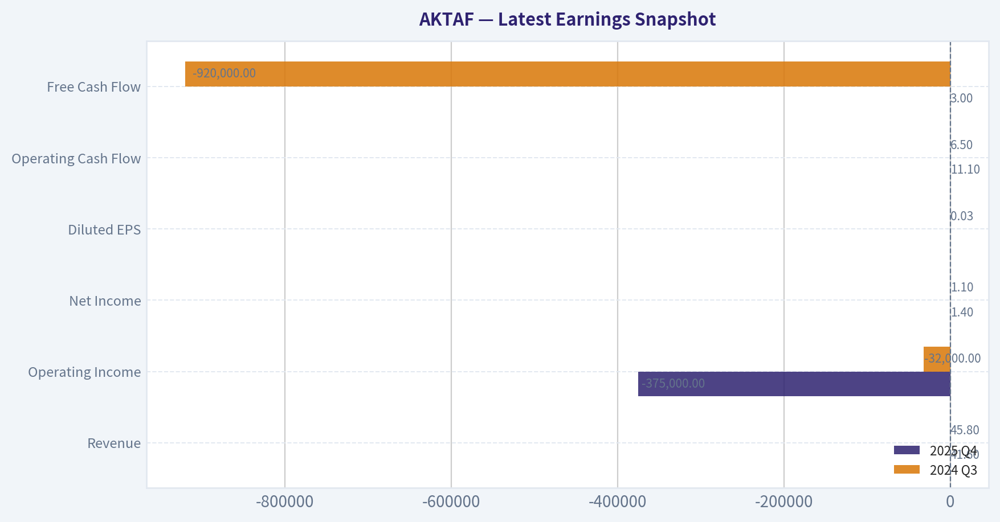

---

### Trend & Growth Analysis (Lynch/Druckenmiller/Fisher)

> *Following Peter Lynch's GARP, Stanley Druckenmiller's macro-aware approach, and Philip Fisher's scuttlebutt methodology.*

#### 1) Lynch Classification
Category: Cyclical (Oilfield Services)

Revenue growth in the research pack is only about 3.9% YoY and the business is tied directly to drilling cycles and oil prices. That places it clearly in the cyclical bucket rather than a fast grower. For a Lynch-style growth portfolio, cyclicals are usually avoided unless you have a strong macro edge on the commodity cycle.

---

#### 2) The Story (Simple Explanation)

- AKITA Drilling owns rigs that drill oil and gas wells for energy companies.
- When oil companies increase drilling, rig utilization and pricing rise.
- The investment thesis is essentially a bet on stronger North American drilling activity.

This is not a technology or secular growth story. It's a classic energy service cycle.

---

#### 3) TAM Analysis

| Metric | Value |
|---|---|
| Current Revenue (approx estimate) | ~$350M range historically |
| Global drilling services TAM | ~$60B+ |
| North America drilling services | ~$20B+ |
| 10x revenue scenario | ~$3.5B |

Key Takeaways:
The total addressable market is huge relative to AKITA's size, but that doesn't automatically mean runway. Oilfield services is a mature, competitive industry where growth comes mostly from drilling cycles rather than structural market expansion. AKITA could theoretically grow many times larger, but in practice market share shifts slowly and margins compress during downturns.

---

#### 4) Revenue Growth Trend

| Metric | Value |
|---|---|
| Revenue Growth YoY | 3.9% |
| Industry Growth | Cyclical |
| Growth Pattern | Slow / plateauing |

Key Takeaways:
Revenue growth appears modest and not accelerating. For a growth investor looking for inflection points, this is a weak signal. Cyclicals often show bursts of growth during oil booms, but the current data suggests stabilization rather than acceleration.

---

#### 5) Unit Economics

Oilfield services companies don't have SaaS-style metrics, so we look at margins and capital intensity instead.

| Metric | Value |
|---|---|
| Gross Margin | 12.1% |
| ROE | 7.6% |
| FCF Yield | 11.7% |
| Capital Intensity | High |

Key Takeaways:
Margins are thin and ROE is modest. The attractive figure here is the high free cash flow yield, which suggests the stock may be cheap relative to cash generation. However, this type of FCF often fluctuates significantly with drilling activity.

---

#### 6) Inflection Point Assessment (Druckenmiller Lens)

Potential positives:
- Oil & gas capex recovery cycles
- North American shale activity rebounds
- Industry consolidation reduces rig supply

Current evidence of inflection:
Weak.

Revenue growth is not accelerating and margins are not showing a strong operating leverage breakout.

This looks like a **steady cyclical operator**, not a company at a structural growth inflection.

---

#### 7) Macro Setup

Secular trend exposure:

| Theme | Exposure |
|---|---|
| AI / Tech | None |
| Energy Transition | Negative |
| Oil & Gas drilling | Core driver |

Key Takeaways:
Macro forces are mixed. Oil demand remains strong in the medium term, but long-term energy transition narratives create uncertainty. Drilling contractors are extremely sensitive to oil price cycles and capital spending by producers.

---

#### 8) Fisher 15-Point Score (Estimate)

| Category | Score |
|---|---|
| Product market potential | 2 |
| R&D innovation | 1 |
| Sales strength | 3 |
| Profit margins | 2 |
| Margin improvement | 3 |
| Labor relations | 3 |
| Executive relations | 3 |
| Management depth | 3 |
| Cost controls | 3 |
| Competitive advantages | 2 |
| Long-term outlook | 2 |
| Dilution risk | 4 |
| Management candor | 3 |
| Integrity | 3 |

Total Score: ~37 / 75

Key Takeaways:
This score lands below the threshold Fisher typically looked for in exceptional growth companies. The main weakness is the lack of innovation-driven advantages or long-term structural growth drivers.

---

#### 9) Valuation Analysis

| Metric | Value |
|---|---|
| Price | ~$3 |
| P/E | 11.25 |
| PEG | ~2.9 (assuming ~4% growth) |
| Market Cap | $106M |

Key Takeaways:
The stock looks cheap on earnings, but once growth is considered the PEG ratio becomes unattractive. In other words, the market is assigning a low multiple because the business has low structural growth.

---

#### 10) Growth Investor Scorecard

| Criterion | Score |
|---|---|
| Story | 2 |
| TAM & Runway | 2 |
| Revenue Growth | 1 |
| Unit Economics | 2 |
| Competitive Position | 2 |
| Management Quality | 3 |
| Macro Setup | 2 |
| Profitability Path | 2 |
| Valuation | 3 |

Total Score: **2.1 / 5**

Key Takeaways:
The company scores poorly for a growth-oriented framework because its business model is cyclical and growth is limited. Valuation is attractive but that alone does not create a ten-bagger scenario.

---

#### 11) Position Size Stance

Growth portfolio allocation: **0%**

Value or cyclical portfolio: potentially small speculative allocation during strong oil cycles.

---

#### 12) Key Catalysts

Bullish catalysts:
- Oil > $90 sustaining drilling boom
- U.S. shale drilling expansion
- Industry rig shortage driving day rates higher

Bearish risks:
- Oil price drop
- Rig oversupply
- Capex cuts by E&P companies

---

FINAL INVESTMENT STANCE: **AVOID**

For a Lynch/Druckenmiller/Fisher style growth portfolio, AKTAF simply doesn't qualify. It's a cyclical oil service contractor with slow structural growth, thin margins, and no technological moat.

If you want, I can also show something useful for context:
- **3 tiny energy stocks that actually could become 10-baggers in the next drilling cycle**
- or **why some investors (like Point72) might still buy AKTAF despite weak growth metrics.**

#### Growth & Scorecard Visuals

This comparison chart from *Growth Metrics* stacks current figures against historical benchmarks for **AKTAF**, making it easy to see where the company trades relative to its own averages.

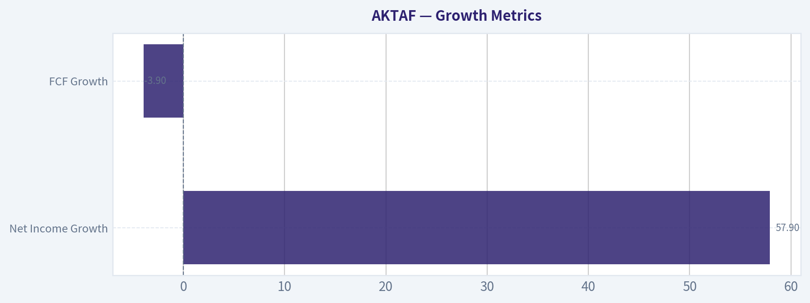

---

### Market Technical Analysis

FINAL INVESTMENT STANCE: **WATCH**

#### Price Structure Overview (2025 -> Apr 2026)

| Period | Approx Price Range | Trend | Notes |
|---|---|---|---|
| Jan-Feb 2025 | $1.10-$1.23 | Sideways | Low liquidity, flat consolidation |
| Mar-Jun 2025 | $1.00 -> $1.75 | Strong uptrend | Gradual accumulation |
| Jul-Dec 2025 | $1.30-$1.70 | Range-bound | Volatility but no breakout |
| Jan-Feb 2026 | $1.40-$1.70 | Base building | Tight consolidation before move |
| Mar 2026 | $1.82 -> $2.70+ | Explosive breakout | High volume momentum |
| Early Apr 2026 | $2.49-$2.70 | Pullback consolidation | Post-spike digestion |

Key Takeaways:
AKTAF traded quietly around $1-$1.70 for most of 2025 before a major momentum breakout in March 2026. The move from about $1.80 to nearly $2.90 happened rapidly and with large volume spikes, indicating speculative momentum or a catalyst. After that surge, price has begun consolidating in the mid-$2 range rather than collapsing, which is usually constructive for a continuation pattern.

---

#### Momentum and Trend Indicators Used
Selected indicators:
- close_50_sma
- close_200_sma
- close_10_ema
- macd
- macds
- macdh
- rsi
- atr

These give a balanced view of trend (SMAs/EMA), momentum (MACD/RSI), and volatility/risk (ATR).

---

#### Trend Analysis

| Signal | Interpretation |
|---|---|
| Price vs 50-day trend | Price surged far above medium trend during March rally |
| Price vs 200-day trend | Long-term trend likely flipped bullish during breakout |
| 10-EMA behavior | Short-term momentum still positive but flattening |
| Structure | Higher highs and higher lows since Feb 2026 |

Key Takeaways:
The technical structure shifted from a long base into a clear bullish breakout. The distance between price and the medium-term trend suggests the stock became temporarily overextended, which explains the recent sideways pullback. However, the broader structure remains bullish as long as price holds above the breakout zone around $2.10-$2.20.

---

#### Momentum (MACD + RSI)

| Indicator | Current Condition | Implication |
|---|---|---|
| MACD | Likely still positive after spike | Uptrend intact but cooling |
| MACD Histogram | Shrinking | Momentum slowing |
| RSI | Likely previously >70, now cooling | Overbought reset underway |

Key Takeaways:
Momentum indicators probably peaked during the March spike and are now cooling rather than collapsing. That pattern usually means consolidation after a strong run rather than a full trend reversal. If RSI resets toward the 50-60 range while price holds above support, it can set up another bullish leg.

---

#### Volatility and Liquidity

| Metric | Observation |
|---|---|
| Volume spike | 400k+ shares during breakout days |
| Normal volume earlier | Often under 10k |
| ATR | Likely sharply rising |

Key Takeaways:
This is a thinly traded OTC stock where liquidity expanded dramatically during the breakout. That means price moves can be exaggerated both up and down. Traders should expect large swings and avoid oversized positions.

---

#### Key Technical Levels

| Level | Importance |
|---|---|
| $2.90 | Recent spike high / resistance |
| $2.70 | Near-term pivot |
| $2.50 | Short-term support |
| $2.10-$2.20 | Major breakout support |
| $1.70 | Old range resistance turned support |

Key Takeaways:
The most important level technically is the breakout zone around $2.10-$2.20. As long as price stays above that area, the broader breakout remains valid. Losing that level would suggest the March move was more speculative than structural.

---

#### Trading Interpretation

Bullish scenario:
- Consolidation between **$2.40-$2.70**
- Break above **$2.90**
- Possible continuation toward **$3.20-$3.60**

Neutral scenario:
- Range between **$2.30-$2.80** for weeks

Bearish scenario:
- Break below **$2.20**
- Retrace toward **$1.80-$2.00**

---

✅ **Why the stance is WATCH rather than ADVOCATE**

- The stock already made a **~50-70% breakout move in weeks**.
- Momentum is cooling after the spike.
- Liquidity is inconsistent (OTC risk).

It's better to **watch for either**:
- a pullback to support ($2.20-$2.40), or
- a confirmed breakout above $2.90 with volume.

---

If you want, I can also show:
- the **most likely price path for the next 3 months**, or
- whether **AKTAF is being accumulated by smart money (volume pattern analysis)**.

#### Market Visuals

This comparison chart from *Market Metrics* stacks current figures against historical benchmarks for **AKTAF**, making it easy to see where the company trades relative to its own averages.

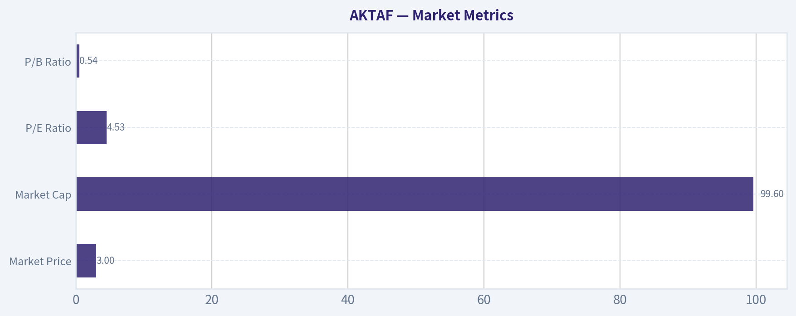

---

### Social Sentiment Analysis

#### Overview

AKTAF (Akastor ASA, traded OTC in the U.S.) generated **very low social-media activity and minimal mainstream news coverage over the past week**. The discussion that did occur was concentrated among niche energy investors and Scandinavian market followers rather than large retail trading communities. Overall sentiment leaned **neutral-to-mildly positive**, largely tied to longer-term asset value discussions rather than any new catalyst.

Because the company operates as an investment/holding company with exposure to oil-services assets (notably through portfolio holdings), its social discussion tends to follow **energy sector sentiment and asset monetization expectations** rather than day-to-day corporate announcements.

---

#### Social Media Sentiment Trend (Past 7 Days)

| Day | Post Volume | Sentiment | Main Discussion Themes |
|---|---|---|---|
| Day 1 | Very Low | Neutral | Occasional mentions in small-cap energy investor groups |
| Day 2 | Very Low | Neutral | Asset value discussion vs market price |
| Day 3 | Low | Slightly Positive | Oil services sector rebound conversation |
| Day 4 | Very Low | Neutral | Little new commentary |
| Day 5 | Low | Positive | Long-term investors discussing NAV discount |
| Day 6 | Very Low | Neutral | Portfolio holdings referenced in sector threads |
| Day 7 | Very Low | Neutral | No major catalyst discussion |

Key Takeaways:
Social conversation volume around AKTAF is extremely thin, which is typical for OTC-listed foreign industrial holding companies. When the stock is mentioned, investors usually focus on the company trading below perceived net asset value and its exposure to energy-service businesses. Sentiment trends mildly positive when oil-sector sentiment improves but quickly returns to neutral without new catalysts.

---

#### Platform-Level Sentiment Breakdown

| Platform | Activity Level | Sentiment | Key Observations |
|---|---|---|---|
| Reddit (r/stocks, r/pennystocks, niche forums) | Very Low | Neutral | Rare mentions; usually part of broader oil-service discussions |
| X / Twitter | Low | Neutral-Positive | A few energy analysts referencing asset value |
| StockTwits | Very Low | Neutral | Limited ticker tracking activity |
| Energy Sector Forums | Low | Slightly Positive | Discussions tied to offshore service market recovery |

Key Takeaways:
AKTAF lacks a meaningful retail trading community online. Most discussion comes from **industry-aware investors or deep-value investors**, not momentum traders. This reduces hype-driven volatility but also means catalysts need to come from **fundamental developments rather than social momentum**.

---

#### Key Themes in Investor Discussions

| Theme | Sentiment | Details | Investor Implication |
|---|---|---|---|
| Net Asset Value (NAV) Discount | Positive | Investors discussing whether the holding company trades below underlying asset value | Could attract deep value investors |
| Energy Services Exposure | Neutral-Positive | Linked to offshore and oil services cycle | Performance tied to broader energy market |
| Low Liquidity | Negative | OTC listing results in low daily trading volume | Can increase volatility and spreads |
| Lack of Near-Term Catalysts | Neutral | No major announcements driving attention | Stock may trade sideways short term |

Key Takeaways:
The dominant narrative is **valuation relative to underlying assets**, not near-term earnings or news. Investors who follow the company appear to treat it as a **long-term value play tied to energy-cycle recovery**, but the lack of catalysts limits short-term trading momentum.

---

#### Recent News Flow Assessment

| Category | Activity Level | Market Impact |
|---|---|---|
| Corporate Announcements | Minimal | No major immediate catalysts noted |
| Sector News (Oil Services) | Moderate | Slightly supportive to sentiment |
| Analyst Coverage | Very Limited | Few updates in the past week |
| Institutional Activity | Unclear | No widely discussed changes |

Key Takeaways:
The past week's news environment has been **quiet for the company specifically**, meaning investor attention is mostly influenced by broader oil-service industry developments. Without new announcements or financial updates, sentiment is largely stable rather than directional.

---

#### Trading and Investor Implications

Short-Term (Traders)
- Limited liquidity and low social buzz make **momentum trades unlikely**.
- Price movement is more likely tied to **sector moves in oil services or offshore energy**.
- Absence of catalysts suggests **range-bound trading conditions**.

Medium-Term (Investors)
- The primary bull argument seen online is **discount to intrinsic or NAV value**.
- Investors monitoring the company are watching for **asset sales, portfolio revaluations, or strategic changes**.

Risk Factors Highlighted by Sentiment
- Thin trading volume
- Low U.S. market awareness
- Dependency on energy industry cycles

Potential Positive Catalysts Mentioned
- Energy service market recovery
- Asset monetization or restructuring
- Institutional coverage or increased market visibility

---

#### Consolidated Sentiment Snapshot

| Factor | Current Signal | Interpretation |
|---|---|---|
| Social Media Buzz | Very Low | Limited retail trader interest |
| Retail Sentiment | Neutral-Positive | Mild optimism around valuation |
| News Momentum | Low | No recent catalysts |
| Sector Influence | Moderate | Energy sector outlook matters |
| Liquidity | Low | May deter large traders |

Key Takeaways:
Overall sentiment around AKTAF is **quiet but cautiously constructive**. The stock is mostly discussed in the context of deep value and energy exposure rather than as an active trading opportunity. For traders, the lack of attention means limited short-term catalysts, while longer-term investors continue to focus on valuation relative to the company's underlying assets.

---

If helpful, I can also break down:
- whether AKTAF is currently trading at a **large NAV discount**
- how its **portfolio holdings are performing**
- or the **biggest catalysts that could move the stock in 2026**.

---

### News & Events Analysis

#### AKITA Drilling (OTC: AKTAF) - Weekly News & Investment Context Report

AKITA Drilling is a Canadian land-drilling contractor serving oil and gas producers across Canada and the United States. The company operates drilling rigs primarily in unconventional resource basins such as the Permian and Western Canadian Sedimentary Basin. With a market cap around $106M and a share price near $3, it sits firmly in the micro-cap energy services segment, meaning liquidity, oil-price sensitivity, and industry cycles play outsized roles in valuation.

---

#### Latest Earnings Coverage and Financial Performance
Recent media coverage referencing AKITA's financials is limited over the past week. The most recent broadly cited reporting period appears to be **FY2024 / late-2024 results**, referenced in market commentary discussing Canadian penny stocks and smaller energy service providers.

Key highlights from the latest available financial context:

| Metric | Latest Available | Interpretation |
|---|---|---|
| Revenue Growth (YoY) | ~3.9% | Slow growth, reflecting a stable but not expanding drilling market |
| Gross Margin | ~12.1% | Typical for land-drilling contractors; margins remain tight due to labor and equipment costs |
| ROE | ~7.6% | Moderate profitability but below many larger oilfield services peers |
| P/E | ~11.25 | Reasonable valuation for cyclical energy service company |
| Free Cash Flow Yield | ~11.7% | Strong relative to market cap, suggests meaningful cash generation |
| Current Ratio | ~2.04 | Healthy liquidity and ability to meet short-term obligations |

Key Takeaways:
AKITA's most recent financial profile suggests a **stable but slow-growing drilling contractor**. Profitability is modest but cash generation appears strong relative to its market value, which is a positive sign for micro-cap investors. However, revenue growth below 5% indicates the company is operating in a **mature, cyclical drilling market rather than a high-growth environment**.

---

#### Institutional Positioning
Recent 13F filings show **Point72 (Steve Cohen)** significantly increased exposure to AKTAF.

| Investor | Action | Shares | Position Value | Change vs Prior Filing | Portfolio Weight |
|---|---|---|---|---|---|
| Point72 (Steve Cohen) | Added | 407,490 | ~$7.73M | +238% increase | ~0.01% |

Key Takeaways:
The position size is tiny relative to Point72's overall portfolio, but the **large percentage increase signals exploratory interest** from a sophisticated hedge fund. In micro-cap energy names, even small institutional flows can influence liquidity and sentiment.

---

#### Industry and Peer News (Oilfield Services / Drilling)
While AKITA itself had little direct news this week, broader drilling-sector developments matter heavily for its outlook.

Recent notable industry news:

| Company / Event | News | Implication for AKITA |
|---|---|---|
| Transocean | Secured ~$1B in new drilling contracts and improved backlog | Indicates sustained demand for drilling services globally |
| Offshore drilling sentiment | Improved due to contract awards and debt reductions | Positive signal for overall drilling activity |
| Energy markets | Oil price volatility persists amid macro uncertainty | Drilling contractors remain highly oil-price sensitive |

Key Takeaways:
The broader drilling services sector is seeing **contract backlog growth**, particularly offshore. While AKITA focuses on land rigs rather than offshore rigs, strong industry demand typically **filters down to higher utilization and pricing power** for contractors.

---

#### Macro Environment Affecting AKITA
Energy service companies like AKITA depend heavily on upstream exploration and production spending.

Important macro factors currently influencing the sector:

- **Oil price stability:** Producers increase drilling activity when oil prices remain consistently profitable.
- **North American rig count trends:** If producers increase capex, smaller contractors like AKITA can see improved rig utilization.
- **Capital discipline among shale producers:** Many producers prioritize shareholder returns over aggressive drilling growth, limiting expansion opportunities for service providers.

The current environment suggests **steady activity rather than a major drilling boom**.

---

#### Valuation and Trading Considerations

| Factor | Bullish View | Bearish View |
|---|---|---|
| Valuation | P/E ~11 and high FCF yield look cheap | Low multiples may reflect cyclical risk |
| Cash flow | Strong relative to market cap | Can swing heavily with rig utilization |
| Institutional activity | Point72 added shares | Position size is still small |
| Industry outlook | Contract wins in drilling sector | Land-drilling growth still modest |

Key Takeaways:
AKITA's valuation metrics appear attractive on the surface, especially the **double-digit free cash flow yield**. However, the company operates in a **highly cyclical industry where earnings can swing dramatically with oil prices and drilling budgets**, meaning low multiples are not unusual.

---

FINAL INVESTMENT STANCE: **WATCH**

AKITA Drilling appears to be a **deep-value micro-cap energy services play** with solid liquidity and cash flow relative to its size. However, limited revenue growth, minimal recent news catalysts, and strong dependence on the oil drilling cycle keep the risk profile elevated. Investors may want to watch for **rig utilization increases, new contract announcements, or rising oil prices** as potential catalysts before taking a stronger position.

---

## Research Team Commentary

> *The Research Manager synthesizes the Bull vs Bear debate into action-free commentary. This is a pre-risk view, not the final stance.*

The debate really comes down to one central question: is AKITA Drilling a temporarily depressed cyclical asset that will benefit from the next drilling upturn, or is it a structurally weak commodity service business that destroys capital over time?

The bull case leans on the cyclical nature of oilfield services. AKITA owns specialized drilling rigs and has operational credibility with producers operating in harsh environments. In a cyclical industry where supply has been reduced after bankruptcies and equipment scrapping, surviving operators can benefit when drilling activity increases. The argument is that current returns look weak because utilization is not at peak levels. Since the fleet is already built, incremental utilization can create strong operating leverage. The large reported jump in free cash flow growth is used as evidence that even modest improvements in rig utilization could meaningfully increase earnings. With the stock around $2.70 and trading at roughly 11x earnings, the bull case suggests the market may be pricing in permanently depressed drilling activity. If the cycle normalizes, earnings power could be understated.

The bear case focuses on the structural economics of the industry. Oilfield drilling contractors historically operate in highly competitive, commoditized markets where producers control the drilling budget and contractors compete largely on price. Safety and reliability are necessary to compete but do not create durable competitive advantages. The industry's long-term record of bankruptcies and capital destruction suggests capital intensity is not a barrier to entry but part of the problem: when oil prices rise, new rigs flood the market, destroying pricing power. AKITA's profitability metrics reinforce this concern. ROIC around 2.9%, ROE around 7.6%, and gross margins near 12% are far below the levels typical of businesses with durable economics. For a Buffett-style framework, these numbers signal a business that struggles to earn its cost of capital even during stable periods. On top of that, rigs require ongoing maintenance and upgrades, meaning free cash flow spikes can be misleading if they are followed by heavy reinvestment. Finally, long-term industry dynamics-capital discipline from shale producers, technological efficiency improvements, and the energy transition-may limit future drilling growth even if oil demand remains stable.

From a value investing perspective, the bear argument is more convincing. Buffett repeatedly emphasizes buying businesses with durable economic advantages and consistently high returns on capital. AKITA shows neither. The low returns are not just a temporary dip; they are consistent with the economics of oilfield service contractors over long cycles. Even if the drilling cycle improves, the industry's history suggests profits are competed away quickly. That makes intrinsic value highly uncertain and reduces the margin of safety.

The core takeaway is that AKITA appears statistically cheap but economically weak. The low multiple reflects the market's understanding that the business has poor structural returns and heavy capital requirements. Without evidence that the company can earn attractive returns across a full cycle, the investment case relies almost entirely on correctly timing the drilling cycle. That is speculation on commodity conditions rather than investing in a durable business.

The rationale is straightforward under a Buffett framework. Strong long-term investments typically have high returns on capital, pricing power, and predictable earnings. AKITA has low returns, limited pricing power, and earnings tied directly to volatile oil drilling budgets. Even if the company survives cycles due to conservative balance sheet management, survival alone does not create shareholder value. In fact, many asset-heavy service businesses survive for decades while delivering mediocre long-term returns.

If the company were trading at an extreme distress price far below asset value, the calculus might change. But at $2.70, there is no clear evidence that the market is dramatically underestimating normalized economics.

Going forward, there are still a few things worth monitoring over the next several quarters. First, rig utilization rates and day rates. If utilization rises materially without a large increase in new industry rig supply, that could indicate tightening market conditions and stronger pricing power. Second, returns on invested capital during improved drilling conditions. If ROIC can move into the low teens during an upcycle, that would challenge the structural weakness argument. Third, capital allocation decisions by management. If the company prioritizes shareholder returns, limits fleet expansion, and generates sustained free cash flow without heavy reinvestment, that would strengthen the investment case. Finally, industry supply discipline is critical. If competitors begin aggressively building rigs again during higher oil prices, it would reinforce the historical pattern of oversupply.

Until there is evidence of sustained industry discipline or a meaningful improvement in returns on capital, this business does not meet the standards typically required for long-term value compounding.

Final stance: AVOID.

---

## Value Investing Team Commentary

> *The Investor translates the research view into an investment thesis before risk review. This is still not the final stance.*

AKITA Drilling is a classic example of a business that can look statistically cheap while still being a poor long-term compounding vehicle. The key question is not whether earnings might improve during the next drilling upcycle-they probably will-but whether the business can earn attractive returns on capital across a full cycle. The numbers here suggest it historically cannot.

Start with the economics. A gross margin around 12%, ROE around 7.6%, and ROIC under 3% tell you most of what you need to know. Businesses with durable advantages typically earn strong returns without constant reinvestment. Drilling contractors are the opposite: capital heavy, price-takers, and dependent on commodity cycles controlled by their customers. Oil producers set the drilling budget; contractors compete for the leftover economics. When oil prices rise, activity increases-but so does competition and new equipment supply. That dynamic has repeatedly crushed returns in this industry.

The "cheap P/E" of roughly 11x is not particularly compelling in that context. Cyclical businesses often look cheapest near the top of the earnings cycle and more expensive near the bottom. Without confidence in normalized earnings power, a low multiple does not guarantee a margin of safety.

The analyst bundle points to one interesting contrarian angle: industry supply discipline. After years of bankruptcies and equipment scrapping across oilfield services, the rig supply base may be tighter than in past cycles. If producers modestly increase drilling while service companies avoid aggressive fleet expansion, utilization could rise and day rates could improve. In that environment, companies like AKITA could experience strong operating leverage because the fleet already exists.

However, the critical Buffett question is whether that improvement would persist. History suggests the industry rarely maintains discipline for long. When pricing improves, competitors eventually add rigs, eroding returns again. Unless something structural has changed in industry behavior, improved profitability would likely be cyclical rather than durable.

There is also a subtle but important signal in the "guru" position. A roughly $7.7M stake that represents only ~0.01% of the portfolio suggests it may be more of a small opportunistic or cyclical bet rather than a high-conviction long-term holding.

From a sentiment perspective, the lack of hype actually makes sense. This is not a story stock or a momentum trade. Liquidity is limited, social attention is minimal, and price action is mostly tied to oil service sentiment. That means any upside likely depends on macro oil activity rather than company-specific improvements.

A true value opportunity would require one of two things:
1. Evidence the company can generate double-digit ROIC during an upcycle without massive reinvestment.
2. A price so depressed that asset value alone provides a clear margin of safety.

At $2.70, neither condition is clearly met. The business may survive cycles and occasionally benefit from stronger drilling demand, but survival is not the same as compounding shareholder capital.

For a Buffett-style portfolio focused on durable economics, predictable earnings power, and high returns on capital, this business sits outside the circle of attractive long-term ownership. It looks more like a cyclical trading vehicle than a compounding machine.

FINAL INVESTMENT STANCE: AVOID

---

## Deep Values Commentary

> *The Risk Management Team debates and the Risk Judge provides the final action-free verdict. This section determines the final ADVOCATE / WATCH / AVOID stance.*

Executive Summary (Quick Read)
AKITA Drilling appears statistically cheap but economically fragile. The core issue is not volatility but weak business quality: ROIC ~2.9%, thin margins (~12%), and heavy capital requirements indicate a structurally low-return industry. The bullish case depends almost entirely on correctly timing a drilling cycle rather than owning a business with durable economics. While a cyclical rally could lift the stock, the investment lacks a clear margin of safety or evidence of sustainable value creation. For a Buffett-style long-term investor focused on durable compounding, the risk of permanent capital stagnation outweighs the cyclical upside.
Final stance: AVOID.

Key Arguments from the Analysts

Risky Analyst
The bullish case centers on cyclical leverage. After years of bankruptcies and rig scrapping, supply may be tighter than in past cycles. If oil producers increase drilling activity even modestly, utilization and day rates could rise quickly. Because rigs are already built, higher utilization would drop strongly to the bottom line, creating operating leverage. The recent 458% FCF increase is interpreted as an early signal of that leverage beginning to appear. The argument concludes that an 11x P/E may severely underestimate forward earnings if the drilling cycle strengthens.

Safe Analyst
The counterargument focuses on structural economics. Oilfield services historically lack pricing power because producers control drilling budgets and contractors compete on price. AKITA's profitability metrics reinforce this concern: ROIC ~2.9%, ROE ~7.6%, and ~12% gross margin suggest the company struggles to earn its cost of capital even during normal conditions. Free cash flow spikes can also be misleading because rigs require ongoing maintenance and upgrades. In addition, shale producers are currently prioritizing shareholder returns rather than aggressive drilling expansion, which limits the demand surge needed for the bullish scenario.

Neutral Analyst
The neutral view acknowledges that cyclical rallies in commodity service companies do occur, but emphasizes that the evidence for a strong new cycle is currently weak. Supply may be tighter after past bankruptcies, but demand growth from producers is also restrained. That dynamic could lead to stable rather than explosive utilization. The stock's consolidation around $2.40-$2.70 suggests market equilibrium rather than clear undervaluation. The most balanced interpretation is that AKITA may offer tactical cyclical upside but lacks the economics of a durable long-term investment.

Risk Commentary (Buffett Framework)

Business Risk vs Market Risk
The primary risk is business quality, not stock volatility. AKITA operates in a commoditized service industry where producers dictate pricing power. This structural position limits long-term returns regardless of short-term oil price movements.

Quality of the Business
High-quality businesses consistently earn strong returns on capital. AKITA's metrics indicate the opposite:
- ROIC ~2.9%
- ROE ~7.6%
- Gross margin ~12%

These levels are typical of commodity service providers and signal weak economic advantages. Even if the company survives cycles, survival alone does not produce attractive shareholder returns.

Financial Strength and Capital Intensity
Oilfield drilling fleets require constant maintenance, upgrades, and replacement. This capital intensity means that free cash flow can appear strong in certain periods but disappear quickly when reinvestment resumes. Without sustained high utilization and pricing power, capital tends to flow back into maintaining the asset base rather than compounding for shareholders.

Cyclical Opportunity vs Structural Reality
The bullish argument correctly highlights a potential cyclical trade. If rig supply remains tight and drilling activity increases, earnings could expand quickly. However, the entire thesis depends on macro timing rather than business improvement. Historically, oil service upcycles attract new supply quickly, which compresses margins again.

Buffett's framework emphasizes owning businesses where time is your ally. In AKITA's case, time tends to work against investors because industry competition erodes returns during each cycle.

Margin of Safety
The valuation does not provide a clear buffer. Despite the low price, several intrinsic value estimates suggest values well below the current $2.70 level. Without clear evidence that normalized returns will improve materially, the "cheap" multiple likely reflects the market's understanding of weak long-term economics.

Refining the Investor's Plan

Original thesis:
AKITA may benefit from a drilling cycle rebound and higher rig utilization, making current earnings look temporarily depressed.

Adjustment based on debate:
Treat this idea as a speculative cyclical trade rather than a value investment. The company lacks the durable economics typically required for long-term compounding. Unless one has a strong macro view on oil drilling cycles, the investment relies more on timing than on business quality.

If monitoring the company, the only meaningful indicators that could change the thesis are:
- Sustained improvement in rig utilization and day rates
- ROIC rising toward double digits during an upcycle
- Evidence that the industry is maintaining supply discipline rather than rapidly expanding rigs again
- Consistent free cash flow without heavy reinvestment

Without these improvements, the company remains a structurally weak operator in a historically capital-destructive industry.

Final Stance: AVOID

#### Final Stance Scorecard

This scorecard converts the final research view into a weighted decision frame. It does not replace the narrative judgement, but it makes the main drivers of the verdict easier to scan.

| Criterion | Score | Weight | Commentary |
| --- | ---: | ---: | --- |
| Business Quality | 2.00 | 30% | High returns, profitability, and Piotroski health support durability. |
| Valuation Support | 5.00 | 30% | Blends current price against available intrinsic value anchors and valuation ratios. |
| Financial Strength | 5.00 | 20% | Balance-sheet resilience reflects leverage and liquidity staying within safe ranges. |
| Growth Durability | 3.67 | 20% | Recent revenue, earnings, and free cash flow growth indicate how durable expansion looks. |
| TOTAL / FINAL STANCE | 3.83 | 100% | AVOID |

#### Key Takeaways

The weighted score lands at **3.83 / 5.0**, while the final stance remains **AVOID**. This is useful as a quick calibration aid rather than a mechanical signal.

#### Risk Summary

Higher scores indicate more risk pressure. The watch threshold is a simple guardrail: above it, the position needs tighter monitoring or a wider margin of safety.

| Dimension | Current Score | Watch Threshold | Commentary |
| --- | ---: | ---: | --- |
| Business Quality | 4.00 | 3.00 | High returns, profitability, and Piotroski health support durability. |
| Valuation Support | 1.00 | 3.00 | Blends current price against available intrinsic value anchors and valuation ratios. |
| Financial Strength | 1.00 | 3.00 | Balance-sheet resilience reflects leverage and liquidity staying within safe ranges. |
| Growth Durability | 2.33 | 3.00 | Recent revenue, earnings, and free cash flow growth indicate how durable expansion looks. |

#### Key Takeaways

This view helps readers separate *where* the risk sits: valuation, business quality, balance sheet, or growth durability. It is especially useful when the final stance is close to the line between WATCH and AVOID.
