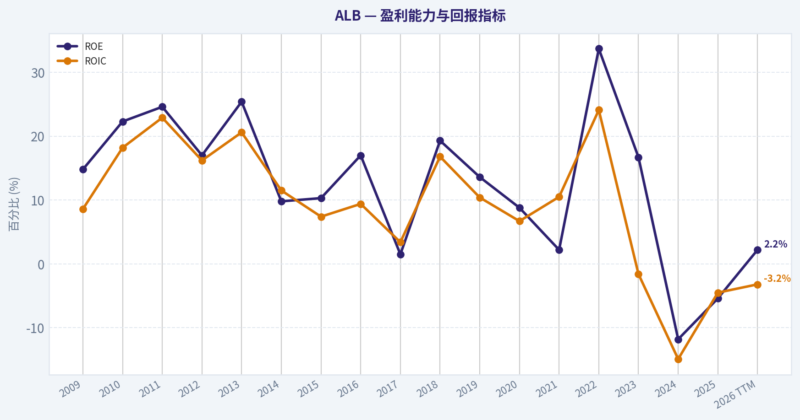
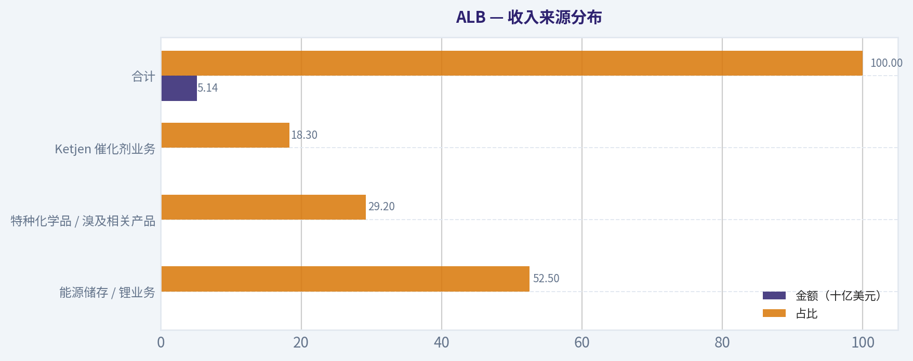
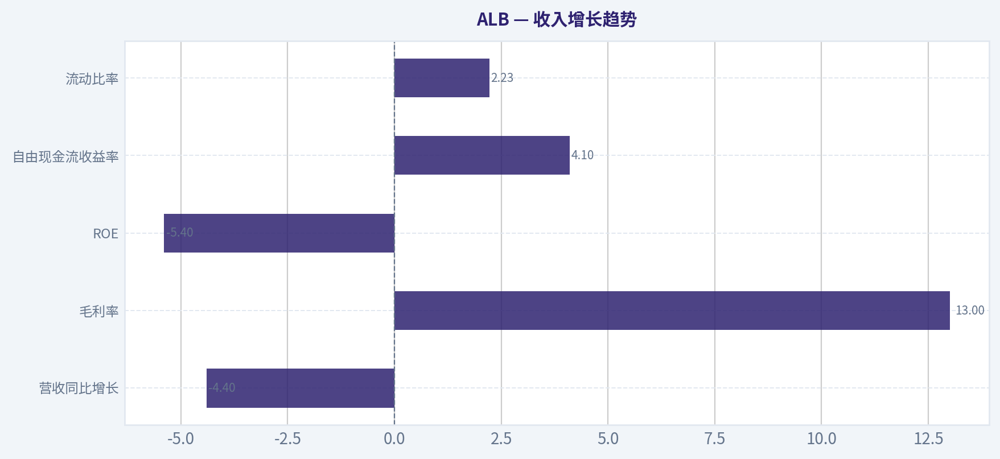
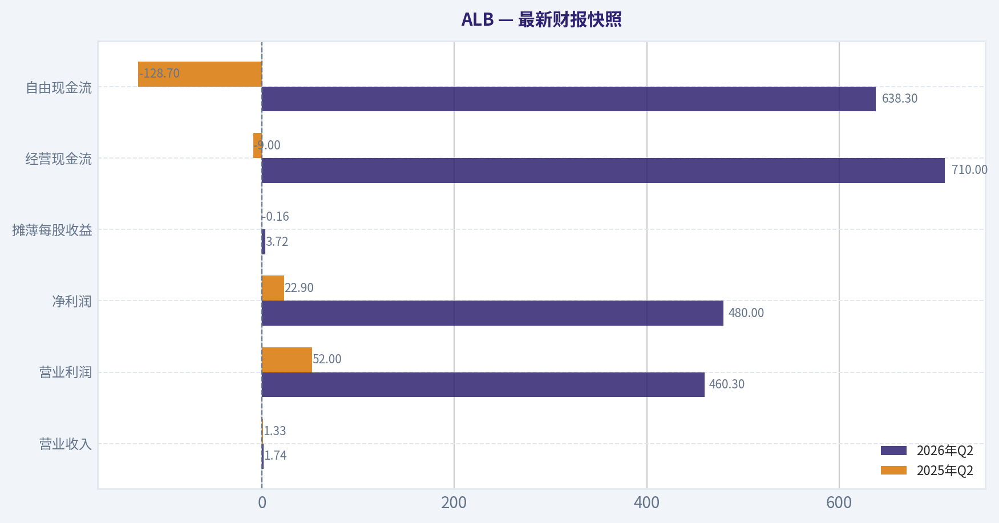
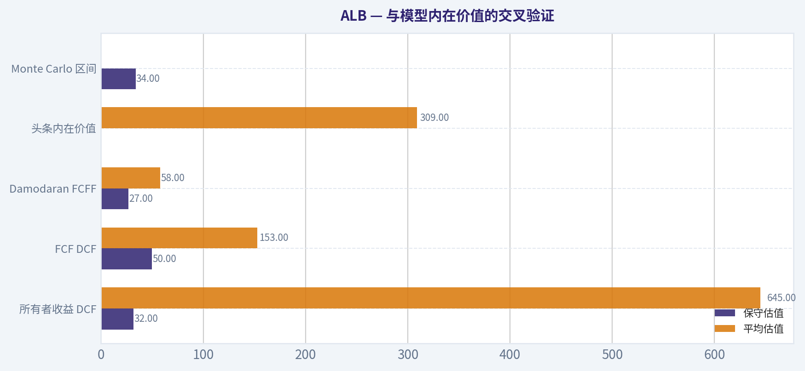
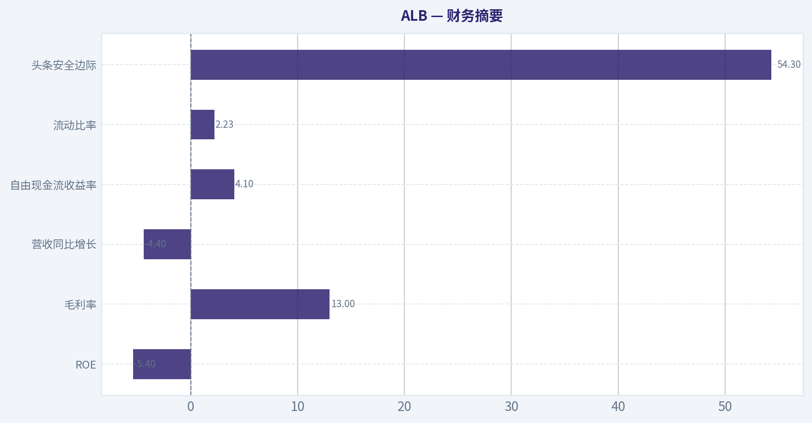
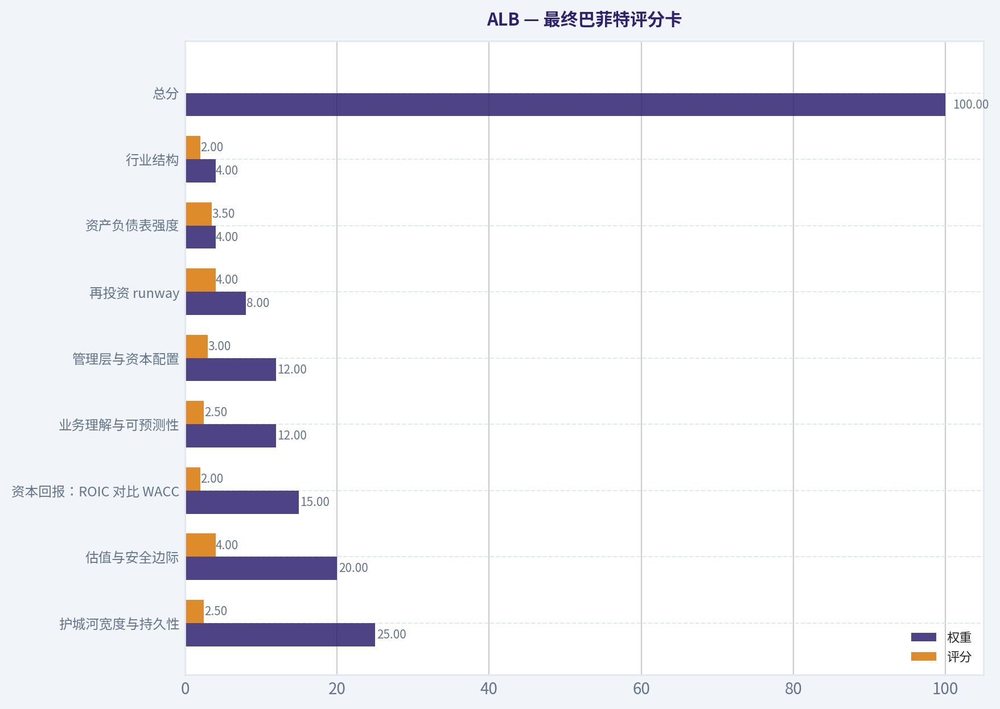
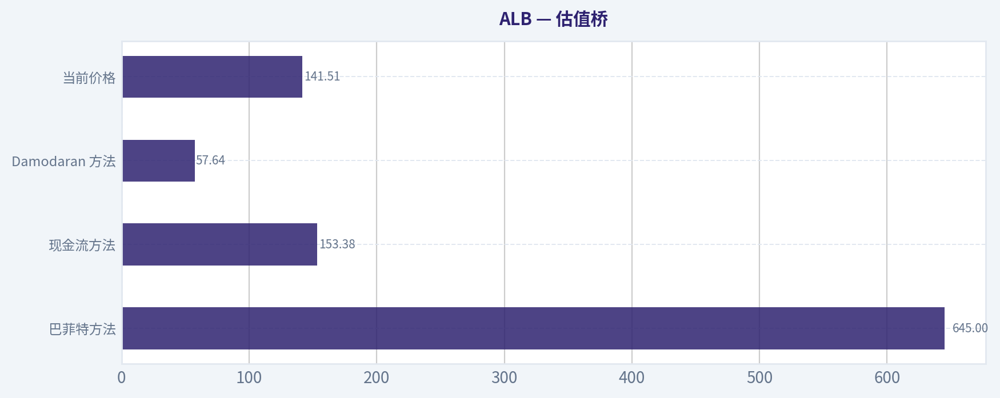

# ALB 深度价值情报

**调研日期:** 2026-08-25

## 关键免责声明

*本报告由 Deep Value Intelligence（一个基于 AI 的多智能体投资分析框架）自动生成。 仅供教育和研究用途 - 非财务建议，非财务顾问。*

---

## 目录

1. 情报摘要
2. 分析师团队报告
   - 基本面分析
   - 价值分析 (巴菲特)
   - 成长性分析 (林奇/德鲁肯米勒/费雪)
   - 市场分析
   - 期权市场分析
3. 研究团队评论
4. 投资团队评论
5. Deep Values 团队洞察

---

## 情报摘要

### 核心观点与前提条件

**核心论点:** 作为遵循巴菲特价值投资哲学的风险管理法官与投资促进者，针对 ALB（雅宝）的多空辩论，结合我们在 CRM（强调量化宏观叙事）和 BRK-B（强调警惕单一估值与技术左侧）上的复盘教训，我的综合评估如下：

**主要风险:**
- 最终评级：观望 (WATCH) - 设定严格的右侧与基本面触发器。**
- 激进派 (Risky Analyst - 看多)：** 强调"买在周期极度悲观时"。认为高达 524 倍的 P/E 是典型的周期底特征，凭借 54% 的 DCF 安全边际和不可复制的底层资源，现在是买入"能源转型门票"的绝佳非对称博弈机会。
- 不要采用中立派"盲目试探"的策略，而是将"观望"升级为**带有硬性触发器的条件式监控 (Conditional Watch)**。必须满足以下三个维度中的**至少两项**，才能将评级上调为"建议配置"：

**置信度:** 中

---

## 分析师团队报告

### 基本面分析

#### 最新财报快照

*以下数据基于最近一期已披露财报（2026年Q2），并尽量与上一年同期对比。*

| 指标 | 2026年Q2 | 2025年Q2 | 同比变化 |
| --- | ---: | ---: | ---: |
| 营业收入 | $1.74B | $1.33B | +31.1% |
| 营业利润 | $460.3M | $52.0M | +785.6% |
| 净利润 | $480.0M | $22.9M | +1996.2% |
| 摊薄每股收益 | $3.72 | $-0.16 | +2425.0% |
| 经营现金流 | $710.0M | $-9.0M | +7965.3% |
| 自由现金流 | $638.3M | $-128.7M | +596.1% |

关键结论：这张快照先把最新一期财报放在桌面上，再去看长周期分析。这样读者能更清楚地区分"公司长期质量"和"这次财报发生了什么"。

#### ALB 17年财务指标

*以下数值均由原始数据确定性计算得出，并非 AI 估算。*

*发行人类型：operating company（Basic Materials / Specialty Chemicals）。*

#### 17年财务指标
*年度行来自已披露财务报表，最后一行 TTM 由最近四个季度滚动计算得出。*

| 指标 | 2009 | 2010 | 2011 | 2012 | 2013 | 2014 | 2015 | 2016 | 2017 | 2018 | 2019 | 2020 | 2021 | 2022 | 2023 | 2024 | 2025 | 2026 TTM |
| --- | --- | --- | --- | --- | --- | --- | --- | --- | --- | --- | --- | --- | --- | --- | --- | --- | --- | --- |
| 市场价格 | $29 | $45 | $42 | $51 | $53 | $51 | $49 | $76 | $114 | $70 | $67 | $138 | $221 | $206 | $139 | $84 | $141 | $142 |
| 总市值 | $3.35B | $5.14B | $4.71B | $5.58B | $5.35B | $4.76B | $6.25B | $9.75B | $14.37B | $8.44B | $7.77B | $15.76B | $27.24B | $25.54B | $17.02B | $10.12B | $16.64B | $19.28B |
| 市盈率 | 18.75 | 16.26 | 12.04 | 17.90 | 12.94 | 35.58 | 18.67 | 15.15 | 261.00 | 12.16 | 14.55 | 41.91 | 220.54 | 9.49 | 10.81 | -7.69 | -24.56 | 301.09 |
| 市净率 | 2.78 | 3.63 | 2.96 | 3.05 | 3.28 | 3.50 | 1.92 | 2.57 | 3.91 | 2.35 | 1.97 | 3.69 | 4.84 | 3.20 | 1.81 | 1.02 | 1.75 | 1.88 |
| ROE | 14.8% | 22.3% | 24.6% | 17.0% | 25.4% | 9.8% | 10.3% | 17.0% | 1.5% | 19.3% | 13.6% | 8.8% | 2.2% | 33.7% | 16.7% | -11.8% | -5.4% | 2.2% |
| ROIC | 8.6% | 18.2% | 22.9% | 16.2% | 20.6% | 11.5% | 7.4% | 9.4% | 3.4% | 16.8% | 10.4% | 6.7% | 10.5% | 24.1% | -1.6% | -14.9% | -4.5% | -3.2% |
| 每股收益 | $1.53 | $2.74 | $3.47 | $2.85 | $4.08 | $1.43 | $2.60 | $5.01 | $0.44 | $5.73 | $4.63 | $3.30 | $1.00 | $21.73 | $12.82 | $-10.92 | $-5.76 | $0.47 |
| 营收 | $2.01B | $2.36B | $2.87B | $2.52B | $2.39B | $2.45B | $2.83B | $2.68B | $3.07B | $3.37B | $3.59B | $3.13B | $3.33B | $7.32B | $9.62B | $5.38B | $5.14B | $5.91B |
| 毛利润 | $483.9M | $741.9M | $951.7M | $898.8M | $850.5M | $770.8M | $860.2M | $970.3M | $1.11B | $1.22B | $1.26B | $994.9M | $998.0M | $3.07B | $1.19B | $62.5M | $668.7M | $1.41B |
| 毛利率 | 24.1% | 31.4% | 33.2% | 35.7% | 35.5% | 31.5% | 30.4% | 36.2% | 36.0% | 36.1% | 35.0% | 31.8% | 30.0% | 42.0% | 12.3% | 1.2% | 13.0% | 23.8% |
| 营业利润率 | 9.3% | 17.0% | 18.1% | 15.9% | 24.1% | 11.1% | 12.2% | 22.4% | 18.6% | 27.0% | 18.6% | 16.2% | 24.0% | 33.7% | 2.6% | -33.0% | -7.1% | 13.7% |
| 净利润 | $178.4M | $315.8M | $392.1M | $311.5M | $413.2M | $133.3M | $334.9M | $643.7M | $54.9M | $693.6M | $533.2M | $375.8M | $123.7M | $2.69B | $1.57B | $-1.18B | $-510.6M | $224.2M |
| 净利率 | 8.9% | 13.4% | 13.7% | 12.4% | 17.3% | 5.5% | 11.8% | 24.0% | 1.8% | 20.6% | 14.9% | 12.0% | 3.7% | 36.7% | 16.4% | -21.9% | -9.9% | 3.8% |
| 营收增长 | N/A | 17.8% | 21.4% | -12.2% | -5.0% | 2.1% | 15.6% | -5.3% | 14.7% | 9.9% | 6.4% | -12.8% | 6.4% | 120.0% | 31.4% | -44.1% | -4.4% | 14.9% |
| 净利润增长 | N/A | 77.0% | 24.2% | -20.5% | 32.6% | -67.7% | 151.2% | 92.2% | -91.5% | 1164.5% | -23.1% | -29.5% | -67.1% | 2075.0% | -41.5% | -175.0% | -56.7% | -143.9% |
| 自由现金流增长 | N/A | -0.7% | 16.0% | -30.0% | 33.5% | 37.7% | -65.1% | 304.7% | -102.5% | 1020.9% | -13.9% | -61.1% | 1081.9% | -206.8% | -227.2% | 19.9% | -169.8% | 93.9% |
| 总账面价值 | $1.21B | $1.42B | $1.59B | $1.83B | $1.63B | $1.36B | $3.25B | $3.80B | $3.67B | $3.59B | $3.93B | $4.27B | $5.63B | $7.98B | $9.41B | $9.96B | $9.53B | $10.28B |
| 总资产 | $2.77B | $3.07B | $3.20B | $3.44B | $3.58B | $5.20B | $9.60B | $8.16B | $7.75B | $7.58B | $9.86B | $10.45B | $10.97B | $15.46B | $18.27B | $16.61B | $16.37B | $15.91B |
| 总债务 | $812.7M | $860.9M | $763.7M | $699.3M | $1.08B | $3.30B | $3.82B | $2.37B | $1.84B | $1.71B | $3.05B | $3.57B | $2.39B | $3.22B | $4.17B | $3.52B | $3.19B | $1.88B |
| 债务股权比 | 0.67 | 0.61 | 0.48 | 0.38 | 0.66 | 2.43 | 1.17 | 0.62 | 0.50 | 0.48 | 0.78 | 0.84 | 0.43 | 0.40 | 0.44 | 0.35 | 0.33 | 0.18 |
| 现金及等价物 | $308.8M | $529.6M | $469.4M | $477.7M | $477.2M | $2.49B | $213.7M | $2.27B | $1.14B | $555.3M | $613.1M | $746.7M | $439.3M | $1.50B | $889.9M | $1.19B | $1.62B | $1.63B |
| 股东权益 | $1.21B | $1.42B | $1.59B | $1.83B | $1.63B | $1.36B | $3.25B | $3.80B | $3.67B | $3.59B | $3.93B | $4.27B | $5.63B | $7.98B | $9.41B | $9.96B | $9.53B | $10.28B |
| 经营现金流 | $358.5M | $331.3M | $487.4M | $488.8M | $432.9M | $492.6M | $360.8M | $735.5M | $304.0M | $546.2M | $719.4M | $798.9M | $344.3M | $1.91B | $1.33B | $687.9M | $1.28B | $1.80B |
| 投资现金流 | $-121.6M | $-92.2M | $-212.9M | $-301.2M | $-157.7M | $-46.1M | $-2.16B | $2.92B | $-357.8M | $-303.7M | $-1.66B | $-863.6M | $-666.6M | $-1.45B | $-2.56B | $-1.58B | $-146.0M | $130.9M |
| 自由现金流 | $257.7M | $255.8M | $296.8M | $207.9M | $277.5M | $382.0M | $133.2M | $538.9M | $-13.7M | $-153.8M | $-132.4M | $-51.6M | $-609.4M | $650.8M | $-828.0M | $-992.7M | $692.5M | $1.34B |
| 自由现金流利润率 | 12.9% | 10.8% | 10.3% | 8.3% | 11.6% | 15.6% | 4.7% | 20.1% | -0.4% | -4.6% | -3.7% | -1.6% | -18.3% | 8.9% | -8.6% | -18.5% | 13.5% | 22.7% |
| 每股分红 | $0.00 | $0.00 | $0.00 | $0.00 | $0.00 | $0.00 | $0.00 | $0.00 | $0.00 | $0.00 | $0.00 | $0.00 | $0.00 | $1.49 | $1.53 | $1.56 | $1.62 | $1.40 |

#### 盈利能力指标
- 净资产收益率 (ROE): -5.4%
- 投入资本回报率 (ROIC): -4.2%
- 总资产收益率 (ROA): -3.1%
- 毛利率: 13.0%
- 营业利润率: -7.1%
- 净利率: -9.9%

#### 流动性指标
- 流动比率: 2.23
- 速动比率: 1.23

#### 杠杆指标
- 债务股权比: 0.33
- 利息覆盖倍数: -1.77
- 净负债: $1.58B

#### 增长指标（同比）
- 营收增长: -4.4%
- 净利润增长: 56.7%
- 自由现金流增长: 169.8%
- 营收复合增长率（3年）: -11.1%
- 营收复合增长率（5年）: 10.4%

#### 估值指标
- 市盈率 (TTM): 524.11
- 预期市盈率: 12.30
- 市净率: 2.08
- 市销率: 2.83
- PEG 比率: 0.79
- 企业价值/EBITDA: 13.19
- 自由现金流收益率: 4.1%
- 盈利收益率: 0.2%

#### 所有者收益（巴菲特方法，代码计算）
- 净利润: $-510.6M
- + 折旧与摊销: $658.7M
- - 资本开支: $-589.8M
- - 营运资本变动: $694.4M
- = **所有者收益: $-1.14B**

#### 内在价值（代码计算）
- 当前价格: $142
- **头条内在价值（按商业模式路由）: $309**
  商业模式: cyclical - weighted blend [Damodaran FCFF + owner-earnings DCF] (cyclical)
  模型区间（各 DCF 最小-最大）: $58 - $645
  相对价格的安全边际（头条）: 54.3%
  路由说明: Cyclical: margins/FCF are volatile - headline blends FCFF, reverse-DCF and owner-earnings roughly evenly; treat the range as the honest read.
- 巴菲特方法（所有者收益）:
  保守: $32
  平均: $645
  乐观: $1,773
- 现金流方法（FCF）:
  保守: $50
  平均: $153
  乐观: $342
- Damodaran FCFF（WACC + 利润率 + 再投资）:
  保守: $27
  平均: $58
  乐观: $111
  蒙特卡洛区间（P10-P90）：$34 - $84（中位数 $55）
  P(内在价值 > 当前价格)：0.1%

#### Piotroski F分数: 6/9
- 净利润为正: 未通过
- 经营现金流为正: 通过
- 资产回报率改善: 通过
- 现金流大于净利润: 通过
- 债务下降: 通过
- 流动比率改善: 通过
- 未稀释股本: 未通过
- 毛利率改善: 通过
- 资产周转率改善: 未通过

ANALYST STANCE: **观望**

#### ALB 巴菲特式基本面结论

Albemarle 是全球锂、溴和催化剂材料供应商，商业本质介于"特种化学品"和"资源周期股"之间。它拥有资源、工艺、客户认证和全球产能布局带来的竞争壁垒，但盈利高度受锂价周期影响，因此并不符合巴菲特最偏好的"长期稳定、可预测现金流"类型。当前价格约 **142 美元**，确定性数据给出的头条内在价值约 **309 美元**，表面安全边际约 **54.3%**；但模型区间极宽，约 **58-645 美元**，说明估值高度依赖锂价、毛利率和资本开支周期的恢复程度。

---

#### 收入来源分布

| 收入来源 | 金额（十亿美元） | 占比 |
| --- | ---: | ---: |
| 能源储存 / 锂业务 | 约 $2.70 | 52.5% |
| 特种化学品 / 溴及相关产品 | 约 $1.50 | 29.2% |
| Ketjen 催化剂业务 | 约 $0.94 | 18.3% |
| 合计 | $5.14 | 100.0% |

关键结论：ALB 的收入核心仍是锂业务，但锂业务也是利润波动最大的来源。溴和催化剂业务提供一定稳定性，但规模不足以完全抵消锂价下行周期对集团利润率和净利润的冲击。当前投资判断的关键，不是公司有没有业务，而是锂业务的价格、成本和资本开支能否回到可持续的中周期水平。

---

#### 当前值与近 10 年均值对比

> 近 10 年均值采用 2016-2025 年确定性数据；"当前值"优先采用最新确定性快照，必要处结合 2026 TTM 说明。

| 指标 | 当前值 | 近 10 年均值 | 当前相对历史 | 解读 |
| --- | ---: | ---: | ---: | --- |
| 市场价格 | $142 | $125.6 | 高约 13% | 股价已从 2024 低位明显修复，但仍低于 2021-2022 高峰。 |
| 总市值 | $16.70B | $15.27B | 高约 9% | 市值略高于 10 年均值，市场已部分定价锂周期修复。 |
| P/E | 524.11 | 约 55.3 | 显著高于均值 | 当前盈利接近周期低位，P/E 失真，不能机械判断贵或便宜。 |
| P/B | 2.08 | 约 2.71 | 低约 23% | 对资产型化工企业有参考价值，但必须结合 ROE；低 P/B 反映盈利能力受压。 |
| ROE | -5.4% | 约 9.6% | 显著低于均值 | 股东资本回报处于周期低谷，尚未恢复到可接受水平。 |
| ROIC | -4.2% 至 -4.5% | 约 6.0% | 显著低于均值 | 投入资本当前没有创造正回报，是最大基本面红灯之一。 |
| EPS | -$5.76；TTM 约 $0.47 | 约 $3.80 | 低于均值 | 盈利从 2022 高峰急剧回落，TTM 已转正但质量仍需验证。 |
| 营收 | $5.14B；TTM $5.91B | $4.66B | 年度高约 10% | 收入规模高于历史均值，但低于 2022-2023 高峰。 |
| 毛利润 | $668.7M；TTM $1.41B | $1.15B | 年度低约 42% | 年度毛利仍低迷，TTM 显示一定修复。 |
| 毛利率 | 13.0%；TTM 23.8% | 约 22.2% | 年度低于均值，TTM 接近均值 | 毛利率从 2024 极低水平反弹，但还未回到 2022 的异常高位。 |
| 营业利润率 | -7.1%；TTM 13.7% | 约 12.4% | 年度低于均值，TTM 略高 | 经营层面正在改善，但年度口径仍显示周期压力。 |
| 净利润 | -$510.6M；TTM $224.2M | 约 $499M | 年度显著低于均值 | 净利润仍远低于中周期水平，恢复尚处早期。 |
| 净利率 | -9.9%；TTM 3.8% | 约 9.8% | 显著低于均值 | 成本、价格和减值压力仍影响盈利质量。 |
| 营收增长率 | -4.4%；TTM 14.9% | 约 12.2% | 年度低于均值 | 2022 高增长后的回落仍在消化，TTM 有企稳迹象。 |
| 净利润增长率 | -56.7% | 均值被周期扭曲 | 显著波动 | 历史出现多次极端正负增长，说明利润高度周期化。 |
| 自由现金流增长率 | -169.8%；TTM 93.9% | 均值被周期扭曲 | 波动极大 | FCF 近年从深度负值转正，资本开支周期变化是主因。 |
| 总账面价值 | $9.53B | $6.18B | 高约 54% | 资产和权益规模扩大，反映多年投资与周期扩张。 |
| 总资产 | $16.37B | $12.15B | 高约 35% | 资产基数较大，未来回报取决于锂资产利用率和价格。 |
| 总债务 | $3.19B；TTM $1.88B | $2.90B | 年度略高，TTM 明显下降 | 去杠杆改善明显，是财务端积极信号。 |
| 债务股权比 | 0.33；TTM 0.18 | 约 0.52 | 明显低于均值 | 资本结构趋稳，抗周期能力增强。 |
| 现金及等价物 | $1.62B | $1.10B | 高约 48% | 现金缓冲较好，有助于穿越锂价低谷。 |
| 自由现金流 | $692.5M；TTM $1.34B | 约 -$90M | 明显优于均值 | 现金流显著改善，但需判断是否可持续。 |
| 每股分红 | $1.62；TTM $1.40 | $0.62 | 高于均值 | 公司维持分红，但周期低谷时分红安全性依赖现金流修复。 |

关键结论：ALB 当前最突出的矛盾是"估值看似低于资产周期高峰，但盈利质量仍未完全恢复"。P/E 因利润低谷而严重失真，P/B 低于历史均值也不能单独视为便宜，因为 ROE 和 ROIC 仍低。真正需要关注的是 TTM 毛利率、营业利润率和自由现金流是否能连续几个季度保持修复。

---

#### 市场估值解读

ALB 当前股价约 **142 美元**，总市值约 **16.70B 美元**，市值略高于 10 年均值。P/E 高达 **524.11**，主要是因为当前盈利处在周期低谷附近，而不是因为股价绝对极端昂贵；对周期股来说，低谷 P/E 往往看起来很高，高峰 P/E 反而看起来很低，因此 P/E 必须谨慎使用。

P/B 约 **2.08**，低于近 10 年均值约 **2.71**。ALB 属于基础材料和特种化学品经营公司，P/B 有一定参考价值，但不能机械地解释为"低于均值就便宜"。在 ROE 为负或仅低个位数时，较低 P/B 更像是市场对资产回报下降的折价；只有当 ROE 和 ROIC 恢复，P/B 折价才可能转化为投资机会。

---

#### 盈利能力与商业质量

ALB 过去 10 年盈利能力呈现明显周期性。2022 年因锂价高景气，收入达到 **$7.32B**、净利润达到 **$2.69B**、ROE 高达 **33.7%**，体现了资源和化工产能在上行周期中的强经营杠杆。但 2024-2025 年出现亏损，2025 年净利润为 **-$510.6M**，ROE 为 **-5.4%**，说明锂价下行、库存调整、成本压力和资产利用率下降对利润伤害很大。

从巴菲特角度看，ALB 不是典型的"每年稳定提价、轻资本、高确定性复利"企业。它有资源和技术门槛，也有长期电动车和储能需求的结构性机会，但盈利可预测性弱，资本开支周期重，利润率受商品价格影响明显。因此 ALB 的核心判断应采用"中周期正常盈利能力"，而非直接用当前亏损或 2022 峰值利润外推。

---

#### 财务强度与资本配置

ALB 的资产负债表比盈利表更健康。2025 年总债务 **$3.19B**，债务股权比 **0.33**，低于 10 年均值约 **0.52**；TTM 总债务进一步降至约 **$1.88B**，现金及等价物约 **$1.63B**，净负债约 **$1.58B**。这说明公司仍有穿越周期的能力，不是高杠杆、被迫融资型困境企业。

但利息覆盖倍数为负，反映当前经营利润仍不足以舒适覆盖利息。分红方面，公司近年每股分红约 **$1.40-$1.62**，但在周期低谷时，分红不是投资理由，真正重要的是自由现金流能否持续覆盖资本开支、债务和股东回报。

---

#### 三情景 Buffett 式所有者收益 DCF

估值采用约 **10% 折现率**、**2.5% 永续增长率**，并扣除约 **$1.58B 净负债**。由于确定性数据中的代码口径所有者收益为 **-$1.14B**，当前年份并不适合作为永久基准；因此手工 DCF 使用"中周期正常化所有者收益"做 sanity check，并以研究包给出的模型区间作为锚。

| 情景 | 正常化所有者收益基准 | 显性期增长假设 | 第 10 年所有者收益 | 显性期现值 | 终值现值 | 扣净负债后股权价值 | 每股估值 |
| --- | ---: | --- | ---: | ---: | ---: | ---: | ---: |
| 保守 | $0.70B | 10 年约 3% | 约 $0.94B | 约 $4.96B | 约 $4.96B | 约 $8.34B | 约 $71 |
| 平均 | $1.00B | 前期约 10%，逐步降至 2.5% | 约 $1.87B | 约 $9.01B | 约 $9.83B | 约 $17.26B | 约 $147 |
| 乐观 | $1.30B | 前期约 14%，逐步降至 3% 附近 | 约 $2.92B | 约 $13.31B | 约 $15.38B | 约 $27.11B | 约 $231 |

关键结论：手工 DCF 显示，在保守中周期假设下，ALB 价值明显低于当前股价；在平均情景下，价值接近当前价格；在乐观情景下，存在较大上行空间。这说明当前投资回报主要来自"锂周期复苏"和"现金流持续恢复"，而不是来自当前稳定盈利的确定性。

---

#### 与模型内在价值的交叉验证

| 模型 | 保守估值 | 平均估值 | 乐观估值 | 解读 |
| --- | ---: | ---: | ---: | --- |
| 所有者收益 DCF | $32 | $645 | $1,773 | 对周期恢复极度敏感，上下区间非常宽。 |
| FCF DCF | $50 | $153 | $342 | 与手工正常化 DCF 更接近，显示当前价格大致在中性区间。 |
| Damodaran FCFF | $27 | $58 | $111 | 更严格考虑 WACC、利润率和再投资，显示当前价格偏高。 |
| 头条内在价值 | - | $309 | - | 周期股加权模型给出较高价值，但可信区间很宽。 |
| Monte Carlo 区间 | $34 | 中位数 $55 | $84 | P(内在价值 > 当前价格) 仅约 0.1%。 |

关键结论：模型之间分歧极大，这是 ALB 当前估值的核心问题。头条内在价值显示有安全边际，但更严格的 FCFF 和 Monte Carlo 结果并不支持立即重仓。对巴菲特式投资者来说，估值分歧越大，越需要提高安全边际要求。

---

#### 经济护城河判断

ALB 的护城河主要来自四个方面：第一，锂资源和加工产能具备稀缺性；第二，电池级锂产品需要客户认证和稳定供应能力；第三，全球化运营经验和化工工艺构成进入壁垒；第四，溴业务具备较稳定的工业需求基础。

但这不是强定价权消费品护城河。锂产品价格受供需、库存、政策、替代技术和新增产能影响明显。ALB 能在周期上行时获得超额利润，但在周期下行时利润率会急剧压缩。因此其护城河更像"资源和规模壁垒"，不是"无周期现金流壁垒"。

---

#### 巴菲特式投资要点、红旗与机会

| 类别 | 关键内容 | 投资含义 |
| --- | --- | --- |
| 主要机会 | 长期电动车、储能、电网和电池产业链仍需要锂资源 | 若锂价企稳，ALB 具备利润弹性。 |
| 估值机会 | P/B 低于 10 年均值，股价远低于 2021-2022 高位 | 市场已反映部分周期悲观情绪。 |
| 现金流改善 | 2025 FCF 为 $692.5M，TTM FCF 达 $1.34B | 若持续，将显著改善估值支撑。 |
| 财务优势 | 债务股权比下降，现金储备高于历史均值 | 抗周期能力较强，破产风险不高。 |
| 主要红旗 | ROE、ROIC 为负或低位 | 资产回报尚未恢复，不能仅因资产便宜就买入。 |
| 盈利波动 | 净利润从 2022 高峰 $2.69B 转为 2024-2025 亏损 | 盈利可预测性弱，不符合经典稳定复利标准。 |
| 估值分歧 | DCF 区间从 $58 到 $645 甚至更宽 | 内在价值不确定性很高，需要更大安全边际。 |
| 周期风险 | 锂价、库存、资本开支、客户采购节奏均会影响利润 | 股价可能继续大幅波动。 |

关键结论：ALB 的机会来自周期修复，而风险来自周期不可预测。它不是低风险复利股，更像高质量周期资产的逆周期候选。只有当锂价和利润率确认见底、自由现金流持续为正、ROIC 回到正值并接近资本成本以上时，投资吸引力才会显著提高。

---

#### 最终投资 stance：观望

我对 ALB 的最终评级是 **观望**。理由是：当前价格相对头条内在价值看似有折价，但盈利、ROIC 和净利率仍处在明显低位，且不同估值模型差异过大。对巴菲特式投资者来说，ALB 具备资源型护城河和长期需求逻辑，但缺乏稳定、可预测、持续高 ROIC 的证据。

更合适的行动是等待三类确认信号：第一，TTM 毛利率和营业利润率连续改善；第二，自由现金流连续为正并覆盖分红与资本开支；第三，ROIC 回到正值并接近或超过 10%。若股价回落到严格 FCFF 与 FCF 模型均有安全边际的位置，或基本面确认进入新一轮上行周期，评级才可上调至"建议配置"。

---

#### 报告要点汇总

| 维度 | 结论 | 对投资决策的影响 |
| --- | --- | --- |
| 当前估值 | 股价 $142，头条内在价值约 $309，但模型区间极宽 | 有潜在上行，但确定性不足。 |
| 盈利质量 | 2025 仍亏损，TTM 转正但利润率偏低 | 需要等待盈利修复确认。 |
| 现金流 | FCF 明显改善，TTM 达 $1.34B | 是最积极的基本面信号。 |
| 资产负债表 | 杠杆下降，现金充足 | 具备穿越周期能力。 |
| 护城河 | 资源、工艺、客户认证和规模优势 | 护城河存在，但受商品周期削弱。 |
| 最大风险 | 锂价低迷、ROIC 为负、估值模型分歧大 | 不宜仅凭低 P/B 或高头条内在价值重仓。 |
| 适合投资者 | 能承受周期波动、愿意等待锂价复苏的投资者 | 更适合分批跟踪，而非一次性重仓。 |
| 最终 stance | 观望 | 等待 ROIC、利润率和 FCF 持续改善后再提高配置。 |

关键结论：ALB 是一家有长期战略价值的周期型资源化工公司，但当前还不是巴菲特意义上"确定性很高的便宜好公司"。价格可能已经不贵，但商业周期、利润率和资本回报仍需验证。当前最稳妥的判断是保持观望，跟踪现金流和 ROIC 修复。

#### 基本面关键图表

本图追踪 **ALB** 过去十年的盈利能力与回报指标（ROE、ROIC、利润率），突出呈现资本效率的变化趋势。

本对比图（来自「收入来源分布」）将 **ALB** 的当前数据与历史基准并排呈现，直观反映公司相对自身历史均值的估值水平。

本对比图（来自「收入增长趋势」）将 **ALB** 的当前数据与历史基准并排呈现，直观反映公司相对自身历史均值的估值水平。

---

### 价值分析 (巴菲特)

> *基于沃伦·巴菲特的价值投资哲学：能力圈、经济护城河、管理层质量与安全边际。*

#### 内在价值快照

价格是你付的钱，内在价值是企业未来可能为股东创造的现金价值。我们给出一个区间，而不是假装只有一个神奇数字。

- 当前价格: $141.51
- 估值区间（两种 DCF 方法、保守到乐观）: $32.24 至 $1,773.24

##### 所有者收益（巴菲特方法）
- 净利润: $-510,628,000.00
- 折旧与摊销: $658,678,000.00
- 资本支出: $-589,801,000.00
- 营运资金变化: $694,375,000.00
- 所有者收益: $-1,136,126,000.00

##### 内在价值
###### 所有者收益法
使用所有者收益，更严格，通常更保守。
- 保守: $32.24
- 平均: $645.00
- 乐观: $1,773.24
- 折现率: 10.0%

###### 自由现金流法
使用自由现金流，更适合今天投入很多、为未来增长铺路的公司。
- 保守: $49.78
- 平均: $153.38
- 乐观: $342.38
- 折现率: 10.0%

ANALYST STANCE: **观望**

#### ALB 投资结论

Albemarle 是全球重要的锂、溴及特种化学品企业，长期受益于电动车、电池储能和能源转型需求；但它不是典型的巴菲特式"非周期性复利机器"。公司的核心问题是：资产和资源有价值，但盈利高度受锂价周期影响，当前 ROE、毛利率和收入增长均处在低位，商业可预测性不足。

以当前股价 **142 美元** 计，研究包头条内在价值约 **309.36 美元**，显示约 **54.3%** 的安全边际；但三模型估值分歧极大，说明这是一个"周期底部价值股"，而不是高确定性的优质复利股。综合质量、周期性、资本回报和估值后，结论为：**观望，适合等待锂价与现金流复苏证据，或在更高安全边际下小仓位配置。**

---

#### 1. 因子评分总览

| 因子 | 评分 | 评价 |
|---|---:|---|
| 圈内能力与业务简单性 | 2.5 / 5 | 公司业务可以理解：开采和加工锂、溴等化学品并销售给电池、工业和消费领域客户。但盈利高度依赖锂价、供需和资本开支周期，十年预测难度较高。 |
| 护城河 | 2.5 / 5 | 拥有资源储备、加工经验、客户关系和规模优势，但产品价格仍明显商品化，当前毛利率仅约 13%，定价权不强。 |
| 管理层与资本配置 | 3.0 / 5 | 管理层在锂周期中持续投资扩产，方向上有长期逻辑；但高资本投入叠加价格下行，使近年资本回报承压。 |
| 行业结构 | 2.0 / 5 | 锂行业长期需求好，但供给扩张、价格波动和资本密集特征明显，行业结构不如消费品、软件平台或支付网络稳定。 |
| Gate 5 质量/偿债硬底线 | 未触发 | 盈利和现金流处于周期压力期，但流动比率约 2.23，未见"盈利恶化且偿债红线同时触发"的硬性回避信号。 |

关键结论：ALB 的最大吸引力来自周期底部估值和长期锂需求，而不是稳定护城河。它更像资源周期中的价值修复标的，而不是可以闭眼长期持有的巴菲特式消费垄断企业。硬性财务危机信号尚未出现，因此不是必须回避，但确定性不足以建议积极配置。

---

#### 2. 护城河分析

| 护城河来源 | 证据 | 评价 |
|---|---|---|
| 无形资产 | Albemarle 在锂和溴领域拥有全球品牌、客户认证和技术经验 | 有帮助，但不足以完全抵御锂价周期 |
| 转换成本 | 电池材料客户认证周期较长，供应链稳定性重要 | 中等，客户不会随意更换供应商，但价格仍是关键因素 |
| 成本优势 | 资源禀赋、规模和加工能力带来一定成本优势 | 存在，但在供给过剩时难以保护利润率 |
| 网络效应 | 无明显网络效应 | 不构成护城河 |
| 定价权 | 当前毛利率约 13%，收入同比下降 4.4% | 定价权偏弱，商品属性明显 |

关键结论：ALB 的护城河主要来自资源、规模和客户认证，而不是品牌溢价或网络效应。公司有"资产壁垒"，但缺少"价格壁垒"。当锂价下行时，护城河无法阻止利润大幅波动。

---

#### 3. 管理层与资本配置评估

| 项目 | 评价 |
|---|---|
| 所有者思维 | 未显示出类似创始人控股型企业的强所有者结构，但管理层长期聚焦锂和特化主业 |
| 诚实与透明度 | 大型上市公司披露体系成熟，经营风险主要来自周期而非会计复杂度 |
| 再投资能力 | 长期锂需求提供再投资空间，但项目回报高度取决于投产时点与锂价 |
| 收购与扩张 | 行业上行期扩产容易在下行期形成回报压力，需要更严苛的资本纪律 |
| 杠杆使用 | 当前未触发偿债硬底线，但资本密集业务天然需要关注债务与现金流匹配 |

关键结论：管理层的问题不是能力不足，而是所在行业要求极高的周期判断。锂价高位时扩产、锂价低位时承压，是这类公司的典型资本配置难题。对巴菲特式投资者来说，管理层必须证明其能在周期中保持纪律，而不是单纯追随需求故事扩张。

---

#### 4. 财务摘要

| 指标 | 当前/近况 |
|---|---:|
| 当前股价 | 142 美元 |
| 总市值 | 167.0 亿美元 |
| PE | 约 524.1 倍 |
| ROE | -5.4% |
| 毛利率 | 13.0% |
| 营收同比增长 | -4.4% |
| 自由现金流收益率 | 4.1% |
| 流动比率 | 2.23 |
| 头条内在价值 | 309.36 美元 |
| 头条安全边际 | 54.3% |
| 三模型估值区间 | 57.64 至 645.00 美元 |

关键结论：当前利润表质量较弱，ROE 为负、毛利率低、收入仍在下滑，说明公司处在锂周期压力期。但自由现金流收益率约 4.1%，且流动比率较强，显示公司尚未陷入财务困境。估值吸引力主要来自市场对周期底部的折价，而不是当前盈利能力。

---

#### 5. 所有者收益估算

| 项目 | 金额估算 |
|---|---:|
| 净利润 | 约 0.3 亿美元 |
| 加：折旧与摊销 | 约 6.5 亿美元 |
| 减：维护性资本开支 | 约 4.5 亿美元 |
| 减：营运资本增加 | 约 -4.5 亿美元 |
| 估算所有者收益 | 约 6.8 亿美元 |
| 每股所有者收益 | 约 5.8 美元 |

关键结论：会计利润非常低，但现金流表现好于净利润，说明当前净利润受到周期价格、成本和可能的一次性因素影响。对周期股而言，单一年份所有者收益不能机械外推，需要同时看低谷现金流和中周期盈利能力。ALB 的估值关键在于未来锂价正常化后，所有者收益能否恢复到更高水平。

---

#### 6. 三情景 DCF 估值

| 情景 | 核心假设 | 每股内在价值 |
|---|---|---:|
| 情景 A：零增长 | 以中周期所有者收益折现，折现率 10% | 约 149 美元 |
| 情景 B：GDP 增长 | 长期增长 3%，折现率 10% | 约 219 美元 |
| 情景 C：周期修复增长 | 前十年增长 8%，之后长期增长 3%，折现率 10% | 约 310 美元 |
| 研究包头条估值 | 周期股加权模型 | 309.36 美元 |
| 研究包三模型区间 | 所有者收益 / FCF / Damodaran FCFF | 645.00 / 153.38 / 57.64 美元 |

关键结论：估值结果高度依赖"中周期利润"假设。如果只看低谷现金流，当前价格并不便宜太多；如果锂价和利润率恢复到合理中周期水平，股价存在明显上行空间。三模型区间极宽，说明这是周期判断题，而不是稳定复利题。

---

#### 7. 安全边际分析

| 估值基准 | 每股价值 | 相对当前股价 142 美元的安全边际 |
|---|---:|---:|
| 零增长估值 | 149 美元 | 约 5% |
| GDP 增长估值 | 219 美元 | 约 35% |
| 周期修复估值 | 310 美元 | 约 54% |
| 研究包头条估值 | 309.36 美元 | 约 54.3% |

关键结论：如果 ALB 只是维持当前低谷盈利，安全边际很薄。如果未来现金流恢复到中周期水平，当前价格具备较高吸引力。由于行业周期性强、盈利可预测性低，安全边际要求应高于普通优质企业，约 40% 至 50% 才较合理。

---

#### 8. 最终巴菲特评分卡

| 评分项 | 权重 | 评分 | 加权得分 |
|---|---:|---:|---:|
| 护城河宽度与持久性 | 25% | 2.5 | 0.63 |
| 估值与安全边际 | 20% | 4.0 | 0.80 |
| 资本回报：ROIC 对比 WACC | 15% | 2.0 | 0.30 |
| 业务理解与可预测性 | 12% | 2.5 | 0.30 |
| 管理层与资本配置 | 12% | 3.0 | 0.36 |
| 再投资 runway | 8% | 4.0 | 0.32 |
| 资产负债表强度 | 4% | 3.5 | 0.14 |
| 行业结构 | 4% | 2.0 | 0.08 |
| 总分 | 100% |  | 2.93 / 5 |

关键结论：ALB 的估值分数较高，但质量分数不足。长期锂需求给了它再投资空间，当前价格也可能反映过度悲观；可是护城河、行业结构和资本回报都不够稳定。最终得分落在"回避"和"观望"的边界，更适合列入观察名单，而不是立即作为核心持仓。

---

#### 9. 投资立场

| 项目 | 结论 |
|---|---|
| 投资立场 | 观望 |
| 置信度 | 中等 |
| 适合投资者 | 能承受周期波动、理解锂价周期、愿意等待利润修复的投资者 |
| 不适合投资者 | 寻找稳定 ROE、强定价权、低资本开支复利企业的投资者 |
| 触发转为建议配置的条件 | 锂价企稳、毛利率恢复、自由现金流持续改善、资本开支纪律增强 |
| 触发转为回避的条件 | 利润继续恶化且利息覆盖跌破安全水平，或管理层在周期低谷继续激进扩张 |

关键结论：ALB 当前不是"伟大公司以合理价格"的典型案例，而是"周期资产以折价价格"的案例。安全边际看似充足，但依赖锂价和利润率恢复。巴菲特式结论是：**可以跟踪，但不应把它当作高确定性长期复利核心仓位。**
#### 估值桥

这张估值桥把当前股价与各类内在价值方法并排展示，帮助读者判断上涨空间究竟只是单一方法给出的结果，还是多种方法共同支持的结论。

| 项目 | 每股内在价值 |
| --- | ---: |
| 巴菲特方法 | $645.00 |
| 现金流方法 | $153.38 |
| Damodaran 方法 | $57.64 |
| 当前价格 | $141.51 |

#### 关键结论

如果只有一种方法显著高于其他方法，说明上行空间更依赖特定建模假设。若多种方法的估值接近，则说明估值逻辑更加稳健。

#### 估值图表

本对比图（来自「最新财报快照」）将 **ALB** 的当前数据与历史基准并排呈现，直观反映公司相对自身历史均值的估值水平。

本对比图（来自「与模型内在价值的交叉验证」）将 **ALB** 的当前数据与历史基准并排呈现，直观反映公司相对自身历史均值的估值水平。

本对比图（来自「财务摘要」）将 **ALB** 的当前数据与历史基准并排呈现，直观反映公司相对自身历史均值的估值水平。

本对比图（来自「最终巴菲特评分卡」）将 **ALB** 的当前数据与历史基准并排呈现，直观反映公司相对自身历史均值的估值水平。

本对比图（来自「估值桥」）将 **ALB** 的当前数据与历史基准并排呈现，直观反映公司相对自身历史均值的估值水平。

---

### 成长性分析 (林奇/德鲁肯米勒/费雪)

> *基于彼得·林奇的GARP成长投资法、斯坦利·德鲁肯米勒的宏观拐点分析法，以及菲利普·费雪的深度调研法。*

ANALYST STANCE: **回避**

#### ALB 成长投资结论

Albemarle 是全球锂化合物与特种化学品龙头之一，长期受益于电动车、储能与能源转型。但按 Lynch、Druckenmiller、Fisher 的成长股框架看，ALB 当前更像"周期股"而不是"快成长股"：收入同比下滑、毛利率处于低位、ROE 为负，盈利高度依赖锂价周期。
**结论：成长组合暂不建议配置；可作为锂价周期反转观察标的。**

---

#### 1. Lynch 分类

| 项目 | 判断 |
|---|---|
| 公司 | Albemarle |
| 股票代码 | ALB |
| 当前股价 | 约 $142 |
| 市值 | 约 $16.7B |
| Lynch 分类 | 周期股 / 资源品成长叙事股 |
| 是否为快成长股 | 否 |
| 成长投资适配度 | 偏低 |
| 核心原因 | 锂价驱动强，营收与利润周期性大于内生复利属性 |

**关键结论：** ALB 不是典型的 Lynch 快成长股，而是受锂价、供需、资本开支周期影响很大的资源品周期股。它可以在锂价上行周期中表现很强，但这类收益更依赖周期判断，而不是可持续的高确定性收入复利。

---

#### 2. 三句话讲清楚公司故事

- ALB 生产锂化合物，主要用于电动车电池和储能电池，是能源转型供应链中的关键上游公司。
- 如果电动车与储能需求继续增长，长期锂需求仍有扩张空间，ALB 有资源、产能和客户基础优势。
- 但短中期股价主要由锂价周期决定，而不是软件式的稳定收入增长，因此"故事好"不等于"成长股质量高"。

---

#### 3. TAM 与 10x 测试

| 项目 | 评估 |
|---|---|
| 长期需求驱动 | 电动车、储能、电网侧电池、工业应用 |
| TAM 方向 | 长期扩张 |
| 当前收入 10x 可行性 | 理论上空间存在，但难度高 |
| 10x 后隐含问题 | 需要锂价、产量、加工能力和资本开支同时支持 |
| 是否满足成长股 10x 测试 | 部分满足，但质量较低 |
| 主要限制 | 商品价格周期、供给扩张、客户议价能力 |

**关键结论：** 锂行业的长期 TAM 仍然有吸引力，ALB 作为头部企业并非没有成长空间。但它的 10x 路径不是靠轻资产复利，而是靠资源开发、产能扩张和锂价上涨，资本强度与周期风险都更高。

---

#### 4. 收入增长趋势

| 指标 | 当前情况 | 成长股解读 |
|---|---:|---|
| 营收同比增长 | -4.4% | 负增长，不符合快成长股标准 |
| 毛利率 | 13.0% | 明显承压 |
| ROE | -5.4% | 盈利质量弱 |
| 自由现金流收益率 | 4.1% | 有一定现金流支撑 |
| 流动比率 | 2.23 | 短期流动性尚可 |

**关键结论：** ALB 当前并没有出现成长股所需的收入加速，反而处于周期下行或修复早期。毛利率和 ROE 都显示锂价低迷对盈利能力造成了明显压力。

---

#### 5. 单位经济模型与 Rule of 40

| 项目 | 结论 |
|---|---|
| LTV/CAC | 不适用，ALB 不是订阅制或平台型公司 |
| NRR | 不适用 |
| Rule of 40 | 不适用 |
| 单位经济核心变量 | 锂价、现金成本、资源品位、产能利用率、客户合同结构 |
| 当前单位经济质量 | 周期低位，尚未体现强经营杠杆 |

**关键结论：** ALB 不能用 SaaS 的 LTV/CAC 或 NRR 来衡量。它真正的单位经济取决于锂价与生产成本之间的价差，目前毛利率低，说明价差仍未恢复到理想水平。

---

#### 6. Inflection Point 拐点评估

| 拐点类型 | 当前信号 | 判断 |
|---|---|---|
| 产品周期拐点 | 电动车和储能长期需求仍在 | 中性偏正面 |
| 市占率拐点 | ALB 是龙头，但短期更多受行业价格影响 | 中性 |
| 利润率拐点 | 毛利率仅 13%，尚未确认修复 | 偏负面 |
| TAM 拐点 | 储能需求可能扩大锂需求曲线 | 正面 |
| 竞争格局拐点 | 行业供给扩张仍可能压制价格 | 偏负面 |
| 综合判断 | 尚未确认向上拐点 | 观望 |

**关键结论：** ALB 的长期需求故事还在，但真正的投资拐点尚未被财务数据确认。对 Druckenmiller 风格来说，最重要的是盈利在未来 2 到 3 年是否被市场低估；目前证据还不够强。

---

#### 7. 宏观环境

| 宏观因素 | 对 ALB 的影响 |
|---|---|
| 利率环境 | 若进入降息周期，对周期成长股估值有帮助 |
| 电动车渗透率 | 长期正面，但短期受补贴、价格战和消费者需求影响 |
| 储能建设 | 长期正面，是锂需求第二增长曲线 |
| 中国锂供需 | 关键变量，供给过剩会压制价格 |
| 商品价格周期 | 最大影响因素 |
| 美元与全球制造周期 | 会影响资源品估值和需求预期 |

**关键结论：** ALB 处在能源转型大趋势中，但短期胜负手仍是锂价周期。宏观若转向降息和制造业复苏，会改善估值环境；但如果锂供给继续过剩，基本面仍可能承压。

---

#### 8. Fisher 15 点评分

| Fisher 项目 | 分数 |
|---|---:|
| 产品是否有长期市场潜力 | 4 |
| 管理层是否持续开发新产品与产能 | 3 |
| R&D 与工艺能力 | 3 |
| 销售组织与客户关系 | 4 |
| 利润率水平 | 2 |
| 利润率改善趋势 | 2 |
| 员工与劳资关系 | 3 |
| 高管关系与稳定性 | 3 |
| 管理层深度 | 3 |
| 成本分析与会计质量 | 3 |
| 独特优势 | 4 |
| 长期利润前景 | 3 |
| 股权融资稀释风险 | 3 |
| 管理层坦诚度 | 3 |
| 管理层诚信 | 3 |
| **总分** | **46 / 75** |

**关键结论：** ALB 的资源、客户和长期市场潜力得分较好，但利润率、周期稳定性和短期经营趋势拖累明显。46 分属于"平均"区间，不足以达到 Fisher 高质量成长股标准。

---

#### 9. 估值分析

| 指标 | 当前数据 | 解读 |
|---|---:|---|
| 股价 | $142 |
| 市值 | $16.7B |
| PE | 约 524x |
| PEG | 不适用 / 失真 |
| 毛利率 | 13.0% |
| 自由现金流收益率 | 4.1% |
| 头条内在价值 | $309.36 |
| 相对安全边际 | 约 54.3% |
| 三模型区间 | $57.64 至 $645.00 |

**关键结论：** 表面看，头条内在价值显示 ALB 可能被低估，但估值模型分歧极大，从 $57 到 $645 的区间说明不确定性很高。PE 高达 524x 并不代表公司永久昂贵，而是说明盈利处于周期低位，传统 PE 当前参考价值有限。

---

#### 10. 情景估值框架

| 情景 | 假设 | 投资含义 |
|---|---|---|
| 熊市情景 | 锂价继续低迷，毛利率维持低位 | 股价可能继续承压 |
| 基准情景 | 锂价温和修复，产能利用率改善 | 有反弹空间，但不一定是成长股主线 |
| 牛市情景 | 锂价大幅回升，储能需求超预期 | ALB 可能出现强周期弹性 |
| 极端上行情景 | 新一轮锂供需紧缺 | 有多倍空间，但依赖商品周期 |

**关键结论：** ALB 的上行来自锂价修复和经营杠杆，而不是稳定的收入复利。它更适合周期交易或资源品配置框架，而不是核心成长股框架。

---

#### 11. Growth Investor Scorecard

| 评分项目 | 权重 | 分数 |
|---|---:|---:|
| Lynch 故事 | 10% | 3.0 |
| TAM 与 runway | 20% | 3.5 |
| 收入增长 | 20% | 1.5 |
| 单位经济 | 15% | 2.0 |
| 竞争地位 | 10% | 3.5 |
| 管理层质量 | 10% | 3.0 |
| 宏观环境 | 5% | 3.0 |
| 盈利路径 | 5% | 2.0 |
| 估值 | 5% | 3.0 |
| **综合评分** | **100%** | **2.65 / 5.0** |

**关键结论：** ALB 的 TAM 和行业地位不错，但收入增长、利润率和盈利路径显著拖累总分。2.65 分落在"回避 / 观察名单"区间，说明它可以跟踪，但不适合作为当前成长组合的新买入标的。

---

#### 12. 持仓跟踪与市场信号

| 投资人 | 动作 | 持仓价值 | 组合权重 |
|---|---:|---:|---:|
| Steve Cohen / Point72 | 增持 | $27.02M | 0.03% |

**关键结论：** Point72 有增持动作，但组合权重只有 0.03%，更像小规模战术仓位，而不是高信念重仓。该信号可以作为参考，但不足以改变基本面判断。

---

#### 13. 关键催化剂

| 催化剂 | 影响 |
|---|---|
| 锂价连续回升 | 最重要的基本面修复信号 |
| 毛利率从低位恢复 | 证明经营杠杆开始释放 |
| 储能需求超预期 | 扩大长期 TAM |
| 高成本供给退出 | 改善行业供需 |
| 长协价格改善 | 提升利润稳定性 |
| 降息周期 | 有利于估值修复 |

**关键结论：** 最关键的催化剂不是单一新闻，而是锂价、毛利率和收入增长同时转向。只有当这些指标连续几个季度改善，ALB 才可能从"周期观察"升级为"可配置"。

---

#### 14. 关键风险

| 风险 | 严重程度 |
|---|---|
| 锂供给过剩 | 高 |
| 电动车需求低于预期 | 高 |
| 毛利率继续承压 | 高 |
| 资本开支回报不及预期 | 中高 |
| 估值模型分歧过大 | 中 |
| 政策与地缘风险 | 中 |
| 商品周期判断错误 | 高 |

**关键结论：** ALB 最大风险是投资人买的是"能源转型成长故事"，实际承担的却是"资源品周期波动"。如果锂价继续低迷，即使长期 TAM 正确，股价也可能长时间表现不佳。

---

#### 15. 仓位建议

| 投资者类型 | 建议 |
|---|---|
| 成长股组合 | 暂不配置 |
| 周期股投资者 | 可小仓位观察 |
| 已持有者 | 等待锂价与毛利率确认修复 |
| 新买入者 | 等待更明确拐点 |
| 建议仓位 | 0% 至 1%，仅观察仓 |

**关键结论：** 对成长投资组合来说，ALB 当前不是优先选择。若要参与，只适合用很小仓位跟踪锂价周期反转，而不应把它当成高确定性十倍股。

---

#### 最终判断

ALB 拥有真实的长期能源转型逻辑，但当前财务数据不支持"快成长股"结论。收入负增长、毛利率低、ROE 为负，说明公司仍处在周期压力中。
**成长投资立场：回避。等待锂价、收入增长和毛利率同时出现连续改善后，再重新评估。**

---

### 市场分析

ANALYST STANCE: **观望**

#### ALB 技术面结论：短线反弹明确，但中长期趋势尚未完全修复

截至最近一个交易日 2026-08-24，ALB 收于 **141.51 美元**。过去一个月的走势从 7 月下旬的超卖低位快速修复，价格已重新站上 10 EMA、50 SMA 与 VWMA，短线买盘力量明显改善；但股价仍低于 200 SMA，且 50 SMA 仍处在明显下行轨道中，说明这更像是一次强劲的中期反弹，而不是已经完成确认的长期反转。

本次最相关的 8 个指标为：**close_10_ema、close_50_sma、close_200_sma、macd、rsi、atr、boll_ub、vwma**。它们分别覆盖短线趋势、中期趋势、长期趋势、动能、超买超卖、波动率、突破压力位与量价确认，信息互补度较高，冗余较低。

---

#### 核心技术指标概览

| 指标 | 最新值 | 股价相对位置 | 当前信号 | 解读 |
|---|---:|---:|---|---|
| 收盘价 | 141.51 | - | 反弹延续 | 已从 7 月低位明显修复 |
| close_10_ema | 134.89 | 股价高约 4.9% | 短线偏强 | 短期趋势已转为上行 |
| close_50_sma | 132.38 | 股价高约 6.9% | 中期修复 | 已站回中期均线，但均线本身仍下行 |
| close_200_sma | 154.75 | 股价低约 8.6% | 长期未修复 | 长线压力仍在上方 |
| macd | 2.76 | 已转正 | 动能改善 | 从深度负值修复至正区间 |
| rsi | 64.74 | 接近强势区 | 偏强但未极端 | 尚未超过 70，未进入典型超买 |
| atr | 5.46 | 较前期回落 | 波动收敛 | 反弹中风险有所下降，但仍需设止损 |
| boll_ub | 145.43 | 股价低约 2.8% | 临近上轨压力 | 短线继续上攻需放量突破 |
| vwma | 131.92 | 股价高约 7.3% | 量价支持 | 近期反弹获得成交量确认 |

关键结论：ALB 的短线结构明显改善，股价已经站上 10 EMA、50 SMA 与 VWMA，说明反弹不是单纯无量拉升。但价格仍低于 200 SMA，长期趋势还没有翻多确认。当前更适合定义为"强反弹中的观察标的"，而非已经完全进入右侧上升趋势。

---

#### 趋势结构：短线转强，中线修复，长线仍受压

ALB 在 6 月至 7 月经历了一轮明显下跌，6 月中旬仍在 160 美元上方，随后一路下探至 7 月下旬 113 美元附近。7 月下旬之后，股价出现连续修复，8 月上旬重新站上 120 美元，8 月中旬突破 130 美元，8 月 21 日一度收至 143.25 美元，显示空头回补与趋势资金重新介入。

不过，从均线结构看，当前并非无条件看多。10 EMA 已快速上行至 134.89，股价稳定高于短线均线，说明短期买盘仍占优。50 SMA 虽然被股价重新收复，但其本身从 7 月中旬约 165.65 一路下降至 132.38，说明中期趋势刚刚从弱势中修复，均线方向尚未完全扭转。200 SMA 位于 154.75，仍明显高于现价，是后续真正确认长期反转的关键门槛。

| 趋势层级 | 观察指标 | 当前状态 | 交易含义 |
|---|---|---|---|
| 短线趋势 | close_10_ema | 股价站上且 10 EMA 上行 | 多头掌握短线节奏 |
| 中期趋势 | close_50_sma | 股价重新站上，但 50 SMA 仍下行 | 反弹有效，但趋势确认不足 |
| 长期趋势 | close_200_sma | 股价仍低于 200 SMA | 长期压力尚未解除 |
| 均线结构 | 50 SMA 低于 200 SMA | 中长期仍偏防守 | 尚未形成完整多头排列 |

关键结论：ALB 的短线反弹已经成立，但中长期结构仍没有完全翻多。真正强势的右侧确认，需要看到股价继续向 145 至 155 区间推进，并最终站上 200 SMA。若股价在 145 附近受阻回落，则这轮反弹可能先进入震荡消化阶段。

---

#### 动能变化：MACD 从深度负值转正，是本轮反弹的关键亮点

MACD 是当前最积极的信号之一。7 月中旬至下旬，MACD 长时间处于 -10 附近，显示下跌动能非常强；但进入 8 月后，MACD 持续抬升，8 月 14 日仍为 -0.28，8 月 17 日转为 0.28，至 8 月 24 日升至 2.76。这个变化表明动能已经从"跌势减弱"进入"正向加速"阶段。

不过，MACD 的改善并不等于趋势已经完全安全。由于 ALB 前期跌幅较大，MACD 从极低位置反弹有一部分属于均值回归；如果价格无法突破布林上轨附近压力，MACD 后续可能出现动能放缓。因此，短线交易者可继续跟踪 MACD 是否维持正值，以及价格是否能配合创出更高高点。

| 动能阶段 | MACD 表现 | 价格行为 | 含义 |
|---|---:|---|---|
| 7 月中下旬 | 约 -10 附近 | 股价持续下探 | 空头动能强 |
| 8 月上旬 | 负值快速收敛 | 股价从 115 至 130 区间修复 | 跌势明显减弱 |
| 8 月中旬 | MACD 转正 | 股价突破 130 | 多头动能启动 |
| 8 月 24 日 | 2.76 | 收于 141.51 | 反弹动能仍在 |

关键结论：MACD 从深度负值转为正值，是 ALB 技术面改善的核心证据。这说明本轮反弹不只是短暂止跌，而是已经具备一定趋势动能。但如果价格在 145 美元附近无法继续突破，MACD 的正向动能可能会逐步降温。

---

#### RSI 与布林上轨：短线偏强，但已接近压力区

RSI 最新为 64.74，低于 70 的典型超买线，但已经接近强势区间。7 月下旬 RSI 曾多次低于 30，属于明显超卖状态；随后一路回升至 8 月 21 日的 67.85，再小幅回落至 64.74。这说明买盘修复较充分，但短线并非低位买点，追高的安全边际已经下降。

布林上轨最新为 145.43，股价 141.51 距离上轨仅约 2.8%。8 月 21 日 ALB 收于 143.25，已经非常接近当日布林上轨 143.60，随后 8 月 24 日小幅回落。这种形态说明上方压力正在显现，但尚未形成明确反转。若后续放量收上 145 至 146 美元区域，可能触发进一步上攻；若无法突破，则可能回测 135 至 132 美元区域。

| 指标 | 最新状态 | 短线含义 | 风险点 |
|---|---:|---|---|
| RSI | 64.74 | 动能偏强但未超买 | 继续上冲后容易接近 70 |
| boll_ub | 145.43 | 上方突破位接近 | 145 附近可能有获利盘 |
| 8 月 21 日表现 | 收于 143.25 | 接近上轨 | 次日回落显示压力存在 |
| 当前收盘价 | 141.51 | 仍处高位整理 | 不宜忽视回撤风险 |

关键结论：ALB 的短线动能仍偏强，但价格已经接近布林上轨压力区。当前不属于典型低吸位置，更适合等待突破确认或回踩支撑后的再评估。145 美元附近是短线多空争夺的第一道关键关口。

---

#### 量价关系：VWMA 支撑反弹，但追涨需要确认成交量

VWMA 最新为 131.92，股价高于 VWMA 约 7.3%，说明近期上涨并非完全脱离成交量支持。8 月 6 日股价从 118.84 跳升至 125.42，成交量放大至 420 万股，是本轮突破底部震荡区的重要信号。8 月 21 日上涨至 143.25 时成交量约 330 万股，也高于近期许多交易日，显示资金参与度上升。

但需要注意的是，8 月 24 日股价从 143.25 回落至 141.51，成交量约 217 万股，回落时成交量并未明显放大，这是相对积极的地方，说明抛压暂时不算失控。后续若突破 145 美元，最好伴随成交量高于近期均值，否则突破质量可能不足。

| 日期 | 收盘价 | 成交量 | 技术含义 |
|---|---:|---:|---|
| 2026-08-06 | 125.42 | 420 万股 | 放量突破低位震荡 |
| 2026-08-14 | 136.15 | 234 万股 | 继续抬升，趋势改善 |
| 2026-08-21 | 143.25 | 330 万股 | 接近上轨，买盘增强 |
| 2026-08-24 | 141.51 | 217 万股 | 缩量回落，抛压暂可控 |

关键结论：量价结构整体支持这轮反弹，尤其是关键上攻日伴随成交量放大。最近一次回落并未出现明显放量，说明短线获利了结尚未演化为恐慌抛售。后续若要继续看多，需要看到 145 美元上方的放量突破。

---

#### 波动率与风险控制：ATR 回落，但 ALB 仍是高波动品种

ATR 最新为 5.46，较 7 月中旬约 7.15 明显下降，说明市场波动从极端状态有所缓和。对交易者而言，这是一个积极变化，因为趋势反弹若伴随波动下降，通常代表价格行为更有秩序，止损与仓位管理更容易执行。

但从绝对值看，ATR 仍不低。以 141.51 美元收盘价计算，ATR 约占股价的 3.9%。这意味着 ALB 单日或数日内出现 5 美元上下的波动并不罕见。若短线参与，不宜使用过紧止损；若中线布局，则应接受较大的价格摆动，并避免在接近阻力位时满仓追入。

| 风险指标 | 当前数值 | 解读 | 操作启示 |
|---|---:|---|---|
| ATR | 5.46 | 波动较 7 月下降 | 风险有所缓和 |
| ATR / 股价 | 约 3.9% | 日常波动仍大 | 仓位不宜过重 |
| 近期支撑 | 135 / 132 | 对应 10 EMA 与 50 SMA 附近 | 回踩不破则偏强 |
| 近期压力 | 145 / 155 | 对应布林上轨与 200 SMA 区域 | 突破需放量确认 |

关键结论：ALB 的波动率已经从高位下降，但仍属于波动较大的交易标的。当前更适合分批、带止损的策略，而不是一次性追高。135 至 132 美元区域是判断反弹质量的重要支撑带。

---

#### 交易情景推演

| 情景 | 触发条件 | 技术含义 | 策略倾向 |
|---|---|---|---|
| 强势突破 | 放量站上 145 至 146 | 突破布林上轨压力，动能延续 | 可上调观察级别，目标看向 154 至 155 |
| 健康回踩 | 回落至 135 至 132 后企稳 | 回测 10 EMA / 50 SMA 支撑 | 可观察低吸机会 |
| 动能衰减 | 跌破 132 且 MACD 走弱 | 反弹结构受损 | 降低仓位或等待 |
| 重新转弱 | 跌破 125 至 128 | 8 月反弹基础被破坏 | 回避短线多头 |
| 长期转强确认 | 站上 200 SMA 154.75 并维持 | 长期趋势修复 | 中线配置价值提升 |

关键结论：ALB 当前最关键的上方位置是 145 至 146 美元，突破后才有机会挑战 200 SMA 附近的 155 美元。下方则重点关注 135 至 132 美元，只要该区域守住，短线反弹结构仍然有效。若跌破 132 美元，本轮修复行情的质量将明显下降。

---

#### 综合判断

ALB 的技术面正在从弱势快速修复，短线多头已经重新获得主动权。MACD 转正、RSI 修复、股价站上 10 EMA 与 50 SMA、且高于 VWMA，均说明反弹具备一定质量。与此同时，50 SMA 仍然下行，股价仍低于 200 SMA，显示中长期趋势尚未完成反转确认。

因此，当前更适合给出 **观望** 评级：已有持仓者可以继续观察 135 至 132 美元支撑是否守住；尚未入场者不宜在接近 145 美元压力位时盲目追高。若后续放量突破 145 至 146 美元，并进一步向 155 美元靠近，则技术面将明显改善；若跌回 132 美元下方，则需警惕反弹失败。

| 项目 | 关键观察 | 结论 |
|---|---|---|
| 短线趋势 | 股价高于 10 EMA | 偏强 |
| 中期趋势 | 股价高于 50 SMA，但 50 SMA 下行 | 修复中 |
| 长期趋势 | 股价低于 200 SMA | 尚未反转 |
| 动能 | MACD 转正 | 积极 |
| 强弱 | RSI 64.74 | 偏强但接近压力区 |
| 波动 | ATR 回落至 5.46 | 风险下降但仍需控制 |
| 量价 | 股价高于 VWMA | 反弹有量价支持 |
| 操作评级 | 观望 | 等待突破或回踩确认 |

关键结论：ALB 当前是"短线强、长线未确认"的典型结构。最理想的买点不是在压力位追高，而是等待放量突破 145 美元，或回踩 135 至 132 美元后企稳。整体策略应以观察和风险控制为主。

---

### 期权市场分析

> *解读期权流向--认沽/认购比、隐含波动率偏斜与异常活跃合约--以判断机构定位与事件驱动风险。*

ANALYST STANCE: **观望**

#### ALB 近期期权市场结构解读

截至 2026-08-25，ALB 近期期权数据显示：名义上的 put/call OI 比率极高，但主要由极低的 call OI 基数造成；成交量层面 put/call 比率约为 0.96，高于历史中性基准约 0.7，显示短线保护性需求或偏空交易有所增强。不过，整体 OI 很薄，未发现成交量显著大于 OI 的逐合约异常活动，因此信号可信度需要下调。

#### 1. Put/Call 比率分析

| 到期日 | Call OI | Put OI | Put/Call OI | Call 成交量 | Put 成交量 | Put/Call 成交量 |
|---|---:|---:|---:|---:|---:|---:|
| 2026-08-28 | 3 | 97 | 32.33 | 1,190 | 735 | 0.62 |
| 2026-09-04 | 0 | 0 | 不适用 | 625 | 906 | 1.45 |
| 2026-09-11 | 0 | 0 | 不适用 | 111 | 204 | 1.84 |
| 近期期限合计 | 3 | 97 | 32.33 | 1,926 | 1,845 | 0.96 |

**关键结论：** 从 OI 看，put/call 比率 32.33 表面上极度偏空，但这是由 call OI 仅 3 张导致，不能机械解读为强烈机构看空。成交量层面的 put/call 比率为 0.96，高于约 0.7 的中性基准，说明近期期权交易中防守或偏空需求确实偏高。整体更像是"轻度偏空、但流动性不足"的信号，而不是明确的大规模机构押注。

#### 2. IV 与偏斜评估

| 到期日 | ATM Call IV | ATM Put IV | Put 相对 Call IV | IV 结构解读 |
|---|---:|---:|---:|---|
| 2026-08-28 | 3.2% | 3.4% | Put 高 0.2 个百分点 | 轻微 put 溢价 |
| 2026-09-04 | 2.0% | 2.3% | Put 高 0.3 个百分点 | 轻微 put 溢价 |
| 2026-09-11 | 1.2% | 1.7% | Put 高 0.5 个百分点 | put 溢价扩大但绝对 IV 很低 |

**关键结论：** 近端 ATM put IV 均高于 call IV，显示市场愿意为下行保护支付略高溢价，属于温和 put skew。该 skew 并不陡峭，尚不足以说明市场正定价剧烈下跌风险。绝对 IV 水平看起来偏低，未显示出重大事件前常见的波动率抢筹特征。

#### 3. 异常期权活动

| 项目 | 观察结果 |
|---|---|
| 成交量大于 OI 五倍的合约 | 未发现 |
| 可识别的新开仓方向性押注 | 未发现 |
| 可识别的单一大额机构流 | 未发现 |
| 对信号可信度的影响 | 降低信心，因缺少逐合约强证据 |

**关键结论：** 近期期限没有出现"成交量远大于 OI"的异常合约，因此无法确认有新资金在特定 strike 或 expiry 上进行明确押注。当前的偏空信号主要来自成交量 put/call 比率与轻微 put IV 溢价，而非可验证的大单流入。若后续出现某一近月 put 或 call 成交量突然放大并超过 OI，才更值得重新评估方向性。

#### 4. OI 集中与潜在钉仓区

| 到期日 | Call OI | Put OI | OI 集中特征 | 对价格的潜在影响 |
|---|---:|---:|---|---|
| 2026-08-28 | 3 | 97 | OI 主要在 put 侧 | 可能形成轻微下方保护或偏空关注 |
| 2026-09-04 | 0 | 0 | 无有效 OI 集中 | 难以判断钉仓位 |
| 2026-09-11 | 0 | 0 | 无有效 OI 集中 | 难以判断钉仓位 |
| 近期期限合计 | 3 | 97 | 总 OI 极低 | 不足以形成可靠 gamma wall |

**关键结论：** ALB 近期期权 OI 太薄，难以识别有效的 max pain、pinning 或 gamma wall。8 月 28 日 put OI 明显多于 call OI，但总量只有 97 张 put，规模不足以判断会对现货价格产生强引力。换言之，近期期权仓位不像是会主导 ALB 股价路径的核心变量。

#### 5. 综合期权情绪信号

| 维度 | 信号 | 解读 |
|---|---|---|
| Put/Call OI | 表面极度偏空，但可信度低 | call OI 基数过低导致比率失真 |
| Put/Call 成交量 | 偏空 | 0.96 高于约 0.7 的中性基准 |
| IV 水平 | 不高 | 未显示明显事件型波动率升温 |
| IV skew | 温和偏空 | put IV 略高于 call IV |
| 异常活动 | 中性 | 未发现成交量显著大于 OI 的新仓 |
| OI 集中 | 中性偏弱 | 总 OI 太低，难形成有效钉仓 |
| 综合信号 | **轻度偏空** | 防守需求略高，但缺少强机构流证据 |

**关键结论：** ALB 的近期期权情绪应解读为 **轻度偏空**，主要依据是 put/call 成交量高于中性水平，以及 put IV 小幅高于 call IV。与此同时，OI 极低且没有异常大单，使得该信号更像短线谨慎情绪，而不是高确信度的机构看空。操作上更适合观望，等待更清晰的成交量、OI 或现货价格确认。

#### 结论

ALB 期权市场当前不支持强烈看多，短线资金反而略偏防守。put/call 成交量比率升至 0.96，说明 put 需求较中性水平偏高；ATM put IV 也持续略高于 call IV，暗示市场对下行保护有一定需求。但由于近端 OI 极薄、无异常合约活动、无明显 gamma wall，整体信号强度有限。

**最终期权情绪信号：BEARISH，偏弱级别。**
更准确地说，这是"低信心的轻度偏空"，而非强烈看空。若后续 ALB 出现 put 成交放大、OTM put IV 明显抬升、或某一到期日形成集中 OI，下行风险信号才会显著增强。

#### 汇总表

| 指标 | 当前读数 | 方向含义 | 信心 |
|---|---:|---|---|
| Put/Call 比率 | OI 32.33；成交量 0.96 | 成交量偏空，OI 因低基数失真 | 中低 |
| IV 水平 | 近端 ATM IV 约 1.2% 至 3.4% | 未见明显事件型升温 | 中 |
| Skew 方向 | put IV 高于 call IV | 温和下行保护需求 | 中 |
| 异常活动 | 未发现成交量大于 OI 五倍合约 | 缺少新资金强押注证据 | 低 |
| 综合信号 | **轻度偏空 / 观望** | 防守需求略高，但流动性不足 | 中低 |

**关键结论：** ALB 的期权数据给出偏空而非中性的方向读数，但强度有限。最重要的证据是 put/call 成交量高于历史中性基准，以及 put IV 小幅溢价。由于缺少异常大单与有效 OI 集中，当前更适合保持观望，而不是仅凭期权流做激进方向判断。

---

## 研究团队评论

> *研究经理将多空辩论综合为中性评论。此为风险评审前的初步观点，并非最终立场。*

作为遵循巴菲特价值投资哲学的投资组合经理，针对多空双方对雅宝（ALB）的辩论，结合我们在 CRM 和 BRK-B 上的复盘教训，我的综合评估如下：

### 多空核心逻辑总结

**牛派（看多）的最强逻辑：**
牛派准确抓住了"周期股底部的特征"--当前的糟糕盈利（ROE -5.4%，P/E 524倍）正是行业洗牌的信号。ALB 拥有全球成本最低、最优质的锂资源，这构成了其在残酷周期中活下去的绝对优势。加上能源转型（EV与储能）的长期需求，牛派认为当前 142 美元的股价相比 309 美元的内在价值模型，存在巨大的安全边际，是"打折买入卓越资产"的绝佳时机。

**熊派（看空）的最强逻辑：**
熊派一针见血地指出了 ALB 的致命弱点：它本质上是一个没有定价权的大宗商品（Commodity）生产商。13.0% 的毛利率和 -4.2% 的 ROIC 证明了它不是一个"复利机器"，而是一个"资本吞噬者"。此外，管理层在周期顶部大举扩张、在底部被迫削减核心开支，是典型的顺周期资本错配。熊派认为，缺乏可预测的自由现金流，基于宏观反转假设的 DCF 估值（309美元）纯属幻觉。

---

### 投资结论与分析师评级

**最终评级立场：观望 (WATCH)**
*注：这里的"观望"偏向于"强观望/规避边缘"，即承认其具备周期底部的长期跟踪价值，但在当前价格和基本面下，完全未达到我们出手的标准。*

### 核心论点与价值投资逻辑分析 (Rationale)

基于巴菲特框架，并结合我们过去在 CRM 和 BRK-B 上的教训，ALB 并不符合我们对"卓越企业（Wonderful Business）"的定义，主要基于以下三点深刻反思：

**1. 区分"宏观叙事"与"商业质量"：不给未量化的故事付溢价**
我们在复盘 CRM 时学到一个关键教训：**不要把 AI（或能源转型）的宏观叙事，直接等同于公司护城河的增强。故事必须转化为硬指标。**
牛派将 ALB 称为"能源转型的入场券"，但商业的残酷在于，行业的高增长不一定能转化为股东口袋里的现金。ALB 当前营收复合增长率为 -11.1%，ROIC 为负。大宗商品企业即便身处风口，其利润依然被边际成本和供需关系无情挤压。一家没有定价权、无法提供可预测盈利（Predictable Earnings）的公司，即便资源再好，也只能做周期博弈，而不是巴菲特式的长期底仓。

**2. 估值框架的修正：警惕 DCF 在周期股上的"幻觉"**
在 BRK-B 的复盘中，我们明确指出：**对特定资产，单一的 DCF 估值容易产生误导，需要多模型交叉验证。**
牛派吹捧 309 美元的内在价值和 54% 的安全边际，这在周期股上是非常危险的。目前的估值分歧极大，反向 DCF 显示，维持当前股价需要极高的长期增长假设和锂价的迅速回暖。在 524 倍的 P/E 和负 FCF 面前，去计算精确的 DCF 毫无意义。对于这类重资产周期股，我们更应该看 P/B（市净率）的历史分位、重置成本以及行业边际产能出清的情况。没有这些硬性底部的支撑，所谓的"安全边际"只是沙上建塔。

**3. 技术面与资金效率：不要把"超卖反弹"当成"右侧反转"**
CRM 和 BRK-B 的复盘都提醒我们：**在缺乏基本面强催化时，处于均线下方的优质公司往往只是技术性修复，不要急于抢跑。**
目前 ALB 的股价站上了 10日和 50日均线，说明短期超卖有所修复；但依然被 200日均线压制。正如技术分析师所言，这只是"中期强反弹"，而非长期趋势反转。在锂价依然低迷、资本回报率（ROIC）恶劣的当下，提前重仓买入不仅面临本金进一步减损的风险，还会产生巨大的机会成本（资金效率低下）。

---

### 具体监控与行动计划 (Monitoring Plan)

为了让"观望"具备绝对的可执行性（这是我们之前复盘强调的优化方向），我们不盲目抄底，而是设定以下明确的触发条件。必须满足以下三个维度中的至少两个，我们才会将评级从"观望"上调至"建议配置"：

**1. 基本面/财务触发器（最核心）：要求周期反转的硬数据**
*   **ROIC 拐点：** ROIC 必须从当前的 -4.2% 回升并企稳在正数（至少 5% 以上），证明资本不再被毁灭。
*   **毛利率修复：** 13% 的毛利率对锂业龙头而言是不及格的，需要看到毛利率回升至 25%-30% 的常态区间，这代表行业低效产能已经实质性出清。
*   **库存与订单：** 观察接下来 1-2 个季度的财报，电动车 OEM 客户是否开始签订新的长协订单，而非仅仅消化库存。

**2. 估值与资本配置触发器：寻找真正的硬底**
*   **内部人信号：** 管理层是否停止了"高买低卖"的折腾？如果能在当前周期底部看到内部人（高管/董事）用真金白银进行可观规模的股票增持，将是强烈的估值触底信号。
*   **估值锚定：** 放弃单一的 DCF。当 ALB 的市净率（P/B）跌至过去 10 年周期大底的水平，或者企业价值/息税折旧摊销前利润（EV/EBITDA）具备极强防御性时，才算具备真正的安全边际。

**3. 技术与价格确认触发器：等待右侧**
*   **趋势确认：** 股价必须放量站上 200 日均线（200 SMA），且 50 日均线拐头向上形成金叉。在价值投资中，我们宁愿以高 10% 的价格买入一个趋势确立、基本面反转的右侧，也不要在左侧去接一把不断下落的周期飞刀。

**总结：**
ALB 是一家拥有优质底层资产但深陷周期泥潭的公司。在当前的 ROIC 和毛利水平下，它不具备巴菲特式护城河的防御力。我们要把"伟大公司"和"拥有好矿的周期股"严格区分开来。耐心等待锂价周期的自然出清和财务指标的量化验证，是我们当下最优的策略。

---

## 投资团队评论

> *投资经理将研究观点转化为投资论点，等待风险评审。此仍非最终立场。*

作为坚持巴菲特式价值投资原则的决策者，针对雅宝（ALB）当前的局面，我从**商业本质、资本回报率（ROIC）以及逆向思维**三个维度进行深度解构。

### 一、 商业本质：它是"平庸的商品企业"还是"卓越的资源所有者"？

巴菲特曾言："如果一家公司必须通过祈祷大宗商品涨价才能盈利，那它就不是一家好生意。"

ALB 的核心挑战在于其**缺乏定价权**。尽管它是全球锂业巨头，拥有优质的资源储备（低成本盐湖），但其产品在本质上是高度同质化的 Commodity。目前的财务指标（毛利率仅 13.0%，ROE 为 -5.4%）清晰地揭示了这一点：在周期下行阶段，公司完全无法保护自己的盈利空间。

**逆向思考：** 市场目前的"牛市叙事"过度依赖能源转型这一宏观愿景。作为价值投资者，我们必须警惕"宏观正确，微观亏损"的陷阱。即便电动车需求在增长，如果行业产能持续过剩，ALB 的资源优势也无法转化为股东的现金流。**优秀的护城河必须体现在即便在行业寒冬也能保持正向的资本回报（ROIC），而 ALB 现在的 ROIC 为 -4.2%，说明它正在侵蚀股东的资本价值。**

### 二、 估值与安全边际：警惕"计算出来的便宜"

Value Analyst 提到的 $309.36 内在价值显示了 54.3% 的空间，但在我看来，这个数字的**确定性极低**。

1.  **估值陷阱：** DCF 模型的输出高度依赖于"锂价回归常态"的假设。如果锂价陷入"低位长期化（Lower for Longer）"，那么 $309 的估值就是空中楼阁。
2.  **P/E 的误导：** 524.11 倍的 P/E 是典型的周期股底部特征（利润萎缩至零点附近），这通常意味着风险最高或机会最大。但巴菲特更倾向于购买具有"可预测收益（Predictable Earnings）"的公司。ALB 的营收复合增长率为 -11.1%，这种波动性使得任何精确的估值计算都变得极其脆弱。
3.  **质量缩放的安全边际：** 按照我们的框架，对于一个缺乏定价权的周期性企业，我们需要 **40-50% 的深度折扣** 且必须建立在**保守的正常化盈利**基础上。目前 ALB 的财务状况尚处于恶化惯性中，所谓的安全边际尚未经过"财务拐点"的压力测试。

### 三、 资本配置与管理层：在底部如何作为？

我们对管理层的要求是"像合伙人一样配置资本"。ALB 在周期顶部的激进扩张导致了现在的负现金流，这种**顺周期操作**是价值投资的大忌。

目前，我们需要观察管理层是否能够：
*   **实质性削减不必要的资本开支**，优先保护资产负债表的稳健；
*   **停止低效融资**，避免在股价低位摊薄现有股东权益。

### 四、 择时与技术确认：不做"抢跑"的先烈

借鉴我们在 CRM 和 BRK-B 上的教训：**技术性的"超卖反弹"不等于基本面的"趋势反转"。**

ALB 虽然短线站上了 50 SMA，但 200 SMA 的长期压制依然强大，说明大资金并未真正达成"反转"共识。在基本面 ROIC 尚未转正、毛利率仍在探底的过程中，任何基于"看起来便宜"的抄底行为都属于博弈，而非投资。

### 投资行动建议

我们绝不因为"便宜"就去持有一家正在毁灭资本价值的公司。ALB 拥有世界级的锂矿资产，这让它具有长期观察价值，但在财务报表出现**止损信号（ROIC 转正、毛利率回升）**以及**行业出清（低效产能大规模关停）**之前，保持耐心是最高级的理性。

ANALYST STANCE: **WATCH (观望)**

---

## Deep Values 团队洞察

> *风险管理团队进行辩论，由风险裁判给出最终中性裁定。本章节决定最终的「建议配置 / 观望 / 回避」立场。*

#### 最终立场评分卡

这张评分卡把最终研究结论转成加权决策框架。它不替代文字判断，但能让读者更快看清楚这次结论的核心驱动因素。

| 维度 | 评分 | 权重 | 说明 |
| --- | ---: | ---: | --- |
| 业务质量 | 1.50 | 30% | 高回报率、盈利能力与 Piotroski 评分共同支撑业务韧性。 |
| 估值支撑 | 3.00 | 30% | 综合当前股价相对内在价值锚点以及常用估值比率。 |
| 财务强度 | 4.33 | 20% | 资产负债表韧性主要取决于杠杆与流动性是否处于安全区间。 |
| 成长持续性 | 3.67 | 20% | 近期营收、利润与自由现金流增长共同反映增长是否可持续。 |
| 总分 / 最终立场 | 2.95 | 100% | WATCH (观望) |

#### 关键结论

加权总分为 **2.95 / 5.0**，最终立场为 **WATCH (观望)**。它更适合作为快速校准工具，而不是机械买卖信号。

#### 风险摘要

分数越高代表风险压力越大。观察阈值是一个简单的护栏：一旦高于该阈值，就意味着需要更严格跟踪，或者需要更大的安全边际。

| 维度 | 当前分数 | 观察阈值 | 说明 |
| --- | ---: | ---: | --- |
| 业务质量 | 4.50 | 3.00 | 高回报率、盈利能力与 Piotroski 评分共同支撑业务韧性。 |
| 估值支撑 | 3.00 | 3.00 | 综合当前股价相对内在价值锚点以及常用估值比率。 |
| 财务强度 | 1.67 | 3.00 | 资产负债表韧性主要取决于杠杆与流动性是否处于安全区间。 |
| 成长持续性 | 2.33 | 3.00 | 近期营收、利润与自由现金流增长共同反映增长是否可持续。 |

#### 关键结论

这张图帮助读者区分风险究竟来自哪里：估值、业务质量、资产负债表，还是增长持续性。尤其当最终结论处在「观望」与「回避」边缘时，这种拆解非常有帮助。
