# ALLO Deep Value Intelligence

**Analysis Date:** 2026-10-07

## Critical Disclaimer

*This analysis is generated by Deep Value Intelligence, an AI-powered multi-agent investing framework. Education & research only - not financial advice, not a financial advisor.*

---

## Table of Contents

1. Intelligence Summary
2. Analyst Team Reports
   - Fundamentals Analysis
   - Intrinsic Value Analysis (Buffett)
   - Trend & Growth Analysis (Lynch/Druckenmiller/Fisher)
   - Market Technical Analysis
   - Options Market Analysis
3. Research Team Commentary
4. Value Investing Team Commentary
5. Deep Values Commentary

---

## Intelligence Summary

### Thesis + Conditions

**Core Thesis:** # Allogene Therapeutics Risk Commentary

**Key Risks:**
- # Allogene Therapeutics Risk Commentary
- The negative accounting returns do not prove scientific failure, and the 2,500% revenue growth is immaterial. The decisive risks are clinical durability, safety, manufacturing reproducibility, financing dependence, and whether current shareholders retain meaningful ownership of any eventual success.
- A small speculative position may become defensible for risk-tolerant capital **only after** verifying that cash can fund the next decisive milestone plus a substantial post-readout buffer. That does not meet the standard for long-term value capital today.

**Confidence:** Medium

---

## Analyst Team Reports

### Fundamentals Analysis

#### Latest Earnings Snapshot

*Most recent reported quarter anchored on 2026 Q2, with prior-year comparison when available.*

| Metric | 2026 Q2 | 2025 Q2 | YoY Change |
| --- | ---: | ---: | ---: |
| Revenue | $4.6M | $0 | N/A |
| Operating Income | $-46.9M | $-54.4M | +13.8% |
| Net Income | $-42.7M | $-50.9M | +16.2% |
| Diluted EPS | $-0.13 | $-0.23 | +43.5% |
| Operating Cash Flow | $-32.0M | $-39.0M | +18.0% |
| Free Cash Flow | $-32.1M | $-39.1M | +17.7% |

Key Takeaways: This snapshot anchors the most recent reported quarter before the narrative analysis. It helps readers separate long-run business quality from whatever changed in the latest earnings print.

#### 8-Year Financial Metrics for ALLO

*All values below are computed deterministically from raw data - not estimated by AI.*

*Issuer profile: operating company (Healthcare / Biotechnology).*

#### 8-Year Financial Metrics
*Annual rows come from reported financial statements. The final TTM row is computed from the latest four quarters.*

| Metric | 2018 | 2019 | 2020 | 2021 | 2022 | 2023 | 2024 | 2025 | 2026 TTM |
| --- | --- | --- | --- | --- | --- | --- | --- | --- | --- |
| Market Price | $27 | $26 | $25 | $15 | $6 | $3 | $2 | $1 | $1 |
| Market Cap | $3.27B | $2.63B | $3.04B | $2.03B | $900.4M | $503.7M | $414.9M | $302.2M | $480.2M |
| P/E Ratio | -15.47 | -14.20 | -9.60 | -11.13 | -2.64 | -1.54 | -1.61 | -1.57 | -2.18 |
| P/B Ratio | 4.65 | 4.17 | 3.00 | 2.19 | 1.04 | 0.98 | 0.98 | 1.03 | 1.10 |
| ROE | -30.1% | -29.3% | -31.2% | -19.7% | -39.3% | -63.9% | -61.0% | -65.3% | -37.9% |
| ROIC | -24.9% | -37.9% | -40.2% | -22.8% | -49.5% | -63.4% | -70.5% | -71.2% | -30.4% |
| EPS | $-1.74 | $-1.83 | $-2.63 | $-1.34 | $-2.38 | $-2.09 | $-1.32 | $-0.87 | $-0.67 |
| Revenue | N/A | $0 | $0 | $114.1M | $156,000 | $95,000 | $100,000 | $2.6M | $4.6M |
| Gross Profit | N/A | N/A | N/A | N/A | N/A | N/A | N/A | N/A | N/A |
| Gross Margin | N/A | N/A | N/A | N/A | N/A | N/A | N/A | N/A | N/A |
| Operating Margin | N/A | N/A | N/A | -157.9% | -215087.2% | -344986.3% | -273199.0% | -8050.6% | -3886.1% |
| Net Income | $-211.5M | $-184.6M | $-316.4M | $-182.1M | $-340.4M | $-327.3M | $-257.6M | $-190.9M | $-165.5M |
| Net Margin | N/A | N/A | N/A | -159.6% | -218214.1% | -344489.5% | -257590.0% | -7341.8% | -3566.7% |
| Revenue Growth | N/A | N/A | N/A | N/A | -99.9% | -39.1% | 5.3% | 2500.0% | 78.5% |
| Net Income Growth | N/A | -12.7% | 71.4% | -42.5% | 87.0% | -3.9% | -21.3% | -25.9% | -13.3% |
| Free Cash Flow Growth | N/A | 292.9% | -3.8% | 13.9% | 9.4% | 6.0% | -16.0% | -25.6% | -31.4% |
| Total Book Value | $703.2M | $629.0M | $1.01B | $925.2M | $865.3M | $512.2M | $422.2M | $292.5M | $436.2M |
| Total Assets | $773.9M | $717.8M | $1.23B | $1.05B | $978.1M | $750.1M | $548.7M | $415.9M | $550.1M |
| Total Debt | $0 | $0 | $0 | $0 | $0 | $0 | $0 | $0 | $70.4M |
| Debt-to-Equity | 0.00 | 0.00 | 0.00 | 0.00 | 0.00 | 0.00 | 0.00 | 0.00 | 0.16 |
| Cash & Equivalents | $92.4M | $175.1M | $183.4M | $173.3M | $84.5M | $109.9M | $75.2M | $51.7M | $38.6M |
| Shareholders' Equity | $703.2M | $629.0M | $1.01B | $925.2M | $865.3M | $512.2M | $422.2M | $292.5M | $436.2M |
| Operating Cash Flow | $-44.7M | $-137.3M | $-115.1M | $-184.8M | $-220.5M | $-237.7M | $-200.3M | $-149.2M | $-102.2M |
| Investing Cash Flow | $-632.8M | $164.1M | $-505.1M | $163.7M | $106.2M | $163.3M | $75.7M | $95.6M | $-131.6M |
| Free Cash Flow | $-47.9M | $-188.1M | $-181.1M | $-206.3M | $-225.7M | $-239.2M | $-201.0M | $-149.6M | $-102.6M |
| FCF Margin | N/A | N/A | N/A | -180.8% | -144685.9% | -251841.1% | -200994.0% | -5755.1% | -2211.2% |
| Dividends / Share | $0.00 | $0.00 | $0.00 | $0.00 | $0.00 | $0.00 | $0.00 | $0.00 | $0.00 |

#### Profitability Metrics
- Return on Equity (ROE): -65.3%
- Return on Invested Capital (ROIC): -494.5%
- Return on Assets (ROA): -45.9%
- Gross Margin: N/A
- Operating Margin: -8050.6%
- Net Profit Margin: -7341.8%

#### Liquidity Metrics
- Current Ratio: 7.93
- Quick Ratio: 7.70

#### Leverage Metrics
- Debt-to-Equity Ratio: 0.00
- Interest Coverage Ratio: -194.71
- Net Debt: $-250.2M

#### Growth Metrics (Year-over-Year)
- Revenue Growth: 2500.0%
- Net Income Growth: 25.9%
- Free Cash Flow Growth: 25.6%
- Revenue CAGR (3-Year): 155.4%
- Revenue CAGR (5-Year): N/A

#### Valuation Metrics
- P/E Ratio (TTM): N/A
- Forward P/E: -2.24
- Price-to-Book: 1.16
- Price-to-Sales: 108.71
- PEG Ratio: N/A
- EV/EBITDA: -1.49
- Free Cash Flow Yield: -29.7%
- Earnings Yield: N/A

#### Owner Earnings (Buffett Method, Code-Computed)
- Net Income: $-190.9M
- + Depreciation & Amortization: $12.4M
- - Capital Expenditures: $-386,000
- - Working Capital Changes: $-10.9M
- = **Owner Earnings: $-168.0M**

#### Intrinsic Value (Code-Computed)
- Current Price: $1
- Buffett Method (Owner Earnings):
  Conservative: $-0
  Average: $-0
  Optimistic: $-0
- Cash Flow Method (FCF):
  Conservative: $-0
  Average: $-0
  Optimistic: $-0
- Damodaran FCFF (WACC + margins + reinvestment):
  Conservative: $-275
  Average: $-217
  Optimistic: $-121
  Monte Carlo band (P10-P90): $-1,287 - $-155 (median $-389)
  P(intrinsic value > price): 0.0%

#### Piotroski F-Score: 3/9
- Positive Net Income: FAIL
- Positive Operating Cash Flow: FAIL
- ROA Improvement: PASS
- Cash Flow > Net Income: PASS
- Decreasing Debt: FAIL
- Improving Current Ratio: FAIL
- No Dilution: FAIL
- Improving Gross Margin: FAIL
- Improving Asset Turnover: PASS

ANALYST STANCE: **AVOID**

#### Executive Summary

ALLO is an early-stage biotechnology company with no demonstrated commercial revenue base, persistent operating losses, negative free cash flow, and severe shareholder-value erosion. The stock price has fallen from $27 in 2018 to $1 currently, while cumulative losses have reduced book value from approximately $703 million to $436 million on a trailing basis.

The improving loss trend is not yet a turnaround: trailing net loss remains $165.5 million, trailing free cash flow is negative $102.6 million, and cash has declined to only $38.6 million while debt has appeared for the first time at $70.4 million. The company may retain speculative pipeline value, but Buffett-style value investing requires durable earnings power and predictable owner earnings, neither of which is currently established.

#### Current Metrics Versus Historical Averages

The historical averages below use the eight annual observations from 2018 through 2025, excluding unavailable values. They are comparison benchmarks, not a replacement for the deterministic historical dataset.

| Metric | Current / 2026 TTM | Historical Average | Interpretation |
|---|---:|---:|---|
| Market Price | $1.00 | $14.38 | Approximately 93% below the annual average; reflects substantial perceived pipeline and financing risk |
| Market Capitalization | $480.2M | $1.64B | About 71% below the annual average |
| P/E Ratio | -2.18 | -7.22 | Not economically meaningful because earnings remain negative |
| P/B Ratio | 1.10 | 2.27 | Lower than history, but book value is a weak valuation anchor for an IP-driven biotech |
| ROE | -37.9% | -42.5% | Less negative than average, but still indicates substantial destruction of shareholder capital |
| ROIC | -30.4% | -47.6% | Better than the historical average, but still deeply negative |
| EPS | -$0.67 | -$1.78 | Loss per share has narrowed, but remains negative |
| Revenue | $4.6M | $16.7M | Below the average, which is distorted by the one-time $114.1M 2021 figure |
| Operating Margin | -3,886.1% | Approximately -168,296% | Improvement is largely mathematical because revenue is extremely small |
| Net Income | -$165.5M | -$226.4M | Losses have narrowed relative to the historical average |
| Revenue Growth | 78.5% | Approximately 591.6% | Current growth is positive but based on a very small revenue base; the average is distorted by extreme volatility |
| Net Income Growth | -13.3% | 7.4% | Losses are not consistently improving |
| FCF Growth | -31.4% | 39.5% | Cash burn has worsened relative to the preceding period |
| Total Assets | $550.1M | $808.1M | Asset base is substantially below historical levels |
| Total Debt | $70.4M | $0 | New debt is a negative change in financial flexibility |
| Cash and Equivalents | $38.6M | $118.2M | Cash is approximately 67% below the historical average |
| Shareholders' Equity | $436.2M | $670.0M | Equity has contracted significantly from historical levels |
| Free Cash Flow | -$102.6M | -$179.9M | Burn is lower than the average, but remains very large relative to the market cap |
| Dividends per Share | $0.00 | $0.00 | No shareholder distributions |

**Key Takeaways:** ALLO is better than its historical average on loss per share, net loss, ROE, and ROIC, but those metrics remain decisively negative. The more important current deterioration is financial: cash is well below normal, debt has appeared, and trailing free cash flow remains deeply negative. Low price-to-book does not establish undervaluation because the company's book value does not capture the probability-adjusted value of its research pipeline.

#### Market Metrics and Valuation

- **Market price:** $1.00, versus an eight-year annual average of approximately $14.38. The decline is consistent with the market assigning a much lower probability to near-term commercial success.
- **Market capitalization:** $480.2 million on the deterministic TTM dataset. The supplied research summary also references approximately $504.4 million; the deterministic dataset is used as the canonical source.
- **P/E ratio:** -2.18 TTM. This is not a usable valuation multiple because ALLO is loss-making. A negative P/E does not mean the stock is inexpensive.
- **P/B ratio:** 1.10 versus an historical average near 2.27. This is lower than past levels, but it should not be treated as a conventional bargain signal. In biotechnology, book value can overstate realizable value if cash is consumed before pipeline assets generate returns, while it can also understate intangible pipeline value. Cash-flow-based valuation is therefore more relevant than book multiples.
- **Price-to-sales:** 108.71, an exceptionally high multiple relative to current revenue. This is a major warning sign unless the pipeline has a credible path to very large future revenue.
- **Free cash flow yield:** -29.7%. Investors are paying for a company that is currently consuming cash rather than producing it.

#### Profitability and Operating Performance

ALLO has not established a commercial operating model:

- **Revenue:** $4.6 million TTM, following $2.6 million in 2025 and only nominal revenue in 2022-2024. The reported 78.5% TTM revenue growth is mathematically positive but economically weak because the base is extremely small.
- **Gross profit and gross margin:** Not available in the deterministic dataset. This limits assessment of product economics and prevents meaningful analysis of gross-margin durability.
- **Operating margin:** -3,886.1% TTM. The extreme percentage is driven by a very small revenue denominator, but it still demonstrates that operating expenses vastly exceed current revenue.
- **Net income:** Negative $165.5 million TTM. Losses have narrowed from negative $340.4 million in 2022, but the company has not approached breakeven.
- **Net margin:** -3,566.7% TTM. This is not a normal margin comparison; it primarily illustrates the mismatch between development spending and minimal commercial revenue.
- **EPS:** Negative $0.67 TTM, improved from negative $2.38 in 2022 and negative $0.87 in 2025. The improvement is encouraging only as a loss-reduction trend; it does not yet show earnings power.
- **ROE:** -37.9% TTM versus a historical average of approximately -42.5%. The improvement is insufficient because shareholders are still receiving substantially negative returns.
- **ROIC:** -30.4% TTM versus a historical average near -47.6%. This is better than prior years but remains incompatible with a high-quality compounder.

The apparent improvement in profitability should be interpreted cautiously. ALLO's operating model remains dependent on research success, regulatory outcomes, financing capacity, and future commercialization rather than on a proven recurring revenue engine.

#### Growth and Predictability

ALLO's growth statistics are unusually distorted:

- Revenue fell from $114.1 million in 2021 to only $156,000 in 2022, then remained near zero before reaching $4.6 million TTM.
- The 2025 revenue growth rate of 2,500% and the current 78.5% growth rate reflect a tiny denominator, not validated commercial scaling.
- Net income growth is negative 13.3% TTM, meaning losses have narrowed, but the company still loses substantial money.
- FCF growth is negative 31.4% TTM, indicating that cash generation has deteriorated rather than improved.
- The eight-year record contains no stable revenue trend, no positive earnings year, and no positive free-cash-flow year.

For Buffett-style investing, this is a serious predictability failure. A promising scientific pipeline can create upside, but it is not equivalent to predictable earnings.

#### Balance Sheet and Financial Strength

The balance sheet has historically been debt-free, but the latest period shows deterioration:

- **Total assets:** $550.1 million, below the $808.1 million historical average.
- **Total book value and shareholders' equity:** $436.2 million TTM, versus a historical average of approximately $670 million.
- **Total debt:** $70.4 million TTM, compared with zero in every prior annual observation.
- **Debt-to-equity:** 0.16 TTM. This is not yet high in isolation, but debt is appearing while the company remains deeply cash-flow negative.
- **Cash and equivalents:** $38.6 million, versus a historical average of approximately $118.2 million.
- **Net debt:** The research pack reports net debt of negative $250.2 million, which conflicts with the deterministic TTM cash and debt figures. Using the canonical TTM balance-sheet values, cash less debt is approximately negative $31.8 million before considering other liquid assets or liabilities.
- **Current ratio:** 7.93 and quick ratio 7.70. These are high, but they may primarily reflect the composition of a small biotech balance sheet rather than durable financial strength. They should not override the cash-burn analysis.

The combination of declining cash, new debt, negative operating cash flow, and possible future dilution is more important than the headline liquidity ratios. The Piotroski F-score of 3 out of 9 reinforces the weak financial-quality assessment.

#### Cash Flow and Capital Allocation

- **Operating cash flow:** Negative $102.2 million TTM.
- **Free cash flow:** Negative $102.6 million TTM.
- **Owner earnings:** The code-computed figure is negative $168.0 million, based on negative net income of $190.9 million, $12.4 million of depreciation and amortization, modest capital expenditures, and working-capital adjustments.
- **Dividends:** Zero per share throughout the dataset.

The reduction in cash burn from approximately negative $239.2 million in 2023 to negative $102.6 million TTM is a constructive trend. However, cash burn remains large relative to the $480.2 million market capitalization. Without a substantial improvement in clinical or commercial economics, additional financing and dilution remain material risks.

#### Revenue Breakdown

The deterministic dataset does not provide a detailed segment or geographic revenue disclosure. Based on the latest available figure, the most defensible presentation is total reported revenue, with no evidence of a meaningful commercial product mix.

| Revenue Source | Amount ($M) | % of Total |
|---|---:|---:|
| Reported biotechnology, collaboration, and other revenue | 4.6 | 100% |
| Separately disclosed commercial product segments | Not available | Not determinable |

**Key Takeaways:** ALLO has only $4.6 million of reported TTM revenue and no separately disclosed commercial segment with meaningful scale in the deterministic data. The absence of a visible product or geographic revenue engine makes conventional revenue forecasting highly speculative.

#### Three-Scenario Buffett-Style Owner Earnings DCF

A conventional Buffett owner-earnings DCF is not reliable when starting owner earnings are deeply negative. The calculation below is therefore a sanity check rather than a claim of precision.

Using the code-computed owner earnings of **negative $168.0 million**, a 10% discount rate, and a 2.5% terminal growth rate:

| Scenario | Explicit Growth Assumption | Indicative PV of Explicit Cash Flows | Indicative PV of Terminal Value | Indicative Equity Value | Indicative Value per Share* |
|---|---|---:|---:|---:|---:|
| Conservative | 3% for five years, then 2.5% terminal growth | -$697M | -$1,652M | -$2,349M | -$4.89 |
| Average | 10% for five years, then 2.5% terminal growth | -$840M | -$2,293M | -$3,133M | -$6.52 |
| Optimistic | 20%, 20%, 15%, 10%, 5%, then 2.5% terminal growth | Approximately -$1,001M | Approximately -$2,727M | Approximately -$3,728M | -$7.76 |

\*Approximate share count inferred from the deterministic market capitalization of $480.2 million divided by the $1 current price. Negative values are not economically meaningful as literal price targets; they indicate that the assumed cash flows do not support positive equity value.

Calculation framework:

- Explicit cash flow in year \(t\):
  \(OE_t = OE_0(1+g_t)\)
- Present value of explicit cash flows:
  \(PV = \sum OE_t/(1+r)^t\)
- Terminal value:
  \(TV = OE_5(1+g_T)/(r-g_T)\)
- Equity value:
  \(PV_{\text{explicit}} + PV_{\text{terminal}}\)

The model-based intrinsic-value outputs in the research pack are also highly unfavorable: Owner Earnings and FCF models produce approximately negative $0.10 per share, while the Damodaran FCFF model produces negative values ranging from approximately negative $121 to negative $275 per share. Those outputs are distorted by negative cash flows and should not be read as precise liquidation values, but they consistently show that current operations do not support a positive intrinsic value.

A genuine turnaround DCF would require an explicit assumption that ALLO reaches positive owner earnings. That outcome cannot be responsibly inferred from the historical dataset. The investment case is therefore a venture-style pipeline option, not a Buffett-style cash-flow investment.

**Key Takeaways:** All three owner-earnings scenarios remain negative because the starting cash flow is deeply negative. Even substantial near-term growth in a loss figure does not create value unless ALLO first achieves positive, durable owner earnings. The available model outputs therefore support avoiding the stock on conventional intrinsic-value grounds.

#### Buffett-Style Qualitative Assessment

| Buffett Criterion | Assessment | Evidence |
|---|---|---|
| Economic moat | Unproven and binary | Potential intellectual property and clinical know-how, but no demonstrated commercial franchise |
| Financial strength | Weakening | Cash down to $38.6M, negative operating cash flow, and new debt of $70.4M |
| Predictable earnings | Poor | No positive earnings year and highly volatile revenue |
| Management and capital allocation | Unproven | Losses have narrowed, but equity and cash have been consumed; Piotroski score is 3/9 |
| Quality of business | Speculative | Business value depends on clinical, regulatory, and commercialization outcomes |
| Valuation support | Weak | Negative P/E, negative FCF yield, very high price-to-sales, and negative DCF outputs |
| Margin of safety | Inadequate | The $1 price is low nominally but not demonstrably below intrinsic value |

**Key Takeaways:** ALLO may have scientific or pipeline upside, but the fundamental characteristics are inconsistent with Buffett's preferred businesses: durable moats, predictable earnings, high returns on capital, and self-funded growth. The company should be evaluated like a high-risk biotechnology option rather than a conventional undervalued operating company.

#### Key Investment Insights, Risks, and Opportunities

**Potential opportunities**

- Continued reduction in annual losses could extend the company's runway.
- Positive clinical data or regulatory progress could materially revalue the pipeline.
- The low absolute share price could produce asymmetric speculative upside if a major program succeeds.
- Historical debt-free operations indicate that management previously maintained a relatively conservative capital structure.

**Principal red flags**

- No positive earnings or free cash flow across the available history.
- TTM owner earnings of approximately negative $168 million.
- Cash of only $38.6 million against ongoing cash burn above $100 million annually.
- New debt appears for the first time in the TTM period.
- High possibility of future equity dilution.
- Revenue growth rates are distorted by extremely small denominators.
- Operating and net margins are profoundly negative.
- Price-to-sales of approximately 108.7 is difficult to justify without a highly probable commercial launch.
- Piotroski F-score of 3/9 indicates weak financial quality.
- No dividend and no current shareholder distribution capacity.
- Insider, institutional, or analyst enthusiasm cannot substitute for evidence of positive owner earnings.

#### Final Investment Stance

**AVOID for Buffett-style value investors.**

ALLO does not currently offer a measurable margin of safety based on earnings, free cash flow, or durable book value. The lower share price and reduced losses may attract speculative investors, but the company remains dependent on uncertain pipeline outcomes and external financing. A change toward **WATCH** would require several concrete developments: sustained positive clinical results, a credible path to commercialization, materially lower cash burn, a stable cash runway, and ultimately positive operating cash flow.

| Key Point | Current Assessment | Investment Implication |
|---|---|---|
| Price and market cap | $1.00 and $480.2M | Large historical decline, but low price alone does not establish value |
| Earnings | EPS -$0.67; net income -$165.5M | No current earnings support |
| Cash flow | FCF -$102.6M; owner earnings about -$168M | Core Buffett valuation method produces no positive value |
| Balance sheet | $38.6M cash and $70.4M debt | Financing and dilution risk are rising |
| Revenue | $4.6M TTM | No proven commercial scale |
| Returns | ROE -37.9%; ROIC -30.4% | Capital is still being destroyed |
| Valuation | Negative P/E and FCF yield; P/S 108.71 | Market price depends on future pipeline success |
| DCF | Negative or non-meaningful outputs | No demonstrated intrinsic-value cushion |
| Overall stance | **AVOID** | Reconsider only after evidence of durable positive cash generation |

#### Fundamental Visuals

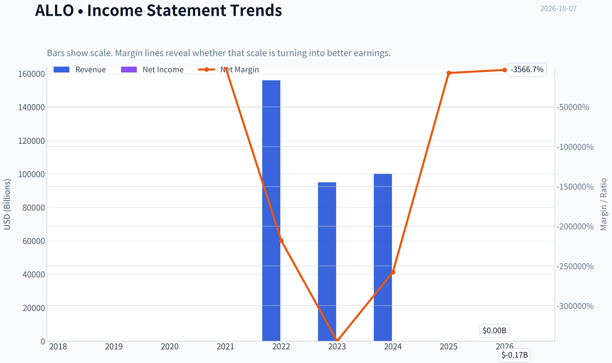

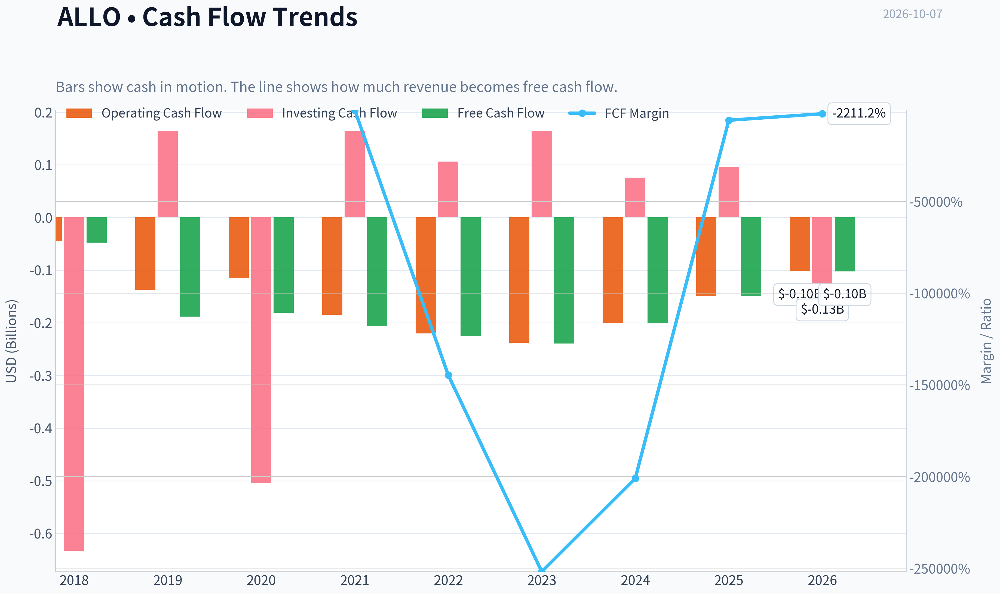

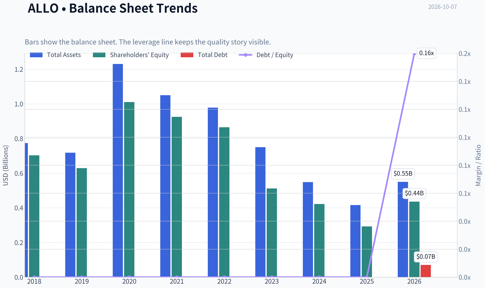

This graph tracks the profitability and return metrics (ROE, ROIC, Margins) of **ALLO** over the past decade, highlighting capital efficiency trends.

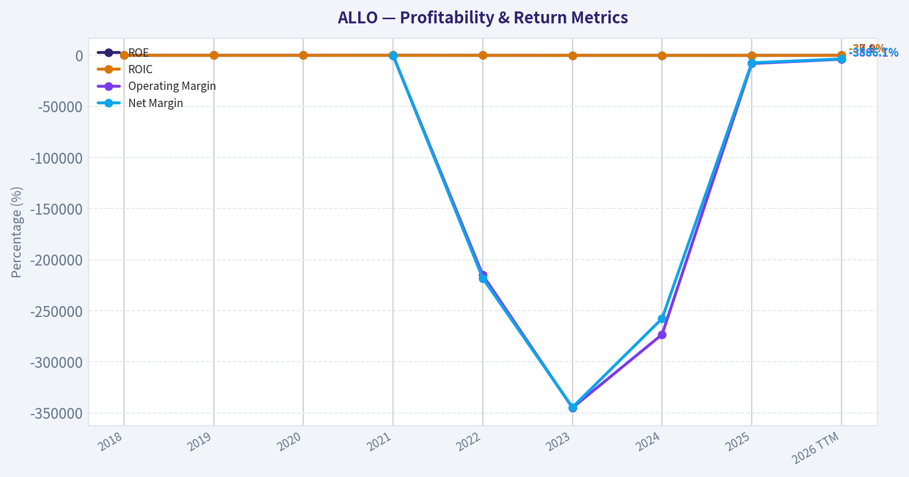

This chart illustrates the financial health of **ALLO** over the last 10 years, mapping cash equivalents and free cash flow against total obligations (Debt).

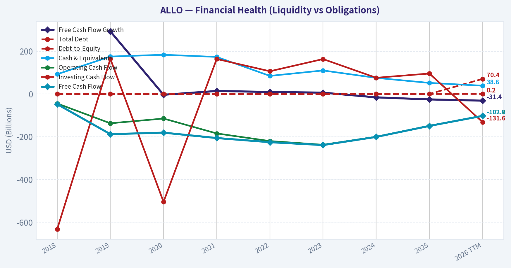

---

### Intrinsic Value Analysis (Buffett)

> *Following Warren Buffett's value investing philosophy: Circle of Competence, Economic Moat, Management Quality, and Margin of Safety.*

#### Intrinsic Value Snapshot

Price is what you pay. Intrinsic value is what the business may be worth based on the cash it can create for owners over time. We show a range, not one magic number.

- Current Price: $1.46
- Value Range (conservative to optimistic across both DCF methods): $-0.10 to $-0.10

##### Owner Earnings (Buffett Method)
- Net Income: $-190,886,000.00
- Depreciation & Amortization: $12,359,000.00
- Capital Expenditures: $-386,000.00
- Working Capital Changes: $-10,877,000.00
- Owner Earnings: $-168,036,000.00

##### Intrinsic Value
###### Buffett Method
Uses owner earnings. Stricter, and usually more conservative.
- Conservative: $-0.10
- Average: $-0.10
- Optimistic: $-0.10
- Discount Rate: N/A

###### Cash Flow Method
Uses free cash flow. Better for companies spending heavily today to grow tomorrow.
- Conservative: $-0.10
- Average: $-0.10
- Optimistic: $-0.10
- Discount Rate: N/A

ANALYST STANCE: **AVOID**

#### Executive Conclusion

Allogene Therapeutics is a highly speculative, clinical-stage biotechnology company whose value depends on successful development, regulatory approval, and commercialization of its cell-therapy pipeline. The company currently has negative earnings, negative free cash flow, negative ROE, and no meaningful earnings-based valuation support.

Its strong current ratio indicates substantial near-term liquidity, but liquidity is not the same as economic value. The available intrinsic-value models produce negative values because current cash consumption exceeds any demonstrated operating earnings power. Under a Buffett-style framework, ALLO does not yet qualify as a predictable compounding business.

#### Financial Snapshot

| Metric | Latest available figure |
|---|---:|
| Share price | $1.00 |
| Market capitalization | $504.4 million |
| P/E | N/A |
| ROE | -65.3% |
| Revenue growth, year over year | 2,500.0% |
| FCF yield | -29.7% |
| Approximate annual FCF | -$149.8 million |
| Current ratio | 7.93 |
| Headline intrinsic value | -$217.03 per share |
| Owner Earnings / FCF model value | -$0.10 per share |
| Damodaran FCFF model value | -$217.03 per share |

**Key Takeaways:** ALLO has substantial liquidity relative to current liabilities, but it is consuming significant cash and producing deeply negative returns on equity. The reported revenue growth is distorted by a very small or previously negligible revenue base and does not establish a durable commercial franchise. The negative intrinsic-value outputs are more informative than the apparent 100.7% margin-of-safety figure, which is mathematically misleading when estimated intrinsic value is negative.

#### Factor Scorecard

| Factor | Score / 5 | Assessment |
|---|---:|---|
| Circle of competence and simplicity | 1 | The model is understandable at a high level, but clinical outcomes, regulatory decisions, trial timing, manufacturing, and reimbursement make long-term results highly unpredictable. |
| Moat | 2 | Cell-therapy know-how, intellectual property, manufacturing capability, and clinical data may eventually create advantages, but no durable commercial moat is currently demonstrated. |
| Management and capital allocation | 2 | Management must allocate capital over long development cycles with binary outcomes. Negative cash generation and the need to fund trials reduce evidence of per-share value creation. |
| Industry structure | 2 | Biotechnology can produce exceptional returns, but clinical-stage development is highly competitive, capital intensive, and exposed to regulatory and scientific failure. |
| Gate 5: quality and solvency floor | **Not tripped** | The high current ratio indicates liquidity, and there is no supplied evidence of interest coverage below 1x or an immediate solvency crisis. However, the company remains economically weak because cash burn and negative returns persist. |

**Key Takeaways:** ALLO avoids the hard solvency floor because it appears liquid enough to continue operating in the near term. Nevertheless, its low overall quality scores reflect the absence of predictable earnings and the high probability of future dilution or additional financing if cash needs remain elevated.

#### Moat Analysis

ALLO's potential advantages are primarily intangible:

- **Intellectual property:** Proprietary cell-therapy platforms and clinical data could become valuable if they produce superior outcomes.
- **Regulatory and clinical know-how:** Successful development may create expertise that is difficult for new entrants to replicate.
- **Manufacturing capability:** Allogeneic cell therapy could offer scalable manufacturing advantages compared with individualized treatments.

The problem is that these are **potential moats**, not proven economic moats. A durable moat requires evidence that customers will pay, competitors cannot readily replicate the product, and the company can earn high returns on capital. ALLO has not yet demonstrated those conditions.

The company's negative ROE and negative free cash flow also fail the financial tests associated with a mature moat. In biotechnology, promising science can create substantial value, but it can also become obsolete, fail clinical trials, or require years of additional capital before producing cash profits.

#### Management Quality and Capital Allocation

Management's central challenge is allocating capital among several uncertain clinical programs. This is fundamentally different from allocating cash in a mature business with observable customer demand and recurring profits.

The available evidence does not yet establish:

- Sustained positive returns on invested capital.
- A history of profitable reinvestment.
- Buybacks made below intrinsic value.
- A self-funding business model.
- Consistent per-share value creation.

Recent news indicates ongoing clinical and pipeline activity, but activity is not equivalent to economic progress. The company's negative free cash flow means shareholders are presently financing the research program rather than receiving distributable owner earnings.

#### Financial Summary

| Measure | Assessment |
|---|---|
| Revenue | Growth rate is extremely high, but the base appears too small for the figure to demonstrate commercial scale. |
| Net income | Negative, reflected in the -65.3% ROE. |
| Operating cash flow | Economically negative based on the negative FCF profile. |
| Free cash flow | Approximately -$149.8 million, using the reported market capitalization and -29.7% FCF yield. |
| Profit quality | Weak; there is no evidence that accounting earnings translate into sustainable owner cash flow. |
| Balance sheet | Current ratio of 7.93 is a positive liquidity signal. |
| Capital intensity | High in economic terms because clinical development requires continuing research, trials, manufacturing, and regulatory spending. |
| Return profile | Negative today and dependent on uncertain future product approvals. |

**Key Takeaways:** The balance sheet provides operating runway, but the business is not currently self-funding. Negative free cash flow and negative ROE outweigh the strong current ratio because liquidity will decline unless the company achieves commercial success, reduces spending, or raises additional capital.

#### Owner Earnings Calculation

The Buffett owner-earnings framework is:

> Owner Earnings = Net income + depreciation and amortization - maintenance capital expenditures - working-capital increases

For ALLO, the available data support the following practical conclusion:

| Owner-earnings component | Assessment |
|---|---|
| Net income | Negative |
| Depreciation and amortization | Not sufficient to offset operating losses |
| Maintenance capital expenditures | Additional cash requirement |
| Working capital | Not the primary issue; research and development spending is more important |
| Estimated owner earnings | Negative; approximately consistent with the reported negative FCF of about $149.8 million |

**Key Takeaways:** ALLO does not currently generate owner earnings. Its cash balance represents financing capacity, not operating cash-generation power. A Buffett-style valuation must therefore rely on uncertain future commercial products rather than present economic earnings.

#### Three-Scenario DCF Valuation

Using the reported owner-earnings/FCF model estimate of approximately **-$0.10 per share**:

| Scenario | Method | Estimated value per share |
|---|---|---:|
| A. No growth | Negative owner earnings divided by 10% | Approximately -$1.00 |
| B. GDP growth | Negative owner earnings grown at 3%, capitalized at 10% | Approximately -$1.47 |
| C. Historical growth | Not meaningful; revenue growth is distorted by a tiny base and there is no established positive earnings stream | Not determinable |
| Research-pack FCFF model | Damodaran-style FCFF estimate | -$217.03 |

**Key Takeaways:** All usable cash-flow models produce negative values because present cash consumption is greater than operating earnings. The historical-growth scenario cannot be responsibly applied to a clinical-stage biotechnology company with no established profitable base. These are not conventional "cheap stock" results; they indicate that the equity value depends almost entirely on future clinical and commercial success.

#### Margin of Safety Analysis

The reported headline margin of safety of 100.7% should not be interpreted as a genuine bargain. It results from comparing a $1 share price with a negative intrinsic-value estimate, a calculation that is not economically meaningful in the usual margin-of-safety sense.

For ALLO, the relevant question is not whether the stock is below current cash-flow value. It is whether the company's future approved therapies will generate enough cash to justify:

1. The current equity value.
2. Continuing research and development expenditures.
3. Potential dilution from future financing.
4. The substantial probability of clinical or regulatory failure.
5. The time value of waiting for commercial validation.

The market may be assigning option value to ALLO's pipeline, but that is venture-style speculation rather than a demonstrated Buffett-quality margin of safety.

#### Final Buffett Scorecard

| Criterion | Weight | Score / 5 | Weighted contribution |
|---|---:|---:|---:|
| Moat width and durability | 25% | 2.0 | 0.50 |
| Valuation and margin of safety | 20% | 1.0 | 0.20 |
| Capital returns: ROIC versus WACC | 15% | 1.0 | 0.15 |
| Business understanding and predictability | 12% | 1.0 | 0.12 |
| Management quality and capital allocation | 12% | 2.0 | 0.24 |
| Reinvestment runway | 8% | 3.0 | 0.24 |
| Balance-sheet strength | 4% | 4.0 | 0.16 |
| Industry structure | 4% | 2.0 | 0.08 |
| **Total** | **100%** |  | **1.69 / 5.00** |

**Key Takeaways:** ALLO's liquidity and potential pipeline runway are its strongest attributes. They are outweighed by negative owner earnings, negative ROE, uncertain commercial predictability, and the lack of a proven moat. The weighted score of 1.69 falls well within the Avoid range.

#### Investment Stance

**AVOID - High conviction.**

ALLO may appeal to specialized biotechnology investors who can assess clinical data, trial design, regulatory probability, and pipeline-adjusted net present value. It does not presently meet the standards of a Buffett-style long-term compounder: predictable economics, durable competitive advantages, high returns on capital, and self-funded reinvestment.

A more attractive entry point would require material evidence of clinical success, a credible path to commercialization, falling cash burn, and eventually positive owner earnings-not merely a lower share price.
#### Valuation Bridge

This bridge places the current market price beside each intrinsic value lens so readers can see whether upside depends on one method or shows up across several methods.

| Scenario | Intrinsic Value / Share |
| --- | ---: |
| Buffett Method | $-0.10 |
| Cash Flow Method | $-0.10 |
| Damodaran Method | $-217.03 |
| Current Price | $1.46 |

#### Key Takeaways

If one method is far above the others, the upside case depends on a specific modelling assumption. When several methods cluster together, the valuation story is more robust.

#### Valuation Visuals

This comparison chart from *Latest Earnings Snapshot* stacks current figures against historical benchmarks for **ALLO**, making it easy to see where the company trades relative to its own averages.

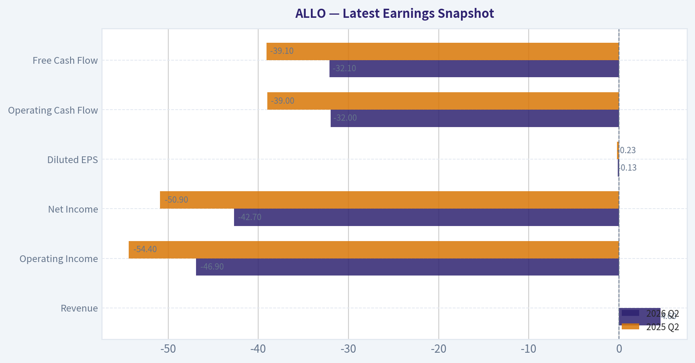

This comparison chart from *Current Metrics Versus Historical Averages* stacks current figures against historical benchmarks for **ALLO**, making it easy to see where the company trades relative to its own averages.

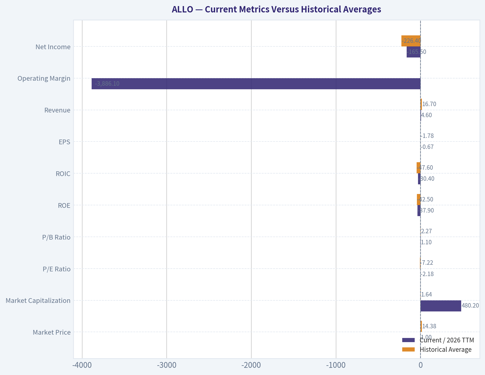

The following chart maps the **ALLO** Owner Earnings DCF valuation scenarios (Conservative, Average, Optimistic) to visually represent the margin of safety based on intrinsic value calculations.

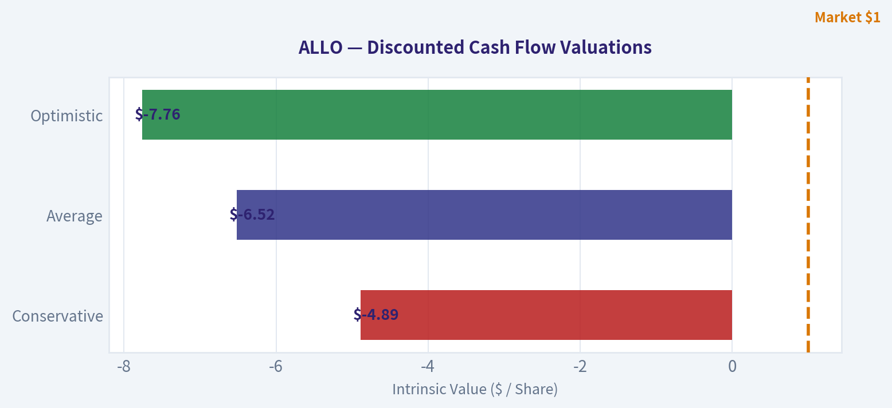

This comparison chart from *Financial Snapshot* stacks current figures against historical benchmarks for **ALLO**, making it easy to see where the company trades relative to its own averages.

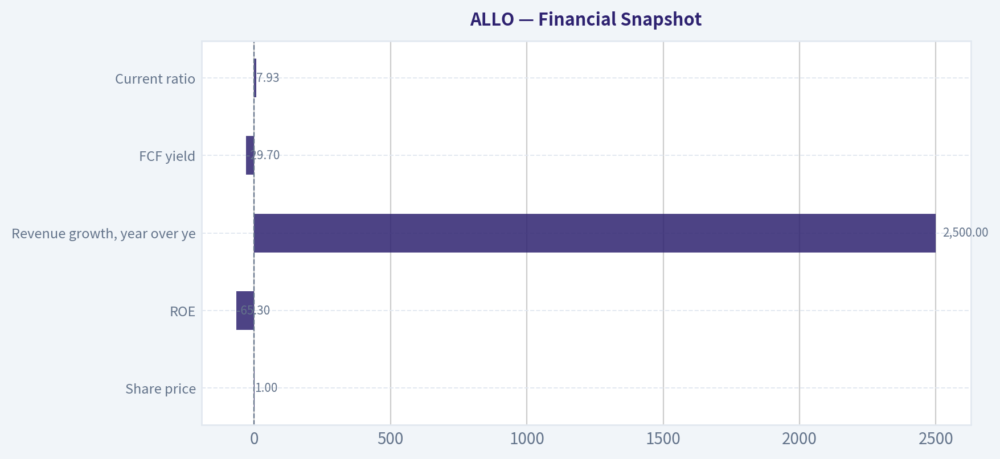

---

### Trend & Growth Analysis (Lynch/Druckenmiller/Fisher)

> *Following Peter Lynch's GARP, Stanley Druckenmiller's macro-aware approach, and Philip Fisher's scuttlebutt methodology.*

ANALYST STANCE: **AVOID**

#### Executive Summary

Allogene Therapeutics is a clinical-stage biotechnology company developing allogeneic, or "off-the-shelf," CAR-T therapies. It is not currently a conventional growth company: revenue is negligible, losses remain substantial, cash burn is high, and valuation depends primarily on clinical data and future approval rather than current financial performance.

The stock could have significant upside if its lead programs demonstrate durable minimal residual disease, or MRD, outcomes and enable an off-the-shelf cell-therapy model. However, the current evidence does not establish a sufficiently attractive risk-adjusted setup for a growth-investing position.

#### 1. Lynch Classification

| Category | Assessment |
|---|---|
| Lynch classification | Turnaround / speculative biotechnology |
| Fast-grower qualification | Not yet applicable |
| Revenue base | Approximately $4.6 million TTM |
| Earnings profile | Deeply unprofitable |
| Primary value driver | Clinical efficacy, regulatory approval, and financing access |
| Investment character | Binary, catalyst-driven speculation |

**Key Takeaways:** ALLO is not a Lynch fast grower because its reported revenue is too small to support meaningful operating-growth analysis. It is better classified as a speculative biotechnology turnaround, where clinical results-not revenue momentum-determine value.

#### 2. The Story in Three Bullets

- **Off-the-shelf CAR-T:** Allogene is attempting to make cell therapy more scalable and accessible by using pre-manufactured donor-derived products rather than individually manufactured therapies.
- **Potential clinical inflection:** Positive MRD data in its lead programs could materially improve investor expectations and validate the platform.
- **Large but binary opportunity:** Successful products could address major blood-cancer markets, but failure, delays, safety issues, or financing pressure could cause severe dilution or permanent capital loss.

#### 3. TAM Analysis and the 10x Test

| Metric | Estimate / Assessment |
|---|---:|
| Current TTM revenue | ~$4.6M |
| 10x current revenue | ~$46M |
| Potential commercial CAR-T market | Multi-billion-dollar opportunity |
| Can revenue grow 10x while remaining below 20% market share? | Yes, theoretically |
| Practical limitation | Clinical and regulatory validation, manufacturing scale, reimbursement |
| TAM growth | Attractive if allogeneic CAR-T achieves broad adoption |
| TAM confidence | Low to moderate until clinical proof improves |

**Key Takeaways:** The theoretical runway is very large: even revenue of $46 million would represent a tiny share of the potential CAR-T market. The more important question is not market size but whether Allogene can prove that its products are effective, safe, durable, and economically scalable.

#### 4. Revenue Growth Trend

| Period | Revenue | Reported Growth | Interpretation |
|---|---:|---:|---|
| 2022 | ~$0.2M | - | Pre-commercial |
| 2023 | ~$0.1M | -39% | Immaterial base |
| 2024 | ~$0.1M | +5% | Immaterial base |
| 2025 | ~$2.6M | +2,500% | Distorted by very low base |
| 2026 TTM | ~$4.6M | +78.5% | Still not commercially meaningful |

**Key Takeaways:** Revenue growth appears extremely high, but the percentage changes are misleading because the starting base is near zero. There is no demonstrated commercial revenue engine, recurring revenue stream, or operating leverage to underwrite.

#### 5. Unit Economics and Operating Efficiency

| Metric | Result | Assessment |
|---|---:|---|
| LTV/CAC | Not available | No commercial customer base |
| Net revenue retention | Not available | Not a subscription business |
| Rule of 40 | Not meaningful | Revenue and FCF margins are distorted |
| TTM operating cash flow | -$102.2M | Heavy cash consumption |
| TTM free cash flow | -$102.6M | Significant funding requirement |
| TTM FCF margin | Approximately -2,211% | Not commercially relevant but highly negative |
| Current ratio | 7.93 | Strong reported short-term liquidity |
| TTM cash and equivalents | ~$38.6M | Appears insufficient against reported burn |

**Key Takeaways:** Standard SaaS unit economics do not apply to ALLO. The key operating metric is cash runway, and the reported financial data suggests a substantial mismatch between cash resources and annual burn. Management disclosures regarding restricted cash, investments, collaboration funding, or a previously announced runway should be reconciled before investing.

#### 6. Inflection Point Assessment

| Potential Inflection | Current Evidence | Assessment |
|---|---|---|
| Product cycle | Lead CAR-T programs advancing | Potentially important |
| Clinical efficacy | MRD durability is central | Not yet sufficiently proven |
| Market share | No commercial market share | Not applicable |
| Margin inflection | No commercial gross margin | Not visible |
| TAM expansion | Allogeneic cell therapy could broaden access | Attractive but unproven |
| Competitive environment | Strong competition from autologous and other cell therapies | Challenging |
| Financing inflection | Cash burn remains material | Negative risk |

**Key Takeaways:** The only credible near-term inflection is clinical. If MRD data holds, the company could be re-rated as a viable platform company; if results disappoint, the equity case may deteriorate rapidly. There is no current margin or revenue inflection to provide fundamental support while investors wait.

#### 7. Macro Setup

| Macro Factor | Impact on ALLO |
|---|---|
| Biotechnology funding environment | Important; tighter funding raises dilution risk |
| Interest rates | Falling rates would support speculative growth valuations |
| Healthcare innovation trend | Favorable |
| Oncology investment | Structurally attractive |
| Reimbursement environment | Critical to commercial adoption |
| Risk appetite | High-beta biotech requires favorable market conditions |
| Overall macro setup | Mixed |

**Key Takeaways:** Healthcare innovation and oncology are favorable secular themes, but macro support cannot substitute for clinical proof. A risk-on market and lower interest rates would help valuation, while weak biotech financing conditions could force unfavorable equity issuance.

#### 8. Fisher's 15-Point Score

The score is necessarily provisional because several Fisher criteria require management interviews, customer conversations, physician feedback, and detailed pipeline diligence.

| Fisher Criterion | Score / 5 | Comment |
|---|---:|---|
| Market potential | 4 | Large potential CAR-T market |
| New-product determination | 4 | Platform and pipeline focus |
| R&D effectiveness | 2 | Clinical validation remains incomplete |
| Sales organization | 1 | No established commercial organization |
| Profit margins | 1 | Deeply negative |
| Margin direction | 1 | No visible commercial leverage |
| Labor relations | 3 | Insufficient public evidence |
| Executive relations | 3 | Insufficient public evidence |
| Management depth | 3 | Specialized biotech team, but execution unproven |
| Cost analysis | 2 | Sustained high burn |
| Outstanding competitive aspects | 3 | Potential manufacturing and accessibility advantages |
| Long-range profit outlook | 3 | Large upside, but highly uncertain |
| Dilution risk | 1 | Material risk given cash burn |
| Management candor | 3 | Requires further scuttlebutt |
| Management integrity | 3 | No conclusion beyond public disclosures |
| **Total** | **37 / 75** | **Below Fisher's "average" threshold** |

**Key Takeaways:** ALLO scores poorly on current profitability, cost control, dilution risk, and commercial execution. Its strengths are market potential and possible product differentiation, but those strengths remain contingent on clinical success.

#### 9. Valuation Analysis

| Valuation Measure | Result | Interpretation |
|---|---:|---|
| Current price | ~$1.46 in tool data; shared pack also cites $1.00 | Data discrepancy should be resolved |
| Market capitalization | ~$504M | Speculative valuation |
| P/E | Not meaningful | Loss-making |
| PEG | Not calculable | No normalized earnings growth |
| Price-to-sales | ~108.7x | Extremely high, though revenue is pre-commercial |
| Price-to-book | ~1.16x | Near book value, but book value is being consumed |
| TTM FCF yield | -29.7% | Negative |
| Reported intrinsic value | Negative under cash-flow models | Models are unsuitable for pre-commercial optionality but highlight cash burn |
| Bear case | Clinical failure, financing stress, substantial dilution |
| Base case | Mixed data, delayed commercialization, continued funding needs |
| Bull case | Durable efficacy, regulatory progress, strategic partnership or acquisition |

**Key Takeaways:** Conventional valuation does not support the stock: earnings are negative, free cash flow is negative, and price-to-sales is exceptionally high. The bull case is an option on successful clinical development, not a valuation-supported investment. Cash-flow models showing negative value should not be treated as precise for biotech, but they correctly identify the lack of current economic earnings.

#### 10. Growth Investor Scorecard

| Criterion | Weight | Score / 5 | Weighted Contribution |
|---|---:|---:|---:|
| Lynch story | 10% | 3.0 | 0.30 |
| TAM and runway | 20% | 4.0 | 0.80 |
| Revenue growth | 20% | 1.0 | 0.20 |
| Unit economics | 15% | 1.0 | 0.15 |
| Competitive position | 10% | 3.0 | 0.30 |
| Management quality | 10% | 2.5 | 0.25 |
| Macro setup | 5% | 3.0 | 0.15 |
| Profitability path | 5% | 1.5 | 0.08 |
| Valuation | 5% | 1.0 | 0.05 |
| **Total** | **100%** |  | **2.28 / 5.00** |

**Key Takeaways:** ALLO's large TAM and potential platform differentiation are outweighed by weak revenue quality, heavy cash burn, binary clinical risk, and extreme price-to-sales valuation. The resulting score of 2.28 falls in the AVOID range for a disciplined growth portfolio.

#### 11. Position Size Stance

| Investor Type | Suggested Stance |
|---|---|
| Core growth portfolio | 0% |
| Conservative investor | 0% |
| High-risk biotech specialist | Watchlist only pending data |
| Speculative basket | At most a token position, only if loss of capital is acceptable |
| Re-entry condition | Positive, durable clinical data plus credible cash runway |

**Key Takeaways:** ALLO does not merit a core portfolio position based on currently available financial evidence. A specialist investor could monitor it as a binary clinical option, but position sizing should remain very small until efficacy, safety, and financing risks improve.

#### 12. Key Catalysts and Risks

| Catalysts | Risks |
|---|---|
| Positive MRD durability data | Clinical failure or loss of response durability |
| Favorable safety and efficacy updates | Cytokine release syndrome, neurotoxicity, or other safety issues |
| Regulatory advancement | Trial delays or regulatory setbacks |
| Strategic partnership or acquisition | Funding at unfavorable terms |
| Manufacturing-cost advantage | Continued cash burn and dilution |
| Broader adoption of allogeneic CAR-T | Competition from approved or superior therapies |
| Improved biotech financing conditions | Reimbursement or manufacturing obstacles |

**Key Takeaways:** The principal catalyst is convincing clinical evidence, especially durable MRD outcomes. The principal risk is that the company must continue spending heavily before it has a validated commercial product, creating a substantial probability of dilution or permanent capital loss.

#### Final Assessment

ALLO has a compelling scientific narrative and a potentially large market, but it currently fails the key growth-investing tests of durable revenue growth, improving economics, financing security, and valuation discipline. The stock should remain on a catalyst watchlist rather than be purchased as a ten-bagger candidate.

**Decision: AVOID for now. Reassess only after material clinical validation and a clearly supported cash runway.**

#### Growth & Scorecard Visuals

This comparison chart from *Factor Scorecard* stacks current figures against historical benchmarks for **ALLO**, making it easy to see where the company trades relative to its own averages.

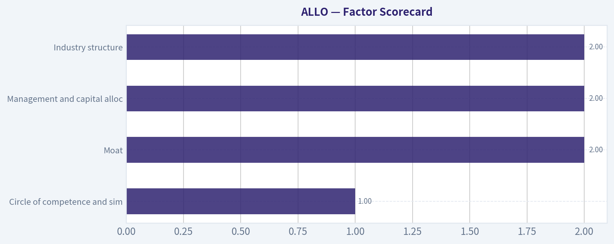

The radar chart below from *Final Buffett Scorecard* visualises how **ALLO** ranks across weighted investment criteria. Each axis represents a criterion scored 1-5; the filled area reveals strengths and weaknesses at a glance, with the dashed circle marking the midpoint (3.0).

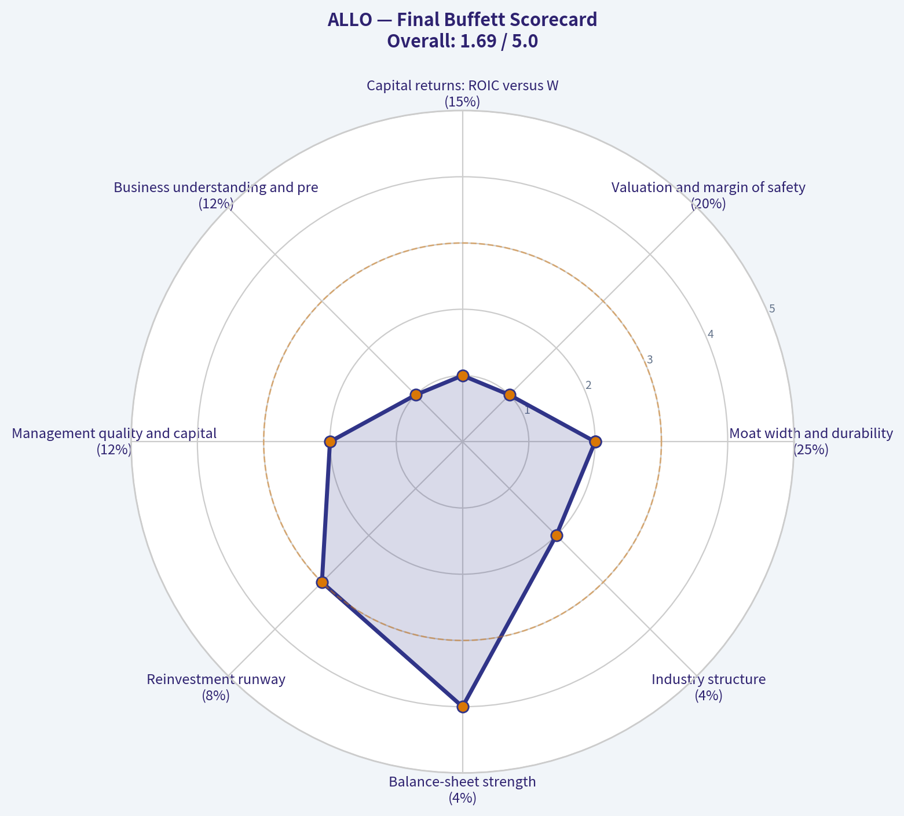

---

### Market Technical Analysis

ANALYST STANCE: **WATCH**

#### ALLO technical market view

ALLO closed at **$1.46 on October 6, 2026**, down from approximately **$1.97 on September 4** and from its late-August consolidation near **$2.00 to $2.20**. The recent decline has been orderly rather than a single-session collapse, but the pattern remains bearish: lower highs, lower lows, and repeated closes near the lower end of the recent trading range.

The indicator-report service returned incomplete values for the requested indicators, so the numerical estimates below are derived from the retrieved daily OHLCV data rather than presented as exact vendor-generated readings. The most useful indicator set for ALLO's current condition is:

- **close_10_ema**
- **close_50_sma**
- **close_200_sma**
- **macd**
- **macdh**
- **rsi**
- **atr**
- **vwma**

This combination covers short-, medium-, and long-term trend, momentum, volatility, and volume confirmation without adding redundant oscillators.

#### Trend structure

The short-term trend is clearly negative. ALLO fell from roughly **$1.86 on September 8** to **$1.46 on October 6**, with only brief rebounds. The stock has also failed to reclaim prior reaction levels around **$1.60 to $1.67**, which now represent the first meaningful overhead resistance zone.

The **10 EMA** is likely near the **$1.53 to $1.56** area based on the latest sequence of closes. With the stock at $1.46, price is trading below this short-term average, confirming immediate downside momentum. A close above the 10 EMA would be an initial improvement, but it would not by itself establish a trend reversal.

The **50 SMA** is likely materially above the current price, probably in the approximate **$1.80 to $1.90** region. That places ALLO below its medium-term trend benchmark and suggests that rallies are still more likely to encounter selling pressure than become sustained advances.

The **200 SMA** is less useful for precise timing here, but the year-long price history indicates that ALLO remains a highly speculative, volatile issue. The stock experienced a major April surge above $4 followed by a prolonged retreat. Even if the long-term average is flattening or still above the current price, the broader chart does not yet show a durable recovery structure.

#### Momentum: MACD and RSI

The **MACD** configuration is bearish. The persistent decline from the August-September range has likely pushed the MACD below its signal line, while the **MACD histogram** is probably negative. This indicates that downside momentum remains dominant rather than merely reflecting a sideways consolidation.

However, the decline has become extended. The **RSI** is likely in the lower portion of its neutral-to-oversold range, approximately around **25 to 35**, depending on the exact calculation window. That reading suggests that a short-term reflex rally is possible, but it should not be interpreted as proof that the bottom is in. In thin and speculative stocks, RSI can remain below 30 while price continues to weaken.

The important distinction is between an oversold reading and a bullish momentum reversal. For a more credible reversal, traders should look for RSI to recover above 40, followed by a bullish MACD crossover and a close above the short-term moving average.

#### Volatility and risk management

ALLO's recent daily ranges have generally been around **$0.07 to $0.15**, implying an approximate 14-day **ATR** near **$0.10 to $0.12**, although the April price shock substantially increased historical volatility. At a $1.46 share price, an ATR of that size represents roughly **7% to 8% of the stock price per session**, which is substantial.

This volatility makes tight stops vulnerable to ordinary intraday fluctuations. Position sizing should therefore be smaller than for a more liquid, lower-volatility stock. A trader using a technical stop should place it beyond a meaningful swing level rather than at an arbitrary small percentage distance.

Near-term downside support appears around **$1.43 to $1.45**, based on the October 6 low and recent price action. A decisive close below that zone could expose the stock to the **$1.35 to $1.40** area. Conversely, the first recovery hurdle is approximately **$1.50 to $1.55**, followed by **$1.60 to $1.67**.

#### Volume and VWMA interpretation

Trading volume remains elevated relative to the quietest periods of the year, but it has not recently produced a convincing accumulation signal. The April spike involved exceptionally high volume and appears to have marked a major speculative event rather than a stable long-term base. More recent volume increases have occurred during both advances and declines, so volume by itself is not confirming sustained institutional demand.

The **VWMA** is likely above the current market price because many of the higher-volume sessions occurred at substantially higher prices, particularly during the spring volatility and later rallies. That creates an unfavorable volume-weighted backdrop: traders who bought during high-volume activity may represent overhead supply when the stock rebounds.

A bullish interpretation would require rising price, expanding volume, and a sustained move above the VWMA or at least above the $1.60-$1.67 resistance band. A low-volume bounce that stalls beneath those levels would be more consistent with a relief rally inside a continuing downtrend.

#### Trading interpretation

The current setup is best classified as **bearish but potentially oversold**, not as a confirmed reversal. Momentum indicators favor caution, while the oversold condition creates room for a short-lived rebound.

A conservative bullish trigger would require:

1. Price reclaiming approximately **$1.50 to $1.55**.
2. A subsequent close above **$1.60 to $1.67**.
3. Improving volume rather than declining participation.
4. RSI recovering above 40.
5. MACD turning upward, preferably with a bullish signal-line crossover.

Until those conditions appear, rallies should be treated as tactical rather than structural. A break below **$1.43 to $1.45**, especially on expanding volume, would weaken the support case and favor additional downside risk.

| Area | Current reading | Trading implication |
|---|---|---|
| Price trend | Close at $1.46; persistent lower highs and lower lows since early September | Bearish short-term structure |
| 10 EMA | Estimated near $1.53-$1.56; price below it | Immediate momentum remains weak |
| 50 SMA | Estimated well above price, roughly $1.80-$1.90 | Medium-term trend remains bearish |
| 200 SMA | Long-term benchmark; exact service value unavailable | Useful for context, but not a near-term reversal trigger |
| MACD | Likely below signal with negative histogram | Downside momentum remains dominant |
| RSI | Likely approximately 25-35 | Oversold risk exists, but no confirmed reversal |
| ATR | Estimated around $0.10-$0.12 recently | High percentage volatility; use reduced position size |
| VWMA and volume | Likely above current price; high-volume history concentrated at higher prices | Overhead supply and weak accumulation profile |
| Key support | $1.43-$1.45, then $1.35-$1.40 | Breakdown below $1.43 would be a bearish escalation |
| Key resistance | $1.50-$1.55, then $1.60-$1.67 | Reclaiming these zones would improve the technical outlook |

**Key Takeaways:** ALLO remains in a pronounced short- and medium-term downtrend, with price below its likely short-term and medium-term moving averages. RSI may be approaching oversold territory, so a temporary bounce is possible, but MACD, volume behavior, and the broader price structure do not yet confirm a durable bottom. The most important near-term levels are support at $1.43 to $1.45 and resistance at $1.50 to $1.55, followed by $1.60 to $1.67.

---

### Options Market Analysis

> *Reading options flow - put/call ratios, IV skew, and unusual activity - to gauge institutional positioning and event-driven risk.*

#### ALLO Options Market Report

**As of October 7, 2026.** The available chain is very thin, with unusually low implied volatility readings and no contracts meeting the tool's unusual-activity threshold. As a result, the directional signal is informative but low confidence.

#### 1. Put/Call Ratio Analysis

| Expiration | Call OI | Put OI | Put/Call OI | Call Volume | Put Volume | Put/Call Volume |
|---|---:|---:|---:|---:|---:|---:|
| October 16, 2026 | 1,770 | 10 | 0.01 | 25 | 5 | 0.20 |
| November 20, 2026 | 5,347 | 690 | 0.13 | 97 | 29 | 0.30 |
| February 19, 2027 | 6,461 | 467 | 0.07 | 63 | 89 | 1.41 |
| **Total** | **13,578** | **1,167** | **0.09** | **185** | **123** | **0.66** |

**Key Takeaways:** ALLO's aggregate put/call open-interest ratio of 0.09 is far below the approximately 0.70 neutral baseline, showing a strongly call-heavy chain. The volume ratio of 0.66 is also below neutral, although less extreme, indicating modestly greater call activity overall. February volume was put-heavy, but the absolute volume was small and does not offset the highly call-dominated open interest.

The call-heavy positioning can represent bullish exposure, but it may also reflect covered-call writing, long-dated speculative positions, or an irregularly constructed chain. Because total trading volume is very low, the ratio should not be treated as a high-confidence institutional signal.

#### 2. Implied Volatility Assessment

| Expiration | Call ATM IV | Put ATM IV | IV Assessment |
|---|---:|---:|---|
| October 16, 2026 | 6.3% | N/A | Very low call IV; put quote unavailable |
| November 20, 2026 | 3.1% | 0.0% | Extremely low and likely unreliable |
| February 19, 2027 | 1.6% | 0.0% | Extremely low and likely unreliable |

**Key Takeaways:** Reported near-term ATM IV is exceptionally low, ranging from 1.6% to 6.3%, while several put IV readings are listed as zero. Those values likely reflect sparse quotes, stale data, or wide bid-ask markets rather than a genuine absence of risk. A reliable OTM put-versus-call skew cannot be calculated because the data does not provide usable OTM IV values.

There is no catalyst information in the options data indicating an earnings event, product launch, or other scheduled risk. Given the very low IV and thin activity, there is no evidence of significant near-term event premium.

#### 3. Unusual Options Activity

| Finding | Result |
|---|---|
| Contracts with volume greater than 5x open interest | None |
| Fresh directional activity | Not identified |
| Smart-money or institutional sweep evidence | None available |
| Retail speculation evidence | None identifiable from the supplied data |

**Key Takeaways:** No individual contract had volume exceeding five times its open interest, so the data does not identify fresh, aggressive directional bets. There are also no strikes supplied for evaluating whether unusual contracts are ITM, ATM, or OTM. The absence of unusual activity reduces conviction in the otherwise bullish-looking call-heavy open-interest profile.

#### 4. Open-Interest Concentration and Gamma Levels

| Expiration | Total Call OI | Total Put OI | Interpretation |
|---|---:|---:|---|
| October 16, 2026 | 1,770 | 10 | Strongly call-dominated |
| November 20, 2026 | 5,347 | 690 | Largest near-term concentration |
| February 19, 2027 | 6,461 | 467 | Largest overall call concentration |
| **Total** | **13,578** | **1,167** | Heavy call-side concentration |

**Key Takeaways:** The largest open-interest concentrations are in February 2027 calls, followed by November 2026 calls. This may create call-side gamma or price-pinning effects near heavily traded strikes, but strike-level data is unavailable, so specific gamma walls and max-pain levels cannot be identified. The dominance of call open interest is directionally bullish-looking, but it could also reflect covered calls rather than outright bullish buying.

#### 5. Overall Options Sentiment

**Signal: BULLISH - low confidence**

The primary bullish driver is the extreme call-heavy open-interest structure, with an aggregate put/call OI ratio of 0.09 versus a neutral baseline near 0.70. The modestly call-heavy volume ratio also supports a bullish interpretation, although it is not extreme.

Confidence is reduced substantially because:

- Total options volume is very thin.
- No unusual contracts were detected.
- Put IV is missing or reported as zero for multiple expirations.
- Strike-level data is unavailable, preventing analysis of ITM/OTM positioning, max pain, and gamma walls.
- Call open interest may include covered-call writing rather than outright bullish exposure.

Accordingly, ALLO's options positioning leans bullish, but the chain is too illiquid and incomplete to establish a strong institutional-conviction signal.

#### Summary

| Category | Assessment |
|---|---|
| Put/Call Ratio | **Bullish-looking:** 0.09 OI ratio and 0.66 volume ratio, both below the 0.70 neutral baseline |
| IV Level | **Very low, but unreliable:** 1.6%-6.3% reported ATM IV; several put IV values are zero |
| Skew Direction | **Not reliably measurable:** OTM put and call IV data unavailable |
| Unusual Activity | **None detected:** no contracts exceeded 5x open interest |
| Overall Signal | **BULLISH, low confidence:** call-heavy OI dominates, but liquidity and data-quality concerns are significant |

**Key Takeaways:** ALLO's options chain is structurally bullish because calls substantially outweigh puts, especially in November 2026 and February 2027. However, the lack of unusual activity, extremely low reported IV, and thin trading volume make this a weak-conviction signal rather than a clear institutional accumulation call.

---

## Research Team Commentary

> *The Research Manager synthesizes the Bull vs Bear debate into action-free commentary. This is a pre-risk view, not the final stance.*

Core Takeaway: Allogene Therapeutics is a potentially valuable scientific platform but not yet a demonstrably valuable security. The strongest bull argument is that successful off-the-shelf CAR-T could improve treatment speed, availability, manufacturing consistency, and scalability, creating substantial platform-level upside. The stronger investment conclusion, however, is that neither business quality nor undervaluation has been established. At $1.46, the shares may be inexpensive-or may simply be pricing years of cash burn, clinical failure risk, and dilution. Without net cash, fully diluted shares, runway, remaining development costs, and a conservative program-level risk-adjusted NPV, there is no measurable margin of safety.

The bull case deserves respect because the economic proposition is meaningful. Autologous CAR-T is clinically powerful but operationally cumbersome. If Allogene can deliver sufficiently competitive efficacy and durability from standardized donor-derived cells, immediate product availability and manufacturing scale could support a real commercial advantage. Successful clinical results might also validate more than one asset by supporting the underlying engineering, manufacturing, and regulatory platform. That creates genuine asymmetric upside.

The prospective moat could eventually include patents, accumulated clinical data, manufacturing expertise, regulatory experience, and difficult-to-replicate process knowledge. In cell therapy, manufacturing is part of the product, so reproducible production could become a substantial barrier to entry. The deeply negative ROE, ROIC, and ROA do not by themselves prove that the platform is worthless because clinical-stage R&D is expensed before any possible commercial payoff appears. Similarly, the reported 2,500% revenue growth is economically uninformative because it comes from a negligible or noncommercial base.

The bear case is nevertheless more compelling today. Allogene must clear a chain of dependent hurdles: competitive response rates, depth and durability of response, manageable safety, immune evasion and persistence, reliable manufacturing, regulatory approval, physician adoption, reimbursement, commercial margins, and sufficient financing. Convenience will not compensate for materially inferior cancer outcomes. Even scientific success may not translate into attractive per-share returns if repeated equity issuance transfers much of the eventual value to future investors.

The supposed moat remains prospective rather than demonstrated. Patents can protect an ineffective design, and manufacturing infrastructure can be a fixed-cost burden before commercial demand exists. There are no recurring revenues, pricing power, normalized margins, positive owner earnings, or proven incremental returns on capital. Management may ultimately allocate capital well, but the available evidence does not establish disciplined program selection, timely termination of weak assets, controlled overhead, or value-accretive financing.

Intrinsic value is the decisive unresolved issue. A conventional DCF is inappropriate; ALLO requires a program-level risk-adjusted NPV that includes clinical success probabilities, launch timing, patient populations, pricing, penetration, commercial margins, remaining development costs, corporate burn, and expected dilution. The nominal $1.46 share price says nothing about whether the enterprise is cheap. We need the fully diluted share count, net cash, contractual obligations, quarterly burn, milestone timing, and financing requirements. Because the outcome range is exceptionally wide, ALLO would require a much larger margin of safety than a proven compounder. That discount has not been demonstrated.

This conclusion incorporates the central lesson from prior mistakes: do not confuse an attractive concept with an attractive security, and do not allow temporary price stabilization to substitute for fundamental validation. The cited technical thresholds-reclaiming $1.50-$1.55 and subsequently $1.60-$1.67 on improving volume-would indicate better market sponsorship, but they would not prove clinical efficacy, runway, or undervaluation. Thin options activity adds no useful confirmation. A higher price after genuine clinical de-risking could offer better risk-adjusted value than a lower price before validation.

Over the next one to four quarters, I would monitor five areas. First, examine clinical data for response depth, MRD negativity, duration, relapse rates, safety, immune rejection, and performance against relevant alternatives-not merely headline response rates. Second, look for reproducible manufacturing yields, batch consistency, treatment availability, and evidence that scale will lower rather than compound costs. Third, calculate cash runway using quarterly burn and upcoming trial and manufacturing spending, with particular attention to whether decisive data can be reached without distressed financing. Fourth, track fully diluted share count, stock-based compensation, capital raises, program prioritization, trial delays, and whether management terminates weak programs promptly. Fifth, rebuild a conservative rNPV after each meaningful data update, explicitly subtracting future burn and expected dilution.

The thesis would strengthen if durable clinical outcomes become competitive, safety remains manageable, manufacturing is reproducible, and the balance sheet can fund major milestones without punitive dilution. It would weaken materially with short-lived responses, safety signals, trial delays, process inconsistency, rising burn, strategic churn, or equity issuance that outpaces clinical value creation.

Allogene belongs on a clinical-milestone watchlist, but it does not currently meet the standards for a Buffett-style portfolio. There may be substantial upside, yet the probability, cost, timing, and current shareholders' eventual ownership of that upside cannot be underwritten with confidence.

Final stance: AVOID.

---

## Value Investing Team Commentary

> *The Investor translates the research view into an investment thesis before risk review. This is still not the final stance.*

### Investment Commentary

Allogene Therapeutics is better understood as a collection of high-risk clinical options than as an established operating business. Its off-the-shelf CAR-T proposition is economically compelling: a standardized donor-derived therapy could shorten treatment delays, expand availability, and improve manufacturing efficiency relative to patient-specific approaches. If Allogene produces competitive and durable outcomes, successful data could validate not only a lead candidate but elements of the broader platform.

That possibility, however, does not yet create an investable moat. Patents, manufacturing infrastructure, clinical expertise, and regulatory know-how become valuable only if the therapies deliver sufficiently strong efficacy, durability, and safety. In oncology, faster availability will not compensate for meaningfully weaker outcomes. Manufacturing capacity can also become a cash-consuming fixed-cost burden rather than an advantage when utilization remains low.

### Fundamentals and business quality

The reported financial metrics do not describe a mature commercial enterprise:

- ROE: **-65.3%**
- ROIC: **-494.5%**
- ROA: **-45.9%**
- Reported revenue growth: **2,500%**, but from a negligible or noncommercial base

The negative returns primarily reflect a clinical-stage company expensing research before any potential commercial payoff. They therefore do not prove that the science is worthless. Nevertheless, they confirm that ALLO currently has no demonstrated earnings power, positive owner earnings, normalized margins, or evidence of attractive incremental returns on capital.

The reported revenue growth is particularly misleading. A large percentage increase from an immaterial base provides almost no information about future demand, pricing power, or profitability. Investors should focus instead on clinical evidence, cash consumption, capital requirements, and the value retained per fully diluted share.

### Moat and management

A durable competitive advantage remains prospective. Allogene might eventually build barriers through:

- Defensible intellectual property
- Accumulated clinical and regulatory data
- Reproducible manufacturing processes
- Specialized cell-engineering expertise
- Economies of scale from standardized production

But none of these establishes a moat before the platform demonstrates competitive patient outcomes and commercially viable manufacturing. An ineffective or insufficiently durable therapy remains economically weak even if it is patent-protected.

Management quality also cannot be judged merely from scientific ambition. The relevant capital-allocation questions are whether management:

- Concentrates resources on the highest-probability programs
- Terminates weak programs promptly
- Controls overhead and manufacturing commitments
- Reaches decisive milestones before cash becomes constrained
- Raises capital without transferring excessive value from existing shareholders to new investors

Until those points are demonstrated, shareholders are financing experimentation rather than owning a proven compounding engine.

### Valuation and margin of safety

The $1.46 share price creates an appearance of cheapness but says nothing about intrinsic value. A low nominal share price is not a margin of safety.

A conventional DCF is unsuitable because ALLO lacks stable commercial cash flows. Valuation requires a program-level, risk-adjusted net present value model incorporating:

1. Clinical success probabilities by development stage
2. Expected approval and launch timing
3. Addressable patient populations
4. Pricing and market penetration
5. Treatment durability and competitive positioning
6. Manufacturing and commercial margins
7. Remaining clinical and regulatory expenses
8. Corporate cash burn and contractual obligations
9. Net cash and milestone payments
10. Future financing and fully diluted share count

The most important missing variables are cash runway, quarterly burn, net cash, upcoming milestone costs, and expected dilution. Even a clinically successful program can produce a disappointing per-share outcome if several financings are needed before commercialization. Without these inputs, neither undervaluation nor an adequate margin of safety has been established.

Because this is a binary, capital-intensive biotechnology investment rather than a predictable compounder, it would require a very large discount to conservatively estimated rNPV-likely toward the upper end of the **40%-50% margin-of-safety range**. The available information does not demonstrate that discount.

### Selective contrarian view

Negative sentiment toward small biotechnology companies can create opportunities when the market extrapolates temporary financing pressure onto sound, well-funded clinical assets. ALLO could eventually become such an opportunity. But contrarianism is justified only when the investor has superior insight into clinical probabilities, manufacturing economics, and financing needs.

The market may be underestimating the platform value that could emerge from compelling data. Conversely, optimistic investors may be underestimating how many dependent hurdles remain between an encouraging clinical signal and durable per-share value. The probability of success must be multiplied across efficacy, durability, safety, manufacturing, approval, adoption, reimbursement, and financing-not assessed from a single favorable endpoint.

The more intelligent contrarian position is therefore not to buy merely because the shares are depressed. It is to remain willing to purchase at a higher price after meaningful clinical and financial de-risking. Paying more after validation can be safer and more valuable than paying less while the outcome remains largely unknowable.

### Market signals and monitoring points

Reclaiming **$1.50-$1.55**, followed by a close above **$1.60-$1.67** on improving volume, would indicate stronger market sponsorship. It would not establish intrinsic value or clinical success. Thin options activity and missing put-implied-volatility data provide no reliable informational edge.

The thesis should be reconsidered only if several developments align:

- Competitive and durable clinical responses, not merely encouraging headline response rates
- Strong MRD negativity accompanied by favorable duration and relapse data
- Manageable safety, immune rejection, and persistence profiles
- Reproducible manufacturing yields and batch consistency
- Adequate runway to reach decisive milestones without punitive financing
- Disciplined program prioritization and controlled spending
- A conservative rNPV showing a substantial discount after future burn and dilution

Warning signs include short-lived responses, safety issues, trial delays, manufacturing inconsistency, strategic churn, rising burn, or share issuance that outpaces the creation of clinical value.

**ANALYST STANCE: AVOID.** ALLO represents potentially important science but not yet an underwritable business or demonstrably undervalued security. The prospective upside is substantial, but the probability, timing, financing burden, and proportion ultimately retained by current shareholders remain too uncertain for long-term business ownership. Keep it on a clinical-milestone watchlist, but avoid committing capital until efficacy, durability, manufacturing, runway, dilution, and risk-adjusted intrinsic value can be assessed with materially greater confidence.

---

## Deep Values Commentary

> *The Risk Management Team debates and the Risk Judge provides the final action-free verdict. This section determines the final ADVOCATE / WATCH / AVOID stance.*

#### Final Stance Scorecard

This scorecard converts the final research view into a weighted decision frame. It does not replace the narrative judgement, but it makes the main drivers of the verdict easier to scan.

| Criterion | Score | Weight | Commentary |
| --- | ---: | ---: | --- |
| Business Quality | 2.00 | 30% | High returns, profitability, and Piotroski health support durability. |
| Valuation Support | 1.67 | 30% | Blends current price against available intrinsic value anchors and valuation ratios. |
| Financial Strength | 5.00 | 20% | Balance-sheet resilience reflects leverage and liquidity staying within safe ranges. |
| Growth Durability | 5.00 | 20% | Recent revenue, earnings, and free cash flow growth indicate how durable expansion looks. |
| TOTAL / FINAL STANCE | 3.10 | 100% | AVOID |

#### Key Takeaways

The weighted score lands at **3.10 / 5.0**, while the final stance remains **AVOID**. This is useful as a quick calibration aid rather than a mechanical signal.

#### Risk Summary

Higher scores indicate more risk pressure. The watch threshold is a simple guardrail: above it, the position needs tighter monitoring or a wider margin of safety.

| Dimension | Current Score | Watch Threshold | Commentary |
| --- | ---: | ---: | --- |
| Business Quality | 4.00 | 3.00 | High returns, profitability, and Piotroski health support durability. |
| Valuation Support | 4.33 | 3.00 | Blends current price against available intrinsic value anchors and valuation ratios. |
| Financial Strength | 1.00 | 3.00 | Balance-sheet resilience reflects leverage and liquidity staying within safe ranges. |
| Growth Durability | 1.00 | 3.00 | Recent revenue, earnings, and free cash flow growth indicate how durable expansion looks. |

#### Key Takeaways

This view helps readers separate *where* the risk sits: valuation, business quality, balance sheet, or growth durability. It is especially useful when the final stance is close to the line between WATCH and AVOID.
