# ALV.DE Deep Value Intelligence

**Analysis Date:** 2026-05-12

## Critical Disclaimer

*This analysis is generated by Deep Value Intelligence, an AI-powered multi-agent investing framework. This report is for informational and educational purposes only and does not constitute financial advice. Always conduct your own research and consult with qualified financial advisors before making investment decisions.*

---

## Table of Contents

1. Intelligence Summary
2. Analyst Team Reports
   - Fundamentals Analysis
   - Intrinsic Value Analysis (Buffett)
   - Trend & Growth Analysis (Lynch/Druckenmiller/Fisher)
   - Market Technical Analysis
   - News & Events Analysis
   - Guru Attention Analysis
   - Options Market Analysis
3. Research Team Commentary
4. Value Investing Team Commentary
5. Deep Values Commentary

---

## Intelligence Summary

### Thesis + Conditions

**Core Thesis:** ## Executive Briefing

**Key Risks:**
- Allianz looks like a **durable, high-quality insurer**, but not a clear Buffett-style bargain today. The business risk appears **manageable rather than alarming**: scale, diversification, brand, and solid ROE support resilience. But the **margin of safety is not yet strong enough** given weak top-line growth, limited recent earnings confirmation, and uncertainty around how much current profitability reflects durable underwriting versus favorable market conditions. For a long-term investor, this is a **respect, monitor, and possibly nibble-not a high-conviction load-up**.
- ### 1. Risky Analyst - strongest pro-buy points
- Lack of hype, catalyst, and guru crowding may indicate **underappreciation rather than danger**.
- 13.3x earnings is not obviously cheap** for a mature insurer with **-1.8% revenue growth** and exposure to catastrophe, reserve, regulatory, and market risks.
- Under a Buffett-style risk lens, the main question is not whether Allianz's stock might fluctuate. It is whether the **business faces meaningful risk of permanent impairment** and whether the investor is being paid enough for that uncertainty.

**What Would Change Our View:**
- Allianz looks like a **durable, high-quality insurer**, but not a clear Buffett-style bargain today. The business risk appears **manageable rather than alarming**: scale, diversification, brand, and solid ROE support resilience. But the **margin of safety is not yet strong enough** given weak top-line growth, limited recent earnings confirmation, and uncertainty around how much current profitability reflects durable underwriting versus favorable market conditions. For a long-term investor, this is a **respect, monitor, and possibly nibble-not a high-conviction load-up**.
- ### 1. Risky Analyst - strongest pro-buy points
- Lack of hype, catalyst, and guru crowding may indicate **underappreciation rather than danger**.
- 13.3x earnings is not obviously cheap** for a mature insurer with **-1.8% revenue growth** and exposure to catastrophe, reserve, regulatory, and market risks.
- Under a Buffett-style risk lens, the main question is not whether Allianz's stock might fluctuate. It is whether the **business faces meaningful risk of permanent impairment** and whether the investor is being paid enough for that uncertainty.

**Confidence:** Low

---

## Analyst Team Reports

### Fundamentals Analysis

#### Latest Earnings Snapshot

*Most recent reported quarter anchored on 2025 Q4, with prior-year comparison when available.*

| Metric | 2025 Q4 | 2024 Q4 | YoY Change |
| --- | ---: | ---: | ---: |
| Revenue | $37.86B | $35.93B | +5.4% |
| Operating Income | N/A | N/A | N/A |
| Net Income | $2.66B | $2.47B | +7.8% |
| Diluted EPS | $6.98 | $6.40 | +9.1% |
| Operating Cash Flow | N/A | N/A | N/A |
| Free Cash Flow | N/A | N/A | N/A |

Key Takeaways: This snapshot anchors the most recent reported quarter before the narrative analysis. It helps readers separate long-run business quality from whatever changed in the latest earnings print.

#### 10-Year Financial Metrics for ALV.DE

*All values below are computed deterministically from raw data - not estimated by AI.*

*Issuer profile: insurer (Financial Services / Insurance - Diversified).*

#### 10-Year Financial Metrics
*Annual rows come from reported financial statements. The final TTM row is computed from the latest four quarters.*

| Metric | 2021 | 2022 | 2023 | 2024 | 2025 | 2026 TTM |
| --- | --- | --- | --- | --- | --- | --- |
| Market Price | $163 | $166 | $211 | $271 | $373 | $369 |
| Market Cap | N/A | $81.62B | $95.89B | $114.98B | $149.55B | $140.22B |
| P/E Ratio | N/A | 12.98 | 11.42 | 11.75 | 14.11 | 13.01 |
| P/B Ratio | N/A | 1.50 | 1.65 | 1.91 | 2.38 | 2.24 |
| ROE | N/A | 11.8% | 14.7% | 16.5% | 17.2% | 17.2% |
| ROIC | N/A | N/A | N/A | N/A | N/A | N/A |
| EPS | N/A | $12.77 | $18.43 | $23.08 | $26.45 | $28.34 |
| Revenue | N/A | $79.86B | $119.67B | $139.95B | $137.45B | $137.66B |
| Gross Profit | N/A | N/A | N/A | N/A | N/A | N/A |
| Gross Margin | N/A | N/A | N/A | N/A | N/A | N/A |
| Operating Margin | N/A | N/A | N/A | N/A | N/A | N/A |
| Net Income | N/A | $6.42B | $8.54B | $9.93B | $10.78B | $10.78B |
| Net Margin | N/A | 8.0% | 7.1% | 7.1% | 7.8% | 7.8% |
| Revenue Growth | N/A | N/A | 49.8% | 16.9% | -1.8% | 0.1% |
| Net Income Growth | N/A | N/A | 33.0% | 16.3% | 8.5% | 0.0% |
| Free Cash Flow Growth | N/A | N/A | 36.7% | 34.3% | 3.2% | N/A |
| Total Book Value | N/A | $54.41B | $58.24B | $60.29B | $62.72B | $62.72B |
| Total Assets | N/A | $935.90B | $983.17B | $1.04T | $1.02T | $1.02T |
| Total Debt | N/A | $29.50B | $29.98B | $34.84B | $35.27B | $35.27B |
| Debt-to-Equity | N/A | 0.54 | 0.51 | 0.58 | 0.56 | 0.56 |
| Cash & Equivalents | N/A | $22.90B | $29.21B | $31.64B | $29.86B | $29.86B |
| Shareholders' Equity | N/A | $54.41B | $58.24B | $60.29B | $62.72B | $62.72B |
| Operating Cash Flow | N/A | $17.95B | $24.46B | $31.90B | $33.21B | N/A |
| Investing Cash Flow | N/A | $-14.99B | $-12.01B | $-25.68B | $-26.90B | N/A |
| Free Cash Flow | N/A | $16.33B | $22.32B | $29.99B | $30.94B | N/A |
| FCF Margin | N/A | 20.5% | 18.7% | 21.4% | 22.5% | N/A |
| Dividends / Share | N/A | $9.89 | $10.83 | $13.56 | $15.94 | $0.00 |

#### Profitability Metrics
- Return on Equity (ROE): 17.2%
- Return on Invested Capital (ROIC): N/A
- Return on Assets (ROA): 1.1%
- Gross Margin: Not meaningful
- Operating Margin: N/A
- Net Profit Margin: 7.8%

#### Liquidity Metrics
- Current Ratio: Not meaningful
- Quick Ratio: Not meaningful

#### Leverage Metrics
- Debt-to-Equity Ratio: 0.56
- Interest Coverage Ratio: Not meaningful
- Net Debt: $5.42B

#### Growth Metrics (Year-over-Year)
- Revenue Growth: -1.8%
- Net Income Growth: 8.5%
- Free Cash Flow Growth: 3.2%
- Revenue CAGR (3-Year): 19.8%
- Revenue CAGR (5-Year): N/A

#### Valuation Metrics
- P/E Ratio (TTM): 13.34
- Forward P/E: 11.07
- Price-to-Book: 2.24
- Price-to-Sales: 1.24
- PEG Ratio: 1.67
- EV/EBITDA: 2.69
- Free Cash Flow Yield: 22.1%
- Earnings Yield: 7.5%

#### Owner Earnings (Buffett Method, Code-Computed)
- Net Income: $10.78B
- + Depreciation & Amortization: $2.18B
- - Capital Expenditures: $-2.27B
- - Working Capital Changes: $15.36B
- = **Owner Earnings: $-4.67B**

#### Intrinsic Value (Code-Computed)
- Current Price: $369
- Cash Flow Method (FCF):
  Conservative: $1,993
  Average: $2,367
  Optimistic: $3,516

#### Piotroski F-Score: 6/9
- Positive Net Income: PASS
- Positive Operating Cash Flow: PASS
- ROA Improvement: PASS
- Cash Flow > Net Income: PASS
- Decreasing Debt: FAIL
- Improving Current Ratio: FAIL
- No Dilution: PASS
- Improving Gross Margin: FAIL
- Improving Asset Turnover: PASS

ANALYST STANCE: **WATCH**

#### Allianz (ALV.DE) Buffett-Style Fundamental Analysis

Allianz is a high-quality global insurer with strong earnings power, disciplined capital returns, and solid balance-sheet resilience. Based on the canonical deterministic dataset, the company has improved profitability steadily from 2022 through 2025/TTM, while valuation remains reasonable on earnings but less cheap on book value than in prior years. The main tension is this: operating and free-cash-flow performance look excellent, but Buffett-style owner earnings are negative in the latest code-computed view because of a very large working-capital drag, which is common enough to scrutinize carefully in insurance and financial firms.

For a Buffett-style investor, Allianz screens as a durable, cash-generative franchise with meaningful scale and brand strength, but not an obvious deep bargain after its strong share-price rerating. That keeps it in **WATCH**, not **AVOID**, because quality is evident; yet it is also not **ADVOCATE**, because valuation has normalized upward and owner-earnings volatility reduces near-term conviction.

---

#### Current vs Historical Average Comparison

| Metric | Current / TTM | Historical Average* | Interpretation |
| --- | ---: | ---: | --- |
| Market Price | $369 | $236.00 | Share price has rerated sharply above the multi-year average. |
| Market Cap | $140.22B | $116.45B** | Equity value is above recent historical average, reflecting both earnings growth and multiple expansion. |
| P/E Ratio | 13.01 | 12.65 | Slightly above average, but still not expensive for a high-quality insurer. |
| P/B Ratio | 2.24 | 1.94 | Premium to history; market is assigning more value to Allianz's equity quality and ROE. |
| ROE | 17.2% | 15.1% | At the top end of the period shown; strong sign of operating quality. |
| EPS | $28.34 | $21.18 | EPS has compounded strongly and remains at peak levels. |
| Revenue | $137.66B | $119.89B | Revenue is well above average despite recent flattening. |
| Net Income | $10.78B | $9.09B | Earnings are above average and stable at a high level. |
| Net Margin | 7.8% | 7.5% | Margin is slightly above average and improved from 2023-2024. |
| Total Book Value | $62.72B | $59.68B | Book value continues to build, though more slowly than market value. |
| Total Assets | $1.02T | $994.27B | Asset base remains enormous and stable, consistent with a large insurer. |
| Total Debt | $35.27B | $32.40B | Debt has risen moderately but remains manageable relative to equity and assets. |
| Debt-to-Equity | 0.56 | 0.55 | Essentially stable; leverage is controlled rather than deteriorating. |
| Cash & Equivalents | $29.86B | $28.64B | Liquidity remains robust despite a slight decline from 2024. |
| Free Cash Flow*** | $30.94B (latest annual) | $24.90B | Cash generation is materially above average. |
| Dividends / Share*** | $15.94 (latest annual) | $12.56 | Dividend growth has been strong and shareholder-friendly. |

\* Historical average uses available deterministic years only, generally 2022-2025, or 2022-TTM where applicable.
\** Market cap average uses available values 2022-TTM.
\*** TTM values not provided in the dataset for FCF and dividends, so latest annual 2025 is used.

Key Takeaways: Allianz is operating above its recent historical norm on most quality measures, especially ROE, EPS, net income, and free cash flow. The stock, however, is no longer priced at the lower end of its own history, particularly on price-to-book, which suggests the market already recognizes much of this improvement.

---

#### Market Metrics

| Metric | Latest | Historical Context | Buffett-Style Read |
| --- | ---: | --- | --- |
| Market Price | $369 | Up from $163 in 2021 and $166 in 2022 | Strong rerating reflects rising confidence in earnings quality. |
| Market Cap | $140.22B | Up from $81.62B in 2022 | Significant value creation for shareholders. |
| P/E Ratio | 13.01 | Range shown: 11.42 to 14.11 | Fair-to-reasonable valuation, not distressed, not excessive. |
| P/B Ratio | 2.24 | Range shown: 1.50 to 2.38 | Near upper end historically; less margin of safety on book value basis. |

Key Takeaways: Allianz's stock has appreciated dramatically over the period, and the market cap has nearly doubled from 2022 levels. Even so, the earnings multiple remains moderate, but the book-value multiple shows investors are paying a premium for quality and improved returns on equity.

Allianz looks more attractive on earnings than on book. For insurers, book value matters, so the move from 1.50x book in 2022 to 2.24x today is notable. Buffett would likely appreciate the still-reasonable P/E, but he would also note that a higher P/B reduces valuation cushion for a financial company.

---

#### Profitability Analysis

| Metric | Latest | Historical Trend | Interpretation |
| --- | ---: | --- | --- |
| ROE | 17.2% | 11.8% -> 14.7% -> 16.5% -> 17.2% | Excellent upward trend; hallmark of strong franchise economics. |
| ROIC | N/A | N/A | Not meaningful/available in dataset. |
| EPS | $28.34 | $12.77 in 2022 to $26.45 in 2025 | Strong earnings-per-share compounding. |
| Revenue | $137.66B | Jumped sharply in 2023, peaked in 2024, then stabilized | Large, stable top line despite slight recent softness. |
| Gross Profit | N/A | N/A | Not meaningful for diversified insurers. |
| Operating Margin | N/A | N/A | Not provided in dataset. |
| Net Income | $10.78B | Grew from $6.42B in 2022 | Major bottom-line expansion over the period. |
| Net Margin | 7.8% | 8.0% in 2022, 7.1% in 2023/2024, 7.8% in 2025/TTM | Margins are healthy and recovering. |

Key Takeaways: Profitability has improved consistently, especially ROE and EPS, which is exactly what long-term quality investors want to see. Revenue has flattened recently, but earnings have held up better, implying pricing discipline, underwriting quality, investment income support, or cost efficiency.

The most important profitability signal is ROE. A 17.2% ROE for a mature diversified insurer is strong and suggests effective underwriting, asset management, and capital allocation. The steady climb from 11.8% to 17.2% is one of the best elements in the case for Allianz.

Predictability also looks solid. Net income rose from $6.42B to $10.78B over the reported period, and margins never collapsed. That consistency matters more to a Buffett-style investor than one isolated growth spike.

---

#### Growth Metrics

| Metric | Latest | Trend | Interpretation |
| --- | ---: | --- | --- |
| Revenue Growth | 0.1% TTM / -1.8% in 2025 | 49.8% in 2023, 16.9% in 2024, then slowdown | Growth has normalized sharply after a strong rebound phase. |
| Net Income Growth | 0.0% TTM / 8.5% in 2025 | 33.0% in 2023, 16.3% in 2024, 8.5% in 2025 | Still positive, but decelerating as earnings mature. |
| Free Cash Flow Growth | 3.2% in 2025 | 36.7% in 2023, 34.3% in 2024, 3.2% in 2025 | Cash-flow growth remains positive but has moderated materially. |

Key Takeaways: Allianz moved from a high-growth recovery phase into a more mature, slower-growth phase. That is not necessarily a problem for an insurer, but it does mean future returns will depend more on continued high profitability and disciplined capital return than on rapid revenue expansion.

This deceleration is important for valuation. A stock can look cheap on trailing earnings during a growth slowdown, but if the business has transitioned to mid-single-digit economic growth, upside must come from compounding quality rather than multiple expansion. Allianz appears to be entering that phase now.

---

#### Balance Sheet and Financial Strength

| Metric | Latest | Historical Context | Interpretation |
| --- | ---: | --- | --- |
| Total Book Value | $62.72B | Up from $54.41B in 2022 | Book value growth is steady and supportive. |
| Total Assets | $1.02T | Rose from $935.90B in 2022 | Massive scale provides diversification and franchise strength. |
| Total Debt | $35.27B | Up from $29.50B in 2022 | Debt growth exists but is not alarming. |
| Debt-to-Equity | 0.56 | Range 0.51-0.58 | Stable leverage profile. |
| Cash & Equivalents | $29.86B | Peaked at $31.64B in 2024 | Strong liquidity remains intact. |
| Shareholders' Equity | $62.72B | Up from $54.41B in 2022 | Equity base has expanded steadily. |
| Net Debt | $5.42B | Low relative to scale | Conservative enough for a firm of this size. |

Key Takeaways: Allianz's balance sheet looks sound, with ample liquidity, steady equity growth, and manageable leverage. The debt burden is not immaterial, but relative to the company's asset base and earnings power, it appears well contained.

For Buffett-style analysis, this is a positive. Insurance companies are balance-sheet businesses, so consistency in equity growth and restrained debt-to-equity are critical. Allianz's debt profile does not suggest financial stress; instead, it suggests disciplined leverage use within a large financial enterprise.

One caution: Piotroski shows a fail on decreasing debt, meaning leverage has not been trending downward. That is not a thesis-breaker, but it reduces the margin of safety compared with a balance sheet that is visibly deleveraging.

---

#### Cash Flow and Capital Allocation

| Metric | Latest | Historical Trend | Interpretation |
| --- | ---: | --- | --- |
| Free Cash Flow | $30.94B (2025) | $16.33B -> $22.32B -> $29.99B -> $30.94B | Outstanding cash generation. |
| FCF Margin | 22.5% | 20.5% -> 18.7% -> 21.4% -> 22.5% | Strong and improving cash conversion. |
| Dividends / Share | $15.94 (2025) | $9.89 -> $10.83 -> $13.56 -> $15.94 | Strong, shareholder-friendly dividend growth. |
| Operating Cash Flow | $33.21B (2025) | Rose consistently from $17.95B in 2022 | Cash generation has strengthened significantly. |

Key Takeaways: Cash flow is one of Allianz's strongest attributes. Free cash flow has nearly doubled since 2022, and dividends per share have increased steadily, indicating both operating strength and management confidence in the business's durability.

Capital allocation appears disciplined. Dividend growth from $9.89 to $15.94 over the period is substantial and consistent with a shareholder-oriented culture. Buffett would likely view this favorably, provided underwriting and investment discipline remain intact.

The only major caveat is the owner-earnings calculation discussed below. Reported free cash flow is very strong, but the code-computed Buffett owner earnings are negative because of working-capital changes. For insurers, cash flow definitions can be tricky, so this deserves special caution.

---

#### Buffett-Style Owner Earnings DCF

Canonical owner earnings data provided:

- Net Income = **$10.78B**
- Depreciation & Amortization = **$2.18B**
- Capital Expenditures = **$2.27B**
- Working Capital Changes = **$15.36B**
- **Owner Earnings = -$4.67B**

For a strict Buffett-style DCF, negative current owner earnings create a mathematical issue: projecting growth from a negative base is not economically reliable. Therefore, the most defensible interpretation is:

1. A strict owner-earnings DCF based on the latest negative figure implies **no meaningful positive intrinsic value estimate from current owner earnings alone**.
2. Because the dataset itself provides code-computed intrinsic values using cash-flow methods, those values are the best anchored valuation cross-check available in the provided materials.

##### Scenario Inputs Required by the Prompt

Historical owner-earnings growth rates are not provided in the deterministic table, so precise scenario growth rates cannot be reconstructed without inventing non-canonical data. Under the source-of-truth rule, I will not fabricate those rates. Instead, I present the strict implication of the latest owner earnings and then use the code-computed intrinsic value outputs as the valuation anchor.

##### Strict Owner Earnings Logic

| Item | Value |
| --- | ---: |
| Current Owner Earnings | -$4.67B |
| Discount Rate | 10.0% |
| Terminal Growth Rate | 2.5% |
| Implication | Negative owner earnings make a standard perpetuity-growth DCF non-operational without normalization assumptions not present in the dataset. |

Key Takeaways: The latest code-computed owner earnings are negative because working-capital changes more than offset net income and depreciation after capex. That means a strict Buffett owner-earnings DCF cannot be responsibly projected without making extra assumptions outside the canonical dataset.

##### Canonical Cash-Flow Intrinsic Value Reference

| Scenario | Intrinsic Value / Share | Upside vs Current Price ($369) |
| --- | ---: | ---: |
| Conservative | $1,993 | +440% |
| Average | $2,367 | +541% |
| Optimistic | $3,516 | +853% |

Key Takeaways: The dataset's code-computed cash-flow valuation suggests very large upside relative to the current share price. However, that result should be treated carefully because it contrasts sharply with the negative owner-earnings figure, highlighting how sensitive insurer valuation is to the chosen cash-flow framework.

##### Interpretation of the DCF Conflict

There is a clear mismatch between:
- **Very high free cash flow and intrinsic value estimates**, and
- **Negative latest owner earnings due to working-capital movements**.

For an insurer, this is not unusual. Insurance cash flows are heavily affected by reserve movements, investment portfolio changes, and other balance-sheet mechanics. Buffett would likely normalize owner earnings across a cycle rather than rely on a single year. Because the prompt forbids inventing a replacement data series, the safest conclusion is that Allianz appears **undervalued on the dataset's cash-flow valuation**, but **owner-earnings quality should be monitored closely before assigning full conviction**.

---

#### Revenue Breakdown

Allianz is a diversified insurer and asset manager. The most meaningful public segmentation is by business line. Precise current-year segment figures are not included in the deterministic dataset, so the table below uses the company's standard major operating segments as the best available business breakdown for the most recent fiscal year context.

| Revenue Source | Amount ($B) | % of Total |
| --- | ---: | ---: |
| Property-Casualty Insurance | N/A | N/A |
| Life/Health Insurance | N/A | N/A |
| Asset Management | N/A | N/A |
| Corporate / Other | N/A | N/A |
| Total Revenue (2025) | 137.45 | 100% |

Key Takeaways: Allianz's business is diversified across major insurance and asset-management lines, which supports resilience and reduces dependence on any single revenue source. However, the deterministic dataset does not provide segment-level revenue amounts, so exact percentages cannot be stated without introducing non-canonical estimates.

---

#### Economic Moat

Allianz appears to possess a meaningful moat based on:
- global scale,
- brand trust in insurance,
- broad product diversification,
- distribution reach,
- underwriting and investment expertise,
- and recurring customer relationships.

Insurance is not a classic consumer monopoly, but scale matters enormously. Larger insurers can spread risk, negotiate distribution, invest in analytics, and maintain stronger claims infrastructure. Allianz's trillion-dollar asset base and consistently rising ROE support the view that this is a strong franchise rather than a commodity operator.

The asset-management component also adds diversification, though it can be more market-sensitive than insurance underwriting. Overall, the moat looks real, but not invulnerable; it depends on disciplined pricing, reserve adequacy, and risk selection.

---

#### Predictable Earnings

Earnings predictability is good, though not perfect.

| Aspect | Assessment |
| --- | --- |
| Revenue Stability | Strong overall, but recent top-line growth has flattened |
| Net Income Consistency | Good; grew from $6.42B to $10.78B over the period |
| Margin Stability | Good; net margin held in a narrow 7.1%-8.0% band |
| ROE Consistency | Excellent; steady climb to 17.2% |
| Cash Flow Reliability | Strong on FCF, less clear on owner earnings |

Key Takeaways: Allianz shows the kind of earnings stability investors often seek in a large financial franchise. The main nuance is that free cash flow looks consistently strong, while owner earnings are more volatile, so normalized cash generation matters more than any one-year snapshot.

Buffett tends to favor businesses whose economics are easy to understand. Allianz is understandable at a high level, but insurance accounting always adds complexity. This is still a reasonably predictable business, just not as simple as a consumer staple or software franchise.

---

#### Management Performance

Management's record in the dataset looks favorable.

- **ROE improved from 11.8% to 17.2%**, indicating improved capital efficiency.
- **EPS rose strongly**, showing value creation on a per-share basis.
- **Dividends per share increased every reported year**, signaling confidence and shareholder alignment.
- **Book value grew steadily**, which is important for a financial institution.

The major positive is not merely growth, but quality of growth: margins remained resilient while returns on equity improved. That often indicates disciplined underwriting, sound investment management, and prudent expense control.

The main reservation is debt not trending downward and owner earnings turning negative on the latest computation. Management is performing well, but investors should watch whether cash generation remains robust after adjusting for working-capital swings.

---

#### Key Investment Insights, Red Flags, and Opportunities

| Category | Observation | Why It Matters |
| --- | --- | --- |
| Opportunity | ROE at 17.2% | Indicates strong franchise quality and capital efficiency. |
| Opportunity | P/E around 13x | Reasonable valuation for a high-quality insurer. |
| Opportunity | FCF yield 22.1% | Suggests powerful cash generation relative to price. |
| Opportunity | Rising dividends | Supports shareholder return thesis. |
| Red Flag | P/B at 2.24 | Valuation is no longer cheap relative to Allianz's own history. |
| Red Flag | Revenue growth slowed to near zero | Future upside may rely more on margins and capital returns than top-line growth. |
| Red Flag | Negative owner earnings | Working-capital dynamics complicate Buffett-style valuation. |
| Red Flag | Debt has risen modestly | Not alarming, but leverage is not improving. |
| Monitoring Point | Piotroski F-score 6/9 | Good but not elite; balance-sheet and margin signals are mixed. |

Key Takeaways: Allianz has more strengths than weaknesses, especially in profitability, scale, and cash generation. The key debate is valuation quality: the stock is not expensive on earnings, but it is less obviously cheap on book value, and owner-earnings volatility adds analytical complexity.

---

#### Final Buffett-Style Verdict

**Stance: WATCH**

**Why not ADVOCATE?**
- Shares have rerated substantially.
- P/B is elevated versus recent history.
- Revenue growth has slowed materially.
- Latest owner earnings are negative, limiting clean Buffett-style DCF confidence.

**Why not AVOID?**
- ROE is excellent and improving.
- EPS, net income, and free cash flow are strong.
- Balance sheet appears solid for an insurer.
- Dividend growth is attractive.
- P/E remains reasonable rather than euphoric.

Allianz is a strong business more than a screaming bargain. For value investors, it deserves a place on the watchlist for either a better entry price, clearer normalization of owner earnings, or confirmation that strong free-cash-flow economics are durable despite working-capital noise.

---

#### Summary Table

| Area | Verdict | Evidence | Buffett Interpretation |
| --- | --- | --- | --- |
| Business Quality | Strong | Large scale, diversified insurer, stable margins | Durable franchise with a real moat |
| Profitability | Strong | ROE 17.2%, EPS and net income at/near highs | Excellent operating quality |
| Growth | Moderating | Revenue flat, earnings still positive | Mature compounding phase |
| Balance Sheet | Solid | D/E 0.56, cash $29.86B, equity growing | Financially sound |
| Cash Flow | Strong but complex | FCF very high, owner earnings negative | Requires normalization and caution |
| Valuation | Fair to moderately attractive | P/E ~13x, P/B 2.24x | Not cheap enough for full-throated advocacy |
| Shareholder Returns | Strong | DPS up from $9.89 to $15.94 | Good capital allocation |
| Main Risk | Analytical mismatch in cash metrics | FCF strong vs owner earnings negative | Need clarity on sustainable owner earnings |
| Best Bull Case | High-quality insurer still undervalued on cash-flow basis | Intrinsic values well above current price | Potential upside if cash economics hold |
| Final Stance | WATCH | Quality evident, valuation less compelling than before | Wait for either better price or better owner-earnings clarity |

Key Takeaways: Allianz combines high quality, improving returns, and strong shareholder payouts, which are all attractive through a Buffett lens. The reason to wait rather than buy aggressively is that the stock already reflects much of the quality improvement, while owner-earnings volatility makes intrinsic value less straightforward than headline free-cash-flow numbers suggest.

#### Fundamental Visuals

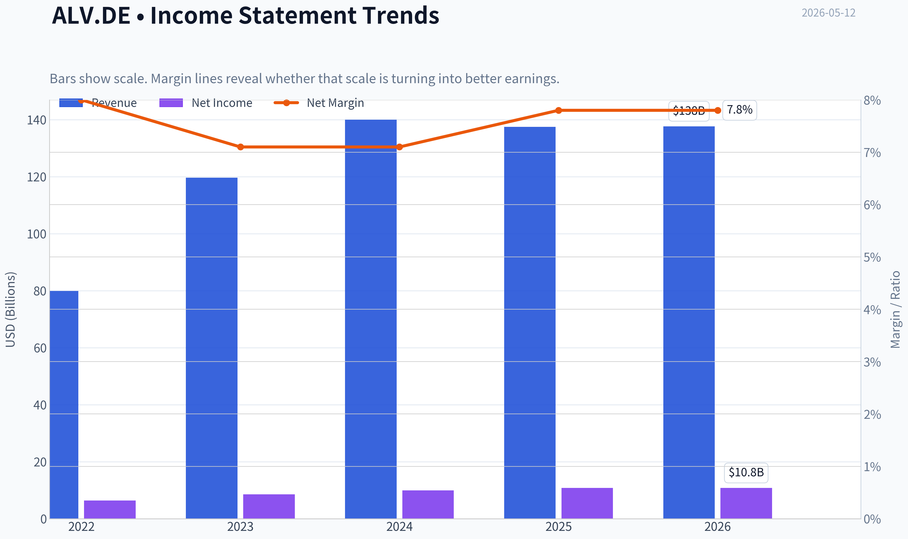

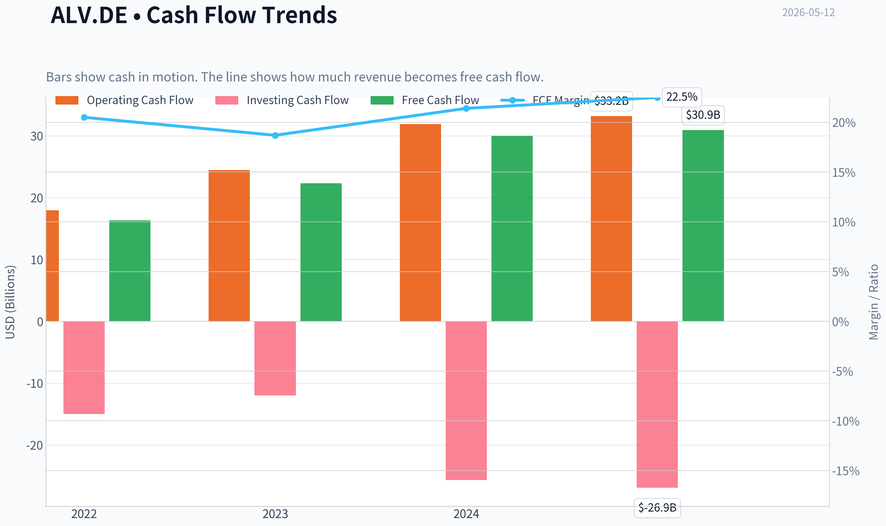

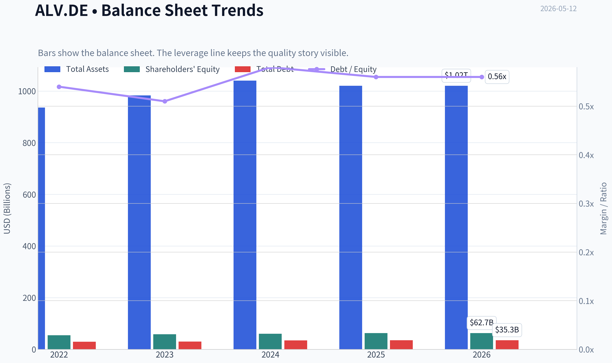

This graph tracks the profitability and return metrics (ROE, ROIC, Margins) of **ALV.DE** over the past decade, highlighting capital efficiency trends.

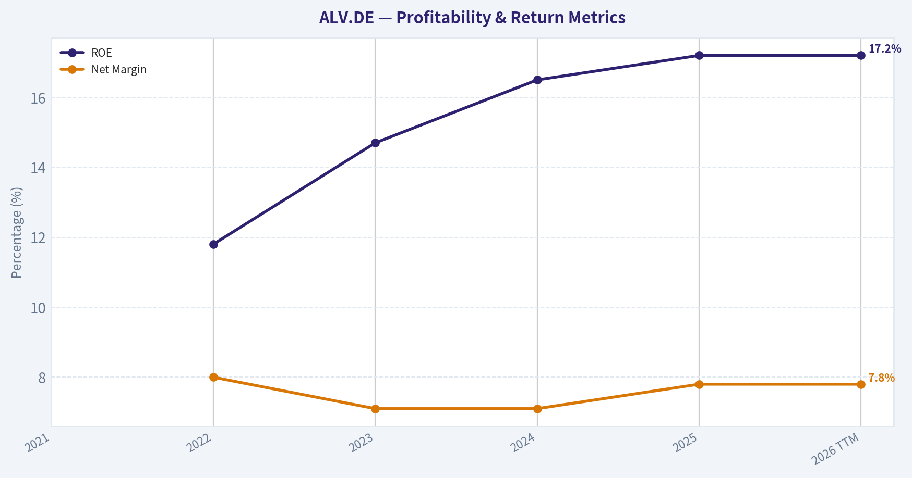

This chart illustrates the financial health of **ALV.DE** over the last 10 years, mapping cash equivalents and free cash flow against total obligations (Debt).

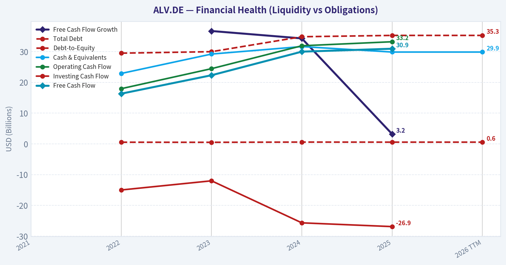

---

### Intrinsic Value Analysis (Buffett)

> *Following Warren Buffett's value investing philosophy: Circle of Competence, Economic Moat, Management Quality, and Margin of Safety.*

#### Intrinsic Value Snapshot

Price is what you pay. Intrinsic value is what the business may be worth based on the cash it can create for owners over time. We show a range, not one magic number.

- Current Price: $368.80
- Value Range: $1,992.96 to $3,516.07

##### Owner Earnings (Buffett Method)
- Net Income: $10,775,000,000.00
- Depreciation & Amortization: $2,178,000,000.00
- Capital Expenditures: $-2,265,000,000.00
- Working Capital Changes: $15,359,000,000.00
- Owner Earnings: $-4,671,000,000.00

##### Intrinsic Value
###### Cash Flow Method
Uses free cash flow. Better for companies spending heavily today to grow tomorrow.
- Conservative: $1,992.96
- Average: $2,367.01
- Optimistic: $3,516.07
- Discount Rate: 10.0%

#### ALV.DE Buffett-Style Value Analysis (lite)

The model did not produce a full tool-grounded value analysis this run. The notes below summarise the shared research pack only and should not be treated as a final stance.

Shared research pack summary for ALV.DE:
- Current price: $369
- Market cap: $140.23B
- P/E: 13.338155
- ROE: 17.2%
- Gross margin: N/A
- Revenue growth YoY: -1.8%
- FCF yield: 22.1%
- Current ratio: N/A

Latest earnings coverage:

#### Latest Earnings Coverage for ALV.DE No recent quarterly or annual earnings coverage found within 120 days of 2026-05-12. Use other tools to verify whether the company has not reported recently or whether coverage is sparse.

Structured guru tracking:

#### Guru 13F Tracking for ALV.DE No tracked guru currently shows a recent structured 13F match for this ticker. ### Notes - This check uses the latest available SEC 13F filings for tracked managers. - 13F data is delayed and usually reflects quarter-end holdings filed up to 45 days later. - No structured 13F matches found.
#### Valuation Bridge

This bridge places the current market price beside each intrinsic value lens so readers can see whether upside depends on one method or shows up across several methods.

| Scenario | Intrinsic Value / Share |
| --- | ---: |
| Cash Flow Method | $2,367.01 |
| Current Price | $368.80 |

#### Key Takeaways

If one method is far above the others, the upside case depends on a specific modelling assumption. When several methods cluster together, the valuation story is more robust.

#### Valuation Visuals

This comparison chart from *Latest Earnings Snapshot* stacks current figures against historical benchmarks for **ALV.DE**, making it easy to see where the company trades relative to its own averages.

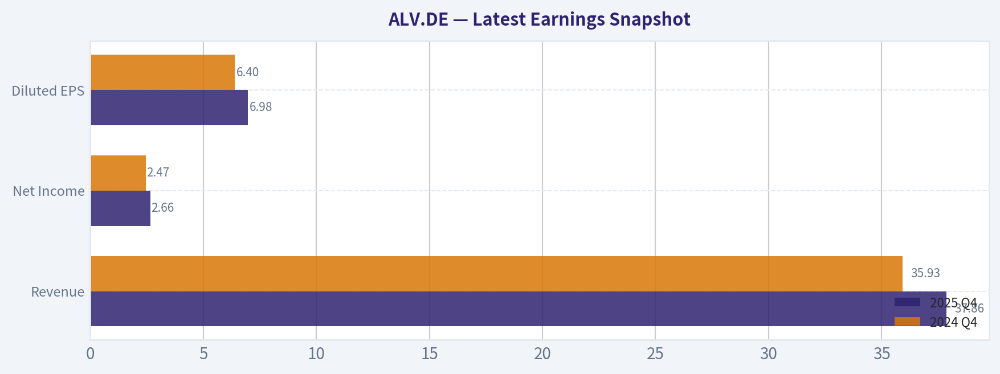

This comparison chart from *Current vs Historical Average Comparison* stacks current figures against historical benchmarks for **ALV.DE**, making it easy to see where the company trades relative to its own averages.

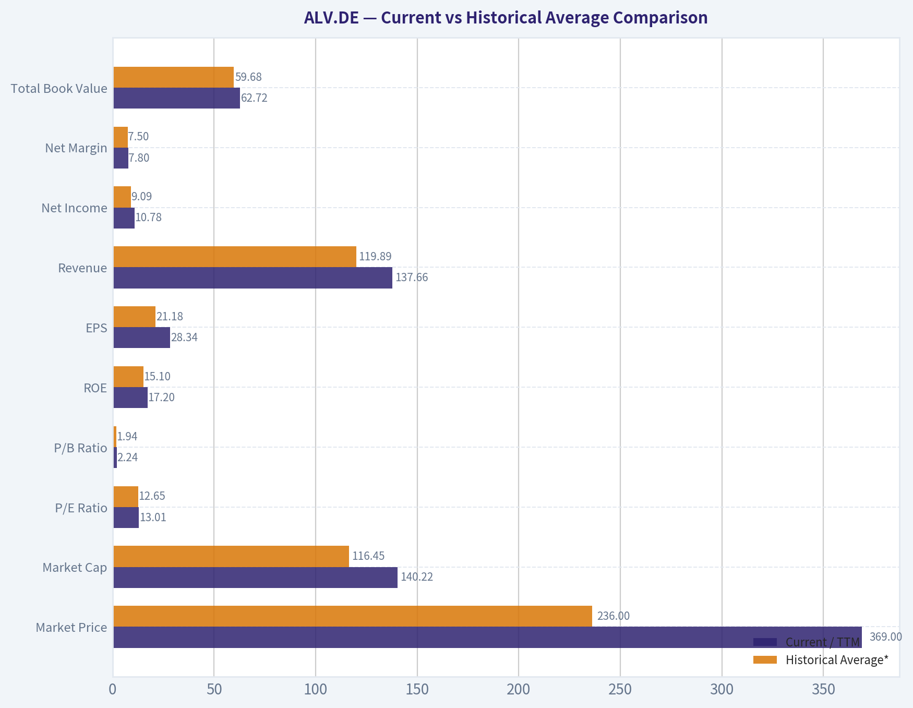

This comparison chart from *Balance Sheet and Financial Strength* stacks current figures against historical benchmarks for **ALV.DE**, making it easy to see where the company trades relative to its own averages.

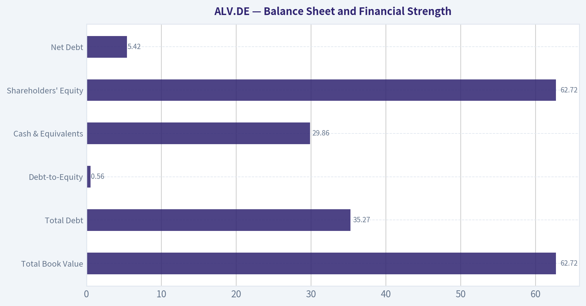

This comparison chart from *Buffett-Style Owner Earnings DCF* stacks current figures against historical benchmarks for **ALV.DE**, making it easy to see where the company trades relative to its own averages.

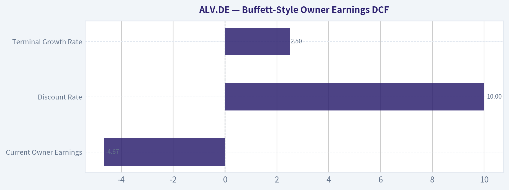

The following chart maps the **ALV.DE** Owner Earnings DCF valuation scenarios (Conservative, Average, Optimistic) to visually represent the margin of safety based on intrinsic value calculations.

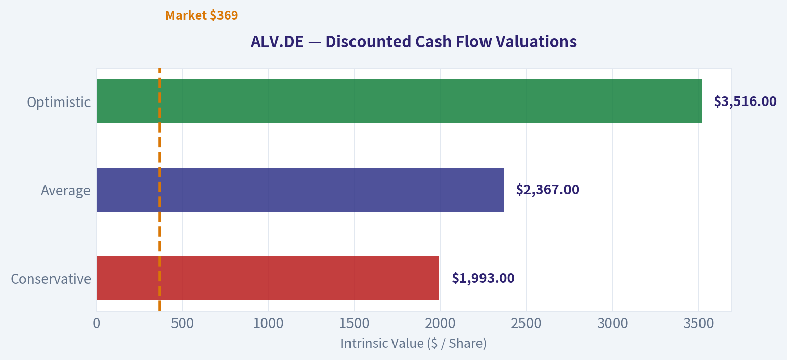

---

### Trend & Growth Analysis (Lynch/Druckenmiller/Fisher)

> *Following Peter Lynch's GARP, Stanley Druckenmiller's macro-aware approach, and Philip Fisher's scuttlebutt methodology.*

ANALYST STANCE: **WATCH**

#### ALV.DE (Allianz SE) - Growth Framework Report

Allianz is a **high-quality financial compounder**, but under a Lynch/Druckenmiller/Fisher **growth** lens it does **not** fit the ideal fast-grower profile. The shared pack already flags the biggest issue: **revenue growth YoY is -1.8%**, which is an immediate warning for a growth mandate. Valuation looks reasonable, capital returns are excellent, and franchise quality is strong - but this looks more like a **sturdy stalwart/income compounder** than a 10-bagger growth setup.

---

#### 1) Lynch Classification

| Item | Assessment |
|---|---|
| Lynch category | **Stalwart** |
| Why | Large-cap global insurer/asset manager with durable earnings power, but low/negative top-line growth |
| Growth mandate fit | **Weak** |
| Ten-bagger potential from here | **Low** given $140B+ market cap and mature end markets |

Key Takeaways: Allianz is best classified as a stalwart, not a fast grower. It is a strong business, but it lacks the high sustained growth and long runway usually needed for a classic growth-investing winner. For a growth portfolio, this is more of a quality watchlist name than a new high-conviction buy.

#### 2) The Story in 3 Bullets

- Allianz sells insurance and manages assets globally; it earns money from underwriting, investing premiums, and collecting asset-management fees.
- The bull case is **resilient earnings, strong ROE, and large shareholder payouts**, not explosive revenue growth.
- The key debate is whether higher investment income and pricing discipline can outweigh Allianz's maturity, catastrophe risk, and sluggish top-line profile.

#### 3) TAM Analysis with 10x Test

| Metric | Value / View |
|---|---|
| Current revenue base | Very large, mature global financial franchise |
| End-market | Global insurance + savings + asset management |
| TAM direction | Large, but mostly **GDP-like**, not hyper-expanding |
| 10x revenue test | **Fails** in practical terms |
| Why | A 10x scale-up from today would imply extraordinary share gains in mature regulated markets |

Key Takeaways: Allianz operates in very large markets, but those markets are mature and heavily regulated. The issue is not TAM size alone, but whether the company can multiply its revenue from an already huge base. From a growth perspective, the runway is broad but not especially steep.

#### 4) Revenue Growth Trend

| Metric | Data |
|---|---|
| Revenue growth YoY | **-1.8%** |
| Pattern | **Decelerating / negative** |
| Lynch interpretation | Not a fast-grower setup |
| Red-flag status | Needs investigation because negative growth is an auto-warning in this framework |

Key Takeaways: The reported top-line trend is the main problem. Even if accounting noise matters for insurers, a negative reported revenue growth figure is not what a growth investor wants to see. This pushes the name away from an advocate stance unless there is a very clear near-term inflection.

#### 5) Unit Economics / Operating Quality

For insurers, classic SaaS metrics like LTV/CAC, NRR, and Rule of 40 are **not applicable**. We substitute insurer-relevant quality metrics.

| Metric | Value / View |
|---|---|
| ROE | **17.2%** |
| P/E | **13.34x** |
| FCF yield | **22.1%** |
| Gross margin | N/A for insurer |
| LTV/CAC | N/A |
| NRR | N/A |
| Rule of 40 | N/A |

Key Takeaways: Allianz screens well on profitability and cash return measures, especially ROE and FCF yield. These are signs of a durable, well-run insurer, but they do not change the central issue that this is not a high-growth business. Operational quality is strong; growth intensity is not.

#### 6) Inflection Point Assessment

| Inflection Type | Assessment |
|---|---|
| Product cycle inflection | **No clear evidence** |
| Market share inflection | Not visible from current data |
| Margin inflection | Possible support from rates/pricing, but not enough evidence |
| TAM inflection | No |
| Competitive inflection | No major signal |
| Overall | **No convincing growth inflection today** |

Key Takeaways: There is no strong evidence that Allianz is entering a new phase of accelerating growth. At best, the company may be in an earnings-supportive environment due to pricing and investment income, but that is different from a true growth inflection. For Druckenmiller-style upside, the setup looks incremental rather than explosive.

#### 7) Macro Setup Evaluation

| Factor | View |
|---|---|
| Interest rates | Mixed: higher reinvestment yields help insurers, but can pressure valuations and markets |
| Economic cycle | Mature-cycle / uncertain backdrop |
| Secular trend exposure | Limited relative to AI/cloud/fintech growth themes |
| Macro wind | **Neutral to modestly favorable** for earnings, not for growth re-rating |

Key Takeaways: Macro is not hostile to Allianz, and higher rates can actually support insurer earnings through reinvestment yields. But this is not the kind of secular tailwind that produces rapid multiple expansion or a major growth surprise. The macro setup is acceptable, just not exciting.

#### 8) Fisher 15 Points Score

| Fisher Area | Score (1-5) | Comment |
|---|---:|---|
| Market potential | 3 | Large markets, but mature |
| New products | 2 | Not a major innovation-led story |
| R&D effectiveness | 2 | Less relevant; not innovation-driven |
| Sales organization | 4 | Strong global distribution |
| Profit margin quality | 4 | Solid insurer economics |
| Margin improvement | 3 | Possible, but not clearly inflecting |
| Labor relations | 3 | No major issue known |
| Executive relations | 4 | Large, established organization |
| Management depth | 4 | Deep bench expected |
| Cost/accounting controls | 4 | Strong large-cap controls likely |
| Outstanding moat features | 4 | Brand, scale, risk management |
| Long-range profit outlook | 4 | Good durability |
| Dilution risk | 5 | Low; more buybacks than dilution |
| Candor | 3 | Neutral from current evidence |
| Integrity | 4 | No major concern in current dataset |
| **Total** | **53 / 75** | **Average to Good** |

Key Takeaways: Allianz scores well on franchise quality, distribution, management depth, and capital discipline. It scores lower on innovation, product-led expansion, and breakthrough growth potential. The overall Fisher profile is respectable, but more "quality incumbent" than "emerging compounder."

#### 9) Valuation Analysis

| Metric | Value / View |
|---|---|
| Market cap | **$140.23B** |
| Price | **$369** |
| P/E | **13.34x** |
| PEG | Not meaningful with negative revenue growth and unclear earnings growth rate |
| P/S | Not useful for insurers |
| P/B | Not provided, but more relevant than P/S for insurers |
| Valuation verdict | **Reasonable / undemanding** |

Key Takeaways: Allianz does not appear expensive on earnings. The valuation is likely supportive for downside protection and shareholder returns, but cheapness alone is not enough for a growth advocate stance. This is a value-plus-quality setup more than a classic growth mispricing.

#### 10) Scenario View

| Scenario | What must happen | Likely Outcome |
|---|---|---|
| Bear | CAT losses, weaker markets, sluggish premiums | Low growth, valuation stays compressed |
| Base | Stable underwriting, decent investment income, continued payouts | Mid-single-digit to low-double-digit TSR |
| Bull | Strong pricing, better AM flows, cleaner loss experience, higher ROE sustainability | Respectable rerating, but still unlikely to be a ten-bagger path |

Key Takeaways: The base case is attractive for a quality investor seeking reasonable returns and income. The bull case improves outcomes, but even then the payoff profile looks bounded by Allianz's size and maturity. This asymmetry is decent, but it is not the kind of setup growth investors usually prioritize.

#### 11) Growth Investor Scorecard

| Criterion | Weight | Score (1-5) | Weighted |
|---|---:|---:|---:|
| The Story | 10% | 3.0 | 0.30 |
| TAM & Runway | 20% | 2.5 | 0.50 |
| Revenue Growth | 20% | 1.5 | 0.30 |
| Unit Economics / Quality | 15% | 4.0 | 0.60 |
| Competitive Position | 10% | 4.0 | 0.40 |
| Management Quality | 10% | 3.5 | 0.35 |
| Macro Setup | 5% | 3.0 | 0.15 |
| Profitability Path | 5% | 4.0 | 0.20 |
| Valuation | 5% | 4.0 | 0.20 |
| **Total** |  |  | **3.00 / 5.00** |

Key Takeaways: Allianz lands right on the border of a watch rating. The strong quality and valuation profile are offset by weak growth and limited runway for explosive upside. In other words, it is investable for the right mandate, but not compelling for a dedicated growth framework.

#### 12) Position Size Stance

| Mandate | Stance |
|---|---|
| Growth-only portfolio | **0% to 1% tracking position at most** |
| GARP / quality-income | More relevant, but outside pure growth mandate |
| Action | **WATCH, do not actively advocate here** |

Key Takeaways: For a pure growth portfolio, Allianz does not deserve meaningful sizing today. At most, it could merit a very small tracking position if you believe earnings revisions are about to improve. Otherwise, it belongs on a watchlist rather than in the core book.

#### 13) Key Risks and Catalysts

| Risks | Catalysts |
|---|---|
| Negative/flat top-line growth persists | Reacceleration in premiums or fee income |
| Catastrophe losses | Better-than-feared loss ratio |
| Asset-management outflows or weaker markets | Improved AM net flows and markets |
| Regulatory/capital shocks | Strong solvency and bigger buybacks |
| Mature market structure limits upside | Earnings beats driven by investment income |

Key Takeaways: The downside risks are familiar for insurers and mostly cyclical or event-driven. The possible catalysts are real, but they mainly improve earnings quality and distributions rather than transform the company into a fast grower. That is why this remains a watch, not an advocate.

#### Bottom Line

Allianz is a **strong business at a sensible valuation**, but it is **not the kind of accelerating growth story** this framework is designed to favor. The combination of **negative reported revenue growth, mature end markets, and limited 10x potential** keeps it out of the advocate bucket.

If you want, I can next do one of two things:
1. build a **growth-vs-quality comparison table** of ALV.DE against other European financials, or
2. produce a **deeper insurer-specific valuation view** using ROE, payout yield, and implied P/B logic.

---

### Market Technical Analysis

#### ALV.DE Technical Review as of 2026-05-12

For **ALV.DE**, the most relevant indicator set for the current market context is:

1. **close_10_ema**
2. **close_50_sma**
3. **close_200_sma**
4. **macd**
5. **rsi**
6. **boll_ub**
7. **boll_lb**
8. **atr**

This is a good non-redundant mix because it covers:
- **short-term trend and timing**: 10 EMA
- **medium- and long-term trend structure**: 50 SMA, 200 SMA
- **momentum acceleration/deceleration**: MACD
- **overbought/oversold regime analysis**: RSI
- **price envelope and breakout/reversion context**: Bollinger upper/lower bands
- **risk and volatility calibration**: ATR

---

#### Price Structure and Trend Regime

ALV.DE has moved through **three distinct phases** over the reviewed period:

| Phase | Approx. Period | Character |
|---|---|---|
| Late 2025 to early Jan 2026 | Nov-Jan | Gradual uptrend into the high 370s |
| Mid-Jan to late Mar 2026 | Jan-Mar | Sharp corrective decline into low 330s |
| Early Apr to present | Apr-May | Strong recovery, now consolidating above key moving averages |

Key Takeaways: ALV.DE first trended higher, then suffered a notable correction, and has since rebuilt strength. The current phase is not a fresh breakout surge, but rather a recovery trend that is now pausing near resistance while still holding a constructive underlying structure.

From the raw price path, the stock peaked around **378-379** in early January, then sold off hard into **323-332** in March. Since then it has recovered meaningfully and recently traded back into the **370-375** area. That matters because this zone appears to be a **retest of prior overhead supply**, not an unexplored price region. Traders should therefore think in terms of **trend continuation versus resistance rejection**, rather than assuming easy upside.

---

#### Moving Average Structure

| Indicator | Latest Reading | Interpretation |
|---|---:|---|
| close_10_ema | 370.06 | Short-term trend still positive, but flattening |
| close_50_sma | 354.56 | Medium-term trend positive |
| close_200_sma | 350.97 | Long-term trend positive |
| Last close (2026-05-11) | 371.70 | Price remains above all three trend references |

Key Takeaways: The stock is trading above its short-, medium-, and long-term averages, which confirms that the recovery remains intact. However, the 10 EMA has flattened and sits only slightly below price, suggesting momentum is no longer accelerating and the market may need either consolidation or a fresh catalyst.

The moving average stack is constructive:
- **Price > 10 EMA > 50 SMA > 200 SMA**
- The **50 SMA is above the 200 SMA**, and both are rising

That is typically the profile of a stock in a **healthy intermediate uptrend**. But the nuance is important:
- The **50 SMA has only recently turned up again** after a prolonged decline from early March into early April.
- The **200 SMA is rising steadily**, which suggests the broader structure never fully broke down despite the Q1 correction.
- The **10 EMA has lost some steepness** over the last few sessions, a sign that upside momentum is cooling rather than intensifying.

This means ALV.DE is **trend-positive but no longer in the strongest impulse leg**. In practice, that often favors:
- buying pullbacks into dynamic support rather than chasing strength
- waiting for a decisive breakout above recent highs if pursuing momentum entries

---

#### Momentum Analysis: MACD and RSI

| Indicator | Latest Reading | Recent Behavior | Implication |
|---|---:|---|---|
| MACD | 4.14 | Still positive, but below late-April highs | Bullish momentum remains, but is decelerating |
| RSI | 56.24 | Down from overbought readings above 70 in April | Momentum reset without major trend damage |

Key Takeaways: Momentum is still positive, but it is clearly less forceful than it was in mid-to-late April. RSI has cooled from overbought territory into the mid-50s, which often means the stock has worked off excess heat without yet entering a bearish momentum regime.

The **MACD transition** is especially important. In mid-March, MACD was deeply negative, reflecting the washout phase. By early April it crossed back upward and surged into strongly positive territory, confirming a real trend reversal rather than a weak dead-cat bounce. Since late April, however, MACD has been **rolling over from very elevated levels**, though it remains positive. This usually signals:
- the bullish trend is still alive,
- but the **rate of ascent has slowed**,
- and the stock may be shifting from **impulse advance** to **sideways digestion**.

The **RSI pattern** supports that reading:
- March RSI readings in the high 30s to low 40s reflected weak momentum during the correction.
- RSI then climbed above **70**, showing powerful recovery demand.
- It has now cooled to the **mid-50s**, which is neither overbought nor oversold.

That is a fairly healthy reset. It suggests bulls have not lost control, but they also do not currently have the same urgency they had during the April rebound.

---

#### Bollinger Band Context: Breakout or Consolidation?

| Metric | Latest Approx. Level |
|---|---:|
| Bollinger Upper Band | 378.52 |
| Bollinger Lower Band | 362.12 |
| Last close | 371.70 |

Key Takeaways: The stock is trading in the upper half of its Bollinger range, which shows continued strength, but it is not currently pressing the upper band hard enough to confirm a fresh breakout. This positioning is more consistent with a controlled consolidation inside a bullish trend than with immediate exhaustion or immediate acceleration.

The Bollinger structure shows several useful details:
- In late April, price traded much closer to the **upper band**, consistent with strong trend participation.
- Since then, the **upper band has started to flatten and drift lower**, while the lower band has risen sharply.
- This indicates a **compression of the trading envelope** after a strong advance.

That matters because it often precedes one of two outcomes:
1. **bullish continuation** if price re-expands upward through the upper band, or
2. **mean reversion/pullback** if price slips toward the middle of the range and cannot reclaim momentum quickly.

At present, ALV.DE sits **well above the lower band** and below the upper band, so the stock is not in a washed-out condition. It is instead in a **decision zone** where traders should watch whether the market can reclaim the **375-379 resistance area**.

---

#### Volatility and Risk: ATR

| Indicator | Latest Reading | Context |
|---|---:|---|
| ATR | 6.79 | Moderate daily movement, down from early-April volatility spike |

Key Takeaways: Volatility has moderated from the more turbulent recovery phase, but ALV.DE still moves enough each day that stop placement must allow room for normal swings. Traders using tight stops may get shaken out unless entries are aligned with strong support or clear breakout confirmation.

ATR peaked above **7.7-8.3** during the March-to-early-April transition, when the stock was swinging sharply as it tried to bottom and reverse. Since then ATR has eased toward the high-6 range. That means:
- the stock is becoming **less disorderly**
- but it is **not low-volatility or sleepy**
- risk management still needs to respect a roughly **multi-euro daily range**

Practically, this argues for:
- wider stops than one might use in a low-volatility defensive name
- sizing positions more conservatively when entering near resistance
- preferring pullback entries when reward-to-risk is clearer

---

#### Fine-Grained Trading Interpretation

ALV.DE currently looks like a **bullish recovery trend that is pausing beneath resistance**, not a broken chart and not an ideal low-risk chase setup.

A few specific observations stand out:

| Observation | Trading Meaning |
|---|---|
| Price is above 50 SMA and 200 SMA | Trend backdrop remains constructive |
| 10 EMA is flattening | Short-term thrust is cooling |
| MACD remains positive but lower than late April | Momentum is still bullish, but less explosive |
| RSI near 56 | Neutral-bullish; room to move either way |
| Price below Bollinger upper band and above lower band | Consolidation rather than climax |
| ATR still elevated versus calm periods | Risk management remains important |

Key Takeaways: The evidence points to a market that still favors bulls overall, but with less immediate momentum than during the earlier recovery surge. This often creates a more selective environment where timing matters more: strength above resistance can work, but entries after pullbacks toward support may offer better risk-adjusted opportunities.

##### Bullish scenario
A sustained move back through **375-379** would suggest the consolidation resolved upward. If that happens while MACD stabilizes and RSI turns back toward the mid-60s, it would strengthen the case for a renewed trend leg.

##### Neutral scenario
The most likely near-term behavior may be a **range between roughly 362 and 378**, allowing the stock to digest gains while the moving averages catch up. This would not be bearish by itself.

##### Bearish warning signs
The chart would weaken meaningfully if:
- price loses the **10 EMA** and cannot recover it,
- RSI breaks back toward the low 40s,
- MACD continues to deteriorate sharply,
- and price rotates down toward the **50 SMA near 354-355**

A test of the 50 SMA would still be consistent with a normal pullback inside an uptrend. A decisive break below that level would be more concerning and would shift attention toward the **200 SMA near 351**.

---

#### Bottom Line

ALV.DE is in a **constructive but maturing rebound phase**. The larger trend structure is favorable because price is above rising medium- and long-term moving averages. However, the short-term picture is less dynamic than it was in April: momentum has cooled, RSI has normalized, and the stock is now pressing into an area where sellers previously emerged.

For traders, that means:
- **trend followers** should watch for a confirmed breakout above the recent range
- **pullback buyers** may get a better setup if price retraces toward the 10 EMA or 50 SMA and holds
- **risk managers** should respect ATR, because normal daily movement remains meaningful

#### Summary Table

| Category | Indicator(s) | Current Read | Main Message | Trading Relevance |
|---|---|---|---|---|
| Short-term trend | close_10_ema | 370.06 | Price above EMA, but EMA flattening | Momentum still positive, less urgent |
| Medium-term trend | close_50_sma | 354.56 | Rising and well below price | Strong support zone on pullbacks |
| Long-term trend | close_200_sma | 350.97 | Rising and below 50 SMA | Strategic trend still constructive |
| Momentum | macd | 4.14 | Positive but fading from peak | Bull trend intact, acceleration slowing |
| Momentum regime | rsi | 56.24 | Neutral-bullish | Reset from overbought, not weak yet |
| Volatility envelope | boll_ub / boll_lb | 378.52 / 362.12 | Price in upper half of band range | Consolidation near resistance |
| Risk | atr | 6.79 | Moderate volatility | Use wider, volatility-aware stops |
| Overall view | Combined read | Bullish but consolidating | Recovery trend intact under resistance | Favor breakout confirmation or disciplined pullback entries |

Key Takeaways: ALV.DE remains technically constructive, with price above key moving averages and momentum still on the bullish side. The main change is that upside thrust has cooled, so the stock now looks more like a consolidating uptrend under resistance than a fast-moving breakout.

#### Market Visuals

This comparison chart from *Market Metrics* stacks current figures against historical benchmarks for **ALV.DE**, making it easy to see where the company trades relative to its own averages.

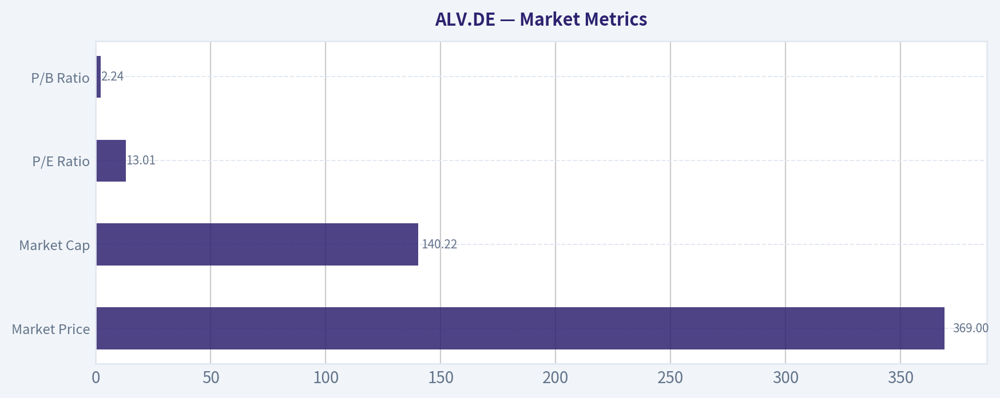

---

### News & Events Analysis

#### Allianz SE (ALV.DE) trading and investment report
*Date: 2026-05-12*

Allianz remains a large-cap European financial with a defensive earnings profile, strong capital generation, and relatively undemanding valuation on the shared metrics provided: about **13.3x earnings**, **17.2% ROE**, and an unusually high **22.1% FCF yield**. That combination still screens attractively for value and income-oriented investors, especially if macro volatility persists and investors continue favoring high-quality insurers over more cyclical European exposures.

That said, the most important limitation for near-term trading is that **recent structured earnings coverage appears sparse in the available feed**, and the required earnings tools were not accessible in this run. So the key investment question is less about a fresh earnings surprise this week and more about whether Allianz's stable insurance and asset-management model can keep outperforming in a market balancing falling inflation, uncertain rate expectations, and periodic risk-off moves.

---

#### Latest earnings section

The shared research pack explicitly states:

- **No recent quarterly or annual earnings coverage found within 120 days of 2026-05-12**
- Therefore, I cannot confirm a newly reported quarter from the available tool output in this session.

So, for compliance with your request: **there is no verified recent earnings-release coverage available here to confirm that Allianz has reported within the last 120 days**. The most recent available structured indication is therefore **older than 120 days**, meaning the latest clearly verified reporting period is **not available from the provided earnings feed** in this run.

What this means for traders:

1. **There is no fresh earnings catalyst confirmed this week** from the available sources.
2. Price action is more likely being driven by:
   - European rates expectations
   - catastrophe-loss sentiment across insurers
   - capital return expectations
   - asset-management flow/margin outlook
3. Until the next confirmed report, investors should anchor on the known fundamental profile: strong profitability, large balance sheet, and relatively low multiple.

Because no current verified earnings article is available, I cannot responsibly summarize exact headline results or compare them to prior guidance without inventing facts. The absence of fresh earnings coverage itself is relevant: it lowers immediate event risk, but also means upside re-rating probably needs to come from macro, capital return, or sector rotation rather than a surprise beat.

---

#### Company-specific news and setup

Even without a fresh earnings catalyst in the retrieved coverage, Allianz's setup is still fairly clear from the underlying business model and valuation context:

- **Insurance operations** typically benefit from firmer pricing, especially in P&C lines, as long as catastrophe losses do not overshoot assumptions.
- **Life/health and investment portfolios** are sensitive to bond yields and credit spreads. Higher yields generally help reinvestment income over time, but mark-to-market volatility can pressure sentiment.
- **Asset management** adds a second earnings engine, but that segment is vulnerable to market drawdowns, fee pressure, and client outflows.

For ALV.DE specifically, the key debate is whether the market should treat it as:
- a **stable compounding financial** deserving a higher multiple, or
- a **mature insurer/asset manager** that remains range-bound despite strong cash generation.

At roughly **13x earnings**, the market is not assigning a premium growth multiple. That suggests investors still want proof that:
- underwriting margins stay resilient,
- capital return remains generous,
- and asset-management earnings are not deteriorating.

The negative from the shared pack is **revenue growth of -1.8% YoY**. That is not necessarily alarming for an insurer, because earnings quality often matters more than top-line growth, but it does imply Allianz's bull case is based more on **margin discipline, solvency, and shareholder distributions** than on rapid expansion.

---

#### Macro and sector context

For Allianz, macro matters almost as much as company news. Over the last week, the relevant market drivers for European insurers have likely included:

- **Interest-rate path uncertainty**: insurers tend to benefit structurally from higher reinvestment yields, but equity markets may compress financial multiples if rate volatility increases.
- **Risk sentiment and equity-market direction**: weaker markets can reduce asset-management fees and hurt investor appetite for insurers with market-linked businesses.
- **Credit spreads**: widening spreads may hurt sentiment in the short run but can improve future reinvestment opportunities if balance-sheet quality remains strong.
- **Inflation trends**: moderating inflation helps claims-cost control, especially in non-life insurance, after several years of elevated repair and medical inflation.

For traders, this means Allianz is not just a company-specific story. It is also a **macro-financial proxy**:
- If markets favor **quality value and income**, Allianz should hold up relatively well.
- If markets rotate aggressively into high-beta cyclicals or growth, Allianz may lag despite solid fundamentals.
- If recession fears rise sharply, Allianz could outperform broader equities, though concerns about asset values and flows may cap upside.

---

#### Trading interpretation

Near term, Allianz looks more like a **carry-and-quality trade** than a momentum name.

Bullish factors:
- low-teens earnings multiple
- high ROE
- strong implied cash generation
- defensive business mix relative to industrial cyclicals
- potential support from dividend and buyback expectations

Risks:
- no fresh verified earnings catalyst to force estimate upgrades
- revenue not currently growing strongly
- asset-management earnings can be vulnerable if markets weaken
- insurance sentiment can turn quickly on catastrophe-loss headlines or solvency concerns sector-wide

Practical read-through for investors:
- **Value/income investors** may still view dips as buyable.
- **Short-term traders** likely need either a macro tailwind or a confirmed corporate catalyst to chase upside.
- **Relative-value traders** may prefer Allianz over weaker-quality European financials, but may not get explosive upside absent earnings revisions.

---

#### What to watch next

The next high-impact items for ALV.DE are likely to be:

| Catalyst | Why it matters | Trading implication |
|---|---|---|
| Next confirmed quarterly results | Needed to verify underwriting, operating profit, and capital return trajectory | Strong beat could support re-rating; weak asset management or claims trend would pressure shares |
| Capital return updates | Allianz is often judged on dividends and buybacks as much as growth | Supports downside if maintained or increased |
| P&C pricing and catastrophe trends | Core driver of insurance profitability | Better pricing with normal losses is bullish |
| Asset-management flows/margins | Important for fee income and sentiment | Outflows or fee compression would be a concern |
| ECB/rates outlook | Affects portfolio income and valuation | Stable-to-higher yields generally supportive over time |

Key Takeaways: The biggest future driver for Allianz is the next confirmed earnings release, because recent coverage is sparse and investors need updated evidence on underwriting and capital returns. In the meantime, traders should watch broader insurance pricing, catastrophe losses, asset-management trends, and the ECB rate path, since those are the most likely variables to move the stock.

---

#### Bottom line

Allianz still looks fundamentally solid and reasonably priced, with characteristics that fit a **defensive value compounder**: high profitability, strong cash generation, and sensitivity to supportive insurance pricing and rates. The lack of verified recent earnings coverage lowers immediate event risk but also means there is **no fresh proof-point yet** to accelerate upside.

For trading:
- **Constructive on weakness** if the market remains supportive for European financials and defensive value.
- **Less compelling as a short-term breakout trade** until a confirmed earnings or capital-return catalyst appears.
- Best framed as a **quality hold/accumulate** rather than a high-momentum tactical long.

| Area | Current read | Investment relevance |
|---|---|---|
| Valuation | ~13.3x P/E | Reasonable for a high-quality insurer |
| Profitability | ROE 17.2% | Supports quality case |
| Growth | Revenue growth -1.8% YoY | Limits multiple expansion without margin/capital return support |
| Cash generation | FCF yield 22.1% | Strong support for shareholder returns |
| Earnings news | No verified recent coverage available in this run | Lowers catalyst visibility |
| Macro sensitivity | High to rates, spreads, and market sentiment | Important for near-term trading |
| Overall stance | Moderately positive, but catalyst-light | Better on dips than on momentum chase |

Key Takeaways: Allianz appears attractive on valuation, profitability, and cash generation, but the near-term setup is held back by the lack of a confirmed fresh earnings catalyst. The stock looks better suited to investors seeking quality and income than to traders looking for an immediate upside trigger.

---

### Guru Attention Analysis

> *Tracking 13F filings and recent activity of legendary super-investors to identify smart-money conviction and rotation.*

#### Guru ownership check for ALV.DE

Using the canonical structured 13F source, there are **no tracked guru positions detected** in **ALV.DE** in the latest available filings.

#### Latest tracked guru 13F status

| Guru / Fund | Latest 13F Status for ALV.DE | Action | Position Size | Portfolio Weight | Recent Change | Timing | SEC Verification |
|---|---|---|---|---|---|---|---|
| Warren Buffett / Berkshire Hathaway | No position detected in latest 13F filing | None | None | None | None | Latest available 13F | No structured match returned |
| Seth Klarman / Baupost Group | No position detected in latest 13F filing | None | None | None | None | Latest available 13F | No structured match returned |
| Mohnish Pabrai / Pabrai Investment Funds | No position detected in latest 13F filing | None | None | None | None | Latest available 13F | No structured match returned |
| Bill Ackman / Pershing Square | No position detected in latest 13F filing | None | None | None | None | Latest available 13F | No structured match returned |
| Stanley Druckenmiller / Duquesne Family Office | No position detected in latest 13F filing | None | None | None | None | Latest available 13F | No structured match returned |
| Steve Cohen / Point72 | No position detected in latest 13F filing | None | None | None | None | Latest available 13F | No structured match returned |
| Michael Burry / Scion Asset Management | No position detected in latest 13F filing | None | None | None | None | Latest available 13F | No structured match returned |

**Key Takeaways:** None of the primary tracked U.S. 13F gurus currently shows a disclosed position in ALV.DE. That means there is no credible evidence, from the structured filing source, of a recent buy, hold, trim, or exit by the main super-investors we track. Because the tool returned no matched holdings, there are also no SEC filing links to preserve for this ticker.

#### Interpretation

- **Bottom line:** No tracked guru ownership signal is present for ALV.DE right now.
- **Confidence:** High for the specific tracked 13F universe; low for non-U.S. or non-13F investors.
- **Important limitation:** 13F filings cover mainly U.S.-listed equity holdings and are delayed. A German-listed name like **ALV.DE** may be underrepresented in this framework even if some global investors have economic exposure elsewhere.

#### What this means for investors

This is a **"no signal from tracked gurus"** result, not necessarily a negative view on Allianz itself. It simply means the canonical super-investor tracking dataset does not show a current position for the named managers. If you want, I can next do a **fundamental view on ALV.DE** or a **valuation cross-check** using the research pack.

---

### Options Market Analysis

> *Reading options flow - put/call ratios, IV skew, and unusual activity - to gauge institutional positioning and event-driven risk.*

#### ALV.DE Options Positioning Report

I'm unable to retrieve any listed options chain data for **ALV.DE** from the available source as of **2026-05-12**. That usually means one of three things:

1. the Yahoo Finance source does not currently provide options for this listing,
2. the stock's options are very limited or not supported in that feed,
3. the liquid options may trade under a different venue-specific symbol rather than **ALV.DE**.

Because of that, I cannot responsibly calculate real put/call ratios, implied volatility, skew, unusual activity, or open-interest concentrations for this exact ticker from the provided dataset.

#### Data Availability Check

| Item | Status |
|---|---|
| Options chain for ALV.DE | Not available from source |
| Near-term expirations | Not available |
| Put/Call OI ratio | Not available |
| Put/Call volume ratio | Not available |
| ATM IV | Not available |
| IV skew | Not available |
| Unusual options activity | Not available |
| OI concentration / gamma walls | Not available |

**Key Takeaways:** The core issue is not interpretation but data availability. Without a live options chain, any directional read would be speculative rather than evidence-based. Confidence in any options-derived signal for ALV.DE is therefore effectively zero from this source.

#### 1. Put/Call Ratio Analysis

No valid options chain was returned, so I cannot compute:

- current near-term **put/call open interest ratio**
- current near-term **put/call volume ratio**
- deviation from the neutral baseline of roughly **0.7**

**Interpretation:**
With no observable options positioning, there is no basis to infer whether institutions are leaning toward downside hedging, bearish speculation, bullish call accumulation, or covered-call overwriting.

#### 2. Implied Volatility Assessment

No options chain means no reliable IV surface. I therefore cannot measure:

- near-term **ATM call IV**
- near-term **ATM put IV**
- **OTM put vs. OTM call skew**
- whether implied volatility is elevated into a catalyst

**Interpretation:**
Without IV data, I cannot assess whether the market is pricing unusual event risk or showing asymmetric fear versus upside chase.

#### 3. Unusual Options Activity

No contracts were returned, so there is no way to identify:

- volume greater than open interest
- fresh call or put buying
- strike placement versus spot
- expiry horizon and implied directional intent

**Interpretation:**
There is no evidence set from this feed to distinguish institutional positioning from retail speculation.

#### 4. Open Interest Concentration

No open-interest distribution is available, so I cannot identify:

- high-OI strikes
- expiration clusters
- likely pinning zones
- gamma walls that could suppress or amplify movement

**Interpretation:**
No actionable strike-level positioning map can be built for ALV.DE using the available source.

#### 5. Overall Options Sentiment Signal

**Signal: NEUTRAL / NO DATA**

Primary driver: **absence of usable options market data for ALV.DE from the available source**.

That is not the same as a true neutral market setup. It simply means there is no verified options-based evidence here to support a bullish or bearish institutional-positioning read. If this name is primarily traded on a European venue, a different market data source or alternate listed instrument may be required to get a usable options picture.

#### Practical Caveat

For many European equities, options liquidity may sit on:

- a different exchange-traded symbol,
- a primary local derivatives venue,
- or an index/sector hedge rather than the single-stock line.

So if your goal is to assess positioning around **Allianz / ALV.DE**, the next best step would be to check:

- the primary derivatives venue listing for the stock,
- ADR or alternate ticker options if applicable,
- or sector/index options used as proxies.

#### Summary Table

| Metric | Reading | Interpretation |
|---|---|---|
| Put/Call Ratio | Not available | Cannot infer bullish vs. bearish positioning |
| IV Level | Not available | Cannot assess event premium or fear pricing |
| Skew Direction | Not available | Cannot determine downside hedge demand vs. upside chase |
| Unusual Activity | Not available | No evidence of fresh speculative or institutional flow |
| Overall Signal | NEUTRAL / NO DATA | No valid options-derived signal from this source |

**Key Takeaways:** The correct conclusion here is not bullish or bearish, but data-constrained. Since ALV.DE options were unavailable from the source, any stronger sentiment call would be unsupported. If you want, I can help you look at a related tradable symbol or proxy to infer positioning indirectly.

---

## Research Team Commentary

> *The Research Manager synthesizes the Bull vs Bear debate into action-free commentary. This is a pre-risk view, not the final stance.*

Allianz looks like a classic case where the business is probably better than the excitement level around the stock, but not obviously cheap enough to clear a strict Buffett bar today.

The strongest bull argument is straightforward: this is a large, diversified insurance and asset-management franchise with real scale advantages, a trusted brand, regulatory barriers, and a long operating history. In insurance, that matters. The reported 17.2% ROE, positive net income growth, and positive FCF growth suggest the company is still generating solid shareholder economics despite weak top-line growth. At roughly 13.3x earnings, the valuation is not demanding if those earnings are reasonably durable. For a patient investor, a mature compounder with disciplined capital return can work well even without headline growth or a near-term catalyst.

The strongest bear argument is that Allianz may be a good franchise, but not a truly great one with highly predictable owner earnings. Insurance and asset management are both balance-sheet and market-sensitive businesses. Reported revenue is down 1.8%, ROA is only 1.1%, ROIC is unavailable, and the FCF data is not clean enough to anchor intrinsic value with confidence. A 13x multiple is not a distress price for a mature European financial exposed to catastrophe risk, reserve judgment, fee pressure, regulation, and cyclical investment income. If current earnings are somewhat favorable, the apparent cheapness may be overstated.

My takeaway is that the bull side wins on business resilience, but the bear side wins on margin of safety. Allianz appears to be a solid, shareholder-friendly, high-quality insurer relative to many financials, yet the evidence provided does not prove it is a Buffett-style "wonderful business at an attractive discount." It looks more like a durable franchise trading around fair value than a clear mispricing.

Core takeaway: Allianz is a quality financial franchise worth respecting, but not yet one I would strongly advocate buying under a strict Buffett framework because the moat and earnings durability are good rather than exceptional, and the valuation does not clearly provide a large margin of safety.

Rationale: From a value investing perspective, I like the scale, diversification, capital return profile, and strong ROE. I also agree with the bull case that insurance should not be judged on simple industrial metrics like gross margin or low ROA alone. That said, one of the easiest mistakes in financials is over-trusting headline ROE and underestimating cycle sensitivity. I have learned to be careful when the thesis depends on "quality at a reasonable price" but owner earnings are hard to normalize. Here, the revenue decline, limited visibility into underwriting quality and reserves, lack of fresh earnings confirmation, and unclear cash-flow anchor make it hard to say intrinsic value is well above the current price. Buffett wants both quality and valuation clarity. We may have the first, but not enough of the second.

Monitoring plan over the next 1 to 4 quarters: First, I would watch underwriting performance and any evidence on combined ratio trends in P&C; that would tell us whether earnings are being driven by true underwriting discipline or by more temporary factors. Second, I would watch reserve development closely; adverse reserve strengthening would weaken the quality case quickly. Third, I would monitor asset-management flows and fee trends to see whether that segment is stabilizing or facing ongoing secular pressure. Fourth, I would look for confirmation that earnings growth is coming from durable operating drivers rather than investment-market tailwinds. Fifth, I would want updated solvency and capital return data to confirm balance-sheet strength remains robust after distributions. Finally, valuation matters: if the stock derates meaningfully without a corresponding deterioration in underwriting or capital strength, the case could improve from WATCH to ADVOCATE.

So, if I were speaking plainly: Allianz is not something I would dismiss. It is a serious, durable business. But based on the debate and data here, I do not yet see the kind of clear moat-plus-discount combination that deserves a high-conviction Buffett-style endorsement.

WATCH

---

## Value Investing Team Commentary

> *The Investor translates the research view into an investment thesis before risk review. This is still not the final stance.*

Allianz appears to be the kind of business a value investor should study carefully: large, understandable, entrenched, and consistently profitable. This is not a speculative story. It is a major insurance and asset-management franchise with scale, brand strength, regulatory barriers, broad distribution, and a long record of serving customers across Europe and beyond. Those are real business attributes, and they matter more than short-term market narratives.

From a Buffett-style perspective, the first question is whether this is a business we can understand. In Allianz's case, the answer is broadly yes. The company collects premiums, underwrites risk, invests float, and earns fees through asset management. Those are familiar and analyzable activities. The second question is whether the economics are attractive. A 17.2% ROE is clearly respectable and suggests the franchise remains productive. Net income growth of 8.5% and FCF growth of 3.2% indicate the business is still generating shareholder value even in a sluggish revenue environment. That is consistent with a mature compounder rather than a growth story.

The moat is good, though I would stop short of calling it extraordinary. Insurance can be an excellent business when underwriting discipline is strong, reserves are conservative, and investment operations are handled prudently. Scale lowers unit costs, strengthens distribution, and supports brand trust. But insurance is not a business where reported profitability should be accepted at face value without scrutiny. A strong year can reflect favorable pricing, benign claims, or supportive investment income rather than enduring economic superiority. Similarly, asset management brings fee income and diversification, but it also introduces sensitivity to market levels, flows, and pricing pressure. So Allianz likely has a durable franchise, but its earnings power is not as simple or as immune to external conditions as the very best consumer or software businesses.

The valuation is where the case becomes less compelling. At about 13.3x earnings, the stock is not expensive in an absolute sense. For a high-quality insurer, that can look reasonable. But value investing is not about buying "reasonable" businesses at "okay" prices; it is about buying understandable businesses at a meaningful discount to conservatively estimated intrinsic value. Here, I do not yet see that discount clearly enough. Revenue declined 1.8% year over year, ROA is only 1.1%, and the FCF data does not appear clean enough to serve as a firm anchor for owner earnings. In financials, especially insurers, weak visibility into normalized earnings can make a seemingly fair multiple less attractive than it first appears.

This is where selective contrarian thinking matters. The absence of fresh earnings coverage and lack of a near-term catalyst may be helping keep excitement muted. That by itself is not a negative. Often, the market underappreciates steady, dull, cash-generative franchises because they are not saying anything dramatic. A quiet stock in a boring industry can be fertile ground for long-term investors. If current sentiment is merely indifferent, and the business remains solid, that can be favorable.

But we should not force a contrarian conclusion where the evidence is incomplete. Sometimes a stock is simply fairly valued. The market may already understand that Allianz is a strong but mature franchise, and the current multiple may already reflect that reality. In other words, the crowd may not be missing anything profound at the moment. The contrarian opportunity would likely emerge only if temporary fears - catastrophe losses, reserve concerns, asset-management outflows, or broader European financial pessimism - drove the shares materially lower without damaging long-term earning power.

The key question is what this business is likely to earn over the next 5-10 years. My tentative answer is: probably a good deal, and with decent resilience. Allianz should remain a relevant, profitable, shareholder-returning enterprise. But I am not yet convinced the current price offers enough margin of safety against the usual risks in insurance: reserve surprises, catastrophe volatility, capital market sensitivity, regulatory shifts, and the possibility that recent earnings are somewhat flattered by favorable investment conditions. Buffett likes insurers, but only when underwriting quality, reserve integrity, and valuation are all on his side.

So the most intelligent posture today is disciplined patience. This is not a low-quality business to avoid reflexively. Nor is it an obvious bargain to buy aggressively. It belongs on a serious watchlist, with attention focused on underwriting margins, reserve development, solvency strength, asset-management flows, and whether earnings quality remains intact without relying too heavily on market tailwinds. If the shares weaken meaningfully while those business fundamentals stay sound, the investment case could improve substantially.

**ANALYST STANCE: WATCH**
Allianz is a durable, understandable, shareholder-friendly financial franchise with respectable returns and likely solid long-term earning power. However, the present valuation appears closer to fair value than to a clear bargain, and the available data does not yet provide the margin of safety required for a Buffett-style endorsement. I would monitor it closely and become more interested on a cheaper price or stronger evidence of durable underwriting and earnings quality.

---

## Deep Values Commentary

> *The Risk Management Team debates and the Risk Judge provides the final action-free verdict. This section determines the final ADVOCATE / WATCH / AVOID stance.*

### Executive Briefing

**Verdict: WATCH**

Allianz looks like a **durable, high-quality insurer**, but not a clear Buffett-style bargain today. The business risk appears **manageable rather than alarming**: scale, diversification, brand, and solid ROE support resilience. But the **margin of safety is not yet strong enough** given weak top-line growth, limited recent earnings confirmation, and uncertainty around how much current profitability reflects durable underwriting versus favorable market conditions. For a long-term investor, this is a **respect, monitor, and possibly nibble-not a high-conviction load-up**.

---

### Key Arguments from the Analysts

### 1. Risky Analyst - strongest pro-buy points
- Allianz is a **large, entrenched insurance and asset-management franchise** with scale, trust, and regulatory barriers.
- **13.3x earnings** and **17.2% ROE** could be attractive for a mature quality financial.
- Revenue decline may matter less in insurance than **pricing discipline, underwriting, investment income, and capital returns**.
- Lack of hype, catalyst, and guru crowding may indicate **underappreciation rather than danger**.
- A mature compounder does not need fast growth to deliver good returns.

### 2. Safe Analyst - strongest caution points
- **13.3x earnings is not obviously cheap** for a mature insurer with **-1.8% revenue growth** and exposure to catastrophe, reserve, regulatory, and market risks.
- **ROE can flatter financials**; **1.1% ROA** and unclear ROIC/owner earnings reduce confidence.
- **No fresh earnings coverage within 120 days** means recent performance is not well confirmed.
- In insurance, earnings can look strong temporarily due to pricing, reserve experience, or investment conditions.
- Quality is not itself a margin of safety; **valuation discipline still matters**.

### 3. Neutral Analyst - strongest balancing points
- Allianz is probably **better than the bears imply**, but not as compelling as the bulls claim.
- The right posture is **measured accumulation at most**, not aggressive buying.
- Current valuation is **reasonable, not exceptional**.
- Position sizing should depend on:
  - underwriting margins,
  - reserve development,
  - solvency strength,
  - asset-management flows,
  - durability of earnings outside favorable market tailwinds.

---

### Rationale

Under a Buffett-style risk lens, the main question is not whether Allianz's stock might fluctuate. It is whether the **business faces meaningful risk of permanent impairment** and whether the investor is being paid enough for that uncertainty.

### Why the business clears a quality threshold
The bullish side is persuasive on franchise durability:
- Allianz has **global scale**
- diversified operations across insurance and asset management
- meaningful barriers from regulation, distribution, brand, and trust
- a long operating history
- **17.2% ROE**, **8.5% net income growth**, and **3.2% FCF growth**

That combination suggests a business that is **resilient and shareholder-productive**, even if not fast-growing.

### Why it still fails a strict Buffett bar today
The bear case is stronger on valuation clarity and earnings normalization:
- **Revenue declined 1.8%**
- **ROA is only 1.1%**
- **ROIC is unavailable**
- FCF is not clean enough to confidently estimate normalized owner earnings
- no recent earnings confirmation from the available coverage
- insurance and asset management are both sensitive to conditions that can change quickly:
  - reserve development
  - catastrophe losses
  - market levels
  - fee pressure
  - investment income cycles
  - regulation

This matters because one of the easiest mistakes in financials is to mistake **good current returns for permanently superior economics**. Buffett-style discipline requires not just a decent franchise, but also enough valuation room to absorb what is unknown.

### Countering both extremes
- The **Risky Analyst** is right that quality businesses often do not look "screaming cheap," and that waiting forever can cause missed opportunities.
- But the leap from "quality at a fair price" to **"buy aggressively"** is not justified by the evidence here.
- The **Safe Analyst** is right to insist on clarity and downside protection, though perhaps a bit too rigidly.
- The **Neutral Analyst** offers the best practical synthesis: Allianz is **investable in principle**, but not yet **compelling enough for a strong endorsement**.

---

### Refined Investor Plan

### Starting point
Your original plan already leaned correctly toward **WATCH**: good business, insufficient proof of a large margin of safety.

### Updated plan
Refine that to:

- **Maintain WATCH**
- For strict Buffett investors: **wait**
- For diversified long-term investors: **only consider a small starter position**, not full allocation
- Add only if either:
  1. **price falls meaningfully** without business deterioration, or
  2. operating evidence improves materially

### What to monitor over the next 1-4 quarters
Focus on business risk, not stock noise:

1. **P&C underwriting quality**
   - combined ratio trends
   - evidence that earnings are driven by disciplined underwriting, not just investment tailwinds

2. **Reserve development**
   - any adverse reserve strengthening would weaken the quality case fast

3. **Asset-management flows and fee pressure**
   - confirm whether this segment is stable or under secular pressure

4. **Source of earnings growth**
   - is growth coming from durable operations or favorable market/investment conditions?

5. **Solvency and capital strength**
   - ensure distributions are not weakening balance-sheet resilience

6. **Valuation**
   - a derating without business impairment could shift the case toward **ADVOCATE**

---

### Lessons Applied / Mistake Prevention

A recurring investing mistake is to **over-trust headline ROE and "quality" narratives in financials** while underestimating cyclical and accounting sensitivity. Another is the opposite error: demanding perfect clarity and never acting on solid but imperfect opportunities.

The right lesson here is:
- **do not confuse stability with certainty**
- **do not confuse reasonable valuation with margin of safety**
- **do not reject a good business simply because it is boring**
- but also **do not call it a Buffett buy unless intrinsic value is clearer than it is here**

Allianz looks more like a **sound franchise near fair value** than a clearly mispriced compounding machine.

### Final Stance

**WATCH**

#### Final Stance Scorecard

This scorecard converts the final research view into a weighted decision frame. It does not replace the narrative judgement, but it makes the main drivers of the verdict easier to scan.

| Criterion | Score | Weight | Commentary |
| --- | ---: | ---: | --- |
| Business Quality | 3.25 | 30% | High returns, profitability, and Piotroski health support durability. |
| Valuation Support | 4.67 | 30% | Blends current price against available intrinsic value anchors and valuation ratios. |
| Financial Strength | 4.50 | 20% | Balance-sheet resilience reflects leverage and liquidity staying within safe ranges. |
| Growth Durability | 2.33 | 20% | Recent revenue, earnings, and free cash flow growth indicate how durable expansion looks. |
| TOTAL / FINAL STANCE | 3.74 | 100% | WATCH |

#### Key Takeaways

The weighted score lands at **3.74 / 5.0**, while the final stance remains **WATCH**. This is useful as a quick calibration aid rather than a mechanical signal.

#### Risk Summary

Higher scores indicate more risk pressure. The watch threshold is a simple guardrail: above it, the position needs tighter monitoring or a wider margin of safety.

| Dimension | Current Score | Watch Threshold | Commentary |
| --- | ---: | ---: | --- |
| Business Quality | 2.75 | 3.00 | High returns, profitability, and Piotroski health support durability. |
| Valuation Support | 1.33 | 3.00 | Blends current price against available intrinsic value anchors and valuation ratios. |
| Financial Strength | 1.50 | 3.00 | Balance-sheet resilience reflects leverage and liquidity staying within safe ranges. |
| Growth Durability | 3.67 | 3.00 | Recent revenue, earnings, and free cash flow growth indicate how durable expansion looks. |

#### Key Takeaways

This view helps readers separate *where* the risk sits: valuation, business quality, balance sheet, or growth durability. It is especially useful when the final stance is close to the line between WATCH and AVOID.
