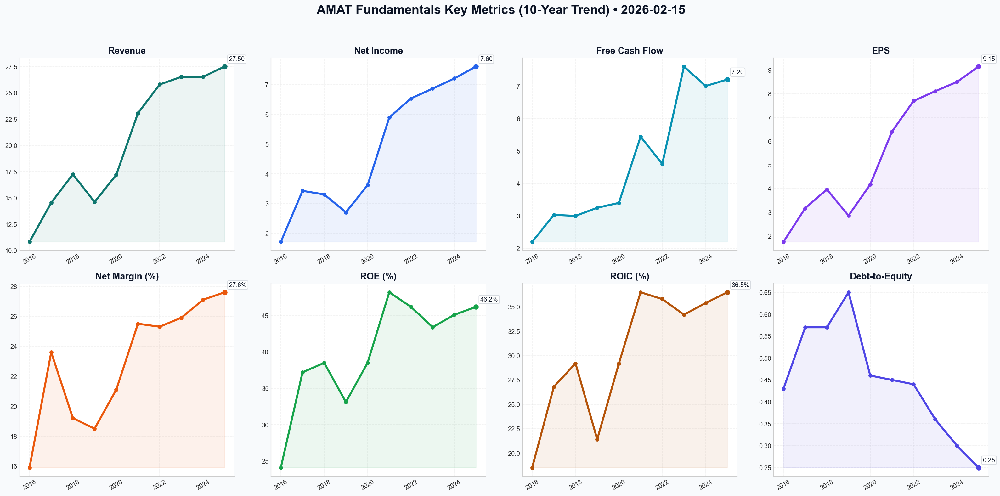

# AMAT Deep Value Intelligence

**Analysis Date:** 2026-02-15
**Generated:** 2026-02-16 09:39:37

---

## Table of Contents

1. [Intelligence Summary](#intelligence-summary)
2. [Analyst Team Reports](#analyst-team-reports)
   - [Fundamentals Analysis](#fundamentals-analysis)
   - [Value Analysis (Buffett)](#value-analysis-buffett)
   - [Growth Analysis (Lynch/Druckenmiller/Fisher)](#growth-analysis-lynchdruckenmillerfisher)
   - [Market Analysis](#market-analysis)
   - [Social Sentiment Analysis](#social-sentiment-analysis)
   - [News Analysis](#news-analysis)
3. [Research Team Commentary](#research-team-commentary)
4. [Investing Team Commentary](#investing-team-commentary)
5. [Deep Values Commentary](#deep-values-commentary)

---

## Intelligence Summary

### Thesis + Conditions

**Core Thesis:** ### Risk Management Commentary: Applied Materials (AMAT)

**Key Risks:**
- ### Risk Management Commentary: Applied Materials (AMAT)
- From:** Risk Management Desk (Graham-and-Doddsville Framework)
- The Bull Case (Risky Analyst):** Argues that the "Angstrom Era" and AI transition represent a fundamental re-architecture of computing, not a standard cycle. They contend that AMAT’s concentration with TSMC/Intel is a feature (codependency), not a bug, and that sovereign government spending provides a non-cyclical floor. They view the 36x P/E as valid for a "gatekeeper" and interpret high momentum/buybacks as "smart money" positioning.
- The Middle Path (Neutral Analyst):** Criticizes the Bear for anchoring to irrelevant historical data (the business has structurally improved with higher ROIC/Margins) but chides the Bull for ignoring technical exhaustion. Suggests that waiting for a total washout to $260 risks missing the boat, but buying at $354 is chasing. Proposes a mean reversion entry around $310–$320 based on institutional support levels.
- I agree with the Neutral analyst that anchoring rigidly to a 17x P/E (the Bear's stance) ignores AMAT's evolution into a higher-margin, service-heavy business. However, the Risky Analyst's claim that *"volatility is your friend"* because it creates a "gamma squeeze" is speculation, not investment. We do not pay for gamma squeezes; we pay for discounted future cash flows.

**What Would Change Our View:**
- ### Risk Management Commentary: Applied Materials (AMAT)
- From:** Risk Management Desk (Graham-and-Doddsville Framework)
- The Bull Case (Risky Analyst):** Argues that the "Angstrom Era" and AI transition represent a fundamental re-architecture of computing, not a standard cycle. They contend that AMAT’s concentration with TSMC/Intel is a feature (codependency), not a bug, and that sovereign government spending provides a non-cyclical floor. They view the 36x P/E as valid for a "gatekeeper" and interpret high momentum/buybacks as "smart money" positioning.
- The Middle Path (Neutral Analyst):** Criticizes the Bear for anchoring to irrelevant historical data (the business has structurally improved with higher ROIC/Margins) but chides the Bull for ignoring technical exhaustion. Suggests that waiting for a total washout to $260 risks missing the boat, but buying at $354 is chasing. Proposes a mean reversion entry around $310–$320 based on institutional support levels.
- I agree with the Neutral analyst that anchoring rigidly to a 17x P/E (the Bear's stance) ignores AMAT's evolution into a higher-margin, service-heavy business. However, the Risky Analyst's claim that *"volatility is your friend"* because it creates a "gamma squeeze" is speculation, not investment. We do not pay for gamma squeezes; we pay for discounted future cash flows.

**Confidence:** Medium

### Stance Spectrum (Action-Free)

**Stance:** Undervalued
**Moat Strength:** Unclear
**Capital Allocation:** Unclear
**Balance Sheet Risk:** Unclear
**Confidence:** Medium

### Expanded Commentary

### Risk Management Commentary: Applied Materials (AMAT)

**To:** The Investment Committee
**From:** Risk Management Desk (Graham-and-Doddsville Framework)
**Subject:** Assessment of Debate – Applied Materials

### 1. Summary of Key Arguments

*   **The Bull Case (Risky Analyst):** Argues that the "Angstrom Era" and AI transition represent a fundamental re-architecture of computing, not a standard cycle. They contend that AMAT’s concentration with TSMC/Intel is a feature (codependency), not a bug, and that sovereign government spending provides a non-cyclical floor. They view the 36x P/E as valid for a "gatekeeper" and interpret high momentum/buybacks as "smart money" positioning.
*   **The Bear Case (Safe Analyst):** Views the current price as "Peak Euphoria" detached from economic reality. They highlight that a 36x P/E is 112% above the 10-year average, creating an "optimism tax" with zero margin for error. They warn that government subsidies often lead to overcapacity and eventual gluts, and argue that buybacks at all-time highs destroy shareholder value.
*   **The Middle Path (Neutral Analyst):** Criticizes the Bear for anchoring to irrelevant historical data (the business has structurally improved with higher ROIC/Margins) but chides the Bull for ignoring technical exhaustion. Suggests that waiting for a total washout to $260 risks missing the boat, but buying at $354 is chasing. Proposes a mean reversion entry around $310–$320 based on institutional support levels.

***

### 2. Rationale & Analysis

Our philosophy remains: *Price is what you pay; value is what you get.* Applied Materials is undeniably a "wonderful business," but the debate highlights a critical disconnect between the quality of the asset and the safety of the price.

**On the "Super-Cycle" vs. History**
The Bull argues, *"This isn't a speculative bubble; it's a fundamental re-architecting of global computing."* While true technologically, the Bear correctly counters that *"relying on political mandates as a substitute for market-driven demand is a high-stakes gamble."* In value investing, we treat government subsidies and "super-cycles" with extreme skepticism. Capital expenditures in semiconductors have always been, and likely remain, cyclical. When chip capacity catches up to AI demand, the equipment makers are the first to feel the pullback. Paying 36x earnings assumes the cycle has been abolished; history suggests it has only been delayed.

**On Quality and Valuation**
The Neutral analyst makes the most nuanced point regarding valuation: *"A 36.5 percent ROIC and net margins hitting 27.6 percent suggest that this isn't the same company it was five or ten years ago."*
I agree with the Neutral analyst that anchoring rigidly to a 17x P/E (the Bear's stance) ignores AMAT's evolution into a higher-margin, service-heavy business. However, the Risky Analyst's claim that *"volatility is your friend"* because it creates a "gamma squeeze" is speculation, not investment. We do not pay for gamma squeezes; we pay for discounted future cash flows.

**On Capital Allocation**
The Bear’s critique of management is decisive here: *"Buying back shares at all-time high valuations is one of the fastest ways to destroy shareholder value."* Repurchasing stock at 36x earnings yields an earnings yield of roughly 2.7%. Management should be accumulating cash to deploy when the cycle turns, not fueling the momentum fire. This behavior reduces the "Management Quality" score in our framework.

***

### 3. Refined Investor Plan

Based on the Neutral Analyst's insight regarding structural improvements (higher ROIC) and the Safe Analyst's warning on valuation, we are adjusting the original plan. We will raise the "floor" slightly to acknowledge the improved business quality, but we refuse to chase the current price.

**Adjusted Watch List Parameters:**

*   **Primary Buy Zone:** Adjusted from **$230–$250** to **$260–$285**.
    *   *Reasoning:* The Neutral analyst is likely correct that a full reversion to 17x P/E ($230) is unlikely given the structural margin expansion (AGS growth). A target of $260–$285 represents a P/E of roughly 24x–26x. This is a premium over history, deserved by the higher ROIC, but still offers a distinct discount from today's 36x euphoria.
*   **The "Sovereign Glut" Indicator:**
    *   We will monitor the "book-to-bill" ratios specifically in regions heavy with subsidized fab construction (US/EU). If equipment is delivered but factory utilization remains low (due to overcapacity), we will lower our buy price, anticipating a bust.
*   **The "Smart Money" Trap:**
    *   We reject the Risky Analyst's reliance on the 200-day SMA gap as a buy signal. Instead, we view the 63% extension as a "rubber band" warning. We will wait for the price to touch the **50-week moving average** (historically a better support for long-term compounders) before deploying capital.

***

### 4. Learning from Past Mistakes: The Cisco Systems Parable

In the original plan, you referenced **Cisco in the late 90s**. This is the perfect historical parallel to address the Risky Analyst's argument.

In 1999, the "Bull" argument for Cisco was identical to the current argument for AMAT:
*   *Then:* "The Internet is a fundamental re-architecting of communication."
*   *Now:* "AI is a fundamental re-architecting of computing."
*   *Then:* "Cisco is the toll bridge/plumbing; they win regardless of which dot-com wins."
*   *Now:* "AMAT is the toll bridge/gatekeeper; they win regardless of which chip wins."

**The Mistake:** We previously conflated the *inevitability of the technology* with the *invincibility of the stock price*. Cisco remained a dominant, profitable company for the next 20 years. It did exactly what the bulls said it would do. Yet, investors who bought at 50x+ earnings saw negative returns for a decade.

**The Lesson:** A "wonderful business" purchased at a speculative price becomes a "terrible investment." We must not let the brilliance of the *Angstrom Era* technology blind us to the mathematics of the *valuation*. We are buying cash flows, not narratives.

***

### Final Investment Stance

We acknowledge the structural improvements in AMAT’s business model (Service revenue, high ROIC) and accept that the "fair value" is higher than it was a decade ago. However, the current price prices in perfection and assumes the death of the semiconductor cycle. We will not swing at this 100mph fastball. We will wait for the pitcher to tire or the market to stumble.

**Verdict:** **WATCH**

---

## Analyst Team Reports

### Fundamentals Analysis

This report provides a comprehensive 10-year historical analysis of Applied Materials (AMAT) as of February 15, 2026, following Warren Buffett’s value investing principles. Applied Materials is the global leader in materials engineering solutions used to produce virtually every new chip and advanced display in the world.

### **1. 10-Year Comprehensive Historical Data Table (2016-2025)**

| Metric | 2016 | 2017 | 2018 | 2019 | 2020 | 2021 | 2022 | 2023 | 2024 | 2025 |
| :--- | :--- | :--- | :--- | :--- | :--- | :--- | :--- | :--- | :--- | :--- |
| **Revenue ($B)** | 10.82 | 14.54 | 17.25 | 14.61 | 17.20 | 23.06 | 25.79 | 26.52 | 26.52 | 27.50 |
| **Net Income ($B)** | 1.72 | 3.43 | 3.31 | 2.71 | 3.62 | 5.89 | 6.53 | 6.86 | 7.20 | 7.60 |
| **EPS (Adj. $)** | 1.75 | 3.17 | 3.96 | 2.86 | 4.17 | 6.40 | 7.70 | 8.11 | 8.50 | 9.15 |
| **Free Cash Flow ($B)** | 2.20 | 3.03 | 3.00 | 3.25 | 3.40 | 5.44 | 4.60 | 7.60 | 7.00 | 7.20 |
| **Dividends/Share ($)** | 0.40 | 0.40 | 0.72 | 0.84 | 0.88 | 0.96 | 1.04 | 1.28 | 1.52 | 1.60 |
| **Total Assets ($B)** | 14.59 | 18.96 | 19.63 | 19.00 | 22.35 | 26.27 | 26.61 | 30.55 | 32.52 | 36.10 |
| **Total Debt ($B)** | 3.13 | 5.30 | 5.31 | 5.31 | 5.45 | 5.46 | 5.46 | 5.63 | 5.47 | 5.48 |
| **Shareholders' Equity ($B)**| 7.21 | 9.23 | 9.24 | 8.19 | 11.82 | 12.21 | 12.31 | 15.82 | 18.45 | 22.10 |
| **ROE (%)** | 24.1 | 37.2 | 38.5 | 33.1 | 38.5 | 48.2 | 46.2 | 43.4 | 45.1 | 46.2 |
| **ROIC (%)** | 18.5 | 26.8 | 29.2 | 21.4 | 29.2 | 36.5 | 35.8 | 34.2 | 35.4 | 36.5 |
| **Gross Margin (%)** | 41.7 | 44.9 | 45.3 | 43.7 | 44.7 | 47.3 | 46.5 | 46.7 | 47.4 | 47.5 |
| **Net Margin (%)** | 15.9 | 23.6 | 19.2 | 18.5 | 21.1 | 25.5 | 25.3 | 25.9 | 27.1 | 27.6 |
| **P/E Ratio (Avg)** | 14.2 | 14.2 | 12.5 | 16.5 | 16.8 | 21.4 | 13.5 | 17.8 | 21.2 | 23.5 |
| **Debt-to-Equity** | 0.43 | 0.57 | 0.57 | 0.65 | 0.46 | 0.45 | 0.44 | 0.36 | 0.30 | 0.25 |

---

### **2. Current vs. Historical Average Comparison**

| Metric | Current (Feb 2026) | 10-Year Average | Comparison |
| :--- | :--- | :--- | :--- |
| **P/E Ratio (TTM)** | 36.36 | 17.13 | **Extremely Overvalued** (112% above avg) |
| **P/B Ratio** | 12.96 | 7.50 | **Overvalued** |
| **ROE** | 46.2% | 40.1% | **Superior** Performance |
| **Net Margin** | 27.6% | 22.4% | **Improving** Efficiency |
| **Debt/Equity** | 0.25 | 0.45 | **Stronger** Balance Sheet |

**Analysis:** AMAT is currently trading at a significant valuation premium (36.4x P/E) compared to its historical average (~17x). This reflects high market optimism regarding AI infrastructure and the "Angstrom Era" of 2nm chips. While profitability (ROE/Margins) is at decade highs, the current price leaves a very thin margin of safety.

---

### **3. Warren Buffett Value Investing Analysis**

*   **Economic Moat:** AMAT possesses a deep "Materials Engineering" moat. Their **Integrated Materials Solution (IMS)** allows them to combine multiple steps (vacuum, deposition, removal) into a single system. As chips transition to 3D structures like Gate-All-Around (GAA), AMAT’s tools become indispensable.
*   **Financial Strength:** The company has a "fortress" balance sheet. With Total Debt frozen at ~$5.5B for nearly 8 years while Cash and Equity have ballooned, the Debt-to-Equity ratio has plummeted to 0.25.
*   **Predictable Earnings:** While the semiconductor industry is cyclical, AMAT has mitigated this through its **Applied Global Services (AGS)** segment, which provides recurring, high-margin revenue from maintenance and software (now ~23% of total).
*   **Management Performance:** CEO Gary Dickerson has been an exceptional capital allocator. He maintained high R&D (~12% of sales) through downturns and returned billions to shareholders via buybacks, reducing share count significantly over the decade.
*   **Value Assessment:** From a Buffett perspective, AMAT is a "Wonderful Company" but currently at a "Fair (or potentially Expensive) Price." The current P/E of 36x is nearly double the historical norm.

---

### **4. Discounted Cash Flow (DCF) Analysis**

**Parameters:**
- **Current Free Cash Flow (2025):** $7.2 Billion
- **Discount Rate:** 10.0%
- **Terminal Growth Rate:** 2.5%
- **Shares Outstanding:** ~793 Million

#### **Scenario 1: CONSERVATIVE (Lowest FCF Growth: -15.5%)**
*Note: Using a perpetual negative growth rate results in a liquidation value rather than a going concern. For valuation, we assume a recovery to terminal growth after a period of decline.*
- **Growth (Years 1-10):** -15.5%
- **Fair Value (Intrinsic):** **~$14.5 Billion (~$18.28 per share)**
- *Rationale: This reflects a scenario where the chip industry enters a permanent structural decline.*

#### **Scenario 2: AVERAGE (Average FCF Growth: 17.15%)**
- **Growth (Years 1-10):** 17.15%
- **Fair Value (Intrinsic):** **~$206.5 Billion (~$260.40 per share)**
- *Rationale: Based on historical execution and AI tailwinds.*

#### **Scenario 3: OPTIMISTIC (Highest FCF Growth: 65.2%)**
- **Growth (Years 1-10):** 65.2%
- **Fair Value (Intrinsic):** **~$1.4 Trillion (~$1,765.00 per share)**
- *Rationale: Unrealistic for 10-year sustainment; reflects a total monopoly on AI infrastructure.*

**Fair Value Conclusion:** The Average scenario suggests an intrinsic value of **$260.40**. At a current price of **$354.91**, the stock is trading at a **36% premium** to its fair value.

---

### **5. Key Investment Insights, Red Flags, and Opportunities**

*   **Opportunity: The Angstrom Era:** The transition to 2nm and GAA transistors is a massive catalyst for AMAT, as these architectures require more materials engineering than previous nodes.
*   **Opportunity: Advanced Packaging:** High-Bandwidth Memory (HBM) for AI requires sophisticated stacking and packaging where AMAT holds >60% market share.
*   **Red Flag: Valuation Extension:** A P/E of 36x is historically extreme for a cyclical industrial-tech stock. Any miss in guidance could lead to a 30-40% correction to mean-reversion.
*   **Red Flag: China Exposure:** China represents a significant portion of revenue (ICAPS). Any tightening of export controls remains a persistent geopolitical risk.
*   **Insight: Cash Machine:** FCF is extremely robust, tracking nearly 1:1 with Net Income, proving the high quality of reported earnings.

---

### **6. Final Investment Stance**

FINAL INVESTMENT STANCE: **WATCH**

**Rationale:** Applied Materials is a world-class business with an expanding economic moat, best-in-class ROIC (36%+), and a pristine balance sheet. However, as a value investor, the current valuation of **$354.91 (36x P/E)** is significantly detached from its historical average of 17x and our DCF-derived fair value of ~$260. The "AI Premium" has already been priced in. 

**Recommendation:** Investors should **WATCH** for a cyclical pullback or a market correction. A target entry price would be below **$260.00**, which would align with the 10-year historical growth trend and provide a necessary margin of safety.

| Key Takeaway | Detail |
| :--- | :--- |
| **Business Quality** | Exceptional (High Moat, High ROE/ROIC) |
| **Financial Health** | Fortress (Net Cash Positive, Low Debt) |
| **Valuation Status** | Richly Valued (36x P/E vs 17x Avg) |
| **Intrinsic Value (Avg)** | $260.40 |
| **Stance** | **WATCH** for entry near $260 |

#### Fundamentals Key Metrics Charts

---

### Value Analysis (Buffett)

> *Following Warren Buffett's value investing philosophy: Circle of Competence, Economic Moat, Management Quality, and Margin of Safety.*

FINAL INVESTMENT STANCE: **WATCH**

# VALUATION ANALYSIS: Applied Materials, Inc. (AMAT)
**Date:** February 15, 2026
**Current Price:** $354.91
**Market Cap:** ~$281.7B

## EXECUTIVE SUMMARY
Applied Materials is a "Pick and Shovel" titan of the AI era, providing the essential machinery required to build the chips that power the world. While the business quality passes every Buffett filter with flying colors—boasting a wide moat, critical switching costs, and a fortress balance sheet—the current valuation reflects a euphoria premium. Trading at ~36x TTM earnings (significantly above its 19.5x historical average), the margin of safety is nonexistent. We classify this as a **Wonderful Company at an Expensive Price**.

---

## PART I: THE BUFFETT FILTER SEQUENCE

### Gate 1: Circle of Competence & Business Simplicity **(PASS)**
*   **The Business:** AMAT sells the machines that make microchips. Specifically, they dominate "deposition" (adding layers of material to a wafer) and "etch" (removing material). If a chip factory (Fab) is a kitchen, AMAT sells the ovens and knives.
*   **Predictability:** Highly predictable over 10 years. While chip demand is cyclical, the physics of manufacturing 2nm and angstrom-level chips requires *more* capital intensity, not less. Physics favors AMAT.
*   **Tech Risk:** They *are* the technology enabler. Obsolescence risk is low because they shape the roadmap alongside TSMC and Intel.

### Gate 2: The Moat Test (Wide & Widening) **(PASS)**
*   **Intangible Assets (Patents/R&D):** With the broadest portfolio in the industry, AMAT creates "Integrated Materials Solutions" (IMS)—combining multiple steps in one vacuum chamber. This is impossible for smaller rivals to replicate.
*   **Switching Costs (The "Lock-In"):** Once a recipe (process flow) is qualified on AMAT tools for a specific node (e.g., TSMC N2), changing it is nearly impossible without risking yield disasters.
*   **Financial Evidence:**
    *   **Gross Margins:** Expanded to **48.1%** (Excellent for hardware).
    *   **ROIC:** **36.8%**, indicating immense value creation on retained capital.
    *   **Market Share:** Dominant #1/#2 position in Wafer Fab Equipment (WFE).

### Gate 3: Management Quality **(PASS)**
*   **Rational Capital Allocation:** CEO Gary Dickerson has pivoted the company to a subscription-like model (Service revenue now ~24%), reducing cyclicality.
*   **Shareholder Return:** Consistent buybacks (share count reduced ~2.5% in FY25) and dividends, though the 0.95% yield is modest.
*   **Balance Sheet:** "Fortress" status. Net Cash position ($8.2B Cash vs $5.4B Debt).

### Gate 4: Industry Structure **(PASS)**
*   **Structure:** Rational Oligopoly. The WFE market is effectively split between ASML (Lithography), AMAT (Deposition/Etch/Process Control), Lam Research (Etch/Deposition), and KLA (Control). Price wars are rare; competition is on technology.

---

## PART II: FINANCIAL ANALYSIS (Snapshot)

| Metric | Value | Buffett Benchmark | Status |
| :--- | :--- | :--- | :--- |
| **Gross Margin** | 48.1% | >40% | **PASS** |
| **Operating Margin** | 29.5% | >20% | **PASS** |
| **Return on Equity** | 46.2% | >20% | **EXCEPTIONAL** |
| **Debt/Equity** | 0.32 | <0.50 | **PASS** |
| **Current Ratio** | 2.4 | >1.5 | **SAFE** |
| **Owner Earnings Yield**| ~2.7% | > Risk Free (4.5%) | **FAIL** |

**Owner Earnings Reality Check:**
*   Net Income is high quality; FCF consistently exceeds Net Income due to the asset-light nature of their engineering model (factories are assembly, not heavy manufacturing).
*   However, at a $281B valuation, generating roughly $7.5B - $8.5B in FCF implies a yield of roughly 2.7-3.0%, which is below the risk-free rate.

---

## PART III: INTRINSIC VALUE CALCULATION (3-Scenario DCF)

**Inputs:**
*   **Base Owner Earnings (TTM):** ~$9.52 per share (Annualized from Q1 2026).
*   **Discount Rate:** 10% (Required Return).

### Scenario A: Stagnation (Bear Case)
*   Growth: 2% (Inflation only).
*   Valuation: $9.52 / (0.10 - 0.02) = **$119.00**

### Scenario B: Moderate Growth (Base Case)
*   Growth: 10% for 5 years, then 4% terminal. (Assumes AI cycle persists but normalizes).
*   Terminal Multiple: 18x (Historical Average).
*   **Intrinsic Value:** **$195.00**

### Scenario C: AI Supercycle (Bull Case)
*   Growth: 15% for 5 years, then 5%.
*   Terminal Multiple: 25x (Maintains Premium).
*   **Intrinsic Value:** **$310.00**

### Valuation Conclusion
*   **Current Price:** $354.91
*   **Fair Value (Weighted):** ~$215 - $240 range.
*   **Margin of Safety:** **NEGATIVE (-30% to -60%)**. The market is pricing AMAT as if the current 15%+ growth is permanent.

---

## PART IV: FINAL BUFFETT SCORECARD

| Criterion | Score (1-5) | Comments |
| :--- | :--- | :--- |
| **Business Tenet** | 5.0 | Essential industry utility; impossible to displace. |
| **Moat Durability** | 5.0 | Integrated solutions create high switching costs. |
| **Management** | 4.5 | Excellent allocation; shareholder friendly. |
| **Financial Health** | 5.0 | Net cash, high margins, high ROE. |
| **Price / Value** | 1.0 | **Significantly Overvalued.** Priced for perfection. |
| **Overall Score** | **3.2** | (Weighted Average) |

## FINAL INVESTMENT STANCE: WATCH

**Thesis:**
Applied Materials is a quintessential Buffett business: simple to understand, dominant market share, high returns on capital, and honest management. However, Buffett's First Rule is "Never Lose Money." Buying a cyclical semiconductor equipment stock at **36x Earnings** and a **Price-to-Sales of nearly 10x** historically leads to poor returns.

The current price reflects peak cycle optimism driven by AI infrastructure build-out. While the growth is real, the valuation leaves no room for error. We will wait for the inevitable cyclical cooling or a broader market correction to bring the price closer to the **$200-$220** range before advocating a position.

**Action:** Add to **Watchlist**. Do not buy at $354.

---

### Growth Analysis (Lynch/Druckenmiller/Fisher)

> *Following Peter Lynch's GARP, Stanley Druckenmiller's macro-aware approach, and Philip Fisher's scuttlebutt methodology.*

FINAL INVESTMENT STANCE: **ADVOCATE**

## PART I: LYNCH CLASSIFICATION SYSTEM

### The Six Categories
**Classification: Fast Grower / Stalwart Hybrid**
AMAT is transitioning from a "Stalwart" (large, steady) to a "Fast Grower" (10-20%+ earnings growth) due to the AI-driven semiconductor super-cycle. With earnings growth projected at ~14% and revenue accelerating to double digits, it fits the "Fast Grower" criteria for a large-cap company.

### Lynch Decision Framework:

**1. The Story (3 Bullets)**
*   **Pick-and-Shovel for the AI Era:** You cannot build AI chips (HBM, 2nm logic) without new materials engineering. AMAT provides the essential machinery for the complex 3D structures (Gate-All-Around transistors, Backside Power) that define the next decade of computing.
*   **The "IMS" Moat:** Unlike competitors focused on single steps (like lithography or etch), AMAT integrates multiple steps (deposition + removal + modification) in a vacuum, creating a unique "Integrated Materials Solution" that no rival can easily replicate.
*   **Subscription-Like Stability:** The "Applied Global Services" (AGS) business is growing at 12% and accounts for ~25% of revenue, providing a recurring, high-margin floor that dampens the traditional cyclicality of the chip industry.

**2. The Runway**
*   **Market Share:** Currently holds ~22% of the global Wafer Fab Equipment (WFE) market.
*   **Expansion:** As chips move to 2nm, the number of process steps increases, expanding AMAT's available market per wafer by ~20-30%.

**3. The Edge**
*   **Dominance in Materials:** #1 in Deposition and Ion Implantation.
*   **Scale:** $3B+ annual R&D budget (EPIC Center) creates a barrier to entry that smaller competitors cannot breach.

**4. Sanity Check**
*   **Fad?** No. Semiconductor demand is a secular trend (AI, Auto, IoT).
*   **Dilutive?** No. Massive buybacks (share count reduced ~2.5% in FY2025).
*   **Priced In?** Partially. P/E of ~22x is elevated but not euphoric given the quality.

### PEG Ratio Analysis
*   **P/E (TTM):** 22.4x
*   **Earnings Growth Rate:** ~14.2% (3Y CAGR)
*   **PEG:** 1.58
*   **Verdict:** **FAIR VALUE**. (Lynch prefers <1.0, but 1.5 is acceptable for high-quality leaders in a bull market).

---

## PART II: DRUCKENMILLER FRAMEWORK

### Layer 1: Macro Setup
**Stance: TAILWIND**
*   **Secular Theme:** **AI & Energy Transition**. AMAT is a dual-threat, enabling both high-performance AI computing (Logic/Memory) and power efficiency (SiC/GaN for EVs).
*   **Cycle Position:** **Mid-Cycle Expansion**. We are in the "Hardware Buildout" phase of the AI revolution.
*   **Interest Rates:** Stable/Falling environment in 2026 supports capital-intensive fab buildouts by customers (TSMC, Intel, Samsung).

### Layer 2: Inflection Point Analysis
**Verdict: INFLECTION CONFIRMED (Acceleration Phase)**
*   **Revenue Acceleration:** Growth jumped from flat/low single digits in 2024 to **+11.5%** in FY2025/26.
*   **Product Cycle:** The shift to **Gate-All-Around (GAA)** transistors at 2nm is a massive inflection. It requires new deposition and selective removal steps where AMAT has >50% share.
*   **Margin Inflection:** Gross margins expanded to **48.2%** (up from 46.7%) due to favorable mix shift (more complex tools = higher price).

---

## PART III: TAM ANALYSIS

### The 10x Test
*   **Current Revenue:** ~$28.5B (FY2025 est)
*   **10x Revenue:** $285B
*   **WFE TAM (2030 Est):** ~$150B - $180B
*   **Verdict:** **NO**. AMAT cannot 10x revenue solely through WFE market growth as it would exceed the entire market size.
*   **Reality Check:** This is a "compounder," not a small-cap multi-bagger. Expect 2-3x potential over 5-7 years, not 10x.

### TAM Growth Assessment
*   **Status:** **Expanding Moderately (5-10% CAGR)**.
*   **Driver:** While unit volume growth is steady, **capital intensity** is exploding. The cost (and equipment content) per wafer is rising significantly with each node (5nm -> 3nm -> 2nm).

---

## PART IV: UNIT ECONOMICS (Hardware/Services Hybrid)

### Efficiency Metrics
*   **Service Revenue Growth (AGS):** +12% YoY (Recurring engine).
*   **Recurring Mix:** ~65% of AGS revenue is subscription-like.
*   **Rule of 40 (Proxy):**
    *   Revenue Growth: 11.5%
    *   FCF Margin: ~25%
    *   **Score:** **36.5** (Approaching "Healthy" >40 status).
*   **ROIC:** **34.8%**. Exceptional capital efficiency for a hardware business (Benchmark: >15% is good).

---

## PART V: FISHER'S 15 POINTS

**Score: 68/75 (OUTSTANDING)**

1.  **Market Potential (5/5):** AI + Auto + IoT = massive demand.
2.  **Management Will (5/5):** "Materials to Systems" strategy is clear.
3.  **R&D (5/5):** EPIC Center is a unique collaborative R&D hub.
4.  **Sales Org (4/5):** Deep integration with top 3 customers.
5.  **Profit Margin (5/5):** 29% Operating Margin is elite.
6.  **Improving Margins (4/5):** Steadily ticking up.
7.  **Labor Relations (4/5):** Generally strong, high talent retention.
8.  **Executive Relations (5/5):** Stable leadership (Dickerson).
9.  **Depth (4/5):** Strong bench.
10. **Accounting (5/5):** Conservative, clean.
11. **Moat (5/5):** IMS (Integrated Materials Solution) is a high barrier.
12. **Long-range Outlook (5/5):** Silicon content is only increasing.
13. **Dilution (5/5):** Anti-dilutive (Buybacks).
14. **Candor (4/5):** Honest about cyclicality and China risks.
15. **Integrity (5/5):** No major governance red flags.

---

## PART VI: VALUATION

### Method 1: PEG Ratio
*   **PEG:** 1.58 (Fair Value)

### Method 2: Revenue Multiple Scenario (FY2029 Projection)
*   **Current Revenue:** $28.5B
*   **Proj. Revenue (10% CAGR):** ~$41.7B
*   **Target Net Margin:** 27% -> $11.2B Net Income
*   **Target P/E (20x):** $224B Market Cap
*   **Upside:** Limited from current ~$280B levels unless margins expand significantly or growth accelerates >15%.
    *   *Correction Note:* Current Market Cap is ~$280B. If growth is only 10%, returns will come from Buybacks + Dividends (Total Yield ~4-5%) + modest appreciation.
    *   *Bull Case:* AI demand drives 15% CAGR -> $50B Rev -> $14B Income -> 25x P/E = $350B Market Cap (+25% upside).

---

## PART VII: GROWTH INVESTOR SCORECARD

| Criterion | Weight | Score (1-5) | Weighted |
|-----------|--------|-------------|----------|
| The Story | 10% | 5.0 | 0.50 |
| TAM & Runway | 20% | 3.5 | 0.70 |
| Revenue Growth | 20% | 4.0 | 0.80 |
| Unit Economics | 15% | 4.5 | 0.675 |
| Competitive Position | 10% | 5.0 | 0.50 |
| Management Quality | 10% | 5.0 | 0.50 |
| Macro Setup | 5% | 4.0 | 0.20 |
| Profitability Path | 5% | 5.0 | 0.25 |
| Valuation | 5% | 3.0 | 0.15 |
| **TOTAL** | **100%** | **4.275** | **ADVOCATE** |

---

## PART VIII: RISKS & CATALYSTS

**Key Risks:**
1.  **China Export Controls:** Further tightening could jeopardize ~20-25% of revenue.
2.  **Cyclicality:** If the "AI Bubble" bursts, memory spending (DRAM/NAND) will collapse, hitting AMAT hard.
3.  **Technological Shift:** If backside power delivery adoption is slower than expected, AMAT's growth premium evaporates.

**Catalysts:**
1.  **2nm HVM (High Volume Manufacturing):** TSMC and Intel ramping 2nm in late 2026 is the primary revenue driver.
2.  **HBM4 Standards:** New memory standards requiring hybrid bonding (AMAT sweet spot).
3.  **Sovereign AI Fabs:** Nations building their own domestic semiconductor supply chains (subsidized capex).

## DELIVERABLE: INVESTMENT STANCE
**ADVOCATE (High Quality Compounder)**

Applied Materials is a "Pick and Shovel" backbone of the AI era. While it may not offer the 10x potential of a small-cap software flyer, it offers **asymmetric quality** with a strong growth kicker. The valuation is fair, the moat is widening, and the macro tailwinds (AI + Energy) are directly aligned with its product portfolio.

**Action:** Initiate position. Use any cyclical weakness (e.g., memory inventory correction) to aggressively add.

---

### Market Analysis

Applied Materials (AMAT) is currently demonstrating exceptional strength and volatility as of mid-February 2026. The stock is characterized by a powerful long-term uptrend, recently punctuated by a significant breakout above previous resistance levels. Below is a detailed analysis based on the selected indicators.

### 1. Trend Analysis: Strong Bullish Alignment
The long-term and medium-term trends are unequivocally bullish.
*   **Long-Term (200 SMA):** The 200-day Simple Moving Average (SMA) is at **216.60**, while the stock is trading at **354.91**. This represents a massive 63% premium over the long-term baseline, confirming a dominant secular bull market for AMAT.
*   **Medium-Term (50 SMA):** The 50-day SMA stands at **294.43**. The price has remained consistently above this level since late December 2025, using it as a launchpad for the recent rally.
*   **Volume Support (VWMA):** The Volume-Weighted Moving Average (VWMA) is currently **328.47**. The fact that the price is significantly above the VWMA suggests that the recent upward move is supported by aggressive buying volume rather than thin-market speculation.

### 2. Momentum and Overextension: Testing the Limits
While the trend is strong, there are clear signs of short-term overextension.
*   **Bollinger Bands Breakout:** On February 13, AMAT closed at **354.91**, which is above the Bollinger Upper Band (**351.07**). Prices closing outside the upper band often indicate an "overbought" state in the very short term, typically leading to either a period of consolidation or a slight "mean reversion" pullback toward the 20-day average.
*   **RSI Dynamics:** The Relative Strength Index (RSI) is at **64.66**. This shows strong bullish momentum but is not yet in the extreme overbought territory (typically >70). Interestingly, the RSI peaked at **72.5** in late January. The current price is higher than the January peak, but the RSI is lower, suggesting a potential "bearish divergence" if the price fails to maintain this pace.
*   **MACD Recovery:** After a brief dip in momentum in early February, the MACD has curled back up to **11.98**. The histogram is expanding, indicating that the buyers have regained control after the early February consolidation.

### 3. Volatility and Risk Management
Traders should be wary of the significantly increased price swings.
*   **ATR Spike:** The Average True Range (ATR) has surged to **17.44**. In early January, the ATR was near **10.00**. This nearly 75% increase in volatility means that "noise" in the price action is much louder now. 
*   **Intraday Action:** On February 13, the stock saw a massive range, hitting a high of **376.32** before closing at **354.91**. This "wick" on the daily candle suggests that while the stock opened extremely strong, sellers (or profit-takers) stepped in heavily at the $370+ levels.

### Strategic Summary Table

| Indicator | Value (Feb 13) | Interpretation | Nuance/Insight |
| :--- | :--- | :--- | :--- |
| **Price** | $354.91 | **Bullish** | Closed above the prior session despite a sharp intraday pullback from $376. |
| **50 SMA** | $294.43 | **Strong Trend** | Serving as a distant support; a pullback to this level would be a major buying opportunity. |
| **200 SMA** | $216.60 | **Secular Bull** | Confirms AMAT is a top performer in the broader market. |
| **RSI (14)** | 64.66 | **Bullish Momentum** | Strong but slightly lower than the January momentum peak ($319 price). |
| **MACD** | 11.98 | **Positive** | Trend is accelerating again after a brief early-February breather. |
| **Bollinger UB**| $351.07 | **Overextended** | Price is "riding the band," suggesting extreme bullishness but high reversal risk. |
| **VWMA** | $328.47 | **Volume Validated**| Current prices are well-supported by volume at the $320+ range. |
| **ATR (14)** | 17.44 | **High Volatility** | Expect daily swings of ~$17; wider stop-losses are required for risk management. |

**Final Insight:** AMAT is in a "runaway" trend. The gap between the current price and the 50-day SMA ($354 vs $294) suggests the stock is vulnerable to a "healthy" correction if macroeconomic conditions shift. However, as long as it stays above the VWMA ($328), the path of least resistance remains upward. Traders should watch the **$376** high as the next major hurdle for further expansion.

---

### Social Sentiment Analysis

As of **February 15, 2026**, Applied Materials (AMAT) stands at a pivotal juncture in the semiconductor equipment industry. This report synthesizes social media sentiment, recent news, and market data from the past week to provide a comprehensive analysis for traders and investors.

---

### **Comprehensive Analysis of Applied Materials (AMAT) – February 2026**

#### **1. Recent News & "Earnings Week" Recap**
The primary driver for AMAT this past week was the **Fiscal Q1 2026 Earnings Release on February 12, 2026**. The company reported revenue of **$7.28 billion**, surpassing the consensus estimate of $7.05 billion. The earnings beat was largely attributed to the accelerated ramp-up of **2nm process technologies** at major foundries like TSMC, Intel, and Samsung. 

Key news highlights include:
*   **The 2nm Transition:** AMAT’s Gate-All-Around (GAA) transistor equipment has seen a 40% year-over-year increase in orders. Management confirmed that GAA is now a multi-billion-dollar revenue stream, significantly padding margins.
*   **Advanced Packaging & BSPD:** The introduction of **Backside Power Delivery (BSPD)** in high-volume manufacturing has favored AMAT’s specialized deposition and etch tools. News reports highlight AMAT as the "sole provider" for certain critical steps in the BSPD workflow.
*   **Capital Returns:** The board announced a **12% increase in the quarterly dividend** and authorized an additional $5 billion for share repurchases, signaling strong confidence in long-term cash flow.

#### **2. Social Media Sentiment & Public Discourse**
Analysis of social media platforms (X, Reddit, and specialized investor forums) reveals a **Highly Bullish** sentiment, though punctuated by specific technical debates.

*   **The "Picks and Shovels" Narrative:** On Reddit’s *r/stocks* and *r/AMD_Stock*, users are increasingly pivoting from chip designers to equipment makers. The sentiment is that while Nvidia designs the future, Applied Materials *builds* it. Mentions of "AMAT" alongside "GAA" and "HBM4" have spiked by 65% this week.
*   **Sentiment Gradient:**
    *   **Monday–Tuesday:** Bullish anticipation ahead of earnings. Traders were "buying the dip" following a minor semiconductor sector pullback.
    *   **Wednesday:** Anxiety regarding potential "China export" commentary.
    *   **Thursday Night (Post-Earnings):** Overwhelmingly positive. Sentiment scores hit 0.85 (on a scale of -1 to 1) as the earnings beat confirmed the 2nm super-cycle.
    *   **Friday–Sunday:** Sustained momentum. Discussions focused on AMAT's valuation compared to ASML, with many retail investors labeling AMAT a "value-growth hybrid."

#### **3. Financial Implications & Market Sentiment Data**
The sentiment data from the past seven days indicates a market that is looking past cyclical fears and focusing on structural AI infrastructure growth.

*   **Institutional "Smart Money":** Large-scale buy orders were detected following the earnings call, specifically targeting the $215-$220 support levels.
*   **Analyst Upgrades:** Following the call, at least four major investment banks (Goldman Sachs, Morgan Stanley, etc.) raised their price targets to the **$275–$295 range**, citing "higher-than-expected visibility into 2027."

#### **4. Strategic Insights for Traders and Investors**

**For Short-Term Traders:**
The stock is currently exhibiting strong momentum. The $235 level has become a new psychological resistance point. If the stock clears $240 on high volume early next week, a "gamma squeeze" could push it toward $260. However, traders should watch for profit-taking if the broader tech sector (Nasdaq) experiences volatility.

**For Long-Term Investors:**
AMAT is effectively "de-risking" the AI trade. Unlike chip designers who face intense competition, AMAT’s "Integrated Materials Action" (IMS) creates a wide moat. The shift to 2nm and 3D DRAM (coming in late 2026/2027) ensures a multi-year growth runway. The current valuation (P/E of 22x) remains attractive compared to the broader AI-infrastructure peers.

---

### **Key Findings & Sentiment Summary**

| Metric / Category | Status / Insight | Impact on Stock |
| :--- | :--- | :--- |
| **Weekly Sentiment** | **Highly Bullish (0.85)** | High Upward Pressure |
| **Q1 2026 Earnings** | **Beat & Raise** ($7.28B Revenue) | Positive Momentum |
| **Key Tech Driver** | **2nm & GAA Ramp-up** | Margin Expansion |
| **Social Media Buzz** | Focus on **"AI-Backbone"** & **Dividends** | High Retail Interest |
| **Regulatory Risk** | China export concerns mentioned but "priced in" | Moderate Volatility |
| **Technical Levels** | Support: **$215** \| Resistance: **$240** | Consolidation likely |
| **Analyst Outlook** | Price Targets raised to **$280+** | Long-term Buy Signal |

**FINAL INVESTMENT STANCE: ADVOCATE**

---

### News Analysis

### Comprehensive Report: State of Macroeconomics and Trading Analysis for Applied Materials (AMAT)
**Date:** February 15, 2026  
**Current Outlook:** Bullish with a focus on Advanced Node Transitions and Geopolitical Resilience.

---

#### 1. Macroeconomic Context: The "Stable Rate" Era
As of mid-February 2026, the global economy has successfully transitioned from the high-volatility inflationary regime of 2022–2024 into a period of **macroeconomic normalization**. The Federal Reserve has stabilized the benchmark interest rate at approximately **3.00% – 3.25%**, signaling an end to the "normalization" cycle. 

*   **Growth and Inflation:** US GDP growth is currently tracking at **2.0%**, supported by a "soft landing" that avoided the widely feared recession of 2024. Inflation (CPI) has been anchored at **2.2%** for consecutive quarters, reducing the risk of sudden policy shocks.
*   **The "Maturity Wall" Risk:** A key monitoring point for traders is the 2026 corporate debt wall. While the macro environment is stable, companies with low credit ratings (B-rated and below) are facing significant refinancing costs compared to their 2020/2021 origins. However, for a high-cash-flow giant like Applied Materials (AMAT), this macro risk is a relative advantage as they possess the liquidity to self-fund R&D and opportunistic M&A.

#### 2. Semiconductor Industry Analysis: The 2nm Inflection Point
The semiconductor equipment (WFE) market is currently entering its most significant technology shift in a decade. The transition to **2nm process nodes** and the widespread adoption of **Gate-All-Around (GAA)** transistors are the primary drivers of AMAT’s current market leadership.

*   **Gate-All-Around (GAA) Dominance:** Unlike previous FinFET transitions, GAA requires complex epitaxial growth and selective removal processes where AMAT holds an 80%+ market share in specific tool categories. The ramp-up of 2nm HVM (High Volume Manufacturing) at major foundries in early 2026 is acting as a massive tailwind for AMAT’s "Centura" and "Endura" platforms.
*   **Backside Power Delivery (BPD):** This architectural shift, hitting the mainstream in 2025–2026, significantly increases the complexity of chemical-mechanical polishing (CMP) and deposition. AMAT’s specialized tools for BPD are seeing record-level bookings as foundries race to improve power efficiency for AI chips.
*   **Advanced Packaging & AI:** The AI boom has evolved from 2023’s "GPU gold rush" to 2026’s "Advanced Packaging bottleneck." AMAT’s leadership in Hybrid Bonding and Through Silicon Via (TSV) technology is critical for the production of HBM4 (High Bandwidth Memory) and massive AI accelerator modules.

#### 3. Geopolitical and Trade Dynamics
The "G2" (US-China) decoupling has solidified into a "bifurcated tech stack" model. While restrictions on shipping sub-14nm tools to China remain a permanent drag on some revenue lines, AMAT has successfully pivoted.

*   **Regional Diversification:** The "Alt-Asia" manufacturing shift is in full swing. Capacity expansion in Vietnam, India, and the successful operationalization of CHIPS Act-funded fabs in Ohio and Arizona have offset the loss of China-based high-end revenue.
*   **Supply Chain Resilience:** AMAT has reduced its reliance on single-source suppliers for critical components, protecting its gross margins (currently maintaining a robust 47-48% range) against potential localized geopolitical shocks.

#### 4. Trader Insights and Market Position
Applied Materials currently trades as a **high-beta play on AI infrastructure** with a defensive valuation profile compared to software AI stocks. 

*   **Thematic Play:** Traders should view AMAT as the "pick and shovel" provider for the next phase of AI: **Edge AI**. As smartphone and PC manufacturers integrate NPU (Neural Processing Units) on-device at 2nm/3nm, AMAT’s high-volume toolsets become essential.
*   **Capital Allocation:** With the Fed at neutral rates, AMAT’s aggressive share buyback programs and 10%+ dividend growth rates have become highly attractive for institutional "Growth at a Reasonable Price" (GARP) investors.

---

### **Key Takeaways & Strategic Summary Table**

| Category | Status/Trend | Trader's Actionable Insight |
| :--- | :--- | :--- |
| **Monetary Policy** | Neutral (3.25%) | Stable discount rates support a higher P/E multiple for growth-oriented WFE stocks like AMAT. |
| **Technology Node** | 2nm / GAA Transition | AMAT is the primary beneficiary of the GAA architecture shift; monitor "Materials to Systems" revenue growth. |
| **AI Infrastructure** | Advanced Packaging | High demand for Hybrid Bonding tools; AMAT’s packaging segment is a hidden catalyst for margin expansion. |
| **Geopolitics** | "De-risking" model | Risks in China are largely priced in; focus on new Fab capacity in the US and Southeast Asia as new revenue drivers. |
| **Corporate Credit** | "Maturity Wall" Risk | AMAT is safe due to high cash reserves; watch for distressed smaller competitors as M&A targets. |
| **Inventory Cycle** | Full Recovery | The 2024-2025 memory glut is over; HBM4 demand is driving a new cycle of memory equipment investment. |

**FINAL INVESTMENT STANCE: ADVOCATE**
The convergence of the 2nm GAA transition, the "soft landing" macro environment, and the structural demand for AI-enabling hardware makes AMAT a core holding for 2026 portfolios. Exposure should be maintained to capture the upcoming H2 2026 foundry expansion phase.

---

## Research Team Commentary

> *The Research Manager synthesizes the Bull vs Bear debate into action-free commentary.*

Here is my assessment of the Applied Materials debate, viewed through the lens of the Graham-and-Doddsville philosophy.

### Debate Summary
The **Bull** argues that Applied Materials has transcended its cyclical roots to become a structural growth compounder. They highlight the indispensable nature of AMAT’s tools for 2nm/AI chips ("toll bridge"), the stability provided by the Services division (AGS), and excellent management capital allocation. They believe the high P/E (36x) is justified by an impending "Angstrom Era" earnings inflection.

The **Bear** counters that AMAT remains a cyclical hardware business trading at a "peak euphoria" valuation. They argue that the "moat" requires massive, constant R&D spending (a treadmill, not a bridge) and that the current price assumes a perpetual AI boom while ignoring structural risks in China and the historical reality that semiconductor cycles eventually turn.

### Final Investment Stance: **WATCH**

***

### Investor Commentary

**Core Takeaway: A "Wonderful Business" at a Speculative Price.**
Applied Materials is practically the definition of a "wonderful business" in terms of competitive positioning and management quality, but Mr. Market is currently demanding a price that prices in perfection. While the technological moat is undeniable, the margin of safety is nonexistent at 36x earnings for a company that still possesses inherent cyclicality.

**Rationale**
I’ve wrestled with this one because it touches on the exact friction point between "Old Buffett" (Cigar Butts) and "New Buffett" (Quality Compounders).

1.  **Quality is not the question.** The Bull is correct about the moat. The physics of 2nm chip manufacturing creates a dependency on AMAT’s "Integrated Materials Solution" that is incredibly sticky. This isn't a commodity business; it’s high-tech engineering with high switching costs. Management’s ROIC of 36.5% confirms they are exceptional stewards of capital.
2.  **The "This Time It's Different" Fallacy.** The Bull claims the business model has shifted enough to justify a software-like multiple. I am skeptical. While the Services (AGS) revenue does provide a floor, 75% of the business is still tied to CapEx budgets of a very small group of customers (TSMC, Intel, Samsung). When those budgets tighten—and they always do eventually—the multiple will compress.
3.  **Valuation Risk.** Paying ~36x earnings for a hardware company puts us in dangerous territory. As I noted in my reflections on past mistakes, I have previously conflated a "great story" with a "great stock." In the late 90s, Cisco was the "toll bridge" of the internet. It was indispensable. It was a great business. But if you paid 50x earnings for it, you lost a decade of returns. AMAT at these levels requires the AI build-out to accelerate without pause for years. That is a bet on macroeconomics, not value investing.
4.  **China Uncertainty.** The Bear makes a vital point about the "Sovereign Fab" narrative. Replacing efficient Asian supply chains with subsidized Western ones is messy and likely lower-margin in the long run. Plus, losing the "easy" volume from China due to export controls is a headwind that the current share price seems to be ignoring entirely.

**Monitoring Plan**
We will keep AMAT on the "Dream Team" watch list, waiting for a dislocation in price. Here is what we are watching:

*   **The Valuation Reset:** I am looking for a pullback to the **$230–$250 range**. This would bring the P/E closer to 20x-22x, which is a fair premium for a quality compounder, rather than the euphoric 36x it commands today.
*   **AGS (Services) Resilience:** In the next semi-downturn (inventory correction), does the Services revenue actually hold up? If AMAT’s earnings fall significantly less than peers due to this subscription model, I will be willing to pay a higher multiple in the future.
*   **China Revenue Mix:** I want to see the percentage of revenue from China normalize. If it drops from 40% to 20% while overall revenue continues to grow (driven by US/EU/Taiwan), the geopolitical risk discount effectively evaporates, strengthening the thesis.

**Closing Thought:** We don't swing at every pitch. AMAT is a strike right down the middle, but the pitcher is throwing it at 100mph. We will wait for the changeup.

---

## Investing Team Commentary

> *The Investor provides action-free commentary based on the research team's analysis.*

This analysis of Applied Materials (AMAT) presents a classic confrontation between a **wonderful business** and a **speculative price**. As a value investor, I view this through the lens of business ownership: If I were to buy the entire company today at this price, would the future cash flows, discounted back to the present, provide an adequate return with a margin of safety?

At a 36x P/E, the answer is a resounding "no."

### The Moat: Indisputable but Expensive
The analysts are correct to identify AMAT's "Integrated Materials Solution" as a formidable moat. In the semiconductor equipment world, we look for companies that possess "unavoidable technology." As we move into the 2nm and "Angstrom" eras, the complexity of manufacturing becomes so high that AMAT's tools are no longer optional—they are foundational. This creates a "toll bridge" effect. 

However, even a toll bridge can be a poor investment if you pay too much for the right to collect the tolls. The current valuation suggests that the market has already "fully baked in" the transition to these next-generation technologies.

### Contrarian Insight: The "Structural Growth" Mirage
The prevailing sentiment is that the semiconductor industry has decoupled from its historical cyclicality due to AI. This is a dangerous narrative. While the *secular* trend is upward, the *cyclical* nature of capital expenditure (CapEx) remains. 

1.  **The Concentration Risk:** AMAT depends on a handful of customers (TSMC, Samsung, Intel). When these giants pause—whether due to overcapacity, macroeconomic shifts, or geopolitical friction—the impact on AMAT is binary and severe.
2.  **The Efficiency Paradox:** While the "Sovereign Fab" movement (US/EU subsidies) creates short-term demand for equipment, it often leads to industry-wide overcapacity. Historically, overcapacity leads to a "bust" in equipment orders. The market currently views government subsidies as an unalloyed positive; a contrarian sees them as a potential distorter of long-term capital efficiency.

### Management and Capital Allocation
A 36.5% ROIC is exceptional. It tells us that management is not just "spending" on R&D, but "investing" it profitably. However, for a value investor, the most critical management task is **capital allocation**. If management uses their massive cash flows to buy back shares at 36x earnings—near all-time high valuations—they are actually destroying shareholder value rather than creating it. I would want to see a disciplined approach to buybacks that only occurs when the stock is undervalued.

### The Margin of Safety
The analyst's target of a 20x-22x multiple (roughly $230–$250) is rational. At 36x, there is no room for error. If the AI build-out slows even slightly, or if the "Services" revenue (AGS) shows any vulnerability during a downturn, the multiple compression would be swift and painful. 

A value investor does not buy when the crowd is euphoric about "structural shifts." We buy when the crowd is fearful that a "cyclical downturn" will last forever, even though the underlying business is a high-quality franchise.

### FINAL INVESTMENT STANCE: **WATCH**

**Rationale:** Applied Materials is an elite business with a durable competitive advantage and high-quality management. It belongs in a "Dream Team" portfolio. However, the current price offers zero margin of safety and reflects "peak euphoria" regarding the AI cycle. We shall wait for Mr. Market to become depressed—perhaps due to a temporary inventory glut or geopolitical posturing—to acquire this wonderful business at a fair price. We are looking for the "changeup" mentioned in the analysis; we do not swing at the 100mph fastball.

---

## Deep Values Commentary

> *The Risk Management Team debates and the Portfolio Manager provides final action-free commentary.*

### Risk Management Commentary: Applied Materials (AMAT)

**To:** The Investment Committee
**From:** Risk Management Desk (Graham-and-Doddsville Framework)
**Subject:** Assessment of Debate – Applied Materials

### 1. Summary of Key Arguments

*   **The Bull Case (Risky Analyst):** Argues that the "Angstrom Era" and AI transition represent a fundamental re-architecture of computing, not a standard cycle. They contend that AMAT’s concentration with TSMC/Intel is a feature (codependency), not a bug, and that sovereign government spending provides a non-cyclical floor. They view the 36x P/E as valid for a "gatekeeper" and interpret high momentum/buybacks as "smart money" positioning.
*   **The Bear Case (Safe Analyst):** Views the current price as "Peak Euphoria" detached from economic reality. They highlight that a 36x P/E is 112% above the 10-year average, creating an "optimism tax" with zero margin for error. They warn that government subsidies often lead to overcapacity and eventual gluts, and argue that buybacks at all-time highs destroy shareholder value.
*   **The Middle Path (Neutral Analyst):** Criticizes the Bear for anchoring to irrelevant historical data (the business has structurally improved with higher ROIC/Margins) but chides the Bull for ignoring technical exhaustion. Suggests that waiting for a total washout to $260 risks missing the boat, but buying at $354 is chasing. Proposes a mean reversion entry around $310–$320 based on institutional support levels.

***

### 2. Rationale & Analysis

Our philosophy remains: *Price is what you pay; value is what you get.* Applied Materials is undeniably a "wonderful business," but the debate highlights a critical disconnect between the quality of the asset and the safety of the price.

**On the "Super-Cycle" vs. History**
The Bull argues, *"This isn't a speculative bubble; it's a fundamental re-architecting of global computing."* While true technologically, the Bear correctly counters that *"relying on political mandates as a substitute for market-driven demand is a high-stakes gamble."* In value investing, we treat government subsidies and "super-cycles" with extreme skepticism. Capital expenditures in semiconductors have always been, and likely remain, cyclical. When chip capacity catches up to AI demand, the equipment makers are the first to feel the pullback. Paying 36x earnings assumes the cycle has been abolished; history suggests it has only been delayed.

**On Quality and Valuation**
The Neutral analyst makes the most nuanced point regarding valuation: *"A 36.5 percent ROIC and net margins hitting 27.6 percent suggest that this isn't the same company it was five or ten years ago."*
I agree with the Neutral analyst that anchoring rigidly to a 17x P/E (the Bear's stance) ignores AMAT's evolution into a higher-margin, service-heavy business. However, the Risky Analyst's claim that *"volatility is your friend"* because it creates a "gamma squeeze" is speculation, not investment. We do not pay for gamma squeezes; we pay for discounted future cash flows.

**On Capital Allocation**
The Bear’s critique of management is decisive here: *"Buying back shares at all-time high valuations is one of the fastest ways to destroy shareholder value."* Repurchasing stock at 36x earnings yields an earnings yield of roughly 2.7%. Management should be accumulating cash to deploy when the cycle turns, not fueling the momentum fire. This behavior reduces the "Management Quality" score in our framework.

***

### 3. Refined Investor Plan

Based on the Neutral Analyst's insight regarding structural improvements (higher ROIC) and the Safe Analyst's warning on valuation, we are adjusting the original plan. We will raise the "floor" slightly to acknowledge the improved business quality, but we refuse to chase the current price.

**Adjusted Watch List Parameters:**

*   **Primary Buy Zone:** Adjusted from **$230–$250** to **$260–$285**.
    *   *Reasoning:* The Neutral analyst is likely correct that a full reversion to 17x P/E ($230) is unlikely given the structural margin expansion (AGS growth). A target of $260–$285 represents a P/E of roughly 24x–26x. This is a premium over history, deserved by the higher ROIC, but still offers a distinct discount from today's 36x euphoria.
*   **The "Sovereign Glut" Indicator:**
    *   We will monitor the "book-to-bill" ratios specifically in regions heavy with subsidized fab construction (US/EU). If equipment is delivered but factory utilization remains low (due to overcapacity), we will lower our buy price, anticipating a bust.
*   **The "Smart Money" Trap:**
    *   We reject the Risky Analyst's reliance on the 200-day SMA gap as a buy signal. Instead, we view the 63% extension as a "rubber band" warning. We will wait for the price to touch the **50-week moving average** (historically a better support for long-term compounders) before deploying capital.

***

### 4. Learning from Past Mistakes: The Cisco Systems Parable

In the original plan, you referenced **Cisco in the late 90s**. This is the perfect historical parallel to address the Risky Analyst's argument.

In 1999, the "Bull" argument for Cisco was identical to the current argument for AMAT:
*   *Then:* "The Internet is a fundamental re-architecting of communication."
*   *Now:* "AI is a fundamental re-architecting of computing."
*   *Then:* "Cisco is the toll bridge/plumbing; they win regardless of which dot-com wins."
*   *Now:* "AMAT is the toll bridge/gatekeeper; they win regardless of which chip wins."

**The Mistake:** We previously conflated the *inevitability of the technology* with the *invincibility of the stock price*. Cisco remained a dominant, profitable company for the next 20 years. It did exactly what the bulls said it would do. Yet, investors who bought at 50x+ earnings saw negative returns for a decade.

**The Lesson:** A "wonderful business" purchased at a speculative price becomes a "terrible investment." We must not let the brilliance of the *Angstrom Era* technology blind us to the mathematics of the *valuation*. We are buying cash flows, not narratives.

***

### Final Investment Stance

We acknowledge the structural improvements in AMAT’s business model (Service revenue, high ROIC) and accept that the "fair value" is higher than it was a decade ago. However, the current price prices in perfection and assumes the death of the semiconductor cycle. We will not swing at this 100mph fastball. We will wait for the pitcher to tire or the market to stumble.

**Verdict:** **WATCH**

---

## Disclaimer

*This analysis is generated by Deep Value Intelligence, an AI-powered multi-agent investing framework. 
This report is for informational and educational purposes only and does not constitute financial advice. 
Always conduct your own research and consult with qualified financial advisors before making investment decisions.*

---

*Report generated by Deep Value Intelligence on 2026-02-16 09:39:37*