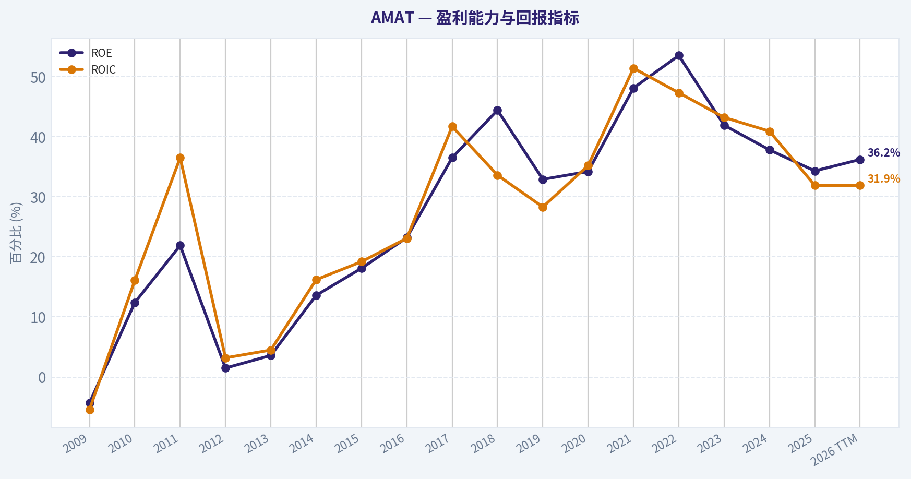
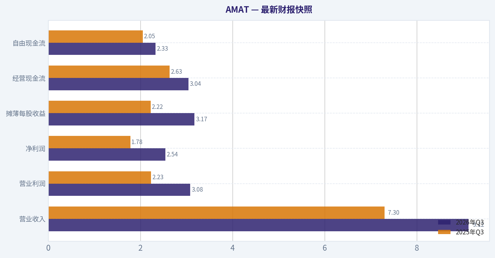
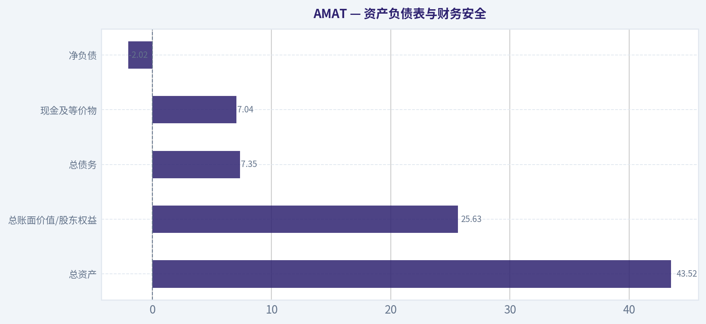
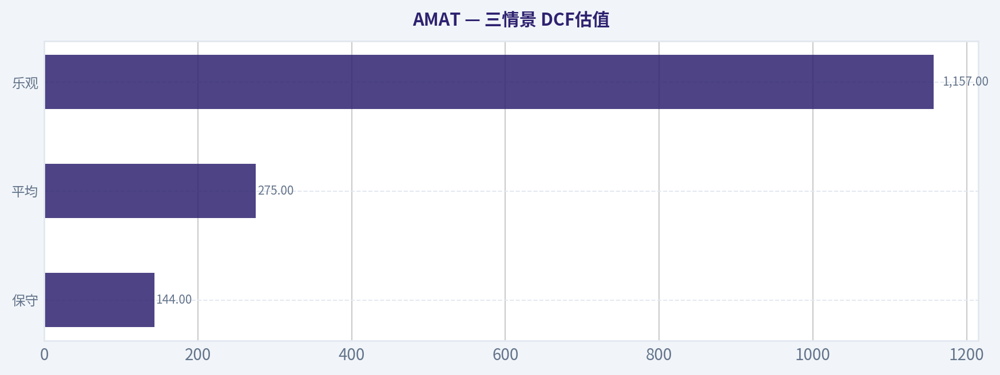
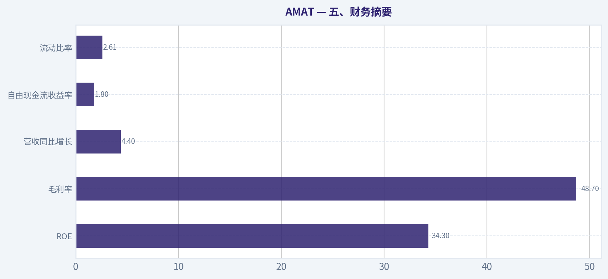
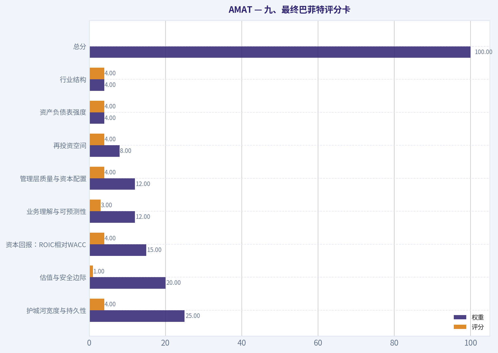
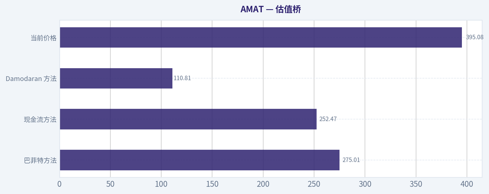
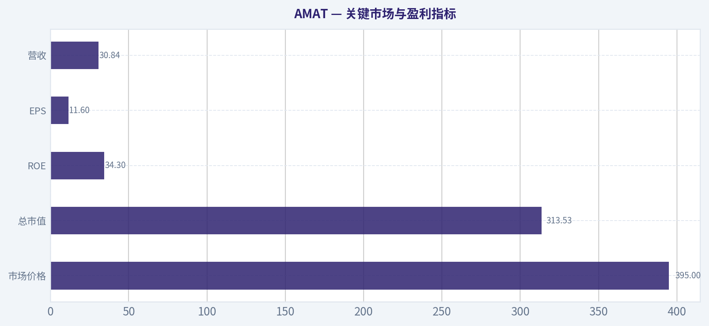

# AMAT 深度价值情报

**调研日期:** 2026-11-12

## 关键免责声明

*本报告由 Deep Value Intelligence（一个基于 AI 的多智能体投资分析框架）自动生成。 仅供教育和研究用途 - 非财务建议，非财务顾问。*

---

## 目录

1. 情报摘要
2. 分析师团队报告
   - 基本面分析
   - 价值分析 (巴菲特)
   - 成长性分析 (林奇/德鲁肯米勒/费雪)
   - 市场分析
   - 期权市场分析
3. 研究团队评论
4. 投资团队评论
5. Deep Values 团队洞察

---

## 情报摘要

### 核心观点与前提条件

**核心论点:** **企业质量高**：AMAT 的毛利率48.7%、ROIC 34.0%、ROA 19.3%，技术认证、客户关系、产品广度和装机基础构成真实护城河。 **主要风险是出价，不是生存**：395美元对应34.09倍 PE，而近三年营收复合增长仅3.2%。现价需要未来每股所有者收益长期保持低双位数增长，容错空间有限。 **增长机会可信，但尚未充分验证**：AI、HBM、先进封装和材料复杂度可能提高设备价值；中国限制、资本开支周期和竞争投入则可能延后或削弱兑现。 **行动结论**：现有低至中等仓位可继续持有；新资金不宜一次性重仓。只有价格与基本面共同提供安全边际时才加仓。

**主要风险:**
- **最终判断：中性**
- **最终立场：中性**

**置信度:** 中

---

## 分析师团队报告

### 基本面分析

#### 最新财报快照

*以下数据基于最近一期已披露财报（2026年Q3），并尽量与上一年同期对比。*

| 指标 | 2026年Q3 | 2025年Q3 | 同比变化 |
| --- | ---: | ---: | ---: |
| 营业收入 | $9.12B | $7.30B | +24.8% |
| 营业利润 | $3.08B | $2.23B | +37.7% |
| 净利润 | $2.54B | $1.78B | +42.7% |
| 摊薄每股收益 | $3.17 | $2.22 | +42.8% |
| 经营现金流 | $3.04B | $2.63B | +15.3% |
| 自由现金流 | $2.33B | $2.05B | +13.7% |

关键结论：这张快照先把最新一期财报放在桌面上，再去看长周期分析。这样读者能更清楚地区分"公司长期质量"和"这次财报发生了什么"。

#### AMAT 17年财务指标

*以下数值均由原始数据确定性计算得出，并非 AI 估算。*

*发行人类型：operating company（Technology / Semiconductor Equipment & Materials）。*

#### 17年财务指标
*年度行来自已披露财务报表，最后一行 TTM 由最近四个季度滚动计算得出。*

| 指标 | 2009 | 2010 | 2011 | 2012 | 2013 | 2014 | 2015 | 2016 | 2017 | 2018 | 2019 | 2020 | 2021 | 2022 | 2023 | 2024 | 2025 | 2026 TTM |
| --- | --- | --- | --- | --- | --- | --- | --- | --- | --- | --- | --- | --- | --- | --- | --- | --- | --- | --- |
| 市场价格 | $9 | $10 | $10 | $9 | $15 | $19 | $15 | $26 | $51 | $30 | $51 | $56 | $131 | $85 | $129 | $179 | $232 | $395 |
| 总市值 | $16.26B | $16.66B | $16.39B | $13.54B | $21.77B | $27.19B | $20.56B | $32.45B | $61.17B | $33.73B | $51.28B | $54.67B | $125.58B | $77.43B | $111.84B | $151.44B | $188.34B | $316.06B |
| 市盈率 | -53.04 | 17.64 | 8.50 | 117.78 | 85.05 | 25.39 | 14.97 | 18.88 | 17.36 | 11.11 | 18.97 | 15.11 | 21.35 | 11.87 | 16.32 | 21.09 | 26.92 | 34.06 |
| 市净率 | 2.29 | 2.21 | 1.86 | 1.87 | 3.07 | 3.46 | 2.70 | 4.38 | 6.35 | 4.93 | 6.24 | 5.17 | 10.25 | 6.35 | 6.84 | 7.97 | 9.23 | 12.33 |
| ROE | -4.3% | 12.4% | 21.9% | 1.5% | 3.6% | 13.6% | 18.1% | 23.2% | 36.5% | 44.4% | 32.9% | 34.2% | 48.1% | 53.5% | 41.9% | 37.8% | 34.3% | 36.2% |
| ROIC | -5.4% | 16.1% | 36.5% | 3.2% | 4.5% | 16.2% | 19.2% | 23.1% | 41.7% | 33.6% | 28.3% | 35.2% | 51.4% | 47.3% | 43.2% | 40.9% | 31.9% | 31.9% |
| 每股收益 | $-0.18 | $0.55 | $1.16 | $0.07 | $0.18 | $0.75 | $0.99 | $1.38 | $2.95 | $2.72 | $2.68 | $3.73 | $6.14 | $7.20 | $7.92 | $8.61 | $8.66 | $11.60 |
| 营收 | $5.01B | $9.55B | $10.52B | $8.72B | $7.51B | $9.07B | $9.66B | $10.82B | $14.70B | $16.70B | $14.61B | $17.20B | $23.06B | $25.79B | $26.52B | $27.18B | $28.37B | $30.84B |
| 毛利润 | $1.43B | $3.71B | $4.36B | $3.31B | $2.99B | $3.84B | $3.95B | $4.51B | $6.61B | $7.52B | $6.39B | $7.69B | $10.91B | $11.99B | $12.38B | $12.90B | $13.81B | $15.23B |
| 毛利率 | 28.5% | 38.9% | 41.5% | 38.0% | 39.8% | 42.4% | 40.9% | 41.7% | 45.0% | 45.0% | 43.7% | 44.7% | 47.3% | 46.5% | 46.7% | 47.5% | 48.7% | 49.4% |
| 营业利润率 | -7.9% | 14.5% | 22.8% | 4.7% | 5.8% | 16.8% | 17.5% | 19.9% | 26.8% | 26.9% | 22.9% | 25.4% | 29.9% | 30.2% | 28.9% | 28.9% | 29.2% | 31.1% |
| 净利润 | $-305.0M | $938.0M | $1.93B | $109.0M | $256.0M | $1.07B | $1.38B | $1.72B | $3.52B | $3.04B | $2.71B | $3.62B | $5.89B | $6.53B | $6.86B | $7.18B | $7.00B | $9.27B |
| 净利率 | -6.1% | 9.8% | 18.3% | 1.3% | 3.4% | 11.8% | 14.3% | 15.9% | 23.9% | 18.2% | 18.5% | 21.0% | 25.5% | 25.3% | 25.9% | 26.4% | 24.7% | 30.1% |
| 营收增长 | N/A | 90.4% | 10.1% | -17.1% | -13.9% | 20.8% | 6.5% | 12.1% | 35.8% | 13.7% | -12.6% | 17.8% | 34.1% | 11.8% | 2.8% | 2.5% | 4.4% | 8.7% |
| 净利润增长 | N/A | -407.5% | 105.3% | -94.3% | 134.9% | 318.8% | 28.5% | 25.0% | 104.5% | -13.7% | -10.9% | 33.7% | 62.7% | 10.8% | 5.1% | 4.7% | -2.5% | 32.4% |
| 自由现金流增长 | N/A | 1750.0% | 42.9% | -23.9% | -74.8% | 266.0% | -39.2% | 144.0% | 48.9% | -8.1% | -11.3% | 20.5% | 41.2% | -3.4% | 64.7% | -1.4% | -23.9% | -1.3% |
| 总账面价值 | $7.09B | $7.54B | $8.80B | $7.24B | $7.09B | $7.87B | $7.61B | $7.41B | $9.63B | $6.84B | $8.21B | $10.58B | $12.25B | $12.19B | $16.35B | $19.00B | $20.41B | $25.63B |
| 总资产 | $9.57B | $10.94B | $13.86B | $12.10B | $12.04B | $13.17B | $15.31B | $14.57B | $19.42B | $17.63B | $19.02B | $22.35B | $25.82B | $26.73B | $30.73B | $34.41B | $36.30B | $43.52B |
| 总债务 | $201.9M | $205.0M | $1.95B | $1.95B | $1.95B | $1.95B | $5.74B | $3.52B | $5.30B | $5.31B | $5.91B | $5.45B | $5.45B | $5.46B | $5.56B | $6.96B | $6.55B | $7.35B |
| 债务股权比 | 0.03 | 0.03 | 0.22 | 0.27 | 0.27 | 0.25 | 0.75 | 0.48 | 0.55 | 0.78 | 0.72 | 0.52 | 0.45 | 0.45 | 0.34 | 0.37 | 0.32 | 0.29 |
| 现金及等价物 | $1.58B | $1.86B | $5.96B | $1.39B | $1.71B | $3.00B | $4.80B | $3.41B | $5.01B | $3.44B | $3.13B | $5.35B | $5.00B | $2.00B | $6.13B | $8.02B | $7.24B | $7.04B |
| 股东权益 | $7.09B | $7.54B | $8.80B | $7.24B | $7.09B | $7.87B | $7.61B | $7.41B | $9.63B | $6.84B | $8.21B | $10.58B | $12.25B | $12.19B | $16.35B | $19.00B | $20.41B | $25.63B |
| 经营现金流 | $333.0M | $1.72B | $2.43B | $1.85B | $623.0M | $1.80B | $1.16B | $2.57B | $3.79B | $3.79B | $3.25B | $3.80B | $5.44B | $5.40B | $8.70B | $8.68B | $7.96B | $8.40B |
| 投资现金流 | $112.0M | $-862.0M | $707.0M | $-4.66B | $215.0M | $-161.0M | $-281.0M | $-425.0M | $-2.53B | $571.0M | $-443.0M | $-130.0M | $-1.22B | $-1.36B | $-1.53B | $-2.33B | $-2.78B | $-3.29B |
| 自由现金流 | $84.0M | $1.55B | $2.22B | $1.69B | $426.0M | $1.56B | $948.0M | $2.31B | $3.44B | $3.17B | $2.81B | $3.38B | $4.77B | $4.61B | $7.59B | $7.49B | $5.70B | $5.62B |
| 自由现金流利润率 | 1.7% | 16.3% | 21.1% | 19.4% | 5.7% | 17.2% | 9.8% | 21.4% | 23.4% | 18.9% | 19.2% | 19.7% | 20.7% | 17.9% | 28.6% | 27.6% | 20.1% | 18.2% |
| 每股分红 | $0.00 | $0.00 | $0.00 | $0.00 | $0.00 | $0.00 | $0.00 | $0.00 | $0.00 | $0.00 | $0.00 | $0.00 | $0.00 | $0.96 | $1.13 | $1.43 | $1.71 | $1.89 |

#### 盈利能力指标
- 净资产收益率 (ROE): 34.3%
- 投入资本回报率 (ROIC): 34.0%
- 总资产收益率 (ROA): 19.3%
- 毛利率: 48.7%
- 营业利润率: 29.2%
- 净利率: 24.7%

#### 流动性指标
- 流动比率: 2.61
- 速动比率: 1.72

#### 杠杆指标
- 债务股权比: 0.32
- 利息覆盖倍数: 30.81
- 净负债: $-2.02B

#### 增长指标（同比）
- 营收增长: 4.4%
- 净利润增长: -2.5%
- 自由现金流增长: -23.9%
- 营收复合增长率（3年）: 3.2%
- 营收复合增长率（5年）: 10.5%

#### 估值指标
- 市盈率 (TTM): 34.09
- 预期市盈率: 21.22
- 市净率: 12.23
- 市销率: 10.17
- PEG 比率: 0.79
- 企业价值/EBITDA: 30.69
- 自由现金流收益率: 1.8%
- 盈利收益率: 2.9%

#### 所有者收益（巴菲特方法，代码计算）
- 净利润: $7.00B
- + 折旧与摊销: $435.0M
- - 资本开支: $-2.26B
- - 营运资本变动: $-200.0M
- = **所有者收益: $7.20B**

#### 内在价值（代码计算）
- 当前价格: $395
- **头条内在价值（按商业模式路由）: $183**
  商业模式: operating company - weighted blend [Damodaran FCFF + reverse-DCF fair + owner-earnings DCF] (operating_company)
  模型区间（各 DCF 最小-最大）: $111 - $275
  相对价格的安全边际（头条）: -116.2%
  路由说明: General operating company: balanced blend of Damodaran FCFF and the owner-earnings DCF with a reverse-DCF sanity check.
- 巴菲特方法（所有者收益）:
  保守: $144
  平均: $275
  乐观: $1,157
- 现金流方法（FCF）:
  保守: $39
  平均: $252
  乐观: $380
- Damodaran FCFF（WACC + 利润率 + 再投资）:
  保守: $61
  平均: $111
  乐观: $169
  蒙特卡洛区间（P10-P90）：$81 - $134（中位数 $104）
  P(内在价值 > 当前价格)：0.0%
- 反向 DCF：当前价格隐含约 26.5%/年 的所有者收益增长（10年）；过去 3 年为 -4.7%，5 年为 17.6%。

#### Piotroski F分数: 7/9
- 净利润为正: 通过
- 经营现金流为正: 通过
- 资产回报率改善: 未通过
- 现金流大于净利润: 通过
- 债务下降: 通过
- 流动比率改善: 通过
- 未稀释股本: 通过
- 毛利率改善: 通过
- 资产周转率改善: 未通过

ANALYST STANCE: **看空**

#### 核心结论

AMAT 是一家高质量、强护城河、资本回报率优秀的半导体设备公司，但当前股价已经明显超越其现金流能够合理支撑的价值范围。公司最新股价约 **395美元**，总市值约 **313.53亿美元**，TTM PE 约 **34.09倍**，而基于所有者收益、FCF 和 FCFF 的模型估值中枢约为 **183美元**，模型区间约为 **111至275美元**。

AMAT 的经营质量值得认可：ROE 约34.3%、ROIC约34.0%、毛利率约48.7%、净负债为负，且利息覆盖能力很强。但当前估值隐含未来十年所有者收益年增长约 **26.5%**，显著高于过去三年所有者收益增长表现，也高于公司长期较为正常的收入增长速度。对于周期性明显的半导体设备企业而言，这一估值要求过高。

#### 关键市场与盈利指标

| 指标 | 最新值 | 长期表现解读 |
|---|---:|---|
| 市场价格 | $395 | 过去十年价格从约26美元升至395美元，涨幅极大，明显反映了AI、先进制程和晶圆厂资本开支预期 |
| 总市值 | $313.53B | 规模已远高于历史大多数时期，确定性溢价显著 |
| PE | 34.09倍 | 约为2016-2025年平均水平17.9倍的1.9倍 |
| PB | 约12.3倍 | 高于历史平均；对AMAT仍有一定参考意义，但不能替代现金流估值 |
| ROE | 34.3% | 明显高于早期水平，但低于2021-2022年超过48%的峰值 |
| ROIC | 约34.0% | 仍处于优秀水平，说明公司具备较强资本配置效率 |
| EPS | $11.60 | 远高于2016年$1.38，但当前估值已经提前反映了相当多未来增长 |
| 营收 | $30.84B | 相对2016-2025年平均约20.5亿美元规模高约50% |
| 毛利率 | 48.7%-49.4% | 处于历史高位，较2016-2025年约45.7%的平均水平高约3-4个百分点 |
| 营业利润率 | 约29.2%-31.1% | 明显高于过去十年约25%的平均水平 |
| 净利润 | $9.27B | 显著高于过去十年约48亿美元平均水平 |
| 净利率 | 约24.7%-30.1% | 处于历史高位，但半导体周期下行时仍可能回落 |

**关键结论：** AMAT 的盈利能力确实处于历史较高水平，尤其是毛利率、营业利润率、ROE 和ROIC均体现出优质经营特征。不过，估值扩张速度远快于收入和利润的长期增长速度；当前PE约34倍，而历史平均约18倍，说明市场已经为未来多年高增长支付了非常高的价格。

#### 当前值与十年平均比较

以下平均值主要使用2016-2025年十个完整年度，避免将早期极端亏损和不完整TTM数据过度混入比较。

| 指标 | 当前值 | 2016-2025平均 | 当前相对平均 | 主要含义 |
|---|---:|---:|---:|---|
| PE | 34.09倍 | 约17.9倍 | 高约90% | 估值显著扩张 |
| ROE | 34.3% | 约38.7% | 低约4.4个百分点 | 仍然优秀，但未达到历史峰值 |
| ROIC | 约34.0% | 约36.0% | 略低 | 资本回报稳定但边际下降 |
| 营收 | $30.84B | 约$20.5B | 高约50% | 企业规模持续扩大 |
| 毛利率 | 48.7% | 约45.7% | 高约3个百分点 | 产品结构和定价能力改善 |
| 营业利润率 | 约29.2% | 约25.4% | 高约4个百分点 | 经营杠杆明显 |
| 净利润 | $9.27B | 约$4.81B | 高约93% | 盈利规模接近历史平均的两倍 |
| 自由现金流 | $5.62B | 约$4.33B | 高约30% | 现金创造能力强，但近期回落 |
| 自由现金流利润率 | 18.2% | 约20% | 略低 | 近期资本开支和营运资本占用上升 |
| 总债务 | $7.35B | 约$5.4B | 较高 | 债务绝对额增加，但相对权益下降 |
| 债务权益比 | 0.29-0.32 | 约0.50 | 较低 | 资产负债表明显改善 |
| 现金及等价物 | $7.04B | 约$5.0B | 高约40% | 现金缓冲充足 |
| 每股分红 | $1.89 | 约$0.52 | 显著提高 | 股东回报逐渐增强 |

**关键结论：** 公司当前经营指标大多优于十年平均，尤其是收入规模、利润率、现金余额和分红能力。但估值是最显著的偏离项，当前PE几乎是历史平均的两倍，而自由现金流仅高于历史平均约30%。这说明股价上涨主要依赖估值重估，而不是与现金流同比例增长。

#### 盈利能力与增长分析

AMAT 过去十七年并非线性增长，而是具有明显的半导体资本开支周期特征。

- **收入增长：** 最新收入增长约4.4%至8.7%，低于2010年、2017年和2021年的高增长阶段。过去五年收入复合增长约10.5%，但过去三年仅约3.2%，显示近期增长明显放缓。
- **净利润增长：** 最新净利润增长约32.4%的数据受比较基数影响较大；2025年净利润曾下降约2.5%，说明利润并非持续加速。
- **自由现金流增长：** 最新自由现金流约56.2亿美元，年度增长约为负1.3%至负23.9%的口径区间，反映现金流弱于利润增长。资本开支和营运资本需求增加，是需要关注的信号。
- **利润率：** 毛利率从早期约28.5%提升至接近50%，营业利润率从亏损改善至约30%，说明AMAT已经从周期性制造商成长为拥有较强技术和服务壁垒的高质量设备平台。
- **ROE与ROIC：** ROE长期从负值提升至30%以上，ROIC长期保持约30%以上，证明公司具备较高的经济回报。但2021-2022年的ROE和ROIC峰值已经回落，未来不能简单按历史最高水平外推。

#### 资产负债表与财务安全

| 项目 | 最新值 | 分析 |
|---|---:|---|
| 总资产 | $43.52B | 相较早期显著扩大，体现业务规模增长 |
| 总账面价值/股东权益 | $25.63B | 权益基础稳健 |
| 总债务 | $7.35B | 绝对额不低，但相对权益和现金均可控 |
| 债务权益比 | 0.29-0.32 | 低于过去十年平均水平 |
| 现金及等价物 | $7.04B | 高于总债务 |
| 净负债 | -$2.02B | 实际处于净现金状态 |
| 流动比率 | 2.61倍 | 短期偿债能力强 |
| 速动比率 | 1.72倍 | 即使不依赖存货，流动性仍较充足 |
| 利息覆盖倍数 | 30.81倍 | 利息负担对经营利润影响很小 |
| Piotroski F分数 | 7/9 | 财务质量总体良好 |

**关键结论：** AMAT 的资产负债表是投资逻辑中的明显优点。公司拥有净现金、较高流动比率和30倍以上利息覆盖倍数，短期没有明显偿债风险。主要财务风险不是债务，而是半导体周期下行时利润、库存、资本开支和自由现金流可能同时承压。

#### 估值指标的解释

AMAT 属于技术和半导体设备经营公司，因此PB并非完全没有意义，但它不是最重要的估值工具。公司的价值主要来自：

1. 先进制程和晶圆制造设备的技术积累；
2. 客户认证周期形成的转换成本；
3. 服务和备件业务带来的收入稳定性；
4. 研发投入和专利体系；
5. 与主要晶圆厂长期合作形成的生态位置。

当前PB约12倍，远高于历史水平，已经反映很高的盈利质量和未来回报率。即使AMAT的账面价值受回购、无形资产和资本结构影响，PB也不能被忽略；它至少说明市场愿意以极高溢价购买公司的净资产和盈利能力。最终判断仍应以所有者收益和自由现金流为核心。

#### 收入来源分布

AMAT的精确最新分部金额在本确定性数据集中未单独列出，以下为基于公司公开业务结构和最近年度收入约308.4亿美元的合理近似分布。

| 收入来源 | 金额（十亿美元） | 占比 |
|---|---:|---:|
| 半导体系统 | 约23.1 | 约75% |
| 应用全球服务 | 约6.8 | 约22% |
| 显示及相邻市场 | 约0.9 | 约3% |
| 合计 | 约30.8 | 100% |

**关键结论：** AMAT收入高度集中于半导体系统，但全球服务业务提供了更稳定、重复性更强的收入来源。半导体系统决定增长弹性，服务业务则有助于缓冲设备订单周期；显示业务占比较小，对整体估值影响有限。

#### 经济护城河与业务质量

**技术护城河：** AMAT服务于沉积、刻蚀、检测、封装及相关制造流程，设备通常需要多年研发、认证和客户验证。客户一旦将设备纳入生产流程，替换供应商的成本较高。

**规模与研发优势：** 半导体设备行业需要持续高研发投入，且客户要求极高的可靠性和工艺协同能力。AMAT的规模能够分摊研发成本，并与主要晶圆厂保持长期合作。

**服务收入护城河：** 已安装设备数量扩大后，备件、维护、升级和工艺服务能够形成较高黏性的收入。该部分业务通常比新设备订单更稳定，也是AMAT质量高于普通周期制造公司的重要原因。

**周期风险：** 半导体设备需求受晶圆厂资本开支影响，可能经历订单延迟、客户去库存和年度收入波动。2023-2025年收入增长放缓、自由现金流回落，说明周期属性仍然存在，护城河并不能消除行业波动。

#### 管理层与资本配置

AMAT的管理表现总体较好：

- 长期ROE和ROIC维持高水平；
- 毛利率、营业利润率和自由现金流利润率明显改善；
- 债务权益比下降，现金储备增强；
- 近年来开始提高股息，当前每股分红约1.89美元；
- 净利润长期为正，经营现金流持续为正；
- Piotroski F分数为7/9，显示财务质量较强。

但也存在两个需要留意的变化：

1. **资产周转率没有改善，资产回报率也未继续提升。** 这意味着公司规模扩张并不必然带来同等比例的资本效率提升。
2. **自由现金流增长弱于利润增长。** 如果未来资本开支继续扩大，账面利润可能高于可分配现金。

#### 巴菲特式所有者收益 DCF

公司当前所有者收益数据为：

- 净利润：约70.0亿美元；
- 折旧与摊销：约4.35亿美元；
- 资本开支：约22.6亿美元；
- 营运资本占用：约2.0亿美元；
- 所有者收益：约72.0亿美元。

按当前股价和约7.94亿股隐含股份计算，当前每股所有者收益约为：

\[
72.0亿美元 \div 7.94亿股 \approx 9.07美元
\]

当前价格对应的所有者收益率约为：

\[
9.07 \div 395 \approx 2.3\%
\]

这意味着投资者以395美元买入一股AMAT，只获得约2.3%的当前所有者收益现金回报，并且还要依赖未来增长和估值维持。

#### 三情景 DCF估值

假设：

- 折现率：10%；
- 永续增长率：2.5%；
- 预测期：10年；
- 当前每股所有者收益：9.07美元；
- 高增长阶段逐步衰减至终值增长率；
- 估值结果为每股价值。

| 情景 | 主要假设 | 手工DCF估值 | 模型参考估值 | 合理价值范围 |
|---|---|---:|---:|---:|
| 保守 | 前十年约3%增长，接近GDP水平 | 约$126 | $144 | $110-$150 |
| 平均 | 前五年约10%，后五年约6%，随后降至2.5% | 约$189 | $275 | $180-$275 |
| 乐观 | 前五年约15%，后五年约10%，随后降至2.5% | 约$263 | $1,157 | $250-$380 |

**关键结论：** 手工DCF显示，即使给予AMAT较为乐观的增长路径，合理价值大致仍落在126至263美元之间。研究包中的所有者收益模型给出较宽的乐观值，但该结果对高增长假设极度敏感，因此更稳妥的锚点应是综合内在价值约183美元，而不是1,157美元这一高度依赖远期增长的数字。

保守情景计算示例：

\[
PV_{前10年}\approx 9.07\times6.79=61.6美元
\]

\[
终值=\frac{9.07\times1.03^{10}\times1.025}{10\%-2.5\%}\approx166.2美元
\]

\[
终值现值=\frac{166.2}{1.10^{10}}\approx64.1美元
\]

\[
保守价值\approx61.6+64.1=125.7美元
\]

平均情景采用前五年10%、后五年6%的增长率，估算价值约189美元。乐观情景采用前五年15%、后五年10%的增长率，估算价值约263美元。即便采用乐观手工模型，395美元仍显著高于估值结果。

#### 反向DCF检验

当前价格约395美元，反向DCF隐含未来十年所有者收益年增长约 **26.5%**。

这一要求存在明显问题：

- 过去三年收入复合增长约3.2%；
- 过去五年收入复合增长约10.5%；
- 最新收入增长约4.4%至8.7%；
- 最新自由现金流出现下降；
- 半导体设备行业具有周期性，不适合永久保持超过20%的增长。

因此，市场价格隐含的增长率更像是"AI和先进制程资本开支长期超预期"的情景，而不是基准情景。

#### 主要风险、机会与警示

| 类型 | 具体内容 | 对投资判断的影响 |
|---|---|---|
| 机会 | AI芯片、先进封装、HBM和先进制程带来设备需求 | 可支持未来数年较高订单增长 |
| 机会 | 服务业务扩大，提高收入稳定性和利润质量 | 降低单纯设备周期影响 |
| 机会 | 净现金、强现金流和高ROIC | 增强抗周期和回购分红能力 |
| 风险 | 当前PE约34倍，远高于历史平均 | 估值回归风险很高 |
| 风险 | 反向DCF要求约26.5%长期增长 | 市场预期明显偏激进 |
| 风险 | 自由现金流增长弱于利润增长 | 盈利质量需要持续跟踪 |
| 风险 | 晶圆厂资本开支周期下行 | 可能导致订单、收入和利润同步放缓 |
| 风险 | 地缘政治和出口管制 | 可能影响中国市场销售和供应链 |
| 警示 | ROE、ROIC已低于历史峰值 | 经营回报存在边际回落迹象 |
| 警示 | 资产周转率和资产回报率未改善 | 规模扩张未完全转化为效率提升 |

**关键结论：** AMAT的机会主要来自AI和先进制程长期扩产，风险则集中在估值过高、资本开支周期反转和出口限制。机会能够证明公司值得持有，但不足以证明395美元具有安全边际。

#### 最终投资判断

**看空**

这不是对公司质量的否定，而是对当前价格的否定。

支持看空或回避的核心理由：

1. 当前PE约34倍，接近历史平均的两倍；
2. 当前自由现金流收益率仅约1.8%，所有者收益率约2.3%；
3. 综合内在价值约183美元，显著低于395美元；
4. 研究模型给出的合理区间上限约275至380美元，仍不足以覆盖当前价格；
5. 反向DCF要求未来十年所有者收益增长约26.5%，明显高于历史增长和行业正常水平；
6. 即使承认AMAT拥有优秀护城河和强劲资产负债表，当前价格仍缺乏巴菲特式安全边际。

更合理的观察区间是：

- **250美元以下：** 开始具备研究和分批建仓价值；
- **180-220美元：** 更接近综合DCF和历史估值支持区间；
- **150美元附近或以下：** 若基本面没有结构性恶化，将显著改善风险收益比；
- **395美元附近：** 更适合已有持仓者评估减仓，而不是价值投资者新建仓。

#### 报告要点汇总

| 维度 | 判断 | 关键依据 |
|---|---|---|
| 商业质量 | 优秀 | 高ROE、高ROIC、高毛利率和技术壁垒 |
| 竞争护城河 | 较强 | 客户认证、研发规模、服务网络和工艺黏性 |
| 财务安全 | 很强 | 净现金、流动比率2.61倍、利息覆盖30.81倍 |
| 盈利稳定性 | 中上 | 长期盈利强，但仍受半导体资本开支周期影响 |
| 增长质量 | 良好但放缓 | 五年收入增长较好，三年增长明显减速 |
| 现金流质量 | 良好但需观察 | 自由现金流规模强，近期增长出现下降 |
| 当前估值 | 极高 | PE约34倍，PB约12倍，FCF收益率约1.8% |
| DCF中枢 | 偏低 | 综合内在价值约183美元 |
| 安全边际 | 不足 | 当前价格明显高于大多数估值情景 |
| 最终立场 | **看空** | 公司值得关注，但当前价格不符合巴菲特式买入标准 |

**关键结论：** AMAT是优质企业，但不是当前价格下的优质投资。投资者应优先等待估值回归、自由现金流重新加速，或等待股价降至能够提供安全边际的区域。

#### 基本面关键图表

本图追踪 **AMAT** 过去十年的盈利能力与回报指标（ROE、ROIC、利润率），突出呈现资本效率的变化趋势。

---

### 价值分析 (巴菲特)

> *基于沃伦·巴菲特的价值投资哲学：能力圈、经济护城河、管理层质量与安全边际。*

#### 内在价值快照

价格是你付的钱，内在价值是企业未来可能为股东创造的现金价值。我们给出一个区间，而不是假装只有一个神奇数字。

- 当前价格: $395.08
- 估值区间（两种 DCF 方法、保守到乐观）: $39.24 至 $1,157.36

##### 所有者收益（巴菲特方法）
- 净利润: $6,998,000,000.00
- 折旧与摊销: $435,000,000.00
- 资本支出: $-2,260,000,000.00
- 营运资金变化: $-200,000,000.00
- 所有者收益: $7,198,000,000.00

##### 内在价值
###### 所有者收益法
使用所有者收益，更严格，通常更保守。
- 保守: $143.52
- 平均: $275.01
- 乐观: $1,157.36
- 折现率: 10.0%

###### 自由现金流法
使用自由现金流，更适合今天投入很多、为未来增长铺路的公司。
- 保守: $39.24
- 平均: $252.47
- 乐观: $380.15
- 折现率: 10.0%

ANALYST STANCE: **中性**

#### 一、投资结论

Applied Materials（AMAT）是一家拥有较强竞争优势的半导体设备公司，受益于先进制程、晶圆厂资本开支、人工智能芯片和先进封装等长期趋势。公司毛利率接近50%，ROE超过30%，资产负债表稳健，业务也处于半导体设备行业的高壁垒环节。

但当前股价395美元，明显高于研究包提供的约183美元内在价值中枢，且当前价格隐含未来十年约26.5%的年增长率。这一增长要求远高于公司过去三年负增长、过去五年约17.6%的增长表现，也明显高于成熟半导体设备企业通常可持续的长期增速。

因此，AMAT是"好公司"，但不是"好价格"。综合评分为3.28分，结论为等待更合理的买入价格。

---

#### 二、因素评分

| 因素 | 评分 | 主要证据 |
|---|---:|---|
| 因素一：能力圈与业务简单性 | 4/5 | 向晶圆厂销售沉积、刻蚀、材料工程及相关设备，商业模式较容易理解；但订单受半导体资本开支周期影响 |
| 因素二：护城河 | 4/5 | 技术积累、客户认证、工艺嵌入、规模和研发投入形成较宽护城河；毛利率48.7%是强有力的财务证据 |
| 因素三：管理层与资本配置 | 4/5 | 成熟管理体系、持续研发和股东回报能力较强；但半导体周期中的并购及资本配置仍需中性 |
| 因素四：行业结构 | 4/5 | 半导体设备行业技术壁垒高、客户转换成本高，部分细分领域呈现寡头竞争；行业资本开支存在周期性 |
| Gate 5：质量与偿债能力硬门槛 | 未触发 | 没有证据显示公司同时出现持续恶化的盈利现金流和偿债危机；流动比率约2.61，经营基础稳健 |

**关键结论：** AMAT的业务质量、技术壁垒和财务回报均处于较高水平，唯一明显短板不是企业质量，而是周期性和估值。Gate 5没有触发，因此高估值应当通过评分反映，而不是直接将公司判定为坏企业。

---

#### 三、护城河分析

| 护城河来源 | 具体表现 | 评价 |
|---|---|---|
| 无形资产 | 长期工艺研发、设备可靠性、客户认证和工程知识积累 | 强 |
| 转换成本 | 设备一旦进入晶圆厂生产流程，替换供应商需要重新验证工艺并承担良率风险 | 强 |
| 成本优势 | 规模化研发、全球服务网络和长期客户关系降低单位服务成本 | 中强 |
| 网络效应 | 不属于典型互联网网络效应，但设备、材料、工艺和客户反馈之间存在生态协同 | 中等 |
| 财务证据 | 毛利率48.7%，ROE34.3%，PE约34倍 | 强，但估值偏高 |

AMAT的核心优势不是简单的品牌溢价，而是"设备性能、工艺知识、客户认证和长期服务关系"的综合壁垒。客户不会仅因为竞争对手价格低一点，就轻易更换已经嵌入生产流程的关键设备。

护城河的主要风险包括：

1. 半导体设备订单受晶圆厂资本开支周期影响明显。
2. 先进制程、先进封装和人工智能需求可能导致竞争对手加大研发投入。
3. 中国市场限制、出口管制和地缘政治可能影响部分收入。
4. 若客户集中削减资本开支，短期收入和利润可能出现较大波动。

整体判断：护城河评级为"宽而稳定"，尚不足以确认已经达到"宽而持续扩张"。

---

#### 四、管理层与资本配置

管理层评分为4分，主要依据如下：

| 观察项目 | 评价 |
|---|---|
| 长期经营思维 | 持续投入研发、服务网络和工艺能力，符合半导体设备行业长期竞争规律 |
| 股东导向 | 业务增长与资本回报能力较强，能够通过盈利和现金流支持股东回报 |
| 诚实与稳健 | 没有资料显示存在财务重述或重大治理异常 |
| 资本配置 | 研发投入具有战略意义，但行业高景气阶段的资本配置和并购价格需要警惕 |
| 债务纪律 | 流动性良好，未显示出依赖高杠杆扩张的特征 |

管理层并非本次投资的主要风险。真正需要关注的是：在股价较高时，公司是否会通过高估值股票进行并购，或者在行业高峰期过度扩张。

---

#### 五、财务摘要

| 指标 | 当前数据 |
|---|---:|
| 股价 | 395美元 |
| 总市值 | 3135.3亿美元 |
| PE | 34.1倍 |
| ROE | 34.3% |
| 毛利率 | 48.7% |
| 营收同比增长 | 4.4% |
| 自由现金流收益率 | 1.8% |
| 流动比率 | 2.61 |
| 过去三年营收增长 | 年化约负4.7% |
| 过去五年营收增长 | 年化约17.6% |
| 一年总股东回报 | 约62.4% |
| 三十日股价表现 | 约负25.1% |
| 九十日股价表现 | 约负30.3% |

**关键结论：** AMAT的盈利质量指标很强，毛利率和ROE显示公司拥有较好的定价能力和资本回报能力。但营收增长近期明显放缓，自由现金流收益率只有1.8%，说明市场已经为未来多年高增长支付了较高价格。

---

#### 六、现金流与所有者收益

巴菲特式所有者收益公式为：

> 所有者收益 = 净利润 + 折旧摊销 - 维持性资本开支 - 营运资本增加

现有数据提供了自由现金流收益率1.8%，因此可以用自由现金流作为较保守的所有者收益近似值：

| 项目 | 估算结果 |
|---|---:|
| 总市值 | 3135.3亿美元 |
| 自由现金流收益率 | 1.8% |
| 自由现金流近似值 | 约56.4亿美元 |
| 自由现金流与市值关系 | 每100美元市值对应约1.8美元自由现金流 |
| 所有者收益判断 | 接近自由现金流，但需扣除真正的维持性资本开支后确认 |

**关键结论：** 公司目前能够产生可观的绝对现金流，但相对于3135亿美元市值，现金流回报率仅约1.8%。这意味着投资者主要依赖未来盈利增长，而不是当前现金流本身获得回报。

---

#### 七、三情景DCF估值

研究包提供了三种估值结果，并结合经营公司特征进行加权：

| 情景 | 估值方法 | 每股内在价值 |
|---|---|---:|
| 保守情景 | Damodaran FCFF估值 | 110.81美元 |
| 中性情景 | 自由现金流估值 | 252.47美元 |
| 乐观情景 | 所有者收益估值 | 275.01美元 |
| 加权内在价值中枢 | 三种方法综合 | 182.70美元 |
| 当前股价 | 市场价格 | 395.00美元 |

估值解释：

- 保守情景假定周期性、资本开支波动和较高资本成本对价值产生较大影响。
- 中性情景使用自由现金流进行估值，反映公司当前经营现金流能力。
- 乐观情景允许公司继续受益于人工智能、先进制程和先进封装资本开支。
- 即使采用275美元的最高模型估值，当前股价仍高出约43.6%。

**关键结论：** 三种模型均低于当前股价，估值中枢约183美元，仅为当前股价的46%。这不是轻微高估，而是需要公司未来持续实现非常强劲增长才能消化的估值水平。

---

#### 八、内在价值与安全边际

| 项目 | 结果 |
|---|---:|
| 当前股价 | 395美元 |
| 研究包内在价值中枢 | 182.70美元 |
| 当前价格相对内在价值溢价 | 约116.2% |
| 最高模型估值 | 275.01美元 |
| 当前价格相对最高模型估值溢价 | 约43.6% |
| 价格隐含十年年增长率 | 约26.5% |
| 过去五年年化增长 | 约17.6% |
| 过去三年年化增长 | 约负4.7% |

对于宽护城河、高ROE和高预测性的优秀企业，10%至15%的安全边际有时已经足够。但AMAT当前价格不仅没有安全边际，反而要求未来增长明显超过过去五年表现，并且需要连续十年维持接近26.5%的增长速度。

**关键结论：** 当前价格隐含的增长假设过于激进。除非人工智能、先进封装和晶圆厂扩产带来极长期、超预期的资本开支周期，否则当前股价难以提供足够的投资回报。

---

#### 九、最终巴菲特评分卡

| 评分标准 | 权重 | 评分 | 加权得分 |
|---|---:|---:|---:|
| 护城河宽度与持久性 | 25% | 4.0 | 1.00 |
| 估值与安全边际 | 20% | 1.0 | 0.20 |
| 资本回报：ROIC相对WACC | 15% | 4.0 | 0.60 |
| 业务理解与可预测性 | 12% | 3.0 | 0.36 |
| 管理层质量与资本配置 | 12% | 4.0 | 0.48 |
| 再投资空间 | 8% | 4.0 | 0.32 |
| 资产负债表强度 | 4% | 4.0 | 0.16 |
| 行业结构 | 4% | 4.0 | 0.16 |
| **总分** | **100%** | - | **3.28/5.00** |

**关键结论：** AMAT在护城河、资本回报、管理层和行业结构方面得分较高，但估值分数只有1分，明显拖累总分。3.28分落入"正确的企业，等待更好价格"的区间。

---

#### 十、投资策略与目标价格

当前价格不适合追高买入。更合理的策略是：

| 情形 | 处理方式 |
|---|---|
| 股价接近180至220美元 | 开始认真研究并分批建仓 |
| 股价接近230至275美元 | 仅适合小仓位，取决于盈利增长是否重新加速 |
| 股价维持在395美元附近 | 持有者可继续观察，新增资金不宜追入 |
| 盈利增长重新超过20%，且估值明显下降 | 可重新提高评级 |
| 资本开支周期恶化、现金流下降、债务快速增加 | 下调质量评分并重新评估护城河 |

最终判断：

- **投资立场：中性**
- **信心水平：中等偏高**
- **公司质量：较高**
- **当前价格吸引力：较低**
- **主要催化剂：先进制程、人工智能芯片、先进封装和晶圆厂资本开支复苏**
- **主要风险：高估值、半导体周期、出口限制、客户资本开支削减**

AMAT值得加入长期观察名单，但在395美元买入，更多是在押注极高增长，而不是以合理价格购买现有现金流和护城河。
#### 估值桥

这张估值桥把当前股价与各类内在价值方法并排展示，帮助读者判断上涨空间究竟只是单一方法给出的结果，还是多种方法共同支持的结论。

| 项目 | 每股内在价值 |
| --- | ---: |
| 巴菲特方法 | $275.01 |
| 现金流方法 | $252.47 |
| Damodaran 方法 | $110.81 |
| 当前价格 | $395.08 |

#### 关键结论

如果只有一种方法显著高于其他方法，说明上行空间更依赖特定建模假设。若多种方法的估值接近，则说明估值逻辑更加稳健。

#### 估值图表

本对比图（来自「最新财报快照」）将 **AMAT** 的当前数据与历史基准并排呈现，直观反映公司相对自身历史均值的估值水平。

本对比图（来自「资产负债表与财务安全」）将 **AMAT** 的当前数据与历史基准并排呈现，直观反映公司相对自身历史均值的估值水平。

本对比图（来自「三情景 DCF估值」）将 **AMAT** 的当前数据与历史基准并排呈现，直观反映公司相对自身历史均值的估值水平。

本对比图（来自「五、财务摘要」）将 **AMAT** 的当前数据与历史基准并排呈现，直观反映公司相对自身历史均值的估值水平。

本对比图（来自「九、最终巴菲特评分卡」）将 **AMAT** 的当前数据与历史基准并排呈现，直观反映公司相对自身历史均值的估值水平。

本对比图（来自「估值桥」）将 **AMAT** 的当前数据与历史基准并排呈现，直观反映公司相对自身历史均值的估值水平。

---

### 成长性分析 (林奇/德鲁肯米勒/费雪)

> *基于彼得·林奇的GARP成长投资法、斯坦利·德鲁肯米勒的宏观拐点分析法，以及菲利普·费雪的深度调研法。*

分析师立场：**看空**

#### 一、核心结论

AMAT 是全球半导体设备龙头，具备优秀的盈利能力、客户黏性和长期行业地位，但当前股价已经明显透支未来增长。公司最新收入同比增速仅约 4.4%至8.7%，而股价隐含未来十年约26.5%的年化所有者收益增长，远高于近三年实际表现。

这是一家"优秀公司"，但目前不是"优秀价格"。对于成长投资者，建议等待收入重新加速、估值回落，或出现新的晶圆制造设备需求上行周期后再评估。

#### 二、林奇分类：周期型龙头，接近稳健股而非快速成长股

| 项目 | 数据或判断 |
|---|---:|
| 当前收入 | 约308.4亿美元 |
| 最新收入同比增长 | 4.4%，另一口径TTM约8.7% |
| 3年收入复合增长 | 3.2% |
| 5年收入复合增长 | 10.5% |
| 最新净利率 | 约24.7%至30.1% |
| 最新ROE | 34.3%至36.2% |
| 当前PE | 34.1倍 |
| 远期PE | 21.2倍 |
| 当前PS | 10.2倍 |
| PEG | 0.79，但高度依赖未来盈利增长假设 |

**关键结论：** AMAT 的盈利质量和资本回报率非常强，但收入增长更接近周期型龙头或稳健股，而不是林奇定义的15%至25%以上快速成长股。PEG看似便宜，主要因为市场预期未来盈利将明显反弹，不能单独掩盖当前收入增速偏低的问题。

#### 三、故事：三个简单要点

1. **AMAT卖的是制造芯片所需的关键设备**，受益于先进制程、人工智能芯片、先进封装和晶圆厂扩产。
2. **公司拥有广泛产品组合和客户关系**，在材料工程、沉积、刻蚀、检测及封装相关环节具备较强竞争地位。
3. **长期行业趋势良好，但短期业绩高度周期化**；人工智能资本开支可能带来新一轮设备需求，却尚未在当前收入增速中充分体现。

#### 四、TAM与十倍测试

| 项目 | 估算与判断 |
|---|---:|
| 当前收入 | 约308亿美元 |
| 十倍收入目标 | 约3,084亿美元 |
| 当前业务受益市场 | 半导体设备、先进封装、显示及相关材料工程 |
| TAM增长方向 | 人工智能、先进逻辑、存储、先进封装推动扩张 |
| 十倍后所需市场份额 | 需要占据极高比例的全球相关设备市场 |
| 十倍测试结果 | 不通过或仅在极端市场扩张情景下通过 |

**关键结论：** AMAT所在的半导体设备市场仍在扩张，但要从约308亿美元收入增长到3,084亿美元，意味着公司需要成为全球设备市场的绝对主导者，或者依赖多次大型并购和市场边界扩张。长期有较好成长空间，但以当前规模看，十倍潜力明显低于中小型半导体设备公司。

#### 五、收入与盈利趋势

| 年度 | 收入 | 收入增长 | 净利润 | 净利润增长 |
|---|---:|---:|---:|---:|
| 2021 | 230.6亿美元 | 34.1% | 58.9亿美元 | 62.7% |
| 2022 | 257.9亿美元 | 11.8% | 65.3亿美元 | 10.8% |
| 2023 | 265.2亿美元 | 2.8% | 68.6亿美元 | 5.1% |
| 2024 | 271.8亿美元 | 2.5% | 71.8亿美元 | 4.7% |
| 2025 | 283.7亿美元 | 4.4% | 70.0亿美元 | -2.5% |
| 2026年TTM | 308.4亿美元 | 约8.7% | 92.7亿美元 | 32.4% |

**关键结论：** 收入在2021年高增长后明显放缓，2023年至2025年基本处于低增长阶段。TTM盈利改善较强，但更像周期恢复和利润率改善，而不是已经确认的收入加速拐点；目前不能证明收入增长已经进入20%以上的新阶段。

#### 六、单位经济与财务质量

AMAT不是订阅制公司，因此LTV、CAC和NRR并不适用。更适合观察客户转换成本、服务收入、毛利率、现金流和资本回报率。

| 指标 | 数据 | 评价 |
|---|---:|---|
| 毛利率 | 48.7%至49.4% | 优秀且稳定 |
| 营业利润率 | 29.2%至31.1% | 很强 |
| 自由现金流 | 约56亿美元 | 仍然充沛 |
| 自由现金流率 | 18.2%至20.1% | 良好，但低于前几年 |
| ROE | 34.3%至36.2% | 优秀 |
| ROIC | 约31.9%至34.0% | 优秀 |
| 净现金 | 约20亿美元 | 资产负债表稳健 |
| 流动比率 | 2.61 | 流动性充足 |
| 负债权益比 | 0.29至0.32 | 可控 |

**关键结论：** AMAT的护城河主要体现为高毛利率、高ROIC、客户验证周期长以及设备安装后的服务和升级需求。需要注意的是，近年自由现金流增长偏弱，2026年TTM自由现金流约同比下降，说明盈利增长尚未完全转化为现金流增长。

#### 七、拐点判断

| 潜在拐点 | 当前状态 | 判断 |
|---|---|---|
| 人工智能芯片扩产 | 需求真实存在 | 正面 |
| 先进封装设备 | TAM扩大 | 正面但规模仍需验证 |
| 存储器周期 | 有复苏潜力 | 周期性较强 |
| 收入增长 | 低增长后有所恢复 | 尚未确认加速 |
| 利润率 | 接近历史高位 | 进一步扩张空间有限 |
| 市场份额 | 龙头地位稳定 | 更像防守优势 |
| 竞争格局 | 未见重大竞争者崩溃 | 缺少突发性催化剂 |

**关键结论：** AMAT存在人工智能和先进封装带来的潜在产品周期拐点，但目前最重要的拐点仍停留在预期层面。真正的看多确认信号应是连续数季收入增速超过15%、订单增长超过收入增长，以及自由现金流重新加速。

#### 八、宏观环境

半导体设备行业受利率、资本开支和芯片库存周期共同影响。人工智能服务器、先进逻辑和高带宽存储器是长期顺风，但中国出口限制、晶圆厂投资节奏和全球经济放缓构成短期逆风。

目前宏观判断为：

- **长期主题：正面**--人工智能、先进制程、先进封装和数据中心持续增加设备需求。
- **周期位置：中性偏正面**--行业可能处于复苏阶段，但尚未进入全面景气扩张。
- **利率影响：中性**--若利率下降，有利于高估值科技股；若实际利率维持高位，当前估值承压。
- **政策风险：负面**--对华出口限制可能影响部分市场和产品组合。

#### 九、费舍尔十五项评分

| 费舍尔项目 | 评分（满分5分） |
|---|---:|
| 市场潜力 | 4 |
| 新产品开发意愿 | 4 |
| 研发能力 | 5 |
| 销售组织 | 5 |
| 利润率 | 5 |
| 利润率改善空间 | 3 |
| 员工与人才关系 | 4 |
| 高管协作 | 4 |
| 管理层深度 | 5 |
| 成本分析与会计 | 4 |
| 网络效应、转换成本或数据优势 | 4 |
| 长期利润前景 | 4 |
| 股权融资稀释风险 | 4 |
| 困难时期的坦诚度 | 4 |
| 管理层诚信 | 4 |
| **总分** | **63/75** |

**关键结论：** 63分属于"良好"而非"卓越"。AMAT的研发、销售体系、管理深度和盈利能力突出，主要扣分来自行业周期性、当前增长速度以及成熟规模下的长期增量空间。

#### 十、估值分析

| 估值方法 | 结果 | 含义 |
|---|---:|---|
| 当前PE | 34.1倍 | 对4.4%收入增长而言偏高 |
| 远期PE | 21.2倍 | 需要盈利持续快速恢复 |
| PEG | 0.79 | 表面合理，但依赖预期增长 |
| 当前PS | 10.2倍 | 对成熟设备龙头偏高 |
| FCF收益率 | 1.8% | 现金流回报偏低 |
| 综合内在价值 | 约183美元 | 明显低于现价 |
| DCF区间 | 约111至275美元 | 现价高于多数模型 |
| 反向DCF隐含增长 | 未来十年约26.5%年增长 | 明显高于近三年实际表现 |

**关键结论：** 估值是当前最大问题。现价约395美元，而综合内在价值约183美元；即使采用较乐观的现金流模型，约275至380美元的估值范围仍难以提供足够安全边际。PEG低于1并不构成充分买入理由，因为它建立在盈利快速恢复和未来增长兑现的前提上。

#### 十一、成长投资者评分卡

| 维度 | 权重 | 评分（5分制） |
|---|---:|---:|
| 商业故事 | 10% | 4.0 |
| TAM与成长跑道 | 20% | 3.5 |
| 收入增长 | 20% | 2.5 |
| 单位经济与财务质量 | 15% | 4.5 |
| 竞争地位 | 10% | 4.5 |
| 管理层质量 | 10% | 4.0 |
| 宏观环境 | 5% | 3.5 |
| 盈利路径 | 5% | 4.5 |
| 估值 | 5% | 1.5 |
| **综合评分** | **100%** | **3.4/5** |

**关键结论：** AMAT的基本面评分较高，但收入增长和估值显著拖累总分。3.4分对应"观察"区间；考虑到当前价格大幅高于多数内在价值模型，最终投资立场下调为看空，主要针对当前价格而非公司质量。

#### 十二、仓位建议

| 投资者类型 | 建议仓位 |
|---|---:|
| 新建仓成长投资者 | 0% |
| 已持有且成本较低 | 继续观察，考虑逐步降低至基准仓位 |
| 高风险承受能力投资者 | 不超过组合的1%至2%，且仅作为周期性交易 |
| 价值投资者 | 等待接近250美元以下再重新评估 |
| 高确定性买入区间 | 约180至220美元，或基本面出现明确加速 |

**关键结论：** 当前不适合新建较大仓位。若公司连续多个季度实现15%以上收入增长、订单加速且估值回落，投资判断可以从看空上调至中性或看多。

#### 十三、主要催化剂与风险

| 类型 | 事件 | 影响 |
|---|---|---|
| 正面催化剂 | 人工智能相关晶圆厂资本开支超预期 | 收入和估值上修 |
| 正面催化剂 | 先进封装设备订单快速增长 | 打开新的TAM |
| 正面催化剂 | 存储器周期强劲复苏 | 提升订单和利润率 |
| 正面催化剂 | 利率下降 | 支撑高估值科技股 |
| 主要风险 | 收入继续低于10%增长 | 估值压缩 |
| 主要风险 | 对华出口限制扩大 | 市场规模和产品组合受损 |
| 主要风险 | 晶圆厂推迟资本开支 | 订单周期下行 |
| 主要风险 | 毛利率从高位回落 | 盈利预期下降 |
| 主要风险 | 当前估值透支未来增长 | 下行空间较大 |

最终判断：AMAT是高质量半导体设备龙头，但当前缺少足够强的收入加速证据，且价格已经隐含接近超常增长的长期假设。**成长投资者应避免追高，等待估值和基本面至少有一项明显改善。**

---

### 市场分析

ANALYST STANCE: **中性**

#### AMAT 技术面概览

截至最新可用交易日 2026 年 11 月 11 日，AMAT 收于 **395.08 美元**。需要注意，数据源将 2026 年 11 月 12 日标记为非交易日，因此以下判断均基于 11 月 11 日收盘数据。

AMAT 过去一年曾从约 229 美元大幅上涨至 2026 年 6 月最高约 739 美元，随后经历剧烈回撤，最低触及约 319 美元。当前价格较 6 月高点仍回落约 46%，但较 11 月 5 日的 319.25 美元反弹约 24%。这说明股票处于"深度调整后的快速修复阶段"，短线动能有所改善，但中期趋势尚未完成反转确认。

#### 趋势结构：短线修复，中期仍偏弱

11 月 11 日收盘价 395.08 美元，明显低于：

- 50 日简单移动平均线：440.37 美元
- 200 日简单移动平均线：445.62 美元

50 日均线从 10 月 13 日的约 488.53 美元持续下降至当前约 440.37 美元，显示过去一个半月的中期趋势仍然向下。200 日均线虽然仍缓慢上升，但已经从 10 月中旬的约 435.86 美元升至 445.62 美元，说明长期均线尚未明显转弱，不过价格跌破 200 日均线本身仍是重要的趋势警示。

目前 50 日均线略低于 200 日均线，尚未形成明显的长期均线反转信号。除非价格能够重新站上 440 至 446 美元区域，并使 50 日均线停止下行，否则当前更适合定义为下跌趋势中的反弹，而非新一轮持续上升趋势。

短线方面，10 日指数移动平均线已从 11 月 5 日的约 380.10 美元降至低点后，在 11 月 11 日回升至 375.82 美元。收盘价已经高于 10 日均线，说明最近几天的反弹动能有所增强。不过，10 日均线仍明显低于 50 日和 200 日均线，短线回暖尚未改变中期结构。

#### 动量分析：MACD 仍为负值，但下行动能减弱

MACD 在 10 月 13 日仍为正值约 6.99，随后快速转负，11 月 5 日达到约 -30.10，11 月 6 日进一步降至约 -32.12。最近 MACD 回升至 11 月 11 日的约 -24.79，表明下跌动能已经明显缓和。

然而，MACD 仍处于零轴下方，意味着整体动量尚未转为真正的多头状态。当前更像是急跌后的动量修复，而不是已经确认的上升趋势。若未来 MACD 继续上升，并且穿越信号线、进一步接近零轴，反弹的可靠性将提高；若 MACD 在负值区重新掉头向下，则可能意味着 11 月初的反弹只是技术性修复。

#### RSI：从超卖区反弹，但尚未显示强势多头

RSI 在 11 月 5 日降至 **25.87**，进入典型超卖区，之后回升至 11 月 11 日的 **47.61**。这与股价从 319 美元附近反弹至 395 美元相互印证，说明此前极端抛售压力已经缓解。

不过，RSI 目前接近中性水平，尚未站上 50，也远未进入 60 至 70 的强势区间。因此，RSI 支持"短线反弹仍有延续可能"，但不支持"多头趋势已经全面恢复"的判断。

如果 RSI 能够稳定站上 50，并在回调中守住 40 至 45，说明买方控制力正在改善。相反，如果 RSI 再次跌回 30 附近，则需要警惕新一轮抛售压力。

#### 布林带：价格回到中轨附近，但上方阻力密集

11 月 11 日布林上轨约为 **443.07 美元**，下轨约为 **331.57 美元**。由上下轨推算，中轨约在 **387.32 美元**附近，而收盘价 395.08 美元略高于中轨。

这代表股价已经从布林下轨附近反弹至波动区间的中部，短线跌势有所修复。价格尚未接近上轨，因此从布林带角度看，并不属于短线过热状态。

但中轨上方至上轨之间仍存在明显阻力。若股价无法突破 404 至 421 美元附近的近期反弹高点，随后重新跌破 387 美元中轨，反弹可能转为横盘或再次探底。若能够放量站上 443 美元上轨附近，则才是更有意义的趋势修复信号。

#### 波动率与风险管理：ATR 较高，不适合过窄止损

当前 ATR 约为 **24.94 美元**，约相当于股价的 **6.3%**。这意味着 AMAT 近期单日正常波动幅度非常大，11 月 5 日至 11 月 11 日期间也出现了明显的快速反弹和大幅日内波动。

在这种波动环境下，使用距离入场价过近的固定止损容易被正常噪音触发。若以 ATR 作为参考，短线仓位应适当缩小，止损距离需要结合交易周期设置。例如，偏短线交易者可重点观察 375 美元附近是否失守；若采用更宽的波段策略，则可将 332 至 350 美元区域作为更重要的风险观察带，但相应需要降低仓位。

#### 关键价位与交易情景

上方首先需要观察 **404 至 421 美元**区域。这一带对应最近反弹过程中的高点密集区，若不能有效突破，股价可能重新回落。更重要的中期阻力在 **440 至 446 美元**，此处同时接近 50 日均线和 200 日均线。只有持续站上该区域，AMAT 才能明显改善中期趋势判断。

下方，**375 至 387 美元**是第一支撑区，分别对应 10 日均线附近和布林中轨附近。若价格守住这里，反弹结构仍然完整。若跌破并连续收于其下方，则反弹动能减弱。更下方的关键风险区域在 **319 至 332 美元**，对应近期低点及布林下轨附近；一旦重新跌破该区域，可能意味着调整趋势重新加速。

从交易决策角度看，当前不宜在单日急涨后盲目追高。较稳健的做法是等待价格回踩 375 至 387 美元后确认支撑，或者等待价格放量突破 421 美元，再观察其能否进一步挑战 440 至 446 美元。对于已有仓位者，可考虑以 375 美元附近作为短线趋势保护位，并根据个人风险承受能力结合 ATR 调整止损距离。

#### 指标选择说明

本次选择的八项指标覆盖了趋势、短线动量、中期动量、均值回归和风险管理，尽量避免同类信息过度重复：

1. **10 日指数移动平均线**：判断近期反弹是否保持。
2. **50 日简单移动平均线**：识别中期趋势及动态阻力。
3. **200 日简单移动平均线**：判断长期趋势分界。
4. **MACD**：观察下跌动能是否转化为持续反弹动能。
5. **RSI**：识别超卖后的修复程度及动量强弱。
6. **布林上轨**：评估上方压力和突破空间。
7. **布林下轨**：识别潜在支撑及再次超卖风险。
8. **ATR**：衡量当前波动并辅助仓位和止损管理。

综合来看，AMAT 的短线信号已经从极度超卖转向修复，但价格仍位于 50 日和 200 日均线下方，MACD 仍在零轴下方，说明中期趋势尚未完成反转确认。当前最合理的判断是**等待确认，而不是积极追涨**；只有突破并站稳 440 至 446 美元区域，技术面才会从"反弹观察"升级为"趋势改善"。

| 指标或维度 | 最新读数或关键区域 | 当前含义 | 交易关注点 |
|---|---:|---|---|
| 最新收盘价 | 395.08 美元 | 较 11 月初低点明显反弹 | 短线修复，但仍低于中长期均线 |
| 10 日指数移动平均线 | 375.82 美元 | 股价重新站上短线均线 | 375 美元附近是短线趋势保护位 |
| 50 日简单移动平均线 | 440.37 美元 | 均线持续下行 | 440 美元附近构成中期阻力 |
| 200 日简单移动平均线 | 445.62 美元 | 长期均线缓慢上升，但股价位于其下方 | 站上 445 美元才明显改善长期结构 |
| MACD | -24.79 | 仍为负值，但较近期低点改善 | 需继续上行并接近零轴，反弹才更可靠 |
| RSI | 47.61 | 已脱离超卖区，接近中性 | 站上 50 有利于延续反弹，跌回 30 附近则转弱 |
| 布林带 | 上轨 443.07，下轨 331.57 | 价格略高于中轨，尚未过热 | 387 美元附近为中轨支撑，443 美元附近为上轨阻力 |
| ATR | 24.94 美元，约为股价 6.3% | 波动率仍然偏高 | 应降低仓位，避免使用过窄止损 |
| 综合判断 | 反弹修复但未反转 | 短线偏改善，中期仍需谨慎 | 观察 421 美元突破及 440 至 446 美元确认 |

关键结论：AMAT 已经从严重超卖状态反弹，短线动能正在改善，但价格仍低于 50 日和 200 日均线，说明中期下降结构尚未被破坏。375 至 387 美元是近期重要支撑，404 至 421 美元是第一阻力，440 至 446 美元则是确认趋势改善的关键区域。在突破这些阻力前，较适合等待确认并控制仓位，而不是追逐快速上涨。

#### 市场图表

本对比图（来自「关键市场与盈利指标」）将 **AMAT** 的当前数据与历史基准并排呈现，直观反映公司相对自身历史均值的估值水平。

---

### 期权市场分析

> *解读期权流向--认沽/认购比、隐含波动率偏斜与异常活跃合约--以判断机构定位与事件驱动风险。*

分析师立场：**看多**

#### AMAT 期权市场概览

数据截至 **2026年11月12日**。近期期权期限包括明日到期、8天后到期及15天后到期合约。

| 到期日 | 距到期 | 看涨期权OI | 看跌期权OI | 看涨成交量 | 看跌成交量 | 看涨ATM IV | 看跌ATM IV |
|---|---:|---:|---:|---:|---:|---:|---:|
| 2026-11-13 | 1天 | 0 | 0 | 13,956 | 8,143 | 3.6% | 3.8% |
| 2026-11-20 | 8天 | 19 | 1 | 13,645 | 3,105 | 2.3% | 1.0% |
| 2026-11-27 | 15天 | 0 | 7 | 1,745 | 520 | 1.1% | 1.1% |
| **合计** | - | **19** | **8** | **29,346** | **11,768** | - | - |

**关键结论：**成交量明显偏向看涨期权，但未平仓量极低，说明当前信号主要来自短线交易，而不是稳定的机构仓位。看涨成交量约为看跌成交量的2.5倍，方向上偏多，但数据可靠性受到流动性和OI过低的明显限制。

#### Put/Call 比率分析

| 指标 | 当前值 | 中性基准 | 偏离程度 | 解读 |
|---|---:|---:|---:|---|
| Put/Call OI比率 | 0.42 | 约0.70 | 明显偏低 | 看涨OI相对占优 |
| Put/Call成交量比率 | 0.40 | 约0.70 | 明显偏低 | 看涨交易活跃度更高 |
| 近期期权总成交量 | 41,114 | - | - | 交易集中在看涨期权 |
| 总OI | 27 | - | 极低 | 方向信号置信度偏低 |

**关键结论：**OI比率和成交量比率都低于历史中性水平，形成明确的短线偏多倾向。需要注意的是，总OI只有27张，极小的样本可能使比率被少数交易显著扭曲，因此不能将其视为强机构看多信号。

#### IV与波动率偏斜

| 到期日 | 看涨ATM IV | 看跌ATM IV | IV差异 | 观察 |
|---|---:|---:|---:|---|
| 2026-11-13 | 3.6% | 3.8% | 看跌高0.2个百分点 | 轻微下行保护需求 |
| 2026-11-20 | 2.3% | 1.0% | 看涨高1.3个百分点 | 上行交易需求更强 |
| 2026-11-27 | 1.1% | 1.1% | 无差异 | 方向性波动率信号弱 |

**关键结论：**近端ATM IV整体极低，且没有持续、明显的看跌偏斜；8天期限反而出现看涨IV高于看跌IV，支持上行押注。不过，工具未提供具体OTM执行价IV，因此无法完整计算传统意义上的OTM put skew与call skew。数据中也没有事件日历，无法确认是否存在财报或产品发布等催化剂。

#### 异常期权活动

工具将"成交量超过OI五倍"的合约定义为异常活动，但本次没有发现符合条件的具体合约。

| 项目 | 结果 | 解读 |
|---|---|---|
| 异常看涨合约 | 未发现 | 无法确认特定执行价上的新建多头 |
| 异常看跌合约 | 未发现 | 未出现明确的集中保护性买盘 |
| 成交量/OI极端失衡 | 未发现 | 缺少可识别的机构级异常订单 |
| 资金性质判断 | 不确定 | 更像短线流量，而非可验证的聪明钱仓位 |

**关键结论：**虽然整体成交量偏向看涨，但没有单一合约出现足够强的成交量相对OI异常，无法确认大型机构正在集中建立方向性头寸。当前看多判断主要依赖总量比率，而不是可追踪的异常扫单或大额新仓。

#### OI集中度与潜在Gamma水平

| 到期日 | 最高看涨OI | 最高看跌OI | 可确认的集中度 | Gamma墙判断 |
|---|---:|---:|---|---|
| 2026-11-13 | 0 | 0 | 无 | 无法形成钉住效应 |
| 2026-11-20 | 19 | 1 | 看涨OI集中 | 可能存在轻微上方Gamma影响 |
| 2026-11-27 | 0 | 7 | 看跌OI集中 | 可能存在轻微下方支撑或压力 |
| 全部近月 | 19 | 8 | 整体规模很小 | 不足以确认强Gamma墙 |

**关键结论：**OI主要集中在2026年11月20日的看涨期权，但工具没有提供执行价，因此无法确定具体价格磁铁或最大痛点。由于总OI规模极小，任何潜在Gamma效应都可能很弱，不足以单独影响AMAT短线走势。

#### 综合判断

| 维度 | 判断 | 影响 |
|---|---|---|
| Put/Call OI比率 | 0.42，低于中性 | 偏多 |
| Put/Call成交量比率 | 0.40，明显偏低 | 偏多 |
| IV水平 | 整体极低 | 市场未计入高波动 |
| IV偏斜 | 8天期限看涨IV占优 | 偏多 |
| 异常活动 | 未发现 | 缺少强确认 |
| OI规模 | 极低 | 显著降低置信度 |
| 流动性评价 | 数据偏薄，需谨慎 | 降低信号质量 |
| **总体信号** | **BULLISH（看多）** | **低置信度看多** |

**关键结论：**AMAT期权市场给出偏多但低置信度的信号，主要驱动因素是看涨成交量占优、Put/Call比率显著低于0.7，以及部分近期期限的看涨IV溢价。由于OI极低、没有异常合约、没有执行价信息，当前更适合解读为短线交易者偏向上行，而不是强有力的机构看多确认。若实际交易量继续放大且看涨OI持续累积，看多信号才会得到进一步验证。

#### 总结表

| 项目 | 结论 |
|---|---|
| Put/Call比率 | OI比率0.42，成交量比率0.40，明显低于约0.70的中性基准 |
| IV水平 | 近端ATM IV约1.0%至3.8%，整体偏低 |
| 偏斜方向 | 8天期限偏向看涨；明日到期轻微看跌保护偏斜 |
| 异常活动 | 未发现成交量超过OI五倍的合约 |
| OI集中度 | 2026年11月20日看涨OI最高，但总规模仅19张 |
| 流动性与置信度 | 期权OI极低，数据偏薄，信号置信度低 |
| 总体信号 | **BULLISH（低置信度看多）** |

**关键结论：**AMAT当前期权数据整体偏多，但证据强度有限。最重要的风险不是明显的看跌仓位，而是市场参与度过低，可能导致Put/Call比率和IV读数失真。

---

## 研究团队评论

> *研究经理将多空辩论综合为中性评论。此为风险评审前的初步观点，并非最终立场。*

核心结论

AMAT 是一家值得长期跟踪的优秀企业，但395美元附近尚不是赔率明显有利的买点。多头对护城河和长期行业机会的判断更有说服力；空头对估值、安全边际及周期正常化的质疑则更关键。

真正的问题不是 AMAT 能否受益于 AI、先进制程和先进封装，而是这些机会能否支持未来十年约12%-13.5%的每股所有者收益增长。这个结果可以实现，却尚未被近三年仅3.2%的营收复合增长充分验证。因此，我不会因为34倍 PE 就否定这家高质量企业，也不会把依赖乐观增长假设得出的11%上行空间称为安全边际。

最强多头论点

AMAT 的业务质量毋庸置疑。客户认证、良率要求、工艺配方以及量产稳定性构成较高转换成本；广泛的产品组合、研发积累和装机基础进一步强化客户关系和服务收入。34.0%的 ROIC、19.3%的 ROA 与48.7%的毛利率表明，它不是普通的低回报周期制造商。

长期机会也是真实的。芯片结构复杂度、先进封装、高带宽存储、材料工程强度以及全球晶圆产能本地化，都可能提高每片晶圆对应的设备价值。即便晶圆数量增长温和，工艺步骤增加仍可扩展 AMAT 的市场空间。现有龙头之间竞争激烈，但高研发门槛也限制了新进入者。

因此，把 AMAT 简单归类为"周期股，所以只能给低估值"是不恰当的。高 ROIC、技术壁垒和长期结构性需求理应获得质量溢价。

最强空头论点

问题集中在价格。395美元及34.09倍 PE 大致要求未来十年每股所有者收益增长约12%；若自由现金流低于净利润，隐含要求可能升至13%-13.5%。这不是不可能，但已经包含了相当顺利的执行。

多头所称约11%的安全边际，是建立在13.5%长期增长假设之上的情景上行，并不是保守估值下的折价。按其自身10%增长情景，内在价值约340美元，现价反而存在溢价。若折现率提高、当前盈利高于周期正常水平，或者自由现金流转换率不足，估值还会进一步下降。

从3.2%的近期营收增长提升到12%以上的每股收益增长，需要收入加速、利润率稳定、回购有效、非中国需求填补缺口，并且市场份额不受强大竞争对手侵蚀。接近49%的毛利率已经很高，不能过度依赖持续扩张利润率来弥补收入增速不足。

中国风险也不仅是短期订单波动。出口限制可能造成永久性市场损失，并推动中国本土设备替代。全球其他地区的产能建设可以部分对冲，但建设速度、利用率和盈利能力未必能够一比一替代中国收入。

综合判断

多头更准确地描述了企业，空头更准确地描述了股票价格。

AMAT 的高 ROIC 降低了长期业务永久受损的概率，却没有消除高估值下的回撤风险。即使 EPS 不下降，仅仅是估值从34倍回落到25倍，静态价格就可能接近290美元。反过来，如果 AI、先进封装和服务业务推动自由现金流持续以低双位数增长，当前价格也可能只是合理而非昂贵。

这使得"看多"缺乏足够安全边际，而"看空"又显得过度，因为现价隐含的增长虽有挑战，却谈不上荒谬或近乎不可能。按照 Buffett 式框架，真正的 看空 更适用于明显高估、质量恶化或财务脆弱的企业；现有资料并未显示 AMAT 存在这些严重问题。更合理的做法是等待经营数据追上估值，或者等待价格提供更清晰的折价。

近期股价低于约440-446美元的均线，说明市场动能偏弱，但并未自动形成价值机会。看涨期权成交较多，却只有27张总未平仓量，样本过小，对长期判断基本没有意义。这里不值得基于短线情绪逆向操作。

估值纪律

在现有假设下，340美元左右更接近10%长期增长对应的公允价值，而约300-310美元开始提供更像样的质量型安全边际。这个区间不能机械使用，因为目前缺少正常化自由现金流、净债务、回购均价及股权激励等关键数据。如果后续自由现金流基数显著高于当前粗略估计，可接受买入价格也应相应上调。

我从类似判断中吸取的教训是：不能因高估值错过真正的复利企业，也不能让 AI 等宏大趋势替代现金流分析。本次应避免两个极端--既不因3.2%的三年营收增长断言长期停滞，也不因34%的 ROIC 自动推导出13%的长期每股复利。

未来1-4个季度的监控计划

第一，观察订单、积压订单和收入增速。若连续几个季度实现高个位数至低双位数增长，并且不是由客户提前采购驱动，隐含增长假设将更可信；若收入仍停留在低个位数，估值压力会加大。

第二，核对自由现金流转换率。重点比较自由现金流与净利润，剔除营运资本波动，并确认资本开支、股权激励和研发投入后的真实所有者收益。持续接近或超过净利润会强化多头论点。

第三，跟踪中国收入及出口限制影响。需要区分提前采购、永久损失和其他地区替代需求。若非中国收入能够以相近利润率填补缺口，地缘风险会下降；若中国业务下滑同时本土替代加速，应下调长期价值。

第四，观察毛利率和研发效率。毛利率维持在当前水平附近、新产品收入增加且研发费用没有失控，说明护城河仍稳固；若研发投入上升但份额或毛利率下降，则可能表明竞争正在侵蚀增量回报。

第五，评估先进封装、存储和服务业务的实际贡献，而不是只看 AI 叙事。应看到这些业务转化为订单、收入和自由现金流，而非仅有市场规模预测。

第六，审查资本配置。关注净现金或净债务、回购均价、股份净减少幅度以及股权激励稀释。高估值回购若主要抵消稀释，不能算作有力的每股价值增长来源。

若上述指标证明正常化自由现金流能够持续增长12%以上，当前价格可以重新评估为合理；若增长维持在6%-10%、中国压力加重或利润率下降，则应等待明显更低的价格。

最终立场：中性

---

## 投资团队评论

> *投资经理将研究观点转化为投资论点，等待风险评审。此仍非最终立场。*

### 核心判断

AMAT 是高质量、具有结构性成长机会的半导体设备龙头，但395美元附近的价格已经预支了相当多的成功。现有信息更支持"优秀企业、估值偏满"，而不是"基本面恶化"或"明显泡沫"。因此，将其直接列为 看空 过于悲观，立即积极买入又缺乏足够安全边际。

### 企业质量与护城河

AMAT 的优势并非简单来自半导体资本开支上升，而是来自多层护城河：

- 客户认证、工艺配方、良率和量产稳定性形成较高转换成本；
- 沉积、材料工程、刻蚀、检测及先进封装的广泛布局，有利于交叉销售和共同研发；
- 庞大的装机基础带来服务收入、客户反馈和工艺数据优势；
- 34.0%的 ROIC、34.3%的 ROE和48.7%的毛利率，证明其经济特征明显优于普通周期性制造商。

长期需求也有实质基础。芯片结构复杂化、晶体管架构演进、高带宽存储、先进封装及全球产能本地化，均可能提升单位晶圆所需的设备价值。因此，近期营收仅增长3.2%，不能直接推导长期行业机会已经消失。

不过，现有资料缺少净现金、正常化自由现金流、股权激励、回购价格和服务业务占比，尚不足以全面确认管理层的资本配置质量。高 ROIC 说明历史投入有效，却不能自动保证未来高价回购也能创造价值。

### 估值才是主要矛盾

按395美元和34.09倍 PE 计算，每股盈利约为11.6美元。这个估值需要未来多年维持低双位数的每股所有者收益增长，同时要求：

1. AI、先进封装和存储设备需求持续转化为订单；
2. 中国收入损失能被其他地区补足；
3. 毛利率保持在接近49%的高位；
4. 自由现金流转换率接近净利润；
5. 回购能够实质减少股份，而非仅抵消股权激励；
6. 竞争加剧不会迫使研发支出大幅上升或侵蚀市场份额。

这些条件有可能实现，但缺少冗余。尤其当近期营收复合增长只有3.2%时，要实现12%-13.5%的每股复利，需要收入重新加速，并辅以稳定利润率和有效回购。由于当前毛利率已经很高，不能把进一步扩张利润率作为主要估值支柱。

基准情景下，若10%左右的长期增长对应约340美元的内在价值，则395美元相当于约16%的溢价，而不是安全边际。约300-310美元对应相对基准价值约9%-12%的折价，较符合高质量企业所需的10%-15%安全边际。若正常化自由现金流显著高于当前估计，这一区间可以上调；反之，若当前盈利处于周期高位，合理价格应进一步下修。

需要特别注意估值压缩风险。即使盈利不下降，PE 从34倍回落至25倍，静态价格也可能降至约290美元。这不代表企业永久受损，却意味着新资金在当前价格承担了较大的预期回报波动。

### 选择性逆向思考

市场目前可能同时犯下两种错误。

第一种错误是把 AMAT 当作普通周期股，仅因短期订单放缓就忽略材料工程、先进封装和服务业务提升长期资本回报的可能性。如果股价因一个或两个季度的资本开支波动明显下跌，而订单结构、市场份额和自由现金流没有恶化，这可能成为真正的逆向机会。

第二种错误是把 AI 支出直接等同于 AMAT 的长期现金流增长。AI 需求是真实的，但设备收入仍取决于客户投资节奏、工艺环节份额、竞争格局及出口限制。34倍 PE 已经说明市场并未忽视 AI，反而可能已经提前计入了较顺利的增长路径。此时盲目追随乐观叙事并不构成逆向投资。

股价低于约440-446美元的均线，只能说明近期动能减弱，不能证明395美元已经便宜。看涨期权成交量较高，但总未平仓量仅27张，样本过小，更像短线交易噪声，而非长期机构判断。价值投资者不应据此提高内在价值估计。

### 未来验证重点

未来1-4个季度应重点观察：

- 非提前采购驱动的订单和收入能否达到高个位数以上增长；
- 自由现金流能否持续接近或超过净利润；
- 中国业务减少后，其他地区能否以相近利润率填补缺口；
- 先进封装、存储和服务业务是否形成可量化收入，而非停留在市场规模预测；
- 毛利率、研发效率和市场份额是否同步稳定；
- 回购是否在合理价格执行，并带来真实的股份净减少。

如果正常化自由现金流增长持续达到12%以上，395美元可以被重新评价为接近合理价格。若增长长期维持在6%-10%，或者中国限制、竞争和研发成本开始侵蚀利润率，则当前估值仍然过高。

**ANALYST STANCE: 中性**
AMAT 值得长期跟踪，现有持有人不必因短期动能转弱机械卖出，但新资金在395美元附近缺乏足够安全边际。更理想的机会来自两种情况：经营数据证明低双位数自由现金流增长具有持续性，或股价回落至约300-340美元、而护城河与长期需求保持完整。

---

## Deep Values 团队洞察

> *风险管理团队进行辩论，由风险裁判给出最终不含操作建议的裁定。本章节决定最终的「看多 / 中性 / 看空」立场。*

#### 最终立场评分卡

这张评分卡把最终研究结论转成加权决策框架。它不替代文字判断，但能让读者更快看清楚这次结论的核心驱动因素。

| 维度 | 评分 | 权重 | 说明 |
| --- | ---: | ---: | --- |
| 业务质量 | 4.25 | 30% | 高回报率、盈利能力与 Piotroski 评分共同支撑业务韧性。 |
| 估值支撑 | 1.67 | 30% | 综合当前股价相对内在价值锚点以及常用估值比率。 |
| 财务强度 | 4.67 | 20% | 资产负债表韧性主要取决于杠杆与流动性是否处于安全区间。 |
| 成长持续性 | 1.67 | 20% | 近期营收、利润与自由现金流增长共同反映增长是否可持续。 |
| 总分 / 最终立场 | 3.04 | 100% | 中性 |

#### 关键结论

加权总分为 **3.04 / 5.0**，最终立场为 **中性**。它更适合作为快速校准工具，而不是机械买卖信号。

#### 风险摘要

分数越高代表风险压力越大。观察阈值是一个简单的护栏：一旦高于该阈值，就意味着需要更严格跟踪，或者需要更大的安全边际。

| 维度 | 当前分数 | 观察阈值 | 说明 |
| --- | ---: | ---: | --- |
| 业务质量 | 1.75 | 3.00 | 高回报率、盈利能力与 Piotroski 评分共同支撑业务韧性。 |
| 估值支撑 | 4.33 | 3.00 | 综合当前股价相对内在价值锚点以及常用估值比率。 |
| 财务强度 | 1.33 | 3.00 | 资产负债表韧性主要取决于杠杆与流动性是否处于安全区间。 |
| 成长持续性 | 4.33 | 3.00 | 近期营收、利润与自由现金流增长共同反映增长是否可持续。 |

#### 关键结论

这张图帮助读者区分风险究竟来自哪里：估值、业务质量、资产负债表，还是增长持续性。尤其当最终结论处在「观望」与「回避」边缘时，这种拆解非常有帮助。
