# AMAT Deep Value Intelligence

**Analysis Date:** 2026-11-12

## Critical Disclaimer

*This analysis is generated by Deep Value Intelligence, an AI-powered multi-agent investing framework. Education & research only - not financial advice, not a financial advisor.*

---

## Table of Contents

1. Intelligence Summary
2. Analyst Team Reports
   - Fundamentals Analysis
   - Intrinsic Value Analysis (Buffett)
   - Trend & Growth Analysis (Lynch/Druckenmiller/Fisher)
   - Market Technical Analysis
   - Options Market Analysis
3. Research Team Commentary
4. Value Investing Team Commentary
5. Deep Values Commentary

---

## Intelligence Summary

### Thesis + Conditions

**Core Thesis:** **Applied Materials is a wonderful business, but $395 is not a sufficiently proven value.** Its 34% ROIC, 48.7% gross margin, process expertise, qualification barriers, and exposure to rising semiconductor complexity support a durable moat and premium valuation.

**Key Risks:**
- The problem is not business quality or solvency; no distress evidence was supplied. The problem is **overpayment risk**. At 34.1 times earnings, investors receive a 2.9% earnings yield while cash conversion remains unresolved. The favorable valuation range of $427-$461 requires approximately 13-14% sustained growth or proof that current free cash flow materially understates normalized owner earnings. At more ordinary 10% growth, estimated value falls to about $340.
- **Decision:** Keep AMAT on a high-priority watchlist, but do not establish a normal position at $395. Upgrade only after stronger owner-earnings evidence or a meaningful price decline without business deterioration.
- The risky analyst correctly argues that AMAT should not be valued like an average cyclical manufacturer.

**Confidence:** Low

---

## Analyst Team Reports

### Fundamentals Analysis

#### Latest Earnings Snapshot

*Most recent reported quarter anchored on 2026 Q3, with prior-year comparison when available.*

| Metric | 2026 Q3 | 2025 Q3 | YoY Change |
| --- | ---: | ---: | ---: |
| Revenue | $9.12B | $7.30B | +24.8% |
| Operating Income | $3.08B | $2.23B | +37.7% |
| Net Income | $2.54B | $1.78B | +42.7% |
| Diluted EPS | $3.17 | $2.22 | +42.8% |
| Operating Cash Flow | $3.04B | $2.63B | +15.3% |
| Free Cash Flow | $2.33B | $2.05B | +13.7% |

Key Takeaways: This snapshot anchors the most recent reported quarter before the narrative analysis. It helps readers separate long-run business quality from whatever changed in the latest earnings print.

#### 17-Year Financial Metrics for AMAT

*All values below are computed deterministically from raw data - not estimated by AI.*

*Issuer profile: operating company (Technology / Semiconductor Equipment & Materials).*

#### 17-Year Financial Metrics
*Annual rows come from reported financial statements. The final TTM row is computed from the latest four quarters.*

| Metric | 2009 | 2010 | 2011 | 2012 | 2013 | 2014 | 2015 | 2016 | 2017 | 2018 | 2019 | 2020 | 2021 | 2022 | 2023 | 2024 | 2025 | 2026 TTM |
| --- | --- | --- | --- | --- | --- | --- | --- | --- | --- | --- | --- | --- | --- | --- | --- | --- | --- | --- |
| Market Price | $9 | $10 | $10 | $9 | $15 | $19 | $15 | $26 | $51 | $30 | $51 | $56 | $131 | $85 | $129 | $179 | $232 | $395 |
| Market Cap | $16.26B | $16.66B | $16.39B | $13.54B | $21.77B | $27.19B | $20.56B | $32.45B | $61.17B | $33.73B | $51.28B | $54.67B | $125.58B | $77.43B | $111.84B | $151.44B | $188.34B | $316.06B |
| P/E Ratio | -53.04 | 17.64 | 8.50 | 117.78 | 85.05 | 25.39 | 14.97 | 18.88 | 17.36 | 11.11 | 18.97 | 15.11 | 21.35 | 11.87 | 16.32 | 21.09 | 26.92 | 34.06 |
| P/B Ratio | 2.29 | 2.21 | 1.86 | 1.87 | 3.07 | 3.46 | 2.70 | 4.38 | 6.35 | 4.93 | 6.24 | 5.17 | 10.25 | 6.35 | 6.84 | 7.97 | 9.23 | 12.33 |
| ROE | -4.3% | 12.4% | 21.9% | 1.5% | 3.6% | 13.6% | 18.1% | 23.2% | 36.5% | 44.4% | 32.9% | 34.2% | 48.1% | 53.5% | 41.9% | 37.8% | 34.3% | 36.2% |
| ROIC | -5.4% | 16.1% | 36.5% | 3.2% | 4.5% | 16.2% | 19.2% | 23.1% | 41.7% | 33.6% | 28.3% | 35.2% | 51.4% | 47.3% | 43.2% | 40.9% | 31.9% | 31.9% |
| EPS | $-0.18 | $0.55 | $1.16 | $0.07 | $0.18 | $0.75 | $0.99 | $1.38 | $2.95 | $2.72 | $2.68 | $3.73 | $6.14 | $7.20 | $7.92 | $8.61 | $8.66 | $11.60 |
| Revenue | $5.01B | $9.55B | $10.52B | $8.72B | $7.51B | $9.07B | $9.66B | $10.82B | $14.70B | $16.70B | $14.61B | $17.20B | $23.06B | $25.79B | $26.52B | $27.18B | $28.37B | $30.84B |
| Gross Profit | $1.43B | $3.71B | $4.36B | $3.31B | $2.99B | $3.84B | $3.95B | $4.51B | $6.61B | $7.52B | $6.39B | $7.69B | $10.91B | $11.99B | $12.38B | $12.90B | $13.81B | $15.23B |
| Gross Margin | 28.5% | 38.9% | 41.5% | 38.0% | 39.8% | 42.4% | 40.9% | 41.7% | 45.0% | 45.0% | 43.7% | 44.7% | 47.3% | 46.5% | 46.7% | 47.5% | 48.7% | 49.4% |
| Operating Margin | -7.9% | 14.5% | 22.8% | 4.7% | 5.8% | 16.8% | 17.5% | 19.9% | 26.8% | 26.9% | 22.9% | 25.4% | 29.9% | 30.2% | 28.9% | 28.9% | 29.2% | 31.1% |
| Net Income | $-305.0M | $938.0M | $1.93B | $109.0M | $256.0M | $1.07B | $1.38B | $1.72B | $3.52B | $3.04B | $2.71B | $3.62B | $5.89B | $6.53B | $6.86B | $7.18B | $7.00B | $9.27B |
| Net Margin | -6.1% | 9.8% | 18.3% | 1.3% | 3.4% | 11.8% | 14.3% | 15.9% | 23.9% | 18.2% | 18.5% | 21.0% | 25.5% | 25.3% | 25.9% | 26.4% | 24.7% | 30.1% |
| Revenue Growth | N/A | 90.4% | 10.1% | -17.1% | -13.9% | 20.8% | 6.5% | 12.1% | 35.8% | 13.7% | -12.6% | 17.8% | 34.1% | 11.8% | 2.8% | 2.5% | 4.4% | 8.7% |
| Net Income Growth | N/A | -407.5% | 105.3% | -94.3% | 134.9% | 318.8% | 28.5% | 25.0% | 104.5% | -13.7% | -10.9% | 33.7% | 62.7% | 10.8% | 5.1% | 4.7% | -2.5% | 32.4% |
| Free Cash Flow Growth | N/A | 1750.0% | 42.9% | -23.9% | -74.8% | 266.0% | -39.2% | 144.0% | 48.9% | -8.1% | -11.3% | 20.5% | 41.2% | -3.4% | 64.7% | -1.4% | -23.9% | -1.3% |
| Total Book Value | $7.09B | $7.54B | $8.80B | $7.24B | $7.09B | $7.87B | $7.61B | $7.41B | $9.63B | $6.84B | $8.21B | $10.58B | $12.25B | $12.19B | $16.35B | $19.00B | $20.41B | $25.63B |
| Total Assets | $9.57B | $10.94B | $13.86B | $12.10B | $12.04B | $13.17B | $15.31B | $14.57B | $19.42B | $17.63B | $19.02B | $22.35B | $25.82B | $26.73B | $30.73B | $34.41B | $36.30B | $43.52B |
| Total Debt | $201.9M | $205.0M | $1.95B | $1.95B | $1.95B | $1.95B | $5.74B | $3.52B | $5.30B | $5.31B | $5.91B | $5.45B | $5.45B | $5.46B | $5.56B | $6.96B | $6.55B | $7.35B |
| Debt-to-Equity | 0.03 | 0.03 | 0.22 | 0.27 | 0.27 | 0.25 | 0.75 | 0.48 | 0.55 | 0.78 | 0.72 | 0.52 | 0.45 | 0.45 | 0.34 | 0.37 | 0.32 | 0.29 |
| Cash & Equivalents | $1.58B | $1.86B | $5.96B | $1.39B | $1.71B | $3.00B | $4.80B | $3.41B | $5.01B | $3.44B | $3.13B | $5.35B | $5.00B | $2.00B | $6.13B | $8.02B | $7.24B | $7.04B |
| Shareholders' Equity | $7.09B | $7.54B | $8.80B | $7.24B | $7.09B | $7.87B | $7.61B | $7.41B | $9.63B | $6.84B | $8.21B | $10.58B | $12.25B | $12.19B | $16.35B | $19.00B | $20.41B | $25.63B |
| Operating Cash Flow | $333.0M | $1.72B | $2.43B | $1.85B | $623.0M | $1.80B | $1.16B | $2.57B | $3.79B | $3.79B | $3.25B | $3.80B | $5.44B | $5.40B | $8.70B | $8.68B | $7.96B | $8.40B |
| Investing Cash Flow | $112.0M | $-862.0M | $707.0M | $-4.66B | $215.0M | $-161.0M | $-281.0M | $-425.0M | $-2.53B | $571.0M | $-443.0M | $-130.0M | $-1.22B | $-1.36B | $-1.53B | $-2.33B | $-2.78B | $-3.29B |
| Free Cash Flow | $84.0M | $1.55B | $2.22B | $1.69B | $426.0M | $1.56B | $948.0M | $2.31B | $3.44B | $3.17B | $2.81B | $3.38B | $4.77B | $4.61B | $7.59B | $7.49B | $5.70B | $5.62B |
| FCF Margin | 1.7% | 16.3% | 21.1% | 19.4% | 5.7% | 17.2% | 9.8% | 21.4% | 23.4% | 18.9% | 19.2% | 19.7% | 20.7% | 17.9% | 28.6% | 27.6% | 20.1% | 18.2% |
| Dividends / Share | $0.00 | $0.00 | $0.00 | $0.00 | $0.00 | $0.00 | $0.00 | $0.00 | $0.00 | $0.00 | $0.00 | $0.00 | $0.00 | $0.96 | $1.13 | $1.43 | $1.71 | $1.89 |

#### Profitability Metrics
- Return on Equity (ROE): 34.3%
- Return on Invested Capital (ROIC): 34.0%
- Return on Assets (ROA): 19.3%
- Gross Margin: 48.7%
- Operating Margin: 29.2%
- Net Profit Margin: 24.7%

#### Liquidity Metrics
- Current Ratio: 2.61
- Quick Ratio: 1.72

#### Leverage Metrics
- Debt-to-Equity Ratio: 0.32
- Interest Coverage Ratio: 30.81
- Net Debt: $-2.02B

#### Growth Metrics (Year-over-Year)
- Revenue Growth: 4.4%
- Net Income Growth: -2.5%
- Free Cash Flow Growth: -23.9%
- Revenue CAGR (3-Year): 3.2%
- Revenue CAGR (5-Year): 10.5%

#### Valuation Metrics
- P/E Ratio (TTM): 34.09
- Forward P/E: 21.22
- Price-to-Book: 12.23
- Price-to-Sales: 10.17
- PEG Ratio: 0.79
- EV/EBITDA: 30.69
- Free Cash Flow Yield: 1.8%
- Earnings Yield: 2.9%

#### Owner Earnings (Buffett Method, Code-Computed)
- Net Income: $7.00B
- + Depreciation & Amortization: $435.0M
- - Capital Expenditures: $-2.26B
- - Working Capital Changes: $-200.0M
- = **Owner Earnings: $7.20B**

#### Intrinsic Value (Code-Computed)
- Current Price: $395
- **Headline Intrinsic Value (business-model routed): $183**
  Business model: operating company - weighted blend [Damodaran FCFF + reverse-DCF fair + owner-earnings DCF] (operating_company)
  Model spread (min-max across DCFs): $111 - $275
  Margin of safety vs. price (headline): -116.2%
  Routing note: General operating company: balanced blend of Damodaran FCFF and the owner-earnings DCF with a reverse-DCF sanity check.
- Buffett Method (Owner Earnings):
  Conservative: $144
  Average: $275
  Optimistic: $1,157
- Cash Flow Method (FCF):
  Conservative: $39
  Average: $252
  Optimistic: $380
- Damodaran FCFF (WACC + margins + reinvestment):
  Conservative: $61
  Average: $111
  Optimistic: $169
  Monte Carlo band (P10-P90): $81 - $134 (median $104)
  P(intrinsic value > price): 0.0%
- Reverse-DCF: price implies ~26.5%/yr owner-earnings growth for 10y; trailing 3y was -4.7%, 5y 17.6%.

#### Piotroski F-Score: 7/9
- Positive Net Income: PASS
- Positive Operating Cash Flow: PASS
- ROA Improvement: FAIL
- Cash Flow > Net Income: PASS
- Decreasing Debt: PASS
- Improving Current Ratio: PASS
- No Dilution: PASS
- Improving Gross Margin: PASS
- Improving Asset Turnover: FAIL

ANALYST STANCE: **Bearish**

#### Executive Summary

Applied Materials, Inc. is a high-quality semiconductor equipment company with a substantial economic moat, excellent profitability, strong cash generation, and manageable leverage. However, at approximately **$395 per share**, the market is pricing in an exceptionally aggressive growth trajectory.

The deterministic dataset shows:

- Current P/E of approximately **34.1x**, versus a less distorted historical positive-earnings average of roughly **28x**.
- Current FCF yield of only **1.8%**.
- Current ROE of **36.2%** and ROIC of **31.9%**, both well above long-term averages.
- Current free cash flow of **$5.62 billion**, below the recent peak of $7.59 billion.
- Reverse DCF requirement of approximately **26.5% annual owner-earnings growth for ten years**, despite recent three-year owner-earnings growth of approximately **-4.7%**.
- Model-derived intrinsic values ranging from **$111 to $275 per share** across the primary valuation models, with the headline blended value at approximately **$183**.

AMAT is a strong business, but the current valuation leaves little room for cyclical weakness, semiconductor spending delays, China restrictions, margin compression, or slower AI-related demand.

#### Current Metrics and Historical Comparison

The following comparison uses the 2009-2025 annual observations as the historical reference period, while current values refer to the 2026 TTM dataset. Averages are approximate and can be distorted by the semiconductor cycle and unusually weak or unusually strong years.

| Metric | Current / 2026 TTM | Approx. Historical Average | Interpretation |
|---|---:|---:|---|
| Market Price | $395 | $62 | Approximately 6.4 times the historical average price |
| Market Cap | $316.06B | $72.9B | Major long-term value creation, but also a much higher valuation base |
| P/E Ratio | 34.1x | ~28.2x positive-year average | Above average, although historical average is distorted by 2012-2013 |
| P/B Ratio | 12.3x | ~5.4x | Very elevated; secondary valuation indicator for an operating technology company |
| ROE | 36.2% | ~27.2% | Strongly above average |
| ROIC | 31.9% | ~27.7% | Strongly above average and evidence of durable economics |
| Revenue | $30.84B | ~$15.49B | Approximately double the annual historical average |
| Gross Margin | 49.4% | ~42.5% | Record-level profitability relative to the dataset |
| Operating Margin | 31.1% | ~21.6% | Materially above historical norms |
| Net Margin | 30.1% | ~16.9% | Near the highest level in the period |
| Free Cash Flow | $5.62B | ~$3.22B | Above long-term average but below recent peak |
| Cash and Equivalents | $7.04B | Approximately $4.2B | Strong liquidity, although below the 2024 level |
| Total Debt | $7.35B | Approximately $4.1B | Debt has increased over time but remains manageable |
| Debt-to-Equity | 0.29 | ~0.43 | Current leverage is below the long-term average |
| Dividends per Share | $1.89 | ~$0.50 | Consistent increase since dividends began |

**Key Takeaways:** AMAT's operating performance is substantially better than its long-term average, particularly in ROE, ROIC, gross margin, operating margin, and net margin. The problem is that the market has recognized much of this improvement: the valuation is also materially above historical norms, while free cash flow is below its recent peak.

#### Market Metrics

- **Market price:** $395.
- **Market capitalization:** approximately $313.5 billion in the current research pack, compared with $316.06 billion in the deterministic TTM table. The small difference reflects source and timing variation; the deterministic dataset remains canonical.
- **P/E ratio:** 34.1x.
- **P/B ratio:** approximately 12.3x.

The P/E ratio is not extreme for a high-quality compounder, but it is elevated relative to AMAT's normal valuation range. Historical P/E observations include unusually high values during depressed earnings years, so the simple historical average is not a perfect benchmark. A more representative normalized multiple is closer to the high teens or low twenties during mature portions of the cycle.

The P/B ratio is very high. For AMAT, book value is not a reliable standalone valuation anchor because the company's value derives from proprietary process technology, customer relationships, installed-base economics, intellectual property, and high-return engineering capabilities. P/B should therefore be treated as a warning about valuation intensity rather than as a mechanical "expensive" or "cheap" signal. Cash flow and normalized earnings are more relevant.

#### Profitability

| Metric | Current | Historical Pattern | Assessment |
|---|---:|---|---|
| ROE | 36.2% | Average approximately 27.2%; peak 53.5% | Excellent, but below the 2022 peak |
| ROIC | 31.9% | Average approximately 27.7%; peak 51.4% | Strong capital efficiency, though lower than peak-cycle levels |
| EPS | $11.60 | $0.18-$8.66 in prior reported years | New high in the dataset |
| Revenue | $30.84B | Historical average approximately $15.49B | Long-term scale has expanded significantly |
| Gross Profit | $15.23B | Historical gross margins generally 38%-48% | Strong gross-profit expansion |
| Gross Margin | 49.4% | Average approximately 42.5% | Best level in the dataset |
| Operating Margin | 31.1% | Average approximately 21.6% | Best level in the dataset |
| Net Income | $9.27B | Prior reported high $7.18B | New high on the TTM data |
| Net Margin | 30.1% | Average approximately 16.9% | Exceptional current profitability |

**Key Takeaways:** Profitability is the strongest part of the AMAT investment case. Current margins and returns are significantly above historical norms, suggesting stronger mix, pricing power, software and services contribution, operating leverage, and disciplined capital allocation. Nevertheless, investors should avoid assuming that peak margins will rise indefinitely in a cyclical industry.

ROE and ROIC have been particularly impressive since 2016. The company generated negative returns in 2009 and very weak returns during the 2012-2013 downturn, but since then it has generally produced returns that meet or exceed Buffett-style quality thresholds.

#### Growth Metrics

| Growth Metric | Current TTM Growth | Historical Pattern | Interpretation |
|---|---:|---|---|
| Revenue Growth | 8.7% TTM table; 4.4% latest research snapshot | Highly cyclical; strong years include 2010, 2017, 2021 | Growth has normalized after the pandemic and semiconductor upcycle |
| Net Income Growth | 32.4% TTM table; latest snapshot reports -2.5% YoY | Highly volatile because of operating leverage | Earnings growth is less predictable than margin levels suggest |
| Free Cash Flow Growth | -1.3% TTM table; latest snapshot reports -23.9% YoY | Repeated positive and negative years | Cash flow is strong but cyclical and currently below peak |

**Key Takeaways:** AMAT has grown substantially over the full period, but recent growth is not consistent enough to justify assuming a permanent high-growth rate. The divergence between the deterministic TTM growth figures and the latest research snapshot reflects different measurement windows; in either case, the broad conclusion is the same: current growth is well below what the share price appears to require.

Revenue increased from $5.01 billion in 2009 to $30.84 billion TTM, but the path included sharp contractions in 2012-2013 and 2019. Net income and FCF are even more cyclical because semiconductor equipment demand carries substantial operating leverage.

#### Balance Sheet and Financial Strength

AMAT's balance sheet is sound:

- **Total assets:** $43.52 billion.
- **Shareholders' equity:** $25.63 billion.
- **Total debt:** $7.35 billion.
- **Debt-to-equity:** 0.29.
- **Cash and equivalents:** $7.04 billion.
- **Net debt:** negative $2.02 billion, meaning cash exceeds debt.
- **Current ratio:** 2.61.
- **Quick ratio:** 1.72.
- **Interest coverage:** approximately 30.8x.

Debt has increased from the very low levels of the early period, but leverage is currently below the long-term average and interest coverage is excellent. The company has sufficient liquidity to fund research and development, acquisitions, shareholder returns, and working-capital needs through a downcycle.

This is a meaningful Buffett-style strength: AMAT does not need aggressive leverage to produce high returns. Its strong ROIC is primarily supported by economics and competitive position rather than financial engineering.

#### Cash Flow and Capital Allocation

- **Operating cash flow:** $8.40 billion.
- **Free cash flow:** $5.62 billion.
- **FCF margin:** 18.2%.
- **Owner earnings:** $7.20 billion based on the deterministic model.
- **Dividends per share:** $1.89.

The owner-earnings calculation is:

| Owner Earnings Calculation | Amount |
|---|---:|
| Net income | $7.00B |
| Add: depreciation and amortization | +$0.435B |
| Less: capital expenditures | -$2.26B |
| Less: working-capital investment | -$0.20B |
| Estimated owner earnings | **$7.20B** |

**Key Takeaways:** AMAT produces substantial cash beyond accounting earnings, although capital expenditures and working-capital requirements can fluctuate with capacity expansion and demand conditions. Dividends have risen steadily since their introduction, but the shareholder-return policy also depends on repurchases and reinvestment rather than a high dividend yield.

The company's current dividend yield is only about 0.5% based on the $395 share price. The dividend is growing, but the income component is not sufficient to offset a material valuation contraction.

#### Revenue Breakdown

Precise current segment amounts are not provided in the deterministic dataset. The following is an approximate mix based on Applied Materials' publicly reported business structure and recent segment proportions, applied to the 2026 TTM revenue of $30.84 billion.

| Revenue Source | Amount ($B) | % of Total |
|---|---:|---:|
| Semiconductor Systems | ~$23.1B | ~75% |
| Applied Global Services | ~$6.5B | ~21% |
| Display and adjacent businesses | ~$1.2B | ~4% |
| Total | **$30.84B** | **100%** |

**Key Takeaways:** Semiconductor Systems is the dominant revenue engine and provides exposure to wafer-fabrication equipment, advanced logic, memory, packaging, and related process transitions. Applied Global Services is strategically important because its installed-base and service revenue are generally more recurring and can help stabilize the more cyclical equipment business.

The principal revenue risk is concentration in semiconductor capital spending. The service business improves durability, but it does not eliminate exposure to customer utilization, memory cycles, foundry spending, export restrictions, and technology-transition timing.

#### Buffett-Style Business Quality Assessment

| Buffett Criterion | Assessment | Evidence |
|---|---|---|
| Economic moat | Strong | Deep process know-how, customer qualification, intellectual property, switching costs, and installed base |
| Financial strength | Strong | Net cash position, low debt-to-equity, high interest coverage |
| Predictable earnings | Moderate | Long-term upward trend, but substantial semiconductor-cycle volatility |
| Management execution | Strong | Sustained ROE and ROIC, margin expansion, rising dividends |
| Reinvestment runway | Strong but cyclical | AI, advanced logic, memory, packaging, and materials innovation |
| Valuation discipline | Weak at current price | Low FCF yield and large gap between price and modeled intrinsic value |
| Quality of business | High | Strong margins, high returns, global scale, and technological relevance |

**Key Takeaways:** AMAT passes the qualitative quality test but fails the price test. It has many characteristics Buffett would admire-high returns, durable competitive advantages, strong balance-sheet protection, and attractive reinvestment opportunities-but those qualities are already heavily capitalized into the stock price.

#### Economic Moat and Competitive Position

AMAT's moat is based on several mutually reinforcing advantages:

1. **Technological complexity:** Semiconductor equipment is difficult to design, qualify, and manufacture. Customers cannot casually replace critical equipment without risking yield and production disruption.
2. **Customer integration:** Equipment becomes embedded in manufacturing processes, creating switching costs and long qualification cycles.
3. **Installed base:** The equipment base supports recurring service, upgrades, spare parts, and process optimization.
4. **Scale and R&D:** AMAT can spread large research costs across a global customer base.
5. **Industry relationships:** Close cooperation with leading chip manufacturers improves product development and customer retention.
6. **High consequence of failure:** In semiconductor manufacturing, a small improvement in yield or throughput can justify substantial equipment spending.

The moat is real, but the company operates in a competitive oligopoly. ASML, Lam Research, KLA, Tokyo Electron, and specialized suppliers compete across different process categories. AMAT is also exposed to customer concentration and government policy.

#### Predictability and Cyclicality

AMAT's decade-long trajectory is positive, but earnings are not smooth:

- Revenue declined by 17.1% in 2012 and 13.9% in 2013.
- Revenue declined by 12.6% in 2019.
- Net income dropped sharply during weak periods.
- FCF growth has repeatedly turned negative even while long-term FCF expanded.
- Asset turnover and ROA have not improved in the latest Piotroski assessment.

The company has improved its structural profitability, but semiconductor equipment remains a cyclical industry. A high current operating margin can magnify downside when revenue softens because R&D and operating infrastructure are not perfectly variable.

#### Management and Capital Allocation

Management performance appears strong based on:

- ROE above 30% in most recent years.
- ROIC near or above 30% in the current period.
- Rising gross and operating margins.
- Increasing dividends from $0.96 per share in 2022 to $1.89 TTM.
- No evidence of material dilution in the Piotroski analysis.
- Debt-to-equity below the long-term average.

The main concern is not poor management but valuation expectations. Even excellent management cannot reliably produce 26%-27% annual owner-earnings growth for a decade from a company already generating more than $30 billion of annual revenue.

#### Buffett-Style Owner Earnings DCF

The model uses estimated owner earnings of **$7.20 billion**, a roughly **10% discount rate**, and a **2.5% terminal growth rate**. The structure is:

\[
\text{Equity Value} =
\sum_{t=1}^{10}\frac{\text{Owner Earnings}_t}{(1+r)^t}
+
\frac{\text{Terminal Value}}{(1+r)^{10}}
\]

where:

\[
\text{Terminal Value} =
\frac{\text{Owner Earnings}_{10}\times(1+g)}{r-g}
\]

Using the current market capitalization and price, the implied share count is approximately:

\[
\frac{\$313.53\text{B}}{\$395}
\approx 793.7\text{ million shares}
\]

| Scenario | Growth Framework | Model Equity Value per Share | Approx. Equity Value | Upside / Downside vs. $395 |
|---|---|---:|---:|---:|
| Conservative | Low normalized growth, fading toward 2.5% terminal growth | $144 | ~$114B | -63.5% |
| Average | Durable growth case with reinvestment runway and fading growth | $275 | ~$218B | -30.4% |
| Optimistic | Strong semiconductor and AI-related growth, still fading toward terminal growth | $1,157 | ~$919B | +193.0% |

**Key Takeaways:** The average owner-earnings valuation is approximately $275 per share, substantially below the current price. The optimistic case produces an unusually high value because DCF models are extremely sensitive to high near-term growth and terminal cash flows; it should not be treated as the most probable outcome.

The model-derived owner-earnings values are:

- Conservative: **$144 per share**.
- Average: **$275 per share**.
- Optimistic: **$1,157 per share**.

The optimistic result requires assumptions that are difficult to defend as a central case for a company of AMAT's current scale. A more important valuation signal is the reverse DCF: **the current price implies approximately 26.5% annual owner-earnings growth for ten years**. That is far above recent three-year owner-earnings growth of approximately **-4.7%** and above the five-year rate of approximately **17.6%**.

#### Cross-Check Against Other Valuation Models

| Valuation Method | Conservative | Average / Base | Optimistic | Interpretation |
|---|---:|---:|---:|---|
| Owner Earnings | $144 | $275 | $1,157 | Highly sensitive to growth assumptions |
| FCF valuation | $39 | $252 | $380 | Current price remains above all but aggressive assumptions |
| Damodaran FCFF | $61 | $111 | $169 | More conservative because it incorporates margins, reinvestment, and WACC |
| Headline blended intrinsic value | - | **$183** | - | Weighted blend of multiple operating-company models |
| Monte Carlo FCFF band | $81 | Median $104 | $134 | All modeled outcomes below current price |
| Current market price | - | **$395** | - | Requires very aggressive execution |

**Key Takeaways:** Every primary valuation framework places AMAT below the current market price, although the magnitude varies. The $183 blended intrinsic value implies a negative margin of safety of approximately 116% relative to the current price, while the model range of $111-$275 confirms that the valuation conclusion is not dependent on a single technique.

#### Key Investment Insights

| Area | Positive Insight | Concern or Risk |
|---|---|---|
| Technology | Critical supplier to advanced semiconductor manufacturing | Technology transitions can shift spending among equipment vendors |
| Margins | Current gross, operating, and net margins are record-level | Peak margins may normalize |
| Balance sheet | Net cash and strong interest coverage | Debt has risen from early-period levels |
| Growth | Long-term revenue and EPS expansion are impressive | Recent growth is below the rate implied by valuation |
| Cash flow | Owner earnings are estimated at $7.20B | FCF has declined from recent highs |
| Services | Installed-base service revenue improves durability | Services do not eliminate equipment-cycle risk |
| AI exposure | AI infrastructure supports advanced logic and memory spending | AI expectations may already be embedded in the stock |
| Valuation | Forward P/E is lower at approximately 21.2x | Current price still implies aggressive long-term growth |

**Key Takeaways:** The opportunity is a high-quality compounder exposed to structurally important semiconductor trends. The red flag is not business deterioration; it is the possibility that the stock price assumes nearly flawless execution, sustained margin strength, and unusually high growth for many years.

#### Risks

1. **Semiconductor capital-spending cycle:** Customers may defer or reduce fab investments.
2. **China and export controls:** Restrictions can reduce addressable revenue and disrupt customer relationships.
3. **Customer concentration:** A small number of large semiconductor manufacturers influence industry spending.
4. **Margin normalization:** Current margins are well above historical levels.
5. **Valuation compression:** A decline toward a 20-25x normalized earnings multiple could materially reduce the share price.
6. **Technology competition:** Competitors may gain share in specific process categories.
7. **Working-capital volatility:** Inventory and receivables can increase during demand transitions.
8. **AI spending expectations:** If AI-related demand develops more slowly than expected, valuation could reset sharply.

#### Opportunities

1. Continued growth in advanced logic and leading-edge nodes.
2. Increased memory and high-bandwidth-memory investment.
3. More complex packaging and heterogeneous integration.
4. Growth in semiconductor localization and new fabrication capacity.
5. Expansion of recurring service and upgrade revenue.
6. Margin benefits from product mix, software, and scale.
7. Long-term dividend and repurchase growth if FCF recovers.
8. A more attractive entry point following a cyclical or valuation-driven correction.

#### Final Investment Stance

**Bearish at $395; Neutral for a materially better entry price.**

AMAT is an excellent business with a durable moat, strong financial position, high ROIC, and attractive long-term industry exposure. It is not an "avoid the company" situation. It is an avoid-the-current-price situation.

A Buffett-style investor should demand a margin of safety. At the current price:

- The stock trades at approximately **34x TTM earnings**.
- FCF yield is only approximately **1.8%**.
- The price implies approximately **26.5% annual owner-earnings growth for ten years**.
- The headline intrinsic value is approximately **$183**.
- The average owner-earnings valuation is approximately **$275**.
- The conservative valuation is approximately **$144**.

A more attractive purchase would likely require either a substantial price decline, a meaningful increase in normalized owner earnings, or clear evidence that the company can sustain growth and margins materially above historical levels. Until then, AMAT belongs on a watchlist rather than in a value-oriented portfolio at the current quotation.

| Category | Bottom Line |
|---|---|
| Business quality | High-quality semiconductor equipment franchise with a durable moat |
| Profitability | Exceptional current ROE, ROIC, and margins |
| Financial strength | Strong balance sheet, net cash, low leverage, and high interest coverage |
| Earnings predictability | Positive long-term trend but cyclical annual performance |
| Capital allocation | Generally strong, with rising dividends and disciplined leverage |
| Current valuation | Expensive relative to earnings, FCF, and modeled intrinsic value |
| Main catalyst | Continued advanced-node, AI, memory, packaging, and service growth |
| Main risk | Semiconductor-cycle downturn or valuation compression |
| Buffett conclusion | Great business, insufficient margin of safety at $395 |
| Final stance | **Bearish / Neutral FOR A LOWER ENTRY PRICE** |

**Key Takeaways:** AMAT combines outstanding business quality with an unfavorable current risk-reward profile. The appropriate action for a value investor is patience: monitor the company closely, but wait for a price that reflects semiconductor cyclicality and provides a genuine margin of safety.

#### Fundamental Visuals

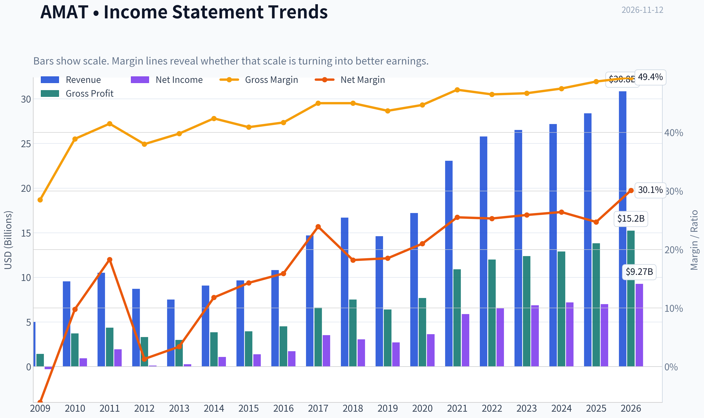

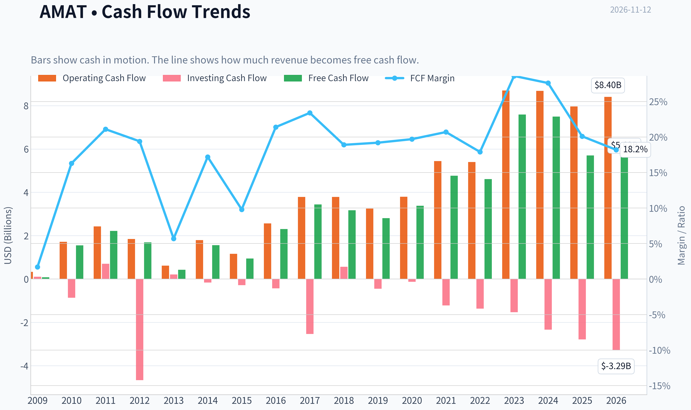

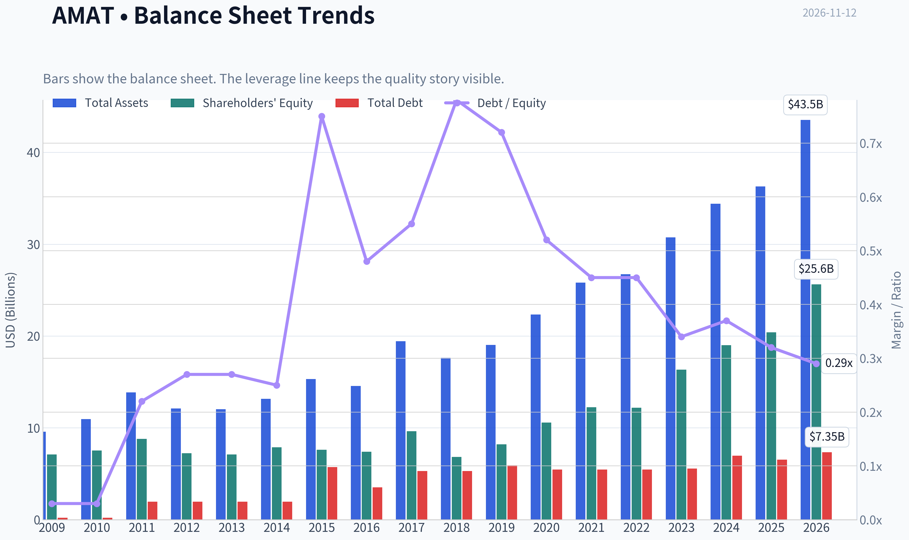

This graph tracks the profitability and return metrics (ROE, ROIC, Margins) of **AMAT** over the past decade, highlighting capital efficiency trends.

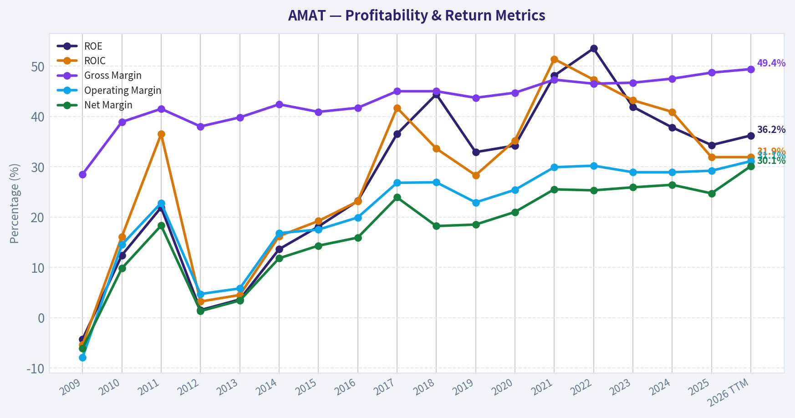

This chart illustrates the financial health of **AMAT** over the last 10 years, mapping cash equivalents and free cash flow against total obligations (Debt).

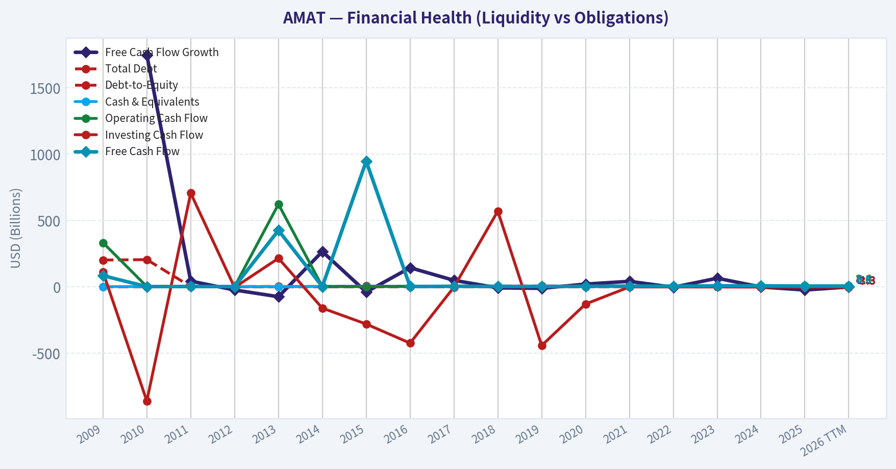

This comparison chart from *Profitability* stacks current figures against historical benchmarks for **AMAT**, making it easy to see where the company trades relative to its own averages.

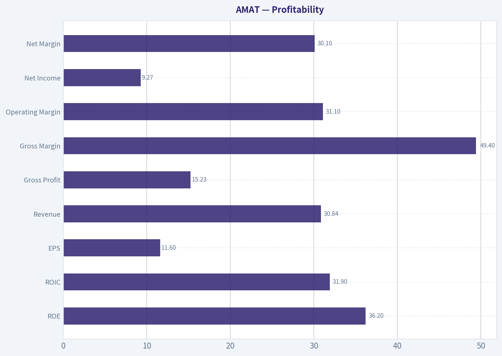

This breakdown chart from <em>Cash Flow and Capital Allocation</em> shows the proportional composition for **AMAT** - useful for understanding what drives or risks the business.

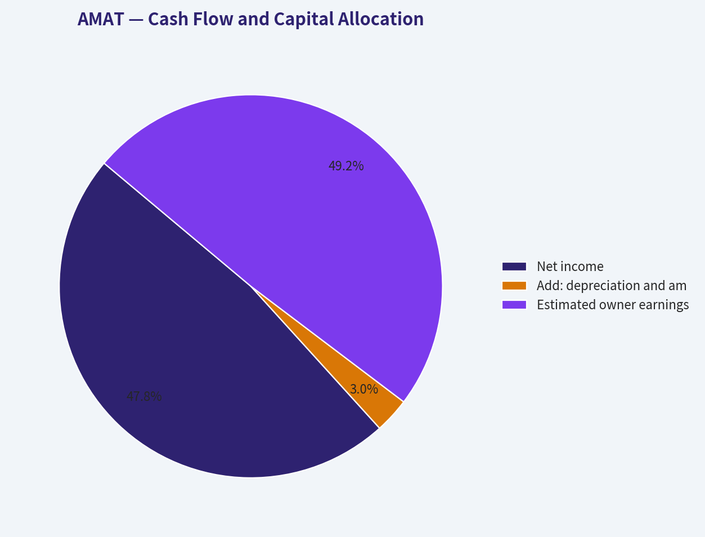

---

### Intrinsic Value Analysis (Buffett)

> *Following Warren Buffett's value investing philosophy: Circle of Competence, Economic Moat, Management Quality, and Margin of Safety.*

#### Intrinsic Value Snapshot

Price is what you pay. Intrinsic value is what the business may be worth based on the cash it can create for owners over time. We show a range, not one magic number.

- Current Price: $395.08
- Value Range (conservative to optimistic across both DCF methods): $39.24 to $1,157.36

##### Owner Earnings (Buffett Method)
- Net Income: $6,998,000,000.00
- Depreciation & Amortization: $435,000,000.00
- Capital Expenditures: $-2,260,000,000.00
- Working Capital Changes: $-200,000,000.00
- Owner Earnings: $7,198,000,000.00

##### Intrinsic Value
###### Buffett Method
Uses owner earnings. Stricter, and usually more conservative.
- Conservative: $143.52
- Average: $275.01
- Optimistic: $1,157.36
- Discount Rate: 10.0%

###### Cash Flow Method
Uses free cash flow. Better for companies spending heavily today to grow tomorrow.
- Conservative: $39.24
- Average: $252.47
- Optimistic: $380.15
- Discount Rate: 10.0%

ANALYST STANCE: **Neutral**

#### Executive Summary

Applied Materials is a high-quality semiconductor-equipment franchise with meaningful process know-how, customer qualification barriers, scale advantages, and a large installed base. Its gross margin of 48.7% and ROE of 34.3% support the existence of a durable moat.

However, at **$395 per share**, the valuation is demanding. The price implies approximately **26.5% annual growth for the next decade**, despite trailing three-year revenue growth of negative 4.7% and five-year growth of 17.6%. The business is attractive; the stock currently offers an inadequate margin of safety.

#### Financial Snapshot

| Metric | AMAT |
|---|---:|
| Current price | $395 |
| Market capitalization | $313.5 billion |
| P/E ratio | 34.1x |
| Revenue growth, year over year | 4.4% |
| Gross margin | 48.7% |
| ROE | 34.3% |
| FCF yield | 1.8% |
| Estimated annual free cash flow | $5.6 billion |
| Current ratio | 2.61 |
| Headline intrinsic value | $182.70 |
| Owner-earnings model value | $275.01 |
| FCF model value | $252.47 |
| Damodaran FCFF value | $110.81 |

**Key Takeaways:** AMAT produces strong margins and returns, but the market is already pricing in substantial future growth. The 1.8% free-cash-flow yield is modest for a cyclical semiconductor supplier. The valuation models consistently fall below the current market price, although the owner-earnings estimate is materially more favorable than the FCFF estimate.

#### Factor Scorecard

| Factor | Score | Evidence |
|---|---:|---|
| Circle of competence and simplicity | 3.5/5 | Sells specialized equipment used to manufacture semiconductors; understandable, but exposed to complex technology cycles and customer capital spending |
| Moat | 4/5 | Process expertise, installed base, switching costs, scale, customer qualification, and concentrated industry structure |
| Management and capital allocation | 3.5/5 | Established public-company governance and strong financial performance; evidence of owner-oriented behavior and acquisition discipline requires continued monitoring |
| Industry structure | 3.5/5 | Rational, concentrated equipment industry with high barriers to entry, but cyclical demand and geopolitical restrictions reduce stability |
| Gate 5: financial distress | **Not tripped** | No indication of deteriorating cash generation combined with insolvency; liquidity is strong and the company appears financially viable |

**Key Takeaways:** AMAT scores well on business quality and industry structure, but not perfectly because semiconductor equipment is cyclical and geopolitically exposed. The hard financial-distress floor is not tripped. The central issue is valuation, not solvency.

#### Moat Analysis

**Intangible assets and process know-how:**
Applied Materials has decades of engineering knowledge, patents, process recipes, and customer-specific integration experience. Semiconductor manufacturers qualify equipment carefully because a production error can destroy substantial wafer value. That qualification process creates meaningful barriers to replacement.

**Switching costs:**
AMAT equipment is embedded in highly specialized manufacturing workflows. Customers must validate new tools, retrain personnel, modify processes, and accept the risk of lower yields when switching suppliers. These costs support customer retention, particularly in mature process categories.

**Cost and scale advantages:**
The company spreads research, manufacturing, service, and sales costs across a global customer base. Its scale supports continued R&D investment that smaller competitors may struggle to match.

**Network effects:**
AMAT does not possess a classic consumer-platform network effect. Its stronger advantages are technological learning, installed-base service relationships, and ecosystem integration with semiconductor manufacturers.

**Moat rating: Wide and stable, approaching wide and widening - 4/5.**
The moat is real, but it is not invulnerable. Major customers have purchasing power, competitors such as Lam Research and ASML remain formidable, and technological transitions can alter market shares.

#### Management Quality and Capital Allocation

| Question | Assessment |
|---|---|
| Owner orientation | Reasonable, but no evidence supplied that senior management has an unusually large personal ownership stake |
| Financial candor | No restatement or accounting concern is indicated in the available information |
| Reinvestment | High R&D intensity and strong returns suggest productive reinvestment in technology and customer support |
| Acquisitions | Requires ongoing review; semiconductor-equipment acquisitions can be strategically useful but expensive |
| Balance-sheet discipline | Strong liquidity and no apparent solvency concern |
| Shareholder returns | The company has the financial capacity for dividends and buybacks, but repurchases should be judged against valuation |

**Key Takeaways:** Management appears competent, and the company's reinvestment in technology is strategically important. The key capital-allocation risk is buying back shares at elevated valuations, which can destroy per-share value even when the underlying business performs well.

#### Financial Trend and Return Profile

| Indicator | Current reading | Interpretation |
|---|---:|---|
| Revenue growth, year over year | 4.4% | Positive but moderate |
| Three-year revenue growth trend | -4.7% | Reflects cyclicality and recent softness |
| Five-year revenue growth trend | 17.6% | Strong long-term expansion, though not necessarily repeatable |
| Gross margin | 48.7% | Supports pricing power and differentiated technology |
| ROE | 34.3% | Excellent headline return |
| P/E | 34.1x | Requires substantial future growth |
| FCF yield | 1.8% | Low cash return at the current price |
| Current ratio | 2.61 | Strong short-term liquidity |

**Key Takeaways:** AMAT's long-term economics are strong, as shown by its high gross margin and ROE. The revenue trend also demonstrates cyclicality: an excellent five-year record has been followed by weaker recent performance. Investors should not extrapolate the best part of the semiconductor cycle indefinitely.

#### Owner Earnings Calculation

A precise Buffett owner-earnings calculation requires depreciation, maintenance capital expenditures, and working-capital changes. Using reported free cash flow as a conservative operating proxy:

| Item | Estimated amount |
|---|---:|
| Market capitalization | $313.5 billion |
| FCF yield | 1.8% |
| Estimated annual FCF / owner-earnings proxy | $5.6 billion |
| Estimated diluted shares at current price | 793.7 million |
| Estimated cash earnings per share | $7.11 |

**Key Takeaways:** The company generates substantial cash in absolute terms, but the cash yield to a new shareholder is only about 1.8%. That yield can become attractive if earnings compound rapidly, but the current valuation leaves little room for a prolonged semiconductor downturn or a slower industry investment cycle.

#### Three-Scenario DCF Valuation

Using approximately $7.11 per share as the current cash-earnings proxy and a 10% discount rate:

| Scenario | Key assumptions | Estimated value per share |
|---|---|---:|
| A. No growth | Cash earnings remain constant; 10% discount rate | $71 |
| B. GDP growth | 3% perpetual growth; 10% discount rate | $105 |
| C. Historical-growth case | 8.8% growth assumption, based on half of the five-year growth rate, for 10 years | Approximately $646 |
| Research-pack owner-earnings model | Independent model estimate | $275 |
| Research-pack FCF model | Independent model estimate | $252 |
| Research-pack FCFF model | Independent model estimate | $111 |

**Key Takeaways:** The valuation range is exceptionally wide because the result is highly sensitive to the assumed growth rate. The conservative cases are far below the current price, while the historical-growth case requires sustained near-double-digit growth for a decade. The independent model range of roughly $111 to $275 is more consistent with a cautious underwriting approach than the current $395 market price.

#### Margin of Safety Analysis

| Measure | Result |
|---|---:|
| Current price | $395 |
| Headline intrinsic value | $182.70 |
| Headline margin of safety versus price | -116.2% |
| Owner-earnings model discount/(premium) | Current price is approximately 44% above model value |
| FCF model discount/(premium) | Current price is approximately 56% above model value |
| FCFF model discount/(premium) | Current price is approximately 256% above model value |
| Price-implied 10-year growth | Approximately 26.5% annually |

**Key Takeaways:** A wide-moat company can justify paying a premium, but this price appears to require exceptional execution rather than merely good execution. The market-implied growth rate is well above what the recent operating trend establishes. AMAT should be considered a watchlist compounder, not a buy at this valuation.

#### Final Buffett Scorecard

| Criterion | Weight | Score | Weighted contribution |
|---|---:|---:|---:|
| Moat width and durability | 25% | 4.0 | 1.00 |
| Valuation and margin of safety | 20% | 1.5 | 0.30 |
| Capital returns versus WACC | 15% | 4.0 | 0.60 |
| Business understanding and predictability | 12% | 3.0 | 0.36 |
| Management quality and capital allocation | 12% | 3.5 | 0.42 |
| Reinvestment runway | 8% | 4.0 | 0.32 |
| Balance-sheet strength | 4% | 4.0 | 0.16 |
| Industry structure | 4% | 3.5 | 0.14 |
| **Total** | **100%** |  | **3.30/5.00** |

**Key Takeaways:** AMAT is a good business with a durable competitive position, high returns, and a long reinvestment runway. Its score is held back principally by valuation and secondarily by semiconductor cyclicality. At a substantially lower price, the same business could move from watchlist status to an attractive long-term investment.

#### Investment Stance

**Neutral - Moderate-to-high conviction.**

Applied Materials is a company worth owning at the right price. Its moat, engineering culture, customer switching costs, and semiconductor growth exposure create attractive long-term economics. At $395, however, the valuation provides insufficient protection against cyclical weakness, slower semiconductor investment, export restrictions, or technological shifts.

A more compelling entry point would require either:

- A materially lower share price;
- Evidence that normalized owner earnings are substantially higher than current free cash flow; or
- Operating growth strong enough to reduce the price-implied 26.5% growth requirement.

The correct Buffett-style action is patience: **admire the business, but wait for a price that offers a genuine margin of safety.**
#### Valuation Bridge

This bridge places the current market price beside each intrinsic value lens so readers can see whether upside depends on one method or shows up across several methods.

| Scenario | Intrinsic Value / Share |
| --- | ---: |
| Buffett Method | $275.01 |
| Cash Flow Method | $252.47 |
| Damodaran Method | $110.81 |
| Current Price | $395.08 |

#### Key Takeaways

If one method is far above the others, the upside case depends on a specific modelling assumption. When several methods cluster together, the valuation story is more robust.

#### Valuation Visuals

This comparison chart from *Latest Earnings Snapshot* stacks current figures against historical benchmarks for **AMAT**, making it easy to see where the company trades relative to its own averages.

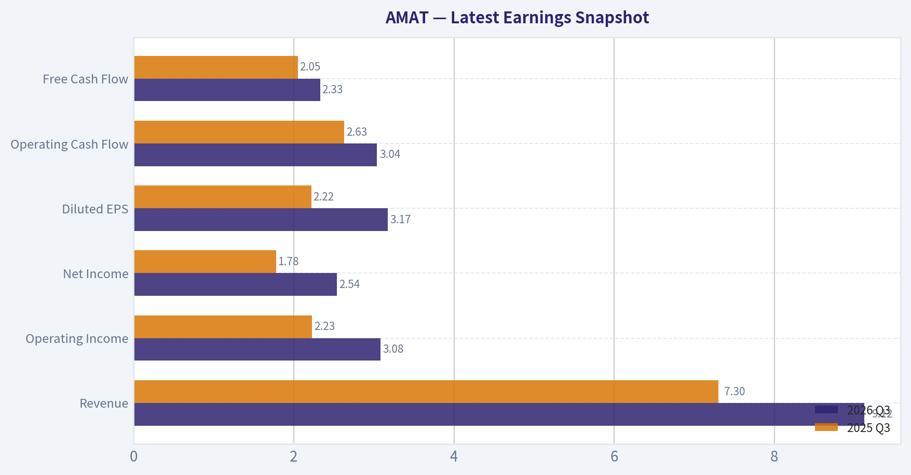

This comparison chart from *Current Metrics and Historical Comparison* stacks current figures against historical benchmarks for **AMAT**, making it easy to see where the company trades relative to its own averages.

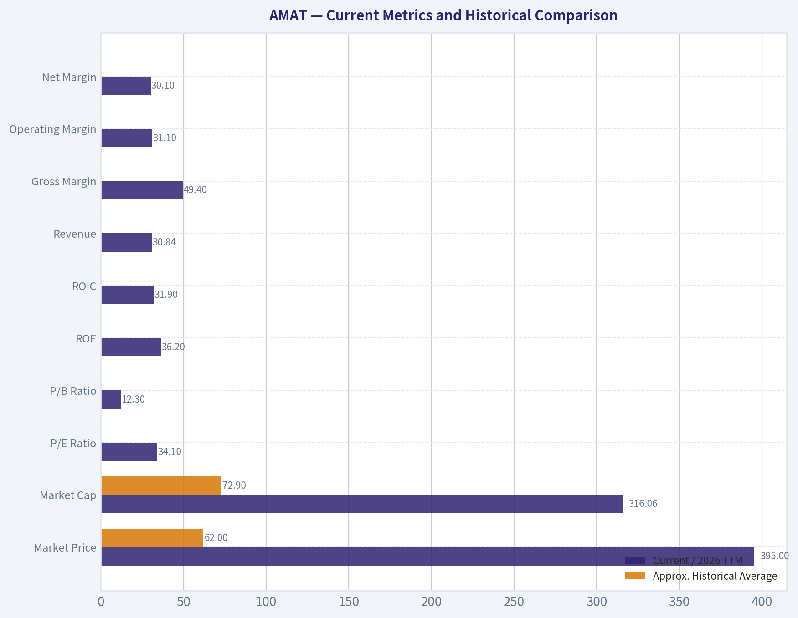

The following chart maps the **AMAT** Owner Earnings DCF valuation scenarios (Conservative, Average, Optimistic) to visually represent the margin of safety based on intrinsic value calculations.

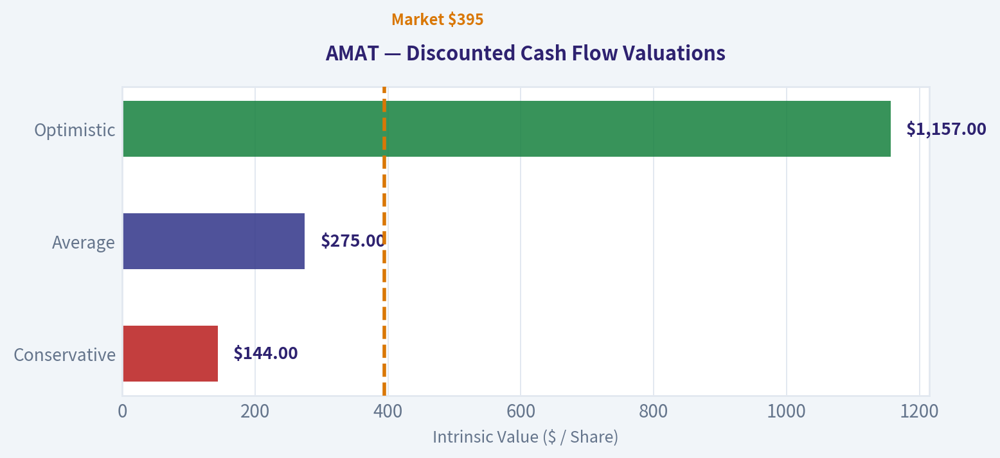

This comparison chart from *Cross-Check Against Other Valuation Models* stacks current figures against historical benchmarks for **AMAT**, making it easy to see where the company trades relative to its own averages.

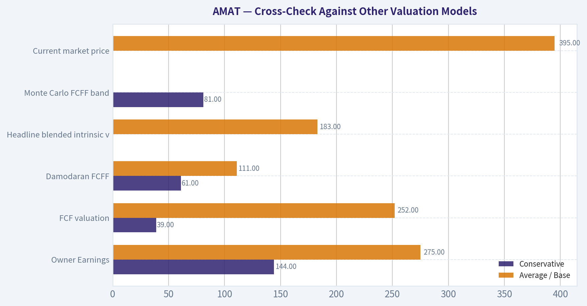

---

### Trend & Growth Analysis (Lynch/Druckenmiller/Fisher)

> *Following Peter Lynch's GARP, Stanley Druckenmiller's macro-aware approach, and Philip Fisher's scuttlebutt methodology.*

ANALYST STANCE: **Neutral**

#### 1. Lynch Classification

**AMAT is currently a cyclical stalwart, not a fast grower.**

Applied Materials has excellent profitability, balance-sheet strength, and semiconductor-equipment exposure, but current revenue growth of only **4.4%** is below the 15-25% threshold for a primary growth investment. The company could become a fast grower during an AI-driven semiconductor capital-spending upcycle, but that inflection is not yet visible in reported revenue.

#### 2. The Story in Three Bullets

- Applied Materials sells critical equipment used to manufacture advanced chips, displays, and semiconductor packaging.
- AI, high-performance computing, advanced memory, and leading-edge nodes are expanding equipment intensity and supporting long-term demand.
- The business has strong margins and returns on capital, but the current stock price appears to discount a major acceleration that financial results have not yet confirmed.

#### 3. Key Financial Snapshot

| Metric | AMAT |
|---|---:|
| Current price | $395 |
| Market capitalization | $313.5B |
| Revenue, TTM | $30.84B |
| Revenue growth, YoY | 4.4% |
| Five-year revenue CAGR | 10.5% |
| Gross margin | 48.7% |
| Operating margin | 29.2% |
| ROE | 34.3% |
| ROIC | Approximately 32% |
| Free cash flow margin | 18.2% |
| Net cash | Approximately $2.0B |
| Current P/E | 34.1x |
| Forward P/E | 21.2x |
| Price-to-sales | 10.2x |

**Key Takeaways:** AMAT is a high-quality and highly profitable company with strong returns on capital, modest leverage, and net cash. However, current revenue growth is slow relative to its valuation, while a 34x trailing P/E and 10x price-to-sales multiple leave limited room for disappointment.

#### 4. TAM and the 10x Test

| Measure | Assessment |
|---|---|
| Current revenue | $30.8B |
| 10x revenue target | Approximately $308B |
| Core markets | Wafer fabrication, deposition, etch, inspection-related processes, displays, and packaging |
| TAM outlook | Secularly expanding, but still cyclical |
| AI-related opportunity | Positive; higher process complexity increases equipment intensity |
| Strict 10x test | Fails under today's market size |
| Long-runway conclusion | Requires substantial TAM expansion, market-share gains, and new product categories |

**Key Takeaways:** AMAT participates in attractive markets, but $308 billion of revenue would be difficult to reach within the currently defined semiconductor-equipment market. A credible ten-bagger outcome would require the company to capture new categories, benefit from a much larger semiconductor capital-equipment market, or compound earnings for many years rather than simply expand through existing markets.

#### 5. Revenue Growth Trend

| Period | Revenue | Growth |
|---|---:|---:|
| 2021 | $23.06B | 34.1% |
| 2022 | $25.79B | 11.8% |
| 2023 | $26.52B | 2.8% |
| 2024 | $27.18B | 2.5% |
| 2025 | $28.37B | 4.4% |
| 2026 TTM | $30.84B | 8.7% versus prior TTM dataset |

**Key Takeaways:** The long-term trend is positive, but growth has decelerated sharply from the 2021 semiconductor upcycle. The latest TTM figures suggest some recovery, yet the evidence supports stabilization rather than a confirmed acceleration. A sustained return to 15% or higher revenue growth would be the most important signal that the investment case is changing.

#### 6. Unit Economics and Profitability

| Metric | Result | Interpretation |
|---|---:|---|
| Gross margin | 48.7% | Strong |
| Operating margin | 29.2% | Strong |
| Net margin | 24.7% | Strong |
| FCF margin | 18.2% | Healthy |
| Rule of 40 | Not applicable | Not a subscription business |
| NRR / LTV-to-CAC | Not disclosed or not meaningful | Industrial equipment model |
| Interest coverage | 30.8x | Very strong |
| Piotroski F-score | 7/9 | Fundamentally healthy |

**Key Takeaways:** AMAT's economics are attractive even without SaaS-style recurring revenue metrics. Gross margins have improved over time, operating margins are near 30%, and the company converts a meaningful portion of sales into free cash flow. The main weakness is recent FCF growth, which was negative in the latest dataset.

#### 7. Inflection-Point Assessment

| Potential inflection | Current evidence | Status |
|---|---|---|
| Product cycle | AI, advanced logic, memory, and packaging demand | Positive but not yet fully reflected |
| Market share | No supplied evidence of accelerating share gains | Unconfirmed |
| Margin expansion | Operating margin around 31% TTM versus 29.2% reported snapshot | Positive |
| TAM expansion | AI increases semiconductor complexity and equipment intensity | Positive |
| Revenue acceleration | Growth remains below fast-grower levels | Not confirmed |
| Competitive disruption | No clear major competitor failure identified | Neutral |

**Key Takeaways:** The strongest possible inflection is rising equipment intensity per wafer as chip designs become more complex. Margin performance is encouraging, but the central Druckenmiller question remains unanswered: the market price implies a much faster earnings trajectory than the recent revenue trend supports.

#### 8. Macro Setup

**Positive forces:**

- AI infrastructure and high-performance computing are increasing semiconductor demand.
- Advanced-node complexity, memory investment, and advanced packaging can raise equipment spending per unit of semiconductor capacity.
- AMAT has exposure across several semiconductor manufacturing steps rather than relying on a single product.

**Headwinds:**

- Semiconductor equipment is cyclical and vulnerable to inventory corrections and capital-spending pauses.
- Export controls and China exposure create geopolitical and regulatory risks.
- A high-growth-stock valuation is vulnerable to higher interest rates or weaker semiconductor orders.
- The current market price appears to require approximately **26.5% annual owner-earnings growth for ten years** according to the reverse-DCF analysis, versus a much lower recent growth record.

**Macro conclusion:** The secular backdrop is favorable, but the near-term macro setup is mixed. AI is a tailwind; valuation, cyclicality, rates, and geopolitics are meaningful offsets.

#### 9. Fisher 15-Point Assessment

| Fisher factor | Score / 5 | Assessment |
|---|---:|---|
| Market potential | 4 | Large and strategically important markets |
| New-product determination | 4 | Broad technology and process portfolio |
| R&D effectiveness | 4 | Strong technical positioning |
| Sales organization | 4 | Global customer relationships |
| Profit margins | 5 | Excellent |
| Margin improvement | 4 | Long-term improvement evident |
| Labor relations | 3 | Limited data |
| Executive relations | 4 | No major issue identified |
| Management depth | 4 | Large, established operating platform |
| Cost accounting | 4 | Strong financial controls implied |
| Outstanding moat | 4 | Process know-how, switching costs, customer integration |
| Long-term profit outlook | 4 | Attractive, but cyclical |
| Dilution | 4 | No major dilution concern |
| Candor | 3 | Insufficient direct evidence |
| Integrity | 4 | No major concern identified |
| **Total** | **57 / 75** | **Good, but not outstanding** |

**Key Takeaways:** AMAT scores well on technology, margins, customer relationships, and long-term market relevance. The score is held back primarily by limited evidence on management candor, employee relations, and the fact that the near-term growth profile is not yet consistent with a high-conviction fast-growth thesis.

#### 10. Valuation Analysis

| Method | Result | Interpretation |
|---|---:|---|
| Trailing P/E | 34.1x | Expensive for current growth |
| Forward P/E | 21.2x | More reasonable if earnings estimates are achieved |
| PEG ratio | 0.79 | Appears attractive mechanically, but growth denominator may be cyclical |
| Price-to-sales | 10.2x | High for a cyclical industrial-equipment company |
| FCF yield | 1.8% | Low |
| Headline intrinsic value | $183 | Well below current price |
| DCF model range | $111-$275 | Below current price |
| Reverse-DCF requirement | Approximately 26.5% annual owner-earnings growth for 10 years | Very demanding |

**Key Takeaways:** The PEG ratio looks attractive, but it should not be trusted without normalizing semiconductor-cycle earnings. Cash-flow valuation is considerably less favorable: the current price is above the supplied intrinsic-value range and offers only a 1.8% FCF yield.

#### 11. Illustrative Revenue-Multiple Scenarios

These are sensitivity cases, not price targets.

| Scenario | Five-year revenue assumption | Implied revenue | Illustrative P/S | Implied market value | Approximate value per share |
|---|---:|---:|---:|---:|---:|
| Bear | 5% CAGR | $39.4B | 6x | $236B | $298 |
| Base | 10% CAGR | $49.7B | 8x | $398B | $503 |
| Bull | 15% CAGR | $62.0B | 10x | $620B | $784 |

**Key Takeaways:** At the current share price, investors are paying for something close to a strong base case already. The bull case requires both sustained mid-teens growth and continued premium valuation, while the bear case shows meaningful downside if AMAT remains a mid-single-digit grower.

#### 12. Growth Investor Scorecard

| Criterion | Weight | Score / 5 | Weighted contribution |
|---|---:|---:|---:|
| Lynch story | 10% | 3.0 | 0.30 |
| TAM and runway | 20% | 3.0 | 0.60 |
| Revenue growth | 20% | 2.3 | 0.46 |
| Unit economics | 15% | 4.2 | 0.63 |
| Competitive position | 10% | 4.3 | 0.43 |
| Management quality | 10% | 3.8 | 0.38 |
| Macro setup | 5% | 3.2 | 0.16 |
| Profitability path | 5% | 4.5 | 0.23 |
| Valuation | 5% | 1.5 | 0.08 |
| **Total** | **100%** |  | **3.27 / 5.00** |

**Key Takeaways:** AMAT is a high-quality business but currently scores as a monitoring candidate rather than a high-conviction growth purchase. Exceptional profitability and competitive positioning are offset by slow recent growth and a valuation that assumes substantial future acceleration.

#### 13. Position Size Stance

**Position stance: Watchlist or small starter position only.**

- **New position:** Prefer no more than **1-2%** until revenue growth reaccelerates.
- **Existing position:** Hold if the original thesis is based on long-term semiconductor-equipment exposure, but avoid aggressively adding at the current valuation.
- **Higher-conviction add zone:** Would require either a material valuation reset or evidence of sustained revenue growth above 15%, improving bookings, and continued margin expansion.

#### 14. Key Catalysts and Risks

| Catalysts | Risks |
|---|---|
| AI-driven semiconductor capital-spending acceleration | Semiconductor-capex downturn |
| Strong advanced-memory and logic demand | Export controls and China restrictions |
| Increased adoption of advanced packaging | Customer concentration and order timing |
| New process technologies gaining share | Valuation compression |
| Revenue growth returning to 15% or higher | AI spending proves concentrated or cyclical |
| Continued operating-margin expansion | FCF remains weak despite strong earnings |

**Key Takeaways:** The decisive catalyst is not simply positive AI commentary; it is proof that AI-related demand is converting into accelerating AMAT orders, revenue, and cash flow. The primary risk is that the market has already priced in this outcome, leaving the stock exposed to a normal semiconductor cycle or any delay in the expected acceleration.

#### Final Conclusion

AMAT is an excellent semiconductor-equipment franchise with strong margins, high returns on capital, a net-cash balance sheet, and attractive secular exposure. However, it is **not currently demonstrating the revenue acceleration required for a ten-bagger growth thesis**, and valuation is demanding relative to recent growth and cash-flow yields.

**Decision: Neutral.** Upgrade toward **Bullish** only if growth reaccelerates materially or the valuation falls enough to provide a genuine margin of safety.

---

### Market Technical Analysis

ANALYST STANCE: **Neutral**

#### AMAT technical market report

AMAT closed at **$395.08 on November 11, 2026**; November 12 was identified as a non-trading day in the indicator feed. The stock is attempting a short-term rebound after a sharp decline, but the broader technical structure remains damaged. Price is still well below both its medium-term and long-term moving averages, while momentum has only recently begun to improve from deeply weak levels.

#### Selected indicators

The selected indicators are:

- **close_10_ema** - short-term price momentum and tactical trend direction.
- **close_50_sma** - medium-term trend and dynamic resistance.
- **close_200_sma** - long-term trend regime.
- **macd** - underlying momentum and trend transition.
- **macdh** - acceleration or deceleration of momentum.
- **rsi** - momentum condition and potential exhaustion.
- **atr** - volatility-adjusted risk management.
- **vwma** - price trend confirmation incorporating trading volume.

These indicators are complementary: moving averages establish trend, MACD and its histogram evaluate momentum direction, RSI measures momentum stress, VWMA tests volume-backed price acceptance, and ATR frames risk. The set avoids unnecessary redundancy while covering trend, momentum, participation, and volatility.

#### Trend structure

AMAT's closing price has fallen from **$529.30 on October 1** to **$395.08 on November 11**, a decline of approximately **25.3%**. The deterioration was not a single-day event. Price progressively weakened through October, broke below the $400 area in late October, and then experienced a particularly severe selloff on November 5, when it closed at **$319.25** after trading as low as **$316.95**.

The recent rebound is meaningful but not yet sufficient to reverse the broader trend. From the November 5 close to November 11, the stock recovered approximately **23.8%**, reaching $395.08. However, the move has so far retraced only part of the preceding decline and remains below major trend references.

The **10-day EMA was $375.82** on November 11. Price is above this short-term average, which indicates that the immediate selling pressure has eased and that short-term buyers have regained some control. Nevertheless, the 10 EMA itself has been declining sharply, from **$500.78 on October 13** to $375.82, so the current bullish signal is better interpreted as a rebound within a damaged trend rather than confirmation of a durable uptrend.

The **50-day SMA was $440.37**, leaving price approximately **10.3% below** it. This is the most important nearby medium-term resistance zone. A recovery toward $440-$445 would represent a test of the declining 50-day trend and the long-term average, rather than an already-established breakout.

The **200-day SMA was $445.62** and has begun to flatten or turn slightly upward after rising through October. Price is approximately **11.3% below** this benchmark. The 50-day SMA remains slightly below the 200-day SMA, indicating that the medium-term trend has weakened relative to the longer-term trend. A sustained move above both averages would materially improve the technical picture; failure beneath them would preserve a defensive interpretation.

#### Momentum analysis

The MACD remained negative at **-24.79** on November 11. This is a substantial negative reading and confirms that the underlying trend momentum remains bearish. However, the MACD improved considerably from **-32.12 on November 6** and **-30.33 on November 9**, showing that the rate of deterioration has slowed during the rebound.

The MACD histogram turned positive at **+1.85** on November 11 after readings of **-6.24 on November 6**, **-3.56 on November 9**, and **-1.31 on November 10**. This is an important short-term improvement: upside momentum is beginning to exceed the recent downside momentum. Yet a positive histogram alone does not establish a new bullish trend. The MACD line remains deeply below zero, so the current setup is consistent with an early recovery phase rather than a confirmed regime change.

RSI was **47.6** on November 11, up from **25.9 on November 5** and **30.5 on November 6**. The move out of oversold territory confirms that the stock has experienced a strong relief bounce. At the same time, RSI remains below the neutral 50 level, so momentum has not yet shifted decisively in favor of buyers. A sustained move above 50, particularly if accompanied by price acceptance above the 50-day SMA, would provide stronger evidence of trend repair.

The RSI behavior is also important in context. The stock was oversold during the sharp decline, but oversold readings do not by themselves identify a durable bottom. The rebound from deeply depressed momentum levels is constructive; however, the subsequent test of resistance will determine whether this is accumulation or simply short covering and oversold recovery.

#### Volume and price confirmation

VWMA was **$374.00** on November 11, placing the closing price approximately **5.6% above** the volume-weighted average. This supports the view that the latest rebound has achieved some volume-backed acceptance above the immediate short-term trading zone.

However, VWMA has fallen dramatically from **$504.93 on October 13** to $374.00. That long decline indicates that volume-weighted participation has been aligned with the broader selloff. The latest improvement is therefore encouraging but not enough to offset the medium-term deterioration.

The November 5 selloff occurred on approximately **17.05 million shares**, substantially above many recent daily volumes. That combination of a large price decline and heavy participation is a warning sign: it may represent capitulation, but it also demonstrates that supply was significant. The stock now needs to hold the rebound without another high-volume rejection to establish that demand has genuinely replaced forced selling.

#### Volatility and risk management

ATR rose to **$24.94** on November 11, compared with approximately **$19-$21** through much of mid-to-late October. This indicates materially higher daily volatility. At the current price, the ATR represents roughly **6.3% of the share price**, meaning that normal daily fluctuations are unusually large.

For risk control, fixed percentage stops may be too tight in this environment. A volatility-aware approach would account for approximately one ATR of ordinary movement, while a wider swing-trading framework might require more than one ATR depending on position size and time horizon. The precise stop should be determined by the trader's risk budget rather than by the indicator alone.

The high ATR also weakens the reliability of short-term breakout signals. A move above a resistance level that quickly reverses by one ATR should not necessarily be treated as a structural failure, while a high-volume close below support would carry greater significance than an intraday breach.

#### Key price levels and scenarios

The first tactical support area is approximately **$375-$380**, centered around the 10-day EMA and the recent VWMA. Holding this zone would preserve the short-term rebound structure. A decisive close below it would suggest that the recovery is losing traction and would increase the risk of a retest of the **$370 area**, followed by the **$350-$355 region**.

The November 5 low near **$317** remains the major downside reference. A return toward that level would indicate that the relief rally failed and that sellers have regained control. Given the recent volatility, support should be evaluated using closing prices and volume rather than isolated intraday lows.

On the upside, the first meaningful resistance zone is around **$400-$405**, near the recent rebound high region and the psychological $400 threshold. Above that, the stock faces stronger resistance near **$420-$425**, followed by the clustered **$440-$446 area**, where the 50-day SMA and 200-day SMA converge.

A bullish technical repair would require more than simply exceeding $400. The stronger confirmation sequence would be: price holds above the 10-day EMA, RSI moves and remains above 50, MACD continues rising toward a less-negative reading, and price reclaims the $440-$446 moving-average cluster on expanding or at least healthy volume. Conversely, rejection below $420 or $440, followed by a close under the 10-day EMA, would favor a continuation-of-trend interpretation.

#### Trading interpretation

The current evidence favors **cautious observation rather than aggressive directional commitment**. Short-term momentum has improved materially, as shown by the positive MACD histogram, recovering RSI, and price above the 10-day EMA. Those signals may support tactical rebound trades, but they do not yet overcome the bearish medium- and long-term structure.

Momentum traders should focus on whether AMAT can consolidate above $375-$380 and then produce a sustained close above $400-$405. A breakout without volume confirmation would be less reliable given the elevated ATR. Trend-following investors should generally wait for a recovery above the $440-$446 moving-average cluster before treating the broader trend as repaired.

The principal risk is a failed rebound: price could temporarily rise toward $400-$420 while remaining beneath major moving averages, then reverse if buyers cannot absorb overhead supply. The principal bullish opportunity is a base-building process above the November 5 low, followed by improving momentum and a reclaim of the 50-day and 200-day averages.

This is technical analysis, not individualized investment advice. The unusually high volatility makes position sizing and loss control especially important.

| Indicator / area | Latest reading | Technical implication | What would strengthen the signal |
|---|---:|---|---|
| Closing price | $395.08 on Nov. 11 | Strong rebound from $319.25, but still below major trend averages | Sustained closes above $400-$405, then $440-$446 |
| 10-day EMA | $375.82 | Short-term price is above the EMA, indicating near-term recovery | Continued closes above $375-$380 |
| 50-day SMA | $440.37 | Price remains about 10.3% below medium-term resistance | Reclaim and hold above the average |
| 200-day SMA | $445.62 | Long-term benchmark is above price; trend remains technically impaired | Price acceptance above $445-$446 |
| MACD | -24.79 | Still deeply negative, though improving from early November lows | MACD rising toward zero and eventual positive crossover |
| MACD histogram | +1.85 | Short-term upside momentum has returned | Several consecutive positive readings with higher price |
| RSI | 47.6 | Recovered from oversold conditions but remains below neutral | Sustained move above 50-55 |
| VWMA | $374.00 | Price is above recent volume-weighted value, supporting the rebound | VWMA turns upward and price remains above it |
| ATR | $24.94 | High volatility; daily swings are unusually large | ATR contracts while price holds support |
| Primary support | $375-$380 | Key short-term defense zone | Repeated successful tests |
| Major downside reference | Around $317 | November 5 low and failure point for the rebound | Avoiding a retest and forming higher lows |
| First resistance | $400-$405 | Immediate psychological and tactical hurdle | Close above with stable or expanding volume |
| Major resistance | $440-$446 | Confluence of 50-day and 200-day averages | Breakout and sustained acceptance above the cluster |

**Key Takeaways:** AMAT has produced a powerful short-term rebound, with improving RSI, a positive MACD histogram, and price above its 10-day EMA. However, price remains well below the 50-day and 200-day averages, so the broader trend is still bearish until the stock can reclaim roughly $440 to $446. The most important near-term test is whether AMAT can hold $375 to $380 and then break above $400 to $405 without another high-volume rejection.

---

### Options Market Analysis

> *Reading options flow - put/call ratios, IV skew, and unusual activity - to gauge institutional positioning and event-driven risk.*

#### AMAT Options Market Report

*Data as of November 12, 2026. The available near-term chain is extremely thin in open interest, so confidence is low.*

#### 1. Put/Call Ratio Analysis

| Near-term expiry | Call OI | Put OI | Put/Call OI | Call volume | Put volume | Put/Call volume |
|---|---:|---:|---:|---:|---:|---:|
| Nov. 13, 2026 | 0 | 0 | N/A | 13,956 | 8,143 | 0.58 |
| Nov. 20, 2026 | 19 | 1 | 0.05 | 13,645 | 3,105 | 0.23 |
| Nov. 27, 2026 | 0 | 7 | N/A | 1,745 | 520 | 0.30 |
| **Aggregate** | **19** | **8** | **0.42** | **29,346** | **11,768** | **0.40** |

**Key Takeaways:** AMAT's aggregate put/call OI ratio of 0.42 is below the approximately 0.70 neutral baseline, while the volume ratio of 0.40 indicates substantially heavier call activity. This is directionally bullish, but the conclusion is unreliable because total open interest is only 27 contracts and the largest activity occurs in expirations with virtually no established OI.

#### 2. Implied Volatility Assessment

| Expiry | Call ATM IV | Put ATM IV | Put-versus-call IV difference | Interpretation |
|---|---:|---:|---:|---|
| Nov. 13, 2026 | 3.6% | 3.8% | +0.2 percentage points | Essentially neutral, marginal put premium |
| Nov. 20, 2026 | 2.3% | 1.0% | -1.3 percentage points | Call IV higher than put IV |
| Nov. 27, 2026 | 1.1% | 1.1% | 0.0 points | Neutral |
| **Near-term assessment** | - | - | - | **Very low reported IV; mildly call-skewed overall** |

**Key Takeaways:** Reported ATM IV is unusually low, ranging from approximately 1.0% to 3.8%, which may reflect stale, sparse, or unreliable quotes rather than genuinely low expected movement. There is no meaningful steep downside put skew; the November 20 chain instead shows higher call IV than put IV. The data does not identify an earnings or other catalyst, so catalyst-related IV elevation cannot be confirmed.

#### 3. Unusual Options Activity

The data provider defines unusual activity as contracts with volume greater than five times open interest. No contracts met that threshold.

| Finding | Result |
|---|---|
| Contracts meeting unusual-activity threshold | None |
| Fresh directional bets identifiable from volume/OI | None |
| Smart-money versus retail classification | Not possible |
| Strike, moneyness, and days-to-expiry detail | Not supplied |

**Key Takeaways:** Although call volume is much higher than put volume, no individual contract qualifies as unusual under the available volume-to-OI test. This prevents identifying whether the activity represents aggressive institutional call buying, covered-call writing, spreads, or retail speculation. The absence of flagged contracts should therefore be interpreted as insufficient evidence, not as evidence of no positioning.

#### 4. Open Interest Concentration and Gamma Levels

| Expiry | Highest reported call OI | Highest reported put OI | Concentration assessment |
|---|---:|---:|---|
| Nov. 13, 2026 | 0 | 0 | No meaningful OI |
| Nov. 20, 2026 | 19 total call OI | 1 total put OI | Limited call concentration, but too small to form a reliable gamma wall |
| Nov. 27, 2026 | 0 | 7 total put OI | Limited put concentration |
| **Overall** | **19** | **8** | **No dependable pinning or max-pain signal** |

**Key Takeaways:** The November 20 expiration has the largest aggregate OI, but only 19 call contracts and one put contract are reported. No strike-level data is available, so specific gravitational prices, max pain, or gamma walls cannot be identified. With such small OI, dealer hedging is unlikely to create a durable price-pinning effect based on this chain alone.

#### 5. Overall Options Sentiment Signal

**Overall signal: BULLISH, low confidence.**

The bullish read is driven by:

- Aggregate put/call OI of 0.42, below the 0.70 neutral reference.
- Put/call volume of 0.40, showing call volume substantially outweighing put volume.
- A lack of meaningful downside IV skew.
- Higher call IV than put IV in the November 20 expiration.

However, conviction is low because the chain is exceptionally illiquid from an open-interest perspective. Most volume is not backed by established OI, no individual unusual contracts were identified, strike-level concentration is unavailable, and the reported IV levels appear suspiciously low. This should be treated as a tentative bullish positioning signal rather than a robust institutional conviction indicator.

| Metric | Assessment |
|---|---|
| Put/Call Ratio | Bullish: 0.42 OI and 0.40 volume, both below neutral |
| IV Level | Extremely low reported IV; possible data or liquidity distortion |
| Skew Direction | Neutral to mildly call-skewed; no meaningful downside fear |
| Unusual Activity | None flagged; no contract-level directional confirmation |
| Overall Signal | **BULLISH, low confidence** |

**Key Takeaways:** AMAT's options data leans bullish because calls dominate both near-term volume and open interest, and downside put skew is not pronounced. The signal is weak, however, because the open-interest base is tiny and no unusual contract or reliable gamma level can be identified. Use this as a secondary indicator alongside price action, liquidity, and fundamental or catalyst information.

---

## Research Team Commentary

> *The Research Manager synthesizes the Bull vs Bear debate into action-free commentary. This is a pre-risk view, not the final stance.*

Core takeaway: Applied Materials is a wonderful business, but $395 is not a sufficiently conservative price based on the evidence provided. The moat, 34% ROIC, 48.7% gross margin, switching costs, and exposure to rising semiconductor complexity are all compelling. The problem is that the valuation requires either a decade of roughly 13-14% owner-earnings growth or proof that current free cash flow substantially understates normalized earning power. That proof is not yet available. I would avoid purchasing the shares at this price while keeping the company on a high-priority watchlist.

The strongest bull argument is that AMAT is more than a conventional cyclical machinery company. Its tools are embedded in mission-critical fabrication processes where yield, reliability, and qualification matter far more than the initial purchase price. Its intellectual property, installed base, customer relationships, and process expertise create meaningful switching costs. AI, high-bandwidth memory, advanced packaging, gate-all-around architectures, and increasing materials complexity should raise equipment content per advanced chip. The 34% ROIC and nearly 49% gross margin provide strong quantitative support for this moat.

That quality deserves a premium. If normalized owner earnings are genuinely close to the implied EPS of about $11.59 and can compound at 13-14% annually, the bull's estimated value of roughly $427-$461 is plausible. Under that scenario, $395 offers a modest quality-scaled margin of safety. It would be a mistake to reject AMAT merely because it is a modern technology business or because its multiple looks high relative to traditional industrial companies.

The strongest bear argument, however, is that this valuation begins by assuming the central uncertainty away. At 34.1 times earnings, the earnings yield is only about 2.9%. More importantly, the free-cash-flow-based reverse DCF reportedly requires 26.5% growth. The bull suggests that working capital and growth investment temporarily depress cash flow, but the supplied evidence does not include a detailed reconciliation showing that free cash flow should normalize toward EPS.

That burden of proof matters. If owner earnings grow 12%, the bull's own model suggests the shares are only approximately fairly valued. At 10%, estimated value falls to around $340; at 8%, it falls to roughly $291. Those are respectable business outcomes, not disaster scenarios. The downside thesis therefore does not require financial distress, a broken moat, or an end to AI investment. It only requires ordinary cyclicality, weaker cash conversion, moderate competitive slippage, or multiple normalization.

The market psychology also argues for discipline. Put/call open interest of 0.42 and volume of 0.40 indicate substantial call-side enthusiasm, with little downside-volatility skew. That is not a sell signal, but it suggests the AI and semiconductor-complexity thesis is widely recognized rather than ignored. There are no actual moving-average values in the bundle, so no technical conclusion should be invented. The relevant contrarian insight is not that AMAT's structural opportunity is false; it is that a true and popular narrative may already be more than adequately reflected in the price.

Rationale: From a Buffett perspective, AMAT passes the business-quality test but does not yet pass the price-versus-verifiable-owner-earnings test. High historical ROIC does not by itself prove that the company can reinvest enough incremental capital to triple or quadruple owner earnings over a decade. Semiconductor equipment remains exposed to customer capital-spending cycles, concentrated buyers, technological share shifts, and export restrictions. These risks are acceptable at the right price, but $395 provides little protection if growth settles in the high single digits or low double digits.

Management appears operationally capable, and the high ROIC supports that assessment, but the data are insufficient to fully judge balance-sheet strength and capital allocation. Buybacks at 34 times earnings create value only if the optimistic growth assumptions are achieved. Net debt, interest coverage, stock-based compensation, acquisition discipline, and the price paid for repurchases should be verified rather than assumed.

The lesson from prior mistakes is to avoid both extremes. We should not mechanically dismiss a superb technology franchise because it looks expensive, but we also should not convert reported EPS into owner earnings simply to justify the market price. Current market conditions and fundamental data should be used together: the fundamentals confirm quality, while the valuation and bullish positioning indicate that investors are already paying for much of that quality.

Monitoring plan: Over the next one to four quarters, the first priority is free-cash-flow conversion. I would want a clear reconciliation of net income to free cash flow, separating temporary working-capital investment, growth capital expenditure, and recurring maintenance needs. Rolling four-quarter free cash flow approaching roughly 90% or more of net income would materially strengthen the thesis; persistently weak conversion would reinforce the bear case.

Second, monitor whether revenue, EPS, and especially per-share owner earnings are moving toward the required low-to-mid-teens trajectory. One strong AI-related quarter is insufficient. Evidence should include durable growth in advanced packaging, leading-edge logic, high-bandwidth memory, and installed-base services.

Third, watch gross margin and ROIC. Stable gross margin near the current high-40% level and ROIC remaining well above the cost of capital would confirm pricing power. Material margin erosion or declining incremental returns would suggest that growth is requiring more capital or that competition is intensifying.

Fourth, assess market share and customer adoption during major technology transitions. AMAT needs evidence of stable or improving positions in gate-all-around, backside power, advanced memory, and packaging-not merely growth in overall wafer-fabrication-equipment spending.

Finally, monitor export restrictions, China-related revenue exposure, net debt, and repurchase discipline. Expanding restrictions, debt-funded buybacks, or aggressive repurchases near the current multiple would weaken the thesis. A materially lower price-potentially in the high-$200s to low-$300s, depending on verified normalized cash flow-or a strong owner-earnings bridge could change the conclusion.

AMAT belongs on the watchlist because its franchise is excellent. It does not belong in the portfolio at $395 without better evidence that cash generation can support the growth already embedded in the price.

Bearish

---

## Value Investing Team Commentary

> *The Investor translates the research view into an investment thesis before risk review. This is still not the final stance.*

### Business Quality: Excellent, but Not Immune to Cycles

Applied Materials is a high-quality semiconductor-equipment franchise rather than an ordinary machinery manufacturer. Its equipment is deeply integrated into customers' fabrication processes, where yield, reliability, and qualification histories are more important than initial tool cost. Intellectual property, process knowledge, customer co-development, and the installed base create meaningful switching costs.

The reported economics support that assessment:

- ROIC of approximately 34%
- Gross margin of 48.7%
- ROE of 34.3%
- Exposure to rising materials and process complexity
- Long-term opportunities in gate-all-around transistors, backside power delivery, high-bandwidth memory, and advanced packaging

These are characteristics of a wonderful business. Nevertheless, AMAT remains exposed to semiconductor capital-spending cycles, a concentrated customer base, technology transitions, export controls, and competitive share shifts. Its moat makes the business more resilient; it does not make annual demand fully predictable.

### The Central Issue Is Cash-Based Valuation

At $395 and 34.09 times earnings, implied EPS is approximately $11.59 and the earnings yield is only 2.9%. That valuation can be justified if AMAT compounds per-share owner earnings at a low-to-mid-teens rate for many years. It is much harder to justify if sustainable growth settles near the high single digits or if cash conversion remains materially below reported earnings.

The supplied valuation range illustrates the asymmetry:

- At 13-14% growth, estimated value of $427-$461 implies approximately 8-17% upside.
- At 12% growth, the shares appear roughly fairly valued.
- At 10% growth, estimated value falls to about $340.
- At 8% growth, estimated value falls to about $291.

A $427 valuation would put the current price at only a 7.5% discount, below the normal 10-15% quality-scaled margin of safety. A $461 valuation would produce a discount of about 14%, but reaching that conclusion requires accepting the more optimistic growth case. In other words, the price is attractive only if the bull case is close to the correct base case.

The reported reverse-DCF requirement of 26.5% free-cash-flow growth is the more serious warning. Such a large difference between the earnings-based and cash-flow-based conclusions suggests that the owner-earnings baseline has not been adequately established. Working-capital investment and growth capital expenditure may temporarily depress free cash flow, but that needs to be demonstrated through a reconciliation rather than assumed.

The crucial questions are:

1. How much capital expenditure is maintenance rather than expansion?
2. Is the working-capital drag temporary and reversible?
3. Can rolling free cash flow consistently approach net income?
4. How much stock-based compensation or dilution must be treated as an owner cost?
5. Can AMAT reinvest enough capital at high incremental returns to support the assumed growth?

Until those questions are answered, reported EPS should not automatically be treated as distributable owner earnings.

### Selective Contrarian View

The contrarian opportunity is not that the market has overlooked AI, high-bandwidth memory, advanced packaging, or semiconductor complexity. Those themes are widely recognized. The low put/call open-interest ratio of 0.42 and volume ratio of 0.40 reinforce the presence of bullish positioning, although options data are tactical sentiment indicators rather than evidence of intrinsic value.

The more useful contrarian observation is that a correct industry narrative can still lead to an excessive stock price. AI investment may continue growing while AMAT produces merely adequate shareholder returns because investors paid too much in advance. Conversely, it would also be a mistake to short or permanently reject AMAT simply because its multiple exceeds that of a traditional industrial company. The company's moat, returns on capital, and structural growth deserve a premium.

Thus, the market may be right about the business but too confident about the speed, duration, and cash conversion of future growth.

Export restrictions are another area requiring balanced judgment. Near-term restrictions on sales to China could pressure revenue and create customer-mix volatility. Over the longer term, restrictions could also encourage duplicated semiconductor capacity across regions, increasing global equipment requirements. That possible benefit does not eliminate the direct risk to AMAT's product access, technology roadmap, or China-derived cash flows.

### What Would Change the Decision?

A purchase case could emerge through either better evidence or a lower price.

Evidence-based triggers would include:

- Rolling four-quarter free cash flow consistently reaching roughly 90% or more of net income
- Per-share owner-earnings growth demonstrably tracking at least the low-to-mid teens
- Stable gross margins near the high-40% range
- ROIC remaining far above the cost of capital
- Stable or improving market share through major process transitions
- Growth across advanced packaging, leading-edge logic, memory, and services rather than dependence on one AI-related category
- A sound balance sheet and disciplined repurchases that do not rely on expensive debt

Alternatively, a price in the low $300s would provide more protection if normalized growth is around 10%. A price in the high $200s would become compelling if the moat and normalized cash generation remained intact. These are not rigid targets; the appropriate entry price should rise or fall with verified owner earnings.

### Capital Allocation Matters

Management's operating record appears strong, but repurchasing shares at approximately 34 times earnings is only accretive if long-duration growth and cash conversion justify that valuation. Buybacks do not create value merely because they raise EPS. Net cash or debt, interest coverage, acquisition discipline, dilution, and historical repurchase prices should be reviewed before awarding management full capital-allocation credit.

AMAT should therefore remain a high-priority company to follow, but the current evidence does not support treating optimistic growth as certain. The prudent decision is to wait for either a stronger owner-earnings bridge or a price that makes satisfactory returns possible under more ordinary assumptions.

**ANALYST STANCE: Neutral** - Applied Materials is a wonderful, wide-moat business, but at $395 the valuation offers little protection if cash conversion remains weak or growth settles near 8-12%. I would not initiate a position at the supplied price, yet "avoid" is too categorical for such a strong franchise; the shares belong on a high-priority watchlist pending better cash-flow evidence or a materially more attractive valuation.

---

## Deep Values Commentary

> *The Risk Management Team debates and the Risk Judge provides the final action-free verdict. This section determines the final Bullish / Neutral / Bearish stance.*

#### Final Stance Scorecard

This scorecard converts the final research view into a weighted decision frame. It does not replace the narrative judgement, but it makes the main drivers of the verdict easier to scan.

| Criterion | Score | Weight | Commentary |
| --- | ---: | ---: | --- |
| Business Quality | 4.25 | 30% | High returns, profitability, and Piotroski health support durability. |
| Valuation Support | 1.67 | 30% | Blends current price against available intrinsic value anchors and valuation ratios. |
| Financial Strength | 4.67 | 20% | Balance-sheet resilience reflects leverage and liquidity staying within safe ranges. |
| Growth Durability | 1.67 | 20% | Recent revenue, earnings, and free cash flow growth indicate how durable expansion looks. |
| TOTAL / FINAL STANCE | 3.04 | 100% | Bearish |

#### Key Takeaways

The weighted score lands at **3.04 / 5.0**, while the final stance remains **Bearish**. This is useful as a quick calibration aid rather than a mechanical signal.

#### Risk Summary

Higher scores indicate more risk pressure. The watch threshold is a simple guardrail: above it, the position needs tighter monitoring or a wider margin of safety.

| Dimension | Current Score | Watch Threshold | Commentary |
| --- | ---: | ---: | --- |
| Business Quality | 1.75 | 3.00 | High returns, profitability, and Piotroski health support durability. |
| Valuation Support | 4.33 | 3.00 | Blends current price against available intrinsic value anchors and valuation ratios. |
| Financial Strength | 1.33 | 3.00 | Balance-sheet resilience reflects leverage and liquidity staying within safe ranges. |
| Growth Durability | 4.33 | 3.00 | Recent revenue, earnings, and free cash flow growth indicate how durable expansion looks. |

#### Key Takeaways

This view helps readers separate *where* the risk sits: valuation, business quality, balance sheet, or growth durability. It is especially useful when the final stance is close to the line between Neutral and Bearish.
