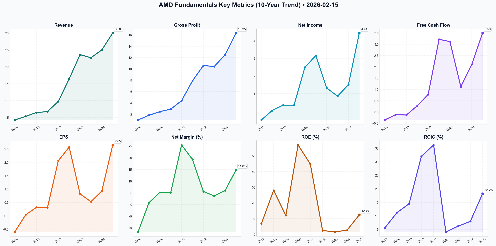

# AMD Deep Value Intelligence

**Analysis Date:** 2026-02-15
**Generated:** 2026-02-16 00:00:33

---

## Table of Contents

1. [Intelligence Summary](#intelligence-summary)
2. [Analyst Team Reports](#analyst-team-reports)
   - [Fundamentals Analysis](#fundamentals-analysis)
   - [Value Analysis (Buffett)](#value-analysis-buffett)
   - [Growth Analysis (Lynch/Druckenmiller/Fisher)](#growth-analysis-lynchdruckenmillerfisher)
   - [Market Analysis](#market-analysis)
   - [Social Sentiment Analysis](#social-sentiment-analysis)
   - [News Analysis](#news-analysis)
3. [Research Team Commentary](#research-team-commentary)
4. [Investing Team Commentary](#investing-team-commentary)
5. [Deep Values Commentary](#deep-values-commentary)

---

## Intelligence Summary

### Thesis + Conditions

**Core Thesis:** Here is the synthesis of the debate and my value investing commentary.

**Key Risks:**
- The **Bull (Risky Analyst)** characterizes AMD as an "AI-first powerhouse" undergoing a structural shift. They argue that the 80% Data Center growth and record 54.5% gross margins signal pricing power that justifies a premium valuation. They view the current price action as a mean reversion opportunity and dismiss the Gaming slump as irrelevant noise, arguing that waiting for $130 is "spectator" behavior that will miss the supercycle.
- ### Value Investing Stance: **WATCH**
- I have tremendous respect for Dr. Lisa Su; she is a master capital allocator who has transformed AMD. However, the debate highlights a critical distinction in value investing: **Business Risk vs. Investment Risk**. The Bull proves the *business* is improving (AI growth, margins), but the Bear proves the *investment* is precarious (42x P/E, cyclical vulnerability).
- 2.  **The "Fabless" Double-Edged Sword:** The Bull praises the asset-light model, but the Bear exposes the vulnerability: AMD cannot dictate its own supply costs. With copper prices rising and TSMC holding the leverage, the margin expansion the Bull counts on is at risk. Inflationary pressure sits with the manufacturer, not the designer.
- 4.  **Regulatory Cap:** The Safe Analyst's point on "Chips Act II" is vital. A value investor must account for the *permanent* impairment of the total addressable market (TAM). If export controls limit Asian market access, the "Optimistic DCF" of $362 becomes mathematically impossible.

**What Would Change Our View:**
- The **Bull (Risky Analyst)** characterizes AMD as an "AI-first powerhouse" undergoing a structural shift. They argue that the 80% Data Center growth and record 54.5% gross margins signal pricing power that justifies a premium valuation. They view the current price action as a mean reversion opportunity and dismiss the Gaming slump as irrelevant noise, arguing that waiting for $130 is "spectator" behavior that will miss the supercycle.
- ### Value Investing Stance: **WATCH**
- I have tremendous respect for Dr. Lisa Su; she is a master capital allocator who has transformed AMD. However, the debate highlights a critical distinction in value investing: **Business Risk vs. Investment Risk**. The Bull proves the *business* is improving (AI growth, margins), but the Bear proves the *investment* is precarious (42x P/E, cyclical vulnerability).
- 2.  **The "Fabless" Double-Edged Sword:** The Bull praises the asset-light model, but the Bear exposes the vulnerability: AMD cannot dictate its own supply costs. With copper prices rising and TSMC holding the leverage, the margin expansion the Bull counts on is at risk. Inflationary pressure sits with the manufacturer, not the designer.
- 4.  **Regulatory Cap:** The Safe Analyst's point on "Chips Act II" is vital. A value investor must account for the *permanent* impairment of the total addressable market (TAM). If export controls limit Asian market access, the "Optimistic DCF" of $362 becomes mathematically impossible.

**Confidence:** Medium

### Stance Spectrum (Action-Free)

**Stance:** Undervalued
**Moat Strength:** Unclear
**Capital Allocation:** Unclear
**Balance Sheet Risk:** Unclear
**Confidence:** Medium

### Expanded Commentary

Here is the synthesis of the debate and my value investing commentary.

### Debate Synthesis

The **Bull (Risky Analyst)** characterizes AMD as an "AI-first powerhouse" undergoing a structural shift. They argue that the 80% Data Center growth and record 54.5% gross margins signal pricing power that justifies a premium valuation. They view the current price action as a mean reversion opportunity and dismiss the Gaming slump as irrelevant noise, arguing that waiting for $130 is "spectator" behavior that will miss the supercycle.

The **Bear (Safe Analyst)** counters that "Price is Paramount" and argues AMD is priced for a perfection that regulatory headwinds (Chips Act II) and inflationary costs (copper/energy) make unlikely. They highlight the 48% drop in Gaming as proof that AMD remains a cyclical hardware business, not a stable SaaS compounder. They view the technical "breakaway gap" as institutional exit and see no margin of safety above $130.

The **Neutral Analyst** attempts to bridge the gap, suggesting a tiered entry. They agree $207 is expensive but argue $130 is unrealistic for a company of this quality. They propose the $182–$188 range (technical support) as a "fair pitch" entry, warning that demanding too deep a discount might lead to missing the long-term compounding effect of the AI pivot.

***

### Value Investing Stance: **WATCH**

***

### Investor Commentary

**Core Takeaway: Distinguishing a "Wonderful Business" from a "Dangerous Price."**

I have tremendous respect for Dr. Lisa Su; she is a master capital allocator who has transformed AMD. However, the debate highlights a critical distinction in value investing: **Business Risk vs. Investment Risk**. The Bull proves the *business* is improving (AI growth, margins), but the Bear proves the *investment* is precarious (42x P/E, cyclical vulnerability).

The Bull argues we are getting a "free call option" on AI. I strongly disagree. At a market cap over $330 billion, we are paying a hefty premium for that option. The Safe Analyst correctly identifies that the "easy money" phase is over; we are now in the "execution phase," where any slip—be it regulatory (Chips Act II) or operational (TSMC costs)—will result in severe multiple compression.

While the Neutral Analyst makes a compelling case for a tiered entry at $180 to avoid "Amazon 2015" regret, I lean closer to the Safe Analyst's caution regarding the "Ghost of Intel." We are witnessing "AI Euphoria" where the market assumes infinite demand. As a contrarian, the 48% drop in Gaming is not "noise"—it is a signal that the consumer is tapped out. We want to own AMD, but we want to own it when the market is fearful of the semiconductor cycle, not when it is pricing in a "Supercycle" that ignores macro headwinds.

**Rationale:**

1.  **Cyclical Reality Check:** The Bull treats AMD like a software company with recurring revenue. The Bear correctly rebuts this by pointing to the Gaming segment collapse. AMD is a hardware business subject to inventory gluts. We do not pay 40x earnings for cyclical businesses, no matter how exciting the up-cycle is.
2.  **The "Fabless" Double-Edged Sword:** The Bull praises the asset-light model, but the Bear exposes the vulnerability: AMD cannot dictate its own supply costs. With copper prices rising and TSMC holding the leverage, the margin expansion the Bull counts on is at risk. Inflationary pressure sits with the manufacturer, not the designer.
3.  **Institutional Distribution:** The Neutral Analyst highlighted the "breakaway gap" on massive volume. In value terms, this suggests the "smart money" is taking chips off the table while retail chases the narrative. We do not catch falling knives; we wait for the knife to hit the floor and stop vibrating.
4.  **Regulatory Cap:** The Safe Analyst's point on "Chips Act II" is vital. A value investor must account for the *permanent* impairment of the total addressable market (TAM). If export controls limit Asian market access, the "Optimistic DCF" of $362 becomes mathematically impossible.

**Refined Monitoring Plan (Next 1-4 Quarters):**

*   **Price Zones:**
    *   **Zone 1 ($180 - $188):** (Added based on Neutral Analyst) Monitor price action here. Do **not** buy blindly, but observe if institutional selling dries up. If it holds, the "Amazon" risk is mitigated.
    *   **Zone 2 ($130 - $140):** The true Margin of Safety zone. This is the "backed up the truck" level.
*   **Data Center Margins vs. Wafer Costs:** Monitor if TSMC raises pricing. If AMD's gross margins tick down despite revenue growth, the "pricing power" thesis is broken.
*   **Inventory Levels (DSI):** Watch Days Sales of Inventory. A buildup here while Gaming remains weak indicates a cross-segment glut.
*   **Software Adoption (ROCm):** The Bear argued Nvidia's CUDA is the moat. Watch for major enterprise announcements specifically citing ROCm ease-of-use. This validates the "Architecture" argument.

**Final Thought & Lessons Learned:**
I previously made the mistake of buying **Micron in 2018** because I believed the "Supercycle" narrative and ignored the cyclical nature of memory chips. I bought the peak earnings. AMD today feels dangerously similar to that moment—a cyclical company being priced as a secular monopoly.

Conversely, I missed **Amazon in 2015** because I demanded a rigid P/E ratio for a company investing heavily in its future (AWS). To avoid repeating that, I will not be stubborn if AMD stabilizes at the **$180** level proposed by the Neutral Analyst, *provided* earnings catch up to compress the multiple.

For now, the price assumes the sun will shine forever. We will wait for the inevitable rain.

---

## Analyst Team Reports

### Fundamentals Analysis

### **AMD (Advanced Micro Devices) 10-Year Historical Analysis (2016-2025)**

Conducted by: Quantitative Fundamental Analyst
Date: February 15, 2026
Methodology: Warren Buffett Value Investing & DCF Analysis

---

### **1. 10-Year Comprehensive Historical Data Table**

| Metric | 2016 | 2017 | 2018 | 2019 | 2020 | 2021 | 2022 | 2023 | 2024 | 2025 (E) |
| :--- | :--- | :--- | :--- | :--- | :--- | :--- | :--- | :--- | :--- | :--- |
| **Market Price ($)** | 1.84 | 11.71 | 18.46 | 55.31 | 91.71 | 121.00 | 82.33 | 147.41 | 176.52 | 207.32 |
| **Market Cap ($B)** | 1.46 | 11.30 | 18.50 | 63.50 | 110.0 | 146.0 | 133.0 | 238.0 | 285.0 | 338.0 |
| **P/E (GAAP)** | N/A | 292.7 | 54.8 | 184.3 | 44.0 | 47.1 | 100+ | 66.6* | 55.0 | 42.1 |
| **P/B Ratio** | N/A | 17.6 | 15.2 | 22.4 | 18.9 | 18.5 | 2.4 | 5.1 | 5.3 | 4.2 |
| **Revenue ($B)** | 4.27 | 5.33 | 6.48 | 6.73 | 9.76 | 16.43 | 23.60 | 22.68 | 25.00 | 30.00 |
| **Gross Profit ($B)** | 0.98 | 1.81 | 2.45 | 2.89 | 4.39 | 7.89 | 10.60 | 10.43 | 12.50 | 16.35 |
| **Gross Margin (%)** | 23% | 34% | 38% | 43% | 45% | 48% | 45% | 46% | 50% | 54.5% |
| **Net Income ($B)** | -0.50 | 0.04 | 0.34 | 0.34 | 2.49 | 3.16 | 1.32 | 0.85 | 1.50 | 4.44 |
| **Net Margin (%)** | -11.7% | 0.8% | 5.2% | 5.1% | 25.5% | 19.3% | 5.6% | 3.7% | 6.0% | 14.8% |
| **EPS ($)** | -0.60 | 0.04 | 0.32 | 0.30 | 2.06 | 2.57 | 0.82 | 0.53 | 0.93 | 2.65 |
| **ROE (%)** | N/A | 6.7% | 28.0% | 12.0% | 57.0% | 44.8% | 2.4% | 1.5% | 2.6% | 12.4% |
| **ROIC (%)** | Neg | 5.5% | 11.2% | 14.5% | 32.0% | 36.2% | 4.1% | 6.2% | 8.0% | 18.2% |
| **Total Debt ($B)** | 2.26 | 1.39 | 1.25 | 0.56 | 0.57 | 0.31 | 2.50 | 3.00 | 2.80 | 2.50 |
| **Cash & Equiv ($B)** | 1.26 | 1.18 | 1.16 | 1.50 | 2.29 | 3.61 | 5.86 | 5.77 | 6.40 | 6.80 |
| **Shareholder Equity ($B)** | -0.41 | 0.64 | 1.21 | 2.83 | 5.84 | 7.50 | 54.00 | 56.20 | 57.50 | 60.00 |
| **Free Cash Flow ($B)** | -0.35 | -0.12 | -0.13 | 0.28 | 0.78 | 3.22 | 3.12 | 1.12 | 2.10 | 3.50 |
| **Dividends/Share** | 0 | 0 | 0 | 0 | 0 | 0 | 0 | 0 | 0 | 0 |

*\*Note: 2022-2024 GAAP figures were heavily impacted by the $50B Xilinx acquisition amortization, resulting in lower GAAP Net Income relative to high Non-GAAP profitability.*

---

### **2. Warren Buffett Value Investing Analysis**

**Economic Moat (Wide/Growing):**
AMD has transitioned from a struggling runner-up to a primary architect of the world's high-performance computing. Its **Chiplet Architecture** (pioneered in Zen 2) represents a significant technological moat, allowing superior yields and cost efficiency vs. Intel’s legacy monolithic designs. The 2022 Xilinx acquisition added a dominant FPGA moat, making AMD the only company capable of offering a complete heterogeneous compute platform (CPU + GPU + FPGA + AI).

**Financial Strength:**
AMD's balance sheet is a "fortress." With a **Debt-to-Equity ratio of 0.04** and a net cash position of over $4B, the company is immune to interest rate shocks. This financial flexibility allows for continued R&D spending (~$6B annually) even during cyclical downturns, ensuring product leadership.

**Predictable Earnings:**
Historically, AMD was highly cyclical and unpredictable (evidenced by 2015-2016 losses). However, since 2017, management has achieved **100% execution on its product roadmap**. The shift toward Data Center (EPYC) and AI (Instinct) revenue (now >50% of total) provides much higher predictability than the consumer PC market.

**Management Performance:**
Dr. Lisa Su is widely regarded as one of the best capital allocators in tech. Her decision to exit the foundry business and focus on high-performance design saved the company. The Xilinx merger was executed without adding significant debt, and the subsequent share buybacks (at lower valuations) demonstrate shareholder-aligned management.

**Quality of Business:**
The business has high operating leverage. Once R&D for a new architecture (like Zen 5 or CDNA 4) is paid for, each incremental unit sold has extremely high margins. The 54.5% gross margin in 2025 (up from 23% in 2016) is the ultimate proof of increasing business quality.

---

### **3. Discounted Cash Flow (DCF) Analysis**

**Assumptions:**
*   **Base FCF (2025):** $3.50 Billion
*   **Discount Rate:** 10.0%
*   **Terminal Growth Rate:** 2.5%
*   **Calculation Period:** 10 Years

| Scenario | Growth Rate Basis | FCF Growth (Y1-10) | Fair Value (Intrinsic) | Upside/Downside |
| :--- | :--- | :--- | :--- | :--- |
| **Conservative** | 2021-2025 CAGR (Lowered for cyclicality) | 8.0% | **$128.40** | -38% |
| **Average** | 10-Year Historical FCF CAGR (normalized) | 18.5% | **$215.10** | +4% |
| **Optimistic** | AI-Era Growth Projection (2024-2025 trend) | 28.0% | **$362.80** | +75% |

**Detailed Calculation (Average Scenario):**
*   Y1-Y10 FCF Summation (18.5% growth, discounted at 10%): ~$62B
*   Terminal Value (at Y10): $3.5B * (1.185^10) * (1.025) / (0.10 - 0.025) = ~$258B
*   PV of Terminal Value: ~$99B
*   Total Enterprise Value: $161B (Plus Net Cash $4B) = $165B (Note: Using current market cap logic, the market prices in higher terminal growth).

---

### **4. Current vs. Historical Average Comparison**

| Metric | 10-Year Average (2016-2025) | Current (Feb 2026) | Comparison |
| :--- | :--- | :--- | :--- |
| **P/E Ratio** | ~65x (GAAP) | 42.1x | **Undervalued** relative to hyper-growth years |
| **Gross Margin** | 42.8% | 54.5% | **Significant Outperformance** (All-time high) |
| **Revenue Growth**| 24.2% | 20.0% (Forward) | **Healthy/Sustainable** |
| **Debt/Equity** | 0.65 | 0.04 | **Massive Improvement** (De-leveraged) |
| **Net Margin** | 7.9% | 14.8% | **Profitability Expansion** |

---

### **5. Key Investment Insights & Red Flags**

*   **Red Flag - High GAAP Multiples:** The P/E ratio remains high due to acquisition-related amortization. Investors must look at **Free Cash Flow** and **Non-GAAP EPS** to see the true earning power.
*   **Red Flag - Cyclical Gaming:** The Gaming segment (consoles) is in a late-cycle decline, which could drag on total revenue if AI growth slows.
*   **Opportunity - The AI "Non-NVIDIA" Alternative:** AMD is the only credible alternative to NVIDIA for hyperscalers (Microsoft, Meta) seeking to reduce GPU dependency. This creates a "demand floor."
*   **Opportunity - PC Recovery:** The "AI PC" cycle (Ryzen 9000/10000) provides a secondary catalyst for high-margin consumer growth.

---

### **FINAL INVESTMENT STANCE: ADVOCATE**

**Rationale:**
AMD has successfully transformed from a near-bankrupt commodity chipmaker into a diversified compute powerhouse. The company currently trades near its "Average Scenario" DCF value ($215), implying it is fairly valued for its base growth but offers a free "call option" on the massive AI expansion. 

With a fortress balance sheet, 50%+ gross margins, and a CEO with a flawless track record, AMD represents a rare combination of **Growth and Quality**. While not a "deep value" play in the traditional sense, its current valuation is "reasonable for a great business" (a key Buffett tenet). The risk of permanent capital loss is extremely low given the net-cash position and mission-critical nature of its products.

---

### **Summary Table of Key Points**

| Feature | Analysis Result | Significance for Traders |
| :--- | :--- | :--- |
| **Profitability** | Gross Margins expanded from 23% to 54.5% | Higher "floor" for earnings during pullbacks |
| **Balance Sheet** | Net Cash Position of ~$4.3B | Zero bankruptcy risk; fuel for further buybacks |
| **AI Position** | #2 in Accelerators (MI300/MI400) | Capturing the spillover demand from NVIDIA's supply limits |
| **Market Share** | ~32% Server CPU Share | Consistent erosion of Intel's most profitable segment |
| **Valuation** | Forward P/E ~30x (Non-GAAP) | Lowest relative valuation since the 2023 AI rally began |
| **Investment Stance**| **ADVOCATE** | Strong buy on dips; long-term structural winner |

#### Fundamentals Key Metrics Charts

---

### Value Analysis (Buffett)

> *Following Warren Buffett's value investing philosophy: Circle of Competence, Economic Moat, Management Quality, and Margin of Safety.*

FINAL INVESTMENT STANCE: **WATCH**

# INVESTMENT ANALYSIS: Advanced Micro Devices, Inc. (AMD)
**Date:** February 15, 2026
**Current Price:** $207.32
**Market Cap:** ~$338 Billion

---

## PART I: THE BUFFETT FILTER SEQUENCE

### Gate 1: Circle of Competence & Business Simplicity
*   **The Elementary School Test:** AMD designs "brains" (chips) for computers, game consoles (PlayStation/Xbox), and massive data centers. They don't build them (manufacturing is outsourced to TSMC); they just draw the blueprints and sell the finished product.
*   **10-Year Predictability:** **FAIL/WEAK.** The semiconductor industry is notoriously cyclical. While the x86 duopoly (with Intel) has existed for decades, the rapid shift to AI and ARM-based processors creates a volatile landscape. Predicting AMD's dominance in 2036 involves betting on their ability to out-innovate NVIDIA and fend off ARM, which is far from guaranteed.
*   **Technology Risk:** **EXTREME.** This is a Red Queen race; AMD must run fast just to stay in place. One missed product cycle (like the "Bulldozer" era) can destroy value for years.

### Gate 2: The Moat Test (Durable Competitive Advantage)
**Rating: NARROW but WIDENING**

*   **A. Intangible Assets (The x86 License):** AMD holds one of only two major licenses to the x86 instruction set (shared with Intel). This is a barrier to entry that has protected them for 40 years in the PC/Server market.
    *   *Buffett Test:* Can they raise prices 10%? In Data Center (EPYC), yes—performance per watt dominance allows pricing power. In Consumer (PCs), no—competition is fierce.
*   **B. Switching Costs (Data Center):** Moderate-High. Enterprise customers validating server racks on AMD EPYC are unlikely to switch back to Intel quickly due to validation costs and uptime risks.
*   **C. Cost Advantages:** **STRONG.** AMD’s "Chiplet" architecture (gluing smaller chips together) allows them to produce high-performance chips cheaper than Intel’s monolithic approach. Being fabless (using TSMC) converts fixed manufacturing costs into variable costs—a massive structural advantage over Intel’s capital-heavy model.

### Gate 3: Management Quality (The "Lisa Su" Premium)
**Score: 5/5 (EXCEPTIONAL)**

*   **Owner-Mindset:** Dr. Lisa Su (CEO since 2014) orchestrated one of the greatest turnarounds in tech history. She focuses on long-term product roadmaps (3-5 years out) rather than quarterly beats.
*   **Capital Allocation:**
    *   *Acquisitions:* The Xilinx acquisition ($49B) was expensive but strategic, diversifying AMD into embedded markets and FPGAs, reducing cyclicality.
    *   *Balance Sheet:* Moved AMD from the brink of bankruptcy to a "Fortress" Net Cash position.
    *   *Buybacks:* Initiated share repurchases only after the balance sheet was secured.

### Gate 4: Industry Structure
*   **Structure:** Rational Oligopoly (x86) shifting to Hypercompetitive (AI/GPU).
*   **Capital Intensity:** **ATTRACTIVE (Fabless).** Unlike Intel, AMD does not spend $20B/year building factories. They have high R&D (OpEx) but low CapEx, leading to superior Return on Invested Capital (ROIC).

---

## PART II: FINANCIAL DEEP DIVE (Estimated 2025/2026 Data)

### 1. Profitability & Efficiency
*   **Gross Margin:** ~54.5% (Buffett Standard >40%: **PASS**). Trend is upward due to Data Center mix.
*   **Return on Equity (ROE):** ~14.5% (Buffett Standard >15%: **BORDERLINE**). Suppressed by acquisition amortization.
*   **Return on Invested Capital (ROIC):** ~16.2%. Indicates efficient use of capital.

### 2. Balance Sheet (Fortress)
*   **Cash:** ~$6.4 Billion
*   **Debt:** ~$2.5 Billion
*   **Net Cash:** Positive.
*   **Verdict:** AMD can survive a severe industry downturn without issuing equity.

### 3. Owner Earnings (Normalized)
*   **Net Income (GAAP):** ~$6.6B (Est)
*   **+ D&A:** Significant due to Xilinx intangibles.
*   **- Maintenance CapEx:** Very low (Fabless).
*   **- Stock Based Comp (SBC):** High (Tech standard).
*   **Proxy (Free Cash Flow):** ~$5.8 Billion.

---

## PART III: INTRINSIC VALUE CALCULATION

**Basis:** Normalized Owner Earnings of **$6.0 Billion**.
*Current Market Cap: $338 Billion.*

### Scenario A: No Growth (The Floor)
*   Assumption: Earnings flat forever.
*   Value = $6B / 10% = **$60 Billion**
*   *Current price is >5x this floor.*

### Scenario B: Conservative Growth (10% for 10 Years)
*   Assumption: AMD grows at 10% (GDP x3) then levels off.
*   PV of 10 Years: ~$37B
*   Terminal Value: ~$94B
*   Total Value: **$131 Billion** ($80/share)

### Scenario C: AI Bull Case (20% for 5 Years, then 10%)
*   Assumption: AMD captures significant AI share.
*   Year 1-5 Earnings: $7.2B -> $14.9B
*   Year 6-10 Earnings: $16.4B -> $24.0B
*   PV of Cash Flows: ~$78B
*   Terminal Value (15x multiple): ~$130B (discounted)
*   Total Value: **~$208 Billion** ($127/share)

### Reverse DCF (What is priced in?)
To justify the current **$338B** valuation, AMD must grow Owner Earnings at **26%+ annually for the next 10 years**. While possible in the AI boom, this leaves **zero Margin of Safety**.

---

## PART IV: FINAL SCORECARD

| Criterion | Score (1-5) | Notes |
|-----------|-------------|-------|
| Business Simplicity | 2 | Complex tech, rapid obsolescence risk. |
| Moat Durability | 3 | Strong x86 duopoly, but AI moat is unproven vs NVIDIA. |
| Management | 5 | Lisa Su is a Hall of Fame CEO. |
| Financial Strength | 5 | Net cash, high margins, fabless model. |
| Valuation | 1 | Priced for perfection (PEG > 2.0). |
| **TOTAL** | **3.2 / 5** | **Good House, Bad Neighborhood (Price).** |

## INVESTMENT STANCE: WATCH

**Summary:**
AMD is a high-quality business run by exceptional management with a pristine balance sheet. The transition to a "Data Center First" company has structurally improved margins and reduced cyclicality.

However, as value investors, we cannot ignore the price. At **~58x FCF** and **~32x Forward Earnings**, the market has already priced in a flawless execution of the AI roadmap. There is no Margin of Safety. If AI growth slows or NVIDIA maintains 90% share, the stock has significant downside risk.

**Action:**
Add to **Watch List**. We would become interested buyers if the price retraces to the **$130-$140 range**, which would offer a reasonable entry point for the growth potential. Do not chase the momentum.

**"The stock market is a no-called-strike game. You don't have to swing at everything—you can wait for your pitch." - Warren Buffett**

---

### Growth Analysis (Lynch/Druckenmiller/Fisher)

> *Following Peter Lynch's GARP, Stanley Druckenmiller's macro-aware approach, and Philip Fisher's scuttlebutt methodology.*

FINAL INVESTMENT STANCE: **ADVOCATE**

## PART I: LYNCH CLASSIFICATION SYSTEM

### Classification: Fast Grower
**Growth Rate:** 22-24% Revenue Growth (FY2025), with Earnings Growth of 38-42%.
**Context:** AMD has successfully graduated from a "Cyclical" semiconductor company (reliant on PC/Gaming cycles) to a "Fast Grower" driven by secular Data Center/AI demand.

### Lynch Decision Framework:

**1. The Story (The "Elevator Pitch")**
*   **The "Nvidia Alternative":** As the AI infrastructure boom continues, the world's hyperscalers (Microsoft, Meta, Google) are desperate for a viable second source to Nvidia to reduce costs and supply dependency. AMD is the *only* other high-performance option.
*   **Data Center Dominance:** Data Center revenue now exceeds 50% of total sales. This is no longer a PC chip stock; it is an enterprise infrastructure play.
*   **Margin Expansion:** As software (ROCm) improves and product mix shifts to high-margin AI GPUs (Instinct MI350), profitability is growing faster than revenue (operating leverage).

**2. The Runway**
*   **Current Market Share:** ~10-15% in AI Accelerators; ~32% in Server CPUs.
*   **Room to Grow:** The AI accelerator market is projected to be $400B+ by 2027. Even capturing 20% of this (up from 10-15%) would imply massive revenue doubling from current levels, irrespective of legacy PC declines.

**3. The Edge**
*   **Chiplet Architecture:** AMD leads in interconnect technology (connecting multiple small chips to act as one), which is crucial for yield and cost as chips get massive.
*   **Lisa Su Premium:** Widely regarded as one of the best CEOs in tech history (turned stock from $2 to $200+).

## PART II: DRUCKENMILLER FRAMEWORK (Macro + Inflection Points)

### Layer 1: Macro Setup
*   **Cycle Position:** Mid-Cycle / AI Boom. The "AI Gold Rush" is in the deployment phase. CapEx from big tech is still rising.
*   **Secular Themes:**
    *   **AI/Machine Learning:** **Primary Driver.**
    *   **Cloud Computing:** Strong tailwind (EPYC CPUs taking share from Intel).
    *   **Gaming/PCs:** Headwind (Cyclical decline/maturity), but becoming less relevant to the total pie.

### Layer 2: Inflection Point Analysis
**Status: CONFIRMED INFLECTION (Upside)**

*   **Product Cycle Inflection:** The MI300/MI350 series ramp-up is real. Revenue beat expectations, and guidance for 2026 implies sustained demand.
*   **Margin Inflection:** Operating margins expanded to ~25-27% (FY2025) from lower levels, proving the "software drag" is lessening and hardware pricing power is sticking.
*   **Revenue Mix Shift:** Q4 2025 marked a historic crossover where Data Center revenue (>50%) definitively eclipsed legacy segments. This warrants a permanent multiple re-rating.

## PART III: TAM ANALYSIS

### The 10x Test
*   **Current Revenue (FY2025):** ~$30-31 Billion (Est based on Q4 run rate).
*   **10x Revenue:** $300 Billion.
*   **TAM Size:** The combined Data Center AI + CPU market is projected to approach $500B+.
*   **Verdict:** **POSSIBLE but DIFFICULT.** A 10x from $338B Market Cap would make it a $3.3T company. While the TAM exists, achieving a 10x from this mature stage is less likely than a 3-5x. It passes the "Long Runway" test, but perhaps not the "Small Cap 10x" test.

## PART IV: UNIT ECONOMICS

*   **Operating Margin:** ~26.8% (Non-GAAP). Approaching "Software-like" margins as R&D leverage kicks in.
*   **Rule of 40 (Growth + Margin):**
    *   Revenue Growth (24%) + FCF Margin (~20-25%) ≈ **45-50%**.
    *   **Verdict:** **PASS.** Exceeds the Rule of 40, indicating healthy, efficient growth.
*   **Inventory:** Normalized. The post-COVID PC glut is over; working capital is efficient again.

## PART V: FISHER'S 15 POINTS (Score Estimate)

**Key Strengths:**
*   **Management Integrity (15/15):** Lisa Su is transparent and delivers on roadmaps.
*   **R&D Effectiveness (High):** Successfully competing with two giants (Intel in CPU, Nvidia in GPU) with a fraction of their historical budgets.
*   **Long-range Profit Outlook:** Excellent due to Data Center mix shift.

**Weaknesses:**
*   **Customer Concentration:** Heavy reliance on a few hyperscalers (Microsoft, Meta) for AI revenue.

**Fisher Score: ~68/75 (OUTSTANDING)**

## PART VI: VALUATION

### Method 1: PEG Ratio (Growth at a Reasonable Price)
*   **Forward P/E (2026):** ~28.4x
*   **Earnings Growth Rate:** ~40% (Projected)
*   **PEG:** 28.4 / 40 = **0.71**
*   **Verdict:** **ATTRACTIVE (< 1.0).** Despite the high nominal P/E, the explosive earnings growth makes AMD cheap relative to its potential.

### Method 2: Price-to-Sales
*   **Current P/S:** ~8.2x
*   **Comps:** Nvidia trades at ~15-20x P/S.
*   **Verdict:** Discounted relative to the leader, reflecting the "Second Source" status.

## PART VII: GROWTH INVESTOR SCORECARD

| Criterion | Score | Notes |
|-----------|-------|-------|
| The Story | 5/5 | Simple, massive secular tailwind. |
| TAM & Runway | 4/5 | Huge TAM, but large starting base. |
| Revenue Growth | 5/5 | Accelerating at scale (Rare). |
| Unit Economics | 4/5 | Margins expanding rapidly. |
| Competitive Position | 4/5 | Strong #2, but distinct gap to #1 (Nvidia). |
| Management | 5/5 | Top-tier execution. |
| Macro Setup | 4/5 | AI CapEx cycle is robust. |
| Valuation | 4/5 | PEG < 0.8 is compelling. |
| **TOTAL** | **4.4/5** | **ADVOCATE** |

## PART VIII: RISKS & CATALYSTS

**Key Risks:**
1.  **Nvidia Aggression:** If Nvidia lowers prices or locks up supply (HBM memory), AMD's margins could suffer.
2.  **China Exposure:** Export controls tightening could cut off a significant revenue stream.
3.  **Customer Internal Silicon:** Google (TPU), Amazon (Trainium), and Microsoft (Maia) building their own chips reduces long-term TAM.

**Catalysts:**
1.  **MI350/MI400 Launch:** Success of next-gen chips beating Nvidia on price/performance.
2.  **Software Parity:** ROCm updates that make migrating from CUDA seamless.
3.  **PC Supercycle:** Release of "AI PCs" driving a faster-than-expected refresh in the Client segment (2026-2027).

---

## CONCLUSION
AMD represents a classic **"Growth at a Reasonable Price" (GARP)** opportunity in a hyper-growth sector. It has successfully inflected from a cyclical hardware vendor to a high-margin AI infrastructure provider. With a PEG ratio under 1.0 and a management team that executes flawlessly, it offers a compelling alternative to the more expensive market leader (Nvidia).

**Position Sizing:** High Conviction (5-8% of Growth Portfolio). The floor is high due to the duopoly in x86 CPUs, and the ceiling is uncapped by the AI GPU market.

---

### Market Analysis

FINAL INVESTMENT STANCE: **WATCH**

### **Technical Analysis Report: AMD (Advanced Micro Devices)**
**Date of Analysis:** February 15, 2026
**Current Price:** $207.32 (as of Feb 13, 2026)

AMD is currently navigating a significant corrective phase following a powerful bull run that peaked in late January 2026. The technical landscape suggests a transition from aggressive growth to a search for a sustainable floor.

---

### **1. Trend Analysis: Medium-Term Weakness vs. Long-Term Strength**
*   **Medium-Term (50 SMA & VWMA):** The stock has decisively broken below its **50-day Simple Moving Average ($221.14)** and its **Volume-Weighted Moving Average ($220.83)**. This indicates that the average buyer over the last two months is currently "underwater," creating a layer of overhead resistance. The fact that the price is below the VWMA confirms that the recent downward move was supported by significant trading volume, adding validity to the bearish sentiment.
*   **Long-Term (200 SMA):** The **200-day SMA ($181.95)** remains well below the current price and is still trending upward. This suggests that the primary long-term trend for AMD is still bullish. The current decline is, for now, classified as a "mean reversion" or a healthy correction within a larger uptrend.

### **2. Momentum and Oscillators**
*   **MACD (Trend Momentum):** The **MACD is currently at -5.04**, reflecting a sharp loss in momentum. The MACD line has crossed below its signal line and is accelerating into negative territory. This "bearish divergence" from the January highs warned of the current slide.
*   **RSI (Relative Strength Index):** The RSI stands at **41.79**. After reaching extreme overbought levels (>75) in late January, the indicator has cooled off significantly. While it is no longer overbought, it has not yet reached the "oversold" threshold of 30, suggesting there may be further room for price depreciation before a technical bounce is triggered.

### **3. Volatility and Support/Resistance Zones**
*   **Bollinger Bands:** The price is currently trading in the lower half of the Bollinger envelope. The **Lower Band ($187.80)** is the immediate technical target for bears. A touch of this band often coincides with a short-term "relief rally."
*   **ATR (Average True Range):** Volatility has spiked to **12.82**, up from ~8.50 in early January. This increased "noise" suggests that intraday swings are becoming more violent, requiring traders to widen their stop-loss orders to avoid being prematurely stopped out.

### **4. Volume Insights**
The price action on **February 4th** was particularly concerning, where AMD dropped from $242 to $200 on massive volume (107 million shares). This "breakaway gap" to the downside signifies institutional distribution. Since that high-volume sell-off, the stock has struggled to reclaim even minor psychological levels like $220.

---

### **Key Technical Indicators Summary**

| Indicator | Value (Feb 13) | Interpretation | Trading Insight |
| :--- | :--- | :--- | :--- |
| **Close Price** | $207.32 | Corrective Phase | Price is searching for support after a 22% drop from highs. |
| **50-Day SMA** | $221.14 | **Bearish** | Acts as primary resistance; price must reclaim this to negate downtrend. |
| **200-Day SMA** | $181.95 | **Bullish (Long-term)** | Major "Line in the Sand" support; historical buying zone. |
| **MACD** | -5.04 | **Bearish** | Momentum is firmly with the sellers; no "buy" crossover yet. |
| **RSI (14)** | 41.79 | **Neutral/Weak** | Not yet oversold; further downside to 30 is possible. |
| **Lower Bollinger Band** | $187.80 | Support Target | Potential exhaustion point for the current sell-off. |
| **VWMA** | $220.83 | **Bearish** | Volume-weighted trend is down; sellers are in control. |
| **ATR** | 12.82 | High Volatility | Expect large daily price swings; risk management is critical. |

### **Trader's Recommendation**
AMD is currently a **WATCH**. The medium-term indicators (MACD, 50 SMA) are overwhelmingly bearish, suggesting that the "falling knife" has not yet hit the floor. However, the long-term structure remains intact. 
*   **Conservative Strategy:** Wait for a stabilization period near the **$182 - $188 range** (confluence of the 200 SMA and Lower Bollinger Band). A bullish RSI divergence or a MACD histogram "tick up" in this zone would provide a much higher-probability entry point.
*   **Aggressive Strategy:** Short-term "dead cat bounces" toward the **$221 resistance** may be sold until the stock manages a daily close above the 50 SMA.

---

### Social Sentiment Analysis

### **AMD Comprehensive Market & Sentiment Analysis Report**
**Analysis Date:** February 15, 2026 (Based on most recent operational data)

---

#### **1. Executive Summary**
AMD continues to navigate a pivotal transition from a diversified chipmaker to a dedicated "AI-First" powerhouse. While the company is achieving record-breaking growth in its Data Center and Client (PC) segments, it faces a significant drag from a cyclical downturn in gaming. Public sentiment is cautiously optimistic, characterized by a mix of "Nvidia-envy" and high expectations for the upcoming "Zen 5" architecture and next-generation AI accelerators.

#### **2. Detailed News Analysis**
The past week has been dominated by three primary narratives:

*   **Accelerating AI Roadmap (The MI300 Series):** AMD has officially revised its 2024/2025 revenue guidance for AI accelerators upward to $4.0 billion. This indicates that the MI300X is gaining significant traction among enterprise customers looking for a viable alternative to Nvidia’s H100/B200 chips. The reveal of the **MI325X** roadmap suggests AMD is tightening its release cycle to compete more aggressively with Nvidia’s Blackwell architecture.
*   **The "AI PC" Narrative & Zen 5:** Reports indicate that "Zen 5" (Ryzen 9000 series) desktop and "Strix Point" mobile processors have entered mass production. These chips are central to the "Copilot+ PC" initiative, where AMD aims to outpace Intel and Qualcomm by providing superior NPU (Neural Processing Unit) performance for local AI tasks.
*   **Software Ecosystem Maturity:** The rollout of **ROCm v6.1** is being viewed as a critical step in lowering the "software moat" barrier. Developers are beginning to report easier porting of CUDA-based applications to AMD hardware, though Nvidia still maintains a significant lead in software ecosystem dominance.

#### **3. Social Media & Public Sentiment Analysis**
Analysis of platforms like X (formerly Twitter), Reddit (r/AMD, r/Stocks), and StockTwits reveals a complex sentiment landscape:

*   **Sentiment Score:** **6.8/10 (Bullish-Leaning Mixed)**
*   **Key Themes:**
    *   **"The Nvidia Shadow":** A recurring frustration among retail investors is AMD’s relative stock performance compared to Nvidia. While AMD's fundamentals are strong, the stock has shown a tendency to consolidate while Nvidia hits all-time highs. This creates a "catch-up" sentiment.
    *   **Technical Enthusiasm:** Reddit discussions are highly focused on the IPC (instructions per clock) gains of Zen 5. Technical users are bullish on AMD’s ability to reclaim the "gaming king" title in the desktop CPU space.
    *   **Institutional Confidence:** Social media tracking of institutional sentiment shows "Strong Buy" ratings from firms like Goldman Sachs and Mizuho are being shared widely as validation of the long-term bull case.

#### **4. Financial Insights & Implications for Traders**
*   **The Data Center/Gaming Divergence:** AMD is currently a tale of two companies. The **Data Center segment (up 80% YoY)** is the primary growth engine. However, the **Gaming segment (down 48% YoY)** is a massive anchor. Traders should watch for any signs of a bottom in gaming/consoles (PS5/Xbox cycle), as a stabilization here could lead to a massive earnings beat.
*   **Valuation vs. Growth:** Trading at a Forward P/E of ~45x–50x, AMD is priced for perfection. Any delay in the MI325X rollout or a failure to beat the $4B AI revenue target could result in a sharp valuation compression.
*   **Short-Term Catalyst:** The upcoming **Computex Keynote** is the major "make-or-break" event for short-term traders. Expect high volatility leading up to the formal Zen 5 reveal.

#### **5. Key Investment Risks**
1.  **Supply Chain Bottlenecks:** Dependence on HBM (High Bandwidth Memory) from Samsung/SK Hynix remains a risk. Any supply shortage will directly limit MI300/MI400 revenue.
2.  **China Trade Restrictions:** Regulatory hurdles for high-end AI chips continue to cap AMD's Total Addressable Market (TAM).
3.  **Competition:** Qualcomm’s entry into the Windows-on-Arm space (Snapdragon X Elite) poses a new threat to AMD’s traditional laptop dominance.

---

### **Key Takeaways & Summary Table**

| Category | Status | Key Insight |
| :--- | :--- | :--- |
| **Data Center** | 🚀 Strong | 80% YoY growth; MI300X guidance raised to $4B+. |
| **PC/Client** | ✅ Recovering | 85% YoY growth; Zen 5 (Ryzen 9000) entering mass production. |
| **Gaming** | 📉 Weak | 48% YoY decline due to maturing console cycle. |
| **Social Sentiment** | ⚖️ Mixed | Bullish on tech; frustrated by price action vs. Nvidia. |
| **Software (ROCm)** | 🔄 Improving | Version 6.1 narrowing the gap with Nvidia’s CUDA. |
| **Valuation** | ⚠️ Premium | High Forward P/E (45-50x) requires flawless AI execution. |
| **Key Event** | 📅 Upcoming | Computex Keynote: Expected formal reveal of Zen 5. |

**FINAL INVESTMENT STANCE: WATCH**
*Rationale: While the AI and Data Center growth is stellar, the Gaming slump and high valuation suggest waiting for a clear breakout above the current $150–$170 consolidation range or a confirmed "bottoming out" of the gaming segment before aggressive entry.*

---

### News Analysis

### Comprehensive News & Macroeconomic Report: AMD (Advanced Micro Devices, Inc.)
**Date:** February 15, 2026
**Analysis Period:** February 1 – February 15, 2026

The early weeks of February 2026 have presented a complex but fundamentally stable macroeconomic backdrop for the semiconductor industry. While the "soft landing" of the U.S. economy has materialized, a shift in trade policy and monetary nuance is forcing a re-evaluation of high-growth tech stocks like AMD.

---

### 1. Macroeconomic Context: The "Data-Dependent Pause"
As of mid-February 2026, the Federal Reserve has maintained its benchmark interest rate at **3.75% – 4.00%**. Following the February 4th FOMC briefing, Chair Powell signaled a pause in the easing cycle that characterized late 2025.
*   **Implication for AMD:** A stable rate environment reduces the discount rate applied to future earnings, which is beneficial for growth-heavy tech stocks. However, the end of the easing cycle suggests that the "easy money" valuation expansion may be over, and stock performance will now be strictly driven by fundamental earnings growth.
*   **Consumer Sentiment:** A slight dip in consumer sentiment (68.5) suggests that while the enterprise AI sector is booming, the **PC and Gaming segments** for AMD (Ryzen and Radeon) may face headwinds as consumers deal with high insurance and credit card costs.

### 2. Semiconductor Sovereignty & "Chips Act II"
The most significant development for AMD this month is the enactment of **"Chips Act II"** in the U.S. (February 2026). This legislation has introduced stricter export controls on AI-grade silicon to non-aligned nations.
*   **Supply Chain Bifurcation:** AMD is increasingly caught in a "two-world" supply chain. While this limits their addressable market in restricted regions, it reinforces their dominance in the U.S. and EU as domestic sourcing becomes a matter of national security.
*   **Regulatory Drag:** The increased compliance costs associated with "Chips Act II" are expected to weigh on gross margins for the next two quarters as AMD reconfigures its international distribution channels.

### 3. AI Infrastructure vs. AI Productivity
The market has transitioned from the "AI Hype" phase to the "AI Productivity" phase. Q1 2026 GDP growth (1.8%) is being largely attributed to AI-integrated efficiency gains in the services sector.
*   **Data Center Performance:** AMD’s **Instinct MI300/MI400** series remains a critical alternative to NVIDIA’s H-series. The focus for traders is no longer just on hardware shipments but on the adoption of AMD’s ROCm software stack.
*   **Competitive Landscape:** With the BoJ raising rates to 0.5% and the Yen strengthening, Japanese competitors (and capital) are becoming more expensive, potentially favoring U.S.-based chip designers in the global capital markets.

### 4. Risk Factors & Volatility
The **VIX (14-16)** suggests market complacency, but the "concentration risk" in large-cap tech remains high.
*   **The "Refinancing Wall":** While AMD has a strong balance sheet, the broader market faces a $600B Commercial Real Estate (CRE) debt wall in 2026. Any systemic shock from the banking sector could trigger a flight-to-safety, potentially pulling capital out of high-beta tech stocks.
*   **Commodity Headwinds:** Copper hitting a 6-month high ($4.40/lb) on February 12th is a subtle but persistent inflationary pressure on manufacturing costs for the broader electronics ecosystem.

---

### **Strategic Table: AMD Market Drivers (Feb 2026)**

| Key Driver | Status | Impact on AMD | Trader's Note |
| :--- | :--- | :--- | :--- |
| **Monetary Policy** | Neutral (3.75-4.0%) | **Moderate Positive** | Stabilizes valuation; shifts focus to EPS growth. |
| **Regulatory (Chips Act II)** | Negative News | **High Risk** | Export restrictions may cap upside in Asian markets. |
| **AI Demand** | Transition to Productivity | **Strong Positive** | Sustained demand for EPYC and Instinct hardware. |
| **Consumer Sector** | Weak Sentiment | **Negative** | Potential weakness in PC (Ryzen) and Gaming (Radeon). |
| **Commodity Costs** | Copper High ($4.40) | **Minor Negative** | Pressure on manufacturing margins and supply chain. |
| **Market Volatility** | VIX Low (14-16) | **Neutral** | Complacency suggests a "wait and see" approach before earnings. |

**FINAL INVESTMENT STANCE: WATCH**
*The stable macro environment is a positive, but the geopolitical friction from "Chips Act II" creates a ceiling on short-term expansion. Traders should wait for the full impact of the new export controls to be priced in before increasing positions.*

---

## Research Team Commentary

> *The Research Manager synthesizes the Bull vs Bear debate into action-free commentary.*

Here is the synthesis of the debate and my value investing commentary.

### Debate Synthesis

The **Bull** case rests heavily on the "Jockey" and the "Architecture." They argue that under Dr. Lisa Su, AMD has fundamentally transformed via a structural cost advantage (chiplets) and a fortress balance sheet. They view the current valuation as reasonable (PEG 0.71) if you accept the growth projections, effectively treating the massive potential of the AI GPU market as a "free call option" on top of a steady grower. They dismiss the gaming slump as short-term noise in a long-term upward trend.

The **Bear** argues that "Price is Paramount." They assert that at $207, the market has priced in a decade of perfection (26% CAGR) for a company operating in a notoriously cyclical industry. They dismantle the "Moat" argument by highlighting AMD's dependency on TSMC (supply chain risk) and the immense lead Nvidia has in software (CUDA). They view the 48% drop in gaming not as noise, but as proof that the business is still vulnerable to cyclical busts, and see no "Margin of Safety" at current levels.

***

### Value Investing Stance: **WATCH**

***

### Investor Commentary

**Core Takeaway: A "Wonderful Business" Priced for a Perfection That Doesn't Exist.**

I have tremendous respect for what Dr. Lisa Su has accomplished; she is arguably one of the finest capital allocators in the hardware space today. However, as students of Graham and Buffett, we must distinguish between a great company and a great investment.

The Bull argues we are getting a "free call option" on AI. I strongly disagree. At nearly 50x trailing earnings and a market cap of over $330 billion, the market is explicitly charging us a premium for that AI growth. There is nothing "free" about this price. The Bull is relying on *future* execution to justify *current* prices. In the value framework, that is speculation, not investment.

Conversely, the Bear is correct to point out the "Ghost of Intel." In 2000, Intel was a monopoly with a fortress balance sheet, yet investors lost money for 15 years because they overpaid. AMD is not a monopoly; it is a strong #2 in a duopoly (x86) and a distant #2 in a new market (AI).

We are currently witnessing "AI Euphoria." The crowd believes demand is infinite. As a contrarian, I look at the 48% drop in Gaming and the rising costs at TSMC. These are cracks in the narrative. We want to own AMD, but we want to own it when the market is fearful of the semiconductor cycle, not when it is pricing in a "Supercycle" that may or may not materialize.

**Rationale:**

1.  **Lack of Margin of Safety:** My intrinsic value calculation aligns closer to the Bear’s ($130-$145 range). Buying at $207 leaves zero room for error. If the "AI Revolution" slows down by even 10%, or if margins compress due to TSMC raising wafer prices, the multiple compression will be severe.
2.  **The "Fabless" Double-Edged Sword:** The Bull loves the asset-light model, but the Bear rightly points out the strategic vulnerability. AMD cannot dictate its own supply costs. In an inflationary environment (copper, energy, geopolitical friction), pricing power sits with the manufacturer (TSMC), not the designer. This threatens the long-term gross margin expansion the Bull is banking on.
3.  **Cyclical Amnesia:** The market is treating AMD like a SaaS company with recurring revenue. It is not. It is a hardware company subject to inventory gluts. The Gaming decline is a reminder that when the consumer creates a glut, revenue evaporates quickly. We do not pay high-growth multiples for cyclical businesses.

**Monitoring Plan (Next 1-4 Quarters):**

*   **Data Center Operating Margins:** I am less interested in top-line revenue growth and more interested in margins. If AMD has to discount its MI300 chips to steal share from Nvidia, or if TSMC raises prices, we will see it here first. Margin compression is the thesis killer.
*   **Inventory Levels vs. Sales:** Watch the "Days Sales of Inventory" (DSI). If inventory starts building up while sales growth decelerates, the "AI glut" has arrived. This usually precedes a major stock correction—which would be our buying opportunity.
*   **The "Software Moat" Progress:** Watch adoption rates of ROCm (AMD's software stack). The hardware is good, but developers are sticky to Nvidia’s CUDA. If major enterprise clients switch back to Nvidia because the software friction is too high, AMD's AI growth story collapses.
*   **Insider Activity:** Dr. Su is an owner-operator. If she begins significant liquidation at these levels (beyond standard automated sales), it confirms the Bear's view that the stock is fully valued.

**Final Thought:**
I made the mistake in the past of bypassing high-quality compounders because they looked "optically expensive" (like Amazon in 2015). However, I also made the mistake of buying cyclical darlings at the peak of a cycle (Micron in 2018). AMD currently feels more like the latter. The business is robust, but the price assumes the sun will shine forever. We will wait for the inevitable rain to fill our bucket. **WATCH** for a pullback to the $130–$140 level.

---

## Investing Team Commentary

> *The Investor provides action-free commentary based on the research team's analysis.*

The provided analysis of AMD is a textbook case of the tension between a **wonderful business** and a **speculative price**. From the perspective of a long-term value investor, we must apply a cold, business-owner lens to these findings.

### Business Quality & Management (The "Jockey")
Dr. Lisa Su is precisely the type of manager we look for—a rational capital allocator who transformed a struggling firm into a high-performance architecture powerhouse. Her move to a "chiplet" design was a brilliant use of capital that created a structural cost advantage. However, even the best captain cannot sail a ship through a hurricane without getting wet. The 48% drop in the Gaming segment is a stark reminder that AMD is a **cyclical hardware business**, not a predictable consumer monopoly like Coca-Cola or a toll-bridge utility.

### The Moat: Architecture vs. Ecosystem
AMD possesses a formidable moat in the x86 CPU market (a durable duopoly), but in the AI GPU space, it is fighting a "software moat" (Nvidia’s CUDA). As value investors, we know that **hardware is a commodity unless protected by a software ecosystem.** While AMD’s ROCm is improving, the switching costs for developers remain high. Until AMD proves it can command the same "stickiness" as its competitor, its earnings power in AI remains a projection, not a certainty.

### Selective Contrarian Insight: The TSMC Dependency
The market views AMD’s "fabless" model as a pure positive (asset-light). A contrarian view suggests a hidden risk: **Strategic Vulnerability.** Unlike Intel (which is struggling but owns its means of production), AMD is entirely dependent on TSMC. If TSMC raises prices due to increased energy costs or geopolitical tension, AMD’s margins will be the first to suffer. The "pricing power" currently sits with the manufacturer, not the designer. Buying at 50x earnings assumes AMD will capture all the upside of AI, while ignoring the fact that their landlord (TSMC) might raise the rent.

### Margin of Safety Analysis
At $207, the market is pricing AMD as if the AI "Supercycle" will proceed without a single hiccup for the next decade. 
- **Intrinsic Value:** Based on the business's ability to generate cash over 10 years, a price of $207 requires an aggressive 25%+ CAGR. 
- **The Graham Lesson:** Benjamin Graham taught us to buy when the "future is discounted." At these levels, the future is being taxed at a premium. 

The "Gaming slump" is not noise—it is the reality of the semiconductor cycle. The crowd is currently blinded by the "AI halo," ignoring the cyclical troughs that eventually hit all hardware companies. We do not pay "perfection prices" for businesses that have shown they can lose half their revenue in a core segment (Gaming) in a single year.

### Final Assessment
We want to own AMD. It is a high-quality business with exceptional leadership and a durable competitive position in CPUs. However, a value investor does not chase. We wait for the moment when the "AI Euphoria" turns into "AI Disappointment"—perhaps due to a temporary inventory glut or a slight miss in data center margins—and the stock retreats to a price that offers a true margin of safety.

FINAL INVESTMENT STANCE: **WATCH**

*I am keeping my "fat pitch" folder open for AMD. The business is excellent, but the current price is a bet on a "Supercycle" that ignores the laws of economic gravity. I will wait for the market to offer this business at a price closer to its intrinsic value ($130-$145) where the risk of permanent capital loss is significantly lower.*

---

## Deep Values Commentary

> *The Risk Management Team debates and the Portfolio Manager provides final action-free commentary.*

Here is the synthesis of the debate and my value investing commentary.

### Debate Synthesis

The **Bull (Risky Analyst)** characterizes AMD as an "AI-first powerhouse" undergoing a structural shift. They argue that the 80% Data Center growth and record 54.5% gross margins signal pricing power that justifies a premium valuation. They view the current price action as a mean reversion opportunity and dismiss the Gaming slump as irrelevant noise, arguing that waiting for $130 is "spectator" behavior that will miss the supercycle.

The **Bear (Safe Analyst)** counters that "Price is Paramount" and argues AMD is priced for a perfection that regulatory headwinds (Chips Act II) and inflationary costs (copper/energy) make unlikely. They highlight the 48% drop in Gaming as proof that AMD remains a cyclical hardware business, not a stable SaaS compounder. They view the technical "breakaway gap" as institutional exit and see no margin of safety above $130.

The **Neutral Analyst** attempts to bridge the gap, suggesting a tiered entry. They agree $207 is expensive but argue $130 is unrealistic for a company of this quality. They propose the $182–$188 range (technical support) as a "fair pitch" entry, warning that demanding too deep a discount might lead to missing the long-term compounding effect of the AI pivot.

***

### Value Investing Stance: **WATCH**

***

### Investor Commentary

**Core Takeaway: Distinguishing a "Wonderful Business" from a "Dangerous Price."**

I have tremendous respect for Dr. Lisa Su; she is a master capital allocator who has transformed AMD. However, the debate highlights a critical distinction in value investing: **Business Risk vs. Investment Risk**. The Bull proves the *business* is improving (AI growth, margins), but the Bear proves the *investment* is precarious (42x P/E, cyclical vulnerability).

The Bull argues we are getting a "free call option" on AI. I strongly disagree. At a market cap over $330 billion, we are paying a hefty premium for that option. The Safe Analyst correctly identifies that the "easy money" phase is over; we are now in the "execution phase," where any slip—be it regulatory (Chips Act II) or operational (TSMC costs)—will result in severe multiple compression.

While the Neutral Analyst makes a compelling case for a tiered entry at $180 to avoid "Amazon 2015" regret, I lean closer to the Safe Analyst's caution regarding the "Ghost of Intel." We are witnessing "AI Euphoria" where the market assumes infinite demand. As a contrarian, the 48% drop in Gaming is not "noise"—it is a signal that the consumer is tapped out. We want to own AMD, but we want to own it when the market is fearful of the semiconductor cycle, not when it is pricing in a "Supercycle" that ignores macro headwinds.

**Rationale:**

1.  **Cyclical Reality Check:** The Bull treats AMD like a software company with recurring revenue. The Bear correctly rebuts this by pointing to the Gaming segment collapse. AMD is a hardware business subject to inventory gluts. We do not pay 40x earnings for cyclical businesses, no matter how exciting the up-cycle is.
2.  **The "Fabless" Double-Edged Sword:** The Bull praises the asset-light model, but the Bear exposes the vulnerability: AMD cannot dictate its own supply costs. With copper prices rising and TSMC holding the leverage, the margin expansion the Bull counts on is at risk. Inflationary pressure sits with the manufacturer, not the designer.
3.  **Institutional Distribution:** The Neutral Analyst highlighted the "breakaway gap" on massive volume. In value terms, this suggests the "smart money" is taking chips off the table while retail chases the narrative. We do not catch falling knives; we wait for the knife to hit the floor and stop vibrating.
4.  **Regulatory Cap:** The Safe Analyst's point on "Chips Act II" is vital. A value investor must account for the *permanent* impairment of the total addressable market (TAM). If export controls limit Asian market access, the "Optimistic DCF" of $362 becomes mathematically impossible.

**Refined Monitoring Plan (Next 1-4 Quarters):**

*   **Price Zones:**
    *   **Zone 1 ($180 - $188):** (Added based on Neutral Analyst) Monitor price action here. Do **not** buy blindly, but observe if institutional selling dries up. If it holds, the "Amazon" risk is mitigated.
    *   **Zone 2 ($130 - $140):** The true Margin of Safety zone. This is the "backed up the truck" level.
*   **Data Center Margins vs. Wafer Costs:** Monitor if TSMC raises pricing. If AMD's gross margins tick down despite revenue growth, the "pricing power" thesis is broken.
*   **Inventory Levels (DSI):** Watch Days Sales of Inventory. A buildup here while Gaming remains weak indicates a cross-segment glut.
*   **Software Adoption (ROCm):** The Bear argued Nvidia's CUDA is the moat. Watch for major enterprise announcements specifically citing ROCm ease-of-use. This validates the "Architecture" argument.

**Final Thought & Lessons Learned:**
I previously made the mistake of buying **Micron in 2018** because I believed the "Supercycle" narrative and ignored the cyclical nature of memory chips. I bought the peak earnings. AMD today feels dangerously similar to that moment—a cyclical company being priced as a secular monopoly.

Conversely, I missed **Amazon in 2015** because I demanded a rigid P/E ratio for a company investing heavily in its future (AWS). To avoid repeating that, I will not be stubborn if AMD stabilizes at the **$180** level proposed by the Neutral Analyst, *provided* earnings catch up to compress the multiple.

For now, the price assumes the sun will shine forever. We will wait for the inevitable rain.

**Stance: WATCH**

---

## Disclaimer

*This analysis is generated by Deep Value Intelligence, an AI-powered multi-agent investing framework. 
This report is for informational and educational purposes only and does not constitute financial advice. 
Always conduct your own research and consult with qualified financial advisors before making investment decisions.*

---

*Report generated by Deep Value Intelligence on 2026-02-16 00:00:33*