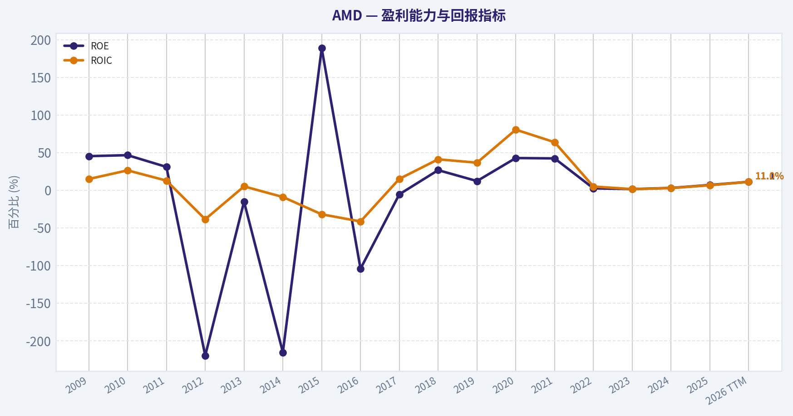
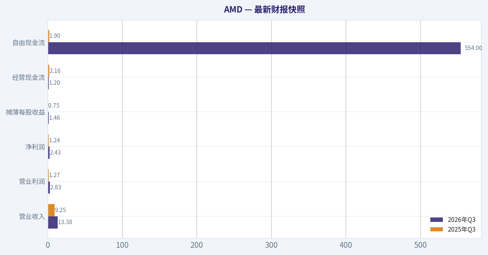
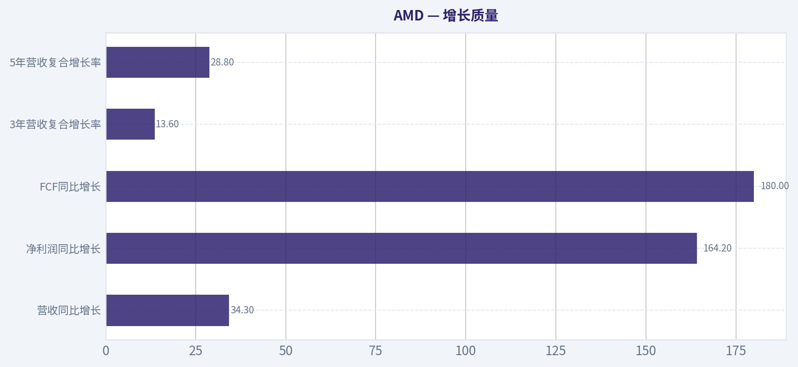
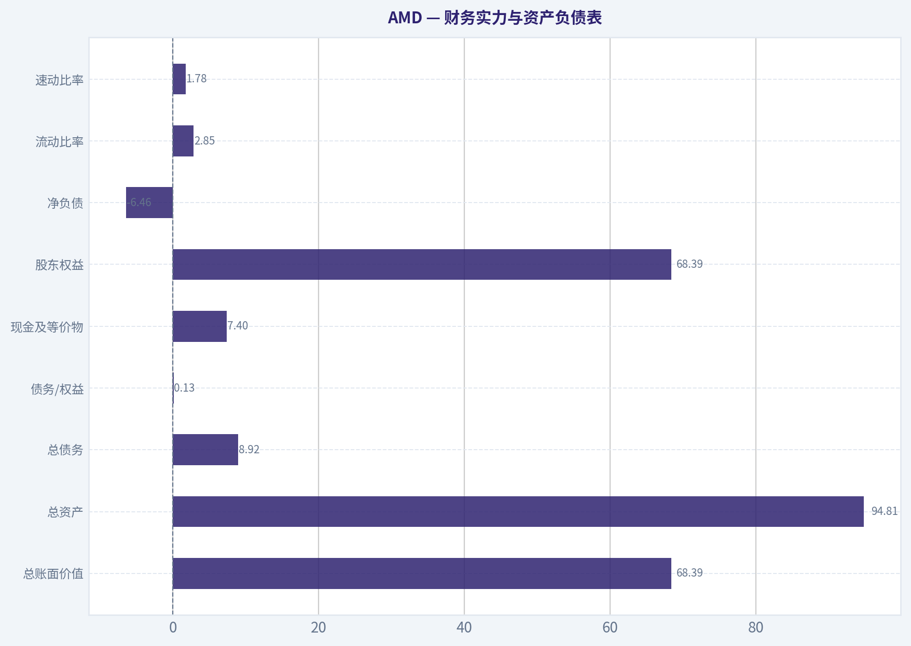
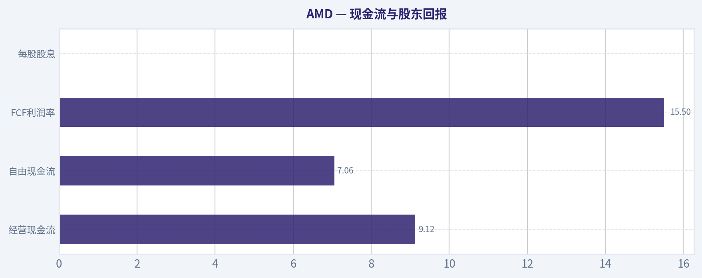
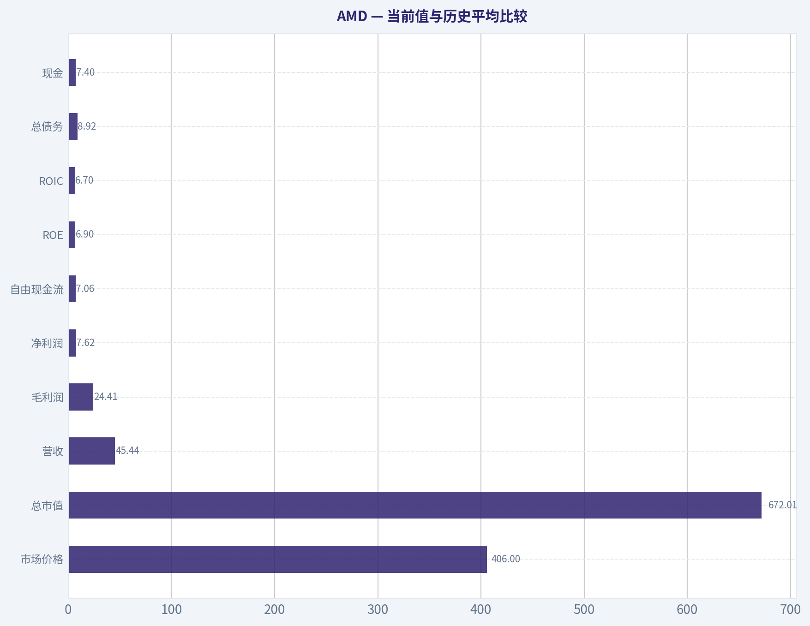
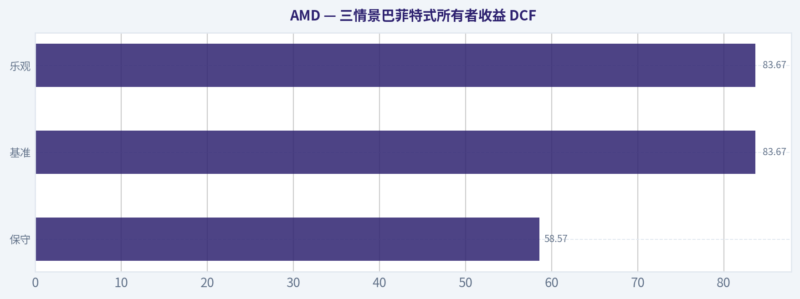
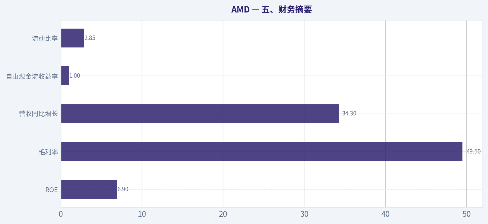

# AMD 深度价值情报

**调研日期:** 2026-11-26

## 关键免责声明

*本报告由 Deep Value Intelligence（一个基于 AI 的多智能体投资分析框架）自动生成。 仅供教育和研究用途 - 非财务建议，非财务顾问。*

---

## 目录

1. 情报摘要
2. 分析师团队报告
   - 基本面分析
   - 价值分析 (巴菲特)
   - 成长性分析 (林奇/德鲁肯米勒/费雪)
   - 市场分析
   - 期权市场分析
3. 研究团队评论
4. 投资团队评论
5. Deep Values 团队洞察

---

## 情报摘要

### 核心观点与前提条件

**核心论点:** **原始判断为 看空，经三方辩论后维持，但理由应明确限定为"估值证据不足"，而非否定AMD的长期业务前景。**

**主要风险:**
- 未明确说明。

**置信度:** 中

---

## 分析师团队报告

### 基本面分析

#### 最新财报快照

*以下数据基于最近一期已披露财报（2026年Q3），并尽量与上一年同期对比。*

| 指标 | 2026年Q3 | 2025年Q3 | 同比变化 |
| --- | ---: | ---: | ---: |
| 营业收入 | $13.38B | $9.25B | +44.7% |
| 营业利润 | $2.83B | $1.27B | +123.0% |
| 净利润 | $2.43B | $1.24B | +95.3% |
| 摊薄每股收益 | $1.46 | $0.75 | +94.7% |
| 经营现金流 | $1.20B | $2.16B | -44.3% |
| 自由现金流 | $554.0M | $1.90B | -70.9% |

关键结论：这张快照先把最新一期财报放在桌面上，再去看长周期分析。这样读者能更清楚地区分"公司长期质量"和"这次财报发生了什么"。

#### AMD 17年财务指标

*以下数值均由原始数据确定性计算得出，并非 AI 估算。*

*发行人类型：operating company（Technology / Semiconductors）。*

#### 17年财务指标
*年度行来自已披露财务报表，最后一行 TTM 由最近四个季度滚动计算得出。*

| 指标 | 2009 | 2010 | 2011 | 2012 | 2013 | 2014 | 2015 | 2016 | 2017 | 2018 | 2019 | 2020 | 2021 | 2022 | 2023 | 2024 | 2025 | 2026 TTM |
| --- | --- | --- | --- | --- | --- | --- | --- | --- | --- | --- | --- | --- | --- | --- | --- | --- | --- | --- |
| 市场价格 | $10 | $8 | $5 | $2 | $4 | $3 | $3 | $11 | $10 | $18 | $46 | $92 | $144 | $65 | $147 | $121 | $214 | $406 |
| 总市值 | $6.56B | $6.00B | $4.01B | $1.78B | $2.92B | $2.05B | $2.25B | $9.47B | $9.79B | $19.64B | $51.36B | $110.69B | $176.85B | $101.75B | $239.54B | $197.73B | $350.37B | $674.42B |
| 市盈率 | 21.51 | 12.78 | 8.18 | -1.50 | -35.18 | -5.04 | -3.42 | -18.90 | -342.67 | 57.69 | 152.87 | 44.52 | 55.99 | 77.11 | 278.13 | 120.79 | 80.82 | 88.27 |
| 市净率 | 10.13 | 5.92 | 2.52 | 3.31 | 5.36 | 10.97 | -6.42 | 19.85 | 16.42 | 15.51 | 18.17 | 18.96 | 23.59 | 1.86 | 4.29 | 3.43 | 5.56 | 9.86 |
| ROE | 45.2% | 46.5% | 30.9% | -219.9% | -15.3% | -215.5% | 188.6% | -104.4% | -5.5% | 26.6% | 12.1% | 42.7% | 42.2% | 2.4% | 1.5% | 2.9% | 6.9% | 11.1% |
| ROIC | 14.8% | 26.3% | 12.7% | -38.7% | 5.0% | -9.1% | -32.1% | -41.6% | 15.0% | 41.0% | 36.5% | 80.4% | 63.7% | 4.8% | 1.4% | 2.7% | 6.5% | 11.0% |
| 每股收益 | $0.45 | $0.64 | $0.66 | $-1.60 | $-0.11 | $-0.53 | $-0.84 | $-0.60 | $-0.03 | $0.32 | $0.30 | $2.06 | $2.57 | $0.84 | $0.53 | $1.00 | $2.65 | $4.60 |
| 营收 | $5.40B | $6.49B | $6.57B | $5.42B | $5.30B | $5.51B | $3.99B | $4.32B | $5.25B | $6.47B | $6.73B | $9.76B | $16.43B | $23.60B | $22.68B | $25.79B | $34.64B | $45.44B |
| 毛利润 | $2.27B | $2.96B | $2.94B | $1.24B | $1.98B | $1.84B | $1.08B | $1.00B | $1.79B | $2.45B | $2.87B | $4.35B | $7.93B | $10.60B | $10.46B | $12.72B | $17.15B | $24.41B |
| 毛利率 | 42.1% | 45.6% | 44.8% | 22.8% | 37.3% | 33.4% | 27.1% | 23.2% | 34.0% | 37.8% | 42.6% | 44.5% | 48.2% | 44.9% | 46.1% | 49.4% | 49.5% | 53.7% |
| 营业利润率 | 12.3% | 13.1% | 5.6% | -19.5% | 1.9% | -2.8% | -12.1% | -8.6% | 2.4% | 7.0% | 9.4% | 14.0% | 22.2% | 5.4% | 1.8% | 7.4% | 10.7% | 17.7% |
| 净利润 | $293.0M | $471.0M | $491.0M | $-1.18B | $-83.0M | $-403.0M | $-660.0M | $-498.0M | $-33.0M | $337.0M | $341.0M | $2.49B | $3.16B | $1.32B | $854.0M | $1.64B | $4.33B | $7.62B |
| 净利率 | 5.4% | 7.3% | 7.5% | -21.8% | -1.6% | -7.3% | -16.5% | -11.5% | -0.6% | 5.2% | 5.1% | 25.5% | 19.2% | 5.6% | 3.8% | 6.4% | 12.5% | 16.8% |
| 营收增长 | N/A | 20.2% | 1.1% | -17.4% | -2.3% | 3.9% | -27.5% | 8.2% | 21.6% | 23.3% | 4.0% | 45.0% | 68.3% | 43.6% | -3.9% | 13.7% | 34.3% | 31.2% |
| 净利润增长 | N/A | 60.8% | 4.2% | -340.9% | -93.0% | 385.5% | 63.8% | -24.5% | -93.4% | -1121.2% | 1.2% | 630.2% | 27.0% | -58.3% | -35.3% | 92.2% | 164.2% | 75.8% |
| 自由现金流增长 | N/A | -8100.0% | -123.6% | -456.8% | -50.7% | -16.8% | 66.8% | -101.2% | -2625.0% | 27.7% | -314.0% | 181.5% | 314.4% | -3.3% | -64.0% | 114.5% | 180.0% | 4.8% |
| 总账面价值 | $648.0M | $1.01B | $1.59B | $538.0M | $544.0M | $187.0M | $-350.0M | $477.0M | $596.0M | $1.27B | $2.83B | $5.84B | $7.50B | $54.75B | $55.89B | $57.57B | $63.00B | $68.39B |
| 总资产 | $9.08B | $4.96B | $4.95B | $4.00B | $4.34B | $3.77B | $3.08B | $3.32B | $3.55B | $4.56B | $6.03B | $8.96B | $12.42B | $67.58B | $67.89B | $69.23B | $76.93B | $94.81B |
| 总债务 | $4.56B | $2.19B | $2.55B | $2.02B | $2.10B | $2.37B | $2.47B | $1.44B | $1.40B | $1.25B | $486.0M | $330.0M | $313.0M | $2.47B | $3.22B | $1.72B | $4.10B | $8.92B |
| 债务股权比 | 7.04 | 2.16 | 1.61 | 3.76 | 3.86 | 12.70 | -7.05 | 3.01 | 2.34 | 0.99 | 0.17 | 0.06 | 0.04 | 0.05 | 0.06 | 0.03 | 0.07 | 0.13 |
| 现金及等价物 | $1.66B | $606.0M | $869.0M | $549.0M | $869.0M | $805.0M | $785.0M | $1.26B | $1.19B | $1.08B | $1.47B | $1.59B | $2.54B | $4.83B | $3.93B | $3.79B | $5.54B | $7.40B |
| 股东权益 | $648.0M | $1.01B | $1.59B | $538.0M | $544.0M | $187.0M | $-350.0M | $477.0M | $596.0M | $1.27B | $2.83B | $5.84B | $7.50B | $54.75B | $55.89B | $57.57B | $63.00B | $68.39B |
| 经营现金流 | $473.0M | $-412.0M | $382.0M | $-338.0M | $-148.0M | $-98.0M | $-226.0M | $81.0M | $12.0M | $34.0M | $493.0M | $1.07B | $3.52B | $3.56B | $1.67B | $3.04B | $7.71B | $9.12B |
| 投资现金流 | $-1.27B | $-1.12B | $-113.0M | $-19.0M | $455.0M | $-12.0M | $147.0M | $277.0M | $-54.0M | $-170.0M | $-149.0M | $-952.0M | $686.0M | $2.00B | $-1.42B | $-1.10B | $-5.53B | $-8.20B |
| 自由现金流 | $7.0M | $-560.0M | $132.0M | $-471.0M | $-232.0M | $-193.0M | $-322.0M | $4.0M | $-101.0M | $-129.0M | $276.0M | $777.0M | $3.22B | $3.12B | $1.12B | $2.40B | $6.74B | $7.06B |
| 自由现金流利润率 | 0.1% | -8.6% | 2.0% | -8.7% | -4.4% | -3.5% | -8.1% | 0.1% | -1.9% | -2.0% | 4.1% | 8.0% | 19.6% | 13.2% | 4.9% | 9.3% | 19.4% | 15.5% |
| 每股分红 | $0.00 | $0.00 | $0.00 | $0.00 | $0.00 | $0.00 | $0.00 | $0.00 | $0.00 | $0.00 | $0.00 | $0.00 | $0.00 | $0.00 | $0.00 | $0.00 | $0.00 | $0.00 |

#### 盈利能力指标
- 净资产收益率 (ROE): 6.9%
- 投入资本回报率 (ROIC): 6.7%
- 总资产收益率 (ROA): 5.6%
- 毛利率: 49.5%
- 营业利润率: 10.7%
- 净利率: 12.5%

#### 流动性指标
- 流动比率: 2.85
- 速动比率: 1.78

#### 杠杆指标
- 债务股权比: 0.07
- 利息覆盖倍数: 28.20
- 净负债: $-6.46B

#### 增长指标（同比）
- 营收增长: 34.3%
- 净利润增长: 164.2%
- 自由现金流增长: 180.0%
- 营收复合增长率（3年）: 13.6%
- 营收复合增长率（5年）: 28.8%

#### 估值指标
- 市盈率 (TTM): 86.76
- 预期市盈率: 23.05
- 市净率: 9.74
- 市销率: 14.79
- PEG 比率: 12.81
- 企业价值/EBITDA: 59.17
- 自由现金流收益率: 1.0%
- 盈利收益率: 1.2%

#### 所有者收益（巴菲特方法，代码计算）
- 净利润: $4.33B
- + 折旧与摊销: $3.00B
- - 资本开支: $-974.0M
- + 营运资本（现金流量表口径；负数=占用现金）: $-2.38B
- = **所有者收益: $3.35B**

#### 内在价值（DeepValues 应用 - SEC 申报数据管道）
- **内在价值（DeepValues 应用，头条）: $83.67** - Owner Earnings (Buffett), 方法 buffett-1986-v2, 截至 2026-11-25 (FY2025)
  区间（保守-乐观）: $58.57 - $83.67
  相对价格的安全边际: -385.3% (价格 $406.03)
  应用使用的输入 (fy_2025): after-tax operating income $3.7B (operating income $3.7B, tax 0.0%) + D&A $2.8B - capex charge $0.9B (three-year average capex/revenue x trailing revenue; reported capex $1.0B) - working capital $0.0B = owner earnings $5.7B.
  Growth 10.0% fading to 2.5% terminal (min(owner-earnings CAGR, 5-year revenue CAGR), clamped [0, 10%]); discount rate 8.3% (30Y Treasury 5.30% + 3 pts (as of 2026-11-24)); net cash $6.5B (cash $5.5B + marketable securities $5.0B - debt $4.1B); 1,661M shares.
- Owner Earnings (Buffett): $58.57 / $83.67 / $83.67 (保守 / 基准 / 乐观) ← headline
- Free cash flow DCF: $18.57 / $148.17 / $179.56 (保守 / 基准 / 乐观)
- Damodaran two-stage FCFF: $5.17 / $25.83 / $91.09 (保守 / 基准 / 乐观)
  这就是内在价值：引用它作为内在价值，并据此衡量安全边际。其他地方的 DVI 情景数字仅为辅助交叉检查，不是估值。

#### DVI 情景模型（辅助交叉检查 - 不是内在价值）
DVI 基于 Yahoo 数据的情景，仅作敏感性检查。请勿将其作为内在价值引用；内在价值是上方的 DeepValues 应用估值。
- 当前价格: $406
- DVI 情景值（按商业模式路由）: $51
  商业模式: cyclical - weighted blend [Damodaran FCFF + reverse-DCF fair + owner-earnings DCF] (cyclical)
  模型区间（各 DCF 最小-最大）: $16 - $157
  相对价格的安全边际（头条）: -695.4%
  路由说明: Cyclical: margins/FCF are volatile - headline blends FCFF, reverse-DCF and owner-earnings roughly evenly; treat the range as the honest read.
- 巴菲特方法（所有者收益）:
  保守: $13
  平均: $106
  乐观: $286
- 现金流方法（FCF）:
  保守: $138
  平均: $157
  乐观: $402
- Damodaran FCFF（WACC + 利润率 + 再投资）:
  保守: $8
  平均: $16
  乐观: $43
  蒙特卡洛区间（P10-P90）：$10 - $25（中位数 $16）
  P(内在价值 > 当前价格)：0.0%
- 反向 DCF：当前价格隐含约 71.8%/年 的所有者收益增长（10年）；过去 3 年为 1.2%，5 年为 33.6%。

#### Piotroski F分数: 7/9
- 净利润为正: 通过
- 经营现金流为正: 通过
- 资产回报率改善: 通过
- 现金流大于净利润: 通过
- 债务下降: 未通过
- 流动比率改善: 通过
- 未稀释股本: 未通过
- 毛利率改善: 通过
- 资产周转率改善: 通过

ANALYST STANCE: **看空**

#### 结论摘要

AMD 是一家收入增长、毛利率和现金流显著改善的高质量半导体企业，但当前估值已经远远领先于经营数据所能支持的内在价值。当前股价约为 **406美元**，总市值约 **6720亿美元**；DeepValues 巴菲特所有者收益模型给出的内在价值为 **83.67美元**，保守至乐观区间为 **58.57至83.67美元**。

核心矛盾是：AMD 的业务质量正在改善，但当前价格已经隐含极高的长期增长要求。反向 DCF 显示，当前价格大致隐含未来十年所有者收益年增长约 **71.8%**，而公司过去五年营收复合增长率为 **28.8%**，过去三年为 **13.6%**。证据支持"优秀成长企业"，但不支持当前估值水平。

#### 市场指标与估值

| 指标 | 当前值 | 17年历史平均或参考 | 解读 |
|---|---:|---:|---|
| 市场价格 | $406 | 约$72.7 | 远高于历史均值，且较2025年$214继续大幅上升 |
| 总市值 | $672.01B | 约$110.4B | 规模已从中型芯片公司跃升为超大市值科技公司 |
| PE | 86.76倍 | 正盈利年度均值约83倍；全历史均值受亏损年份扭曲 | 当前PE接近正盈利历史均值，但盈利基数和增长预期已显著不同 |
| PB | 9.74倍 | 历史值高度波动 | 只能作为辅助指标，不能替代现金流估值 |
| 盈利收益率 | 1.2% | - | 对应极低的当前现金盈利回报 |
| FCF收益率 | 1.0% | - | 说明市场价格相对于当前自由现金流非常昂贵 |

**关键结论：** AMD 当前PE看似没有远高于部分历史正盈利时期，但历史PE受到周期、亏损和低盈利基数严重影响，横向比较的有效性有限。PB对半导体企业的参考意义弱于现金流，因为收购形成的无形资产、研发资本化方式和股本变化会显著影响账面价值；因此，估值判断应主要锚定所有者收益、自由现金流和反向DCF。

当前市值约6720亿美元，而最新TTM营收约454.4亿美元，市销率约14.8倍；TTM自由现金流约70.6亿美元，对应自由现金流收益率约1.0%。这意味着市场不仅在定价当前盈利，也在定价未来多年AI加速器、数据中心和高性能计算业务的快速扩张。

#### 盈利能力与经营质量

| 指标 | 当前值 | 历史平均或趋势 | 经营含义 |
|---|---:|---:|---|
| ROE | 6.9% | 全历史平均受负权益年份扭曲；2022-2025多为1.5%至6.9% | 当前尚未体现与高估值相匹配的高资本回报 |
| ROIC | 6.7% | 历史波动极大；2020-2021曾达80.4%和63.7% | 当前资本回报已恢复，但仍低于超高估值通常要求 |
| EPS | $4.60 | 历史均值约$0.87，受亏损年份影响 | 盈利已创历史高位，但估值增速明显快于EPS增速 |
| 营收 | $45.44B | 约$13.32B | 十七年规模扩张明显，TTM约为历史平均的3.4倍 |
| 毛利润 | $24.41B | 约$6.00B | 绝对毛利润快速增长 |
| 毛利率 | 53.7%（摘要口径49.5%） | 历史大致在23%至49%之间 | 产品组合和数据中心业务提升盈利质量 |
| 营业利润率 | 17.7%（摘要口径10.7%） | 历史平均受亏损年份拖累 | TTM经营杠杆释放明显 |
| 净利润 | $7.62B | 约$1.13B | TTM约为历史平均的6.7倍 |
| 净利率 | 16.8%（摘要口径12.5%） | 历史多数年份低于10% | 利润结构明显改善 |

**关键结论：** AMD 的增长并非只有收入扩张，毛利率、营业利润率、净利率和经营现金流都出现结构性改善。可是，当前ROE约6.9%、ROIC约6.7%仍然偏低，尚未证明公司能够在极大资本基础上持续产生与当前市值匹配的回报。数据集中存在年度与摘要口径差异，例如毛利率、营业利润率和净利率；本文将确定性年度表中的TTM行作为趋势依据，并将摘要数值视为最新口径参考。

#### 增长质量

| 增长指标 | 当前值 | 历史特征 | 评价 |
|---|---:|---|---|
| 营收同比增长 | 34.3% | 历史波动较大，2020-2022曾连续高速增长，2023年下降3.9% | 当前增长强劲，但半导体周期属性明显 |
| 净利润同比增长 | 164.2% | 受低基数、周期和利润恢复影响很大 | 不能简单外推为长期增速 |
| FCF同比增长 | 180.0% | 历史波动极大，多个年份为负增长 | 现金流转强，但可持续性仍需观察 |
| 3年营收复合增长率 | 13.6% | 低于5年复合增长率 | 最近增长速度较此前高增长阶段有所放缓 |
| 5年营收复合增长率 | 28.8% | 受数据中心和AI周期推动 | 是估值模型中较有意义的长期参考 |

**关键结论：** AMD 当前增长数据很强，但净利润和自由现金流增速受到低基数、周期恢复及产品放量影响，不能机械地当作长期复合增长率。五年营收复合增长率28.8%显示商业扩张能力，但三年复合增长率降至13.6%，说明增长需要持续得到AI基础设施投资和产品竞争力支持。

#### 财务实力与资产负债表

| 指标 | 当前值 | 历史比较 | 评价 |
|---|---:|---:|---|
| 总账面价值 | $68.39B | 约$16.5B，2022年后大幅抬升 | 资产规模和并购相关资产显著增加 |
| 总资产 | $94.81B | 约$26.5B | 资产规模扩张，但资本效率仍需改善 |
| 总债务 | $8.92B | 约$2.6B | 绝对债务高于历史均值 |
| 债务/权益 | 0.13 | 历史均值受早期负权益扭曲 | 杠杆仍低，偿债压力可控 |
| 现金及等价物 | $7.40B | 约$2.7B | 现金缓冲显著增强 |
| 股东权益 | $68.39B | 约$16.5B | 资本基础大幅扩大 |
| 净负债 | -$6.46B | - | 处于净现金状态 |
| 流动比率 | 2.85 | - | 短期流动性充足 |
| 速动比率 | 1.78 | - | 即使不依赖库存，流动性仍较稳健 |
| 利息覆盖倍数 | 28.20倍 | - | 利息负担目前不构成主要风险 |

**关键结论：** AMD 的财务安全性是其投资逻辑中的明显优点：现金充足、净现金约64.6亿美元、债务权益比仅0.13、利息覆盖倍数约28倍。需要关注的是，债务从2025年约41亿美元增加到TTM约89.2亿美元，同时投资现金流为负82亿美元，说明公司正在为产能、库存、战略投资或资本部署投入大量资金。

#### 现金流与股东回报

| 指标 | 当前值 | 历史平均或趋势 | 评价 |
|---|---:|---:|---|
| 经营现金流 | $9.12B | 约$1.63B | 经营现金创造能力达到历史高位 |
| 自由现金流 | $7.06B | 约$1.27B | 约为历史平均的5.6倍 |
| FCF利润率 | 15.5% | 多数早期年份为负，2025年19.4% | 现金流质量显著改善 |
| 所有者收益 | $3.35B（确定性口径）/约$5.7B（DeepValues口径） | - | 不同口径主要来自营运资本和资本开支调整 |
| 每股股息 | $0.00 | 17年均为零 | 资本主要用于研发、扩张和战略投入 |

**关键结论：** AMD 已从早期自由现金流不稳定的状态，转变为能够持续产生数十亿美元自由现金流的企业。可是，确定性数据口径下所有者收益仅约33.5亿美元，明显低于DeepValues采用的57亿美元口径，说明营运资本占用和资本开支估算对估值影响很大。公司没有现金股息，股东回报主要依赖未来盈利增长和资本增值，而不是当期分配。

#### 收入来源分布

以下为最新年度附近的公开业务结构估算，金额采用十亿美元，因共享确定性数据未提供完整分部表，故作为结构参考而非替代财务报表。

| 收入来源 | 金额（十亿美元） | 占比 |
|---|---:|---:|
| 数据中心 | 约16.6 | 约48% |
| 客户端与游戏 | 约14.1 | 约41% |
| 嵌入式 | 约3.9 | 约11% |
| 合计 | 约34.6 | 约100% |

**关键结论：** 数据中心已经成为AMD最大的收入来源，约占最新年度收入的一半，是AI加速器和服务器CPU增长的主要载体。客户端与游戏仍然贡献约四成收入，能够提供规模基础，但周期性更强；嵌入式业务占比较小，理论上可以帮助业务结构多元化，但当前增长弹性不如数据中心。

#### 当前值与历史平均比较

| 指标 | 当前值 | 历史平均或基准 | 当前相对历史的含义 |
|---|---:|---:|---|
| 市场价格 | $406 | 约$72.7 | 显著高于历史平均，估值扩张速度远快于长期平均 |
| 总市值 | $672.01B | 约$110.4B | 公司规模和市场预期均发生跃迁 |
| 营收 | $45.44B | 约$13.32B | 经营规模达到历史平均约3.4倍 |
| 毛利润 | $24.41B | 约$6.00B | 毛利绝对值扩张超过收入规模扩张 |
| 净利润 | $7.62B | 约$1.13B | 盈利能力已经明显脱离早期亏损阶段 |
| 自由现金流 | $7.06B | 约$1.27B | 现金流创造能力达到历史高位 |
| ROE | 6.9% | 全历史平均失真 | 比2020-2021高回报时期低很多 |
| ROIC | 6.7% | 全历史平均失真 | 尚未恢复到2020-2021的极高水平 |
| 总债务 | $8.92B | 约$2.6B | 绝对债务高于历史均值，但杠杆比例仍低 |
| 现金 | $7.40B | 约$2.7B | 现金储备和财务弹性显著增强 |
| PE | 86.76倍 | 正盈利年度约83倍 | 处于高位，但不是单纯由PE倍数扩张解释 |
| PB | 9.74倍 | 历史波动极大 | 只能辅助参考，不能作为核心估值依据 |

**关键结论：** AMD 的经营规模、盈利和自由现金流均已显著高于历史平均，说明公司确实发生了基本面升级。问题在于市场价格的提升幅度更大，当前市值已经提前反映了相当多未来增长；同时，ROE和ROIC仍没有恢复到公司历史上最强的水平。

#### 巴菲特式定性分析

**经济护城河：**

1. **产品与研发护城河。** 高性能CPU、GPU、数据中心加速器需要长期研发积累、软件适配和客户验证，进入门槛高。
2. **先进制造协同。** AMD采用无晶圆厂模式，能够利用先进代工资源降低自建晶圆厂的资本负担，但也增加了对外部供应链和先进制程供给的依赖。
3. **数据中心客户粘性。** 云服务商和大型企业更换核心计算平台需要软件迁移、验证和供应链协调，因此一旦形成规模部署，收入具有一定持续性。
4. **软件生态仍是短板。** 在AI加速器领域，硬件竞争力必须配合编译器、开发工具、模型适配和开发者生态。AMD与行业龙头相比，软件生态护城河仍在建设过程中。

**财务实力：**

AMD当前净现金约64.6亿美元，流动性和利息覆盖能力较强，能够承受研发投入、库存建设及周期波动。风险不在于短期偿债，而在于高估值下未来资本投入是否能够产生足够回报，以及新增债务和投资现金流出能否转化为持续自由现金流。

**盈利可预测性：**

早期十多年中，AMD曾多次出现亏损、负自由现金流和大幅波动，说明其并非传统意义上的稳定消费品企业。2020年以来，数据中心、服务器CPU和AI相关需求改善了盈利结构，但半导体行业仍会受到库存周期、客户资本开支、产品迭代和竞争格局变化影响。

**管理层与资本配置：**

管理层在产品路线、代工协作和数据中心转型方面表现较强，过去几年收入和现金流增长显著。公司没有股息，资本配置重点在研发、战略投资和业务扩张。Piotroski F分数为7/9，说明经营质量改善，但债务增加和股本稀释项目未通过，表明资本扩张并非没有代价。

**业务质量：**

AMD已经从周期性较强、利润率较低的芯片企业，逐步转向由数据中心和高性能计算驱动的高毛利业务组合。最新毛利率、营业利润率和自由现金流利润率均处于历史高位附近，这支持更高质量评价；但在竞争激烈、客户集中度较高、技术迭代快速的市场中，当前利润率能否长期维持仍是关键问题。

#### 三情景巴菲特式所有者收益 DCF

DeepValues采用FY2025所有者收益模型，输入为：

- 税后经营利润：约37亿美元；
- 折旧与摊销：约28亿美元；
- 资本开支扣除：约9亿美元；
- 营运资本调整：约0；
- 模型所有者收益：约57亿美元；
- 净现金：约65亿美元；
- 股份数：约16.61亿股；
- 折现率：8.3%；
- 永续增长率：2.5%。

基本公式为：

\[
企业价值=\sum_{t=1}^{10}\frac{OE_0(1+g_t)^t}{(1+r)^t}
+\frac{OE_{10}(1+g_T)}{(r-g_T)(1+r)^{10}}
\]

\[
每股内在价值=\frac{企业价值+净现金}{总股本}
\]

模型采取前期增长后逐步下降至2.5%的终值增长率，避免把高增长永久外推。

| 情景 | 主要假设 | 所有者收益内在价值 | 与当前价格比较 |
|---|---|---:|---:|
| 保守 | 低增长起点，逐步下降至2.5%终值增长 | $58.57 | 当前价格约为其6.9倍 |
| 基准 | 约10%增长并逐步衰减至2.5% | $83.67 | 当前价格约为其4.9倍 |
| 乐观 | 高增长假设，但模型增长上限和终值约束使结果不再继续上升 | $83.67 | 仍显著低于当前价格 |

**关键结论：** DeepValues的核心内在价值为每股83.67美元，保守区间下限为58.57美元。即使采用较为有利的增长假设，模型结果仍显著低于406美元，说明当前价格要求未来经营结果远超历史可验证水平。

**现金流DCF交叉检查：**

共享研究包中的辅助自由现金流DCF结果为：

- 保守：18.57美元；
- 基准：148.17美元；
- 乐观：179.56美元。

Damodaran两阶段FCFF结果为：

- 保守：5.17美元；
- 基准：25.83美元；
- 乐观：91.09美元。

这些结果差异很大，说明AMD的估值对增长率、资本开支、营运资本和终值假设高度敏感。它们不能替代DeepValues头条内在价值，但共同指向同一个结论：现金流模型难以支持406美元这一价格，除非未来多年增长明显超出历史可比水平。

**反向DCF交叉检查：**

- 当前价格：约406美元；
- DeepValues内在价值：83.67美元；
- 当前价格约为内在价值的4.85倍；
- 反向DCF隐含未来十年所有者收益年增长率：约71.8%；
- 公司过去五年营收复合增长率：28.8%；
- 公司过去三年营收复合增长率：13.6%。

反向DCF并不意味着AMD不可能继续高速增长，而是说明当前价格把极端强劲、持续多年且利润率不下降的执行结果纳入了估值。任何AI需求放缓、竞争加剧、客户自研芯片增加或资本开支回报下降，都可能造成估值压缩。

#### 主要风险、机会与观察重点

| 类型 | 具体因素 | 对估值的影响 |
|---|---|---|
| 机会 | 数据中心和AI加速器继续扩大 | 可能推动收入、毛利率和经营利润率进一步提升 |
| 机会 | 服务器CPU份额提高 | 有助于增强收入可预测性和客户粘性 |
| 机会 | 软件生态持续改善 | 可能降低与主要竞争者之间的产品替代障碍 |
| 机会 | 现金流规模扩大 | 提供研发、并购和供应链投资能力 |
| 风险 | AI芯片竞争激烈 | 可能压低价格、毛利率和资本回报 |
| 风险 | 客户自研芯片 | 可能限制大型云客户对通用加速器的依赖 |
| 风险 | 半导体周期反转 | 库存、订单和资本开支波动会放大盈利变化 |
| 风险 | 供应链集中 | 对先进制程、封装和关键供应商依赖较高 |
| 风险 | 估值极高 | 当前价格对增长失误的容忍度很低 |
| 风险 | 资本扩张和稀释 | 债务增加、股本变化可能降低每股价值增长 |
| 风险 | 现金流口径差异 | 营运资本和资本开支投入可能使所有者收益低于会计利润 |

**关键结论：** AMD最大的机会是数据中心和AI计算带来的长期结构性增长，最大的风险则是市场已经提前计入了极高增长。观察重点应放在数据中心收入增速、毛利率、自由现金流转换率、库存和应收账款变化、股本数量以及ROIC能否持续上升。

#### 最终投资观点

**看空**

该标签表达的是估值与基本面的相对判断，不是操作指令。

支持这一判断的证据包括：

1. 当前价格约406美元，远高于DeepValues所有者收益内在价值83.67美元。
2. 当前自由现金流收益率约1.0%，意味着市场对未来增长的要求极高。
3. 反向DCF隐含所有者收益年增长约71.8%，明显高于公司五年营收复合增长率28.8%。
4. ROE约6.9%、ROIC约6.7%，尚未达到与超高市值相匹配的资本回报水平。
5. 公司历史盈利和自由现金流波动较大，半导体周期风险不能忽略。
6. 业务质量已经明显改善，但经营改善幅度仍不足以解释当前价格与内在价值之间的巨大差距。

AMD是优秀的成长型半导体企业，但"优秀企业"与"当前估值合理"是两个不同命题。现有数据更支持其长期竞争力改善，而不支持406美元价格所隐含的极端增长假设。

#### 报告关键要点汇总

| 维度 | 核心判断 | 关键数据 |
|---|---|---:|
| 业务质量 | 数据中心和AI推动业务升级 | TTM营收$45.44B |
| 盈利能力 | 毛利率和净利率显著改善 | TTM净利润$7.62B |
| 现金流 | 已形成较强现金创造能力 | TTM FCF$7.06B |
| 财务安全 | 净现金、低杠杆、流动性充足 | 净现金约$6.46B |
| 增长 | 当前高速但周期性明显 | 营收同比34.3% |
| 估值 | 对增长要求极高 | PE86.76倍、FCF收益率1.0% |
| 内在价值 | 明显低于市场价格 | $58.57至$83.67 |
| 反向DCF | 隐含增长远超历史水平 | 约71.8%年增长 |
| 主要优势 | 数据中心、研发、客户验证、现金实力 | 护城河正在增强 |
| 主要风险 | AI竞争、周期、客户自研、估值过高 | 估值安全边际不足 |
| 最终立场 | 基本面改善无法覆盖当前估值要求 | **看空** |

**关键结论：** AMD的经营基本面正在改善，尤其是数据中心收入、毛利率、营业利润和自由现金流表现值得肯定。可是，当前市场价格已经大幅超过所有者收益DCF和多种现金流交叉估值结果，研究证据因此更偏向估值风险，而不是经营质量风险。

#### 基本面关键图表

本图追踪 **AMD** 过去十年的盈利能力与回报指标（ROE、ROIC、利润率），突出呈现资本效率的变化趋势。

---

### 价值分析 (巴菲特)

> *基于沃伦·巴菲特的价值投资哲学：能力圈、经济护城河、管理层质量与安全边际。*

#### 内在价值快照

价格是你付的钱，内在价值是企业未来可能为股东创造的现金价值。我们给出一个区间，而不是假装只有一个神奇数字。

- 当前价格: $406.03
- 估值区间（两种 DCF 方法、保守到乐观）: $18.57 至 $179.56

##### 所有者收益（巴菲特方法）
- 净利润: $4,335,000,000.00
- 折旧与摊销: $3,004,000,000.00
- 资本支出: $-974,000,000.00
- 营运资金变化: $-2,378,000,000.00
- 所有者收益: $3,346,000,000.00

##### 内在价值
###### 所有者收益法
使用所有者收益，更严格，通常更保守。
- 保守: $58.57
- 平均: $83.67
- 乐观: $83.67
- 折现率: 8.3%

###### 自由现金流法
使用自由现金流，更适合今天投入很多、为未来增长铺路的公司。
- 保守: $18.57
- 平均: $148.17
- 乐观: $179.56
- 折现率: 9.1%

ANALYST STANCE: **看空**

#### 一、结论摘要

AMD拥有较强的技术资产、先进制程设计能力、数据中心客户基础与第二供应商地位，属于值得研究的高质量半导体平台型企业。问题不在企业质量，而在估值：当前股价约406美元，而DeepValues应用给出的基准内在价值为83.67美元，价格显著超过现金流能够支持的价值范围。

综合评分为2.9分，低于"中性观察"所需的3.0分。Gate 5财务困境硬门槛**未触发**，但当前估值已经要求AMD长期维持极高增长，安全边际明显不足。

#### 二、因素评分

| 因素 | 评分 | 主要证据 |
|---|---:|---|
| 1. 能力圈与业务简单性 | 3/5 | 主要通过设计和销售CPU、GPU及数据中心芯片获利；业务可理解，但半导体周期、产品迭代与人工智能竞争增加预测难度 |
| 2. 护城河 | 4/5 | x86生态、研发知识产权、客户验证周期、数据中心切换成本和规模效应；毛利率49.5%支持技术资产价值 |
| 3. 管理层与资本配置 | 3/5 | 产品路线和经营执行力较强；但股东所有权比例、长期激励细节及资本配置回报证据并不充分 |
| 4. 行业结构 | 4/5 | 高端芯片由少数大型企业主导，研发与客户认证形成进入壁垒；但竞争激烈且行业具有周期性 |
| Gate 5：质量与偿付能力 | 未触发 | 营收同比增长34.3%，拥有正向所有者收益和约65亿美元净现金；没有利息覆盖率低于1倍或明显财务困境证据 |

**关键结论：** AMD的业务质量明显高于普通周期性芯片企业，护城河和行业地位均处于中上水平。但业务预测仍受技术路线、客户集中度和竞争格局影响，不能仅凭高增长率推断未来十年同样高速增长。

#### 三、护城河分析

| 护城河来源 | 具体证据 | 质量判断 |
|---|---|---|
| 技术资产与知识产权 | CPU、GPU、数据中心加速器设计能力；长期研发积累 | 较强 |
| 生态与切换成本 | x86软件兼容生态、服务器验证周期、企业客户迁移成本 | 较强 |
| 成本与规模优势 | 大规模研发投入、先进制程合作、产品组合摊薄研发成本 | 中上 |
| 网络效应 | 芯片本身并非典型双边网络平台，但开发工具、客户部署与生态伙伴会形成间接强化 | 中等 |
| 定价能力 | 毛利率49.5%，说明产品具有技术溢价；但芯片竞争仍限制持续提价能力 | 中上 |

AMD最重要的护城河不是单一品牌，而是"研发能力、软件兼容性、客户认证、供应链协同和产品生态"的组合。人工智能加速器市场仍由英伟达生态占据显著优势，AMD的第二供应商地位具有价值，但尚未证明其拥有不可替代的主导地位。

#### 四、管理层质量与资本配置

AMD管理层过去数年的产品路线执行和市场份额改善较为突出，尤其是在数据中心与人工智能相关产品上的战略聚焦，体现出较强的长期经营能力。

| 管理层维度 | 判断 |
|---|---|
| 经营执行 | 较强，营收同比增长34.3%，说明产品需求和市场拓展仍具动能 |
| 诚实与披露 | 未见重大财务重述或明显会计异常证据 |
| 资本配置 | 研发投入方向具有战略合理性，但高估值下的并购与股权激励需中性 |
| 股东导向 | 管理层长期激励重要，但目前缺乏足够证据确认个人财富高度绑定于每股内在价值 |
| 资本结构 | 净现金约65亿美元，财务弹性较好 |

**关键结论：** 管理层的经营能力较可信，特别是在产品转型和数据中心扩张方面表现突出。不过，经营优秀并不等同于任何价格都合理；未来资本配置是否能将人工智能热潮转化为持续的每股现金流增长，仍是核心验证点。

#### 五、财务摘要

| 指标 | 最新数据 |
|---|---:|
| 当前股价 | 406美元 |
| 总市值 | 6720.1亿美元 |
| PE | 86.76倍 |
| ROE | 6.9% |
| 毛利率 | 49.5% |
| 营收同比增长 | 34.3% |
| 自由现金流收益率 | 1.0% |
| 流动比率 | 2.85 |
| 现金及有价证券 | 约105亿美元 |
| 有息债务 | 约41亿美元 |
| 净现金 | 约65亿美元 |
| FY2025所有者收益 | 约57亿美元 |
| 所有者收益率，按市值计算 | 约0.85% |

**关键结论：** AMD的收入增长和毛利率体现出较强的经营动能，净现金也提供了财务安全垫。但按6720亿美元市值计算，所有者收益率只有约0.85%，明显低于10%的长期价值评估基准，说明市场价格已经提前计入了大量未来增长。

#### 六、所有者收益计算

| 项目 | FY2025金额 |
|---|---:|
| 税后经营利润 | 37亿美元 |
| 加：折旧与摊销 | 28亿美元 |
| 减：资本开支费用 | 9亿美元 |
| 减：营运资本增加 | 0亿美元 |
| 所有者收益 | 57亿美元 |
| 税后经营利润口径下的现金转化 | 较好 |

计算公式：

**所有者收益 = 37 + 28 - 9 - 0 = 57亿美元**

该口径使用了三年平均资本开支占收入比例估算维持性资本开支。当前自由现金流收益率仅1.0%，与所有者收益率约0.85%大体一致，说明估值压力并非单纯来自会计口径差异。

#### 七、三情景DCF估值

以下情景采用57亿美元所有者收益、16.61亿股稀释后股数，并将约65亿美元净现金作为额外权益价值加回。该表是独立敏感性分析；DeepValues应用的83.67美元仍是本报告采用的主要内在价值。

| 情景 | 核心假设 | 经营价值每股 | 加净现金后每股 |
|---|---|---:|---:|
| A：零增长 | 所有者收益 ÷ 10% | 34.3美元 | 38.2美元 |
| B：GDP增长 | 永续增长3%，折现率10% | 50.5美元 | 54.5美元 |
| C：历史增长折扣 | 未来十年增长约7.5%，终值增长2.5%，折现率10% | 68.2美元 | 72.1美元 |

**关键结论：** 即使给予未来十年约7.5%的复合增长，独立DCF估值加净现金也约为72美元，仍显著低于406美元。要支持当前价格，AMD需要实现远高于保守情景的增长，同时保持高利润率和高资本回报。

#### 八、DeepValues内在价值与安全边际

| 项目 | 数值 |
|---|---:|
| DeepValues保守价值 | 58.57美元 |
| DeepValues基准内在价值 | 83.67美元 |
| DeepValues乐观价值 | 83.67美元 |
| 应用所有者收益 | 57亿美元 |
| 应用增长假设 | 初期10%，逐步降至2.5% |
| 应用折现率 | 8.3% |
| 应用净现金 | 65亿美元 |
| 当前价格 | 406美元 |
| 相对基准内在价值的安全边际 | -385.3% |

**关键结论：** 83.67美元是本报告采用的DeepValues基准内在价值，当前价格约为该数值的4.85倍。即使采用较低的8.3%折现率和初期10%的增长假设，估值仍无法解释406美元价格，安全边际为负。

#### 九、反向DCF含义

按57亿美元所有者收益计算，当前6720亿美元市值对应约0.85%的所有者收益率。若以10%折现率衡量，市场需要AMD的所有者收益在未来持续大幅增长，并且终值占估值的比例会非常高。

这种定价隐含了几个强假设：

1. 人工智能加速器需求保持多年高速增长；
2. AMD持续扩大数据中心和GPU市场份额；
3. 毛利率不会因竞争显著下降；
4. 研发投入能够持续转化为高回报产品；
5. 英伟达生态优势、专用芯片和客户自研芯片不会显著压缩机会空间。

这些假设并非不可能，但已经属于高要求情景，而不是普通的合理增长情景。

#### 十、最终Buffett评分卡

| 评估标准 | 权重 | 评分 | 加权得分 |
|---|---:|---:|---:|
| 护城河宽度与持久性 | 25% | 4.0 | 1.00 |
| 估值与安全边际 | 20% | 1.0 | 0.20 |
| 资本回报，ROIC相对资本成本 | 15% | 2.0 | 0.30 |
| 业务理解与可预测性 | 12% | 3.0 | 0.36 |
| 管理层与资本配置 | 12% | 3.0 | 0.36 |
| 再投资空间 | 8% | 5.0 | 0.40 |
| 资产负债表强度 | 4% | 4.0 | 0.16 |
| 行业结构 | 4% | 4.0 | 0.16 |
| **总分** | **100%** | - | **2.94** |

**关键结论：** AMD在护城河、再投资空间、资产负债表和行业结构方面得分较高，但估值项只有1分，资本回报项也受到ROE仅6.9%的拖累。综合得分低于3.0，主要原因是价格远远领先于当前现金流价值，而不是企业本身缺乏竞争力。

#### 十一、投资立场与 conviction

**ANALYST STANCE: 看空**

**Conviction：较高，主要针对估值，不针对企业经营质量。**

AMD是具有长期竞争潜力的高质量芯片企业，但当前406美元价格相对于83.67美元基准内在价值存在极大溢价。财务困境硬门槛没有触发，企业也不属于基本面崩坏类型；然而，现有现金流、ROE和自由现金流收益率不足以支撑当前定价。研究证据因此指向：**企业质量值得持续跟踪，但当前估值不具备足够安全边际，市场价格隐含的增长要求过高。**
#### 估值桥

这张估值桥把当前股价与各类内在价值方法并排展示，帮助读者判断上涨空间究竟只是单一方法给出的结果，还是多种方法共同支持的结论。

| 项目 | 每股内在价值 |
| --- | ---: |
| 巴菲特方法 | $83.67 |
| 现金流方法 | $148.17 |
| Damodaran 方法 | $25.83 |
| 当前价格 | $406.03 |

#### 关键结论

如果只有一种方法显著高于其他方法，说明上行空间更依赖特定建模假设。若多种方法的估值接近，则说明估值逻辑更加稳健。

#### 估值图表

本对比图（来自「最新财报快照」）将 **AMD** 的当前数据与历史基准并排呈现，直观反映公司相对自身历史均值的估值水平。

本对比图（来自「增长质量」）将 **AMD** 的当前数据与历史基准并排呈现，直观反映公司相对自身历史均值的估值水平。

本对比图（来自「财务实力与资产负债表」）将 **AMD** 的当前数据与历史基准并排呈现，直观反映公司相对自身历史均值的估值水平。

本对比图（来自「现金流与股东回报」）将 **AMD** 的当前数据与历史基准并排呈现，直观反映公司相对自身历史均值的估值水平。

本对比图（来自「当前值与历史平均比较」）将 **AMD** 的当前数据与历史基准并排呈现，直观反映公司相对自身历史均值的估值水平。

本对比图（来自「三情景巴菲特式所有者收益 DCF」）将 **AMD** 的当前数据与历史基准并排呈现，直观反映公司相对自身历史均值的估值水平。

本对比图（来自「五、财务摘要」）将 **AMD** 的当前数据与历史基准并排呈现，直观反映公司相对自身历史均值的估值水平。

---

### 成长性分析 (林奇/德鲁肯米勒/费雪)

> *基于彼得·林奇的GARP成长投资法、斯坦利·德鲁肯米勒的宏观拐点分析法，以及菲利普·费雪的深度调研法。*

分析师立场：**中性**

#### 一、Lynch 分类与核心判断

AMD 属于"快速成长股"与"周期股"的混合类型。数据表现已达到快速成长标准，但半导体需求、产品周期和人工智能资本开支使其盈利具有周期性。当前基本面强劲，估值却显著高于多项内在价值测算。

| 项目 | 数据或判断 |
|---|---:|
| 当前股价 | 约406美元 |
| 总市值 | 约6,720亿美元 |
| 最近营收同比增长 | 34.3% |
| 2021-2025营收复合增长率 | 约28.8% |
| 远期市盈率 | 23.05倍 |
| 市销率 | 14.79倍 |
| 市盈率 | 86.76倍 |
| 毛利率 | 49.5% |
| 自由现金流收益率 | 1.0% |

**关键结论：** AMD 的收入增速和人工智能暴露度符合"快速成长股"特征，但估值已经反映了相当强的未来执行表现。远期市盈率看似低于历史市盈率，仍不能抵消市销率高、现金流收益率低和盈利周期性的影响。

#### 二、故事：三个简单要点

1. AMD 正从传统服务器与个人电脑芯片供应商，扩展为数据中心、人工智能加速器和高性能计算平台供应商。
2. 数据中心人工智能需求扩大，为其服务器处理器、加速器和相关软件生态带来新的长期市场。
3. AMD 的主要机会不是单纯扩大现有市场，而是提高在人工智能计算和数据中心处理器中的份额。

#### 三、TAM 与十倍测试

AMD 的精确可服务市场规模取决于人工智能加速器、服务器处理器、图形处理器、嵌入式芯片及软件生态的定义，因此以下为区间判断，而非公司正式指引。

| 项目 | 分析 |
|---|---|
| 当前营收基数 | 约454亿美元 |
| 十倍营收 | 约4,540亿美元 |
| 主要扩张市场 | 人工智能加速器、数据中心、云计算、高性能计算 |
| 市场增长特征 | 人工智能基础设施仍处于高增长阶段，但芯片市场具有周期性 |
| 十倍测试 | 若人工智能计算与数据中心市场持续扩张，理论上仍可容纳十倍收入；若只依赖传统个人电脑和游戏市场，则空间明显不足 |
| 主要限制 | 英伟达生态优势、客户自研芯片、先进封装与晶圆供应约束 |

**关键结论：** AMD 的长期市场空间足以支持收入继续增长，尤其是人工智能基础设施市场仍在扩张。十倍测试通过的前提，是AMD能够在加速器、软件生态和数据中心平台中持续获得份额，而不是仅依靠行业总量增长。

#### 四、收入增长趋势

| 年度 | 营收 | 同比增长 |
|---|---:|---:|
| 2022 | 236亿美元 | 43.6% |
| 2023 | 227亿美元 | -3.9% |
| 2024 | 258亿美元 | 13.7% |
| 2025 | 346亿美元 | 34.3% |
| 2026 TTM | 454亿美元 | 31.2% |

**关键结论：** 收入经历2023年的短暂下滑后重新加速，2024至2026年保持两位数高增长，说明产品周期和数据中心需求出现明显改善。最新TTM增速较2025年略有放缓，但仍处于较高水平，暂未显示结构性失速。

#### 五、单位经济与盈利质量

| 指标 | AMD数据 | 判断 |
|---|---:|---|
| 毛利率 | 49.5% | 中等偏强，较长期历史水平改善 |
| TTM营业利润率 | 10.7% | 仍有较大经营杠杆空间 |
| TTM净利润率 | 12.5% | 盈利能力已明显恢复 |
| TTM自由现金流 | 约70.6亿美元 | 现金创造能力较强 |
| 自由现金流率 | 15.5% | 健康，但低于高估值所需水平 |
| 净收入增长 | 164.2% | 基数效应和经营杠杆明显 |
| 净现金 | 约64.6亿美元 | 资产负债表稳健 |
| NRR、CAC、LTV | 不适用或未披露 | 芯片企业不适合直接套用订阅模型 |
| Rule of 40 | 不适用 | 非SaaS业务 |

**关键结论：** AMD的现金流、毛利率和资产负债表均明显改善，说明增长并非完全依靠收入规模。可是营业利润率仍低于最优质平台型半导体公司的水平，未来估值能否成立取决于人工智能产品放量后利润率能否继续提升。

#### 六、拐点评估

| 拐点类型 | 证据 | 评级 |
|---|---|---|
| 产品周期 | 数据中心处理器与人工智能加速器增长 | 强 |
| 市场份额 | 在服务器处理器领域持续扩大存在感 | 中强 |
| 毛利率 | 2024至2026 TTM由49.4%升至53.7%的另一组口径数据；共享摘要口径为49.5%，存在数据差异 | 中强 |
| 经营杠杆 | TTM营业利润率约17.7%的另一组口径，基础数据摘要为10.7% | 中强，但需核实 |
| TAM扩张 | 人工智能基础设施和云计算资本开支 | 强 |
| 竞争格局 | 英伟达生态优势强，客户自研芯片增加 | 中性偏弱 |

**关键结论：** AMD最重要的拐点来自人工智能加速器和数据中心产品，而非传统个人电脑市场。增长拐点已经出现，但竞争优势尚未达到生态主导地位，市场份额增长能否转化为持续高利润仍是核心验证事项。

#### 七、宏观环境

| 宏观因素 | 对AMD的影响 |
|---|---|
| 人工智能资本开支 | 明显顺风 |
| 云计算基础设施 | 顺风 |
| 高利率与长期国债收益率 | 对高估值成长股构成折现压力 |
| 半导体周期 | 增加收入和库存波动 |
| 出口管制 | 可能限制部分高端产品销售 |
| 客户集中与大型云厂商议价 | 压制利润率的潜在因素 |

**关键结论：** 行业长期趋势仍然有利，人工智能和云计算是最强的结构性顺风。宏观层面却并非全面有利，高利率、芯片周期和出口限制使估值容错空间下降。

#### 八、Fisher 15项评分

| Fisher项目 | 评分（1-5） | 简要依据 |
|---|---:|---|
| 市场潜力 | 5 | 人工智能、数据中心、高性能计算 |
| 新产品决心 | 4 | 产品线持续扩展 |
| 研发效率 | 4 | 处理器与加速器迭代能力较强 |
| 销售组织 | 4 | 云厂商与企业客户覆盖改善 |
| 利润率水平 | 3 | 毛利率不错，营业利润率仍有提升空间 |
| 利润率改善 | 4 | 规模效应明显 |
| 员工关系 | 3 | 公开信息有限 |
| 高管协作 | 4 | 经营战略连续性较强 |
| 管理层深度 | 4 | 技术与产品管理能力较完整 |
| 成本分析 | 3 | 公开披露不足 |
| 特殊竞争优势 | 4 | 研发、客户验证、软件与平台协同 |
| 长期利润展望 | 4 | 取决于人工智能份额与利润率 |
| 股权稀释 | 3 | 历史上存在股权激励与并购影响 |
| 诚实披露 | 4 | 信息披露整体较完整 |
| 管理层诚信 | 4 | 暂无重大诚信事件证据 |
| **总分** | **57/75** | **良好** |

**关键结论：** Fisher评分为57分，属于"良好"而非"杰出"。优势集中在技术研发、市场潜力和产品周期；扣分主要来自盈利率仍在爬坡、行业竞争激烈，以及部分经营质量数据存在口径差异。

#### 九、估值分析

| 估值方法 | 结果或区间 | 含义 |
|---|---:|---|
| TTM市盈率 | 86.76倍 | 对当前盈利要求很高 |
| 远期市盈率 | 23.05倍 | 隐含盈利需要快速增长 |
| PEG | 12.81 | 明显高于通常的合理成长估值区间 |
| 市销率 | 14.79倍 | 对半导体企业而言偏高 |
| 自由现金流收益率 | 1.0% | 当前现金回报率偏低 |
| Owner Earnings内在价值 | 58.57-83.67美元 | 明显低于当前价格 |
| 自由现金流DCF辅助区间 | 18.57-179.56美元 | 对增长、利润率和折现率高度敏感 |
| FCFF辅助区间 | 5.17-91.09美元 | 对资本回报率和周期假设较谨慎 |

**关键结论：** 多项估值指标显示AMD当前价格包含非常高的未来增长预期。共享研究包指定的Owner Earnings内在价值基准为83.67美元，显著低于约406美元的市场价格；这意味着基本面强劲并不等于当前估值已经得到现金流支持。

#### 十、估值敏感性

| 假设变化 | 对估值含义 |
|---|---|
| 收入增速维持30%以上 | 有助于降低远期市盈率，但仍需利润率同步提升 |
| 人工智能加速器份额快速提升 | 可能支持较高收入和利润倍数 |
| 营业利润率持续改善 | 对内在价值提升最关键 |
| 增速降至15%-20% | 当前高市销率将承受明显压力 |
| 折现率维持高位 | 长久期成长现金流的现值下降 |
| 英伟达生态继续占优 | AMD的市场份额和估值倍数可能受到压制 |
| 客户自研芯片扩大 | AMD可服务市场与利润率面临双重压力 |

**关键结论：** 估值对三个变量最敏感：收入增速、人工智能产品份额和营业利润率。只要其中任一项低于市场隐含预期，估值重估风险都会增加；反之，持续超预期的收入和利润增长才可能缩小基本面与市场价格之间的差距。

#### 十一、成长投资评分卡

| 维度 | 权重 | 得分（1-5） | 加权得分 |
|---|---:|---:|---:|
| Lynch故事 | 10% | 4.5 | 0.45 |
| TAM与增长跑道 | 20% | 4.5 | 0.90 |
| 收入增长 | 20% | 4.5 | 0.90 |
| 单位经济 | 15% | 3.5 | 0.53 |
| 竞争地位 | 10% | 3.5 | 0.35 |
| 管理质量 | 10% | 4.0 | 0.40 |
| 宏观环境 | 5% | 3.5 | 0.18 |
| 盈利路径 | 5% | 4.0 | 0.20 |
| 估值 | 5% | 1.5 | 0.08 |
| **总分** | **100%** |  | **3.99/5.00** |

**关键结论：** AMD的经营质量评分接近"看多"门槛，主要由高增长、人工智能市场空间和产品周期推动。估值是决定性扣分项，因此综合结论为WATCH，而不是更积极的立场。

#### 十二、关键风险与催化剂

| 类型 | 内容 |
|---|---|
| 主要催化剂 | 人工智能加速器收入超预期 |
| 主要催化剂 | 数据中心处理器份额继续提升 |
| 主要催化剂 | 软件生态、开发工具和客户部署改善 |
| 主要催化剂 | 毛利率与营业利润率持续扩张 |
| 主要风险 | 英伟达软件生态和客户黏性仍具显著优势 |
| 主要风险 | 大型云厂商自研芯片替代部分通用加速器 |
| 主要风险 | 高利率压低成长资产估值 |
| 主要风险 | 出口限制、供应链与先进封装约束 |
| 主要风险 | 2023年式收入下滑周期再次出现 |
| 主要风险 | 当前价格与Owner Earnings内在价值之间差距过大 |

#### 总结

AMD已经出现真实的增长拐点：营收重新加速，数据中心与人工智能市场扩大，现金流和盈利能力改善。按照Lynch和Fisher框架，公司具有优秀的长期故事与较长跑道；按照Druckenmiller框架，人工智能资本开支是重要顺风，但宏观利率与竞争格局仍需观察。

综合判断是 **中性**：公司基本面属于高质量成长方向，但约406美元的市场价格明显高于共享研究包中的83.67美元Owner Earnings内在价值基准。当前证据支持"业务正在变强"，却不足以支持"估值已经合理"。

---

### 市场分析

ANALYST STANCE: **看空**

#### AMD 技术面综合报告

以下分析仅针对 **Advanced Micro Devices, Inc.（纳斯达克：AMD）**。数据来自截至 **2026年11月25日** 的最新交易日；2026年11月26日暂无当日收盘数据，因此以下指标均以11月25日为基准。

#### 一、价格趋势与阶段结构

AMD在过去约一年内经历了非常剧烈的上涨与回撤。收盘价由2025年11月26日的214.24美元升至2026年11月25日的406.03美元，名义涨幅约89.5%；但股价曾在2026年10月6日达到649.42美元，随后回落至406.03美元，较阶段高点下跌约37.5%。

这说明长期价格表现仍然显著高于一年前，但市场已经从单边扩张阶段转入高波动、快速重新定价阶段。尤其是10月中旬以后，价格连续形成较低的反弹高点；11月19日至11月25日又出现明显的下行加速，期间收盘价由489.19美元降至406.03美元，跌幅约17.0%。

| 观察维度 | 关键数据 | 含义 |
|---|---:|---|
| 最新收盘价 | 406.03美元 | 明显低于短期及中期均线 |
| 一年起点收盘价 | 214.24美元 | 过去一年仍有较大累计涨幅 |
| 阶段高点 | 649.42美元，2026-10-06 | 当前较高点回撤约37.5% |
| 11月19日至11月25日 | 489.19降至406.03美元 | 短期出现连续性较强的下行压力 |
| 11月25日成交量 | 51.34百万股 | 高于近期普通交易日，抛压确认度较高 |

关键结论：AMD的长期价格仍处于过去一年上涨后的高位区域，但近期走势已经明显转弱。阶段高点后的回撤幅度较大，且11月下跌伴随较高成交量，说明这不仅是低成交量环境下的轻微整理，而是市场风险偏好和价格预期出现了实质性收缩。

#### 二、均线结构：长期趋势尚未完全破坏，价格却已跌破关键平均成本区域

本次选取50日简单移动平均线、200日简单移动平均线和10日指数移动平均线，分别观察中期趋势、长期趋势与短线动量。

截至11月25日：

- 10日EMA为462.96美元，股价406.03美元，低于该均线约12.3%。
- 50日SMA为548.35美元，股价低于该均线约26.0%。
- 200日SMA为432.96美元，股价低于该均线约6.2%。

10日EMA在10月初仍位于620美元附近，此后快速降至462.96美元，显示短期趋势已经发生明显反转。50日SMA虽然仍处于约548美元，但已经从11月中旬约555美元缓慢下行，意味着中期趋势也从上升趋平并开始转弱。

200日SMA仍在上升，从2026年8月底约335.55美元升至11月25日约432.96美元，因此长期趋势线本身仍具有上行斜率。然而，股价已经跌破200日SMA，这构成重要的结构性警示：长期均线的方向尚未完全转空，但市场价格已经低于过去约200个交易日的平均水平。

| 指标 | 2026-11-25数值 | 股价相对位置 | 趋势解读 |
|---|---:|---:|---|
| 10日EMA | 462.96美元 | 低于约12.3% | 短期动量明显偏弱 |
| 50日SMA | 548.35美元 | 低于约26.0% | 中期价格结构显著恶化 |
| 200日SMA | 432.96美元 | 低于约6.2% | 长期均线仍上行，但价格已跌破 |
| 50日SMA变化 | 11月中旬约555美元至548美元 | 方向转弱 | 中期趋势由上行转为下行倾向 |
| 200日SMA变化 | 8月底约335.55美元至432.96美元 | 仍明显上行 | 长期趋势尚未完全反转 |

关键结论：均线组合呈现"长期均线仍在上升、价格却跌破主要均线"的不利结构。价格低于10日、50日和200日均线，说明短期、中期与当前长期价格位置均承受压力；唯一相对积极的因素是200日SMA本身仍在上升，但它属于滞后指标，尚不足以抵消当前价格弱势。

#### 三、MACD与动量：反弹曾短暂修复，但下行动能重新增强

MACD在10月上旬仍处于约36附近的正值区域，但随后持续下滑，并于10月下旬转为负值。11月25日MACD为-28.07，较11月18日的-8.03进一步恶化。

MACD柱状图在11月13日至11月19日期间仍为正值，最高约7.58；但11月20日转为负值，11月25日降至-9.66。这一变化说明11月中旬的价格反弹并未形成稳定的趋势修复，反而在反弹动能消失后重新进入负向扩张阶段。

从结构上看，MACD的恶化与价格跌破200日SMA相互印证。MACD不是单纯处在零轴下方，而是近期负值继续扩大，显示下行压力仍未完成充分消化。

| 指标 | 2026-11-25数值 | 近期变化 | 含义 |
|---|---:|---:|---|
| MACD | -28.07 | 11月18日为-8.03 | 负向动量明显扩大 |
| MACD柱状图 | -9.66 | 11月19日为2.13 | 由正转负并继续走弱 |
| MACD阶段高位 | 约36.55，2026-10-07 | 之后持续回落 | 上升动能已完全衰减 |
| MACD零轴状态 | 低于零轴 | 负值扩大 | 趋势动量偏向下行 |

关键结论：MACD显示AMD当前不仅价格偏弱，而且下行动量正在增强。11月中旬的短暂反弹没有改变MACD的中期恶化轨迹，柱状图重新转负并扩大，意味着价格出现持续性修复之前，动量层面仍缺乏确认。

#### 四、RSI：接近弱势区域，但尚未达到典型极端超卖

11月25日RSI为38.01，低于中性水平50，但高于传统超卖参考区间30。RSI曾在10月6日达到72.16，进入明显偏强区域；随后迅速降至10月中旬约37至45之间，11月5日一度跌至29.75，之后短暂回升至11月12日的57.48，最终再次回落至38.01。

这一轨迹具有两个重要特征：

第一，RSI从70上方降至40附近，说明价格动能已从强势扩张转为弱势运行。第二，当前RSI虽然偏低，却没有重新跌入30以下，因此技术指标尚未显示出极端抛售后的充分钝化。换言之，价格已经明显疲弱，但RSI本身并没有给出强烈的趋势反转确认。

| 时间或状态 | RSI数值 | 解释 |
|---|---:|---|
| 2026-10-06 | 72.16 | 处于强势及偏热区域 |
| 2026-10-16 | 37.77 | 动能快速降温 |
| 2026-11-05 | 29.75 | 短暂进入传统超卖区 |
| 2026-11-12 | 57.48 | 反弹令动能短暂恢复 |
| 2026-11-25 | 38.01 | 再次回到弱势区，但尚非极端超卖 |

关键结论：RSI确认AMD已经从过热状态转入弱势动能状态，但38.01的读数并不等同于极端超卖。此前低于30后的反弹没有持续，表明单纯依靠超卖状态并不能证明趋势已经完成反转；目前RSI更接近"弱势中的波动"，而非明确的动能修复。

#### 五、VWMA与成交量：价格低于成交量加权成本，反弹承接不足

11月25日VWMA为488.49美元，明显高于406.03美元的收盘价，差距约16.9%。VWMA将成交量纳入平均价格计算，因此比普通均线更能反映近期实际成交资金的平均价格区域。

10月初VWMA约590美元，随后持续下降至11月25日的488.49美元。虽然VWMA下降意味着加权平均成本正在下移，但当前价格仍显著低于这一水平，说明近期成交量较大的交易大多发生在更高价格区域。11月19日和11月20日成交量分别达到71.66百万股和70.28百万股，同时价格大幅下跌，显示高成交量主要与下行波动相关。

11月24日和11月25日价格继续下跌，成交量分别为46.23百万股和51.34百万股，也没有出现明显的缩量稳定迹象。

| 日期或指标 | 收盘价 | 成交量 | VWMA | 观察 |
|---|---:|---:|---:|---|
| 2026-10-09 | 608.10美元 | 13.73百万股 | 623.51美元 | 价格已低于成交量加权均值 |
| 2026-11-12 | 585.30美元 | 55.41百万股 | 503.57美元 | 价格一度高于VWMA |
| 2026-11-19 | 489.19美元 | 71.66百万股 | 501.61美元 | 放量下跌，价格跌破VWMA |
| 2026-11-20 | 424.39美元 | 70.28百万股 | 496.28美元 | 高波动下跌进一步确认 |
| 2026-11-25 | 406.03美元 | 51.34百万股 | 488.49美元 | 价格低于VWMA约16.9% |

关键结论：AMD当前价格明显低于成交量加权平均价格，说明近期市场成交的平均成本仍位于更高区域。11月19日至20日的放量下跌尤其重要，因为它显示下行并非完全由低流动性造成；截至11月25日，价格仍未重新站回VWMA，反弹承接力度因此仍显不足。

#### 六、ATR与波动率：风险定价显著升温，单日价格变化幅度扩大

11月25日ATR为46.51美元，相对于406.03美元收盘价约为11.5%。这意味着在当前市场环境下，AMD的典型日内波动范围已经非常大。

ATR从10月初约24美元升至11月25日约46.5美元，接近翻倍。与此同时，11月19日、11月20日和11月24日均出现较大的日内高低价区间，11月25日的最低价为370.40美元，最高价为407.77美元，日内振幅达到37.37美元。

高ATR本身不直接说明未来方向，但它清楚表明价格分歧和不确定性显著升高。结合MACD转弱、价格跌破均线以及较高成交量，当前波动率上升更像是下行重定价过程的一部分，而不是稳定上升趋势中的普通整理。

| 指标 | 2026-10-02 | 2026-11-25 | 变化 |
|---|---:|---:|---:|
| ATR | 24.21美元 | 46.51美元 | 约增加92.1% |
| ATR占收盘价比例 | 约3.8% | 约11.5% | 波动率显著升温 |
| 11月25日最高价 | - | 407.77美元 | 接近收盘价 |
| 11月25日最低价 | - | 370.40美元 | 日内波幅较大 |
| 11月25日收盘价 | - | 406.03美元 | 收盘接近日内高位，但仍处弱势区间 |

关键结论：AMD的波动率已经从中等水平升至非常高的区间，ATR约占股价的11.5%。虽然11月25日收盘接近日内高位，显示盘中低点后存在修复，但单日反弹形态尚不足以抵消此前连续下跌、均线破位和动量恶化所形成的整体压力。

#### 七、综合判断与估值含义

从技术证据看，AMD目前存在少数积极因素：200日SMA仍保持上行斜率，过去一年累计价格涨幅仍然较大，11月25日收盘也高于当日最低价，显示盘中存在一定承接。

但更重要的负面信号具有较高一致性：

1. 股价低于10日EMA、50日SMA和200日SMA。
2. 50日SMA开始下行，短中期均线结构同步恶化。
3. MACD位于零轴下方，且负值继续扩大。
4. MACD柱状图重新转负，反弹动能未能延续。
5. RSI仅为38，处于弱势区但尚未达到极端超卖。
6. 股价低于VWMA约16.9%，成交量加权成本明显高于现价。
7. ATR接近股价的11.5%，市场风险定价显著升温。
8. 近期下跌伴随较大成交量，显示价格重估具有一定广度和确认度。

因此，当前证据更支持"长期上涨后的深度趋势修正与高波动重估"，而不是"已经确认完成的底部反转"。对于估值含义而言，AMD需要更强的盈利兑现、需求持续性或市场风险偏好改善，才能为此前高估值水平提供足够支撑；在这些因素得到技术面确认之前，当前价格走势并不支持对高估值进行乐观解释。

#### 结论摘要表

| 领域 | 当前信号 | 研究含义 |
|---|---|---|
| 价格趋势 | 阶段高点后回撤约37.5% | 上升趋势已转入深度修正 |
| 短期均线 | 价格低于10日EMA约12.3% | 短线动量偏弱 |
| 中期均线 | 价格低于50日SMA约26.0% | 中期结构明显恶化 |
| 长期均线 | 价格低于200日SMA约6.2% | 长期趋势线仍上行，但价格已破位 |
| MACD | -28.07，柱状图-9.66 | 下行动量重新增强 |
| RSI | 38.01 | 弱势但尚未极端超卖 |
| VWMA | 488.49美元 | 价格低于成交量加权成本约16.9% |
| ATR | 46.51美元 | 波动率约为收盘价的11.5% |
| 成交量 | 下跌阶段多次显著放量 | 下行重估获得成交量确认 |
| 综合 stance | **看空** | 当前证据不支持对高估值维持乐观技术判断 |

关键结论：AMD的长期均线尚未完全转空，但短期、中期、动量、成交量和波动率指标已经形成较一致的负面组合。综合证据显示，当前价格仍处于高波动下行重估阶段，技术面尚未提供趋势稳定或估值重新扩张的充分确认。

---

### 期权市场分析

> *解读期权流向--认沽/认购比、隐含波动率偏斜与异常活跃合约--以判断机构定位与事件驱动风险。*

ANALYST STANCE: **看多**

#### AMD 期权市场概览

数据截至 2026 年 11 月 26 日。工具未返回 AMD 的现货价格，因此部分合约的 ITM、ATM、OTM 分类只能结合期权链中的 ATM 波动率和执行价区间进行条件判断。

| 到期日 | 看涨未平仓量 | 看跌未平仓量 | 看涨成交量 | 看跌成交量 | Put/Call 未平仓量比 | Put/Call 成交量比 | ATM 看涨 IV | ATM 看跌 IV |
|---|---:|---:|---:|---:|---:|---:|---:|---:|
| 2026-11-27 | 98,722 | 67,858 | 102,098 | 86,831 | 0.69 | 0.85 | 90.2% | 89.6% |
| 2026-11-30 | 19,005 | 10,069 | 20,392 | 17,604 | 0.53 | 0.86 | 85.4% | 84.2% |
| 2026-12-02 | 8,383 | 7,135 | 7,429 | 3,990 | 0.85 | 0.54 | 99.0% | 98.1% |
| **合计** | **126,110** | **85,062** | **129,919** | **108,425** | **0.67** | **0.83** | - | - |

**关键结论：**整体 Put/Call 未平仓量比为 0.67，略低于约 0.70 的历史中性基线，显示看涨期权的未平仓量占优。成交量比为 0.83，仍然是看涨成交量更多，但优势没有未平仓量结构那么明显。最短到期日的流动性和风险最高，方向性偏多但并非极端单边。

#### 1. Put/Call 比率分析

整体未平仓量比 0.67，低于中性基线 0.70，属于轻度偏多。11 月 30 日到期合约的比率最低，为 0.53，说明该期限看涨期权集中程度最高；12 月 2 日到期合约升至 0.85，显示较远的近月期限中保护性看跌需求相对增加。

成交量方面，11 月 27 日和 11 月 30 日的成交量比约为 0.85，接近均衡；12 月 2 日仅为 0.54，主要由看涨期权成交推动。需要注意，成交量数据无法单独区分主动买入、主动卖出或价差交易，因此不能把全部看涨成交量等同于净看涨建仓。

#### 2. 隐含波动率与偏斜

| 到期日 | ATM 看涨 IV | ATM 看跌 IV | 看跌 IV－看涨 IV | 波动率评价 |
|---|---:|---:|---:|---|
| 2026-11-27 | 90.2% | 89.6% | -0.6 个百分点 | 极高 |
| 2026-11-30 | 85.4% | 84.2% | -1.2 个百分点 | 极高 |
| 2026-12-02 | 99.0% | 98.1% | -0.9 个百分点 | 极高 |

**关键结论：**近月 ATM IV 位于约 85%至 99%，显著高于普通交易环境，市场正在为剧烈波动或事件风险计价。ATM 层面看跌 IV 没有明显高于看涨 IV，暂未显示典型的强烈下行恐慌；不过完整的 OTM 偏斜曲线未由数据源提供，结论应保持谨慎。

从单个合约观察，11 月 27 日到期、375 美元看跌期权 IV 为 99.3%，11 月 30 日到期、320 美元看跌期权 IV 为 110.4%，说明深度虚值看跌保护仍然昂贵。与此同时，375 至 390 美元一带的看涨期权 IV 也达到约 96.6%至 110.7%，因此波动率溢价并非只集中在下行方向。

数据没有说明具体催化剂。由于这些合约距离到期仅剩数天，极高 IV 本身已经反映出明显的事件驱动或短线波动风险。

#### 3. 异常期权活动

| 到期日 | 类型 | 执行价 | 成交量 | 未平仓量 | 成交量/未平仓量 | IV | 相对现货分类 |
|---|---|---:|---:|---:|---:|---:|---|
| 11-27 | 看涨 | 400 | 8,523 | 997 | 8.5 倍 | 88.3% | 需现货价确认 |
| 11-27 | 看涨 | 410 | 6,311 | 546 | 11.6 倍 | 89.4% | 需现货价确认 |
| 11-27 | 看涨 | 430 | 5,101 | 972 | 5.2 倍 | 83.3% | 需现货价确认 |
| 11-27 | 看涨 | 420 | 5,001 | 656 | 7.6 倍 | 85.3% | 需现货价确认 |
| 11-27 | 看涨 | 405 | 3,992 | 146 | 27.3 倍 | 84.6% | 需现货价确认 |
| 11-27 | 看跌 | 375 | 3,587 | 274 | 13.1 倍 | 99.3% | 需现货价确认 |
| 11-27 | 看涨 | 380 | 3,180 | 96 | 33.1 倍 | 101.3% | 需现货价确认 |
| 11-27 | 看涨 | 390 | 3,144 | 60 | 52.4 倍 | 96.6% | 需现货价确认 |
| 11-27 | 看涨 | 375 | 2,733 | 69 | 39.6 倍 | 110.7% | 需现货价确认 |
| 11-30 | 看跌 | 320 | 2,691 | 132 | 20.4 倍 | 110.4% | 需现货价确认 |
| 11-27 | 看涨 | 395 | 2,227 | 113 | 19.7 倍 | 94.3% | 需现货价确认 |
| 11-27 | 看跌 | 385 | 1,944 | 349 | 5.6 倍 | 94.4% | 需现货价确认 |
| 11-27 | 看涨 | 385 | 1,896 | 50 | 37.9 倍 | 99.9% | 需现货价确认 |
| 11-27 | 看跌 | 402.5 | 1,784 | 297 | 6.0 倍 | 91.9% | 需现货价确认 |
| 11-27 | 看涨 | 427.5 | 1,665 | 164 | 10.2 倍 | 82.5% | 需现货价确认 |

**关键结论：**异常活动明显由看涨期权主导，且 395 至 430 美元执行价区间出现连续的大额新成交，支持短线向上押注或看涨价差结构。375、385、402.5 美元等看跌期权同时出现异常成交，说明市场也在配置尾部保护；由于缺乏成交方向和逐笔扫单信息，不能确认所有异常成交都属于主动看涨建仓。

成交量远高于未平仓量通常意味着新交易或风险敞口重构，而不是单纯既有风险敞口平仓。400、410、430 美元看涨期权的绝对成交量较大，更可能包含机构价差、做市商对冲或事件交易；380、390、375 美元看涨期权的成交量/未平仓量达到 33 至 52 倍，也可能包含短期期权投机，不能全部视为"聪明资金"信号。

#### 4. 未平仓量集中与潜在 Gamma 影响

可获得数据只提供各到期日的总未平仓量，没有提供完整的执行价级别未平仓量分布，因此无法严格确认单一执行价的 Gamma 墙或最大痛点。

| 到期日 | 看涨总未平仓量 | 看跌总未平仓量 | 总未平仓量 | 可能的市场作用 |
|---|---:|---:|---:|---|
| 11-27 | 98,722 | 67,858 | 166,580 | 最大的近期期权集中区，临近到期可能有明显对冲流 |
| 11-30 | 19,005 | 10,069 | 29,074 | 看涨未平仓量占比较高，可能形成上方对冲敏感区 |
| 12-02 | 8,383 | 7,135 | 15,518 | 总量较小，但 IV 最高，价格波动弹性更大 |

**关键结论：**11 月 27 日到期合约占全部近月未平仓量约 86%，是最主要的价格"磁吸"与做市商对冲区域。看涨未平仓量集中度明显高于看跌未平仓量，若价格上行，相关对冲可能放大短线波动；但由于缺少每个执行价的未平仓量和 Gamma 数据，无法确认具体的上方或下方 Gamma 墙。

#### 5. 综合期权情绪

综合信号为 **偏多**，主要依据包括：

- 总 Put/Call 未平仓量比 0.67，低于 0.70 中性基线；
- 近月异常活动中，看涨期权数量和成交量明显占优；
- 395 至 430 美元执行价区间出现多组高成交量/低未平仓量看涨合约，显示短线向上交易兴趣；
- ATM 看跌 IV 没有明显高于看涨 IV，暂未出现强烈的整体下行偏斜。

主要限制因素包括：

- ATM IV 高达 85%至 99%，市场对短期波动的定价非常激进；
- 375、385、402.5 美元看跌期权也存在异常活动，说明下行保护需求并不弱；
- 数据没有提供现货价格、成交方向、完整 OTM 偏斜和逐执行价 Gamma，因此异常看涨活动可能包含价差交易、覆盖性卖出或零日期权投机；
- 期权集中于极短到期日，信号更适合解释为短线事件情绪，不代表中长期基本面判断。

在估值含义上，期权市场正在为 AMD 的短线向上弹性赋予更高权重，但同时也计入了极高的实现波动风险。该信号支持 **看多** 的方向性判断，但置信度为中等，而非高置信度。

#### 汇总表

| 指标 | 结论 |
|---|---|
| Put/Call 比率 | 未平仓量比 0.67、成交量比 0.83，较中性基线略偏多 |
| IV 水平 | 极高，近月 ATM IV 约 85%至 99%，事件风险显著 |
| 偏斜方向 | ATM 看跌 IV 略低于看涨 IV，未显示明显下行恐慌；深度虚值两侧均有高 IV |
| 异常活动 | 看涨异常成交占主导，395至430美元区间最突出；同时存在看跌保护交易 |
| 总体信号 | **看多**，但高 IV、短到期和数据缺口使置信度为中等 |

**关键结论：**AMD 期权结构整体偏多，核心驱动是看涨未平仓量占优以及多组短期看涨异常成交。与此同时，极高 IV 和同步出现的看跌保护表明市场预期的是"大幅波动中的上行倾向"，而不是低风险、单边式看涨。

---

## 研究团队评论

> *研究经理将多空辩论综合为中性评论。此为风险评审前的初步观点，并非最终立场。*

核心结论

AMD 的长期产业机会真实，管理层执行记录也很强，但现有证据尚不足以证明其已经成为高资本回报、强软件锁定的平台型企业。以约406美元、约86.8倍 PE 衡量，市场计入的不只是AI需求增长，而是AI业务成功商业化、数据中心份额持续提升、利润率扩张、ROIC明显改善以及较高终端估值同时成立。

这是一家可能继续变好的企业，却对应一个已经预付大量改善成果的价格。由于没有提供DeepValues内在价值，也缺少标准化自由现金流数据，无法精确计算折价；但现有反向估值显示，安全边际明显不足，且很可能为负。

多头最有力的论据

AMD 的商业质量不能简单用传统周期芯片公司的框架衡量。公司已经从主要依赖PC处理器，扩展到服务器CPU、AI加速器、GPU、FPGA和嵌入式计算。数据中心产品需要长期验证，客户会考虑能效、可靠性、软件兼容性和总体拥有成本，这些因素确实能够形成一定切换成本。

AI计算也很可能是十年以上的结构性增长市场。AMD无需全面取代NVIDIA；只要成为可信的第二平台，并在云服务商多供应商策略、成本敏感型推理及异构计算中取得有经济意义的份额，就可能形成可观的新增利润池。

Lisa Su 领导下的产品与战略执行同样值得高度评价。AMD过去成功改善了CPU竞争力，通过chiplet架构扩大数据中心业务，并借助Xilinx进入更长生命周期的嵌入式和自适应计算领域。这说明管理层具有把研发资源转化为产品竞争力的历史记录。

此外，当前ROIC可能受到Xilinx并购形成的商誉及无形资产、相关摊销，以及AI研发前置投入的压制。约6.7%的账面ROIC未必完整反映底层产品的增量经济回报。约86.8倍GAAP PE也可能因并购摊销而高估标准化盈利倍数，因此最终判断应当更多依赖每股自由现金流和剔除非现金摊销后的真实经营利润。

空头最有力的论据

估值仍然是决定性问题。当前约13.6%的三年收入复合增速、6.7%的ROIC和49.5%的毛利率，与约86.8倍PE之间存在明显落差。市场支付的是未来平台化成功后的经济质量，而不是目前已经验证的经济质量。

按辩论中的简化反向估值，若每股盈利约4.68美元，未来十年EPS复合增长20%，第十年约为29美元；即使给予30倍终端PE并按10%折现，终值现值也只有约336美元。该计算没有纳入期间现金流，因此不能直接当作完整DCF，但它仍清楚揭示：406美元需要比20%长期增长更强的组合，或者需要更高利润率、更低资本需求及持续较高的终端倍数。

接近25%的十年EPS复合增长意味着盈利扩大约九倍。要实现这一结果，AMD不仅需要获得AI收入，还必须获得高质量利润。这里存在关键区别：AI资本开支增长不等于AMD收入同比例增长，AMD收入增长也不等于每股自由现金流同比例增长。

AMD的软件护城河目前也不能与CUDA相提并论。成为第二供应商可以带来规模，但如果主要价值是帮助大型客户分散供应风险或提高议价能力，那么收入增长可能伴随较低定价权。超大规模云客户还拥有自研芯片、多供应商采购和项目级替换能力，验证周期带来的黏性并不等于永久锁定。

当前低ROIC可以部分由并购会计和研发投入解释，却不能被无限期视为暂时现象。高估值要求经营杠杆最终表现为更高的经营利润率、自由现金流转换率和跨周期ROIC。若收入快速扩张却需要研发、股权激励和价格让利同步增加，股东层面的每股价值增长可能显著低于产业需求增长。

综合判断

最合理的认识不是把AMD归类为低质量周期股，也不是直接把它视为已经成熟的宽护城河平台。它目前处在两者之间：硬件设计、产品路线和管理层执行能力较强，但AI软件生态、定价权和资本回报仍需验证。

多头正确地指出，静态ROIC和GAAP PE可能低估研发型、并购后公司的底层质量；空头则更有力地指出，当前价格已经要求这种潜在质量迅速变成现金回报。质量调整后的较低安全边际只适用于已经证明高ROIC、现金流可预测且护城河稳定的复利企业。AMD目前尚未完全满足这些条件，因此不能仅凭AI市场规模给予同等级别的估值宽容。

技术均线和看涨期权活动只反映短期交易情绪。股价低于部分均线并不自动形成内在价值折价，Put/Call数据也不能证明十年现金流假设成立。

这次分析需要吸取的主要教训，是不能把TAM当作护城河，也不能把"乐观情景可以实现"误认为"当前价格具有安全边际"。同时也不应机械使用GAAP PE和包含并购商誉的ROIC；下一步验证必须落到标准化每股自由现金流、增量ROIC和股份稀释上。

未来1至4个季度的监测计划

第一，观察数据中心与AI加速器收入。重要的不只是增长率，还包括客户数量、重复部署、订单可见度以及收入是否过度集中于少数云客户。广泛且持续的客户采用会增强平台论点；依赖少数项目则会提高波动风险。

第二，跟踪毛利率和经营利润率。若高端数据中心产品增长能够带动毛利率及经营利润率同步改善，说明AMD取得的不只是低价份额。收入增长而利润率停滞，将削弱高质量增长假设。

第三，重点分析自由现金流转换。经营现金流、资本开支、股权激励和营运资本变化应与净利润一起评估。每股自由现金流持续快于收入增长，才是经营杠杆与研发回报开始兑现的证据。

第四，重新计算标准化ROIC。应分别观察包含与剔除商誉、并购无形资产摊销后的回报率，并关注增量投入资本回报。如果调整后的ROIC持续上升并明显超过资本成本，当前低账面回报率的解释才更可信。

第五，评估ROCm及软件生态进展，包括开发工具稳定性、主流框架支持、客户迁移难度和第三方开发者采用。单纯的硬件性能对比不足以建立持续护城河。

第六，关注竞争与客户自研芯片。NVIDIA产品路线、云服务商定制加速器，以及推理市场的价格和能效竞争，都会影响AMD可获得的利润池，而不只是市场份额。

第七，监测股份数量与资本配置。若股权激励导致持续稀释，公司整体盈利增长未必能完整转化为每股价值增长。Xilinx相关业务的现金流贡献和并购协同也应单独验证。

第八，使用最新标准化自由现金流更新完整DCF。若未来几个季度出现利润率扩张、自由现金流转换改善和增量ROIC上升，估值证据会增强；若增长主要停留在收入层面，或市场隐含增长仍接近十年20%至25%，估值风险将继续占主导。

最终判断

AMD具备真实的技术资产、长期增长跑道和优秀管理层，但约406美元对应的预期更接近"转型已经大体成功"，而财务数据仍处于"转型需要证明"的阶段。在缺少明确DeepValues内在价值以及标准化自由现金流支持的情况下，现有证据不支持该价格具备足够的质量调整后安全边际。

看空

---

## 投资团队评论

> *投资经理将研究观点转化为投资论点，等待风险评审。此仍非最终立场。*

### 核心判断

AMD不是低质量企业，也不是单纯的周期性芯片公司。Lisa Su领导下的产品路线、先进封装、数据中心CPU、GPU与Xilinx并购整合，已经证明公司具备较强的技术执行力和战略适应能力。真正的争议在于：这些能力是否已经形成足以支撑当前估值的高ROIC、强现金流和长期定价权。

以约406美元、约86.8倍PE衡量，市场定价显然不只是反映AI行业增长，而是隐含了多个积极条件同时兑现：

- AI加速器收入持续高速增长；
- AMD在数据中心和推理市场获得实质份额；
- 软件生态显著改善；
- 毛利率和经营利润率持续扩张；
- 并购摊销、研发投入和股权激励对每股现金流的拖累逐步下降；
- 增量ROIC明显高于当前约6.7%的账面水平；
- 终端估值长期维持在较高区间。

这些条件并非不可能，但目前尚未被财务结果充分验证。因此，核心问题不是AMD能否继续增长，而是当前价格是否已经提前支付了大部分成功转型的价值。

### 多头逻辑仍然具有实质性

AMD最强的长期论据并非单纯的AI市场规模，而是公司可能成为大型客户的第二计算平台。

云服务商和企业客户不一定需要AMD全面击败NVIDIA。只要AMD在特定训练、推理、高性能计算及成本敏感型场景中形成稳定部署，就可能建立有意义的利润池。大型客户也有动力降低单一供应商依赖，这为第二平台创造了结构性机会。

此外，AMD的产品竞争力并非只来自单一芯片性能。Chiplet架构、服务器CPU路线、数据中心产品组合以及Xilinx带来的嵌入式和自适应计算能力，使公司的收入来源比过去更加多元。若AI产品能够与CPU、网络、软件和系统方案形成交叉销售，长期经济价值可能高于单独销售加速器的收入规模。

市场也可能低估研发型半导体公司的真实经济质量。GAAP利润受到并购无形资产摊销影响，账面ROIC则受到商誉和并购资产基数影响。若未来自由现金流增长明显快于净利润，当前盈利指标可能确实过于保守。

### 但多头叙事仍缺少最关键的验证

AMD的主要短板不是缺乏市场空间，而是尚未充分证明其能够把市场空间转化为高质量、可持续的股东现金流。

第一，硬件份额不等于软件护城河。AMD的ROCm生态正在改善，但开发者工具、框架兼容性、部署稳定性和迁移成本仍与CUDA存在差距。若客户采用AMD主要是为了供应商多元化或议价，而不是因为生态锁定，AMD的收入增长可能伴随较强的价格压力。

第二，AI资本开支增长不等于AMD收入同比增长。大型云服务商拥有自研芯片，也可能通过多供应商采购压低价格。推理市场虽然规模广阔，但通常更加关注单位成本、能效和系统总拥有成本，未必天然带来高毛利。

第三，收入增长不等于每股价值增长。研发支出、股权激励、营运资本和供应链投入都可能消耗经营现金流。若股份数量持续上升，公司整体利润的增长将不能完整转化为每股自由现金流增长。

第四，当前ROIC过低不能无限期归因于并购会计。并购摊销可以解释部分差异，却不能替代未来真实资本回报的改善。只有调整后增量ROIC持续上升，并且自由现金流转换率同步改善，市场才有更坚实的依据给予平台型估值。

### 反向估值揭示了较高的隐含要求

简化计算中，若当前每股盈利约4.68美元，未来十年EPS增长20%，第十年每股盈利约29美元；即使赋予30倍终端PE，终值折现后的价值约为336美元，且这还没有完整计入期间自由现金流。

这不是完整DCF，因此不能直接作为精确内在价值。但它揭示了估值弹性：约406美元要求未来增长、利润率、现金流转换和终端倍数形成更加有利的组合。若长期EPS增长接近25%，十年盈利需要扩大约九倍；这已经不是普通的行业增长假设，而是接近持续复利平台的要求。

与此同时，86.8倍PE本身也不能机械使用。若并购摊销显著压低GAAP盈利，标准化盈利可能高于报告口径；但这种调整必须同时考虑股权激励、研发资本化争议、稀释以及维持竞争力所需的持续投入。单纯剔除非现金摊销而不调整这些成本，会高估真实股东回报。

### 新闻与市场情绪的反向解读

股价低于EMA和SMA，或者看涨期权成交占优，只能说明短期价格与交易情绪发生变化，不能说明内在价值已经改善。低于均线可能反映市场正在重新评估AI收入兑现速度、竞争格局和估值，而看涨期权活跃则可能意味着交易者追逐叙事，并不代表十年现金流假设得到验证。

真正值得关注的反向机会在于，市场也可能过度低估AMD成为第二平台的概率。若未来出现以下组合，当前低ROIC可能被证明具有较强的过渡性质：

- 数据中心和AI收入来源更加分散；
- 产品部署从单一项目变成重复采购；
- 毛利率和经营利润率同步改善；
- 自由现金流增长快于收入增长；
- 稀释后的每股自由现金流仍持续扩张；
- ROCm生态得到主流客户和开发者的实质采用；
- 调整后增量ROIC持续超过资本成本。

但在这些证据出现之前，市场的乐观情绪更像是对未来成功的提前定价，而不是对已经验证的经济护城河进行合理估值。

### 需要重点跟踪的经营证据

未来财报中，最有信息含量的不是AI收入绝对增速，而是收入质量和资本回报：

1. **客户广度与重复部署**：增长是否来自多个大型客户，还是集中于少数项目。
2. **毛利率和经营利润率**：AI产品是否带来经济质量改善，而不只是扩大销售规模。
3. **自由现金流转换率**：经营现金流、资本开支、研发投入、股权激励和营运资本应一并分析。
4. **稀释后每股现金流**：公司整体盈利增长能否转化为每股价值增长。
5. **增量ROIC**：新增投入资本是否产生明显高于资本成本的回报。
6. **ROCm和软件采用度**：开发工具、主流框架、客户迁移难度和第三方开发者活跃度。
7. **竞争与自研芯片**：NVIDIA产品迭代、云服务商定制芯片和推理市场价格竞争。
8. **Xilinx业务质量**：嵌入式业务是否提供稳定现金流，以及并购协同是否真实兑现。

### 综合结论

AMD的长期产业机会真实，管理层质量较高，技术资产也足以支持其继续改善。但"优秀的执行能力"与"已经形成宽护城河、高ROIC平台"之间仍存在距离。

当前估值对未来的要求明显高于目前已经验证的财务质量。即使GAAP PE受到并购摊销影响，经过调整后的估值仍需要依赖非常强的收入增长、利润率扩张、自由现金流转换和终端倍数。技术指标和期权情绪无法弥补这一估值缺口。

**ANALYST STANCE: 看空**--这里的"看空"主要针对当前估值的质量调整后安全边际，而非否定AMD的长期业务潜力。现有证据支持"企业可能继续变好"，但尚不足以支持市场已经为这种改善支付足够高的价格；除非自由现金流、增量ROIC、软件生态和每股盈利质量出现持续验证，否则估值风险仍占主导。

---

## Deep Values 团队洞察

> *风险管理团队进行辩论，由风险裁判给出最终不含操作建议的裁定。本章节决定最终的「看多 / 中性 / 看空」立场。*

#### 最终立场评分卡

这张评分卡把最终研究结论转成加权决策框架。它不替代文字判断，但能让读者更快看清楚这次结论的核心驱动因素。

| 维度 | 评分 | 权重 | 说明 |
| --- | ---: | ---: | --- |
| 业务质量 | 3.00 | 30% | 高回报率、盈利能力与 Piotroski 评分共同支撑业务韧性。 |
| 估值支撑 | 1.33 | 30% | 综合当前股价相对内在价值锚点以及常用估值比率。 |
| 财务强度 | 5.00 | 20% | 资产负债表韧性主要取决于杠杆与流动性是否处于安全区间。 |
| 成长持续性 | 5.00 | 20% | 近期营收、利润与自由现金流增长共同反映增长是否可持续。 |
| 总分 / 最终立场 | 3.30 | 100% | 看空 |

#### 关键结论

加权总分为 **3.30 / 5.0**，最终立场为 **看空**。它更适合作为快速校准工具，而不是机械买卖信号。

#### 风险摘要

分数越高代表风险压力越大。观察阈值是一个简单的护栏：一旦高于该阈值，该维度对估值判断的影响更大，需要更大的安全边际。

| 维度 | 当前分数 | 观察阈值 | 说明 |
| --- | ---: | ---: | --- |
| 业务质量 | 3.00 | 3.00 | 高回报率、盈利能力与 Piotroski 评分共同支撑业务韧性。 |
| 估值支撑 | 4.67 | 3.00 | 综合当前股价相对内在价值锚点以及常用估值比率。 |
| 财务强度 | 1.00 | 3.00 | 资产负债表韧性主要取决于杠杆与流动性是否处于安全区间。 |
| 成长持续性 | 1.00 | 3.00 | 近期营收、利润与自由现金流增长共同反映增长是否可持续。 |

#### 关键结论

这张图帮助读者区分风险究竟来自哪里：估值、业务质量、资产负债表，还是增长持续性。尤其当最终结论处在「观望」与「回避」边缘时，这种拆解非常有帮助。
