# AMD Deep Value Intelligence

**Analysis Date:** 2026-11-26

## Critical Disclaimer

*This analysis is generated by Deep Value Intelligence, an AI-powered multi-agent investing framework. Education & research only - not financial advice, not a financial advisor.*

---

## Table of Contents

1. Intelligence Summary
2. Analyst Team Reports
   - Fundamentals Analysis
   - Intrinsic Value Analysis (Buffett)
   - Trend & Growth Analysis (Lynch/Druckenmiller/Fisher)
   - Market Technical Analysis
   - Options Market Analysis
3. Research Team Commentary
4. Value Investing Team Commentary
5. Deep Values Commentary

---

## Intelligence Summary

### Thesis + Conditions

**Core Thesis:** AMD is a strategically credible semiconductor franchise, not a distressed or deteriorating business. Its EPYC platform, chiplet expertise, customer relationships, and Lisa Su's execution record support meaningful long-term potential in servers and AI accelerators.

**Key Risks:**
- The principal risk is **overpayment**, not insolvency or temporary volatility. At approximately **$406 and 86.8x earnings**, the valuation assumes sustained rapid earnings growth, broader ROCm adoption, repeat accelerator deployments, margin expansion, strong cash conversion, and materially higher returns on capital. Current **ROIC of 6.7%**, **ROE of 6.9%**, and **ROA of 5.6%** do not yet validate those expectations.
- Acquisition accounting can distort earnings, but it does not eliminate the capital committed to Xilinx or the need for those assets to earn attractive returns. Likewise, AI revenue is not equivalent to economic profit if growth depends on discounts, customization, extensive customer support, or continuing software subsidies.
- The neutral analyst provides the most balanced business-risk assessment:

**Confidence:** Medium

---

## Analyst Team Reports

### Fundamentals Analysis

#### Latest Earnings Snapshot

*Most recent reported quarter anchored on 2026 Q3, with prior-year comparison when available.*

| Metric | 2026 Q3 | 2025 Q3 | YoY Change |
| --- | ---: | ---: | ---: |
| Revenue | $13.38B | $9.25B | +44.7% |
| Operating Income | $2.83B | $1.27B | +123.0% |
| Net Income | $2.43B | $1.24B | +95.3% |
| Diluted EPS | $1.46 | $0.75 | +94.7% |
| Operating Cash Flow | $1.20B | $2.16B | -44.3% |
| Free Cash Flow | $554.0M | $1.90B | -70.9% |

Key Takeaways: This snapshot anchors the most recent reported quarter before the narrative analysis. It helps readers separate long-run business quality from whatever changed in the latest earnings print.

#### 17-Year Financial Metrics for AMD

*All values below are computed deterministically from raw data - not estimated by AI.*

*Issuer profile: operating company (Technology / Semiconductors).*

#### 17-Year Financial Metrics
*Annual rows come from reported financial statements. The final TTM row is computed from the latest four quarters.*

| Metric | 2009 | 2010 | 2011 | 2012 | 2013 | 2014 | 2015 | 2016 | 2017 | 2018 | 2019 | 2020 | 2021 | 2022 | 2023 | 2024 | 2025 | 2026 TTM |
| --- | --- | --- | --- | --- | --- | --- | --- | --- | --- | --- | --- | --- | --- | --- | --- | --- | --- | --- |
| Market Price | $10 | $8 | $5 | $2 | $4 | $3 | $3 | $11 | $10 | $18 | $46 | $92 | $144 | $65 | $147 | $121 | $214 | $406 |
| Market Cap | $6.56B | $6.00B | $4.01B | $1.78B | $2.92B | $2.05B | $2.25B | $9.47B | $9.79B | $19.64B | $51.36B | $110.69B | $176.85B | $101.75B | $239.54B | $197.73B | $350.37B | $674.42B |
| P/E Ratio | 21.51 | 12.78 | 8.18 | -1.50 | -35.18 | -5.04 | -3.42 | -18.90 | -342.67 | 57.69 | 152.87 | 44.52 | 55.99 | 77.11 | 278.13 | 120.79 | 80.82 | 88.27 |
| P/B Ratio | 10.13 | 5.92 | 2.52 | 3.31 | 5.36 | 10.97 | -6.42 | 19.85 | 16.42 | 15.51 | 18.17 | 18.96 | 23.59 | 1.86 | 4.29 | 3.43 | 5.56 | 9.86 |
| ROE | 45.2% | 46.5% | 30.9% | -219.9% | -15.3% | -215.5% | 188.6% | -104.4% | -5.5% | 26.6% | 12.1% | 42.7% | 42.2% | 2.4% | 1.5% | 2.9% | 6.9% | 11.1% |
| ROIC | 14.8% | 26.3% | 12.7% | -38.7% | 5.0% | -9.1% | -32.1% | -41.6% | 15.0% | 41.0% | 36.5% | 80.4% | 63.7% | 4.8% | 1.4% | 2.7% | 6.5% | 11.0% |
| EPS | $0.45 | $0.64 | $0.66 | $-1.60 | $-0.11 | $-0.53 | $-0.84 | $-0.60 | $-0.03 | $0.32 | $0.30 | $2.06 | $2.57 | $0.84 | $0.53 | $1.00 | $2.65 | $4.60 |
| Revenue | $5.40B | $6.49B | $6.57B | $5.42B | $5.30B | $5.51B | $3.99B | $4.32B | $5.25B | $6.47B | $6.73B | $9.76B | $16.43B | $23.60B | $22.68B | $25.79B | $34.64B | $45.44B |
| Gross Profit | $2.27B | $2.96B | $2.94B | $1.24B | $1.98B | $1.84B | $1.08B | $1.00B | $1.79B | $2.45B | $2.87B | $4.35B | $7.93B | $10.60B | $10.46B | $12.72B | $17.15B | $24.41B |
| Gross Margin | 42.1% | 45.6% | 44.8% | 22.8% | 37.3% | 33.4% | 27.1% | 23.2% | 34.0% | 37.8% | 42.6% | 44.5% | 48.2% | 44.9% | 46.1% | 49.4% | 49.5% | 53.7% |
| Operating Margin | 12.3% | 13.1% | 5.6% | -19.5% | 1.9% | -2.8% | -12.1% | -8.6% | 2.4% | 7.0% | 9.4% | 14.0% | 22.2% | 5.4% | 1.8% | 7.4% | 10.7% | 17.7% |
| Net Income | $293.0M | $471.0M | $491.0M | $-1.18B | $-83.0M | $-403.0M | $-660.0M | $-498.0M | $-33.0M | $337.0M | $341.0M | $2.49B | $3.16B | $1.32B | $854.0M | $1.64B | $4.33B | $7.62B |
| Net Margin | 5.4% | 7.3% | 7.5% | -21.8% | -1.6% | -7.3% | -16.5% | -11.5% | -0.6% | 5.2% | 5.1% | 25.5% | 19.2% | 5.6% | 3.8% | 6.4% | 12.5% | 16.8% |
| Revenue Growth | N/A | 20.2% | 1.1% | -17.4% | -2.3% | 3.9% | -27.5% | 8.2% | 21.6% | 23.3% | 4.0% | 45.0% | 68.3% | 43.6% | -3.9% | 13.7% | 34.3% | 31.2% |
| Net Income Growth | N/A | 60.8% | 4.2% | -340.9% | -93.0% | 385.5% | 63.8% | -24.5% | -93.4% | -1121.2% | 1.2% | 630.2% | 27.0% | -58.3% | -35.3% | 92.2% | 164.2% | 75.8% |
| Free Cash Flow Growth | N/A | -8100.0% | -123.6% | -456.8% | -50.7% | -16.8% | 66.8% | -101.2% | -2625.0% | 27.7% | -314.0% | 181.5% | 314.4% | -3.3% | -64.0% | 114.5% | 180.0% | 4.8% |
| Total Book Value | $648.0M | $1.01B | $1.59B | $538.0M | $544.0M | $187.0M | $-350.0M | $477.0M | $596.0M | $1.27B | $2.83B | $5.84B | $7.50B | $54.75B | $55.89B | $57.57B | $63.00B | $68.39B |
| Total Assets | $9.08B | $4.96B | $4.95B | $4.00B | $4.34B | $3.77B | $3.08B | $3.32B | $3.55B | $4.56B | $6.03B | $8.96B | $12.42B | $67.58B | $67.89B | $69.23B | $76.93B | $94.81B |
| Total Debt | $4.56B | $2.19B | $2.55B | $2.02B | $2.10B | $2.37B | $2.47B | $1.44B | $1.40B | $1.25B | $486.0M | $330.0M | $313.0M | $2.47B | $3.22B | $1.72B | $4.10B | $8.92B |
| Debt-to-Equity | 7.04 | 2.16 | 1.61 | 3.76 | 3.86 | 12.70 | -7.05 | 3.01 | 2.34 | 0.99 | 0.17 | 0.06 | 0.04 | 0.05 | 0.06 | 0.03 | 0.07 | 0.13 |
| Cash & Equivalents | $1.66B | $606.0M | $869.0M | $549.0M | $869.0M | $805.0M | $785.0M | $1.26B | $1.19B | $1.08B | $1.47B | $1.59B | $2.54B | $4.83B | $3.93B | $3.79B | $5.54B | $7.40B |
| Shareholders' Equity | $648.0M | $1.01B | $1.59B | $538.0M | $544.0M | $187.0M | $-350.0M | $477.0M | $596.0M | $1.27B | $2.83B | $5.84B | $7.50B | $54.75B | $55.89B | $57.57B | $63.00B | $68.39B |
| Operating Cash Flow | $473.0M | $-412.0M | $382.0M | $-338.0M | $-148.0M | $-98.0M | $-226.0M | $81.0M | $12.0M | $34.0M | $493.0M | $1.07B | $3.52B | $3.56B | $1.67B | $3.04B | $7.71B | $9.12B |
| Investing Cash Flow | $-1.27B | $-1.12B | $-113.0M | $-19.0M | $455.0M | $-12.0M | $147.0M | $277.0M | $-54.0M | $-170.0M | $-149.0M | $-952.0M | $686.0M | $2.00B | $-1.42B | $-1.10B | $-5.53B | $-8.20B |
| Free Cash Flow | $7.0M | $-560.0M | $132.0M | $-471.0M | $-232.0M | $-193.0M | $-322.0M | $4.0M | $-101.0M | $-129.0M | $276.0M | $777.0M | $3.22B | $3.12B | $1.12B | $2.40B | $6.74B | $7.06B |
| FCF Margin | 0.1% | -8.6% | 2.0% | -8.7% | -4.4% | -3.5% | -8.1% | 0.1% | -1.9% | -2.0% | 4.1% | 8.0% | 19.6% | 13.2% | 4.9% | 9.3% | 19.4% | 15.5% |
| Dividends / Share | $0.00 | $0.00 | $0.00 | $0.00 | $0.00 | $0.00 | $0.00 | $0.00 | $0.00 | $0.00 | $0.00 | $0.00 | $0.00 | $0.00 | $0.00 | $0.00 | $0.00 | $0.00 |

#### Profitability Metrics
- Return on Equity (ROE): 6.9%
- Return on Invested Capital (ROIC): 6.7%
- Return on Assets (ROA): 5.6%
- Gross Margin: 49.5%
- Operating Margin: 10.7%
- Net Profit Margin: 12.5%

#### Liquidity Metrics
- Current Ratio: 2.85
- Quick Ratio: 1.78

#### Leverage Metrics
- Debt-to-Equity Ratio: 0.07
- Interest Coverage Ratio: 28.20
- Net Debt: $-6.46B

#### Growth Metrics (Year-over-Year)
- Revenue Growth: 34.3%
- Net Income Growth: 164.2%
- Free Cash Flow Growth: 180.0%
- Revenue CAGR (3-Year): 13.6%
- Revenue CAGR (5-Year): 28.8%

#### Valuation Metrics
- P/E Ratio (TTM): 86.76
- Forward P/E: 23.05
- Price-to-Book: 9.74
- Price-to-Sales: 14.79
- PEG Ratio: 12.81
- EV/EBITDA: 59.17
- Free Cash Flow Yield: 1.0%
- Earnings Yield: 1.2%

#### Owner Earnings (Buffett Method, Code-Computed)
- Net Income: $4.33B
- + Depreciation & Amortization: $3.00B
- - Capital Expenditures: $-974.0M
- + Working Capital (cash-flow statement; negative = cash tied up): $-2.38B
- = **Owner Earnings: $3.35B**

#### Intrinsic Value (DeepValues app - SEC filings pipeline)
- **Intrinsic value (DeepValues app, the headline): $83.67** - Owner Earnings (Buffett), method buffett-1986-v2, as of 2026-11-25 (FY2025)
  Range (conservative - optimistic): $58.57 - $83.67
  Margin of safety vs. price: -385.3% (price $406.03)
  Inputs the app used (fy_2025): after-tax operating income $3.7B (operating income $3.7B, tax 0.0%) + D&A $2.8B - capex charge $0.9B (three-year average capex/revenue x trailing revenue; reported capex $1.0B) - working capital $0.0B = owner earnings $5.7B.
  Growth 10.0% fading to 2.5% terminal (min(owner-earnings CAGR, 5-year revenue CAGR), clamped [0, 10%]); discount rate 8.3% (30Y Treasury 5.30% + 3 pts (as of 2026-11-24)); net cash $6.5B (cash $5.5B + marketable securities $5.0B - debt $4.1B); 1,661M shares.
- Owner Earnings (Buffett): $58.57 / $83.67 / $83.67 (conservative / base / optimistic) ← headline
- Free cash flow DCF: $18.57 / $148.17 / $179.56 (conservative / base / optimistic)
- Damodaran two-stage FCFF: $5.17 / $25.83 / $91.09 (conservative / base / optimistic)
  This is THE intrinsic value: quote it as the intrinsic value and measure margin of safety against it. Any DVI scenario figures elsewhere are a secondary cross-check, not the value.

#### DVI scenario model (secondary cross-check - NOT the intrinsic value)
DVI's own Yahoo-based scenarios, shown only as a sensitivity check. Do not quote these as the intrinsic value; the intrinsic value is the DeepValues app value above.
- Current Price: $406
- DVI scenario value (business-model routed): $51
  Business model: cyclical - weighted blend [Damodaran FCFF + reverse-DCF fair + owner-earnings DCF] (cyclical)
  Model spread (min-max across DCFs): $16 - $157
  Margin of safety vs. price (headline): -695.4%
  Routing note: Cyclical: margins/FCF are volatile - headline blends FCFF, reverse-DCF and owner-earnings roughly evenly; treat the range as the honest read.
- Buffett Method (Owner Earnings):
  Conservative: $13
  Average: $106
  Optimistic: $286
- Cash Flow Method (FCF):
  Conservative: $138
  Average: $157
  Optimistic: $402
- Damodaran FCFF (WACC + margins + reinvestment):
  Conservative: $8
  Average: $16
  Optimistic: $43
  Monte Carlo band (P10-P90): $10 - $25 (median $16)
  P(intrinsic value > price): 0.0%
- Reverse-DCF: price implies ~71.8%/yr owner-earnings growth for 10y; trailing 3y was 1.2%, 5y 33.6%.

#### Piotroski F-Score: 7/9
- Positive Net Income: PASS
- Positive Operating Cash Flow: PASS
- ROA Improvement: PASS
- Cash Flow > Net Income: PASS
- Decreasing Debt: FAIL
- Improving Current Ratio: PASS
- No Dilution: FAIL
- Improving Gross Margin: PASS
- Improving Asset Turnover: PASS

ANALYST STANCE: **Neutral**

#### Scope and data convention

This analysis covers Advanced Micro Devices, Inc. exclusively. The deterministic dataset is the canonical source. The latest market snapshot is approximately **$406 per share**, with a deterministic TTM market capitalization of **$674.42 billion**; the shared research pack separately reports approximately **$672.01 billion**.

The dataset contains annual figures from 2009 through 2025 and a 2026 TTM row. Comparisons below use the **2026 TTM figure versus the 2016-2025 average**, unless otherwise noted. Historical averages can be distorted by AMD's substantial losses and restructuring period.

#### Market Metrics and Valuation

| Metric | 2026 TTM / Current | 2016-2025 Average | Interpretation |
|---|---:|---:|---|
| Market Price | $406 | $86.80 | Approximately 4.7 times the recent-decade average |
| Market Capitalization | $674.42B | $126.7B | More than five times the 2016-2025 average |
| P/E Ratio | 88.27 | Approximately 108.5, positive years only | Lower than the recent average, but still exceptionally high |
| P/B Ratio | 9.86 | 12.76 | Below recent average, but not a reliable intrinsic-value anchor |
| Price-to-Sales | 14.79 | Not available from the deterministic table | Very high for a semiconductor company |
| EV/EBITDA | 59.17 | Not available from the deterministic table | Indicates substantial expectations for future earnings |
| Free Cash Flow Yield | 1.0% | Not available from the deterministic table | Low current cash-flow yield |
| Earnings Yield | 1.2% | Not available from the deterministic table | Implies a demanding valuation |

**Key Takeaways:** AMD's valuation reflects a powerful AI and data-center growth narrative rather than current earnings or free cash flow. The TTM P/E is below the recent positive-year average because earnings have recovered sharply, but an 88-times multiple remains demanding. P/B is not a decisive signal for AMD's IP-heavy, fabless semiconductor model; cash-flow-based intrinsic value is more informative.

AMD's reported P/E history is unusually volatile because losses produced negative multiples and later earnings were small relative to the share price. The recent valuation is therefore better assessed through owner earnings, normalized free cash flow, and the growth rate implied by the market price.

The reverse-DCF cross-check indicates that the current price implies approximately **71.8% annual owner-earnings growth for ten years**. That is far above the reported trailing three-year owner-earnings growth of approximately **1.2%**, and materially above the five-year revenue-growth rate of approximately **33.6%**. Even if the reverse-DCF estimate is sensitive to methodology, it demonstrates how much execution is embedded in the current valuation.

#### Profitability

| Metric | 2026 TTM | 2016-2025 Average | Interpretation |
|---|---:|---:|---|
| ROE | 11.1% | Approximately 2.7% | Significant improvement, but below elite compounder levels |
| ROIC | 11.0% | Approximately 21.0% | Improved from recent lows, but below the unusually strong 2019-2021 period |
| EPS | $4.60 | Approximately $1.08 | Strong recovery and new high in the dataset |
| Revenue | $45.44B | $15.57B | Nearly three times the recent-decade average |
| Gross Profit | $24.41B | Approximately $10.18B | Strong operating scale |
| Gross Margin | 53.7% | Approximately 41.8% | Material improvement in product mix and pricing power |
| Operating Margin | 17.7% | Approximately 7.2% | Well above the recent-decade average |
| Net Income | $7.62B | Approximately $2.03B | Strongest reported result in the dataset |
| Net Margin | 16.8% | Approximately 7.0% | More than double the recent-decade average |

**Key Takeaways:** AMD's operating economics have improved substantially. TTM gross margin, operating margin, net margin, EPS, and net income are all far stronger than the 2016-2025 averages. However, the current ROE and ROIC are only moderate relative to the valuation, meaning the market is capitalizing expected future improvement rather than merely rewarding already-established returns.

The improvement in gross margin from the low-to-mid-20% range in 2012-2016 to 53.7% TTM is strategically important. It reflects a transition toward higher-value CPU, GPU, data-center, and adaptive-computing products. Operating margin has also reached a record level in the dataset, but semiconductor margins remain exposed to product cycles, manufacturing costs, inventory corrections, and competitive pricing.

ROIC was exceptionally high in 2019-2021, partly because the capital base was relatively small and earnings expanded rapidly. The more moderate 11.0% TTM ROIC is healthier than the loss-making years, but it does not independently justify the present valuation.

#### Growth Metrics

| Metric | 2026 TTM | 2016-2025 Average | Interpretation |
|---|---:|---:|---|
| Revenue Growth | 31.2% | 25.8% | Above the recent average |
| Net Income Growth | 75.8% | Not economically meaningful | Distorted by losses and low prior-year bases |
| Free Cash Flow Growth | 4.8% | Highly unstable | Current FCF is high, but growth has slowed sharply |
| Revenue CAGR, 3-year | 13.6% | Not applicable | Recent annualized growth is less explosive than the latest YoY figure |
| Revenue CAGR, 5-year | 28.8% | Not applicable | Strong multi-year expansion |
| FCF Margin | 15.5% | Approximately 6.7% for 2016-2025 | Substantial structural improvement |

**Key Takeaways:** Revenue growth remains excellent, but the latest 31.2% rate should not automatically be treated as a permanent compound rate. Net-income growth is inflated by recovery from depressed earnings, while free-cash-flow growth of only 4.8% suggests that cash conversion has not accelerated as rapidly as accounting earnings.

AMD's growth profile is strongest in data-center and AI-related demand, but the business is still cyclical. Revenue declined in 2023 before recovering, and free cash flow has repeatedly moved sharply up and down. The five-year revenue CAGR of 28.8% supports a high-growth thesis, but the three-year CAGR of 13.6% provides a more conservative measure of the underlying trend.

#### Balance Sheet and Financial Strength

| Metric | 2026 TTM | 2016-2025 Average | Interpretation |
|---|---:|---:|---|
| Total Book Value | $68.39B | Approximately $25.7B | Increased substantially, including acquisition-related effects |
| Total Assets | $94.81B | Approximately $29.7B | Expanded significantly with the business |
| Total Debt | $8.92B | Approximately $1.9B | Higher than the recent average |
| Debt-to-Equity | 0.13 | Approximately 0.68 | Low relative to the average because equity has expanded |
| Cash and Equivalents | $7.40B | Approximately $2.72B | Strong liquidity reserve |
| Shareholders' Equity | $68.39B | Approximately $25.7B | Stronger capital base |
| Current Ratio | 2.85 | Not provided as a historical series | Comfortable short-term liquidity |
| Quick Ratio | 1.78 | Not provided as a historical series | Solid liquid-asset coverage |
| Net Debt | Negative $6.46B | Not provided as a historical series | Net cash position |

**Key Takeaways:** AMD has a financially resilient balance sheet, with substantial cash, a low current debt-to-equity ratio, strong interest coverage of 28.2 times, and net cash of approximately $6.46 billion. Debt has increased in absolute terms, so the balance sheet should still be monitored, but debt remains modest relative to equity and operating cash flow.

AMD's balance-sheet strength supports continued research and development, strategic investment, and working-capital flexibility. The Piotroski score of 7 out of 9 is broadly supportive, although the company failed the decreasing-debt and no-dilution tests.

#### Cash Flow and Capital Allocation

| Metric | 2026 TTM | 2016-2025 Average | Interpretation |
|---|---:|---:|---|
| Operating Cash Flow | $9.12B | Approximately $2.18B | Strong improvement |
| Free Cash Flow | $7.06B | Approximately $1.74B | More than four times the recent average |
| FCF Margin | 15.5% | Approximately 6.7% | Improved cash conversion |
| Dividends per Share | $0.00 | $0.00 | No dividend income |
| Code-computed Owner Earnings | $3.35B | Not consistently comparable | Reduced by working-capital investment |
| DeepValues Owner Earnings | $5.7B | Not applicable | Uses normalized capital-expenditure and working-capital assumptions |

**Key Takeaways:** AMD now generates substantial operating cash flow and free cash flow, but the cash-flow history remains cyclical and volatile. The company pays no dividend, so shareholder returns depend primarily on reinvestment, earnings growth, and valuation. The difference between the dataset's $3.35 billion owner-earnings calculation and the DeepValues app's $5.7 billion figure is primarily methodological, especially the treatment of working capital and normalized capital expenditures.

The deterministic owner-earnings calculation is:

- Net income: **$4.33B**
- Add depreciation and amortization: **$3.00B**
- Subtract capital expenditures: **$0.974B**
- Subtract working-capital investment: **$2.38B**
- Owner earnings: **$3.35B**

The DeepValues model instead uses after-tax operating income of approximately **$3.7B**, D&A of **$2.8B**, a normalized capex charge of **$0.9B**, and no working-capital charge, producing normalized owner earnings of approximately **$5.7B**.

#### Revenue Breakdown

The deterministic dataset does not provide a product or segment revenue split. The table below uses an approximate reconstruction based on AMD's publicly reported business categories and the dataset's 2025 revenue of approximately $34.64 billion. These estimates are not substituted for the canonical financial table.

| Revenue Source | Amount ($B, approximate) | % of Total |
|---|---:|---:|
| Data Center | $16.6B | 47.9% |
| Client and Gaming | $14.3B | 41.3% |
| Embedded | $3.7B | 10.7% |
| Other / rounding | $0.0B | 0.1% |
| **Total** | **$34.6B** | **100.0%** |

**Key Takeaways:** Data Center is the dominant economic engine, accounting for roughly half of estimated 2025 revenue. Client and Gaming remains a large contributor, while Embedded is smaller but strategically relevant because it broadens AMD's product exposure. The concentration in data-center and AI demand creates significant growth potential but also increases sensitivity to hyperscaler spending, competitive accelerators, supply availability, and customer concentration.

#### Buffett-Style Owner-Earnings DCF

The DeepValues Owner Earnings model is treated as the primary intrinsic-value model, as required by the research pack.

Core inputs:

- Normalized owner earnings: **$5.7B**
- Shares outstanding: **1.661 billion**
- Net cash: **$6.5B**
- Discount rate: **8.3%**
- Terminal growth rate: **2.5%**
- Explicit growth: begins near **10.0%** and fades toward the terminal rate
- Valuation date: FY2025 / November 2026

The basic valuation structure is:

\[
\text{Equity Value} =
\text{Present Value of Forecast Owner Earnings}
+
\text{Present Value of Terminal Value}
+
\text{Net Cash}
\]

\[
\text{Terminal Value}_n =
\frac{\text{Owner Earnings}_{n+1}}{r-g}
\]

where \(r = 8.3\%\) and \(g = 2.5\%\).

| Scenario | Growth Assumption | Discount Rate | Terminal Growth | Equity Value per Share | Interpretation |
|---|---|---:|---:|---:|---|
| Conservative | Lower normalized growth, fading toward 2.5% | 8.3% | 2.5% | $58.57 | Protects against cyclical normalization and weaker AI monetization |
| Average / Base | Approximately 10% initial growth, fading toward 2.5% | 8.3% | 2.5% | $83.67 | Primary DeepValues intrinsic-value estimate |
| Optimistic | High but capped growth, fading toward 2.5% | 8.3% | 2.5% | $83.67 | Model ceiling reached because the app caps sustainable growth at 10% |

**Key Takeaways:** The primary Buffett-style intrinsic value is **$83.67 per share**, with a conservative-to-optimistic range of **$58.57 to $83.67**. Against a market price of approximately $406, the market is valuing AMD at roughly 4.9 times the base intrinsic-value estimate. The optimistic case does not exceed the base case because the model's growth ceiling is already reached.

A simplified base-case calculation is:

1. Start with normalized owner earnings of **$5.7B**.
2. Forecast growth at approximately **10% initially**, with a gradual fade toward **2.5%**.
3. Discount each annual cash flow at **8.3%**.
4. Calculate terminal value using **2.5% perpetual growth**.
5. Add approximately **$6.5B of net cash**.
6. Divide by approximately **1.661 billion shares**.
7. Result: approximately **$83.67 per share**.

The model's margin of safety relative to the current market price is approximately **negative 385%**, meaning the market price is far above the modeled intrinsic value. This is not a judgment that AMD's business is weak; it is a statement that the current price requires assumptions substantially stronger than those embedded in the normalized owner-earnings model.

#### DCF Cross-Checks

| Valuation Method | Conservative | Base / Average | Optimistic | Role in Analysis |
|---|---:|---:|---:|---|
| DeepValues Owner Earnings | $58.57 | $83.67 | $83.67 | Primary intrinsic-value model |
| Free Cash Flow DCF | $18.57 | $148.17 | $179.56 | Sensitive to cash-flow normalization |
| Damodaran FCFF | $5.17 | $25.83 | $91.09 | More conservative reinvestment and margin framework |
| DVI secondary scenario value | Not applicable | $51.04 | Not applicable | Secondary cross-check only |
| Reverse DCF implied growth | - | 71.8% for 10 years | - | Growth required by current price |

**Key Takeaways:** The valuation methods produce a very wide range because AMD is undergoing a rapid business transition and has a volatile historical cash-flow base. Even the most favorable listed free-cash-flow case remains below the current market price. The consistent message across the models is that the market price requires exceptional, sustained execution.

A hand-built sanity check using the deterministic owner-earnings figure of **$3.35B** would produce an even lower valuation than the DeepValues model because it deducts the $2.38 billion working-capital investment. The DeepValues model is therefore more favorable by using normalized working capital and normalized capex, yet its base value remains only $83.67 per share.

#### Buffett-Style Qualitative Assessment

**Economic moat:** AMD has meaningful but not impregnable advantages. Its moat includes x86 CPU design expertise, high-performance GPU architecture, software and developer ecosystem investment, established relationships with hyperscalers and enterprise customers, and the ability to use leading-edge manufacturing through external foundry partners. The moat is strengthened by high switching costs in data-center platforms and the engineering complexity of advanced chips.

The moat is not equivalent to a monopoly. AMD competes with Intel in CPUs and Nvidia in GPUs and AI accelerators. Nvidia's software ecosystem, especially CUDA, is a major competitive barrier. AMD's reliance on third-party manufacturing also means that access to leading-edge capacity, packaging, and high-bandwidth memory can constrain growth.

**Financial strength:** The balance sheet is a clear strength. AMD has approximately $7.4 billion of cash and equivalents, negative net debt, a 2.85 current ratio, and 28.2 times interest coverage. Absolute debt has risen to $8.92 billion, but leverage remains low relative to the enlarged equity base and cash-generation capacity.

**Predictable earnings:** Predictability has improved materially but is not yet comparable with a highly stable consumer or software compounder. Revenue, margins, and free cash flow have experienced substantial cyclical fluctuations. The 2023 revenue decline and the historical loss years demonstrate that semiconductor earnings can reverse quickly when product cycles or demand conditions change.

**Management and capital allocation:** Management has executed a substantial strategic transformation, moving AMD from a distressed, low-margin processor company toward a stronger data-center and high-performance-computing competitor. R&D reinvestment appears economically rational, and the company has used acquisitions to expand its adaptive-computing and embedded capabilities. However, the absence of dividends and the presence of dilution mean shareholder returns depend on whether reinvested capital produces sufficiently high future returns.

**Quality of business:** The business quality is improving. Gross margin above 50%, operating margin approaching 18%, strong revenue growth, and a large data-center opportunity are all favorable. The key uncertainty is whether current growth reflects a durable long-term earnings base or an unusually strong phase of the semiconductor and AI cycle.

#### Key Risks, Red Flags, and Opportunities

| Category | Evidence | Significance |
|---|---|---|
| Valuation risk | $406 price versus $83.67 primary intrinsic value | Very high expectations are embedded in the market price |
| AI execution risk | Reverse DCF implies 71.8% owner-earnings growth for ten years | Any moderation in AI demand could have an outsized valuation effect |
| Competitive risk | Nvidia, Intel, custom silicon, and other accelerator competitors | Market share and pricing power are not guaranteed |
| Cyclicality | Historical revenue, earnings, and FCF volatility | Normalized earnings may be below TTM results |
| Customer concentration | Large cloud and data-center customers | A small number of buyers may influence demand and pricing |
| Supply-chain risk | Reliance on advanced foundry, packaging, and memory capacity | Capacity constraints can delay revenue conversion |
| Balance-sheet risk | Debt increased to $8.92B | Manageable, but higher than recent lows |
| Dilution | Piotroski no-dilution test failed | Per-share value can lag business growth if share count expands |
| Margin opportunity | TTM gross margin of 53.7% | Mix shift toward data center and AI could support further operating leverage |
| Revenue opportunity | 28.8% five-year revenue CAGR | Large runway if AI and data-center adoption persist |
| Cash-flow opportunity | TTM FCF of $7.06B | Provides internal funding for R&D and strategic investment |

**Key Takeaways:** AMD combines genuine business improvement with unusually demanding valuation assumptions. The most important opportunity is sustained data-center and AI expansion accompanied by durable margin gains. The most important red flag is that the market price requires growth well beyond the company's demonstrated owner-earnings history.

#### Overall Assessment

AMD is a materially better business than it was during its loss-making period. Revenue has scaled from approximately $4.32 billion in 2016 to $45.44 billion TTM, gross margin has expanded to 53.7%, operating margin has reached 17.7%, and free cash flow has become substantial. The balance sheet is strong and provides strategic flexibility.

The valuation is the central issue. At approximately $406 per share, AMD trades at around 88 times TTM earnings, 59 times EV/EBITDA, 14.8 times sales, and only a 1.0% free-cash-flow yield. The primary DeepValues Buffett-style intrinsic value is **$83.67**, with a conservative value of **$58.57**. The market price therefore requires a far more aggressive outcome than the base owner-earnings framework supports.

**Final investment stance: Neutral.** The evidence supports a high-quality, strategically important growth company with improving margins, strong liquidity, and a credible competitive position. However, the evidence does not support the current valuation under conservative or base-case Buffett-style owner-earnings assumptions. The stance would require substantial evidence of durable AI monetization, sustained high returns on invested capital, continued margin expansion, and owner-earnings growth far above the historical norm before the valuation gap narrows.

| Key Point | Conclusion |
|---|---|
| Business quality | Improving, with meaningful CPU, GPU, data-center, and AI capabilities |
| Economic moat | Real but contested, especially against Nvidia's software ecosystem |
| Financial strength | Strong net-cash balance sheet and high interest coverage |
| Earnings predictability | Improved, but still cyclical and semiconductor-sensitive |
| Profitability trend | Major improvement in gross, operating, and net margins |
| Growth trend | Strong revenue growth, but cash-flow growth is less consistent |
| Capital allocation | Heavy reinvestment and no dividend; dilution remains a consideration |
| Primary intrinsic value | $83.67 per share |
| Intrinsic-value range | $58.57-$83.67 per share |
| Current market price | Approximately $406 per share |
| Valuation implication | Market price embeds exceptionally high long-term growth |
| Final stance | **Neutral** |

**Key Takeaways:** AMD's operating transformation is credible, but the current valuation leaves little room for execution shortfalls. The company has attractive strategic opportunities and strong financial resources, yet the primary intrinsic-value model remains far below the market price. The appropriate analytical conclusion is therefore **Neutral**, reflecting business quality alongside substantial valuation risk.

#### Fundamental Visuals

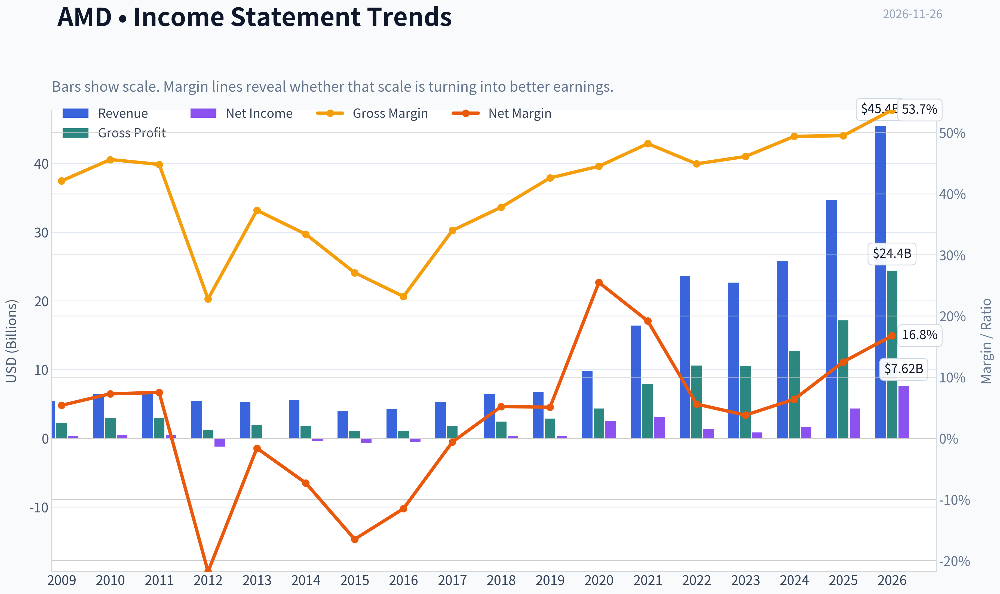

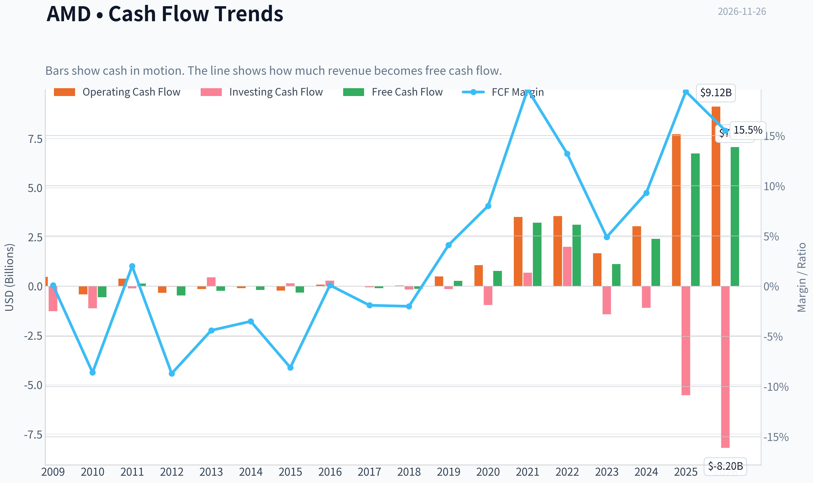

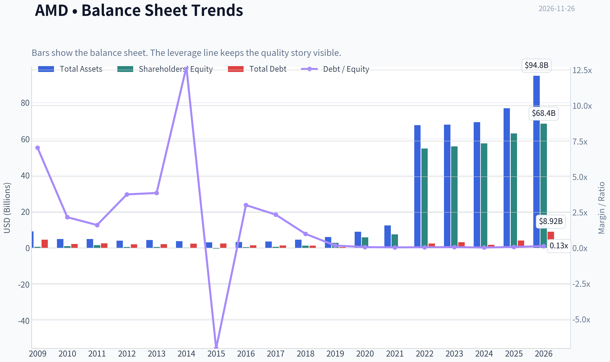

This graph tracks the profitability and return metrics (ROE, ROIC, Margins) of **AMD** over the past decade, highlighting capital efficiency trends.

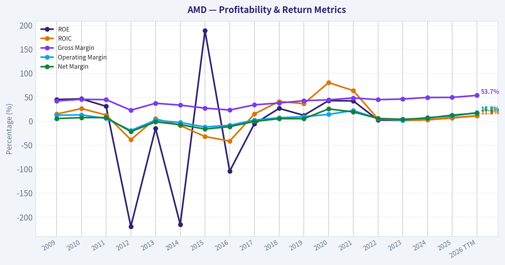

This chart illustrates the financial health of **AMD** over the last 10 years, mapping cash equivalents and free cash flow against total obligations (Debt).

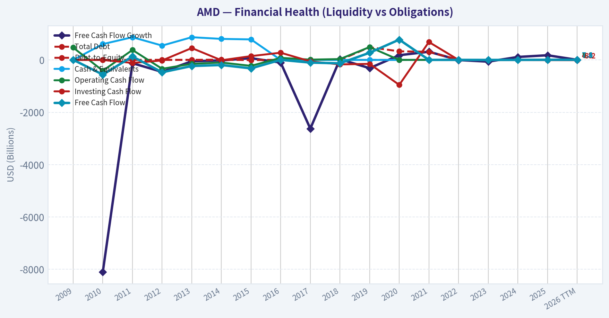

This comparison chart from *Profitability* stacks current figures against historical benchmarks for **AMD**, making it easy to see where the company trades relative to its own averages.

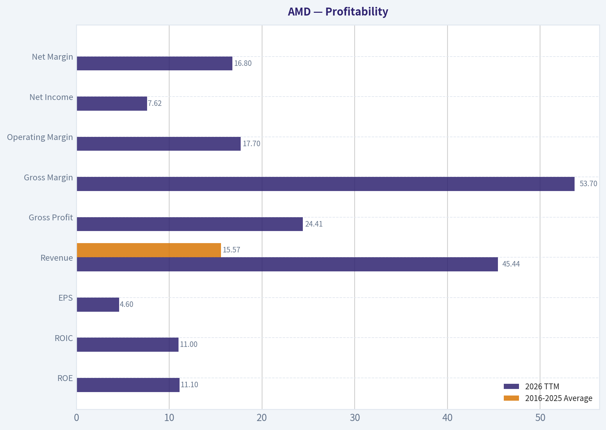

---

### Intrinsic Value Analysis (Buffett)

> *Following Warren Buffett's value investing philosophy: Circle of Competence, Economic Moat, Management Quality, and Margin of Safety.*

#### Intrinsic Value Snapshot

Price is what you pay. Intrinsic value is what the business may be worth based on the cash it can create for owners over time. We show a range, not one magic number.

- Current Price: $406.03
- Value Range (conservative to optimistic across both DCF methods): $18.57 to $179.56

##### Owner Earnings (Buffett Method)
- Net Income: $4,335,000,000.00
- Depreciation & Amortization: $3,004,000,000.00
- Capital Expenditures: $-974,000,000.00
- Working Capital Changes: $-2,378,000,000.00
- Owner Earnings: $3,346,000,000.00

##### Intrinsic Value
###### Buffett Method
Uses owner earnings. Stricter, and usually more conservative.
- Conservative: $58.57
- Average: $83.67
- Optimistic: $83.67
- Discount Rate: 8.3%

###### Cash Flow Method
Uses free cash flow. Better for companies spending heavily today to grow tomorrow.
- Conservative: $18.57
- Average: $148.17
- Optimistic: $179.56
- Discount Rate: 9.1%

ANALYST STANCE: **Bearish**

#### Executive Conclusion

AMD is a strategically important semiconductor company with strong revenue momentum, attractive gross margins, and substantial exposure to AI infrastructure. Its principal advantages include x86 CPU leadership, engineering capability, strategic customer relationships, and a growing data-center accelerator opportunity.

However, the valuation is exceptionally demanding. At approximately **$406 per share**, AMD trades at about **86.8 times earnings**, with a **1.0% FCF yield**. The DeepValues Buffett owner-earnings valuation is **$83.67 per share**, implying a **negative 385.3% margin of safety versus the current price**. The weighted Buffett score is **2.8 out of 5**, placing AMD in the Bearish category despite a credible long-term business franchise.

#### Factor Scorecard

| Factor | Score | Evidence |
|---|---:|---|
| Circle of Competence and Simplicity | 3/5 | The model is understandable-AMD designs chips and relies on manufacturing partners-but semiconductor product cycles, AI accelerators, software ecosystems, and geopolitical supply chains reduce predictability. |
| Moat | 3/5 | Strong CPU design capability, x86 ecosystem participation, customer qualification requirements, and intellectual property provide a narrow moat. The AI accelerator position remains highly competitive. |
| Management and Capital Allocation | 4/5 | Lisa Su has overseen a major strategic and financial turnaround, with disciplined emphasis on product execution and high-value markets. Insider ownership is not large enough to establish exceptional owner alignment. |
| Industry Structure | 3/5 | The industry has significant barriers to entry, but competition is intense, technology changes quickly, and customers depend on powerful rivals and foundry partners. |

**Key Takeaways:** AMD has a real franchise, but it is not a simple or highly predictable business. The moat is meaningful yet exposed to rapid innovation and formidable competition. Management quality is a strength; valuation is the dominant weakness.

#### Gate 5: Quality and Solvency

The hard floor is **not tripped**. AMD has positive net cash according to the valuation inputs, a current ratio of approximately **2.85**, and no evidence in the supplied data of simultaneous deteriorating cash flows and financial distress. The valuation concern is therefore not a solvency issue; it is the gap between business value and market price.

#### Moat Analysis

| Moat Source | Assessment | Evidence |
|---|---|---|
| Intangible assets | Moderate to strong | AMD's chip architecture, engineering talent, patents, and brand support a reported gross margin of **49.5%**. |
| Switching costs | Moderate | Cloud and enterprise customers face qualification, software, and system-integration costs, although large customers retain substantial bargaining power. |
| Cost advantage | Limited to moderate | AMD benefits from scale and fabless manufacturing, but it does not possess a structural manufacturing-cost advantage comparable to the leading foundries. |
| Network effects | Limited | The x86 ecosystem provides compatibility benefits. AMD's AI software ecosystem is developing but remains less entrenched than the dominant incumbent's. |

**Key Takeaways:** AMD's moat is best characterized as **narrow but potentially widening**, rather than wide and secure. Its strongest defenses are engineering capability, ecosystem compatibility, customer qualification, and scale. Its principal vulnerabilities are rapid obsolescence, intense competition, and dependence on external manufacturing capacity.

#### Management Quality and Capital Allocation

Management quality is a relative strength. Under Lisa Su, AMD shifted from a weaker competitive position toward higher-value CPU, data-center, and adaptive-computing markets. The company's strategy emphasizes research and development and product execution rather than financial engineering.

The main limitation is that AMD does not exhibit the extraordinary insider ownership or shareholder-control characteristics associated with the strongest owner-operated companies. Capital allocation appears rational, but the investment case depends primarily on successful reinvestment in technology rather than dividends or aggressive buybacks.

#### Financial Summary

| Metric | Latest Available Result |
|---|---:|
| Current price | $406 |
| Market capitalization | $672.01 billion |
| P/E | 86.8x |
| ROE | 6.9% |
| Revenue growth, year over year | 34.3% |
| Gross margin | 49.5% |
| FCF yield | 1.0% |
| Current ratio | 2.85x |
| Cash and marketable securities | $10.5 billion |
| Debt | $4.1 billion |
| Net cash used in valuation | $6.5 billion |
| Shares used in valuation | 1.661 billion |

**Key Takeaways:** AMD is growing rapidly and produces a healthy gross margin, but the equity valuation discounts a very favorable future. The 6.9% ROE and 1.0% FCF yield are modest relative to the valuation, meaning substantial future earnings expansion is already embedded in the share price.

#### Owner Earnings Calculation

| FY2025 Owner-Earnings Component | Amount |
|---|---:|
| After-tax operating income | $3.7 billion |
| Depreciation and amortization | $2.8 billion |
| Less: normalized capital-expenditure charge | $(0.9) billion |
| Less: working-capital investment | $0.0 billion |
| Estimated owner earnings | **$5.7 billion** |
| Owner earnings per share | **$3.43** |

**Key Takeaways:** The valuation framework estimates AMD's current owner earnings at approximately **$5.7 billion**, or **$3.43 per share**. At a $406 share price, the market is valuing AMD at roughly 118 times this owner-earnings figure, before accounting for the uncertainty of future semiconductor cycles.

#### Three-Scenario DCF Cross-Check

These are independent sensitivity calculations using $5.7 billion of owner earnings, 1.661 billion shares, and a 10% discount rate. The DeepValues app value remains the primary intrinsic-value figure.

| Scenario | Assumption | Estimated Value per Share |
|---|---|---:|
| A: No growth | Owner earnings capitalized at 10% | $34 |
| B: GDP-like growth | 3% perpetual growth | $50 |
| C: Historical-growth sensitivity | 7.5% growth for 10 years, then 2.5% terminal growth | $68 |

**Key Takeaways:** Even a favorable growth sensitivity produces a value below the current market price. The market price requires AMD to sustain unusually strong growth, profitability, and competitive execution for many years.

#### Intrinsic Value and Margin of Safety

The primary DeepValues Buffett owner-earnings valuation is:

| Valuation Measure | Result |
|---|---:|
| DeepValues intrinsic value | **$83.67 per share** |
| Conservative-to-optimistic range | $58.57-$83.67 |
| Current price | $406 |
| Margin of safety versus intrinsic value | **-385.3%** |
| App discount rate | 8.3% |
| App growth assumption | 10.0%, fading to 2.5% terminal growth |
| Net cash included | $6.5 billion |

**Key Takeaways:** AMD's intrinsic value under the supplied owner-earnings model is far below the market price. The business may ultimately exceed the model's assumptions, but the current valuation requires exceptional execution and sustained high growth rather than merely reasonable business performance.

#### Final Buffett Scorecard

| Criterion | Weight | Score | Weighted Contribution |
|---|---:|---:|---:|
| Moat width and durability | 25% | 3/5 | 0.75 |
| Valuation and margin of safety | 20% | 1/5 | 0.20 |
| Capital returns versus WACC | 15% | 2/5 | 0.30 |
| Business understanding and predictability | 12% | 3/5 | 0.36 |
| Management quality and capital allocation | 12% | 4/5 | 0.48 |
| Reinvestment runway | 8% | 5/5 | 0.40 |
| Balance-sheet strength | 4% | 4/5 | 0.16 |
| Industry structure | 4% | 3/5 | 0.12 |
| **Total** | **100%** |  | **2.77/5** |

#### Investment Stance

**Bearish - Moderate conviction.**

AMD is a high-quality strategic competitor with strong reinvestment potential and capable management. The evidence does not support the valuation at approximately **$406 per share**: the price implies heroic long-term growth, while owner-earnings valuation, FCF yield, ROE, and conservative DCF scenarios point to materially lower intrinsic value. The conclusion is driven primarily by valuation, not by a solvency problem or a judgment that AMD lacks a viable business.
#### Valuation Bridge

This bridge places the current market price beside each intrinsic value lens so readers can see whether upside depends on one method or shows up across several methods.

| Scenario | Intrinsic Value / Share |
| --- | ---: |
| Buffett Method | $83.67 |
| Cash Flow Method | $148.17 |
| Damodaran Method | $25.83 |
| Current Price | $406.03 |

#### Key Takeaways

If one method is far above the others, the upside case depends on a specific modelling assumption. When several methods cluster together, the valuation story is more robust.

#### Valuation Visuals

This comparison chart from *Latest Earnings Snapshot* stacks current figures against historical benchmarks for **AMD**, making it easy to see where the company trades relative to its own averages.

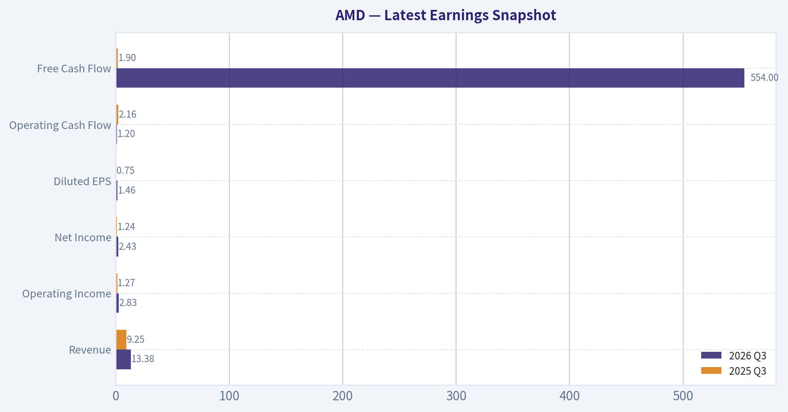

This comparison chart from *Balance Sheet and Financial Strength* stacks current figures against historical benchmarks for **AMD**, making it easy to see where the company trades relative to its own averages.

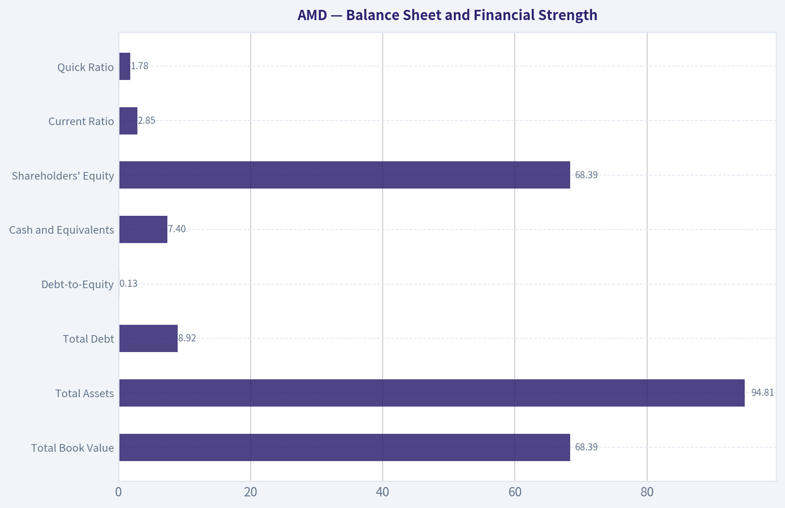

This comparison chart from *Cash Flow and Capital Allocation* stacks current figures against historical benchmarks for **AMD**, making it easy to see where the company trades relative to its own averages.

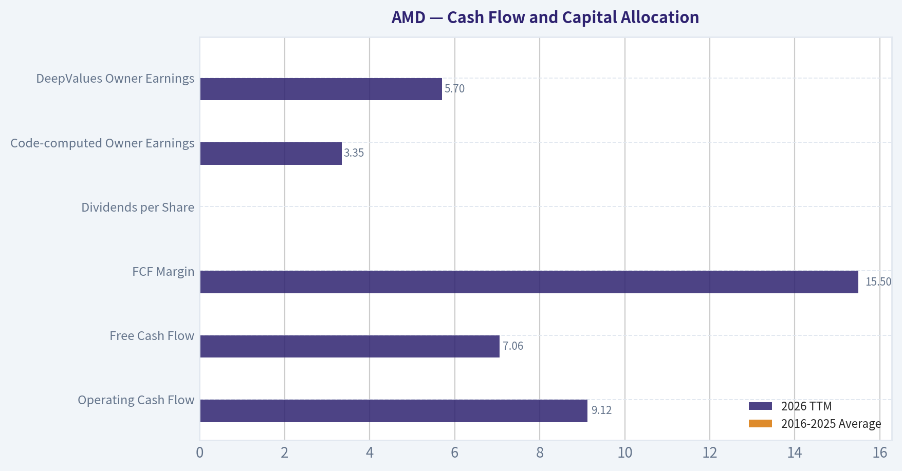

---

### Trend & Growth Analysis (Lynch/Druckenmiller/Fisher)

> *Following Peter Lynch's GARP, Stanley Druckenmiller's macro-aware approach, and Philip Fisher's scuttlebutt methodology.*

ANALYST STANCE: **Neutral**

#### 1. Lynch Classification

AMD is a **Fast Grower**, driven by data-center CPUs, AI accelerators, embedded computing, and adaptive chips. Its reported revenue growth of **34.3% year over year** exceeds the 15-25% fast-grower threshold. However, the valuation already discounts substantial future success.

#### 2. The Story in Three Bullets

- AMD is attempting to become the leading alternative supplier to Nvidia in AI accelerators while retaining a strong position in server CPUs.
- The company benefits from secular growth in AI infrastructure, cloud computing, and high-performance computing.
- The key question is whether AMD can convert strong revenue growth into durable market share, expanding margins, and cash flow sufficient to justify a very high earnings multiple.

#### 3. TAM and Tenfold Test

AMD's latest reported annual revenue base is approximately **$34.6 billion**, using the most recent fiscal-year scale available in the research pack. A tenfold outcome would imply roughly **$346 billion in annual revenue**.

| TAM factor | Assessment |
|---|---:|
| Approximate current annual revenue | $34.6B |
| Tenfold revenue requirement | $346B |
| Relevant markets | AI accelerators, server CPUs, gaming, embedded, adaptive computing |
| Market structure | Large and expanding, but highly competitive |
| Can AMD reach 10x revenue while remaining below 20% of TAM? | Potentially yes |
| TAM growth | Strongest in AI infrastructure; more moderate in mature CPU and gaming markets |

**Key Takeaways:** AMD has a sufficiently large addressable market for a tenfold revenue scenario to remain mathematically possible. The AI accelerator market is the main TAM expansion vector, but Nvidia's ecosystem, customer concentration, supply constraints, and specialized competition make share capture uncertain.

#### 4. Revenue Growth Trend

| Metric | Latest reading | Interpretation |
|---|---:|---|
| Revenue growth, year over year | 34.3% | Fast growth |
| Growth pattern | One latest growth datapoint available | Acceleration cannot be confirmed |
| Gross margin | 49.5% | Solid, but below leading fabless semiconductor economics |
| P/E ratio | 86.8x | Very demanding |
| Return on equity | 6.9% | Modest relative to valuation |
| Free-cash-flow yield | 1.0% | Limited current cash-flow support |

**Key Takeaways:** AMD has strong reported growth, but the available data does not establish a multi-quarter acceleration pattern. The combination of a 49.5% gross margin, 6.9% ROE, and 1.0% free-cash-flow yield shows that the valuation depends primarily on future earnings expansion rather than current financial productivity.

#### 5. Unit Economics and Operating Efficiency

| Measure | AMD assessment |
|---|---|
| LTV/CAC | Not disclosed or not applicable in a directly comparable form |
| Net revenue retention | Not applicable; AMD is primarily a semiconductor supplier |
| Rule of 40 | Not applicable |
| Gross margin | 49.5% |
| Current ratio | 2.85 |
| Balance-sheet liquidity | Strong |
| Dilution and capital intensity | Requires monitoring; semiconductor design and supply-chain commitments remain material |

**Key Takeaways:** SaaS measures such as LTV/CAC and net revenue retention are not meaningful for AMD. Liquidity is a strength, but the more important operating test is whether AI product mix and scale lift gross and operating margins over time.

#### 6. Inflection-Point Assessment

| Potential inflection | Evidence | Assessment |
|---|---|---|
| Product cycle | AI accelerators and next-generation server products | Positive |
| Market share | Opportunity to gain share from incumbent AI and CPU suppliers | Promising, not yet proven |
| Margin | AI mix could improve economics; current gross margin is 49.5% | Emerging |
| TAM | AI infrastructure materially expands AMD's opportunity | Strong |
| Competitive landscape | Large incumbent ecosystems and custom silicon remain formidable | Mixed |
| Earnings power | High future expectations embedded in valuation | Market is already anticipating success |

**Key Takeaways:** The strongest inflection is TAM expansion through AI infrastructure. The decisive confirmation would be sustained accelerator revenue growth accompanied by rising margins and repeat customer adoption, rather than a single strong product cycle.

#### 7. Macro Setup

| Macro factor | Effect on AMD |
|---|---|
| AI and cloud infrastructure spending | Strong tailwind |
| High-performance computing demand | Positive |
| Interest rates | Headwind for long-duration growth valuations |
| Thirty-year Treasury reference rate | 5.30% |
| Semiconductor cyclicality | Ongoing risk |
| Enterprise IT budgets | Sensitive to economic conditions |
| Geopolitical and export restrictions | Material risk |

**Key Takeaways:** The secular AI trend is highly favorable, but the valuation is exposed to elevated discount rates. A 5.30% long-term Treasury rate creates a meaningful headwind for a company whose most important profits are expected several years in the future.

#### 8. Fisher's 15-Point Assessment

Scored from 1 to 5, based on currently available information.

| Fisher criterion | Score | Rationale |
|---|---:|---|
| Market potential | 5 | AI, cloud, and data-center markets are large |
| New-product determination | 5 | Sustained product investment |
| R&D effectiveness | 4 | Strong engineering position, execution still critical |
| Sales organization | 4 | Established enterprise and hyperscaler relationships |
| Profit margins | 3 | Positive but not yet exceptional |
| Margin trend | 4 | AI mix offers operating leverage potential |
| Labor relations | 4 | No major structural concern identified |
| Executive relations | 4 | Generally experienced leadership |
| Management depth | 4 | Strong technical and operating bench |
| Cost analysis and accounting | 4 | No major issue identified |
| Outstanding competitive aspects | 4 | Architecture, ecosystem progress, switching costs |
| Long-range profit outlook | 4 | Attractive if AI share gains persist |
| Dilution risk | 3 | Monitor equity compensation and share count |
| Management candor | 3 | Limited independent evidence in the pack |
| Management integrity | 4 | No major integrity issue identified |
| **Total** | **59 / 75** | **Good** |

**Key Takeaways:** AMD scores well on market potential, innovation, and long-term opportunity. The score is held below the outstanding range by valuation risk, incomplete evidence on customer economics, and the need to prove that AI momentum translates into durable profitability.

#### 9. Valuation Analysis

| Valuation measure | Result | Interpretation |
|---|---:|---|
| Current price | $406 | Market reference |
| Market capitalization | $672.0B | Very large valuation base |
| P/E | 86.8x | Very demanding |
| Earnings growth used for PEG | 34.3% | Based on latest revenue growth, not EPS growth |
| Indicative PEG using revenue growth | 2.53x | Expensive |
| Owner-earnings intrinsic value, base | $83.67 | Far below market price |
| Owner-earnings range | $58.57-$83.67 | Substantial valuation gap |
| Free-cash-flow DCF range | $18.57-$179.56 | Highly assumption-sensitive |
| Damodaran FCFF range | $5.17-$91.09 | More conservative cross-check |

**Key Takeaways:** The PEG approximation is above 2.0, which indicates that valuation is expensive even against strong growth. The primary intrinsic-value estimate is $83.67, compared with a $406 market price; this implies that the current valuation requires much stronger long-term earnings and cash-flow outcomes than the base owner-earnings model assumes.

#### 10. Growth Investor Scorecard

| Criterion | Weight | Score | Weighted result |
|---|---:|---:|---:|
| Lynch story | 10% | 4.5 / 5 | 0.45 |
| TAM and runway | 20% | 4.5 / 5 | 0.90 |
| Revenue growth | 20% | 4.0 / 5 | 0.80 |
| Unit economics | 15% | 3.0 / 5 | 0.45 |
| Competitive position | 10% | 4.0 / 5 | 0.40 |
| Management quality | 10% | 4.0 / 5 | 0.40 |
| Macro setup | 5% | 3.0 / 5 | 0.15 |
| Profitability path | 5% | 3.5 / 5 | 0.18 |
| Valuation | 5% | 1.5 / 5 | 0.08 |
| **Total** | **100%** | - | **3.81 / 5** |

**Key Takeaways:** AMD achieves an overall score consistent with a strong growth business under observation. Its operating opportunity is compelling, but valuation is the dominant weakness and prevents a high-conviction stance under this framework.

#### 11. Valuation Sensitivity

The current market value implies that AMD must materially exceed conservative intrinsic-value assumptions. The sensitivity is especially high to AI accelerator market share, gross margin, operating leverage, and the duration of high growth.

| Scenario | Core assumption | Valuation implication |
|---|---|---|
| Bear | AI share gains disappoint; margins remain near current levels | Current valuation unsupported |
| Base | Strong AI and server growth with moderate margin expansion | Below current market value under owner-earnings analysis |
| Bull | AMD establishes durable AI ecosystem share and achieves major earnings leverage | Current valuation becomes more defensible |
| Extreme upside case | AMD becomes a broad second source for hyperscaler AI demand | Requires sustained execution beyond currently demonstrated economics |

**Key Takeaways:** The valuation is not primarily sensitive to near-term revenue growth; it is sensitive to whether AMD becomes a durable, high-margin AI platform. The market price requires a bull-case trajectory, while the primary intrinsic-value model remains substantially lower.

#### 12. Key Risks and Catalysts

| Catalysts | Risks |
|---|---|
| Sustained AI accelerator adoption | Nvidia ecosystem strength |
| Hyperscaler second-source demand | Custom chips reducing merchant-chip demand |
| Rising data-center CPU share | Export controls and geopolitical restrictions |
| Gross-margin expansion | Semiconductor cyclicality |
| Stronger software ecosystem | Supply-chain and advanced-packaging constraints |
| Operating leverage | High interest rates compressing growth multiples |
| Larger recurring enterprise deployments | Valuation compression if growth decelerates |

**Key Takeaways:** The main catalyst is proof that AMD can turn AI demand into repeatable, high-margin platform revenue. The main risk is that the company delivers strong growth but not enough profitability or market share to support the valuation.

#### Bottom Line

AMD fits the **Fast Grower** category and participates in some of the strongest secular themes in technology. Its TAM and product opportunity are attractive, but current evidence does not yet prove sustained revenue acceleration, superior unit economics, or sufficient cash-flow growth to support a $406 valuation. Under the Lynch, Druckenmiller, and Fisher framework, the appropriate research conclusion is **Neutral**, with particular attention to AI market share, gross-margin expansion, operating leverage, and multi-quarter revenue durability.

#### Growth & Scorecard Visuals

This comparison chart from *Growth Metrics* stacks current figures against historical benchmarks for **AMD**, making it easy to see where the company trades relative to its own averages.

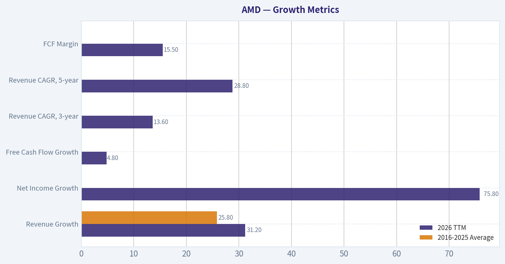

---

### Market Technical Analysis

ANALYST STANCE: **Neutral**

#### AMD technical analysis

The latest available AMD data is from **November 25, 2026**, because November 26 is not shown as a trading session in the retrieved dataset. AMD closed at **$406.03**, down sharply from the late-October level near $560 and from the November 12 close of $585.30. The decline has been accompanied by unusually wide daily ranges and several high-volume selloffs, indicating a material deterioration in short- and medium-term price structure.

The selected indicators are **10 EMA, 50 SMA, 200 SMA, MACD, RSI, ATR, VWMA, and Bollinger middle band**. Together, they cover short-, medium-, and long-term trend, momentum, volatility, volume-weighted price behavior, and mean-reversion context without relying on multiple versions of the same signal.

| Indicator | Latest value | Price relationship | Interpretation |
|---|---:|---:|---|
| AMD close | $406.03 | - | Latest available close on November 25 |
| 10 EMA | $462.96 | Price 12.3% below | Short-term momentum remains decisively negative |
| 50 SMA | $548.35 | Price 25.9% below | Medium-term trend has broken down substantially |
| 200 SMA | $432.96 | Price 6.2% below | Price has moved beneath the long-term trend benchmark |
| VWMA | $488.49 | Price 16.9% below | Volume-weighted trading activity is centered well above the latest close |
| Bollinger middle | $489.22 | Price 17.0% below | Price is materially below its 20-session mean |
| RSI | 38.01 | Below neutral 50 | Weak momentum, but not at the conventional oversold threshold |
| ATR | $46.51 | About 11.5% of price | Exceptionally high short-term volatility |

**Key Takeaways:** AMD is below every listed moving-average and volume-weighted reference except none of the major trend measures, including the 200-day SMA. RSI is weak but not deeply oversold, while ATR shows that daily price movements remain unusually large. The combination indicates significant technical stress rather than a narrowly defined oversold reversal condition.

#### Trend structure

The short-term trend is clearly negative. The **10-day EMA declined from $555.90 on October 29 to $462.96 on November 25**, a fall of roughly 16.7%. AMD's close has remained below this EMA since the large breakdown beginning October 30, apart from no sustained recovery above it. The latest close is approximately $57 below the EMA, showing that recent selling has created substantial downside separation from the short-term average.

The **50-day SMA is also turning lower**, falling from $581.03 on October 27 to $548.35 on November 25. This is important because the medium-term average had previously been relatively elevated and stable, but the recent decline is now pulling it downward. AMD's close is about $142 below that average, so the medium-term trend remains heavily damaged even if short-term volatility produces intermittent rebounds.

The **200-day SMA remains upward sloping**, rising from $405.50 on October 27 to $432.96 on November 25. However, the latest close is below it by approximately 6.2%. This creates a split between a still-rising longer-term average and a price that has broken beneath it. The long-term trend has not fully flattened or reversed based on the average alone, but the price breach weakens the prior bullish structure and increases the importance of whether AMD can establish sustained trading above that benchmark.

#### Momentum and price behavior

MACD has deteriorated materially. It moved from **-5.24 on October 29 to -28.07 on November 25**, with the negative reading becoming more pronounced after the November 13-25 decline. The sequence from **-9.83 on November 17 to -16.29 on November 20 and -28.07 on November 25** shows that downside momentum accelerated rather than merely drifting lower.

RSI provides a more nuanced signal. It reached **29.75 on November 5**, briefly entering conventional oversold territory during the initial breakdown, then recovered to **57.48 on November 12** as AMD rebounded toward $585.30. That recovery failed, and RSI fell to **38.01 by November 25**. This suggests momentum has weakened considerably, but the indicator is not currently at the extreme level associated with a classic oversold reading. The failure of RSI to remain above 50 after the November rebound is consistent with a failed momentum recovery.

Price action has also become increasingly discontinuous. AMD fell from $488.78 on November 4 to $404.40 on November 5, rebounded to $585.30 by November 12, then declined to $406.03 by November 25. This creates a wide trading range rather than a smooth trend, and it indicates that headline sensitivity and rapid repricing are significant features of the current market condition.

#### Volatility and volume

ATR rose from **$26.00 on October 29 to $46.51 on November 25**, an increase of approximately 79%. At the latest close, ATR represents about 11.5% of the share price, which is very high for a single-day average true range. This means that indicator signals are more exposed to whipsaw risk: even when the broader direction is negative, individual sessions can produce sharp countertrend rallies.

Volume was elevated during the major declines. Trading volume reached approximately **71.2 million shares on November 19** and **70.3 million on November 20**, compared with roughly 51.3 million on November 25 and 46.2 million on November 24. The large-volume declines on November 19-20 indicate strong participation during the breakdown from the low-$500s toward the low-$400s. The VWMA's decline from **$558.18 on October 27 to $488.49 on November 25** confirms that volume-weighted trading has migrated lower, although it remains well above the latest close.

The Bollinger middle band fell from **$581.03 on October 27 to $489.22 on November 25**. AMD's latest close is about $83 below this 20-session mean. Because the upper and lower bands were not retrieved, the degree of statistical extension relative to the full Bollinger envelope cannot be measured precisely. The distance below the middle band nevertheless confirms that the recent price action is substantially weaker than its recent average.

#### Valuation implications

Technical indicators cannot establish AMD's intrinsic valuation or determine whether the current price reflects future earnings, semiconductor-cycle expectations, or AI-related growth assumptions. They do show that the market has recently reassessed the stock at much lower prices, with the latest close below short-, medium-, and long-term reference levels and with elevated volatility. On technical evidence alone, the data does not support treating the current price as validated by a stable bullish trend; fundamental earnings, cash-flow, guidance, and valuation multiples would be needed to assess whether the repricing is excessive or justified.

| Area | Evidence | Assessment |
|---|---|---|
| Price trend | Close at $406.03 versus $462.96 10 EMA and $548.35 50 SMA | Strong short- and medium-term deterioration |
| Long-term structure | Close 6.2% below $432.96 200 SMA | Long-term benchmark has been breached, although the SMA itself is still rising |
| Momentum | MACD at -28.07; RSI at 38.01 | Bearish momentum, but RSI is not deeply oversold |
| Volatility | ATR at $46.51, approximately 11.5% of price | Very high movement and elevated signal noise |
| Volume confirmation | Heavy volume near the November 19-20 breakdown | Selling pressure had meaningful participation |
| Mean reversion | Close below $489.22 Bollinger middle and $488.49 VWMA | Price is materially below recent average and volume-weighted value |
| Overall technical regime | Multiple bearish confirmations with sharp countertrend swings | High-risk, unstable, and technically weak market condition |
| Valuation conclusion | Technical data alone lacks earnings and cash-flow context | No reliable intrinsic-value conclusion from these indicators alone |

**Key Takeaways:** The dominant message is a confirmed breakdown across short-, medium-, and long-term trend measures, reinforced by negative MACD and heavy-volume declines. The main counterpoint is that RSI is weak without being deeply oversold, while the 200-day SMA is still rising; however, those qualifications do not yet offset the breadth of the deterioration. The evidence indicates a highly unstable technical regime and is insufficient by itself to validate AMD's valuation.

#### Market Visuals

This comparison chart from *Market Metrics and Valuation* stacks current figures against historical benchmarks for **AMD**, making it easy to see where the company trades relative to its own averages.

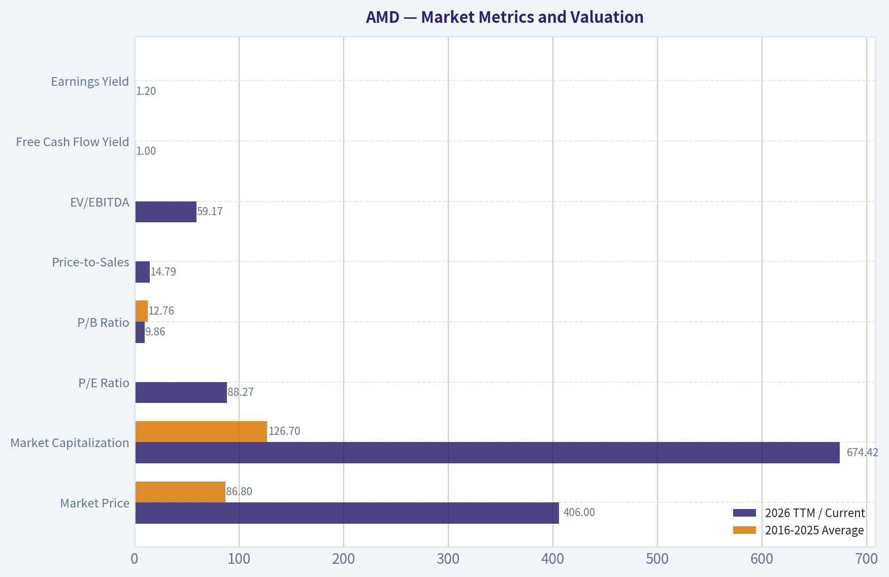

---

### Options Market Analysis

> *Reading options flow - put/call ratios, IV skew, and unusual activity - to gauge institutional positioning and event-driven risk.*

ANALYST STANCE: **Bullish**

#### AMD Options Flow Report

*Data as of November 26, 2026. The supplied chain does not include AMD's exact underlying price, so strike moneyness is assessed relative to the apparent near-term at-the-money area around $400-$405 and should be treated as approximate.*

#### 1. Put/Call Ratio Analysis

| Expiration | Call OI | Put OI | Put/Call OI | Call Volume | Put Volume | Put/Call Volume |
|---|---:|---:|---:|---:|---:|---:|
| Nov. 27, 2026 | 98,722 | 67,858 | 0.69 | 102,098 | 86,831 | 0.85 |
| Nov. 30, 2026 | 19,005 | 10,069 | 0.53 | 20,392 | 17,604 | 0.86 |
| Dec. 2, 2026 | 8,383 | 7,135 | 0.85 | 7,429 | 3,990 | 0.54 |
| **Total** | **126,110** | **85,062** | **0.67** | **129,919** | **108,425** | **0.83** |

**Key Takeaways:** The aggregate put/call OI ratio of 0.67 is slightly more call-heavy than the historical neutral baseline near 0.70. The 0.83 volume ratio also shows greater call activity, although the difference is not extreme. The strongest call bias appears in the November 30 expiration, while the December 2 chain is closer to balanced on open interest.

The data therefore indicates a **modestly bullish near-term bias**, rather than an aggressive directional consensus. Elevated call activity can represent bullish speculation, upside hedging, or covered-call activity, so the ratio alone does not establish that all call flow is outright bullish.

#### 2. Implied Volatility Assessment

| Expiration | Call ATM IV | Put ATM IV | IV Level | Interpretation |
|---|---:|---:|---|---|
| Nov. 27, 2026 | 90.2% | 89.6% | Very high | Significant one-day event or movement premium |
| Nov. 30, 2026 | 85.4% | 84.2% | Very high | Elevated short-dated uncertainty |
| Dec. 2, 2026 | 99.0% | 98.1% | Extremely high | Highest near-term volatility pricing |

**Key Takeaways:** Near-term ATM implied volatility is exceptionally high, ranging from roughly 85% to 99%. Put ATM IV is slightly below call ATM IV in every listed expiration, which does not show broad, heavy downside skew at the ATM point. No specific catalyst was supplied, so the high IV should be viewed as event or gap-risk pricing rather than attributed to a confirmed earnings or product event.

| Observed Contract | Type | Strike | IV | Skew Signal |
|---|---|---:|---:|---|
| Nov. 27 $375 | Put | $375 | 99.3% | Elevated downside-wing pricing |
| Nov. 27 $385 | Put | $385 | 94.4% | Slightly rich downside protection |
| Nov. 27 $402.50 | Put | $402.50 | 91.9% | Near-ATM put premium |
| Nov. 27 $405 | Call | $405 | 84.6% | Lower than nearby put IV |
| Nov. 27 $410 | Call | $410 | 89.4% | Moderate upside-wing pricing |
| Nov. 27 $430 | Call | $430 | 83.3% | Lower far-upside IV |

**Key Takeaways:** The detailed contracts suggest a **mild downside skew near the apparent ATM area**, especially around the $402.50 put versus the $405 call. However, some far-out-of-the-money calls also carry elevated IV, indicating that upside-tail speculation remains active. Overall skew is best described as mildly defensive but not strongly bearish.

#### 3. Unusual Options Activity

All contracts below had volume greater than five times open interest and at least 500 contracts of volume, indicating potentially fresh activity. Because trade direction, bid/ask execution, and order provenance were not supplied, the flow cannot be definitively classified as opening purchases or sales.

| Expiry | Type | Strike | Approx. Moneyness* | Volume | OI | Vol/OI | IV | Interpretation |
|---|---|---:|---|---:|---:|---:|---:|---|
| Nov. 27 | Call | $400 | Near ATM | 8,523 | 997 | 8.5x | 88.3% | Largest unusual call flow; upside interest or call overwriting |
| Nov. 27 | Call | $410 | Slightly OTM | 6,311 | 546 | 11.6x | 89.4% | Fresh upside speculation or upside hedging |
| Nov. 27 | Call | $430 | OTM | 5,101 | 972 | 5.2x | 83.3% | Far-upside participation, but lower IV than nearer calls |
| Nov. 27 | Call | $420 | OTM | 5,001 | 656 | 7.6x | 85.3% | Upside-tail activity |
| Nov. 27 | Call | $405 | Near ATM | 3,992 | 146 | 27.3x | 84.6% | Strong fresh-flow indication |
| Nov. 27 | Put | $375 | OTM | 3,587 | 274 | 13.1x | 99.3% | Downside hedge or bearish tail speculation |
| Nov. 27 | Call | $380 | ITM or near ITM* | 3,180 | 96 | 33.1x | 101.3% | Very high turnover relative to existing OI |
| Nov. 27 | Call | $390 | Near ITM* | 3,144 | 60 | 52.4x | 96.6% | One of the strongest fresh-flow ratios |
| Nov. 27 | Call | $375 | ITM* | 2,733 | 69 | 39.6x | 110.7% | Deepest apparent call activity; potentially aggressive upside exposure |
| Nov. 30 | Put | $320 | OTM | 2,691 | 132 | 20.4x | 110.4% | Downside-tail hedge or bearish speculation |
| Nov. 27 | Call | $395 | Near ATM/ITM* | 2,227 | 113 | 19.7x | 94.3% | Fresh near-term call activity |
| Nov. 27 | Put | $385 | OTM | 1,944 | 349 | 5.6x | 94.4% | Additional downside protection |
| Nov. 27 | Call | $385 | ITM* | 1,896 | 50 | 37.9x | 99.9% | Very high turnover relative to OI |
| Nov. 27 | Put | $402.50 | Near ATM | 1,784 | 297 | 6.0x | 91.9% | Near-term downside hedge activity |
| Nov. 27 | Call | $427.50 | OTM | 1,665 | 164 | 10.2x | 82.5% | Upside-tail flow |

\*Moneyness is approximate because the exact AMD share price was not included in the data.

**Key Takeaways:** Unusual activity is dominated by November 27 calls, particularly the $400, $405, $410, and $420-$430 strikes. There is also meaningful downside protection through the $375, $385, $402.50, and November 30 $320 puts. The very short expirations and far-out-of-the-money strikes make retail speculation plausible, while the data does not provide enough execution detail to identify institutional or "smart-money" activity with confidence.

#### 4. Open Interest Concentration and Potential Gamma Levels

| Expiration | Total Call OI | Total Put OI | Combined OI | Concentration Assessment |
|---|---:|---:|---:|---|
| Nov. 27, 2026 | 98,722 | 67,858 | 166,580 | Dominant near-term concentration |
| Nov. 30, 2026 | 19,005 | 10,069 | 29,074 | Secondary concentration |
| Dec. 2, 2026 | 8,383 | 7,135 | 15,518 | Smaller but relatively balanced |
| **Total** | **126,110** | **85,062** | **211,172** | **Heavily concentrated in Nov. 27 expiry** |

**Key Takeaways:** The November 27 expiration contains approximately 79% of the reported combined open interest, making it the main source of near-term expiry-related price sensitivity. The aggregate call concentration is materially larger than put open interest. Exact strike-by-strike maximum open interest was not supplied, so a definitive max-pain level or gamma wall cannot be calculated.

The unusual-flow strikes around $400-$410 are the most relevant potential short-dated gamma area based on the available data. If dealer hedging is significant, this concentration could dampen movement near those strikes; if price moves rapidly through them, hedging flows could instead amplify the move. This remains conditional because complete strike-level OI and dealer-gamma data are unavailable.

#### 5. Overall Options Sentiment Signal

| Factor | Assessment | Directional Implication |
|---|---|---|
| Put/Call OI | 0.67, below the 0.70 neutral reference | Mildly bullish |
| Put/Call volume | 0.83 | Mildly bullish |
| ATM IV | 85%-99% | Very high uncertainty and gap risk |
| IV skew | Slight downside skew near ATM, with active upside call wing | Mixed, slightly defensive |
| Unusual activity | More large call flows than put flows | Bullish tilt, but speculative |
| Expiry concentration | Heavy November 27 concentration | Strong near-term pinning or volatility risk |
| **Overall signal** | **BULLISH, low-to-moderate confidence** | Call-heavy flow is the primary driver |

**Key Takeaways:** AMD's options market presents a **BULLISH** near-term signal, driven primarily by call-heavy open interest, a sub-neutral aggregate put/call ratio, and concentrated fresh call activity across the $400-$430 region. Confidence is limited by extremely high implied volatility, the dominance of one-day expirations, simultaneous downside-tail put demand, and the absence of trade-side or dealer-gamma information. The evidence supports a bullish options-market bias, but it also implies unusually high event and gap-risk pricing rather than a clean, low-volatility directional consensus.

#### Summary

| Category | Summary |
|---|---|
| Put/Call Ratio | OI ratio 0.67 and volume ratio 0.83; modestly more call-heavy than neutral |
| IV Level | Extremely elevated; approximately 85%-99% for near-term ATM options |
| Skew Direction | Mild downside skew near ATM, offset by active upside call-wing speculation |
| Unusual Activity | Large fresh-looking call flows at $400-$430, with meaningful downside puts at $320-$402.50 |
| Overall Signal | **BULLISH**, with low-to-moderate confidence because of high IV and very short expirations |

---

## Research Team Commentary

> *The Research Manager synthesizes the Bull vs Bear debate into action-free commentary. This is a pre-risk view, not the final stance.*

Core takeaway

AMD is a strategically valuable semiconductor franchise with credible advantages in x86 server CPUs, chiplet design, customer qualification, and engineering execution. Lisa Su's record and the opportunity to become the leading alternative to Nvidia in AI accelerators deserve substantial credit. Nevertheless, the evidence does not support AMD's $406 valuation with an adequate margin of safety. At roughly 86.8 times earnings, the market is already assuming prolonged rapid growth, significant margin expansion, successful AI ecosystem development, and much higher returns on capital.

The central distinction is between a good company and attractively valued shares. AMD increasingly resembles the former, but the current numbers do not establish the latter.

Bull case

The strongest bullish argument is that AMD is no longer a marginal cyclical chip supplier. Its EPYC server franchise operates behind meaningful barriers: x86 compatibility, demanding qualification processes, advanced design expertise, software optimization, and long product road maps. Its chiplet architecture and foundry-based model also give it flexibility without requiring ownership of leading-edge fabrication plants.

AI provides a second, potentially much larger growth engine. AMD does not need to displace Nvidia to create substantial economic value. Hyperscalers want supply diversification, negotiating leverage, and credible alternatives. A durable minority share of a rapidly expanding accelerator market could support years of revenue and earnings growth. Increasing abstraction by cloud platforms and improving software portability could also reduce some of CUDA's lock-in over time.

Management is another genuine asset. Lisa Su's transformation of AMD, the rebuilding of the server business, and the expansion into adaptive computing demonstrate unusually strong strategic execution. Current profitability may understate normalized economics if software spending, product development, and ecosystem investment are laying the foundation for a much larger data-center platform.

The recent fall from approximately $585 to $406 has reduced the valuation burden. It does not prove undervaluation, but it shows that some prior enthusiasm has been removed.

Bear case

The valuation remains the decisive problem. At $406 and approximately 86.8 times earnings, current earnings are about $4.68 per share. An illustrative reverse-valuation exercise suggests that growth around 15% annually for a decade would probably remain insufficient unless accompanied by unusually favorable terminal assumptions. Something closer to 20% annual earnings growth, substantial interim cash generation, and a premium terminal multiple is needed to make the current price broadly coherent. That is possible, but it is not a conservative base case.

AMD's reported economics do not yet validate those assumptions. Gross margin of 49.5% is respectable, but ROIC of 6.7%, ROE of 6.9%, and ROA of 5.6% are not the returns of a proven premium compounder. These figures may be affected by acquisition accounting, Xilinx-related capital, and current investment intensity, so they should not be interpreted mechanically. Even so, the missing evidence is precisely what the valuation requires: expanding operating margins, strong free-cash-flow conversion, and incremental returns comfortably above the cost of capital.

The AI moat also remains prospective rather than established. Nvidia's CUDA ecosystem creates developer familiarity, mature libraries, customer workflows, and network effects. AMD could win meaningful accelerator revenue while earning less attractive economics if it must use aggressive pricing, heavy customer customization, or sustained software subsidies. Market share is not the same as economic profit.

Customer diversification cuts both ways. Hyperscalers want a credible second source, but they are powerful buyers developing their own custom silicon. AMD faces Nvidia, a potentially recovering Intel, ARM-based CPUs, and internal chips from Amazon, Google, Microsoft, and others. These customers can support AMD's growth while simultaneously constraining its pricing power.

The sharp share-price decline and modestly call-heavy options data deserve little weight in an intrinsic-value assessment. Price action signals changing expectations, not durable cash-flow economics. A stock can fall substantially and still embed demanding assumptions.

Rationale

Buffett's framework allows a narrow margin of safety for a genuinely wonderful, predictable, high-ROIC business. AMD has enough strategic quality that a premium valuation is reasonable, but it has not yet demonstrated the profitability, software moat, or cash-flow predictability that would justify treating it like a mature wide-moat compounder.

The current valuation effectively capitalizes several successes at once: continued server share gains, a durable number-two AI platform, improving ROCm adoption, material margin expansion, strong cash conversion, and a premium valuation many years from now. Failure in only one or two of these areas could materially reduce intrinsic value.

The lack of a supplied DeepValues intrinsic-value estimate, normalized free-cash-flow analysis, and complete balance-sheet information also matters. P/E can be distorted by acquisition amortization and investment spending, but that uncertainty is not itself a margin of safety. Better cash-flow evidence is necessary before concluding that reported earnings materially understate sustainable owner earnings.

The relevant lesson from similar growth situations is not to equate a large addressable market with shareholder value, or strategic importance with superior returns. It is also a mistake to label mediocre current returns "temporary" without setting measurable milestones. AMD deserves qualitative credit, but management quality and AI enthusiasm should not be capitalized twice-first through optimistic forecasts and again through a premium terminal multiple.

Monitoring plan

Over the next one to four quarters, the first priority is data-center performance. Server CPU share gains should continue without material deterioration in pricing, while accelerator growth should come from repeat deployments and broader customer adoption rather than a few concentrated orders.

Second, gross and operating margins should rise as data-center and AI revenue scales. Revenue growth without operating leverage would support the bear argument that customers and ecosystem costs are capturing much of the value.

Third, free cash flow should begin growing faster than accounting earnings or at least demonstrate consistent conversion. Stock-based compensation, acquisition amortization, working-capital movements, and capitalized or recurring ecosystem costs should be separated to estimate normalized owner earnings.

Fourth, ROCm adoption needs concrete validation: broader framework support, easier deployment, cloud availability, developer usage, and customers using AMD in production rather than only as a trial or negotiating tool.

Fifth, incremental ROIC should improve materially from the reported 6.7%. If AI and data-center investments are genuinely high-return, that improvement should eventually appear in margins, cash generation, and returns on capital.

Finally, customer concentration, custom-silicon adoption, advanced-packaging availability, foundry dependence, and Intel's server road map remain important. Evidence of diversified demand and disciplined capital allocation would strengthen the quality thesis. Stagnant margins, weak cash conversion, persistent low ROIC, or AI growth dependent on concessions would strengthen the valuation concern.

The business merits respect, but the present evidence does not establish that AMD can exceed the demanding growth and profitability assumptions already embedded at $406. This conclusion is driven by valuation rather than financial distress or doubts about management competence.

Bearish

---

## Value Investing Team Commentary

> *The Investor translates the research view into an investment thesis before risk review. This is still not the final stance.*

### AMD: Business Quality Versus Valuation

AMD has developed into a strategically important semiconductor franchise rather than a merely cyclical chip supplier. Its EPYC server CPUs benefit from x86 compatibility, demanding customer qualification, long product cycles, advanced chiplet design, and substantial engineering capabilities. Lisa Su's management record is a meaningful strength: AMD has improved its competitive position, rebuilt its data-center business, and expanded through the Xilinx acquisition.

The long-term opportunity is credible. Cloud providers and hyperscalers have strong incentives to diversify beyond Nvidia, and AMD does not need to become the dominant accelerator supplier to create significant revenue. A durable minority position in a rapidly expanding AI infrastructure market could produce substantial earnings growth. Its foundry-based model and chiplet expertise also provide strategic flexibility.

That is the bullish case-and it is stronger than the historical perception of AMD as a weaker, highly cyclical competitor.

However, the central investment question is not whether AMD has an attractive market opportunity. It is whether the economics of that opportunity are already reflected in the $406 valuation. At approximately 86.8 times earnings, the market is assigning substantial value to several future achievements simultaneously:

- Continued server CPU share gains
- Successful execution in AI accelerators
- Increasing ROCm adoption and software competitiveness
- Material operating-margin expansion
- Strong free-cash-flow conversion
- Improving returns on invested capital
- A premium terminal valuation many years into the future

That combination is possible, but it is not yet demonstrated by the reported operating metrics. Gross margin near 49.5% is respectable, but ROIC of 6.7%, ROE of 6.9%, and ROA of 5.6% do not currently resemble the economics of a proven premium compounder. Acquisition amortization, integration effects, and deliberate investment in future products may suppress present returns, so these figures should not be interpreted mechanically. Nevertheless, the required improvement remains an assumption rather than established evidence.

### Selective Contrarian Perspective

The recent decline from roughly $585 to $406 may indicate that sentiment has become less euphoric. That could eventually create an opportunity if the underlying business continues to improve while expectations reset. But a substantial decline is not itself evidence of undervaluation. High-expectation growth companies can experience large drawdowns while still trading above conservative intrinsic value.

The contrarian bullish insight is that the market may underestimate the value of AMD as a credible second platform in AI infrastructure. Hyperscaler demand for supplier diversification is real, and software portability may gradually weaken some of Nvidia's ecosystem advantage. AMD can generate meaningful economic value without matching Nvidia's absolute market share.

The contrarian bearish insight is that revenue growth and strategic relevance may not translate into superior shareholder economics. Nvidia's CUDA ecosystem remains a major moat, while hyperscalers possess considerable bargaining power and are developing custom silicon. AMD may gain accelerator revenue while accepting lower pricing, customer-specific engineering costs, or sustained ecosystem investment. Market share would therefore not automatically equal durable economic profit.

The options data and recent trading pattern provide little evidence about intrinsic value. A modestly call-heavy put/call ratio may reflect sentiment or positioning, but it does not establish future cash flows, competitive durability, or normalized owner earnings. Similarly, high-volume selling signals changing expectations rather than a measurable deterioration-or improvement-in the business itself.

### What Would Change the Valuation Assessment

The most important evidence would be sustained operating leverage, stronger free-cash-flow conversion, and a clear improvement in incremental ROIC. AI growth would be more economically persuasive if it came from repeat production deployments across a broad customer base, rather than a small number of concentrated or strategically motivated purchases.

ROCm would also require tangible validation through wider framework support, easier deployment, broader cloud availability, and sustained production usage. Revenue growth accompanied by stagnant margins or weak cash conversion would suggest that customers, foundry constraints, and ecosystem costs are capturing much of the value.

AMD is therefore a high-quality strategic business with a plausible long-duration growth runway, but its current financial returns do not yet support treating it as a fully proven wide-moat compounder. The valuation appears to require roughly exceptional long-term execution, including very strong earnings growth and substantial margin expansion. Without a supplied intrinsic-value estimate or more complete normalized free-cash-flow analysis, the margin of safety remains unestablished.

**ANALYST STANCE: Bearish** - AMD's business quality and strategic relevance are genuine, but the evidence does not support the $406 valuation with an adequate margin of safety. The classification reflects clear valuation risk, not financial distress or a lack of confidence in management.

---

## Deep Values Commentary

> *The Risk Management Team debates and the Risk Judge provides the final action-free verdict. This section determines the final Bullish / Neutral / Bearish stance.*

#### Final Stance Scorecard

This scorecard converts the final research view into a weighted decision frame. It does not replace the narrative judgement, but it makes the main drivers of the verdict easier to scan.

| Criterion | Score | Weight | Commentary |
| --- | ---: | ---: | --- |
| Business Quality | 3.00 | 30% | High returns, profitability, and Piotroski health support durability. |
| Valuation Support | 1.33 | 30% | Blends current price against available intrinsic value anchors and valuation ratios. |
| Financial Strength | 5.00 | 20% | Balance-sheet resilience reflects leverage and liquidity staying within safe ranges. |
| Growth Durability | 5.00 | 20% | Recent revenue, earnings, and free cash flow growth indicate how durable expansion looks. |
| TOTAL / FINAL STANCE | 3.30 | 100% | Bearish |

#### Key Takeaways

The weighted score lands at **3.30 / 5.0**, while the final stance remains **Bearish**. This is useful as a quick calibration aid rather than a mechanical signal.

#### Risk Summary

Higher scores indicate more risk pressure. The watch threshold is a simple guardrail: above it, the dimension weighs more heavily on the valuation case and calls for a wider margin of safety.

| Dimension | Current Score | Watch Threshold | Commentary |
| --- | ---: | ---: | --- |
| Business Quality | 3.00 | 3.00 | High returns, profitability, and Piotroski health support durability. |
| Valuation Support | 4.67 | 3.00 | Blends current price against available intrinsic value anchors and valuation ratios. |
| Financial Strength | 1.00 | 3.00 | Balance-sheet resilience reflects leverage and liquidity staying within safe ranges. |
| Growth Durability | 1.00 | 3.00 | Recent revenue, earnings, and free cash flow growth indicate how durable expansion looks. |

#### Key Takeaways

This view helps readers separate *where* the risk sits: valuation, business quality, balance sheet, or growth durability. It is especially useful when the final stance is close to the line between Neutral and Bearish.
