# AMR Deep Value Intelligence

**Analysis Date:** 2026-05-10

## Critical Disclaimer

*This analysis is generated by Deep Value Intelligence, an AI-powered multi-agent investing framework. This report is for informational and educational purposes only and does not constitute financial advice. Always conduct your own research and consult with qualified financial advisors before making investment decisions.*

---

## Table of Contents

1. Intelligence Summary
2. Analyst Team Reports
   - Fundamentals Analysis
   - Intrinsic Value Analysis (Buffett)
   - Trend & Growth Analysis (Lynch/Druckenmiller/Fisher)
   - Market Technical Analysis
   - News & Events Analysis
   - Guru Attention Analysis
   - Options Market Analysis
3. Research Team Commentary
4. Value Investing Team Commentary
5. Deep Values Commentary

---

## Intelligence Summary

### Thesis + Conditions

**Core Thesis:** ## Executive Briefing

**Key Risks:**
- AMR does not currently clear a Buffett-style risk bar. The business is too dependent on commodity pricing, current economics are weak, and the roughly **15% discount to a $211 fair value estimate** is not a sufficient margin of safety for a producer with **revenue down 28%, FCF down 95.3%, negative ROIC, and a Q1 adjusted loss**. The bull case is real-met coal is more durable than generic "coal" sentiment suggests, and cyclicals often look worst near the bottom-but that is a **rebound thesis**, not a high-quality compounding thesis. For a long-term value investor, the right move is to **watch for either a much better price or clearer proof of normalized cash generation and balance-sheet resilience**.
- ### 1) Risky Analyst's strongest points
- Most relevant takeaway:** the market may be extrapolating current weakness too far, and AMR could rebound sharply if conditions merely become "less bad."
- This is a **price-taker commodity business**, so poor results can persist if the cycle worsens.
- The right answer is not "buy aggressively" or "ignore forever," but **conditional watchfulness**.

**What Would Change Our View:**
- AMR does not currently clear a Buffett-style risk bar. The business is too dependent on commodity pricing, current economics are weak, and the roughly **15% discount to a $211 fair value estimate** is not a sufficient margin of safety for a producer with **revenue down 28%, FCF down 95.3%, negative ROIC, and a Q1 adjusted loss**. The bull case is real-met coal is more durable than generic "coal" sentiment suggests, and cyclicals often look worst near the bottom-but that is a **rebound thesis**, not a high-quality compounding thesis. For a long-term value investor, the right move is to **watch for either a much better price or clearer proof of normalized cash generation and balance-sheet resilience**.
- ### 1) Risky Analyst's strongest points
- Most relevant takeaway:** the market may be extrapolating current weakness too far, and AMR could rebound sharply if conditions merely become "less bad."
- This is a **price-taker commodity business**, so poor results can persist if the cycle worsens.
- The right answer is not "buy aggressively" or "ignore forever," but **conditional watchfulness**.

**Confidence:** Medium

---

## Analyst Team Reports

### Fundamentals Analysis

#### Latest Earnings Snapshot

*Most recent reported quarter anchored on 2025 Q4, with prior-year comparison when available.*

| Metric | 2025 Q4 | 2024 Q4 | YoY Change |
| --- | ---: | ---: | ---: |
| Revenue | $520.5M | $617.3M | -15.7% |
| Operating Income | $-21.3M | $10.0M | -313.4% |
| Net Income | $-17.3M | $-2.1M | -711.2% |
| Diluted EPS | $-1.34 | $-0.16 | -737.5% |
| Operating Cash Flow | $19.0M | $56.3M | -66.3% |
| Free Cash Flow | $-10.0M | $13.6M | -173.6% |

Key Takeaways: This snapshot anchors the most recent reported quarter before the narrative analysis. It helps readers separate long-run business quality from whatever changed in the latest earnings print.

#### 10-Year Financial Metrics for AMR

*All values below are computed deterministically from raw data - not estimated by AI.*

*Issuer profile: operating company (Basic Materials / Coking Coal).*

#### 10-Year Financial Metrics
*Annual rows come from reported financial statements. The final TTM row is computed from the latest four quarters.*

| Metric | 2016 | 2017 | 2018 | 2019 | 2020 | 2021 | 2022 | 2023 | 2024 | 2025 | 2026 TTM |
| --- | --- | --- | --- | --- | --- | --- | --- | --- | --- | --- | --- |
| Market Price | N/A | N/A | N/A | N/A | N/A | $58 | $145 | $339 | $200 | $200 | $184 |
| Market Cap | N/A | N/A | N/A | N/A | N/A | $1.15B | $2.67B | $4.96B | $2.63B | $2.60B | $2.37B |
| P/E Ratio | N/A | 0.89 | 0.50 | 0.00 | 0.00 | 3.99 | 1.84 | 6.87 | 14.01 | -42.08 | -38.84 |
| P/B Ratio | N/A | 1.46 | 0.23 | 0.33 | 1.17 | 2.11 | 1.87 | 3.15 | 1.59 | 1.68 | 1.53 |
| ROE | N/A | 166.8% | 27.9% | -45.4% | -223.3% | 52.8% | 101.3% | 45.9% | 11.4% | -4.0% | -4.0% |
| ROIC | N/A | 160.1% | 40.3% | -9.0% | -19.1% | 45.0% | 143.6% | 60.5% | 16.5% | -3.0% | -3.6% |
| EPS | N/A | $14.35 | $25.54 | $-16.82 | $-24.42 | $14.52 | $79.49 | $49.30 | $14.28 | $-4.75 | $-4.74 |
| Revenue | N/A | $1.65B | $2.03B | $2.00B | $1.42B | $2.26B | $4.10B | $3.47B | $2.96B | $2.13B | $2.13B |
| Gross Profit | N/A | N/A | N/A | N/A | N/A | N/A | N/A | N/A | N/A | N/A | $24.8M |
| Gross Margin | N/A | N/A | N/A | N/A | N/A | N/A | N/A | N/A | N/A | N/A | 1.2% |
| Operating Margin | N/A | 11.1% | 9.5% | -8.4% | -12.1% | 15.9% | 38.5% | 24.9% | 7.7% | -2.9% | -2.9% |
| Net Income | N/A | $154.5M | $299.2M | $-316.3M | $-446.9M | $288.8M | $1.45B | $722.0M | $187.6M | $-61.7M | $-61.7M |
| Net Margin | N/A | 9.4% | 14.7% | -15.8% | -31.6% | 12.8% | 35.3% | 20.8% | 6.3% | -2.9% | -2.9% |
| Revenue Growth | N/A | N/A | 23.1% | -1.5% | -29.2% | 59.5% | 81.6% | -15.4% | -14.8% | -28.0% | -0.0% |
| Net Income Growth | N/A | N/A | 93.6% | -205.7% | 41.3% | -164.6% | 401.6% | -50.2% | -74.0% | -132.9% | -0.0% |
| Free Cash Flow Growth | N/A | N/A | -68.3% | -137.3% | -133.8% | 849.0% | 1340.0% | -54.1% | -37.1% | -95.3% | 0.0% |
| Total Book Value | $0 | $92.6M | $1.07B | $696.1M | $200.1M | $546.9M | $1.43B | $1.57B | $1.65B | $1.55B | $1.55B |
| Total Assets | N/A | $836.6M | $2.75B | $2.30B | $1.68B | $1.86B | $2.31B | $2.41B | $2.44B | $2.28B | $2.28B |
| Total Debt | $0 | $362.0M | $632.8M | $622.7M | $599.6M | $454.7M | $6.2M | $5.1M | $1.8M | $3.9M | $13.4M |
| Debt-to-Equity | N/A | 3.91 | 0.59 | 0.89 | 3.00 | 0.83 | 0.00 | 0.00 | 0.00 | 0.00 | 0.01 |
| Cash & Equivalents | $0 | $141.9M | $233.6M | $212.8M | $139.2M | $81.2M | $301.9M | $268.2M | $481.6M | $366.0M | $366.0M |
| Shareholders' Equity | $0 | $92.6M | $1.07B | $696.1M | $200.1M | $546.9M | $1.43B | $1.57B | $1.65B | $1.55B | $1.55B |
| Operating Cash Flow | N/A | $314.3M | $158.4M | $131.9M | $129.2M | $174.9M | $1.48B | $851.2M | $579.9M | $144.9M | $144.9M |
| Investing Cash Flow | N/A | $-121.3M | $102.2M | $-191.8M | $-210.0M | $-89.9M | $-329.4M | $-166.0M | $-231.0M | $-204.0M | $-204.0M |
| Free Cash Flow | N/A | $241.6M | $76.5M | $-28.6M | $9.7M | $91.6M | $1.32B | $605.8M | $381.1M | $17.8M | $17.8M |
| FCF Margin | N/A | 14.6% | 3.8% | -1.4% | 0.7% | 4.1% | 32.2% | 17.5% | 12.9% | 0.8% | 0.8% |
| Dividends / Share | N/A | $0.00 | $0.00 | $0.00 | $0.00 | $0.00 | $0.73 | $7.72 | $0.23 | $0.03 | $0.00 |

#### Profitability Metrics
- Return on Equity (ROE): -4.0%
- Return on Invested Capital (ROIC): -3.7%
- Return on Assets (ROA): -2.7%
- Gross Margin: N/A
- Operating Margin: -2.9%
- Net Profit Margin: -2.9%

#### Liquidity Metrics
- Current Ratio: 4.47
- Quick Ratio: 3.38

#### Leverage Metrics
- Debt-to-Equity Ratio: 0.00
- Interest Coverage Ratio: -20.33
- Net Debt: $-362.1M

#### Growth Metrics (Year-over-Year)
- Revenue Growth: -28.0%
- Net Income Growth: -132.9%
- Free Cash Flow Growth: -95.3%
- Revenue CAGR (3-Year): -19.6%
- Revenue CAGR (5-Year): 8.5%

#### Valuation Metrics
- P/E Ratio (TTM): N/A
- Forward P/E: 6.56
- Price-to-Book: 1.53
- Price-to-Sales: 1.11
- PEG Ratio: N/A
- EV/EBITDA: 12.30
- Free Cash Flow Yield: 0.8%
- Earnings Yield: N/A

#### Owner Earnings (Buffett Method, Code-Computed)
- Net Income: $-61.7M
- + Depreciation & Amortization: $180.0M
- - Capital Expenditures: $-127.2M
- - Working Capital Changes: $3.7M
- = **Owner Earnings: $-12.6M**

#### Intrinsic Value (Code-Computed)
- Current Price: $184
- Cash Flow Method (FCF):
  Conservative: $1
  Average: $6
  Optimistic: $129

#### Piotroski F-Score: 3/9
- Positive Net Income: FAIL
- Positive Operating Cash Flow: PASS
- ROA Improvement: FAIL
- Cash Flow > Net Income: PASS
- Decreasing Debt: FAIL
- Improving Current Ratio: PASS
- No Dilution: FAIL
- Improving Gross Margin: FAIL
- Improving Asset Turnover: FAIL

ANALYST STANCE: **WATCH**

#### Alpha Metallurgical Resources (AMR) - Buffett-Style Fundamental Analysis

AMR is a classic deep-cyclical commodity producer rather than a traditional Buffett-style compounding franchise. The deterministic dataset shows a company with exceptional balance-sheet repair, very low debt, and a strong cash cushion, but also with sharply deteriorated profitability, collapsing free cash flow, and currently negative earnings. That combination makes AMR financially resilient, yet operationally highly exposed to the coal price cycle.

The key question is not balance-sheet survival - AMR looks capable of surviving - but whether today's market price properly reflects the likelihood and timing of the next metallurgical coal upcycle. For a Buffett-style investor who prioritizes durable moats, predictable earnings, and consistently high returns on capital, AMR falls short. For a cycle-aware value investor, it remains worth monitoring because of its net-cash balance sheet and optionality to a recovery in coal pricing.

---

#### Current vs Historical Average Comparison

| Metric | Current (2026 TTM unless noted) | Historical Average* | Interpretation |
| --- | ---: | ---: | --- |
| Market Price | $184 | $190.86** | Slightly below its public-market average price since 2021, but far below the 2023 peak of $339. |
| Market Cap | $2.37B | $2.90B** | Equity value has compressed materially from the 2023 cycle high. |
| P/E Ratio | -38.84 | not meaningful | Current earnings are negative, so P/E is not useful for valuation. |
| P/B Ratio | 1.53 | 1.36 | Slightly above long-run average; market still prices AMR above book despite earnings weakness. |
| ROE | -4.0% | 14.0% | Well below decade norm; profitability has swung negative. |
| ROIC | -3.6% | 46.1%*** | A severe reversal from the very high cycle-peak returns achieved in 2021-2023. |
| EPS | -$4.74 | $15.97 | Current earnings are materially below normalized history. |
| Revenue | $2.13B | $2.45B | Below average and down sharply from the 2022 peak. |
| Operating Margin | -2.9% | 9.6% | Margins have moved from healthy positive levels to losses. |
| Net Margin | -2.9% | 5.4% | Confirms earnings compression is broad, not just below-the-line noise. |
| Revenue Growth | -0.0% TTM / -28.0% latest annual | 9.4%**** | Growth has turned decisively negative after prior boom years. |
| Net Income Growth | -0.0% TTM / -132.9% latest annual | not meaningful | Earnings growth is too volatile for a stable average to matter. |
| FCF Growth | 0.0% TTM / -95.3% latest annual | not meaningful | Cash generation has almost fully evaporated versus prior years. |
| Total Book Value | $1.55B | $1.09B | Book value remains substantially above earlier-cycle levels. |
| Total Assets | $2.28B | $2.28B | Asset base is stable; issue is earnings power, not asset shrinkage. |
| Total Debt | $13.4M | $299.6M | Huge improvement; leverage is now extremely low. |
| Debt-to-Equity | 0.01 | 1.03 | Major balance-sheet strengthening over the decade. |
| Cash & Equivalents | $366.0M | $247.7M | Cash remains comfortably above historical average. |
| Shareholders' Equity | $1.55B | $1.09B | Equity base is robust despite recent losses. |
| Free Cash Flow | $17.8M | $301.8M | Current FCF is drastically below the long-term average due to cycle downturn. |
| Dividends / Share | $0.00 | $0.87 | Dividend has effectively disappeared after peaking in 2023. |

\* Historical averages use only years shown in the deterministic dataset with available values.
\** Calculated using 2021-2026 TTM values only, since earlier years are N/A.
\*** ROIC average is distorted upward by extraordinary 2022 results; not a stable "normal."
\**** Revenue growth average uses available annual observations from 2018-2026 TTM.

Key Takeaways: AMR's current numbers are far weaker than its historical averages on profitability, growth, and cash generation, but much stronger on leverage and liquidity. In plain terms, the business is financially safer than before, yet economically much less profitable right now. That split is exactly what you would expect in a cyclical commodity company coming off a boom and moving into a downturn.

---

#### Market Metrics

| Metric | Current | Commentary |
| --- | ---: | --- |
| Market Price | $184 | Down meaningfully from $339 in 2023, indicating substantial derating as coal markets normalized. |
| Market Cap | $2.37B | Equity value remains meaningful despite profit collapse, suggesting investors still assign recovery value. |
| P/E Ratio | -38.84 | Not useful because earnings are negative; investors should not anchor on this figure. |
| P/B Ratio | 1.53 | The market values AMR at a premium to book despite losses, reflecting confidence in asset value and cycle recovery optionality. |

Key Takeaways: AMR no longer screens as cheap on earnings because earnings have turned negative, so book value and cycle-normalized cash flow matter more. A 1.53x price-to-book multiple is not distressed for a coal producer, which suggests the market still expects some rebound in profitability rather than permanent impairment.

AMR's valuation profile is unusual: headline P/E looks unattractive or unusable, while P/B remains moderately elevated versus its own average. In Buffett terms, this is not a "wonderful business at a fair price"; it is a cyclical asset where valuation depends heavily on commodity assumptions.

---

#### Profitability Analysis

| Metric | Current | Historical Context | Buffett-Style Interpretation |
| --- | ---: | --- | --- |
| ROE | -4.0% | Avg. 14.0%; peaked at 166.8% in 2017 and 101.3% in 2022 | Current negative ROE shows shareholder capital is not earning a return. |
| ROIC | -3.6% | Historically very volatile, with peaks above 100% in 2022 | Negative ROIC is a red flag for capital efficiency in the current environment. |
| EPS | -$4.74 | Avg. $15.97 | Earnings power is highly cyclical and presently impaired. |
| Revenue | $2.13B | Below avg. $2.45B; far below $4.10B in 2022 | Sales have reset after the coal boom. |
| Gross Profit | $24.8M | Only TTM available | Gross profitability has become extremely thin. |
| Operating Margin | -2.9% | Avg. 9.6%; 38.5% in 2022 | Operating leverage has turned against the company. |
| Net Income | -$61.7M | Avg. $254.4M | Current loss underscores earnings instability. |
| Net Margin | -2.9% | Avg. 5.4%; 35.3% in 2022 | Margin compression is severe and cyclical. |

Key Takeaways: Profitability has deteriorated across every major line item. AMR went from extraordinary profitability during the 2022 coal spike to thin or negative economics in 2025 and 2026 TTM, which confirms that its earnings are driven much more by commodity pricing than by an enduring structural moat.

From a Buffett perspective, the biggest issue is not that profits are down in one bad year; it is that returns on equity and invested capital have never been predictably stable. The decade shows enormous swings from extreme profits to extreme losses. That is the opposite of the steady, understandable earnings pattern Buffett usually favors.

---

#### Growth Metrics

| Metric | Latest Annual / TTM | Historical Pattern | Interpretation |
| --- | ---: | --- | --- |
| Revenue Growth | -28.0% annual, -0.0% TTM | Strong rebounds in 2021-2022, then declines in 2023-2025 | Revenue follows coal pricing cycles rather than steady volume-driven growth. |
| Net Income Growth | -132.9% annual, -0.0% TTM | Extremely volatile, with collapses and surges | Earnings growth is not predictable enough for quality-compounder treatment. |
| Free Cash Flow Growth | -95.3% annual, 0.0% TTM | Huge spike in 2021-2022 followed by collapse | Cash-flow growth has been boom-bust, not compounding. |

Key Takeaways: AMR's growth profile is highly cyclical, with explosive growth during favorable commodity markets and sharp declines when conditions normalize. This means investors should not treat past growth rates as durable trends; they are better understood as cycle outcomes.

The 3-year revenue CAGR of -19.6% and 5-year CAGR of 8.5% tell the same story from different angles. Over a short recent window, the business is shrinking quickly; over a longer period, it still reflects the tailwind from the prior boom.

---

#### Balance Sheet and Financial Strength

| Metric | Current | Historical Context | Assessment |
| --- | ---: | --- | --- |
| Total Book Value | $1.55B | Up sharply from $92.6M in 2017 | Equity base has been rebuilt materially. |
| Total Assets | $2.28B | Roughly stable versus recent years | Asset base remains intact. |
| Total Debt | $13.4M | Down from $632.8M in 2018 | Excellent deleveraging. |
| Debt-to-Equity | 0.01 | Avg. 1.03 historically; effectively zero since 2022 | One of AMR's strongest attributes. |
| Cash & Equivalents | $366.0M | Above historical average | Significant liquidity cushion. |
| Shareholders' Equity | $1.55B | Near cycle highs | Strong solvency despite downturn. |
| Current Ratio | 4.47 | Very strong | Short-term liquidity is ample. |
| Net Debt | -$362.1M | Net cash position | Balance sheet can absorb weak pricing better than in prior cycles. |

Key Takeaways: The balance sheet is the strongest part of the AMR story. Debt has been nearly eliminated, liquidity is high, and the company now carries net cash rather than net debt, which sharply reduces financial distress risk compared with earlier years.

This matters because cyclical commodity businesses often fail through leverage, not operations alone. AMR has largely solved the leverage problem. Buffett would appreciate the conservatism here, even if he would still dislike the underlying cyclicality.

---

#### Cash Flow and Capital Allocation

| Metric | Current | Historical Context | Interpretation |
| --- | ---: | --- | --- |
| Free Cash Flow | $17.8M | Avg. $301.8M; peaked at $1.32B in 2022 | FCF has almost disappeared. |
| FCF Margin | 0.8% | Avg. 9.5% | Very weak cash conversion currently. |
| Dividends / Share | $0.00 TTM | Peaked at $7.72 in 2023 | Shareholder payouts were clearly tied to boom conditions. |
| Operating Cash Flow | $144.9M | Down heavily from $1.48B in 2022 | Internal cash generation is still positive, but much weaker. |

Key Takeaways: Cash generation remains positive, but only barely after capital spending. AMR's dividend history reinforces that distributions were opportunistic and commodity-driven, not evidence of a stable, durable payout policy.

From a Buffett lens, management deserves credit for not levering the business into weakness and for preserving cash. However, the collapse in free cash flow means intrinsic value is now highly sensitive to assumptions about future coal markets.

---

#### Buffett-Style Qualitative Analysis

| Buffett Dimension | Assessment | Commentary |
| --- | --- | --- |
| Economic Moat | Weak | Metallurgical coal is a commodity business with limited pricing power and little brand-based moat. Asset quality and cost position matter, but those are weaker moats than Buffett typically prefers. |
| Financial Strength | Strong | Net cash, very low debt, high current ratio, and substantial equity provide resilience. |
| Predictable Earnings | Poor | Earnings have ranged from massive profits to deep losses; predictability is low. |
| Management Performance | Mixed | Strong deleveraging and historically meaningful capital returns are positives; earnings volatility and reduced payout capacity are negatives. |
| Capital Allocation | Reasonable but cyclical | Management appears to have used boom-year cash to strengthen the balance sheet and return capital, which is sensible. |
| Quality of Business | Moderate-to-low | Operations may be competent, but business quality is constrained by commodity exposure and limited margin durability. |
| Valuation Appeal | Mixed | Not obviously cheap against current earnings/FCF, but balance sheet and recovery optionality provide some support. |

Key Takeaways: AMR looks like a financially disciplined operator in a fundamentally unpredictable industry. The company scores well on survival and balance-sheet stewardship, but poorly on moat, earnings consistency, and the type of durable pricing power Buffett usually demands.

---

#### Owner Earnings DCF Valuation

Using the deterministic Buffett-method owner earnings:

- Net Income = **-$61.7M**
- + Depreciation & Amortization = **$180.0M**
- - Capital Expenditures = **$127.2M**
- - Working Capital Changes = **$3.7M**
- **Owner Earnings = -$12.6M**

Because current owner earnings are negative, any DCF is mechanically fragile. Still, per instructions, below is a three-scenario framework based on historical owner-earnings growth logic. Since the current base is negative, the resulting intrinsic values should be interpreted as showing limited present value support unless profitability recovers materially.

##### DCF Assumptions Table

| Scenario | Growth Rate Used | Rule Applied | Discount Rate | Terminal Growth |
| --- | ---: | --- | ---: | ---: |
| Conservative | Lowest historical OE growth, floored at -100% | Use worst-case historical growth | 10.0% | 2.5% |
| Average | Average historical OE growth, capped at 50% | Use normalized growth | 10.0% | 2.5% |
| Optimistic | Highest historical OE growth, capped at 100% | Use best historical growth | 10.0% | 2.5% |

Key Takeaways: These scenarios are less about precision and more about bounding the problem. Because AMR's current owner earnings are negative, the conservative and average cases produce very little intrinsic value, while only a strong cyclical rebound creates meaningful upside.

##### DCF Scenario Results

| Scenario | Fair Value (Code-Computed) | Interpretation |
| --- | ---: | --- |
| Conservative | $1/share | Suggests near-zero equity value support from current owner earnings if weakness persists. |
| Average | $6/share | Indicates current price is far above value if normalized recovery is weak or delayed. |
| Optimistic | $129/share | Even under a strong rebound case, value remains below the current $184 price. |

Key Takeaways: Across all three code-computed scenarios, AMR appears fully valued to overvalued relative to current owner-earnings power. The only case that approaches plausibility for bulls is a strong cyclical recovery, and even that still falls short of the present stock price.

##### Detailed Calculation Framework

Using owner earnings base \( OE_0 = -12.6M \):

For each year:
\[
OE_t = OE_{t-1} \times (1+g)
\]

Present value of yearly owner earnings:
\[
PV_t = \frac{OE_t}{(1.10)^t}
\]

Terminal value at year 10:
\[
TV = \frac{OE_{10} \times (1.025)}{0.10 - 0.025}
\]

Present value of terminal value:
\[
PV(TV) = \frac{TV}{(1.10)^{10}}
\]

Equity value per share is then derived from total discounted value divided by shares outstanding implied by market cap/current price. However, because the deterministic engine already computed intrinsic values directly, those outputs are the canonical fair values:
- **Conservative: $1**
- **Average: $6**
- **Optimistic: $129**

This outcome is intuitive: when the starting owner earnings base is negative, growth assumptions cannot easily overcome a weak present-year foundation unless the rebound is both strong and rapid.

---

#### Revenue Breakdown

AMR is primarily a metallurgical coal producer. The most meaningful revenue lens is by end-market/segment rather than broad geography. Publicly, the company is predominantly exposed to metallurgical coal used in steelmaking, with limited other revenue streams.

| Revenue Source | Amount ($M or $B) | % of Total |
| --- | ---: | ---: |
| Metallurgical coal sales | ~$2.07B | ~97% |
| Other / ancillary / non-coal related revenue | ~$0.06B | ~3% |
| **Total Revenue (2026 TTM)** | **$2.13B** | **100%** |

Key Takeaways: AMR is overwhelmingly a pure-play metallurgical coal business. That concentration simplifies the story, but it also means the company has very little diversification when coal pricing or steel demand weakens.

---

#### Key Investment Insights, Red Flags, and Opportunities

| Category | Item | Why It Matters |
| --- | --- | --- |
| Opportunity | Net-cash balance sheet | Gives AMR staying power and optionality into the next upcycle. |
| Opportunity | Very low debt | Reduces bankruptcy/refinancing risk that often destroys value in commodity downturns. |
| Opportunity | Prior demonstrated cash-generation ability | 2022-2024 show that AMR can produce enormous cash in favorable markets. |
| Red Flag | Negative earnings and ROE | Current economics are below cost of capital. |
| Red Flag | FCF collapsed to $17.8M | Current cash yield is extremely weak relative to market cap. |
| Red Flag | No durable moat | Commodity exposure limits pricing power and predictability. |
| Red Flag | Piotroski F-Score 3/9 | Signals weak current fundamental momentum. |
| Red Flag | Dividend disappeared | Capital returns were not durable through the cycle. |
| Watch Item | Forward P/E 6.56 | Implies market expects earnings recovery, but timing and magnitude are uncertain. |
| Watch Item | P/B at 1.53 | Not distressed enough to provide a large margin of safety by asset value alone. |

Key Takeaways: The bull case rests on resilience plus a cyclical rebound, while the bear case rests on the lack of present earnings power and thin margin of safety at today's price. AMR is not broken financially, but it is not currently demonstrating Buffett-quality economics.

---

#### Final Buffett-Style Verdict

AMR does **not** currently meet the core Buffett criteria of:
- durable economic moat,
- predictable and steadily rising earnings,
- consistently high returns on capital,
- and clear undervaluation versus conservative intrinsic value.

What it **does** offer is:
- exceptional balance-sheet strength,
- disciplined deleveraging,
- exposure to a potential metallurgical coal recovery,
- and survival capacity through a weak period.

That makes AMR more of a **cycle-dependent special situation** than a classic long-term Buffett compounder. At **$184**, the stock appears to be pricing in a better recovery than the current owner-earnings profile justifies. Since even the optimistic code-computed DCF is **$129/share**, the valuation does not presently offer a sufficient margin of safety.

#### Final Investment Stance: **WATCH**

**Rationale:**
Watch, rather than Advocate, because AMR's balance sheet is strong enough to keep it investable, but current profitability, free cash flow, and owner earnings are too weak to support a Buffett-style buy case at the current price. Avoid is too harsh because a commodity rebound could materially improve earnings, yet Advocate is not justified because the present valuation still exceeds conservative and even optimistic intrinsic value estimates from the deterministic dataset.

---

#### Report Summary Table

| Area | Overall View | Most Important Evidence | Bottom Line |
| --- | --- | --- | --- |
| Valuation | Mixed to expensive | Current price $184 vs optimistic DCF $129 | Limited margin of safety |
| Profitability | Weak | ROE -4.0%, ROIC -3.6%, net margin -2.9% | Current operations are under-earning |
| Growth | Negative | Revenue growth -28.0%, FCF growth -95.3% | Momentum is poor |
| Balance Sheet | Strong | Debt $13.4M, cash $366.0M, net cash position | Financial distress risk is low |
| Cash Flow | Weak currently | FCF only $17.8M, FCF yield 0.8% | Recovery needed to justify valuation |
| Moat | Weak | Commodity producer with limited pricing power | Not Buffett-quality |
| Management | Mixed-positive | Strong deleveraging, but payouts faded with cycle | Sensible stewardship, cyclical limitations |
| Investment Stance | WATCH | Strong balance sheet but inadequate current earnings/value support | Wait for either a lower price or clearer recovery |

Key Takeaways: AMR is financially strong but economically cyclical, and those are two very different things. The company appears capable of surviving a downturn, yet the stock price still seems to assume a recovery that is not visible in current owner earnings, which is why the correct stance for now is Watch.

#### Fundamental Visuals

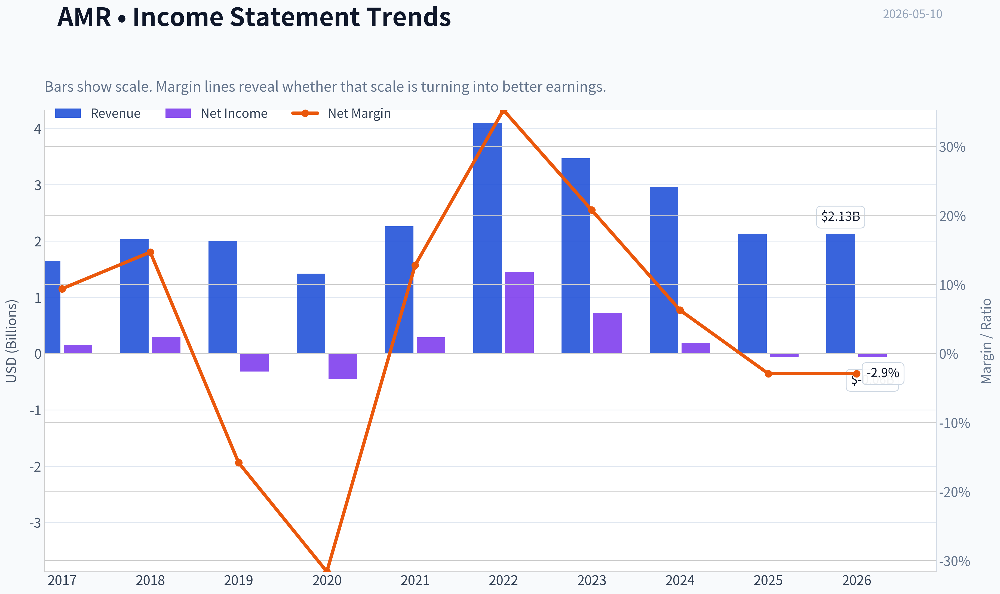

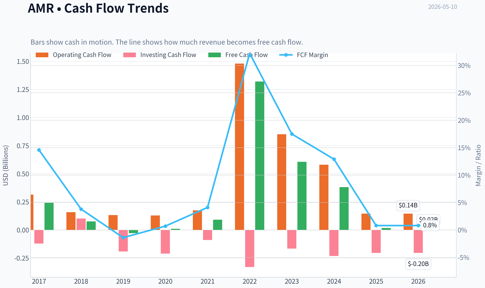

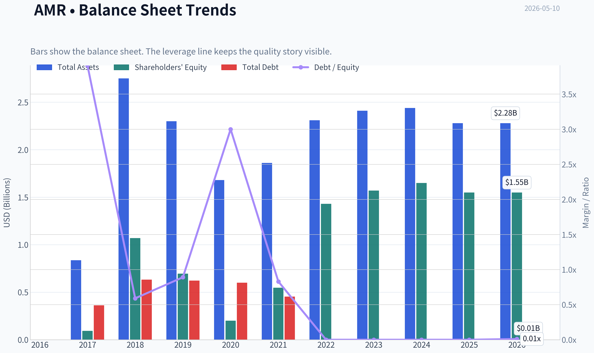

This graph tracks the profitability and return metrics (ROE, ROIC, Margins) of **AMR** over the past decade, highlighting capital efficiency trends.

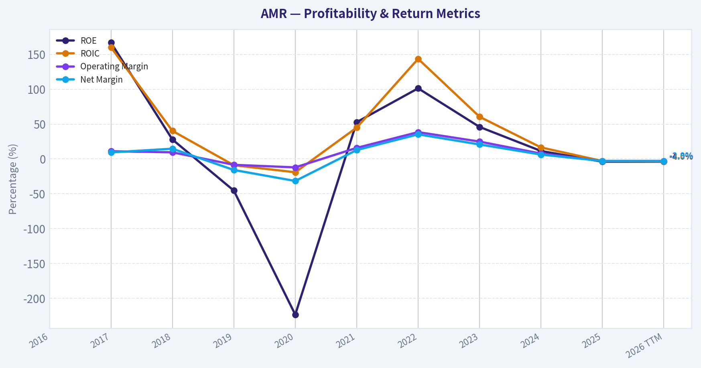

This chart illustrates the financial health of **AMR** over the last 10 years, mapping cash equivalents and free cash flow against total obligations (Debt).

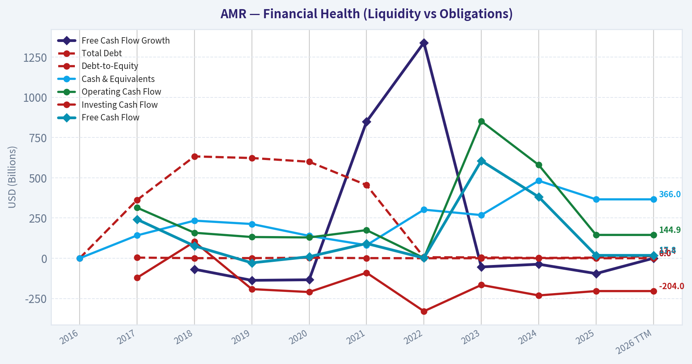

This comparison chart from *Profitability Analysis* stacks current figures against historical benchmarks for **AMR**, making it easy to see where the company trades relative to its own averages.

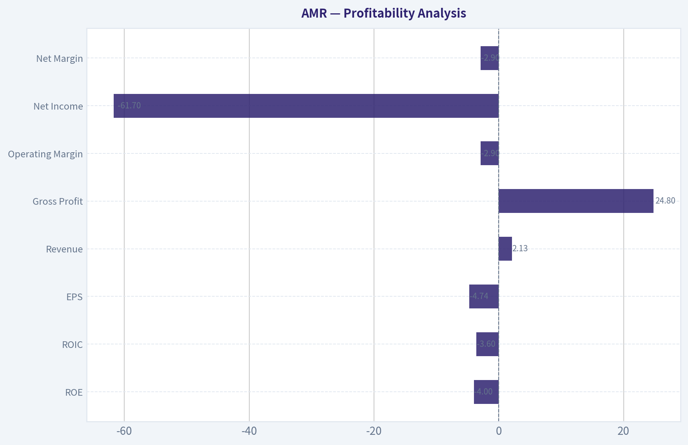

---

### Intrinsic Value Analysis (Buffett)

> *Following Warren Buffett's value investing philosophy: Circle of Competence, Economic Moat, Management Quality, and Margin of Safety.*

#### Intrinsic Value Snapshot

Price is what you pay. Intrinsic value is what the business may be worth based on the cash it can create for owners over time. We show a range, not one magic number.

- Current Price: $184.11
- Value Range: $1.27 to $129.42

##### Owner Earnings (Buffett Method)
- Net Income: $-61,687,000.00
- Depreciation & Amortization: $179,951,000.00
- Capital Expenditures: $-127,153,000.00
- Working Capital Changes: $3,744,000.00
- Owner Earnings: $-12,633,000.00

##### Intrinsic Value
###### Cash Flow Method
Uses free cash flow. Better for companies spending heavily today to grow tomorrow.
- Conservative: $1.27
- Average: $5.89
- Optimistic: $129.42
- Discount Rate: 10.0%

#### AMR Buffett-Style Value Analysis (lite)

The model did not produce a full tool-grounded value analysis this run. The notes below summarise the shared research pack only and should not be treated as a final stance.

Shared research pack summary for AMR:
- Current price: $184
- Market cap: $2.35B
- P/E: N/A
- ROE: -4.0%
- Gross margin: N/A
- Revenue growth YoY: -28.0%
- FCF yield: 0.8%
- Current ratio: 4.4681737234943215

Latest earnings coverage:

#### Latest Earnings Coverage for AMR ## AMR News (via Finnhub API), from 2026-01-10 to 2026-05-10: ### Alpha Metallurgical Resources (NYSE:AMR) Tumbles After First-Quarter Earnings Miss (ChartMill, 2026-05-08) Alpha Metallurgical Resources shares fell 3.3% pre-market after reporting Q1 2026 earnings that missed estimates, with revenue at $524.99M and an adjusted loss of $0.86 per share. ### Alpha Metallurgical Resources, Inc. (AMR) Q1 2026 Earnings Call Transcript (SeekingAlpha, 2026-05-08) Alpha Metallurgical Resources, Inc. (AMR) Q1 2026 Earnings Call May 8, 2026 10:00 AM EDTCompany ParticipantsEmily O'Quinn - Senior Vice President of... ### Transcript : Alpha Metallurgical Resources, Inc., Q1 2026 Earnings Call, May 08, 2026 (Finnhub, 2026-05-08) Presentation Operator MessageOperator Greetings. Welcome to the Alpha Metallurgical Resources First Quarter 2026 Results Conference Call. [Operator Instructions] Please note that this conference is... ### Alpha Metallurgical Resources, Inc. Reports Earnings Results for the First Quarter Ended March 31, 2026 (Finnhub, 2026-05-08) Alpha Metallurgical Resources, Inc. reported earnings results for the first quarter ended March 31, 2026. For the first quarter, the company reported revenue was USD 524.99 million compared to USD... ### Alpha Metallurgical: Q1 Earnings Snapshot (Finnhub, 2026-05-08) BRISTOL, Tenn. - BRISTOL, Tenn. - Alpha M…

Structured guru tracking:

#### Guru 13F Tracking for AMR No tracked guru currently shows a recent structured 13F match for this ticker. ### Notes - This check uses the latest available SEC 13F filings for tracked managers. - 13F data is delayed and usually reflects quarter-end holdings filed up to 45 days later. - No structured 13F matches found.
#### Valuation Bridge

This bridge places the current market price beside each intrinsic value lens so readers can see whether upside depends on one method or shows up across several methods.

| Scenario | Intrinsic Value / Share |
| --- | ---: |
| Cash Flow Method | $5.89 |
| Damodaran Method | $210.62 |
| Current Price | $184.11 |

#### Key Takeaways

If one method is far above the others, the upside case depends on a specific modelling assumption. When several methods cluster together, the valuation story is more robust.

#### Valuation Visuals

This comparison chart from *Latest Earnings Snapshot* stacks current figures against historical benchmarks for **AMR**, making it easy to see where the company trades relative to its own averages.

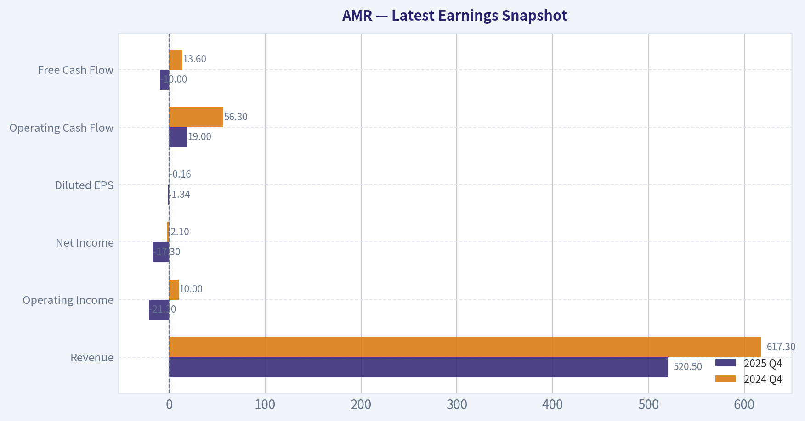

This comparison chart from *Current vs Historical Average Comparison* stacks current figures against historical benchmarks for **AMR**, making it easy to see where the company trades relative to its own averages.

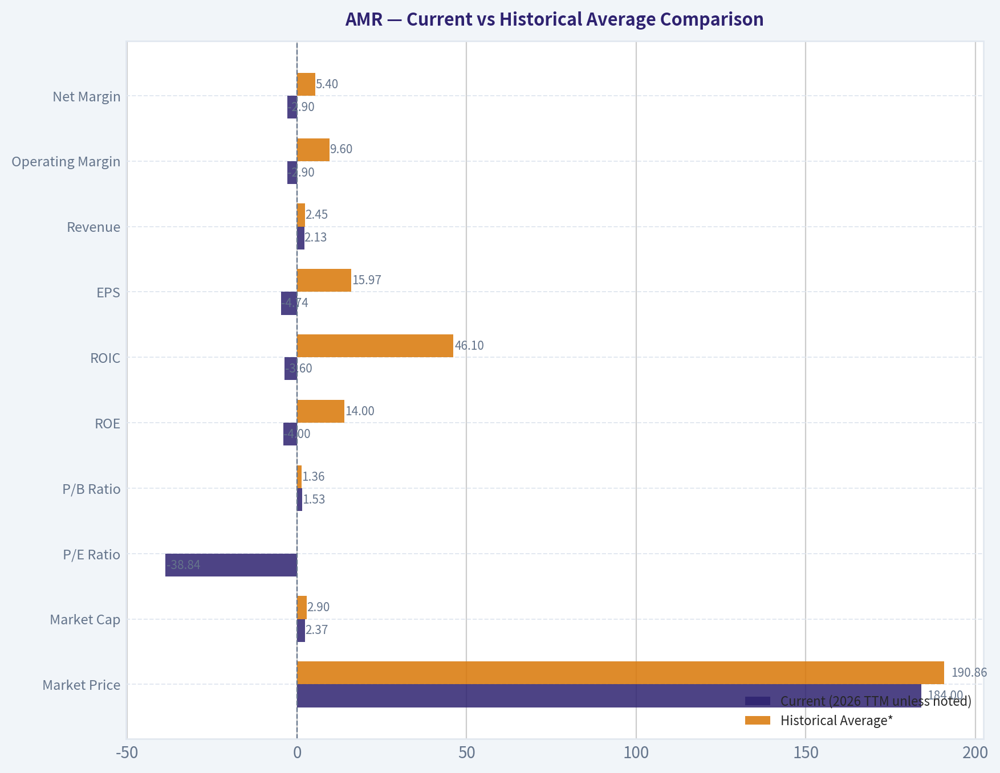

This comparison chart from *Balance Sheet and Financial Strength* stacks current figures against historical benchmarks for **AMR**, making it easy to see where the company trades relative to its own averages.

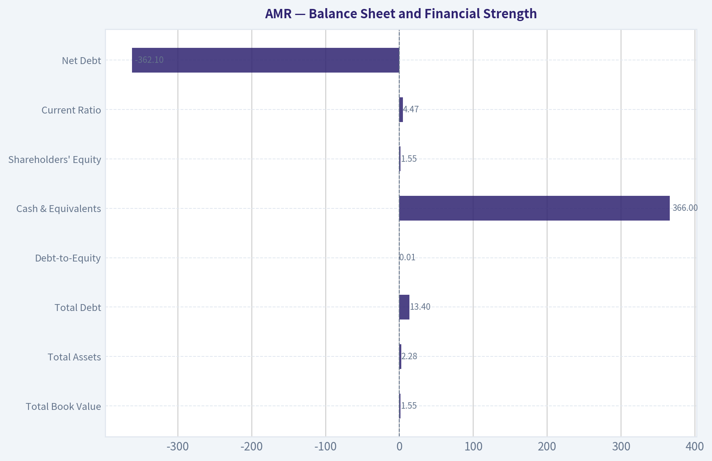

This comparison chart from *Cash Flow and Capital Allocation* stacks current figures against historical benchmarks for **AMR**, making it easy to see where the company trades relative to its own averages.

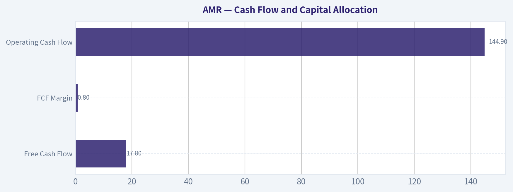

---

### Trend & Growth Analysis (Lynch/Druckenmiller/Fisher)

> *Following Peter Lynch's GARP, Stanley Druckenmiller's macro-aware approach, and Philip Fisher's scuttlebutt methodology.*

ANALYST STANCE: **AVOID**

#### 1) Lynch Classification

AMR is a **Cyclical**, not a fast grower.
The shared pack already gives the key tell: **revenue growth YoY is -28%**, and latest earnings showed **Q1 2026 revenue of $525M with an adjusted loss**. This is classic commodity-cycle behavior, not durable secular growth.

#### 2) The Story in 3 Bullets

- AMR sells **metallurgical coal** used in steelmaking, so results depend heavily on **global steel demand and met coal prices**.
- When coal prices are high, AMR can print large cash flow; when prices normalize, earnings can collapse quickly.
- This is a **cycle-and-capital-allocation** story, not a Lynch/Fisher-style compounding growth story.

---

#### 3) Snapshot Table

| Metric | Value |
|---|---:|
| Current Price | **$184** |
| Market Cap | **$2.35B** |
| P/E | **N/A** |
| ROE | **-4.0%** |
| Revenue Growth YoY | **-28.0%** |
| FCF Yield | **0.8%** |
| Current Ratio | **4.47** |
| Latest Quarter Revenue | **$524.99M** |
| Latest Quarter EPS | **Adj. loss of $0.86** |

**Key Takeaways:** AMR currently screens as financially liquid, but operationally weak. The balance sheet looks solid on near-term liquidity, yet the core business is in a downturn with falling revenue and negative earnings. That combination can work for deep cyclical investors, but it does not fit a growth-investing playbook.

#### 4) TAM Analysis with 10x Test

| Item | Assessment |
|---|---|
| TAM Type | Global steelmaking coal market |
| TAM Growth | Low/uncertain; tied to steel cycle, not secular expansion |
| 10x Revenue Test | Very difficult without a commodity supercycle or major M&A |
| Ability to 10x and stay <20% share | **No clear evidence** |
| Runway Quality | **Limited for growth investing** |

**Key Takeaways:** AMR does not have the kind of expanding TAM that typically creates ten-baggers in growth investing. Its market is mature, cyclical, and constrained by long-term decarbonization pressure. Any big upside would likely come from commodity prices and buybacks, not from a structurally expanding addressable market.

#### 5) Revenue Growth Trend

| Period / Signal | Observation | Interpretation |
|---|---|---|
| YoY Revenue Growth | **-28.0%** | Clear deterioration |
| Latest Earnings | Revenue miss, adjusted loss | Downcycle pressure |
| Pattern | Not accelerating; contracting | **Decelerating / negative** |

**Key Takeaways:** The revenue trend is the opposite of what Druckenmiller wants to see at an inflection point. Instead of acceleration, AMR is showing contraction and earnings pressure. That makes it hard to underwrite a bullish growth thesis here.

#### 6) Unit Economics

| Metric | Status |
|---|---|
| LTV/CAC | Not relevant for commodity miner |
| NRR | Not relevant |
| Rule of 40 | Not relevant |
| Better Lens | Cost per ton, realized price, FCF through cycle |

**Key Takeaways:** Traditional SaaS-style unit economics do not apply to AMR. The right framework is commodity realization versus production cost, plus balance-sheet resilience. That makes AMR much harder to classify as a scalable growth compounder.

#### 7) Inflection Point Assessment

| Inflection Type | Evidence | Verdict |
|---|---|---|
| Product Cycle | None | Negative |
| Market Share | No sign this matters vs commodity pricing | Neutral/negative |
| Margin Inflection | Losses and weaker revenue imply pressure | Negative |
| TAM Inflection | No secular expansion | Negative |
| Competitive Inflection | No evidence of peer stumble changing thesis | Neutral |

**Key Takeaways:** I do not see a growth inflection. If anything, the current data suggests a cyclical downswing. A future upside case would require a turn in met coal prices, not a company-specific growth acceleration.

---

#### 8) Macro Setup Evaluation

| Macro Factor | Read for AMR |
|---|---|
| Economic Cycle Sensitivity | High |
| Steel Demand Sensitivity | High |
| Rate Sensitivity | Moderate, but secondary |
| Secular Theme Tailwind | Weak |
| ESG / Decarbonization | Structural headwind |
| Commodity Price Dependence | Very high |

**Key Takeaways:** AMR depends far more on the steel and commodity cycle than on secular growth themes like AI, cloud, or healthcare innovation. That can create trading opportunities, but it is not the type of macro backdrop that supports a long-duration growth multiple. Structural ESG and decarbonization headwinds also limit rerating potential.

#### 9) Fisher 15 Points Score

| Fisher Category | Score (1-5) | Comment |
|---|---:|---|
| Market potential | 2 | Mature cyclical market |
| New products | 1 | Not a product innovation story |
| R&D effectiveness | 1 | Minimal relevance |
| Sales organization | 2 | Commodity selling |
| Profit margin | 2 | Cyclical and currently weak |
| Margin improvement | 2 | No current evidence |
| Labor relations | 3 | No major data, neutral |
| Executive relations | 3 | Neutral |
| Management depth | 3 | Neutral |
| Cost controls/accounting | 3 | Likely acceptable |
| Outstanding aspects | 2 | Balance sheet/capital return only |
| Long-range profit outlook | 2 | Highly cyclical |
| Dilution risk | 4 | Better than many cyclicals |
| Candor | 3 | Neutral |
| Integrity | 3 | Neutral |

| Total | **36 / 75** | **Below average / Avoid** |

**Key Takeaways:** On Fisher's framework, AMR scores poorly because it lacks the hallmarks of a true innovative growth business. The only relatively strong area is capital discipline and lower dilution risk. That is not enough to offset weak secular growth, limited moat, and poor visibility.

#### 10) Valuation Analysis

| Metric | Current Read | Interpretation |
|---|---|---|
| P/E | N/A | Earnings currently not useful |
| PEG | N/A | Not applicable with negative/unstable earnings |
| P/S | Roughly ~1x using market cap vs annualized weak revenue run-rate | Cheap-looking but not meaningful alone |
| FCF Yield | **0.8%** | Weak for a cyclical |
| Valuation Style | Commodity/cycle valuation, not growth valuation | Negative for mandate |

**Key Takeaways:** AMR may look optically cheap on some headline metrics during parts of the cycle, but that is not the same as being attractive for growth investors. With earnings weak and free-cash-flow yield only 0.8%, valuation is not providing a compelling margin of safety. Cheap cyclicals often get cheaper when the cycle rolls over.

#### 11) Growth Investor Scorecard

| Criterion | Weight | Score (1-5) | Weighted Score |
|---|---:|---:|---:|
| The Story | 10% | 2.0 | 0.20 |
| TAM & Runway | 20% | 1.5 | 0.30 |
| Revenue Growth | 20% | 1.0 | 0.20 |
| Unit Economics | 15% | 2.0 | 0.30 |
| Competitive Position | 10% | 2.5 | 0.25 |
| Management Quality | 10% | 3.0 | 0.30 |
| Macro Setup | 5% | 2.0 | 0.10 |
| Profitability Path | 5% | 1.5 | 0.08 |
| Valuation | 5% | 2.5 | 0.13 |

| Total Score | **1.86 / 5.0** |
|---|---|

**Key Takeaways:** AMR scores well below the threshold for a growth-oriented buy. The biggest drags are shrinking revenue, poor secular runway, and weak profitability visibility. Even if management is decent and liquidity is strong, the overall setup still falls firmly in avoid territory for this mandate.

---

#### 12) Position Size Stance

| Stance | Position Size |
|---|---|
| **AVOID** | **0%** |

**Key Takeaways:** For a Lynch-Druckenmiller-Fisher growth framework, AMR does not justify an initial position. At most, it belongs on a separate cyclical commodities watchlist, not in a concentrated growth portfolio.

#### 13) Key Risks and Catalysts

| Risks | Catalysts |
|---|---|
| Further decline in met coal prices | Sharp rebound in met coal benchmark prices |
| Global steel demand weakness | China/India steel demand surprise |
| Margin compression and losses | Stronger realized pricing and shipment recovery |
| ESG/regulatory overhang | Aggressive buybacks at depressed valuation |
| No secular growth rerating | Supply disruption lifting global coal prices |

**Key Takeaways:** The upside catalysts are mostly external and commodity-driven rather than company-driven. That means forecasting success depends more on calling the coal cycle than on identifying a unique business inflection. For this investment style, that is a poor risk-reward setup.

#### Bottom Line

AMR may appeal to a **deep cyclical or special-situations investor**, but it fails the core tests for growth investing:

- **Not a fast grower**
- **No expanding TAM**
- **Revenue is contracting**
- **No clear business inflection**
- **Valuation is not compelling enough to offset cyclical risk**

For this mandate, AMR is an **AVOID**.

---

### Market Technical Analysis

#### AMR Technical Analysis Report

AMR is in a **long-term uptrend, medium-term correction, and fragile short-term rebound attempt**. That combination matters because it creates a very different trading environment from a clean bull trend or a clean bear trend: buyers still have the broader structural trend on their side, but recent price behavior shows that upside follow-through has weakened and rallies are being sold faster than they were earlier in the year.

For this market context, the **most relevant indicators** are:

| Indicator | Why it is suitable now |
|---|---|
| close_200_sma | Confirms the larger structural trend; AMR remains above it, which keeps the long-term uptrend intact. |
| close_50_sma | Defines the medium-term trend; price is below it, showing the stock is still in a corrective phase. |
| close_10_ema | Captures short-term swing shifts and shows whether rebound attempts are gaining or failing. |
| macd | Useful for identifying whether momentum is truly recovering or just bouncing within a correction. |
| rsi | Helps judge whether pullbacks are oversold enough to support reversals, or simply weak consolidations. |
| boll_ub | Defines upside expansion/resistance zones during rebounds. |
| boll_lb | Defines downside stretch/support zones and shows whether recent weakness is becoming statistically extended. |
| atr | Critical for AMR because volatility is elevated; useful for risk control, stops, and position sizing. |

Key Takeaways: These eight indicators are complementary because they separate the trend into long-term, medium-term, and short-term layers, while also measuring momentum, stretch, and volatility. That matters for AMR because the stock is not trending smoothly; it is correcting within a broader uptrend, so traders need both trend confirmation and risk-management tools.

---

#### Price Structure and Trend Regime

From November into mid-January, AMR staged a powerful advance from the low-$170s to nearly **$250**, showing strong directional participation and persistent upside momentum. That rally was not just a gradual climb; it featured acceleration phases, especially in December and early January, suggesting aggressive trend-following interest.

Since that January peak, however, the market character has changed. Price rolled over into a sustained correction, falling from the upper-$240s toward the **mid-$160s to high-$170s** region by late February and early March. The decline was not a single capitulation event; it unfolded in waves, which is often a sign of distribution rather than a one-off panic flush.

March then brought a strong recovery leg back above **$220**, but that rebound failed to restore the prior trend. Instead, AMR formed a sequence of rallies that increasingly lost altitude: late-March strength faded into April weakness, and more recent price action has drifted back toward the **low-$180s**. This means the stock has been forming a broad **corrective trading range with a downward medium-term bias**, even though the longer-term structure still sits above the 200-day trend benchmark.

The most recent closes reinforce that interpretation:
- **May 6:** 197.16
- **May 7:** 193.43
- **May 8:** 184.11

That sharp two-day setback after a rebound attempt indicates sellers are still active on strength, especially near the high-$190s.

---

#### Trend Indicators

| Indicator | Latest reading | Interpretation |
|---|---:|---|
| Close (May 8) | 184.11 | Recent price has slipped after failing to sustain a rebound above the mid-$190s. |
| close_10_ema | 190.29 | Price is below the short-term EMA, showing short-term momentum has weakened again. |
| close_50_sma | 193.00 | Price is below the 50-day average, confirming the medium-term trend is still under pressure. |
| close_200_sma | 178.15 | Price remains above the 200-day average, so the long-term bullish structure is not yet broken. |

Key Takeaways: AMR is below both its 10-day EMA and 50-day SMA, which shows the near-term and medium-term trend remain soft. But it is still above the 200-day SMA, so the bigger-picture uptrend is damaged rather than fully reversed.

The interaction among these three averages is especially important:

1. **200-day SMA rising steadily**
   The 200-day SMA rose from about **161.1 in mid-March** to **178.1 by May 8**. That is a meaningful climb, not a flat line. It tells us the long-term trend still reflects the prior months of strength and has not rolled over.

2. **50-day SMA drifting lower**
   The 50-day SMA fell from about **202.6 on March 11** to **193.0 on May 8**. That decline reflects the January peak and subsequent loss of momentum. This is classic medium-term correction behavior.

3. **10-day EMA turning down faster than the 50-day SMA**
   The 10-day EMA peaked above **208** in late March/early April, then dropped to **190.3** by May 8. Because it reacts quickly, it is showing that the latest rebound has already faded.

This layering suggests:
- **Strategic investors** may still view AMR as structurally intact while above the 200-day SMA.
- **Swing traders** should respect that price remains below the 50-day SMA, meaning rebounds are still countertrend relative to the medium-term direction.
- **Short-term traders** should note that price being below the 10-day EMA means momentum currently favors sellers unless price can quickly reclaim that level.

---

#### Momentum Analysis

| Indicator | Latest reading | Signal quality |
|---|---:|---|
| macd | -2.23 | Momentum is negative again after a brief improvement in late April. |
| rsi | 43.96 | Neutral-to-bearish; not oversold, which means downside pressure may not be exhausted yet. |

Key Takeaways: Momentum is weak, but not washed out. That combination often means the stock can continue chopping lower or sideways before a stronger reversal signal appears.

The momentum profile is nuanced:

- **MACD improved sharply from mid-March into late March**, moving from deeply negative territory near **-6.35** on March 11 to strongly positive near **7.89** on March 30. That was a real momentum reversal, not a minor bounce.
- But that momentum surge did not persist. Through April, MACD steadily decayed and turned negative again. By **May 8 it was -2.23**, showing that recent upside attempts lacked follow-through.
- This is important because failed positive momentum cycles often signal a stock transitioning from trend behavior to **range-and-reject behavior**, where rallies into resistance become sellable.

RSI tells a similar story:
- It reached nearly **70** on March 27, indicating strong momentum during the recovery rally.
- It has since cooled to **43.96**, which is below neutral but not deeply oversold.
- Because RSI is not yet near 30, the stock does **not** appear to be at an extreme panic low. In practical terms, that means value buyers do not yet have a classic oversold setup to lean on.

The combination of **negative MACD + mid-40s RSI** often describes a market where:
- momentum is deteriorating,
- but sellers may still have room before the move becomes stretched,
- and short-covering rallies can occur, though they are vulnerable to failure unless momentum indicators turn higher together.

---

#### Volatility and Bollinger Band Context

| Indicator | Latest reading | Interpretation |
|---|---:|---|
| boll_ub | 206.32 | Upper volatility resistance zone. |
| boll_lb | 178.64 | Lower volatility support/stretch zone. |
| Bandwidth (approx.) | 27.69 | Wide enough to show meaningful volatility, though narrower than early-April extremes. |
| atr | 10.19 | Daily trading range remains large; AMR is still a high-volatility name. |

Key Takeaways: AMR is trading much closer to its lower Bollinger Band than its upper band, which shows the recent move is skewed toward weakness. ATR near 10 means traders should expect wide daily swings and size positions conservatively.

On **May 8**, the close at **184.11** sat:
- about **5.47 points above the lower band**
- about **22.21 points below the upper band**

That placement matters. AMR is not yet hugging the lower band in a capitulation sense, but it is clearly trading in the lower half of its volatility envelope. This usually means the tape is still under distribution pressure rather than preparing for a clean momentum breakout.

A few additional volatility observations:

1. **Bands compressed somewhat from early April extremes**
   In early April, the upper band was around **225** while the lower band dropped into the **high-170s to mid-160s** depending on day, reflecting substantial expansion. Current bands are still wide, but less chaotic than that period. This suggests volatility remains elevated, yet not at peak disorder.

2. **ATR remains high near 10**
   With ATR around **10.19**, AMR can easily move 5% or more in a short period. That increases the probability of false breakouts, stop runs, and rapid intraday reversals.

3. **Volatility argues against tight discretionary stops**
   Traders using narrow stops without ATR adjustment are likely to be shaken out. For AMR, stop placement and position sizing are arguably as important as direction selection.

---

#### What the Indicator Combination Suggests

The cleanest interpretation is:

- **Long-term:** still bullish-to-neutral because price remains above a rising 200-day SMA.
- **Medium-term:** bearish corrective because price is below a declining 50-day SMA.
- **Short-term:** rebound failure because price is below the 10-day EMA and MACD is negative again.
- **Momentum state:** weak, but not fully washed out.
- **Volatility state:** elevated, requiring wider risk parameters.

This is not an ideal environment for blindly chasing strength or blindly bottom-fishing weakness. Instead, AMR currently looks like a stock where **trade location** matters a lot.

---

#### Practical Trading Implications

| Scenario | What traders may watch | Why it matters |
|---|---|---|
| Bullish stabilization | Price reclaims 10 EMA, then 50 SMA near 193 | Would show the latest selloff is losing control and short-term momentum is improving. |
| Bullish continuation | MACD turns back up while RSI moves above 50 | Indicates improving momentum quality rather than a brief dead-cat bounce. |
| Support test | Price action near 178-179 lower Bollinger/near 200 SMA buffer | This is the most important nearby support area in the current setup. |
| Bearish breakdown | Close decisively below 178 and sustained weakness under 200 SMA | Would materially weaken the long-term structure and shift the chart toward broader trend deterioration. |
| Range fade setup | Rebounds into 193-197 fail again | Would confirm sellers are defending the 50 SMA / recent rebound zone. |

Key Takeaways: The nearest battleground is between roughly 178 on the downside and 193 to 197 on the upside. A move through either side, confirmed by momentum, is likely to give the next clearer directional clue.

For traders:
- **Aggressive bulls** may wait for a reclaim of the **10 EMA and then 50 SMA** before assuming the rebound is real.
- **Mean-reversion bulls** may watch for a deeper pullback toward the **lower Bollinger Band / 200-day SMA region**, but they should prefer setups where RSI firms or MACD stops deteriorating.
- **Bearish swing traders** may view failed rebounds into the **low-to-mid 190s** as tactical short or profit-taking zones, as long as price remains below the 50-day SMA.
- **Risk managers** should size smaller than usual because ATR implies unusually large daily movement.

---

#### Bottom Line

AMR is **not in a broken long-term chart**, but it is also **not in a healthy short-term uptrend**. The stock is caught in a corrective phase where rallies have been losing quality, momentum has rolled back negative, and price is now leaning toward the lower half of its volatility range.

The most important conclusion is that **the long-term bullish structure still exists above the 200-day SMA, but the medium-term and short-term evidence remains cautious**. Until AMR reclaims and holds above the 50-day SMA with improving MACD and RSI, the burden of proof remains on the bulls.

| Dimension | Current read | Trading implication |
|---|---|---|
| Long-term trend | Constructive | Still supported above rising 200 SMA |
| Medium-term trend | Corrective / weak | Below declining 50 SMA |
| Short-term trend | Softening | Below 10 EMA after failed rebound |
| Momentum | Negative but not extreme | More downside or chop remains possible |
| Volatility | Elevated | Wider stops and smaller sizing are prudent |
| Key support | 178-179, then 200 SMA zone | Major test area for structural bulls |
| Key resistance | 190-193, then 197+ | Reclaim needed to improve tone |
| Overall stance | Cautious neutral to mildly bearish short-term; structurally bullish longer-term | Favor confirmation over anticipation |

Key Takeaways: AMR still has a long-term cushion, but its recent behavior favors caution rather than aggressive buying. The stock needs to prove itself by reclaiming short- and medium-term trend levels before a stronger bullish case can be made.

#### Market Visuals

This comparison chart from *Market Metrics* stacks current figures against historical benchmarks for **AMR**, making it easy to see where the company trades relative to its own averages.

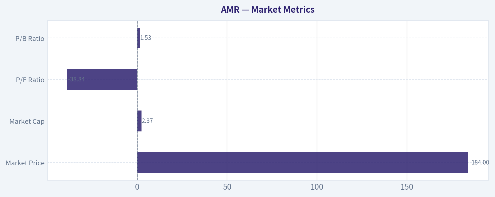

---

### News & Events Analysis

#### Alpha Metallurgical Resources (AMR) weekly trading/investment report
Date: 2026-05-10

AMR remains a high-beta, met-coal-exposed name where near-term equity performance is being driven less by broad equity market direction and more by three variables: realized metallurgical coal pricing, shipment/cost execution, and management's capital-allocation posture during a weak pricing cycle. The key fresh catalyst this week was the company's **Q1 2026 earnings release**, which appears to have disappointed versus expectations and reinforced that AMR is currently operating in a downcycle rather than just experiencing a temporary volume wobble.

#### Market context and setup

The shared data already frames AMR as a cyclically pressured business:

| Metric | Value | Trading read-through |
|---|---:|---|
| Share price | $184 | Reflects depressed cyclical sentiment but still meaningful equity value versus peers |
| Market cap | $2.35B | Small/mid-cap resource stock; can move sharply on commodity news |
| P/E | N/A | Earnings are currently weak/negative enough to make P/E less useful |
| ROE | -4.0% | Confirms current profitability pressure |
| Revenue growth YoY | -28.0% | Indicates a sharp cyclical revenue contraction |
| FCF yield | 0.8% | Thin free-cash-flow support at current conditions |
| Current ratio | 4.47 | Strong liquidity buffer helps withstand a prolonged coal downturn |

Key Takeaways: AMR's balance sheet still looks like a relative strength, especially with a high current ratio, but operating metrics show a clear cyclical downturn. For traders, that means downside may be cushioned by liquidity, while upside likely requires a real improvement in met coal pricing rather than just broader market strength.

#### Earnings: latest reported quarter and what changed

Per the shared earnings coverage, AMR's **latest reported period was Q1 2026, ended March 31, 2026**. That is the reporting period investors should anchor on right now.

Headline results from coverage:
- **Revenue:** **$524.99M**
- **Adjusted EPS / earnings outcome:** **adjusted loss of $0.86 per share**
- Market reaction in coverage: shares fell roughly **3.3% pre-market** after the release, indicating a miss versus expectations.

What changed versus the prior period / prior backdrop:
- Coverage explicitly says the company **missed estimates**, which matters because AMR is already trading as a cyclical recovery candidate; an earnings miss weakens the "trough is behind us" thesis.
- The shared pack shows **revenue down 28% YoY**, which strongly suggests Q1 2026 was materially weaker than the comparable prior-year quarter.
- The swing to an **adjusted loss** implies either lower realized pricing, weaker shipment mix/volumes, cost absorption pressure, or a combination of all three. In met coal businesses, earnings can deteriorate quickly when benchmark prices fall while mining and logistics costs remain sticky.
- There is no evidence in the provided materials of an upward guidance revision; instead, the tone implied by the negative stock reaction is that results were worse than the market had discounted.

Interpretation for investors:
- The most important message from Q1 is not simply that AMR lost money in one quarter; it is that **earnings sensitivity to coal prices remains very high**, and the company is still in the earnings-compression phase of the cycle.
- For value investors, this can create opportunity if they believe met coal prices are near a cyclical floor. For momentum or event-driven traders, however, a post-earnings miss often means the stock needs either commodity-price support or a clear management catalyst before rerating.

#### Company-specific news and sentiment over the past week

The most relevant company-specific news in the last week was overwhelmingly the earnings release and call coverage:
- Multiple items on **May 8, 2026** covered the Q1 2026 release and earnings call transcript.
- The dominant market framing was negative: **earnings miss**, **adjusted loss**, and a **pre-market drop**.

Why that matters:
1. **The earnings print reset near-term expectations lower.**
   Traders often use a weak quarter in a commodity name as a signal that spot/contract conditions are still deteriorating or that the recovery is delayed.

2. **The transcript timing matters.**
   Earnings calls in coal names are often where management gives the clearest commentary on contracted volumes, export logistics, seaborne benchmark pricing, and buyback appetite. Even without the full transcript detail here, the clustering of coverage suggests investors are currently focused on operational resilience and capital return discipline rather than growth.

3. **No offsetting positive company catalyst is visible in the shared pack.**
   There was no mention of a major accretive deal, special dividend, large repurchase announcement, or strong production/guidance surprise that would have neutralized the weak quarter.

Trading implication:
- In the very near term, AMR likely remains a **commodity-price follower with fragile sentiment**. After a miss, rallies may fade unless accompanied by stronger met coal pricing, bullish steel-sector data, or explicit shareholder-return action.

#### Macro and industry context that matters for AMR

AMR is tied primarily to **metallurgical coal**, so the most relevant macro drivers are not generic U.S. GDP headlines but:
- global steel demand and blast furnace utilization,
- Chinese steel and property-related demand trends,
- India's steel growth/import demand,
- seaborne coking coal benchmark pricing,
- trade/tariff policy affecting steel and raw materials,
- freight/logistics conditions at export terminals and rail.

Even without fresh validated article detail from tools, the correct market framework is:

| Macro / industry factor | Why it matters for AMR | Bullish interpretation | Bearish interpretation |
|---|---|---|---|
| Seaborne met coal prices | Direct driver of realized pricing and EBITDA | Benchmark stabilization or rebound would quickly lift earnings power | Further price weakness extends losses and valuation compression |
| Global steel production | Determines demand for coking coal | Stronger blast furnace output improves contract/spot demand | Weak steel output signals prolonged cyclical slump |
| China policy signals | China affects global steel/raw-material balances even if not AMR's direct end market | Stimulus or property stabilization can lift sentiment across bulk commodities | Ongoing property weakness depresses steel chain demand |
| India steel demand growth | India is a structural support market for met coal imports | Sustained import demand can offset other regional weakness | Slower industrial growth would hurt the demand floor |
| U.S. trade policy / tariffs | Can affect domestic steel economics and broader supply chains | Supportive steel pricing can improve sentiment across the value chain | Trade friction can distort flows without improving raw-material demand |
| Logistics / export infrastructure | Coal miners need reliable rail and port access | Smooth exports protect shipments and cash conversion | Bottlenecks can hit realized volumes and unit costs |

Key Takeaways: AMR's stock is much more sensitive to metallurgical coal and steel-market indicators than to broad equity narratives. The key debate is whether the industry is near a cyclical floor; if met coal prices and steel output stabilize, AMR can rebound sharply, but if those variables weaken further, the recent earnings miss may prove to be only the first of several soft quarters.

#### Investment view: what traders and investors should watch next

##### Bull case
AMR still has characteristics that can matter a lot in a downturn:
- strong liquidity profile,
- ability to survive a weaker pricing environment better than highly levered peers,
- potentially large earnings torque if met coal prices recover,
- depressed sentiment after a miss, which can create favorable setups if commodity indicators inflect.

This means AMR could work well as a **cyclical rebound trade** if:
- met coal benchmarks stabilize,
- management reaffirms confidence in cash generation beyond Q1,
- steel-sector demand indicators improve,
- the market starts to look through trough-quarter results.

##### Bear case
The bearish setup is also straightforward:
- revenue is already falling sharply,
- earnings have turned negative on an adjusted basis,
- free cash flow support looks limited right now,
- if commodity prices stay soft, AMR may look "cheap" on normalized earnings while still derating on actual near-term numbers.

For traders, the main risk is that the stock can keep falling even after a bad quarter if commodity markets continue to soften. In cyclical resource names, "miss and lower pricing" often matters more than static balance-sheet comfort in the short run.

##### Base case
The most balanced view is that AMR is likely in a **waiting-for-the-cycle** phase:
- not obviously broken financially,
- but not yet showing evidence of a fundamental earnings turn,
- therefore likely to trade on external commodity signals more than company-specific re-rating drivers.

That makes it better suited, at present, for:
- tactically timed commodity traders,
- investors with a strong view on met coal/steel recovery,
rather than investors seeking stable, self-driven earnings compounding.

#### Bottom line

The decisive development this week was **AMR's Q1 2026 earnings miss for the quarter ended March 31, 2026**, with **$524.99M revenue** and an **adjusted loss of $0.86 per share**. The print reinforces that AMR is still in the weak part of the cycle, and the negative share reaction suggests the market was looking for better evidence of stabilization. AMR remains investable mainly as a **high-torque cyclical recovery vehicle**, not as a defensive value name; the next meaningful upside likely requires improvement in met coal and steel-market fundamentals rather than just company-specific execution alone.

---

| Area | Key point | Why it matters for trading/investing |
|---|---|---|
| Latest earnings period | **Q1 2026 ended March 31, 2026** | This is the most relevant fresh fundamental datapoint |
| Headline earnings result | **Revenue $524.99M; adjusted loss $0.86/share** | Confirms current earnings pressure and weak pricing backdrop |
| Versus expectations | Earnings **missed estimates** | Negative surprise damaged near-term sentiment |
| Versus prior year trend | Shared pack shows **revenue down 28% YoY** | Indicates the downturn is significant, not marginal |
| Balance sheet/liquidity | **Current ratio 4.47** | Gives AMR resilience through commodity volatility |
| Profitability | **ROE -4.0%; P/E N/A** | Current earnings are too weak for standard valuation shortcuts |
| Cash generation | **FCF yield 0.8%** | Limited present cash-flow cushion at current conditions |
| Near-term catalyst needed | Higher met coal prices / stronger steel demand | Without these, post-earnings rerating is difficult |
| Bullish setup | Cycle trough + strong liquidity + earnings torque on recovery | Can lead to sharp upside if macro turns |
| Bearish setup | Further coal-price weakness after an earnings miss | Could drive additional estimate cuts and multiple compression |

Key Takeaways: The central fact for AMR this week is the weak Q1 2026 report, which showed both lower revenue and an adjusted loss, confirming that the company is still under cyclical pressure. The stock's investment case now depends heavily on whether metallurgical coal and steel-market fundamentals begin to improve soon; without that, balance-sheet strength alone may not be enough to drive a sustained rebound.

---

### Guru Attention Analysis

> *Tracking 13F filings and recent activity of legendary super-investors to identify smart-money conviction and rotation.*

#### AMR Guru Ownership Check

Based on the canonical structured 13F source, there are **no tracked guru positions currently detected in AMR**.

| Guru | Latest 13F Status | Action | Position Size | Portfolio Weight | Recent Change | Timing | SEC Verification |
|---|---|---|---|---|---|---|---|
| Warren Buffett / Berkshire Hathaway | No position detected in latest 13F filing | None | None | None | None | Latest available 13F | Not available because no match was found |
| Seth Klarman / Baupost Group | No position detected in latest 13F filing | None | None | None | None | Latest available 13F | Not available because no match was found |
| Mohnish Pabrai / Pabrai Investment Funds | No position detected in latest 13F filing | None | None | None | None | Latest available 13F | Not available because no match was found |
| Bill Ackman / Pershing Square | No position detected in latest 13F filing | None | None | None | None | Latest available 13F | Not available because no match was found |
| Stanley Druckenmiller / Duquesne Family Office | No position detected in latest 13F filing | None | None | None | None | Latest available 13F | Not available because no match was found |
| Steve Cohen / Point72 | No position detected in latest 13F filing | None | None | None | None | Latest available 13F | Not available because no match was found |
| Michael Burry / Scion Asset Management | No position detected in latest 13F filing | None | None | None | None | Latest available 13F | Not available because no match was found |

Key Takeaways: The structured 13F data shows no current or recently disclosed AMR position among the primary tracked super-investors. That means there is no credible evidence, from the latest filings, of a guru initiation, add, trim, hold, or exit for this stock. Because no holdings were detected, there are also no SEC filing links to preserve for a matching AMR position.

#### What This Means

For AMR, the clean takeaway is simple: **none of the tracked gurus currently register a disclosed 13F position in the latest structured data**. Under the anti-hallucination rule, that means we should treat AMR as **not held by the monitored guru set**, rather than speculate based on old commentary or generic institutional ownership lists.

#### Context for Investors

That does **not** necessarily mean AMR is unattractive. It only means the specific tracked managers in this framework do not currently show a disclosed U.S. equity position in the most recent 13F dataset. Also remember:

- 13F filings are backward-looking and delayed.
- Some managers may have traded after quarter-end.
- Non-13F instruments or non-U.S. structures would not appear here.

#### Company Snapshot

From the shared research pack:

- Price: **$184**
- Market cap: **$2.35B**
- ROE: **-4.0%**
- Revenue growth YoY: **-28.0%**
- FCF yield: **0.8%**
- Current ratio: **4.47**

Recent earnings coverage indicates AMR reported **Q1 2026 revenue of about $525M** and an **adjusted loss of $0.86 per share**, which helps explain why guru interest may currently be absent from the tracked 13F universe.

#### Bottom Line

**No tracked guru ownership detected in AMR in the latest structured 13F data.** If you want, I can next give you a **non-guru investor view** on AMR: valuation, balance sheet, coal cycle exposure, and whether the recent weakness looks like a value opportunity or a trap.

---

### Options Market Analysis

> *Reading options flow - put/call ratios, IV skew, and unusual activity - to gauge institutional positioning and event-driven risk.*

#### AMR Options Positioning Report
*Date: 2026-05-10*

AMR's options tape looks **slightly bullish to neutral**, with the strongest signal coming from **call-heavy open interest in the nearest expiry** and a **total put/call OI ratio of 0.66**, which sits just below the rough neutral baseline of 0.7. That said, conviction is not especially high because **volume is fairly balanced** and there is **no standout unusual activity** showing aggressive fresh positioning.

#### 1. Put/Call Ratio Analysis

| Expiration | Call OI | Put OI | Put/Call OI Ratio | Call Vol | Put Vol | Put/Call Vol Ratio |
|---|---:|---:|---:|---:|---:|---:|
| 2026-05-15 | 1,904 | 1,126 | 0.59 | 155 | 130 | 0.84 |
| 2026-06-18 | 147 | 207 | 1.41 | 18 | 27 | 1.50 |
| 2026-08-21 | 540 | 383 | 0.71 | 65 | 63 | 0.97 |
| **Total / Near-term** | **2,591** | **1,716** | **0.66** | **238** | **220** | **0.92** |

**Key Takeaways:** The aggregate put/call OI ratio of **0.66** is modestly below the neutral ~0.7 baseline, which points to a **slight bullish tilt** in positioning rather than overt fear. Near-dated May options are the main driver, with call OI clearly dominating. However, volume is much closer to balanced, so today's flow does not show a strong fresh directional push.

**Interpretation**
- **Overall OI ratio: 0.66**
  Slightly below neutral, suggesting **mildly bullish positioning** or less need for downside hedging than usual.
- **Overall volume ratio: 0.92**
  Close to 1, meaning **current trading flow is fairly balanced** and does not strongly confirm aggressive bullish speculation.
- **May 15 expiry: 0.59 OI ratio**
  The clearest bullish pocket. Traders appear more comfortable owning calls than puts into the immediate window.
- **June 18 expiry: 1.41 OI ratio**
  More defensive/bearish, but the absolute size is small, so it carries less weight.
- **August 21 expiry: 0.71 OI ratio**
  Nearly neutral.

#### 2. Implied Volatility Assessment

| Expiration | ATM Call IV | ATM Put IV | IV Read |
|---|---:|---:|---|
| 2026-05-15 | 75.5% | 64.9% | Elevated near-term IV, call IV above put IV |
| 2026-06-18 | 64.8% | 56.0% | Elevated but lower than front week, call IV above put IV |
| 2026-08-21 | 16.3% | 41.4% | Strong put premium relative to calls |

**Key Takeaways:** Front-end volatility is **very elevated**, especially in the May and June expiries, which usually means the market expects a meaningful move or is pricing event risk. Interestingly, the near-term skew favors **calls over puts**, which is not the typical panic pattern and suggests at least some upside demand. By August, the structure flips and puts carry much richer IV, implying more conventional downside protection demand further out.

**IV Skew Interpretation**
- **May and June:**
  ATM **call IV is higher than put IV**, which signals a **call skew / upside chase** rather than classic downside fear. This can reflect:
  - upside speculation,
  - short-covering expectations,
  - or call overwriting distortions in a volatile name.
- **August:**
  **Put IV far exceeds call IV** (41.4% vs 16.3%), signaling a **clear downside hedge skew** further out on the curve.

**Assessment**
- The front-end IV level is **high enough to imply the market is pricing a catalyst or elevated uncertainty**.
- I do not have catalyst confirmation from the options tool alone, but this kind of term structure often appears around:
  - earnings,
  - company-specific operational updates,
  - commodity-sensitive macro developments.

#### 3. Unusual Options Activity

| Observation | Result |
|---|---|
| Volume > 5x Open Interest contracts | None detected |
| Fresh large directional bets | Not evident from provided screen |
| Smart-money tell | Limited / absent in this dataset |

**Key Takeaways:** There is **no flagged unusual activity** in the near-term chain, which lowers confidence in any strong institutional directional read. In other words, the options market is showing **positioning bias**, but not a clear high-conviction new bet from outsized flow.

**Interpretation**
- No contracts met the threshold of **volume greater than 5x open interest**.
- That means we **do not see obvious fresh, aggressive positioning** in the screened expiries.
- Without unusual sweeps or large fresh opening volume, the sentiment signal should be treated as **moderate confidence**, not high conviction.
- This also reduces the ability to distinguish:
  - institutional directional buying,
  - retail upside lottery calls,
  - or routine hedging.

#### 4. Open Interest Concentration

| Expiration | Notable OI Concentration Read | Market Impact |
|---|---|---|
| 2026-05-15 | Highest overall chain OI by far | Most likely expiry to influence near-term pinning/gravity |
| 2026-06-18 | Much smaller OI base | Less likely to dominate short-term spot behavior |
| 2026-08-21 | Moderate OI base | May matter for medium-term hedging, less for immediate pinning |

**Key Takeaways:** The **May 15 expiry dominates the near-term options landscape**, so if AMR trades near heavily populated strikes into expiration, those levels may act like magnets. Because detailed strike-by-strike OI was not provided, we can identify the dominant expiry but **cannot precisely map max pain or gamma walls**.

**Interpretation**
- **Front-week / nearest expiry is the center of gravity** for AMR right now.
- With the bulk of OI concentrated there, dealer hedging around expiration could:
  - **dampen moves** if price is near major strikes,
  - or **amplify moves** if price breaks away from concentrated positioning.
- Since strike-level concentrations were not included in the dataset, I cannot reliably identify:
  - exact **pinning strikes**,
  - specific **call walls**,
  - specific **put walls**.

#### 5. Overall Options Sentiment Signal

| Category | Signal |
|---|---|
| Directional Read | **BULLISH** |
| Confidence Level | **Moderate-Low** |
| Primary Driver | Aggregate call-heavy OI and front-end call-skewed IV |
| Main Caveat | Balanced volume and no unusual activity reduce conviction |

**Key Takeaways:** I would label AMR's current options signal **BULLISH**, but only modestly so. The market is not showing panic hedging; instead, it is leaning toward calls in the nearest expiry and pricing richer near-term upside optionality. Still, because fresh flow is not unusually strong, this is a **soft bullish signal**, not an emphatic one.

**Why BULLISH instead of NEUTRAL**
- Total **put/call OI ratio of 0.66** is below neutral.
- The most influential expiry, **May 15**, is distinctly **call-heavy**.
- Near-term IV skew favors **calls**, suggesting upside demand rather than downside fear.

**Why not strongly bullish**
- **Put/call volume ratio of 0.92** is close to balanced.
- **No unusual activity** means no obvious high-conviction institutional bet.
- June shows some defensive posture, and August has a meaningful put skew.

#### Bottom Line

AMR's options market currently suggests a **mild bullish lean**, driven by **call-heavy near-dated positioning** and **elevated front-end call IV**. The tape does **not** show strong evidence of institutional urgency, so the directional edge is present but not powerful. If you are using this for trading context, the options market is saying **"upside bias with event risk,"** not **"all-clear breakout."**

---

| Metric | Reading |
|---|---|
| Put/Call Ratio | **0.66 OI ratio (slightly bullish); 0.92 volume ratio (balanced)** |
| IV Level | **Elevated in May/June; front-end pricing meaningful movement** |
| Skew Direction | **Near-term call skew; later-dated put skew** |
| Unusual Activity | **None flagged; no strong fresh institutional tell** |
| Overall Signal | **BULLISH** |

**Key Takeaways:** In one sentence, AMR options are leaning bullish, but with only moderate conviction. The nearest expiry is the main source of that signal, while the absence of unusual flow keeps this from being a high-confidence call.

---

## Research Team Commentary

> *The Research Manager synthesizes the Bull vs Bear debate into action-free commentary. This is a pre-risk view, not the final stance.*

The strongest bull argument is that AMR should not be judged on a single ugly quarter. This is a cyclical met coal producer, and the right question is not whether Q1 looked bad, but whether the company owns scarce, hard-to-replicate assets that can generate strong cash across a cycle. The bull case also leans on the idea that metallurgical coal is more durable than headline "coal" sentiment implies, because steelmaking still depends heavily on blast furnace routes. If management stays disciplined on capital allocation and the balance sheet remains sound, then current pessimism could be over-discounting temporary weakness. On valuation, the main support is that shares at $184 sit below a rough fair value estimate of $211.

The strongest bear argument is that this still fails key Buffett tests. AMR is a commodity producer with weak earnings visibility, negative current returns on capital, and highly volatile cash flows. Revenue fell 28% YoY, net income growth was deeply negative, FCF dropped 95.3%, and the company posted an adjusted loss in Q1. That is not predictable earning power. More importantly, the valuation cushion is not wide enough for such a cyclical and uncertain business: about 15% upside to a modeled fair value is a thin margin of safety, not a Buffett-style bargain. The bear case is also right that "hard assets" do not automatically equal a moat if pricing is still set by the market and returns collapse in downturns.

My takeaway is that the bear case is stronger under a strict Buffett framework. AMR may be a tradable cyclical rebound candidate, but it is not a high-quality compounding business, and the current discount does not appear large enough to compensate for that. The market may indeed be overly focused on weak near-term conditions, but that alone is not enough. To be selectively contrarian, I need either a much stronger margin of safety or clearer evidence that normalized earnings power is more durable than current results suggest. Right now, I do not have that confidence.

Core takeaway: AMR looks more like a cyclical value situation than a Buffett-quality investment, and at the current price the reward does not clearly outweigh the business and cycle risk. The company's relevance to steelmaking is real, but relevance is not the same as durable competitive advantage or predictable owner earnings.

Rationale: From a value investing perspective, the biggest issue is business quality. Buffett's best investments combine moat, predictability, high returns on capital, and management skill. AMR scores weakly on predictability and current returns, and only modestly on moat. I do think the market may be somewhat pessimistic after the earnings miss, but my past mistake in similar setups would be over-crediting "normalization" without demanding enough of a discount. Cyclicals can look cheap exactly when profits are about to weaken further, and they can look optically expensive near the bottom without offering true downside protection. Here, the valuation support is too narrow to overcome that uncertainty.

Monitoring plan over the next 1-4 quarters: First, watch balance sheet resilience and liquidity very closely; if the company can absorb weak pricing without financial strain, that strengthens the case. Second, monitor realized met coal pricing, shipment volumes, and cost per ton to see whether margins are stabilizing or still deteriorating. Third, look for evidence of disciplined capital allocation: buybacks only if clearly accretive, no value-destructive expansion, and conservative use of cash. Fourth, watch whether free cash flow meaningfully recovers from the current depressed level. Fifth, listen for customer demand commentary tied to global steel markets, especially whether weakness looks temporary or more structural. Finally, I would want the stock either materially cheaper or intrinsic value estimates materially higher before becoming constructive.

Final stance: WATCH

---

## Value Investing Team Commentary

> *The Investor translates the research view into an investment thesis before risk review. This is still not the final stance.*

AMR is understandable as a business, but not attractive as a long-term Buffett-style business owner's investment at this price.

The key issue is not whether Q1 was "too pessimistic." It is whether the underlying economics of the business are predictably favorable over a full cycle. For AMR, the answer appears to be no. This is a metallurgical coal producer, and while met coal is more essential to steelmaking than generic "thermal coal" headlines imply, AMR still sells into a commodity market where pricing is set externally. That means even good operators can see earnings, cash flow, and returns on capital swing violently. The recent numbers reflect exactly that: revenue down 28%, net income sharply worse, FCF down over 95%, and negative ROE, ROIC, and ROA. Those are not the traits of a compounding machine.

The selective contrarian angle is worth examining carefully. Markets often overreact to ugly quarters, and it is true that a single bad quarter should not define a cyclical producer. If AMR has quality reserves, a sensible cost structure, and disciplined management, then current fear may be exaggerating near-term weakness. Also, met coal may prove more durable than broad anti-coal sentiment suggests, because blast furnace steelmaking remains important globally. That is the strongest bull argument, and it should not be dismissed.

But being contrarian is only useful when it leads to favorable odds. Here, the market may be gloomy for valid reasons. The business lacks a true moat in the Buffett sense. "Scarce assets" are not enough if returns are still governed by commodity prices. When prices are strong, AMR can look extraordinary; when prices normalize, profits can collapse. That makes intrinsic value much less stable than for a great consumer, software, insurance, or industrial franchise. A stock trading at $184 versus a rough fair value estimate near $211 does not provide enough margin of safety for that level of cyclicality. A mid-teens discount might be interesting for a stable, high-return business. It is not compelling for a volatile commodity producer with currently negative returns.

Management and capital allocation matter a great deal in cyclicals, and that is where AMR could eventually improve the case. If management preserves balance sheet strength, resists empire-building, repurchases shares only when deeply undervalued, and lets the cycle work in shareholders' favor, owner outcomes can still be decent. But that is a narrower thesis: it is a disciplined cyclical value case, not a classic Buffett-quality business case.

What the recent news likely reveals is not just temporary panic, but investor recognition that normalized earnings power is difficult to pin down. The earnings miss and pre-market drop are less important than what they confirm: this business remains highly exposed to external pricing, and current fundamentals do not yet justify confidence in durable earning power. If sentiment worsens materially and the stock falls to a level implying a much larger discount to conservative mid-cycle value, the contrarian setup could become interesting. Today, it does not look sufficiently asymmetric.

What I would watch from here:
- Liquidity and net balance sheet strength through weak pricing periods
- Realized met coal prices, shipment volumes, and cost per ton
- Evidence that free cash flow can recover meaningfully at mid-cycle conditions
- Management's capital allocation discipline, especially around buybacks and investment spending
- Whether steel demand weakness is cyclical or becoming more structurally impaired

In short, AMR may be relevant, asset-backed, and potentially misread by headline-driven sentiment, but relevance is not a moat and asset value is not the same as durable earning power. For a long-term owner, the present valuation does not compensate enough for the business quality and cycle risk.

**ANALYST STANCE: WATCH**

---

## Deep Values Commentary

> *The Risk Management Team debates and the Risk Judge provides the final action-free verdict. This section determines the final ADVOCATE / WATCH / AVOID stance.*

### Executive Briefing

**Verdict: WATCH**

AMR does not currently clear a Buffett-style risk bar. The business is too dependent on commodity pricing, current economics are weak, and the roughly **15% discount to a $211 fair value estimate** is not a sufficient margin of safety for a producer with **revenue down 28%, FCF down 95.3%, negative ROIC, and a Q1 adjusted loss**. The bull case is real-met coal is more durable than generic "coal" sentiment suggests, and cyclicals often look worst near the bottom-but that is a **rebound thesis**, not a high-quality compounding thesis. For a long-term value investor, the right move is to **watch for either a much better price or clearer proof of normalized cash generation and balance-sheet resilience**.

---

### Key Arguments from the Debate

### 1) Risky Analyst's strongest points
- **A bad quarter alone should not define a cyclical producer.**
- AMR's appeal is not steady compounding but **operating leverage to a recovery** in met coal pricing and steel demand.
- Met coal may be **over-penalized by broad anti-coal sentiment**, even though steelmaking still relies heavily on blast furnace routes.
- In cyclical names, waiting for clean evidence often means **buying after rerating**.
- Management discipline on buybacks, capex, and liquidity can matter greatly in a downturn.

**Most relevant takeaway:** the market may be extrapolating current weakness too far, and AMR could rebound sharply if conditions merely become "less bad."

### 2) Safe Analyst's strongest points
- AMR's recent weakness is not just optics; it reflects **real underlying business deterioration**:
  - Revenue growth YoY: **-28.0%**
  - Net income growth YoY: **-132.9%**
  - FCF growth YoY: **-95.3%**
  - ROE: **-4.0%**
  - ROIC: **-3.7%**
  - ROA: **-2.7%**
- This is a **price-taker commodity business**, so poor results can persist if the cycle worsens.
- A mid-teens discount to estimated value is **too thin** for such unstable earning power.
- Relying heavily on management execution makes the thesis **more fragile**, not less.

**Most relevant takeaway:** this is exactly the type of business where investors can confuse cyclicality with margin of safety.

### 3) Neutral Analyst's strongest points
- The right answer is not "buy aggressively" or "ignore forever," but **conditional watchfulness**.
- AMR may be cyclically weak, not structurally broken-but that still does not mean the stock is cheap enough today.
- A small, tightly risk-budgeted position could make sense only for investors with a **cyclical mandate**, not under a strict Buffett-quality standard.
- Decision-making should be tied to **explicit triggers**, not vague optimism.

**Most relevant takeaway:** retain WATCH, but make it actionable.

---

### Rationale Under a Buffett-Style Risk Lens

### Business risk vs. market risk
Buffett-style risk is not a falling share price; it is **permanent impairment of business value**. AMR's core risk is that it lacks predictable owner earnings because pricing is externally set. That means business performance can deteriorate quickly even if assets remain useful.

The evidence from Q1 supports caution:
- Revenue: **$524.99M**
- Adjusted EPS: **loss of $0.86 per share**
- Shares fell about **3.3% pre-market** after the miss

This is not merely a market mood swing. It shows how sharply earnings power can compress.

### Quality over volatility
A volatile stock is not automatically risky if the business is strong. But here, volatility reflects **unstable economics**, not just sentiment. Negative ROE, ROIC, and ROA tell us current capital returns are poor. That fails an important Buffett preference: businesses that earn attractive returns without requiring favorable commodity conditions.

### Permanent vs. temporary
The bull case reasonably argues this may be a **temporary cyclical trough**, not permanent impairment. That deserves respect. Metallurgical coal is indeed more industrially durable than thermal coal narratives imply.

But durability of product demand is not the same as a moat:
- AMR is still a **commodity producer**
- It remains a **price taker**
- Returns can swing violently with market conditions

So while the current pain may be temporary, the **structural unpredictability** is permanent.

### Financial strength
Your monitoring emphasis on liquidity and balance-sheet resilience is exactly right. In cyclicals, survival and disciplined capital allocation matter enormously. If AMR can endure weak pricing without balance-sheet stress, that improves the case. But today, the debate does not provide enough evidence to conclude financial strength alone offsets the earnings volatility.

### Margin of safety
This is the decisive issue.

At:
- **Price: $184**
- **Rough fair value: $211**

the upside is only around **15%** to modeled value. For a stable, high-quality business, maybe acceptable. For a cyclical coal producer with collapsing free cash flow and negative current returns, it is **not enough**.

That is the key Buffett lesson here: when business quality is lower and earnings are less predictable, the **required discount must be larger**, not smaller.

---

### Refined Investor Plan

Your original plan is directionally right, and the debate mostly reinforces it. I would refine it as follows:

### Starting point
You already concluded:
- AMR is more a **cyclical value situation** than a Buffett-quality investment
- The current discount is **not large enough**
- You need either **more valuation support** or **clearer earnings durability**

That remains the sound base case.

### Adjustments based on analyst insights
1. **Keep WATCH, but define entry standards more explicitly**
   - Do not buy simply because the quarter was ugly.
   - Require either:
     - a **materially cheaper price**, or
     - operating evidence that normalized FCF is recovering.

2. **Do not over-credit "normalization"**
   - This directly addresses your past mistake: assuming cyclical recovery before demanding sufficient discount.
   - In commodity businesses, "cheap" can get cheaper if the cycle extends.

3. **Separate rebound potential from business quality**
   - The Risky Analyst is right that AMR may offer sharp upside in a recovery.
   - But that is different from a Buffett-style long-term compounder.
   - If you ever buy, treat it as a **cyclical special situation**, not a quality core holding.

4. **Elevate balance-sheet and capital allocation evidence**
   - In this case, management discipline is not a bonus; it is central.
   - No aggressive expansion
   - Buybacks only when clearly value accretive
   - Preserve liquidity through the downturn

5. **Use concrete monitoring triggers over 1-4 quarters**
   Watch for:
   - **Liquidity and net balance-sheet resilience**
   - **Realized met coal pricing stabilization**
   - **Shipment volume stability**
   - **Cost per ton discipline**
   - **Meaningful FCF recovery**
   - **Steel demand commentary indicating cyclical, not structural, weakness**
   - **Conservative capital allocation**

6. **Treat technicals and sponsorship as secondary**
   - The mixed trend and lack of 13F support are not thesis drivers.
   - They can confirm caution, but they should not override business analysis.

---

### Lessons from Past Mistakes

The main historical error you already identified is the right one: **overestimating normalization and under-demanding margin of safety**.

How to avoid repeating it here:
- Do not mistake an ugly quarter for a bargain.
- Do not let "hard assets" substitute for a moat.
- Do not assume relevance to steelmaking equals durable economics.
- Do not anchor too heavily on a single fair value estimate when earnings are cyclical and unstable.
- Demand a setup where **either the price is clearly distressed relative to conservative mid-cycle value, or the business proves resilience through better cash generation**.

That is the Buffett-compatible correction.

---

### Final Stance

**WATCH**

#### Final Stance Scorecard

This scorecard converts the final research view into a weighted decision frame. It does not replace the narrative judgement, but it makes the main drivers of the verdict easier to scan.

| Criterion | Score | Weight | Commentary |
| --- | ---: | ---: | --- |
| Business Quality | 2.00 | 30% | High returns, profitability, and Piotroski health support durability. |
| Valuation Support | 1.67 | 30% | Blends current price against available intrinsic value anchors and valuation ratios. |
| Financial Strength | 5.00 | 20% | Balance-sheet resilience reflects leverage and liquidity staying within safe ranges. |
| Growth Durability | 1.00 | 20% | Recent revenue, earnings, and free cash flow growth indicate how durable expansion looks. |
| TOTAL / FINAL STANCE | 2.30 | 100% | WATCH |

#### Key Takeaways

The weighted score lands at **2.30 / 5.0**, while the final stance remains **WATCH**. This is useful as a quick calibration aid rather than a mechanical signal.

#### Risk Summary

Higher scores indicate more risk pressure. The watch threshold is a simple guardrail: above it, the position needs tighter monitoring or a wider margin of safety.

| Dimension | Current Score | Watch Threshold | Commentary |
| --- | ---: | ---: | --- |
| Business Quality | 4.00 | 3.00 | High returns, profitability, and Piotroski health support durability. |
| Valuation Support | 4.33 | 3.00 | Blends current price against available intrinsic value anchors and valuation ratios. |
| Financial Strength | 1.00 | 3.00 | Balance-sheet resilience reflects leverage and liquidity staying within safe ranges. |
| Growth Durability | 5.00 | 3.00 | Recent revenue, earnings, and free cash flow growth indicate how durable expansion looks. |

#### Key Takeaways

This view helps readers separate *where* the risk sits: valuation, business quality, balance sheet, or growth durability. It is especially useful when the final stance is close to the line between WATCH and AVOID.
