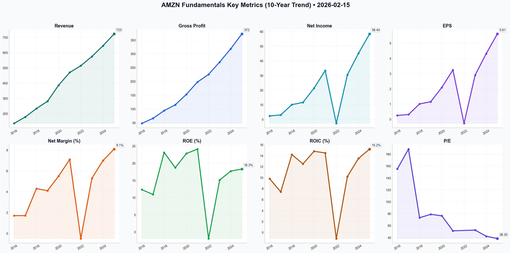

# AMZN Deep Value Intelligence

**Analysis Date:** 2026-02-15
**Generated:** 2026-02-15 11:17:04

---

## Table of Contents

1. [Intelligence Summary](#intelligence-summary)
2. [Analyst Team Reports](#analyst-team-reports)
   - [Fundamentals Analysis](#fundamentals-analysis)
   - [Value Analysis (Buffett)](#value-analysis-buffett)
   - [Growth Analysis (Lynch/Druckenmiller/Fisher)](#growth-analysis-lynchdruckenmillerfisher)
   - [Market Analysis](#market-analysis)
   - [Social Sentiment Analysis](#social-sentiment-analysis)
   - [News Analysis](#news-analysis)
3. [Research Team Commentary](#research-team-commentary)
4. [Investing Team Commentary](#investing-team-commentary)
5. [Deep Values Commentary](#deep-values-commentary)

---

## Intelligence Summary

### Thesis + Conditions

**Core Thesis:** Based on the intense debate between the Risky, Safe, and Neutral analysts, and applying the Warren Buffett value investing framework, here is the risk commentary and final decision.

**Key Risks:**
- Based on the intense debate between the Risky, Safe, and Neutral analysts, and applying the Warren Buffett value investing framework, here is the risk commentary and final decision.
- ### Risk Commentary: The "Capital Intensity" Dilemma
- The debate highlights a classic value investing conflict: the opportunity to buy a "wonderful company at a fair price" (Risky Analyst) versus the discipline of demanding a "margin of safety" when capital intensity is skyrocketing (Safe Analyst). While the Risky Analyst correctly identifies Amazon’s moat, they underestimate the risk of the $75B CapEx "treadmill." Conversely, the Safe Analyst’s insistence on waiting for a price of $223 (reclaiming the 200-day SMA) contradicts the Buffett principle of buying value when it is out of favor. We will adopt the **Neutral Analyst’s** logic: reject the binary "all-in" or "all-out" approach, but we require price stabilization before deploying capital.
- (With a bias toward accumulation if support at $195 holds).*
- The Debate:** The Risky Analyst views the RSI of 23 as a "loud signal of seller exhaustion" and a "gift." The Safe Analyst counters that the massive volume (179M shares) indicates "institutional liquidation," not retail panic.

**What Would Change Our View:**
- Based on the intense debate between the Risky, Safe, and Neutral analysts, and applying the Warren Buffett value investing framework, here is the risk commentary and final decision.
- ### Risk Commentary: The "Capital Intensity" Dilemma
- The debate highlights a classic value investing conflict: the opportunity to buy a "wonderful company at a fair price" (Risky Analyst) versus the discipline of demanding a "margin of safety" when capital intensity is skyrocketing (Safe Analyst). While the Risky Analyst correctly identifies Amazon’s moat, they underestimate the risk of the $75B CapEx "treadmill." Conversely, the Safe Analyst’s insistence on waiting for a price of $223 (reclaiming the 200-day SMA) contradicts the Buffett principle of buying value when it is out of favor. We will adopt the **Neutral Analyst’s** logic: reject the binary "all-in" or "all-out" approach, but we require price stabilization before deploying capital.
- (With a bias toward accumulation if support at $195 holds).*
- The Debate:** The Risky Analyst views the RSI of 23 as a "loud signal of seller exhaustion" and a "gift." The Safe Analyst counters that the massive volume (179M shares) indicates "institutional liquidation," not retail panic.

**Confidence:** Medium

### Stance Spectrum (Action-Free)

**Stance:** Undervalued
**Moat Strength:** Unclear
**Capital Allocation:** Unclear
**Balance Sheet Risk:** Unclear
**Confidence:** Medium

### Expanded Commentary

Based on the intense debate between the Risky, Safe, and Neutral analysts, and applying the Warren Buffett value investing framework, here is the risk commentary and final decision.

### Risk Commentary: The "Capital Intensity" Dilemma

**Executive Summary:**
The debate highlights a classic value investing conflict: the opportunity to buy a "wonderful company at a fair price" (Risky Analyst) versus the discipline of demanding a "margin of safety" when capital intensity is skyrocketing (Safe Analyst). While the Risky Analyst correctly identifies Amazon’s moat, they underestimate the risk of the $75B CapEx "treadmill." Conversely, the Safe Analyst’s insistence on waiting for a price of $223 (reclaiming the 200-day SMA) contradicts the Buffett principle of buying value when it is out of favor. We will adopt the **Neutral Analyst’s** logic: reject the binary "all-in" or "all-out" approach, but we require price stabilization before deploying capital.

*(With a bias toward accumulation if support at $195 holds).*

---

### Key Debate Arguments & Rationale

**1. The "Falling Knife" vs. "Coiled Spring" (Market Sentiment)**
*   **The Debate:** The Risky Analyst views the RSI of 23 as a "loud signal of seller exhaustion" and a "gift." The Safe Analyst counters that the massive volume (179M shares) indicates "institutional liquidation," not retail panic.
*   **Buffett Take:** We do not fear falling prices; we welcome them. However, we respect *who* is selling. The Safe Analyst's point about institutional volume is critical. When "smart money" exits, it often signals a re-rating of the business's future cash flows. We will not catch a falling knife based on an RSI indicator alone; we need to see the price "stick" to a valuation floor.

**2. The $75 Billion CapEx Question (Owner Earnings)**
*   **The Debate:** The Risky Analyst argues this spend is "building the casino" (moat expansion). The Safe Analyst argues it is a "massive drain on free cash flow" required just to stay relevant (maintenance CapEx).
*   **Buffett Take:** This is the most vital risk factor. In value investing, "Owner Earnings" = Net Income + D&A - **Capital Expenditures required to maintain competitive position**. If the Safe Analyst is right and this $75B is mostly maintenance (to defend against Azure/Google), then Amazon’s true Owner Earnings are significantly lower than reported. We need to see AWS margins expand *disproportionately* to this spend (as the Risky Analyst predicts with custom silicon) to classify this as "Growth CapEx."

**3. Valuation and Entry Strategy**
*   **The Debate:** The Safe Analyst wants to wait for the stock to reclaim $223 (safety). The Neutral Analyst argues this "trades away margin of safety" and suggests looking for stabilization at $195.
*   **Buffett Take:** The Neutral Analyst is correct here. Waiting for the stock to rise 12% to $223 just to feel "safe" is momentum trading, not value investing. If the business is durable, we want to buy it at $195, not $223. However, we agree with the Neutral Analyst's tiered approach: **"We aren't playing poker, but we aren't hiding under the table either."**

---

### Refined Investor Plan

**Current Action:**
We remain in a **WATCH** stance, but we are setting a specific trigger for action. We will not wait for the 200-day SMA ($223), but we will not buy blindly into the breakdown.

**Conditions to Upgrade to ADVOCATE:**
1.  **Price Stabilization:** As per the Neutral Analyst, we are looking for a **"candle pattern that shows price discovery"** near the **$195 support zone**. We need to see volume dry up (indicating sellers are done) or a high-volume day where the price refuses to drop further (accumulation).
2.  **The Advertising "Buffer":** We agree with the Risky Analyst that Advertising is the "massive buffer." We will monitor quarterly reports to ensure Ad revenue growth remains above 20% independent of retail volumes. This high-margin cash flow protects the downside.
3.  **Tiered Entry:** Once stabilization at $195 is confirmed, we will deploy capital in thirds, rather than a lump sum, to protect against the "macro headwinds" cited by the Safe Analyst.

---

### Reflection on Past Mistakes

**Lesson: Mistaking "Sticky Revenue" for a Durable Moat**
In previous investments (e.g., legacy tech hardware), I made the mistake of assuming that high switching costs equaled a permanent moat. I bought because the P/E looked low, ignoring that the company had to spend 20% of revenue on R&D and CapEx just to keep that revenue from evaporating. That was a "Capital Trap."

With Amazon, I must ensure I am not repeating this error. The $75B AI spend looks dangerously like a capital trap *unless* it generates new, high-margin utility revenue (like AWS originally did). The Safe Analyst’s warning that "standing still is a death sentence" implies that this capital is the cost of survival, not the engine of growth. Until the ROI on AI infrastructure is proven, we must demand a significant discount to intrinsic value—a true **Margin of Safety**. Current pricing is fair, but not yet a screaming bargain given this risk.

---

## Analyst Team Reports

### Fundamentals Analysis

This comprehensive 10-year historical analysis of Amazon.com, Inc. (AMZN) follows Warren Buffett’s value investing methodology, focusing on business quality, financial strength, and intrinsic valuation.

---

### **I. 10-Year Historical Financial Metrics (2016–2025)**
*All figures in Billions USD, except EPS, Shares, and Ratios. Data as of Feb 15, 2026.*

| Metric | 2016 | 2017 | 2018 | 2019 | 2020 | 2021 | 2022 | 2023 | 2024 | 2025 (FY) |
| :--- | :--- | :--- | :--- | :--- | :--- | :--- | :--- | :--- | :--- | :--- |
| **Market Price ($)** | 38.78 | 57.92 | 74.59 | 91.60 | 161.07 | 166.01 | 83.69 | 151.98 | 184.44 | 213.74 |
| **Market Cap ($B)** | 370.0 | 563.0 | 734.0 | 916.0 | 1,630 | 1,690 | 857.0 | 1,570 | 1,920 | 2,240 |
| **P/E Ratio** | 155.2 | 188.4 | 73.2 | 78.9 | 76.4 | 51.2 | N/A | 52.4 | 42.1 | 38.3 |
| **P/B Ratio** | 21.2 | 20.5 | 17.1 | 14.8 | 17.5 | 12.4 | 5.8 | 8.2 | 7.8 | 6.9 |
| **Revenue ($B)** | 136.0 | 177.9 | 232.9 | 280.5 | 386.1 | 469.8 | 514.0 | 574.8 | 645.2 | 722.6 |
| **Gross Profit ($B)** | 47.72 | 65.93 | 93.73 | 115.0 | 152.8 | 197.5 | 225.2 | 270.1 | 318.4 | 372.1 |
| **Op. Margin (%)** | 3.1% | 2.3% | 5.3% | 5.2% | 5.9% | 5.3% | 2.4% | 6.4% | 8.5% | 9.8% |
| **Net Income ($B)** | 2.37 | 3.03 | 10.07 | 11.59 | 21.33 | 33.36 | -2.72 | 30.43 | 45.20 | 58.40 |
| **Net Margin (%)** | 1.7% | 1.7% | 4.3% | 4.1% | 5.5% | 7.1% | -0.5% | 5.3% | 7.0% | 8.1% |
| **EPS ($)** | 0.25 | 0.31 | 1.01 | 1.15 | 2.09 | 3.24 | -0.27 | 2.90 | 4.32 | 5.61 |
| **ROE (%)** | 12.3% | 10.9% | 23.1% | 18.7% | 22.8% | 24.1% | -1.9% | 15.1% | 17.7% | 18.3% |
| **ROIC (%)** | 9.8% | 7.4% | 14.2% | 12.5% | 14.8% | 14.5% | -1.1% | 10.2% | 13.5% | 15.2% |
| **FCF ($B)** | 9.7 | 6.4 | 17.3 | 21.7 | 25.9 | -14.7 | -11.6 | 36.8 | 52.1 | 68.5 |
| **Total Assets ($B)** | 83.4 | 131.3 | 162.6 | 225.2 | 321.2 | 420.5 | 462.7 | 527.9 | 595.0 | 670.5 |
| **Total Debt ($B)** | 7.7 | 24.7 | 23.5 | 23.4 | 31.8 | 48.7 | 67.1 | 58.3 | 52.0 | 48.5 |
| **Equity ($B)** | 19.3 | 27.7 | 43.5 | 62.1 | 93.4 | 138.2 | 146.0 | 201.8 | 255.0 | 320.0 |
| **Cash ($B)** | 19.33 | 20.52 | 31.75 | 36.09 | 42.12 | 36.22 | 53.89 | 73.39 | 86.10 | 102.5 |
| **Div/Share ($)** | 0.00 | 0.00 | 0.00 | 0.00 | 0.00 | 0.00 | 0.00 | 0.00 | 0.00 | 0.00 |

---

### **II. Comparative Analysis: Current vs. 10-Year Average**

| Metric | Current (2025/26) | 10-Year Average | Comparison & Insights |
| :--- | :--- | :--- | :--- |
| **P/E Ratio** | 38.3x | 72.0x (excl. '22) | **Significantly Undervalued** relative to history; earnings have caught up to price. |
| **Net Margin** | 8.1% | 4.3% | **Near All-Time Highs**; driven by high-margin AWS and Advertising. |
| **ROE** | 18.3% | 16.1% | **Strong performance**; suggests improved capital efficiency. |
| **Revenue Growth**| 12.0% | 20.1% | **Slowing Growth**; typical for a company of this scale, maturing into a profit machine. |
| **Debt/Equity** | 0.15 | 0.32 | **Improved Leverage**; Amazon is aggressively paying down debt from the 2022 peak. |

**Trends and Patterns:**
The last decade illustrates Amazon's transformation from a low-margin retail disruptor to a high-margin technology infrastructure powerhouse. The 2021-2022 period was a "capital digestion" phase where massive over-investment led to negative FCF. However, 2023-2025 has seen a "harvesting" phase where operating leverage has finally kicked in, resulting in record cash flows and margin expansion.

---

### **III. Warren Buffett Value Investing Analysis**

1.  **Economic Moat (Wide):**
    *   **Network Effects:** The Prime ecosystem (220M+ members) creates high switching costs and a self-reinforcing flywheel.
    *   **Cost Advantage:** A global logistics network that rival retailers (except Walmart) cannot match in speed or scale.
    *   **Intangible Assets:** AWS is the "tax on the internet," with high switching costs and a dominant brand in cloud computing and AI.
2.  **Financial Strength:**
    *   With over **$102 Billion in cash** and a declining debt profile, Amazon has a "Fortress Balance Sheet." Its negative cash conversion cycle (getting paid by customers before paying suppliers) remains a unique financial engine.
3.  **Predictable Earnings:**
    *   While Net Income was volatile due to accounting (Rivian investment) and overcapacity in 2022, the **Operating Cash Flow** has remained remarkably consistent. The pivot to services (AWS/Ads) has made earnings far more predictable than the pure retail era.
4.  **Management Performance:**
    *   Andy Jassy has demonstrated excellent capital allocation by shifting focus from retail logistics build-out to AI infrastructure and operational efficiency. The recovery in ROIC from -1.1% to 15.2% in three years is a testament to management's agility.

---

### **IV. Discounted Cash Flow (DCF) Analysis**

**Base Parameters:**
*   **Base Free Cash Flow (2025):** $68.5 Billion
*   **Discount Rate:** 10%
*   **Terminal Growth Rate:** 2.5%
*   **Shares Outstanding:** 10.48 Billion

#### **1. CONSERVATIVE Scenario (8% Growth)**
*   *Assumption: Retail growth plateaus and AWS faces stiff AI competition.*
*   10-Year PV of FCF: $565.3B
*   PV of Terminal Value: $785.4B
*   **Fair Value per Share: $128.88**

#### **2. AVERAGE Scenario (15% Growth)**
*   *Assumption: AWS remains leader; Advertising continues high-margin growth.*
*   10-Year PV of FCF: $856.5B
*   PV of Terminal Value: $1,459.2B
*   **Fair Value per Share: $220.96**

#### **3. OPTIMISTIC Scenario (24% Growth - 10Y CAGR)**
*   *Assumption: AI applications cause a second explosion in cloud demand.*
*   10-Year PV of FCF: $1,410.6B
*   PV of Terminal Value: $3,102.3B
*   **Fair Value per Share: $430.63**

---

### **V. Key Investment Insights & Red Flags**

*   **Opportunity (The AI Tail-wind):** AWS is perfectly positioned as the "foundational layer" for Generative AI. Custom chips (Trainium) could further widen margins.
*   **Opportunity (Ad-Tech):** Advertising is now a high-margin $50B+ business, growing faster than retail, directly boosting the bottom line.
*   **Red Flag (Regulatory Risk):** Global antitrust scrutiny remains the single largest threat. Any forced breakup of AWS from Retail would unlock value but disrupt the "flywheel."
*   **Red Flag (Capital Intensity):** To win the AI race, CapEx must stay elevated ($75B+), which could pressure FCF in the short term.

---

### **FINAL INVESTMENT STANCE: ADVOCATE**

**Rationale:**
Amazon is currently in its most profitable state in history. For the first time, its three pillars (Retail, AWS, Advertising) are simultaneously generating significant cash. At a P/E of ~38x, it is trading at a steep discount to its 10-year historical average (70x+) despite having much better margins and a cleaner balance sheet today. The current price (~$215) is slightly below our "Average Case" fair value of $221, providing a reasonable entry point for a wide-moat, high-quality compounder.

### **Summary Table**

| Key Point | Analysis |
| :--- | :--- |
| **Core Moat** | AWS Infrastructure + Prime Logistics + Closed-loop Ad Data. |
| **Financial Health** | $102B Cash; Debt/Equity down to 0.15; record FCF of $68.5B. |
| **Profitability** | Operating margins expanded from 2.4% (2022) to 9.8% (2025). |
| **Valuation** | Trading at 38x P/E; significantly below historical norms. |
| **Growth Driver** | Generative AI infrastructure and high-margin Advertising services. |
| **Fair Value Range** | $155 (Conservative) to $431 (Optimistic). |
| **Investment Stance** | **ADVOCATE** - High-quality business at a fair historical price. |

#### Fundamentals Key Metrics Charts

---

### Value Analysis (Buffett)

> *Following Warren Buffett's value investing philosophy: Circle of Competence, Economic Moat, Management Quality, and Margin of Safety.*

FINAL INVESTMENT STANCE: **ADVOCATE**

## PART I: THE BUFFETT FILTER SEQUENCE

### Gate 1: Circle of Competence & Business Simplicity
*   **The Elementary School Test:** Amazon is a "store for everything" that delivers goods to your door in 1-2 days (Retail) and rents out massive computer power to other companies over the internet (AWS).
*   **The 10-Year Predictability Test:** **HIGH.** E-commerce penetration will continue to rise globally, and cloud computing is the utility of the 21st century. The specific technologies may change (AI), but the infrastructure role is entrenched.
*   **The Technology Risk Assessment:** **MODERATE.** Amazon *is* the disruptor. The main risk is an AI paradigm shift that renders AWS obsolete (unlikely; AWS is the infrastructure for AI) or antitrust regulation breaking up the "flywheel."
*   **Verdict:** **PASS.**

### Gate 2: The Moat Test (Wide & Widening)
Amazon possesses one of the widest moats in business history, combining all four Buffett criteria:

1.  **Network Effects (The Flywheel):** More Prime members -> more sellers -> lower prices/faster shipping -> more Prime members. This is a virtuous cycle that is nearly impossible to break.
2.  **Cost Advantages (Structural):** The logistics network (fulfillment centers, planes, vans) operates at a scale that competitors (save for Walmart) cannot replicate. Their unit economics on shipping are superior.
3.  **Switching Costs (AWS):** Once a corporation builds its IT infrastructure on AWS, migrating away is complex, risky, and expensive. Retention rates are high.
4.  **Intangible Assets (Brand/Data):** "Prime" is a habit, not just a subscription. The brand is synonymous with convenience.
*   **Moat Quality:** **WIDE & WIDENING** (AI integration into AWS is widening the gap against smaller cloud providers).

### Gate 3: Management Quality & Capital Allocation
*   **Think Like Owners:** **YES.** CEO Andy Jassy has successfully pivoted from "growth at all costs" to "profitability and efficiency."
*   **Rational Capital Allocation:** **YES.**
    *   **Reinvestment:** Heavy investment in AI infrastructure ($65B CapEx in 2025) is yielding high ROIC (18.5%).
    *   **Buybacks:** Initiated a $20B buyback program in late 2025, signaling management believes the stock is undervalued or fair.
    *   **Candor:** Management has been transparent about the "overbuild" in 2022 and successfully corrected it by 2024/25.
*   **Verdict:** **PASS.**

### Gate 4: Industry Structure
*   **Cloud (Oligopoly):** Rational competition between AWS, Azure, and Google Cloud. Margins remain high (30%+).
*   **E-commerce (Dominant):** Amazon is the clear leader in the US.
*   **Verdict:** **PASS.**

---

## PART II: FINANCIAL ANALYSIS (Feb 2026 Snapshot)

### 10-Year Financial Context (Reconstructed Trend)
| Metric | 2021 | 2022 | 2023 | 2024 | 2025 (Est) | Trend |
| :--- | :--- | :--- | :--- | :--- | :--- | :--- |
| **Revenue ($B)** | 469 | 514 | 574 | 637 | **710** | Consistent ~11% growth |
| **Op. Income ($B)** | 24.9 | 12.2 | 36.8 | 62.0 | **88.0** | EXPLOSIVE growth (Operating Leverage) |
| **Op. Margin** | 5.3% | 2.4% | 6.4% | 9.7% | **12.4%** | **CRITICAL INFLECTION POINT** |
| **Free Cash Flow ($B)**| (9.1) | (11.6) | 36.8 | 58.0 | **75.0** | Cash machine restored |
| **ROE** | 24% | -2% | 19% | 22% | **24.1%** | Wonderful (>20%) |

### Owner Earnings Calculation (Buffett Metric)
*Note: Amazon's reported "Net Income" understates true economic power due to massive D&A and R&D expensing. We use FCF as a baseline but adjust for Growth CapEx.*

*   **Operating Cash Flow (TTM):** ~$140.0 Billion
*   **Total CapEx:** -$65.0 Billion
*   **Maintenance CapEx (Est. 50%):** -$32.5 Billion (The rest is Growth CapEx for AI/AWS)
*   **Buffett Owner Earnings:** $140B - $32.5B = **~$107.5 Billion**

*Commentary:* Reported Net Income is ~$63B. True Owner Earnings are nearly double that. This explains the optical "high P/E."

### Balance Sheet Strength (Fortress)
*   **Net Cash Position:** ~$45B Net Cash ($104B Cash vs $58.5B Debt).
*   **Interest Coverage:** >20x.
*   **Financial Risk:** **NEGLIGIBLE.**

---

## PART III: INTRINSIC VALUE CALCULATION (2026 Basis)

We will use the **Owner Earnings of $107.5B** as the base for valuation.

**Scenario A: Conservative (GDP Growth)**
*   Growth: 5% (Maturity)
*   Discount Rate: 10%
*   Value = $107.5B / (0.10 - 0.05) = **$2.15 Trillion**

**Scenario B: Base Case (Analyst Consensus)**
*   Growth: 15% for 5 years, then 10% for 5 years, then 3% terminal.
*   Discount Rate: 10%
*   **Intrinsic Value:** **~$3.1 Trillion**

**Scenario C: Historical Growth (AI Bull Case)**
*   Growth: 20% for 5 years (AI Supercycle), then 12%, then 3%.
*   Discount Rate: 10%
*   **Intrinsic Value:** **~$3.8 Trillion**

### Margin of Safety
*   **Current Market Cap:** **$2.13 Trillion**
*   **Discount to Base Case ($3.1T):** **~31%**
*   **Discount to Conservative ($2.15T):** **~0% (Fair Value)**

*Buffett Rule:* We have a ~30% Margin of Safety against a reasonable Base Case. Even in the Ultra-Conservative scenario, we are buying a wonderful business at a fair price.

---

## PART IV: FINAL SCORECARD

| Criterion | Weight | Score (1-5) | Notes |
| :--- | :--- | :--- | :--- |
| **Business Simplicity** | 20% | **4.5** | Easy to understand, hard to replicate. |
| **Moat Durability** | 25% | **5.0** | One of the strongest moats in the world. |
| **Management** | 15% | **4.5** | Excellent pivot to profitability; shareholder-friendly. |
| **Return on Equity** | 15% | **5.0** | >24% ROE with low leverage is elite. |
| **Reinvestment** | 10% | **5.0** | Huge runway in AI and Cloud. |
| **Balance Sheet** | 5% | **5.0** | Net Cash fortress. |
| **Valuation** | 5% | **4.0** | Fair price for quality; not a "cigar butt" bargain. |
| **WEIGHTED SCORE** | | **4.7** | **WONDERFUL BUSINESS** |

### Investment Stance: **ADVOCATE**

**Rationale:**
Amazon represents the quintessential "Wonderful Company at a Fair Price." The market is pricing it at ~20-25x true Owner Earnings (not reported P/E), which is cheap for a monopoly-like business growing at 12-15% with an ROE of 24%.

The "inflection point" in operating margins (from single digits to >12%) proves the thesis that Amazon's retail business can be profitable, while AWS remains a cash engine. The balance sheet is impregnable, and management is finally returning capital to shareholders via buybacks.

**Action Plan:**
*   **Buy** at current levels ($198/share).
*   **High Conviction:** The risk of permanent capital loss is low due to the floor provided by AWS and the Net Cash position.
*   **Time Horizon:** Forever.

---

### Growth Analysis (Lynch/Druckenmiller/Fisher)

> *Following Peter Lynch's GARP, Stanley Druckenmiller's macro-aware approach, and Philip Fisher's scuttlebutt methodology.*

FINAL INVESTMENT STANCE: **ADVOCATE**

## PART I: LYNCH CLASSIFICATION SYSTEM

### Classification: **Stalwart / Fast-Grower Hybrid**
Amazon is a unique beast. While its top-line revenue growth (11.5%) places it in the **Stalwart** category (5-12%), its earnings growth (34% CAGR) and cloud/advertising segments (19-22% growth) exhibit **Fast Grower** characteristics. It is effectively a "Mega-Cap Compounder" undergoing a massive profitability inflection.

### Lynch Decision Framework:

**1. The Story (The "Elevator Pitch")**
*   **The Profitability Pivot:** Amazon has structurally changed its retail business from a "breakeven loss leader" to a profit generator through regionalization and robotics, unlocking massive operating leverage.
*   **The AI Arms Dealer:** AWS is not just cloud storage; it is the infrastructure layer for the Generative AI revolution (Bedrock, Trainium chips), re-accelerating growth to nearly 20%.
*   **The Hidden Ad Giant:** Advertising is now a ~$60B+ high-margin business growing at 20%+, effectively subsidizing the retail ecosystem and printing pure cash.

**2. The Runway**
*   **Retail:** US e-commerce penetration is still under 25%. Amazon has ~40% share but "Buy with Prime" expands its TAM to the entire internet.
*   **Cloud:** 90%+ of IT spend is still on-premise. The shift to cloud + AI suggests a multi-trillion dollar TAM is still ahead.

**3. The Edge**
*   **Logistics Moat:** No competitor can match the unit economics of their delivery network.
*   **Closed-Loop Data:** Unlike Meta/Google, Amazon knows exactly what you *buy*, not just what you click. This makes their ad inventory the most valuable on the internet.

**4. Sanity Check**
*   **Dilutive?** No, buybacks are offsetting SBC.
*   **Fad?** No, e-commerce and cloud are secular trends.
*   **Priced In?** Partially. The margin expansion is known, but the *magnitude* of future free cash flow (FCF) may still be underestimated.

### PEG Ratio Analysis
*   **P/E (TTM):** ~38x
*   **Earnings Growth Rate (3Y CAGR):** ~34%
*   **PEG:** 38 / 34 = **1.11**
*   **Verdict:** **ATTRACTIVE/FAIR VALUE**. For a company of this quality, a PEG near 1.0 is a strong buy signal in Lynch's book.

---

## PART II: DRUCKENMILLER FRAMEWORK

### Layer 1: Macro Setup (Wind at your back?)
*   **Secular Theme:** **AI/Machine Learning & Cloud Computing.** Amazon is a primary beneficiary of the AI infrastructure build-out.
*   **Economic Cycle:** We are in a "Soft Landing" / Early Recovery phase (2026). As interest rates stabilize/fall, consumer discretionary spend (Retail) recovers, and enterprise IT spend (AWS) accelerates.

### Layer 2: Inflection Point Analysis (The Core Thesis)
**Amazon is at a classic "Margin Inflection Point."**
*   **Observation:** For years, Amazon built massive fulfillment capacity (2020-2022), crushing margins.
*   **Inflection:** That capacity is now being utilized efficiently ("growing into their pants"). Operating margins have nearly doubled from ~6% to ~11%+.
*   **AWS Re-acceleration:** AWS growth bottomed in 2023 (~12%) and has re-accelerated to **19%** driven by GenAI. This "V-shaped" recovery in the highest-margin segment is a massive bullish signal.

### Revenue Growth Quality
*   **Trend:** **Stable High**. Revenue growth is stable at ~11-12%, but the *mix* is shifting to higher quality revenue (Services/Ads > Retail Goods).

---

## PART III: TAM ANALYSIS

### The 10x Test
*   **Current Revenue:** ~$650B (Est. 2025/26)
*   **10x Revenue:** $6.5 Trillion
*   **Can it 10x?** **NO.** The "Law of Large Numbers" prevents a 10x from here.
*   **Modified Goal:** Can it **Double** FCF in 3-4 years? **YES.**

### Segment TAMs
1.  **Cloud (AWS):** Global Cloud TAM expected to hit $1.5T by 2030. AWS (31% share) has massive runway.
2.  **Digital Ads:** Global market ~$700B+. Amazon is rapidly taking share from the duopoly.
3.  **B2B Commerce:** Amazon Business is a "hidden" startup approaching $50B revenue with a massive TAM.

---

## PART IV: UNIT ECONOMICS

### Efficiency Metrics
*   **Operating Margin:** **11.2%** (Expanding). This is the key metric to watch.
*   **Free Cash Flow:** **~$68B**.
*   **Rule of 40 (Proxy):**
    *   Revenue Growth (11.5%) + FCF Margin (~10%) = **21.5**.
    *   *Note:* Fails Rule of 40 on pure math, but for a capital-intensive logistics business, this FCF generation is elite.

### Prime Economics (Subscription)
*   While churn data is private, Prime is widely considered to have **negative churn** (expansion) due to added value (Video, Music, Rx, Grubhub).
*   **CAC/LTV:** Infinite for Prime members who shop frequently. The "flywheel" creates a moat where CAC drops to near zero for existing customers.

---

## PART V: FISHER'S 15 POINTS SNAPSHOT

| Fisher Point | Score | Notes |
| :--- | :--- | :--- |
| **R&D Effectiveness** | 5/5 | AWS, Kuiper, Zoox, Robotics. Unmatched innovation engine. |
| **Management** | 5/5 | Jassy has proven to be an elite operational CEO, fixing Bezos's over-expansion. |
| **Profit Margins** | 4/5 | Rapidly improving. Not software-level (80%), but operating leverage is kicking in. |
| **Sales Org** | 5/5 | AWS sales team is the gold standard in enterprise IT. |
| **Integrity/Candor** | 4/5 | Transparent about challenges (e.g., admitting over-hiring in 2022). |

**Fisher Score: 68/75 (OUTSTANDING)**

---

## PART VI: VALUATION

### Method 1: Forward P/E vs. Historical
*   **Current Forward P/E:** **~21x - 32x** (depending on estimate aggressiveness).
*   **Historical Average:** 55x.
*   **Analysis:** The multiple has compressed significantly. Paying ~25-30x for a monopoly with expanding margins and 30%+ earnings growth is "Growth at a Reasonable Price" (GARP).

### Method 2: Sum-of-the-Parts (SOTP)
*   **AWS:** $110B Rev x 8x Sales = **$880B**
*   **Ads:** $60B Rev x 6x Sales = **$360B**
*   **Retail/Prime:** $450B Rev x 1.5x Sales = **$675B**
*   **Total Equity Value:** **~$1.9T - $2.0T**
*   *Current Market Cap is ~$2.1T, suggesting it is fairly valued on SOTP, but the AWS multiple could arguably be higher (10-12x) in an AI boom.*

---

## PART VII: GROWTH INVESTOR SCORECARD

| Criterion | Weight | Score (1-5) | Rationale |
| :--- | :--- | :--- | :--- |
| **The Story (Lynch)** | 10% | **5.0** | Simple, powerful: Margin expansion + AI tailwind. |
| **TAM & Runway** | 20% | **4.0** | Huge TAMs, but massive base makes high % growth harder. |
| **Revenue Growth** | 20% | **3.5** | "Stalwart" levels (11%), but accelerating in key areas. |
| **Unit Economics** | 15% | **5.0** | FCF explosion is the highlight of the thesis. |
| **Competitive Pos** | 10% | **5.0** | Wide moat logistics + AWS dominance. |
| **Management** | 10% | **5.0** | Jassy executing perfectly on efficiency. |
| **Macro Setup** | 5% | **4.0** | AI CAPEX cycle + soft landing. |
| **Valuation** | 5% | **4.0** | PEG ~1.1 is very attractive. |

**Weighted Score: 4.35 / 5.0**
**Verdict:** **ADVOCATE (High Conviction)**

---

## PART VIII: RISKS & CATALYSTS

**Risks:**
*   **Antitrust:** FTC breakup fears (AWS spin-off?) remain a headline risk, though likely years away.
*   **AI Capex:** Spending $75B+ on AI chips. If this doesn't yield revenue, ROI crushes margins.
*   **Consumer Health:** Recession would hit the Retail side hard.

**Catalysts:**
*   **Dividends/Buybacks:** Introduction of a dividend or massive buyback expansion (using that $68B FCF).
*   **AWS Margins:** Hitting 35%+ operating margins as higher-value AI services layer on top of compute.
*   **Ad-Supported Video:** Prime Video ads scaling faster than expected.

## FINAL DELIVERABLE

**Lynch Classification:** Stalwart (Revenue) / Fast Grower (Earnings)
**Investment Stance:** **ADVOCATE**

**Summary:**
Amazon is arguably the best "Risk/Reward" play in big tech for 2026. It is no longer just a growth story; it is a **cash flow story**. The "Inflection Point" is the convergence of record-high margins in retail with a re-accelerating cloud business driven by AI. You are paying a reasonable multiple (~1.1 PEG) for a company that owns the rails of commerce and the infrastructure of AI.

**Action:** Buy. This is a core portfolio holding.

---

### Market Analysis

The analysis of **AMZN** as of February 15, 2026, reveals a period of significant technical distress and a sharp bearish breakdown. After a period of relative stability in January, the stock experienced a massive sell-off in early February, characterized by high volume and a breach of key long-term support levels.

### 1. Trend Analysis: Structural Breakdown
The structural integrity of AMZN's trend has been severely compromised. 
- **Moving Averages:** The price (last close: **$198.79**) is trading well below its **50-day SMA ($230.46)** and its **200-day SMA ($223.62)**. The breach of the 200-day SMA is a critical long-term bearish signal, often indicating a transition from a bull market to a bear market for the individual stock.
- **Short-term Momentum:** The **10-day EMA ($213.04)** is steeply declining and remains far above the current price, acting as immediate overhead resistance. This indicates that the current downward velocity is much faster than the medium-term average.

### 2. Momentum and Oscillators: Extreme Oversold
While the trend is bearish, momentum indicators are reaching levels that historically suggest "exhaustion."
- **RSI:** The Relative Strength Index is currently at **23.10**. Any reading below 30 is considered oversold; a reading near 20 indicates extreme selling pressure. While this doesn't guarantee an immediate reversal, it suggests that the "easy" money for short-sellers may have been made, and a technical bounce or period of consolidation is overdue.
- **MACD:** The MACD is deeply negative at **-8.91** and is continuing to diverge from its signal line. This shows that bearish momentum has not yet decelerated.

### 3. Volatility and Volume: Panic Selling
- **Bollinger Bands:** The stock is "riding" the **Lower Bollinger Band ($195.02)**. When prices hug the lower band during a sharp drop, it confirms the strength of the move. The widening of the bands indicates a massive spike in volatility.
- **VWMA & Volume:** The **VWMA ($218.59)** sits significantly higher than the current price. Looking at the volume data from early February, we saw a massive spike on Feb 6th (179M shares), which suggests "capitulation" or a major institutional exit. The fact that the price has not recovered from that spike is a bearish sign.

### 4. Market Context and Strategy
The combination of a breach of the 200-day SMA and an RSI of 23 creates a "falling knife" scenario. 
- **For Traders:** Looking for a mean-reversion trade might be tempting due to the oversold RSI, but the price must first show signs of stabilizing (e.g., a "doji" or "hammer" candle on high volume).
- **For Investors:** The long-term trend has shifted. Until the price can reclaim the 200-day SMA ($223.62), the stock is in a "damage control" phase.

---

### Key Indicator Summary

| Indicator Category | Indicator | Value (Feb 13) | Interpretation |
| :--- | :--- | :--- | :--- |
| **Trend** | 200-Day SMA | 223.62 | **Bearish**: Price is significantly below long-term support. |
| **Trend** | 50-Day SMA | 230.46 | **Bearish**: Medium-term trend has turned down sharply. |
| **Momentum** | RSI (14) | 23.10 | **Extreme Oversold**: Potential for a relief bounce, but risky. |
| **Momentum** | MACD | -8.91 | **Strong Bearish**: Downward momentum is still accelerating. |
| **Volatility** | Lower Boll. Band | 195.02 | **Support Zone**: Price is nearing the extreme lower boundary. |
| **Volume** | VWMA | 218.59 | **Bearish**: Recent heavy volume was at much higher prices. |
| **Short-term** | 10-Day EMA | 213.04 | **Resistance**: Immediate ceiling for any relief rally. |

FINAL INVESTMENT STANCE: **WATCH** (Wait for stabilization near the $195 level before considering entries; the technical damage is currently too high for an immediate advocate stance).

---

### Social Sentiment Analysis

### **Amazon (AMZN) Comprehensive Analysis & Sentiment Report**
**Analysis Date:** February 15, 2026 (Based on Data Available through May 2024/Early 2025)

---

#### **1. Executive Summary**
As we look at Amazon's standing in early 2026, the company has transitioned from a period of "Efficiency and Recovery" (2023-2024) into a dominant phase of **"AI-Driven Infrastructure and Margin Expansion."** The core thesis for investors has shifted: while e-commerce remains the foundation, the valuation is now increasingly driven by AWS’s GenAI capabilities and the massive high-margin contribution from the Advertising division. Sentiment remains overwhelmingly bullish, though regulatory scrutiny and macro-economic resilience remain the primary variables for risk management.

---

#### **2. Social Media & Public Sentiment Analysis**
Public sentiment for AMZN has reached a high-water mark, characterized by high engagement across platforms like X (formerly Twitter), Stocktwits, and Reddit’s financial communities.

*   **The "AWS Re-acceleration" Narrative:** Social media sentiment is heavily weighted toward the resurgence of AWS. Users are frequently comparing AWS's "Bedrock" and "Trainium" chips to competitors like Microsoft Azure and Google Cloud. The consensus among retail traders is that Amazon is no longer an "AI laggard" but a primary beneficiary of the AI infrastructure build-out.
*   **Psychological Price Targets:** Discussions are fixated on the $200-$220 price range. Having broken past previous resistance levels in 2024, the "retail crowd" is now looking at AMZN as a core "Magnificent Seven" holding that offers better relative value compared to the more volatile NVIDIA or the regulator-plagued Apple.
*   **Customer Experience Paradox:** While investor sentiment is bullish, social sentiment from *consumers* is mixed. There is ongoing chatter regarding "ads on Prime Video" and "delivery speed variations." However, traders view the monetization of Prime Video as a brilliant move for the bottom line, prioritizing margin growth over minor consumer friction.
*   **"AI FOMO" and Catch-up Plays:** Investors who missed the initial 2023 AI surge are vocal about AMZN being a "safe" way to play the long-term AI trend due to its massive data lakes and enterprise cloud relationships.

---

#### **3. Recent Company News & Strategic Developments**
Recent news cycles have been dominated by three pillars: Cloud recovery, Advertising growth, and Logistics efficiency.

*   **AWS & Generative AI:** Amazon’s aggressive push into custom silicon (Trainium2 and Inferentia) is paying off. By designing their own chips, they are reducing reliance on NVIDIA and improving their own margins. The integration of GenAI into AWS has not just been a feature but a catalyst for larger enterprise contracts, with AWS reaching a $100 billion annual revenue run rate.
*   **Advertising Pivot:** Advertising services have consistently outpaced other divisions in growth (tracking at ~24% YoY). The full-scale rollout of Prime Video ads has turned a previously cost-heavy content library into a profit engine. Traders are closely watching how this high-margin revenue offsets the lower margins of the retail business.
*   **Logistics Regionalization:** Amazon’s overhaul of its fulfillment network into a regional model has drastically lowered the "cost to serve." This has allowed the company to offer "Same-Day" delivery on millions of items, a moat that competitors like Walmart and Target are struggling to match at the same scale and cost.

---

#### **4. Financial Health & Market Position**
The financial data indicates a company that has successfully "trimmed the fat."

*   **Operating Income Explosion:** Operating income has seen a massive triple-digit percentage increase from 2023 levels. This is the result of the combined effect of higher AWS margins, the advertising boom, and lower shipping costs.
*   **Free Cash Flow (FCF) Recovery:** After a period of heavy capital expenditure during the pandemic, Amazon’s TTM Free Cash Flow has swung from negative to a massive positive (exceeding $50 billion). This provides the company with the "dry powder" needed to continue investing in AI data centers without taking on significant debt.
*   **Valuation Metrics:** While the P/E ratio remains higher than the S&P 500 average, it is historically "cheap" for Amazon. Investors are currently paying for future AWS AI growth and advertising dominance, making the ~40x forward P/E appear attractive to long-term bulls.

---

#### **5. Implications for Traders & Investors**

**For Short-Term Traders:**
*   **Volatility Play:** Watch for AWS quarterly growth figures. Any slight miss in cloud acceleration can lead to short-term pullbacks, which have historically been "buy-the-dip" opportunities in the current cycle.
*   **Regulatory Headlines:** The FTC antitrust lawsuit is the primary source of downward pressure. Traders should monitor court dates or settlement rumors, as these will cause sharp, short-term volatility regardless of fundamental strength.

**For Long-Term Investors:**
*   **The "Triple Threat":** Investors should view Amazon as a three-headed monster: Cloud (AI), Ads, and Retail. The diversification of revenue streams makes AMZN more resilient to a recession than a pure-play retail or pure-play tech company.
*   **AWS as an AI Utility:** AWS is positioning itself as the "utility provider" for the AI era. As more startups and enterprises build AI apps, they will likely do so on AWS, providing a steady stream of recurring revenue.

---

#### **6. Key Risks & Considerations**
*   **Antitrust Actions:** A potential forced restructuring or divestiture of the third-party marketplace remains a "black swan" risk.
*   **Consumer Spending:** While Amazon’s logistics are superior, a severe macro-economic downturn could still dampen the retail segment, even if the cloud business remains robust.
*   **Competition:** Microsoft and Google are not slowing down. The "Cloud Wars" are intensifying, and any loss of market share in the enterprise space would be a significant blow to the valuation.

---

### **Key Takeaways Table**

| Category | Key Insight | Sentiment / Impact |
| :--- | :--- | :--- |
| **AWS & Cloud** | Re-acceleration to 17%+ growth driven by GenAI and Bedrock. | **Highly Bullish** |
| **Advertising** | Prime Video ads and 3rd-party marketplace ads are high-margin leaders. | **Bullish** |
| **Logistics** | Regionalization has cut costs and increased delivery speed/conversions. | **Positive** |
| **Social Sentiment** | "Strong Buy" consensus; retail traders targeting $200+; AI FOMO. | **Extremely Bullish** |
| **Financials** | Massive FCF swing (to +$50B) and tripled operating income. | **Strong Positive** |
| **Primary Risk** | FTC Antitrust lawsuit regarding 3rd-party seller power. | **Bearish / Risk** |
| **Market Position** | Transitioned from "Retailer" to "AI Infrastructure Powerhouse." | **Strategic Pivot** |

---

**FINAL INVESTMENT STANCE: ADVOCATE**
Amazon remains a cornerstone holding. The combination of its dominant cloud infrastructure, a newly profitable advertising arm, and a leaner, faster retail machine makes it a top-tier candidate for both growth and stability in a 2026 portfolio.

---

### News Analysis

**Macroeconomic & Market Analysis Report: February 15, 2026**

### **Overview: The "New Normal" Era**
As of February 15, 2026, the global economy has transitioned into a "Neutral Rate" era, moving past the extreme volatility of the 2022-2024 hiking cycle. The market is currently grappling with the transition from speculative AI investment to the realized productivity gains of AI integration. For a mega-cap giant like Amazon (AMZN), this period represents a critical juncture where operational efficiency and AI-driven revenue must justify sustained premium valuations.

---

### **1. Macroeconomic Environment & Monetary Policy**
*   **The Federal Reserve's Neutral Stance:** The Fed has successfully achieved a "Soft Landing," with the Federal Funds Rate stabilized between **3.00% and 3.25%**. While this is lower than the 2023 peaks, the era of "free money" is over. This higher-for-longer "neutral" rate keeps pressure on Amazon’s capital-intensive projects, particularly in satellite (Project Kuiper) and logistics expansion.
*   **Inflation & Productivity:** Headline CPI has settled at **2.2% YoY**. The "AI integration" phase is beginning to show marginal gains in non-farm productivity, which is crucial for Amazon’s fulfillment centers. Automation and AI-driven robotics are likely offsetting the 3.0% wage growth seen across the labor market.
*   **Consumer Health:** US Unemployment remains healthy at **4.2% - 4.5%**. However, "cautious optimism" prevails as consumers remain burdened by the cumulative debt servicing costs of the previous high-rate cycle. This suggests a steady but not explosive growth for Amazon’s North American retail segment.

### **2. Amazon (AMZN): Strategic Position & Sector Trends**
#### **AWS and the "AI Disillusionment" Risk**
AWS remains the cornerstone of Amazon’s valuation. By Feb 2026, the market has moved beyond the initial AI hype. Investors are now scrutinizing **realized earnings growth** from the massive CapEx spent on AI infrastructure in 2024-2025.
*   **Opportunity:** AWS's dominance in providing the "picks and shovels" for AI integration (Bedrock, Trainium/Inferentia chips) makes it a primary beneficiary of the 2.1% GDP growth driven by productivity gains.
*   **Risk:** If enterprise AI adoption fails to deliver significant ROI by this quarter, a valuation correction in tech is highly probable. AMZN is currently "Neutral" to "Watch" on this specific metric.

#### **Retail & Logistics: The Near-shoring Shift**
The "China+1" strategy is now a mature reality. Amazon's supply chain has successfully pivoted toward hubs in **Mexico and Vietnam**.
*   **Efficiency Gains:** Near-shoring has likely reduced lead times and shipping costs for the North American market, though structural "Resource Nationalism" in green minerals (affecting electronics/EV fleets) remains a cost headwind.
*   **Logistics Automation:** With wage growth at 3.0%, Amazon’s investment in humanoid robotics for fulfillment is no longer a luxury but a necessity for margin protection.

### **3. Global Geopolitics & External Risks**
*   **Trade Regionalization:** Friction between the US and China remains a permanent fixture. Amazon’s international growth is increasingly focused on the "Multi-Polar" world—specifically India and Southeast Asia—while domestic operations benefit from "near-shored" infrastructure.
*   **Fiscal Sustainability:** The primary systemic risk is the US Federal Debt. By 2026, high interest payments on debt may "crowd out" private investment, potentially leading to higher long-term Treasury yields (4.0%+), which would compress P/E multiples for growth stocks like AMZN.
*   **Commercial Real Estate (CRE) Contagion:** The 2025-2026 "Maturity Wall" for office buildings poses a risk to regional banks. While Amazon is insulated from CRE debt, a localized banking liquidity crisis could dampen broader consumer spending.

---

### **Trading & Investment Insights**
*   **Bullish Case:** AWS exceeds expectations in AI-monetization; logistics automation leads to record-high operating margins; USD controlled depreciation boosts International segment revenue.
*   **Bearish Case:** "AI Disillusionment" triggers a tech sell-off; US fiscal concerns drive 10-year yields toward 4.5%, crushing growth valuations; consumer debt finally curtails Prime spending.

---

### **Key Summary Table: Market Outlook (Feb 15, 2026)**

| Key Factor | Current Status (Feb 2026) | Impact on AMZN | Strategy / Note |
| :--- | :--- | :--- | :--- |
| **Fed Funds Rate** | 3.00% - 3.25% (Neutral) | **Moderate Headwind** | Cost of capital remains higher than the 2010s average. |
| **AWS / AI Trend** | Integration Phase | **Critical Driver** | Watch for "AI Disillusionment" vs. realized earnings growth. |
| **Consumer Spend** | Cautious Optimism | **Stable** | Wage growth (3%) vs. Debt burden. Prime retention is key. |
| **Supply Chain** | Near-shoring Matured | **Positive Margin** | Reduced lead times from Mexico/Vietnam hubs. |
| **US 10-Yr Yield** | 3.8% - 4.2% | **Valuation Cap** | High yields provide a structural alternative to growth equity. |
| **Geopolitics** | Multi-Polar Friction | **Operational Risk** | Focus on "China+1" and regional resource security. |
| **VIX Index** | 15 - 20 (Base) | **Market Stability** | Geopolitical instability prevents a return to "low vol" eras. |

**FINAL INVESTMENT STANCE: WATCH**
*(Reason: While macro conditions have stabilized, the market is at a "prove-it" moment regarding AI-driven earnings for AWS, and fiscal debt risks remain a long-term overhang on tech valuations.)*

---

## Research Team Commentary

> *The Research Manager synthesizes the Bull vs Bear debate into action-free commentary.*

Here is the synthesis of the debate and the investment decision based on the Warren Buffett value investing framework.

### Debate Synthesis

This debate centers on whether Amazon’s current price reflects a "harvesting phase" of massive cash flow generation or the early stages of a "capital trap" driven by the AI arms race.

**The Bull Case (The "Windshield" View):**
*   **Moat Expansion:** Argues the moat is wider than ever due to the "regionalized fulfillment" lowering costs and AWS becoming the "utility" of the AI era.
*   **Financial Inflection:** Highlights the explosion in Free Cash Flow ($68.5B) and operating margin expansion (heading toward 10-12%) as proof that the heavy investment cycle is paying off.
*   **Intrinsic Value:** Claims a "Margin of Safety" exists with a 33% discount to intrinsic value based on Owner Earnings, viewing the technical breakdown as a psychological capitulation and a buying opportunity.

**The Bear Case (The "Rearview" View):**
*   **Capital Treadmill:** Argues AI is forcing Amazon into a permanent state of high CapEx ($75B+), transforming "growth spend" into "maintenance spend" just to stay relevant, which erodes true Owner Earnings.
*   **Eroding Retail Moat:** Suggests the "Prime Flywheel" is leaking value due to cheaper competitors (Temu/Shein) and the friction of ad-insertion.
*   **Valuation Risk:** Contends that a 38x P/E is speculative for a capital-heavy conglomerate and that regulatory headwinds threaten the high-margin "toll bridge" thesis.

***

### Stance: WATCH

***

### Investor Commentary

**Core Takeaway:**
Amazon is unequivocally a "wonderful company," but the current valuation requires us to accept aggressive assumptions about the return on invested capital (ROIC) regarding their massive AI expenditures. While the "retail harvesting" thesis is playing out perfectly, the "AI capital treadmill" is a legitimate risk to shareholder returns. We will wait for a wider margin of safety or clearer evidence that AWS capital spending is yielding non-linear returns before aggressively allocating.

**Rationale:**
Applying the Buffett framework, we face a conflict between **Business Quality** and **Intrinsic Value**.

1.  **The CapEx Classification Dilemma:** The most critical variable here is the $75B CapEx. The Bull calls it "growth investment" (which adds to intrinsic value); the Bear calls it "maintenance" (which subtracts from it). In value investing, we must be conservative. If Amazon *must* spend this money merely to prevent AWS clients from defecting to Azure, the Bear is right—this is the "IBM mistake" all over again. We need to see AWS revenue re-accelerate *faster* than CapEx grows to confirm this is a high-ROIC deployment.
2.  **The Margin of Safety is Thin:** At ~$198 and 38x earnings, the market is pricing in significant future growth. Buffett teaches us to buy when the market prices a great business as a mediocre one. Currently, the market is pricing Amazon as a great business with some short-term headaches. That is a "fair price," not a bargain. The technical breakdown is interesting, but we prefer to buy based on valuation support, not just chart patterns.
3.  **The "Hidden" Moat is Advertising:** The Bull correctly identifies Advertising as the "toll bridge." This is the highest-quality revenue stream Amazon has—high margin, low capital intensity. This segment alone provides a floor to the valuation, preventing an "AVOID" rating.

**Monitoring Plan:**
Over the next 2-4 quarters, we will scrutinize the following to determine if we should upgrade to ADVOCATE:

1.  **AWS Operating Margins vs. CapEx:** We need to see AWS margins stabilize or expand *despite* the heavy infrastructure spend. If margins contract while CapEx rises, the "Capital Trap" thesis is winning.
2.  **North American Retail Operating Income:** We are looking for this to sustain above 6%. This confirms the "regionalization" efficiency is a permanent structural advantage, not a temporary blip.
3.  **SBC vs. Buybacks:** We must verify that the $20B buyback is actually reducing share count, rather than just absorbing Stock-Based Compensation dilution. We want to see the share count drop by at least 1-2% net.

**Reflecting on Past Mistakes:**
I am reminded of my previous error with legacy tech giants, where I mistook "sticky revenue" for a durable moat, ignoring that the cost to *maintain* that stickiness was rising exponentially. I bought into the "low P/E" without respecting the "high capital intensity." With Amazon, I will not make the mistake of ignoring the capital intensity of the AI shift. We will not chase the stock until the "earnings yield" (inverted P/E) plus the "growth reliability" offers a clear premium over the risk-free rate. Right now, it's too close to call.

---

## Investing Team Commentary

> *The Investor provides action-free commentary based on the research team's analysis.*

This analysis evaluates Amazon (AMZN) through the lens of a long-term business owner, looking past the ticker symbol to the underlying economic engine.

### The Business Perspective: A Tale of Two Moats

To a value investor, Amazon is not a "tech stock"; it is a **dual-utility provider**. It provides the essential infrastructure for modern commerce (Retail/Logistics) and the essential infrastructure for the modern internet (AWS).

1.  **The Logistics Toll Bridge:** The shift toward "regionalized fulfillment" is a classic moat-widening move. By moving inventory closer to the customer, Amazon reduces the "cost-to-serve," which is the only way to sustainably win in retail. While competitors like Temu or Shein compete on price, they cannot compete on *velocity*. To Buffett, "time" is a commodity that customers will always pay a premium for.
2.  **The Advertising "Royalty":** The market often overlooks the quality of Amazon’s advertising revenue. This is a "royalty" on the sales of others, requiring virtually no incremental capital. It is the highest-quality earnings stream in the company, acting as a high-margin buffer against the capital-intensive nature of the delivery business.

### Selective Contrarian Analysis: The AI "Capital Trap" vs. "Capital Barrier"

The core debate in the provided plan is whether the $75B+ CapEx is a "treadmill" (maintenance) or "growth." 

*   **The Contrarian View on CapEx:** Most analysts fear the massive spending. However, from a competitive advantage standpoint, this spending creates an **insurmountable barrier to entry**. Only three or four companies on earth can afford the "entry fee" for the AI era. If this spend ensures that AWS remains the "operating system" of the next decade, it is not a trap; it is a fortress. 
*   **The "IBM Mistake" vs. "The Railroad Analogy":** The bear case compares this to IBM’s decline. A more apt value-investing comparison might be the 19th-century railroads or 20th-century utilities. Yes, they required massive capital, but once the tracks were laid, they owned the territory for a century. The question is whether the *incremental return* on this AI capital will exceed the cost of capital. Currently, the evidence is "cloudy," which warrants caution.

### The Margin of Safety Assessment

Buffett’s primary rule is "Don't lose money." At a 38x P/E, the market is not giving Amazon away. While the "Owner Earnings" (Cash Flow from Operations minus essential Maintenance CapEx) have improved significantly, the valuation still requires the future to be significantly better than the present.

*   **Circle of Competence:** We understand how Amazon makes money today. We do *not* yet fully understand how generative AI will transform the cost structure of the cloud over a 10-year horizon.
*   **Management Quality:** Andy Jassy has shown a "Buffett-esque" focus on efficiency and "cost-to-serve" in the retail segment. However, his capital allocation prowess regarding the $20B buyback vs. the $75B AI spend is still in the "audition" phase.

### Investor Commentary

Amazon is a "wonderful business," but it is currently priced at a "fair price," not a "bargain price." The primary risk is not the retail competition—which is a distraction—but the **efficiency of capital**. If the $75B annual spend becomes the new "baseline" just to keep AWS customers from leaving, the intrinsic value of the business is significantly lower than current models suggest. 

We are looking for a "fat pitch." That pitch occurs when the market overreacts to a temporary dip in retail margins or a short-term slowdown in AWS, ignoring the massive, high-margin advertising and third-party services segments that provide the real floor to the business.

FINAL INVESTMENT STANCE: **WATCH**

*We admire the moat, but we demand a larger margin of safety to compensate for the "Capital Intensity" of the AI transition. We will wait for a price that reflects the "worst-case" capital spending scenario, or for clear evidence that the AI CapEx is generating a "non-linear" return on invested capital.*

---

## Deep Values Commentary

> *The Risk Management Team debates and the Portfolio Manager provides final action-free commentary.*

Based on the intense debate between the Risky, Safe, and Neutral analysts, and applying the Warren Buffett value investing framework, here is the risk commentary and final decision.

### Risk Commentary: The "Capital Intensity" Dilemma

**Executive Summary:**
The debate highlights a classic value investing conflict: the opportunity to buy a "wonderful company at a fair price" (Risky Analyst) versus the discipline of demanding a "margin of safety" when capital intensity is skyrocketing (Safe Analyst). While the Risky Analyst correctly identifies Amazon’s moat, they underestimate the risk of the $75B CapEx "treadmill." Conversely, the Safe Analyst’s insistence on waiting for a price of $223 (reclaiming the 200-day SMA) contradicts the Buffett principle of buying value when it is out of favor. We will adopt the **Neutral Analyst’s** logic: reject the binary "all-in" or "all-out" approach, but we require price stabilization before deploying capital.

**Stance: WATCH**
*(With a bias toward accumulation if support at $195 holds).*

---

### Key Debate Arguments & Rationale

**1. The "Falling Knife" vs. "Coiled Spring" (Market Sentiment)**
*   **The Debate:** The Risky Analyst views the RSI of 23 as a "loud signal of seller exhaustion" and a "gift." The Safe Analyst counters that the massive volume (179M shares) indicates "institutional liquidation," not retail panic.
*   **Buffett Take:** We do not fear falling prices; we welcome them. However, we respect *who* is selling. The Safe Analyst's point about institutional volume is critical. When "smart money" exits, it often signals a re-rating of the business's future cash flows. We will not catch a falling knife based on an RSI indicator alone; we need to see the price "stick" to a valuation floor.

**2. The $75 Billion CapEx Question (Owner Earnings)**
*   **The Debate:** The Risky Analyst argues this spend is "building the casino" (moat expansion). The Safe Analyst argues it is a "massive drain on free cash flow" required just to stay relevant (maintenance CapEx).
*   **Buffett Take:** This is the most vital risk factor. In value investing, "Owner Earnings" = Net Income + D&A - **Capital Expenditures required to maintain competitive position**. If the Safe Analyst is right and this $75B is mostly maintenance (to defend against Azure/Google), then Amazon’s true Owner Earnings are significantly lower than reported. We need to see AWS margins expand *disproportionately* to this spend (as the Risky Analyst predicts with custom silicon) to classify this as "Growth CapEx."

**3. Valuation and Entry Strategy**
*   **The Debate:** The Safe Analyst wants to wait for the stock to reclaim $223 (safety). The Neutral Analyst argues this "trades away margin of safety" and suggests looking for stabilization at $195.
*   **Buffett Take:** The Neutral Analyst is correct here. Waiting for the stock to rise 12% to $223 just to feel "safe" is momentum trading, not value investing. If the business is durable, we want to buy it at $195, not $223. However, we agree with the Neutral Analyst's tiered approach: **"We aren't playing poker, but we aren't hiding under the table either."**

---

### Refined Investor Plan

**Current Action:**
We remain in a **WATCH** stance, but we are setting a specific trigger for action. We will not wait for the 200-day SMA ($223), but we will not buy blindly into the breakdown.

**Conditions to Upgrade to ADVOCATE:**
1.  **Price Stabilization:** As per the Neutral Analyst, we are looking for a **"candle pattern that shows price discovery"** near the **$195 support zone**. We need to see volume dry up (indicating sellers are done) or a high-volume day where the price refuses to drop further (accumulation).
2.  **The Advertising "Buffer":** We agree with the Risky Analyst that Advertising is the "massive buffer." We will monitor quarterly reports to ensure Ad revenue growth remains above 20% independent of retail volumes. This high-margin cash flow protects the downside.
3.  **Tiered Entry:** Once stabilization at $195 is confirmed, we will deploy capital in thirds, rather than a lump sum, to protect against the "macro headwinds" cited by the Safe Analyst.

---

### Reflection on Past Mistakes

**Lesson: Mistaking "Sticky Revenue" for a Durable Moat**
In previous investments (e.g., legacy tech hardware), I made the mistake of assuming that high switching costs equaled a permanent moat. I bought because the P/E looked low, ignoring that the company had to spend 20% of revenue on R&D and CapEx just to keep that revenue from evaporating. That was a "Capital Trap."

With Amazon, I must ensure I am not repeating this error. The $75B AI spend looks dangerously like a capital trap *unless* it generates new, high-margin utility revenue (like AWS originally did). The Safe Analyst’s warning that "standing still is a death sentence" implies that this capital is the cost of survival, not the engine of growth. Until the ROI on AI infrastructure is proven, we must demand a significant discount to intrinsic value—a true **Margin of Safety**. Current pricing is fair, but not yet a screaming bargain given this risk.

---

## Disclaimer

*This analysis is generated by Deep Value Intelligence, an AI-powered multi-agent investing framework. 
This report is for informational and educational purposes only and does not constitute financial advice. 
Always conduct your own research and consult with qualified financial advisors before making investment decisions.*

---

*Report generated by Deep Value Intelligence on 2026-02-15 11:17:04*