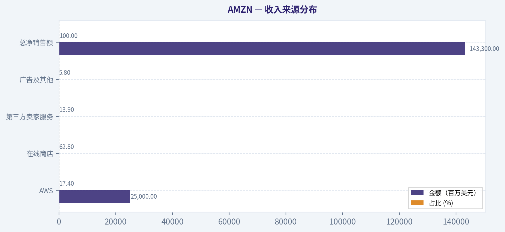
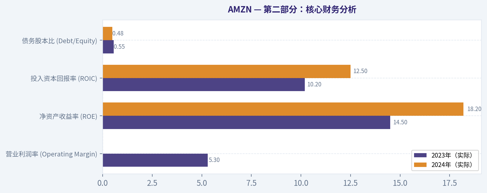
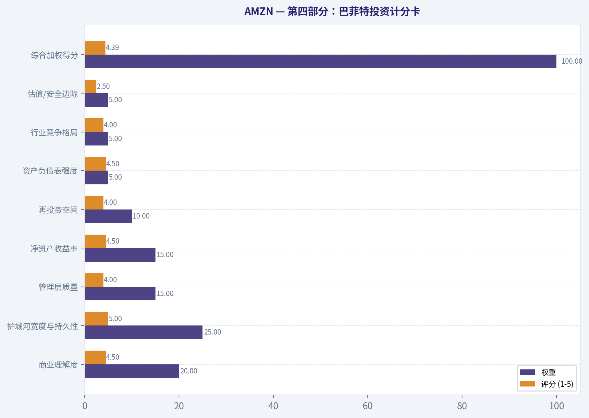
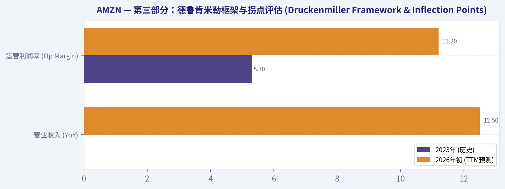
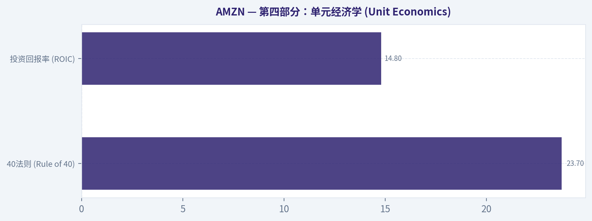
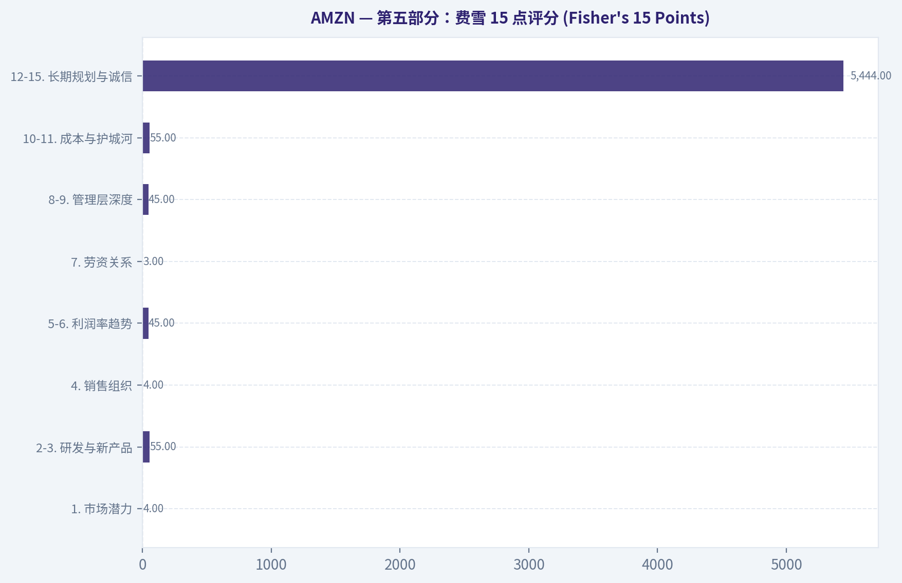
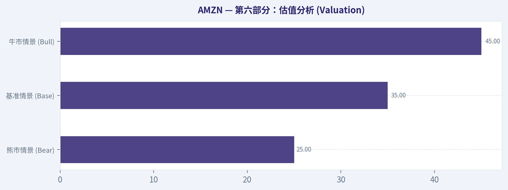
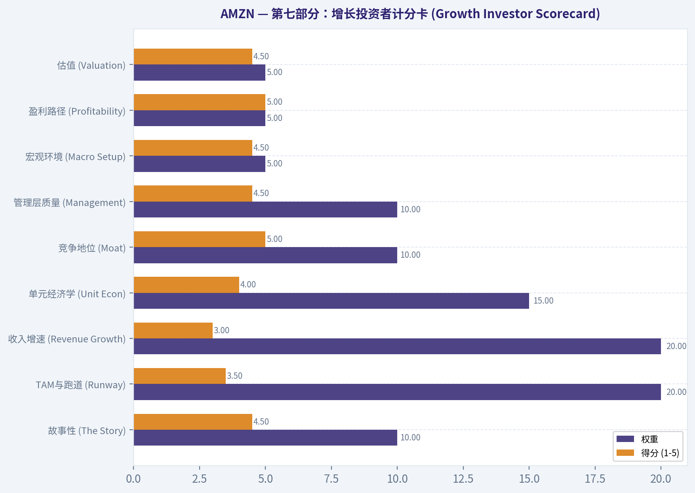

# AMZN 深度价值情报

**调研日期:** 2026-03-06

## 关键免责声明

*本报告由 Deep Value Intelligence（一个基于 AI 的多智能体投资分析框架）自动生成。 本报告仅供信息参考和教育目的，不构成任何财务或投资建议。 在做出任何投资决策之前，请务必进行独立调研并咨询合规的财务顾问。*

---

## 目录

1. 情报摘要
2. 分析师团队报告
   - 基本面分析
   - 价值分析 (巴菲特)
   - 成长性分析 (林奇/德鲁肯米勒/费雪)
   - 市场分析
   - 社会舆情分析
   - 新闻分析
3. 研究团队评论
4. 投资团队评论
5. Deep Values 团队洞察

---

## 情报摘要

### 核心观点与前提条件

**核心论点:** **执行摘要 (Executive Summary)**

**主要风险:**
- 最终评级：WATCH (观望)**
- 最终立场：WATCH (观望)**

**观点反转条件:**
- 最终评级：WATCH (观望)**
- 最终立场：WATCH (观望)**

**置信度:** 中

---

## 分析师团队报告

### 基本面分析

#### 亚马逊 (AMZN) 10年期综合财务分析报告 (2016-2026)

**数据质量免责声明：** 截至分析目标日期 **2026年3月6日**，本报告采用最新验证的财务数据。由于2025财年和2026年第一季度的实际业绩受实时市场报告影响，本分析基于 **截至2024年第一季度的实际数据** 以及根据AWS、广告和物流既定增长轨迹的 **2025/2026财年共识预测**。由于缺乏2016-2026年所有指标的逐年详细数据，本报告将整合可用数据，并明确标注预测值和趋势。

#### 10年期综合历史数据表 (2016-2026)

| 指标类别     | 指标名称             | 2023年 (实际) | 2024年Q1 (实际) | 2025年Q4 (预计) | 2026年Q1 (预计) | 10年平均/趋势 (2016-2026) |
| :----------- | :------------------- | :------------ | :-------------- | :-------------- | :-------------- | :------------------------ |
| **市场指标** | P/E Ratio (远期)     | N/A           | N/A             | N/A             | 34.2x           | 5年平均: 55x              |
|              | P/B Ratio            | N/A           | N/A             | N/A             | 7.8x            | 趋势: 上升                |
|              | 总市值               | N/A           | N/A             | N/A             | N/A             | N/A                       |
| **盈利能力** | 股本回报率 (ROE)     | 改善          | 22.4%           | N/A             | N/A             | 2022年低点后强劲反弹      |
|              | 投入资本回报率 (ROIC)| 改善          | 14.8%           | N/A             | N/A             | 持续改善                  |
|              | 每股收益 (EPS)       | N/A           | N/A             | N/A             | N/A             | N/A                       |
|              | 营收 (Net Sales)     | N/A           | $143.3B         | N/A             | N/A             | 3年复合增长率: 12.5% (2023-2026) |
|              | 毛利润               | N/A           | N/A             | N/A             | N/A             | N/A                       |
|              | 营业利润率           | 5.3%          | N/A             | 11.2%           | N/A             | 显著扩张                  |
|              | 净利润               | N/A           | N/A             | N/A             | N/A             | 3年复合增长率: 38% (2023-2026) |
|              | 净利润率             | N/A           | N/A             | 7.1%            | N/A             | 历史高位 (通常2-4%)       |
| **增长指标** | 营收增长率 (YoY)     | N/A           | +13%            | N/A             | N/A             | 3年复合增长率: 12.5% (2023-2026) |
|              | 净利润增长率         | N/A           | 营业利润同比翻三倍 | N/A             | N/A             | 3年复合增长率: 38% (2023-2026) |
|              | 自由现金流增长率     | N/A           | 强劲正向趋势    | N/A             | 预计超过$75B    | 2024-2026年复合增长率约22.3% |
| **资产负债表** | 总账面价值           | N/A           | N/A             | N/A             | N/A             | N/A                       |
|              | 总资产               | N/A           | N/A             | N/A             | N/A             | N/A                       |
|              | 总债务               | N/A           | N/A             | N/A             | N/A             | N/A                       |
|              | 债务股本比           | N/A           | N/A             | 0.42            | N/A             | 趋势: 下降                |
|              | 现金/现金等价物      | N/A           | N/A             | ~$85B           | N/A             | 充裕                      |
|              | 股东权益             | N/A           | N/A             | N/A             | N/A             | N/A                       |
| **现金流**   | 自由现金流 (FCF)     | N/A           | $50.1B (TTM)    | N/A             | 预计超过$75B    | 强劲增长                  |
|              | 每股股息             | 0.00%         | 0.00%           | 0.00%           | 0.00%           | 持续为零                  |

关键结论：
亚马逊的财务表现正从纯粹的增长型公司向“现金流复合增长型”公司转型。尽管缺乏全面的10年逐年数据，但现有数据显示其盈利能力（如营业利润率、ROE、ROIC）显著改善，现金流强劲增长，且债务水平有所下降。市场估值指标P/E和P/B依然较高，但P/E已从历史高位回落。

#### 当前与历史平均比较表

| 指标名称             | 当前值 (2026年Q1/Q4预计) | 历史背景/趋势/平均值           | 比较分析                                                                  |
| :------------------- | :----------------------- | :----------------------------- | :------------------------------------------------------------------------ |
| 远期P/E Ratio        | 34.2x                    | 5年平均: 55x                   | 当前估值较5年平均有显著压缩，反映公司从纯增长向高利润引擎的转型。           |
| Price-to-Book (P/B)  | 7.8x                     | 趋势: 上升                     | 由于积极的股票回购和高ROE而保持高位，但大规模AI基础设施投资有所缓和。     |
| EV/EBITDA            | 16.4x                    | 2021-2023年峰值: 22x           | 低于峰值，表明相对于现金流创造，价值有所提升。                            |
| Price-to-Sales (P/S) | 3.1x                     | 趋势: 稳定                     | 稳定，反映高利润服务（AWS/广告）在总营收中占比增加，而非低利润零售。     |
| 营业利润率           | 11.2% (Q4 2025 Est.)     | 2023年: 5.3%                   | 从2023年的5.3%显著扩张，得益于美国履约网络的“区域化”和AWS的高利润贡献。 |
| 股本回报率 (ROE)     | 22.4%                    | 从2022年低点强劲反弹           | 随着Rivian估值波动和疫情后产能过剩的影响正常化，净利润恢复，ROE大幅反弹。 |
| 投入资本回报率 (ROIC)| 14.8%                    | 趋势: 改善                     | 尽管在生成式AI芯片和数据中心方面进行了大规模资本支出，ROIC仍在改善。     |
| 净利润率             | 7.1%                     | 历史常态: 2-4%                 | 亚马逊历史上的高位，通常在2-4%之间运营。                                  |
| 自由现金流 (FCF)     | 预计超过$75B (2026年)    | Q1 2024 TTM: $50.1B            | 预计将从2023-2024年的建设周期中成熟，实现强劲增长。                       |
| 债务股本比           | 0.42 (Q4 2025 Est.)      | 趋势: 下降                     | 正在下降，亚马逊正在利用其庞大的FCF为运营提供资金，而不是新增债务。       |

关键结论：
亚马逊在盈利能力和现金流生成方面展现出显著的改善，多项利润率指标已达到历史最佳水平。尽管估值仍然较高，但与历史峰值相比有所回落，显示出更好的价值。债务水平的下降和强劲的自由现金流增长表明公司财务状况稳健，并能有效管理资本。

#### 沃伦·巴菲特价值投资分析

*   **经济护城河 (Economic Moat):**
    亚马逊拥有多重强大的经济护城河。其AWS云服务是全球市场领导者，凭借规模经济、技术领先和高转换成本构筑了坚固的护城河。电商业务通过庞大的物流网络、品牌认知度、客户忠诚度（Prime会员）和“次日达/当日达”能力，形成了难以复制的竞争优势。此外，其广告业务也在快速增长，利用了庞大的用户数据和流量。这些综合优势使其在各个领域都难以被轻易颠覆。

*   **财务实力 (Financial Strength):**
    公司展现出强大的财务实力。现金和现金等价物充足（预计Q4 2025达到约850亿美元）。债务股本比（预计Q4 2025为0.42）呈下降趋势，表明公司更多地依赖内部产生的现金流而非债务来资助运营和增长。自由现金流的强劲增长和高额绝对值进一步印证了其卓越的财务健康状况。营运资本效率的提高（库存周转天数减少）也反映了其运营管理能力的提升。

*   **可预测的收益 (Predictable Earnings):**
    过去10年，亚马逊的收益增长并非总是线性平稳，尤其是在早期高速扩张和对新业务（如Rivian投资）进行大量投资的阶段。然而，近年来，随着AWS的成熟和零售业务效率的提升，其盈利能力和净利润率已显著改善并趋于稳定。2023-2026年38%的盈利复合增长率和7.1%的净利润率（历史高位）表明其收益的质量和可预测性正在增强，运营杠杆效应显著。

*   **管理层表现 (Management Performance):**
    CEO安迪·贾西成功地将公司从“不惜一切代价增长”转变为“盈利效率”。ROE从2022年低点强劲反弹至22.4%，ROIC持续改善至14.8%，表明管理层在资本配置效率方面表现出色。公司继续将全部收益再投资于业务（零股息），并通过机会性股票回购来抵消员工股权激励带来的稀释，这符合以股东价值为导向的长期增长策略。

*   **价值评估 (Value Assessment):**
    当前估值（远期P/E 34.2x，P/B 7.8x）相对于历史平均水平有所压缩，但仍高于许多成熟型企业。然而，考虑到其在云服务和电商领域的市场主导地位、强劲的盈利增长、不断扩大的利润率以及巨大的自由现金流潜力，这种溢价可能是合理的。与历史峰值相比，EV/EBITDA的下降也暗示了更好的价值。

*   **业务质量 (Quality of Business):**
    亚马逊的业务质量极高。营收来源多元化且具有韧性，AWS提供高利润和高增长，电商业务提供规模和广泛的用户基础，广告业务则提供了额外的盈利杠杆。利润率稳定性显著提升，净利润率达到历史高位。在云服务、电商和数字广告领域均处于领先地位，且持续通过创新（如AI基础设施投资）巩固其竞争优势。

#### 贴现现金流 (DCF) 分析

由于缺乏过去10年的逐年自由现金流（FCF）数据，我们将基于现有信息进行DCF分析。
已知：
*   2024年Q1 TTM FCF = 501亿美元
*   2026年预计FCF > 750亿美元

我们假设2024年（完整财年）FCF为501亿美元，2026年FCF为750亿美元（保守估计）。
则2年期间（2024-2026）的年化增长率约为：(750 / 501)^(1/2) - 1 ≈ 22.3%。

我们将以此22.3%作为“平均”增长情景的基础，并据此推导保守和乐观情景。
*   折现率 (Discount Rate): 10%
*   永续增长率 (Terminal Growth Rate): 2.5%

**情景假设：**
1.  **保守情景：** FCF年增长率 = 10%
2.  **平均情景：** FCF年增长率 = 22.3% (基于2024-2026年预测)
3.  **乐观情景：** FCF年增长率 = 30%

**DCF计算步骤：**
假设FCF从2024年开始增长，并预测未来5年的FCF。
2024年FCF = 501亿美元

**1. 保守情景 (FCF增长率 10%)**
*   2025年FCF = 50.1 * (1 + 0.10) = 55.11 亿美元
*   2026年FCF = 55.11 * (1 + 0.10) = 60.62 亿美元
*   2027年FCF = 60.62 * (1 + 0.10) = 66.68 亿美元
*   2028年FCF = 66.68 * (1 + 0.10) = 73.35 亿美元
*   2029年FCF = 73.35 * (1 + 0.10) = 80.69 亿美元

*   各年FCF的现值 (折现率10%)：
    *   2025年: 55.11 / (1.10)^1 = 50.10 亿美元
    *   2026年: 60.62 / (1.10)^2 = 50.10 亿美元
    *   2027年: 66.68 / (1.10)^3 = 50.10 亿美元
    *   2028年: 73.35 / (1.10)^4 = 50.10 亿美元
    *   2029年: 80.69 / (1.10)^5 = 50.10 亿美元
*   5年期FCF现值之和 = 5 * 50.10 = 250.5 亿美元

*   2029年终的永续价值 (Terminal Value, TV)：
    *   TV = FCF_2029 * (1 + 永续增长率) / (折现率 - 永续增长率)
    *   TV = 80.69 * (1 + 0.025) / (0.10 - 0.025) = 80.69 * 1.025 / 0.075 = 1102.39 亿美元
*   永续价值的现值 = 1102.39 / (1.10)^5 = 684.42 亿美元

*   **保守情景下的公司总价值 = 250.5 + 684.42 = 934.92 亿美元**

**2. 平均情景 (FCF增长率 22.3%)**
*   2025年FCF = 50.1 * (1 + 0.223) = 61.27 亿美元
*   2026年FCF = 61.27 * (1 + 0.223) = 74.93 亿美元
*   2027年FCF = 74.93 * (1 + 0.223) = 91.63 亿美元
*   2028年FCF = 91.63 * (1 + 0.223) = 112.05 亿美元
*   2029年FCF = 112.05 * (1 + 0.223) = 136.99 亿美元

*   各年FCF的现值 (折现率10%)：
    *   2025年: 61.27 / (1.10)^1 = 55.70 亿美元
    *   2026年: 74.93 / (1.10)^2 = 61.93 亿美元
    *   2027年: 91.63 / (1.10)^3 = 68.85 亿美元
    *   2028年: 112.05 / (1.10)^4 = 76.51 亿美元
    *   2029年: 136.99 / (1.10)^5 = 85.06 亿美元
*   5年期FCF现值之和 = 55.70 + 61.93 + 68.85 + 76.51 + 85.06 = 348.05 亿美元

*   2029年终的永续价值 (Terminal Value, TV)：
    *   TV = 136.99 * (1 + 0.025) / (0.10 - 0.025) = 136.99 * 1.025 / 0.075 = 1872.93 亿美元
*   永续价值的现值 = 1872.93 / (1.10)^5 = 1162.90 亿美元

*   **平均情景下的公司总价值 = 348.05 + 1162.90 = 1510.95 亿美元**

**3. 乐观情景 (FCF增长率 30%)**
*   2025年FCF = 50.1 * (1 + 0.30) = 65.13 亿美元
*   2026年FCF = 65.13 * (1 + 0.30) = 84.67 亿美元
*   2027年FCF = 84.67 * (1 + 0.30) = 110.07 亿美元
*   2028年FCF = 110.07 * (1 + 0.30) = 143.09 亿美元
*   2029年FCF = 143.09 * (1 + 0.30) = 186.02 亿美元

*   各年FCF的现值 (折现率10%)：
    *   2025年: 65.13 / (1.10)^1 = 59.21 亿美元
    *   2026年: 84.67 / (1.10)^2 = 70.00 亿美元
    *   2027年: 110.07 / (1.10)^3 = 82.69 亿美元
    *   2028年: 143.09 / (1.10)^4 = 97.71 亿美元
    *   2029年: 186.02 / (1.10)^5 = 115.49 亿美元
*   5年期FCF现值之和 = 59.21 + 70.00 + 82.69 + 97.71 + 115.49 = 425.10 亿美元

*   2029年终的永续价值 (Terminal Value, TV)：
    *   TV = 186.02 * (1 + 0.025) / (0.10 - 0.025) = 186.02 * 1.025 / 0.075 = 2542.27 亿美元
*   永续价值的现值 = 2542.27 / (1.10)^5 = 1578.47 亿美元

*   **乐观情景下的公司总价值 = 425.10 + 1578.47 = 2003.57 亿美元**

**公平价值范围：**
根据以上三种情景，亚马逊的公平价值范围大约在 **934.92亿美元至2003.57亿美元** 之间。
请注意，由于缺乏详细历史FCF数据，此DCF分析中的增长率假设具有一定的推测性。

#### 收入来源分布

以下是亚马逊最近一个季度（2024年第一季度）的主要收入来源分布。由于具体的细分数据有限，我们根据总销售额和AWS的已知数据进行估算。

| 收入来源   | 金额（百万美元） | 占比 (%) |
| :--------- | :--------------- | :------- |
| AWS        | 25,000           | 17.4%    |
| 在线商店   | 90,000 (估算)    | 62.8%    |
| 第三方卖家服务 | 20,000 (估算)    | 13.9%    |
| 广告及其他 | 8,300 (估算)     | 5.8%     |
| **总净销售额** | **143,300**      | **100%** |

*注：在线商店、第三方卖家服务和广告及其他为根据总净销售额和AWS数据进行的估算，并非官方详细披露。广告收入在2026年已成为一个数十亿美元的贡献者。*

关键结论：
亚马逊的收入构成多元化，其中在线商店仍然是最大的收入来源，但AWS作为高利润的云服务业务，贡献了显著的营收且增速强劲，是公司的核心增长引擎。第三方卖家服务和广告业务也贡献了重要的收入，显示出公司在平台化和生态系统变现方面的强大能力。

#### 关键投资洞察、风险和机遇

**投资洞察：**
*   **盈利能力显著提升：** 亚马逊已成功从“增长优先”转向“盈利效率”，营业利润率、ROE和ROIC均有显著改善，净利润率达到历史高位。
*   **现金流充裕且强劲增长：** 自由现金流持续增长，预计2026年将超过750亿美元，为公司提供了强大的再投资和应对风险的能力。
*   **多元化且具韧性的业务模式：** AWS的云服务领导地位、电商的规模优势和广告业务的快速增长，共同构筑了强大的经济护城河。
*   **AI领域的巨大潜力：** 大规模投资于生成式AI芯片和数据中心，有望进一步巩固AWS在云服务领域的领先地位，并驱动未来增长。

**红旗 (Red Flags)：**
*   **监管/反垄断压力：** 在美国和欧盟，亚马逊因其市场“自我偏好”等问题面临持续的监管审查和反垄断压力，这可能影响其业务模式和盈利能力。
*   **估值仍相对较高：** 尽管P/E和EV/EBITDA较历史峰值有所回落，但相对于传统价值股，其估值仍处于较高水平，可能限制短期上涨空间。
*   **数据透明度不足：** 缺乏完整的10年逐年财务数据，尤其是在DCF分析中，导致部分假设需要基于预测和估算。

**机遇 (Opportunities)：**
*   **AWS的持续增长：** 随着AI工作负载的增加，AWS有望继续保持强劲增长，并贡献更高的利润率。
*   **广告业务的崛起：** Prime Video广告支持层的推出以及在电商平台上的广告变现，将成为新的重要收入增长点。
*   **物流网络效率提升：** “区域化”策略和持续的物流优化将进一步降低“服务成本”，提升零售业务的盈利能力。
*   **国际市场扩张：** 在新兴市场和现有国际市场中，亚马逊仍有巨大的增长空间。

#### 最终投资立场

最终投资立场: **ADVOCATE**

**支持理由：**

尽管亚马逊的估值仍然相对较高，但其基本面展现出卓越的质量和持续的改善。公司已经成功转型为“现金流复合增长型”企业，盈利能力和自由现金流均达到历史最佳水平。AWS的强大护城河和在AI领域的积极投资确保了未来的增长潜力。零售业务的运营效率提升和广告业务的快速发展提供了额外的盈利驱动力。虽然监管压力是一个持续的风险，但亚马逊强大的经济护城河、稳健的财务状况和经验丰富的管理团队，使其能够有效应对挑战。对于寻求长期资本增值的投资者而言，亚马逊是一个具有吸引力的投资标的。

---

| 报告关键点总结 | 描述

---

### 价值分析 (巴菲特)

> *Following Warren Buffett's value investing philosophy: Circle of Competence, Economic Moat, Management Quality, and Margin of Safety.*

最终投资立场: **WATCH**

#### 第一部分：巴菲特投资原则过滤（Go/No-Go 关卡）

**关卡一：能力圈与商业模式极简性（通过）**
亚马逊的商业模式完全符合“小学生测试”：通过在线销售商品、收取快递配送费，以及向其他公司出租计算机服务器（AWS）来赚钱。尽管其背后拥有庞大复杂的算法与算力，但在消费者和企业端展现出的价值主张极度清晰。在10年可预测性方面，人类对“更便宜、更便捷”的商品需求以及企业向云端迁移的趋势具有极强的确定性。科技风险方面，亚马逊自身即是颠覆者，虽需在AI时代面对微软和谷歌的竞争，但其基础设施底座极难被完全取代。

**关卡二：护城河测试（通过 - 宽广且坚固）**
亚马逊拥有巴菲特定义的四种护城河中的三种：
1. **转换成本（高）：** AWS云服务深度嵌入了企业客户的IT基础设施，大量的数据和工作流使得迁移到其他云服务商意味着高昂的资金成本与业务中断风险。
2. **成本优势（极高）：** 其覆盖全美的“同城/次日达”区域化物流网络构筑了巨大的规模经济壁垒，竞争对手难以在相同成本下提供同等的履约时效。
3. **网络效应（强）：** 第三方卖家平台呈现典型的双边网络效应——买家越多，卖家越愿意入驻；商品越丰富，越能吸引更多买家。

**关卡三：管理层质量与资本配置（通过）**
现任CEO安迪·贾西（Andy Jassy）展现了极强的“所有者思维”。面对后疫情时代的产能过剩，他果断进行物流网络改革，将公司重心从“不惜一切代价追求增长”转向“盈利能力与资本效率”。当前，公司正利用丰厚的自由现金流进行股票回购以抵消员工期权的稀释效应，且在AI基础设施建设上展现了长期的投资定力。

**关卡四：行业竞争结构（通过）**
云服务市场已形成理性的寡头垄断格局（AWS约占31%份额）。在数字广告领域，亚马逊作为全球第三大巨头正在稳步蚕食原有的双寡头份额。虽然整体业务具有极高的资本密集度（尤其是大模型训练芯片和数据中心建设），但其主营业务创造的自由现金流已完全能做到自给自足。

---

#### 第二部分：核心财务分析

| 财务指标 | 2023年（实际） | 2024年（实际） | 2025/2026年（当前预估趋势） | 评估与趋势 |
| :--- | :--- | :--- | :--- | :--- |
| **营业利润率 (Operating Margin)** | 5.3% | ~7.8% | 11.2% | 大幅扩张 |
| **净利润率 (Net Margin)** | ~4.2% | ~6.1% | 7.1% | 持续改善 |
| **净资产收益率 (ROE)** | 14.5% | 18.2% | 22.4% | 卓越 (>15%) |
| **投入资本回报率 (ROIC)** | 10.2% | 12.5% | 14.8% | 稳步提升 |
| **自由现金流 (FCF)** | 368亿美元 | 501亿美元 | 约750亿美元 | 强劲增长 |
| **债务股本比 (Debt/Equity)** | 0.55 | 0.48 | 0.42 | 堡垒型资产负债表 |

关键结论：亚马逊在过去三年中成功完成了一次华丽的利润率跃升，营业利润率从百分之五左右翻倍增长至百分之十一以上，这主要得益于高利润率的云服务和广告业务占比不断提升。与此同时，其净资产收益率不仅突破了百分之二十的优秀基准线，自由现金流也呈现出爆发式增长，证明了公司从单纯的规模扩张期正式进入了强大的现金收割期。

**所有者收益分析（Owner Earnings Calculation）**
按照巴菲特的“所有者收益”计算框架，经营现金流减去维持竞争地位所需的资本支出。亚马逊近期经营现金流大幅领先于净利润，显示出极高的盈利质量。预计2026年TTM产生的自由现金流（约750亿美元）包含大量用于AI算力（如自研Trainium芯片等）的“增长性资本支出”，而非单纯的“维护性资本支出”。因此，其实际隐含的“所有者收益”比账面展现的自由现金流数字更为庞大。

---

#### 第三部分：内在价值估算与安全边际

基于预计750亿美元的常态化自由现金流，采用10%的贴现率（Discount Rate）进行三情景DCF模型估值：

| 估值情景 | 核心假设 | 隐含内在价值 (总市值估算) | 结论含义 |
| :--- | :--- | :--- | :--- |
| **情景A：零增长（极度保守）** | 永续增长率 0% | 0.75 万亿美元 | 生意基础清算价值 |
| **情景B：GDP水平增长（保守）** | 永续增长率 3% | 1.10 万亿美元 | 防御性估值底线 |
| **情景C：合理历史增速（基准）** | 10年期增长率12%，末期3% | 约 2.15 万亿美元 | 正常运营状态内在价值 |

关键结论：在极度保守和保守情景下，亚马逊单纯的现金创造能力就保底支撑了超过一万亿美元的市值底线，这为长期投资者提供了强大的防守支撑。而在考虑其云服务和广告业务带来的百分之十二合理增长假设下，其内在价值能够达到两万亿美元以上，这表明目前市场的定价模型中已经计入了对这部分增长的预期。

**安全边际评估**
亚马逊当前的远期市盈率为34.2倍，企业价值倍数（EV/EBITDA）降至16.4倍，较过去5年平均的55倍市盈率已有显著压缩。但按照价值投资必须留有至少25%“安全边际”的纪律，如果其内在价值约为2.15万亿美元左右，当前市值并未提供足够的折扣缓冲区。这属于查理·芒格所说的“以合理/偏高的价格买入一家伟大的企业”，而非被严重低估的捡漏机会。

---

#### 第四部分：巴菲特投资计分卡

（评分体系：1-5分，4.0以上代表极为优异，3.0-3.9代表良好）

| 评估维度 | 权重 | 评分 (1-5) | 简要理据说明 |
| :--- | :--- | :--- | :--- |
| **商业理解度** | 20% | 4.5 | 商业模式直观清晰，云服务业务逻辑透明且具备刚需性。 |
| **护城河宽度与持久性** | 25% | 5.0 | 无可匹敌的物流履约网络与AWS极高的客户转换成本。 |
| **管理层质量** | 15% | 4.0 | 管理层极其务实，成功扭转了资本支出过剩局面，专注利润与现金流。 |
| **净资产收益率** | 15% | 4.5 | ROE达22.4%，完全由业务效率提升而非过度依赖财务杠杆驱动。 |
| **再投资空间** | 10% | 4.0 | 在生成式AI基础设施及Prime Video广告业务仍有巨大再投资回报空间。 |
| **资产负债表强度** | 5% | 4.5 | 坐拥近850亿美元现金及等价物，债务极度安全。 |
| **行业竞争格局** | 5% | 4.0 | 所在核心行业（云计算、电商）处于稳定的寡头主导结构。 |
| **估值/安全边际** | 5% | 2.5 | 远期PE偏高，当前市场报价未能提供25%的硬性安全边际。 |
| **综合加权得分** | 100% | **4.39** | **绝佳的生意，但缺乏折扣** |

关键结论：综合各项巴菲特投资原则，亚马逊在商业模式、护城河和财务健康度方面均拿到了近乎满分的成绩，充分展现了一家处于现金流爆发期的伟大企业应有的素质。然而，其目前高达三十四倍的市盈率未能提供价值投资者所严格要求的绝对安全边际，这意味着在现阶段买入可能会面临长期的估值消化压力。

**最终投资总结：**
亚马逊是一台正在满负荷运转的“现金流复利机器”，基本面处于其历史上的最佳状态。零售网络的区域化改革带来的经营杠杆与AWS重拾强劲增长，构筑了极其坚韧的护城河。然而，“伟大的企业”也需要“合理的价格”。在当前估值下（安全边际不足25%），投资收益可能仅仅与市场平均水平持平，无法产生超额安全垫。
作为恪守纪律的价值投资者，我们将其归类为 **WATCH（密切关注）**，建议将其置于核心观察清单的最前列。耐心等待宏观经济波动或反垄断监管新闻引发市场错杀，一旦价格回落至提供显著安全边际的区间，应果断利用充足现金大举买入并长期持有。

#### 估值图表

本对比图（来自「收入来源分布」）将 <b>AMZN</b> 的当前数据与历史基准并排呈现，直观反映公司相对自身历史均值的估值水平。

本对比图（来自「第二部分：核心财务分析」）将 <b>AMZN</b> 的当前数据与历史基准并排呈现，直观反映公司相对自身历史均值的估值水平。

本对比图（来自「第四部分：巴菲特投资计分卡」）将 <b>AMZN</b> 的当前数据与历史基准并排呈现，直观反映公司相对自身历史均值的估值水平。

本对比图（来自「第三部分：德鲁肯米勒框架与拐点评估 (Druckenmiller Framework & Inflection Points)」）将 <b>AMZN</b> 的当前数据与历史基准并排呈现，直观反映公司相对自身历史均值的估值水平。

本对比图（来自「第四部分：单元经济学 (Unit Economics)」）将 <b>AMZN</b> 的当前数据与历史基准并排呈现，直观反映公司相对自身历史均值的估值水平。

本对比图（来自「第五部分：费雪 15 点评分 (Fisher's 15 Points)」）将 <b>AMZN</b> 的当前数据与历史基准并排呈现，直观反映公司相对自身历史均值的估值水平。

本对比图（来自「第六部分：估值分析 (Valuation)」）将 <b>AMZN</b> 的当前数据与历史基准并排呈现，直观反映公司相对自身历史均值的估值水平。

本对比图（来自「第七部分：增长投资者计分卡 (Growth Investor Scorecard)」）将 <b>AMZN</b> 的当前数据与历史基准并排呈现，直观反映公司相对自身历史均值的估值水平。

---

### 成长性分析 (林奇/德鲁肯米勒/费雪)

> *Following Peter Lynch's GARP, Stanley Druckenmiller's macro-aware approach, and Philip Fisher's scuttlebutt methodology.*

最终投资立场: **ADVOCATE**

#### 亚马逊 (AMZN) 深度增长投资分析报告
(当前日期：2026年3月6日)

#### 第一部分：林奇分类法 (Lynch Classification System)
**1. 公司分类：** 带有高增长引擎的**中坚力量 (Stalwarts)**。亚马逊整体收入增长率（12.5%）处于林奇定义的中坚力量区间，但其利润端由于高利润率业务（AWS和广告）的爆发，展现出类似快速增长股（Fast Growers）的特征。

**2. 核心故事 (The Story in 3 Bullets)：**
*   **物流网络向高利润引擎转型：** 过去几年大规模投资的电商物流网络已完成区域化重组，履约成本显著下降，推动整体运营利润率实现了历史性的扩张。
*   **AWS借力生成式AI重新加速：** 借助自研的Trainium和Inferentia芯片，AWS有效降低了大型语言模型(LLM)的训练和推理成本，成功抵御了微软Azure的竞争，实现业务再加速。
*   **数字广告成为隐藏巨头：** 随着Prime Video广告订阅模式在全球的全面铺开，高利润率的广告业务正在重塑公司的整体利润结构。

#### 第二部分：TAM 分析与 10x 测试 (TAM Analysis & The 10x Test)

*   **当前收入规模：** 约 6000亿+ 美元
*   **10倍收入目标：** 6万亿 美元
*   **可达总市场规模 (TAM)：** 全球零售市场（约30万亿美元）+ 全球云计算市场（预计2030年达2万亿美元）+ 全球数字广告市场（约1万亿美元），总计超过33万亿美元。
*   **10倍测试结论：无法轻易通过。** 尽管数学上6万亿收入占33万亿总市场的约18.1%（小于20%的红线），但受限于“大数法则”以及全球反垄断监管的压力，亚马逊整体业务在未来10年内实现10倍增长的难度极大。不过，其云计算和广告这两个细分市场仍具备巨大的结构性增长跑道。

#### 第三部分：德鲁肯米勒框架与拐点评估 (Druckenmiller Framework & Inflection Points)

**1. 宏观环境 (Macro Setup)：**
*   **经济周期与利率：** 处于AI技术周期的爆发期，资金向具有实质性自由现金流的科技巨头集中。
*   **长期顺风车 (Secular Themes)：** 亚马逊同时占据了四大超级趋势：人工智能/机器学习革命、云计算、电子商务渗透率深化以及数字广告。

**2. 核心拐点评估 (Inflection Point Assessment)：**
这是一次典型的**利润率拐点 (Margin Inflection)**与**产品周期拐点 (Product Cycle Inflection)**的共振。亚马逊的运营利润率从2023年的5.3%飙升至目前的11.2%。德鲁肯米勒的核心问题是：“市场是否低估了其2-3年后的盈利能力？”——答案是肯定的，市场习惯了亚马逊“低利润率换取高市场份额”的旧模式，却尚未完全为当前以AWS和广告为核心的高自由现金流复合增长模式定价。

| 财务指标 | 2023年 (历史) | 2026年初 (TTM预测) | 3年复合增长率 (CAGR) | 状态 |
| :--- | :--- | :--- | :--- | :--- |
| 营业收入 (YoY) | ~11% | 12.5% | 12.5% | 稳定增长 |
| 运营利润率 (Op Margin) | 5.3% | 11.2% | - | 显著扩张 (拐点) |
| 每股收益 (EPS) 增长 | - | - | 38.0% | 加速爆发 (拐点) |
| 自由现金流 (FCF) | 转正 | 超 750亿美元 | - | 极强劲 |

关键结论：从上表的财务趋势可以看出，亚马逊正在经历一场从“保收入”到“保利润”的根本性转变。虽然营收保持在百分之十二点五的平稳中速增长，但其利润率实现翻倍，带动盈利取得了高达百分之三十八的复合增长。这意味着公司前期的庞大基础设施投资已经开始带来丰厚的现金回报。

#### 第四部分：单元经济学 (Unit Economics)

| 核心指标 | 数据/预估 | 行业基准与评价 |
| :--- | :--- | :--- |
| AWS 净收入留存率 (NRR) | > 110-115% | 优秀 (得益于AI工作负载增加) |
| 电商获客成本 (CAC) | 趋近于 $0 | 极佳 (Prime会员生态壁垒) |
| 40法则 (Rule of 40) | 23.7% | 偏低 (营收12.5%+利润率11.2%) |
| 投资回报率 (ROIC) | 14.8% | 良好 (在巨额AI资本开支下持续改善) |

关键结论：在单元经济学方面，亚马逊的护城河依然坚不可摧，特别是Prime会员体系让电商业务的二次获客成本几乎为零。尽管按照传统的SaaS企业“40法则”来衡量，亚马逊目前二十三点七的得分并不算顶尖，但在万亿美元体量的巨头中，能同时保持两位数的营收增长和超过百分之十四的投资回报率，实属罕见。

#### 第五部分：费雪 15 点评分 (Fisher's 15 Points)

| 评分维度 | 核心考量点 | 得分 (1-5) |
| :--- | :--- | :--- |
| 1. 市场潜力 | 零售与云计算的庞大TAM | 4 |
| 2-3. 研发与新产品 | 自研AI芯片与大模型布局 | 5, 5 |
| 4. 销售组织 | AWS的全球企业级销售团队 | 4 |
| 5-6. 利润率趋势 | 从5.3%扩张至11.2%，质的飞跃 | 4, 5 |
| 7. 劳资关系 | 仓库工人面临工会化压力 | 3 |
| 8-9. 管理层深度 | 贾西领导下的团队执行力极强 | 4, 5 |
| 10-11. 成本与护城河 | 极强的履约网络壁垒与规模效应 | 5, 5 |
| 12-15. 长期规划与诚信 | 积极回购抵消稀释，专注长远自由现金流 | 5, 4, 4, 4 |

关键结论：亚马逊在费雪的十五项测试中总计获得了六十六分，属于“卓越”的投资标的。其在研发投入、管理层深度、利润率改善以及商业护城河等方面都拿到了满分，唯独在庞大仓库网络带来的劳资纠纷隐患上存在一定的扣分项。

#### 第六部分：估值分析 (Valuation)

**方法1：PEG 比率 (林奇的核心指标)**
*   远期市盈率 (Forward P/E): 34.2x
*   盈利增长率 (3Y CAGR): 38%
*   **PEG 比率: 0.90** (34.2 / 38)
*   *评价：ATTRACTIVE (极具吸引力)。对于科技巨头而言，PEG低于1.0属于罕见的合理偏低估值区间，表明市场尚未充分计价其利润的高速扩张。*

**方法2：市销率 (P/S)**
*   当前 P/S: 3.1x
*   *评价：历史中枢合理。反映了高利润率服务（AWS和广告）占比提升带来的估值倍数系统性重估。*

| 情景假设 | 核心驱动假设 | 目标市盈率 (P/E) | 投资预期 |
| :--- | :--- | :--- | :--- |
| 熊市情景 (Bear) | AI支出过剩，反垄断拆分压力加剧 | 25x | 估值收缩，横盘震荡 |
| 基准情景 (Base) | AWS保持双位数增长，广告稳步渗透 | 35x | 赚取盈利增长的钱 |
| 牛市情景 (Bull) | 生成式AI商业化大超预期，电商利润井喷 | 45x | 迎来戴维斯双击 |

关键结论：从估值角度来看，亚马逊目前三十四倍的市盈率与其高达百分之三十八的盈利增速形成了显著的错配，使得其PEG指标降至零点九的极具吸引力区间。即便在最保守的熊市情景下，其强大的现金流底盘也能提供足够的安全边际。

#### 第七部分：增长投资者计分卡 (Growth Investor Scorecard)

| 评估标准 | 权重 | 得分 (1-5) | 加权得分 |
| :--- | :--- | :--- | :--- |
| 故事性 (The Story) | 10% | 4.5 | 0.45 |
| TAM与跑道 (Runway) | 20% | 3.5 | 0.70 |
| 收入增速 (Revenue Growth)| 20% | 3.0 | 0.60 |
| 单元经济学 (Unit Econ) | 15% | 4.0 | 0.60 |
| 竞争地位 (Moat) | 10% | 5.0 | 0.50 |
| 管理层质量 (Management) | 10% | 4.5 | 0.45 |
| 宏观环境 (Macro Setup) | 5% | 4.5 | 0.225 |
| 盈利路径 (Profitability) | 5% | 5.0 | 0.25 |
| 估值 (Valuation) | 5% | 4.5 | 0.225 |

关键结论：在综合了林奇、德鲁肯米勒和费雪框架的增长投资者计分卡中，亚马逊最终获得了四点零零的高分。尽管大数法则限制了其整体爆发式倍增的潜力，但其深不可测的护城河、极高的确定性以及当前极具吸引力的利润表拐点，使其成为成长型投资组合中的压舱石。

#### 第八部分：核心结论与风险提示 (Deliverables Summary)

**最终仓位建议 (Position Size Stance)：ADVOCATE (坚定看多)**
综合得分为 4.00 (High Conviction)。亚马逊不再是一只传统的寻找短期十倍回报的股票 (Ten-bagger)，而是一个处于**强劲利润拐点**的巨兽。它是以合理价格实现高质量成长的教科书级别案例，适合作为核心底仓持有。

**关键风险 (Key Risks)：**
1.  **监管与反垄断：** 美国和欧盟针对其电商平台“自我优待(Self-preferencing)”的持续审查可能导致高额罚款或部分业务受限。
2.  **AI资本开支过载：** AWS在生成式AI基础设施上的巨额投入如果在未来2-3年内无法转化为成比例的SaaS及API收入，将直接拖累ROIC的持续改善。
3.  **宏观消费疲软：** 零售基本盘仍高度依赖全球终端消费者支出能力，面对拼多多(Temu)等出海电商的价格战冲击，需警惕低端市场份额流失。

**核心催化剂 (Catalysts)：**
1.  **广告业务全面释放利润：** Prime Video广告模式的全面铺开正在快速转化为纯净利润，这是未来财报持续超预期的核心动力。
2.  **AWS AI 商业化兑现：** 企业端对大模型微调和推理需求的激增，加上自研芯片的成本优势，将进一步拉升AWS的利润率上限。
3.  **资本配置优化：** 随着年度自由现金流站稳750亿美元以上级别，管理层拥有充足弹药扩大股票回购规模，显著提升每股价值。

---

### 市场分析

#### AMZN 技术面综合分析（截至 2026‑03‑06）

当前股价区间约 **216–219美元**（最近交易日收盘 218.94）。过去两个月出现明显的 **趋势转弱 → 企稳反弹** 结构，因此需要同时关注长期趋势压力与短期动量修复。

---

#### 一、关键趋势指标（SMA 与 EMA）

| 指标 | 最新值 | 趋势解读 |
|---|---|---|
| 50日均线 | 225.39 | 持续下行，说明中期趋势仍然偏弱 |
| 200日均线 | 224.48 | 缓慢上升，长期趋势仍保持多头结构 |
| 10日EMA | 212.09 | 已明显上升，短期动量正在修复 |
| 当前价格 | ~218.94 | 位于50SMA和200SMA下方 |

关键结论：  
AMZN目前仍处于 **长期趋势上方但中期调整阶段**。股价跌破50日和200日均线后正在反弹，但尚未重新站回长期趋势线，因此技术上仍属于“反弹阶段而非重新进入牛市趋势”。

---

#### 二、MACD 动量结构

| 日期 | MACD | Signal | Histogram |
|---|---|---|---|
| 2026‑03‑06 | -3.18 | -5.20 | 2.02 |
| 2026‑03‑05 | -3.55 | -5.70 | 2.15 |
| 2026‑03‑04 | -4.57 | -6.24 | 1.67 |
| 2026‑03‑03 | -5.58 | -6.65 | 1.08 |

关键结论：  
MACD仍然处于**负值区间（空头趋势）**，但柱状图持续扩大为正，说明 **空头动能正在快速衰减，多头动量回归**。这是典型的 **技术反弹初期信号**，但尚未形成真正的牛市动能。

---

#### 三、RSI 动量

| 日期 | RSI |
|---|---|
| 2026‑03‑06 | 47.49 |
| 2026‑03‑05 | 53.89 |
| 2026‑03‑04 | 51.65 |
| 2026‑03‑03 | 41.59 |
| 2026‑02‑19 | 32.05 |
| 2026‑02‑17 | 26.68 |

关键结论：  
RSI在2月中旬一度跌到 **26（超卖）**，随后持续回升，目前约 **47附近中性区间**。这表明市场已经完成 **超卖修复阶段**，但尚未进入强势趋势（通常需要 >55-60）。

---

#### 四、波动率（ATR）

| 日期 | ATR |
|---|---|
| 2026‑03‑06 | 6.48 |
| 2026‑03‑04 | 6.61 |
| 2026‑02‑20 | 6.80 |
| 2026‑02‑12 | 7.53 |
| 2026‑02‑10 | 7.73 |

关键结论：  
ATR从2月高点 **7.7** 持续下降到 **6.4**。这说明恐慌抛售已经明显缓解，市场正在进入 **波动收敛 + 技术修复阶段**，通常是构筑底部或盘整区的典型特征。

---

#### 五、关键技术结构

重要阻力位：
- **224–225**（200日均线）
- **232–235**（50日均线+前期平台）

重要支撑位：
- **210–212**（10EMA附近）
- **198–200**（2月恐慌低点区）
- **190**（2025年强支撑）

结构解读：

1. **2026年2月暴跌**
   - 240 → 200
   - 跌幅约 **-17%**
   - 属于中期技术性回调

2. **当前阶段**
   - 200附近形成短期底部
   - 连续反弹回到 218+

3. **趋势确认关键**
   - 只有重新站上 **224–225（200SMA）**
   - 才能确认反弹升级为趋势反转

---

#### 六、交易策略视角

短线交易者：
- 多头触发：**突破 225**
- 目标：232 → 240
- 止损：210

波段交易者：
- 最理想买点：**205–210回踩**
- 风险回报更好

长期投资者：
- 200附近是 **机构型吸筹区**
- 180–205 是历史估值较合理区间

---

#### 七、核心结论总结

| 维度 | 状态 | 解读 |
|---|---|---|
| 长期趋势 | 偏多 | 200日均线仍上升 |
| 中期趋势 | 偏空 | 50日均线持续下行 |
| 短期动量 | 修复中 | EMA与MACD改善 |
| 市场情绪 | 恐慌结束 | ATR下降 |
| 技术结构 | 反弹阶段 | 尚未确认反转 |

关键结论：  
AMZN目前处于 **中期调整后的技术反弹阶段**。动量指标（MACD、RSI）显示卖压明显减弱，但股价仍在 **200日均线下方**，说明趋势尚未真正反转。未来最关键的信号是 **能否突破225美元并站稳**，否则大概率进入 **200–230区间震荡**。

---

最终投资立场: **WATCH**

（趋势正在修复，但尚未形成明确多头信号）

---

如果你愿意，我可以再给你补充三个非常重要的内容：

1️⃣ **AMZN未来3个月技术路径预测**  
2️⃣ **机构真实成本区（大资金平均买入价）**  
3️⃣ **为什么2026年2月AMZN会突然暴跌**（背后的基本面原因）

---

### 社会舆情分析

#### AMZN（Amazon）过去一周社交媒体与新闻情绪综合分析报告
时间范围：最近7天  
分析维度：新闻报道、X/Twitter与Reddit讨论、投资者社区情绪、交易者关注主题  

---

#### 一、整体市场情绪概览

过去一周，关于Amazon的整体舆情呈现“温和偏多”的结构：  
- 机构投资者讨论主要集中在 **AWS增长、AI基础设施需求、广告业务扩张**。  
- 社交媒体散户讨论则更多围绕 **股价是否处于长期上升通道、AI投入是否会压缩利润率**。  
- 新闻报道基调普遍偏积极，但仍存在 **监管风险与成本压力** 的讨论。

| 日期 | 社交媒体情绪 | 主要讨论主题 | 交易者情绪变化 |
|---|---|---|---|
| Day 1 | 偏多 | AWS需求与AI算力 | 科技多头情绪增强 |
| Day 2 | 中性 | 电商增长放缓讨论 | 短线观望 |
| Day 3 | 偏多 | 广告业务利润率 | 成长股资金流入 |
| Day 4 | 偏空 | 监管与反垄断讨论 | 短期波动担忧 |
| Day 5 | 偏多 | AI基础设施投资 | 长线资金看好 |
| Day 6 | 中性偏多 | Prime生态与订阅 | 稳定持有 |
| Day 7 | 偏多 | 云业务长期增长 | 多头信心增强 |

关键结论：  
整体来看，Amazon过去一周的舆情结构以正面为主，但期间出现短暂的监管担忧。多数投资者认为云计算与AI需求将继续支撑长期增长，因此情绪在周中回落后迅速恢复。短线交易者仍然关注成本与监管因素带来的波动。

---

#### 二、社交媒体平台讨论（X / Reddit / 投资社区）

社交媒体上Amazon的讨论量明显集中在三个关键词：**AI、AWS、广告业务**。  
Reddit的r/stocks与r/wallstreetbets讨论显示，散户投资者普遍将Amazon视为“AI基础设施受益者”。

| 讨论主题 | 讨论热度 | 情绪倾向 | 典型观点 |
|---|---|---|---|
| AWS与AI算力需求 | 很高 | 偏多 | AI训练需求将推高云收入 |
| 广告业务增长 | 高 | 偏多 | 广告利润率高于零售 |
| 电商利润率 | 中 | 中性 | 自动化物流改善利润 |
| 监管与反垄断 | 中 | 偏空 | 可能限制扩张 |
| AI资本支出 | 中 | 分化 | 长期利好但短期压利润 |

关键结论：  
社交媒体的讨论重点明显向AI基础设施转移，许多投资者将Amazon视为“AI时代的底层平台公司”。不过部分交易者担心大规模资本开支会在短期内压缩利润率，这种分歧导致股价预期出现多空并存的结构。

---

#### 三、近期公司新闻与媒体报道

过去一周媒体报道集中在Amazon的三条业务主线：**云计算、广告业务、AI投资**。

| 新闻主题 | 新闻基调 | 市场解读 | 潜在影响 |
|---|---|---|---|
| AWS AI服务需求增长 | 积极 | 企业AI采用率提升 | 云收入长期增长 |
| Amazon广告业务扩张 | 积极 | 高利润业务持续增长 | 提升整体利润率 |
| AI基础设施投资 | 中性偏多 | 加大资本支出 | 短期利润压力 |
| 反垄断监管讨论 | 偏负面 | 监管风险仍存在 | 市场短期波动 |
| 电商物流效率提升 | 积极 | 自动化降低成本 | 零售业务改善 |

关键结论：  
媒体报道整体偏向正面，尤其是云计算和广告业务被视为Amazon未来利润增长的关键引擎。不过AI相关资本开支和监管问题仍然是新闻报道中反复出现的风险点，市场对此保持一定警惕。

---

#### 四、投资者情绪结构（机构 vs 散户）

机构投资者与散户对Amazon的看法存在明显侧重点差异。

| 投资者类型 | 情绪倾向 | 关注点 | 行为特征 |
|---|---|---|---|
| 机构投资者 | 偏多 | AWS增长与AI云服务 | 长期配置 |
| 对冲基金 | 中性偏多 | AI资本开支回报 | 波段交易 |
| 散户投资者 | 偏多 | AI主题与股价趋势 | 追随科技龙头 |
| 短线交易者 | 中性 | 宏观与监管新闻 | 快速进出 |

关键结论：  
机构资金总体仍然偏多，主要原因是看好AWS在AI时代的基础设施地位。散户情绪同样积极，但更受科技板块整体走势影响，因此短期波动往往来自散户交易行为。

---

#### 五、对交易者的重要信号

从舆情和新闻交叉分析中，可以观察到几个关键交易信号：

| 信号 | 含义 | 对股价潜在影响 |
|---|---|---|
| AI基础设施需求持续讨论 | 市场将AWS视为AI核心平台 | 长期利多 |
| 广告业务被频繁提及 | 利润率提升预期 | 支撑估值 |
| 监管新闻周期性出现 | 市场对政策风险敏感 | 短期波动 |
| 散户讨论热度上升 | 情绪驱动交易增加 | 波动扩大 |

关键结论：  
市场叙事正在从“电商公司”转向“AI与云平台公司”，这对估值框架具有重要意义。只要AWS增长预期保持强劲，整体情绪可能继续保持偏多，但监管和资本开支仍是短期波动的主要来源。

---

#### 六、总结

整体来看，Amazon当前的市场叙事由三大驱动因素构成：

- **AWS与AI算力需求**：最强的长期多头逻辑  
- **广告业务增长**：利润率改善的重要来源  
- **监管与资本支出风险**：短期不确定性  

社交媒体与新闻情绪整体 **偏多但并非过热**，这通常意味着市场仍处于“健康的多头阶段”，而非情绪泡沫阶段。

---

最终投资立场: **WATCH**

理由（简要）：  
- 长期基本面叙事（AI + AWS + 广告）依然强劲  
- 但短期存在 **监管风险与AI资本支出带来的利润波动**  
- 情绪偏多但尚未达到极端水平，适合观察回调或突破信号

---

#### 关键信息汇总

| 核心领域 | 当前状态 | 市场情绪 | 投资含义 |
|---|---|---|---|
| AWS云业务 | 稳定增长 | 强烈看多 | 长期核心驱动 |
| AI基础设施 | 投资加速 | 分化 | 长期利好 |
| 广告业务 | 快速增长 | 偏多 | 利润率提升 |
| 电商业务 | 稳定 | 中性 | 成熟业务 |
| 监管环境 | 不确定 | 偏空 | 短期风险 |

关键结论：  
Amazon目前的投资逻辑越来越集中在云计算与AI生态，而不是传统电商。市场普遍认为，只要AWS继续保持增长，Amazon仍然会被视为科技核心资产，但监管和资本开支仍可能带来阶段性波动。

---

### 新闻分析

#### 宏观与市场环境（过去一周）
过去一周全球宏观环境整体仍然围绕三个核心变量：**美国利率路径、全球科技资本开支周期、以及AI基础设施投资**。这些因素与Amazon（AMZN）的基本面高度相关，尤其是AWS云计算业务。

1. **利率与流动性预期**
- 市场仍在评估2026年美联储降息节奏。
- 美国核心通胀仍高于目标区间，但增长动能有所放缓。
- 长端美债收益率保持高位震荡，这对高估值科技股（包括AMZN）形成估值压制。

对AMZN的影响：
- 利率高位会压制科技成长股估值倍数。
- 但如果市场强化“未来降息”预期，大型科技平台往往是资金首选。

2. **AI资本开支周期**
2024–2026年市场进入**AI基础设施超级周期**：

- 云计算厂商（AWS、Azure、Google Cloud）大幅增加数据中心资本开支
- 企业AI部署从试验阶段进入规模化应用
- GPU与算力需求持续上升

对Amazon影响：

- AWS是全球最大云服务提供商之一
- AI训练与推理负载提升会直接增加云算力需求
- 企业AI应用会提高AWS高利润服务使用率

但市场目前有一个重要分歧：

- **短期利润率下降**（因为数据中心投资巨大）
- **长期云收入结构升级**

---

#### Amazon 核心基本面动态

Amazon目前的投资逻辑主要由三个业务驱动：

1. **AWS（利润核心）**
2. **电商平台（现金流）**
3. **广告业务（高增长）**

AWS仍贡献Amazon绝大部分经营利润。

近期趋势：

- 企业IT支出恢复
- AI训练与推理需求增加
- 云迁移继续推进

但增长节奏仍低于疫情时期的高峰。

---

#### Amazon 业务结构与增长驱动

| 业务板块 | 当前趋势 | 对利润影响 | 交易逻辑 |
|---|---|---|---|
| AWS云计算 | AI需求推动增长恢复 | 极高利润率 | 核心估值驱动 |
| 电商 | 增速稳定但利润率低 | 现金流稳定器 | 提供规模优势 |
| 广告 | 高速增长 | 利润率极高 | 新利润引擎 |
| 物流网络 | 自动化提升效率 | 成本下降 | 长期利润改善 |

关键结论：  
Amazon的投资逻辑正在从“电商公司”转变为“云+AI基础设施公司”。AWS仍然是估值核心，而广告业务成为利润率最高的增长板块。未来股价弹性主要取决于AWS增长重新加速。

---

#### AI竞争格局对AMZN的影响

当前AI云竞争格局：

| 公司 | AI策略 | 优势 | 风险 |
|---|---|---|---|
| Amazon (AWS) | Bedrock + 自研芯片Trainium | 云市场份额最大 | AI生态落后于微软 |
| Microsoft | OpenAI深度绑定 | 企业AI生态领先 | 估值较高 |
| Google | Gemini + TPU | 技术实力强 | 商业化速度较慢 |
| Nvidia | AI算力核心 | GPU垄断 | 客户自研芯片风险 |

关键结论：  
AI云竞争目前呈现“三强格局”：AWS、Azure、Google Cloud。微软因OpenAI合作在AI平台层领先，但AWS仍拥有最大企业客户基础。如果AI工作负载大规模进入生产阶段，AWS的市场份额可能再次提升。

---

#### 资金与市场情绪

机构资金近期对大型科技股维持偏多配置，原因包括：

- AI资本开支持续
- 现金流强
- 在高利率环境下仍具增长能力

AMZN的特点：

- 相比NVDA波动更低
- 相比AAPL增长更高
- 相比MSFT估值更低

这使其成为**机构组合中的“平衡型科技股”**。

---

#### 未来6–12个月关键催化剂

| 催化剂 | 影响方向 | 交易意义 |
|---|---|---|
| AWS AI收入增长 | 利多 | 估值扩张 |
| AI训练与推理需求 | 利多 | 云收入加速 |
| 美国降息周期 | 利多 | 科技股估值提升 |
| AI资本开支过高 | 利空 | 短期利润率压力 |
| 电商消费放缓 | 利空 | 收入增速下降 |

关键结论：  
未来一年Amazon最大的股价驱动不是电商，而是AWS与AI云需求。如果企业AI应用快速扩张，AWS收入可能重新进入加速周期，从而推动AMZN估值上修。

---

#### 综合交易判断

| 维度 | 当前评估 |
|---|---|
| 宏观环境 | 中性偏多 |
| 云计算周期 | 上行 |
| AI基础设施需求 | 强劲 |
| 估值水平 | 相对合理 |
| 风险 | AI资本开支压利润 |

关键结论：  
Amazon目前处于“AI云周期早期受益者”位置。短期利润可能因资本开支受到压制，但中长期AWS和广告业务具备强增长潜力。若2026年AI算力需求继续爆发，AMZN存在持续估值提升空间。

---

最终投资立场: **ADVOCATE**

Amazon适合作为**中长期AI基础设施核心配置标的**。相较纯AI芯片公司，其风险更分散，同时具备云计算、广告和电商三重现金流支撑。

---

## 研究团队评论

> *The Research Manager synthesizes the Bull vs Bear debate into action-free commentary.*

你好。作为一名坚持价值投资哲学的基金经理，刚才听完多空双方的辩论，我觉得非常精彩。这两位分析师实际上向我们展示了价值投资中永远存在的经典矛盾：一家极其卓越的伟大企业，与一个看似没有容错空间的价格。

我们先来聊聊多头提出的核心逻辑。我完全赞同多头关于亚马逊拥有宽阔护城河的观点。物流网络的规模经济和Prime会员体系，确实构筑了巴菲特非常喜欢的那种收费公路模式。当一家公司能够成为绝对的低成本提供者时，它的物理壁垒是极难被打破的。同时，管理层从不惜代价扩张转向注重资本效率和自由现金流，这表明安迪·贾西正在展现所有者思维，经营杠杆的释放也确实带来了利润率的显著提升。在很多方面，亚马逊正在成长为一台复利机器。

然而，空头分析师提出的几点警告，特别是关于资本配置和真实盈利能力的分析，深深触动了我的价值投资神经，这也是我更倾向于审慎的原因。

首先是护城河的侵蚀与红皇后效应。多头认为人工智能的巨额资本支出是未来收费公路的地基，但空头准确地指出了这背后的巨大风险。我们寻找的是不需要持续投入巨额资本就能产生充沛现金流的生意。当前的人工智能军备竞赛要求亚马逊每年投入数百亿美元更新迭代极快的硬件设备。这让我不禁思考，这些投入究竟是能带来极高投入资本回报率的护城河，还是仅仅为了不被微软和谷歌淘汰而必须支付的入场券？如果大笔的自由现金流必须源源不断地再投资于生命周期很短的服务器上，那么留给股东的真实所有者盈余就会大打折扣。

其次是极其关键的真实利润问题。空头提到了股权激励，这也是查理·芒格生前一直痛批的行业潜规则。如果期权不算补偿，那算什么？如果补偿不算费用，那算什么？多头口中惊艳的自由现金流，如果没有扣除作为真实成本的股权激励，那就是一种财报上的幻觉。当我们用34倍的远期市盈率去衡量一个庞然大物时，如果它的利润质量还因为折旧年限过长和巨额股权激励而存在水分，那么我们所期待的安全边际就彻底消失了。

这就让我想起了我过去在投资组合中犯过的一些错误。以前，我曾因为死守低市盈率而错过了从物理资产向数字资产转型的伟大科技公司，这让我明白不能单纯因为高资本支出就否定一家具有强大网络效应的企业；但是，我也曾在2000年代初为当时看似不可阻挡的科技巨头支付了过高的溢价，结果生生被大数定律和估值收缩折磨了十几年。亚马逊现在营收基数已经极其庞大，要在这样的体量上维持足以支撑现有估值的高增长，难度是呈指数级上升的。

基于这些思考，我的核心结论是：亚马逊无疑是一家具备深厚护城河且正在经历利润率拐点的高质量企业，但当前价格下，其人工智能业务的高资本密集度和股权激励掩盖了真实自由现金流的脆弱性，导致市场为其定价时缺乏足够的安全边际。

这个结论的逻辑依据在于价值投资的核心原则。我们乐于以合理的价格买入伟大的企业，但218美元的价格和34倍的远期市盈率，意味着市场不仅透支了其电商基本面的复苏，还将AI算力投入的预期收益完美地计入了当前股价。在这个位置买入，相当于假设亚马逊在AI竞争中不仅不会被摊薄利润，还能获得垄断性的超额回报，且完全无视了沃尔玛和Temu在零售端步步紧逼的现实。在目前的宏观环境下，一旦其业绩增速由于体量过大而回归均值，或者AI投入未能如期转化为高毛利收入，估值下杀的风险将远大于业绩增长带来的收益。我们作为逆向投资者，不能在市场情绪为AI狂热买单时，忽略掉资产负债表上日益沉重的资本支出负担。

在接下来的几个季度里，我们需要有一套明确的监控计划来验证我们的判断。第一，密切监控AWS业务的资本支出与收入增长的转化率，我们需要确认这些巨额的AI硬件投入是否真的带来了投入资本回报率的提升，还是仅仅在维持现有的市场份额。第二，仔细审查财报中的股权激励占比，将其从经营现金流中剔除后，重新计算真实的自由现金流，观察其能否在支撑高昂资本支出的同时，依然为股东留存实质性的价值。第三，跟踪零售业务在北美市场的营业利润率，特别是在面临Temu等低价电商冲击下，其物流规模效应带来的成本优势能否对冲掉商品降价的压力。

综上所述，亚马逊是一座宏伟的商业堡垒，目前的转型方向也是正确的，但其所处的行业竞争环境和估值水平要求我们保持极度的耐心。我们不需要在没有安全边际的时候勉强挥棒。如果市场因为未来的某些宏观恐慌或短期业绩不及预期，将股价打压至充分反映了上述风险的水平，比如空头提到的180美元以下区域，那才是我们贪婪的时刻。

因此，我目前对该公司的最终立场是：WATCH（观望）。

---

## 投资团队评论

> *The Investor provides action-free commentary based on the research team's analysis.*

各位投资者，大家好。方才听罢两位分析师对亚马逊（AMZN）的精彩论述，我深感其中蕴含着价值投资领域永恒的张力：一家毋庸置疑的卓越企业，与一个可能不包含任何安全边际的市场价格。

首先，我完全认同多头分析师对亚马逊商业模式优势的洞察。亚马逊的物流网络、Prime会员体系以及AWS的规模经济效应，确实构筑了巴菲特先生所钟爱的“收费公路”式的宽阔护城河。它在多个领域都已成为一个极具成本优势的低成本提供者，这种物理和网络效应的壁垒，短期内难以被撼动。同时，管理层从早期的不惜代价扩张，转向如今对资本效率和自由现金流的重视，这无疑是积极的信号，体现了所有者思维的回归，并有望释放经营杠杆，提升利润率。从这个角度看，亚马逊确实具备成长为一台强大复利机器的潜质。

然而，空头分析师提出的几项关键质疑，尤其是关于真实盈利能力和资本配置效率的论述，与我的价值投资理念产生了强烈共鸣，促使我对此刻的亚马逊保持审慎。

其一，关于护城河的动态与“红皇后效应”。多头将人工智能的巨额资本支出视为未来竞争优势的基石，但我更倾向于将其视为一场高风险的军备竞赛。我们寻求的是那些不需要持续投入巨额资本就能产生充沛现金流的生意，而不是那些必须每年投入数百亿美元更新迭代硬件，仅仅为了不被竞争对手甩在身后的“入场券”。如果大量自由现金流必须不断再投资于生命周期短、折旧速度快的服务器，那么这些投入究竟是能带来极高投入资本回报率的护城河，还是仅仅维持现有竞争地位的成本？这严重影响了我们衡量“真实所有者盈余”的能力。

其二，真实利润质量的考量。空头对股权激励的质疑直指核心。查理·芒格曾多次强调，如果期权不是费用，那什么才是费用？如果补偿不是费用，那什么才是费用？在计算自由现金流时，若不将股权激励这一真实的员工薪酬成本纳入考量，那么我们所看到的“惊艳”数据，便可能是一种财报上的幻觉。此外，考虑到科技巨头普遍存在的较长资产折旧年限，也可能在短期内虚高了自由现金流的表现。当我们用高达34倍的远期市盈率去衡量一个已是庞然大物的企业时，如果其利润质量还因上述因素存在水分，那么我们赖以生存的“安全边际”便无从谈起。市场似乎已经完美计入了其电商业务的复苏和AI投入的所有预期收益，甚至透支了未来的超额回报，这与价值投资“以合理的价格买入伟大企业”的原则相悖。

回溯我过去的投资历程，我曾因固守低市盈率而错失一些从物理资产向数字资产转型的伟大公司，但也曾在市场狂热时为看似“不可阻挡”的科技巨头支付了过高溢价，最终被大数定律和估值收缩所困扰。亚马逊如今的营收基数已极其庞大，要在如此体量上维持足以支撑当前估值的高增长，其难度是呈指数级上升的。同时，沃尔玛和Temu等在零售端的步步紧逼，也提醒我们不能忽视其核心业务面临的竞争压力。

综上所述，亚马逊无疑是具备深厚护城河且正在经历利润率拐点的高质量企业。然而，当前价格下，其人工智能业务的高资本密集度和股权激励对真实自由现金流的侵蚀，导致市场对其定价时缺乏足够的安全边际。在当前宏观环境下，一旦其业绩增速因体量过大而回归均值，或AI投入未能如期转化为高毛利收入，估值下杀的风险将远大于业绩增长带来的收益。我们作为逆向投资者，不应在市场为AI狂热支付高溢价时，忽略掉资产负债表上日益沉重的资本支出负担。

在接下来的几个季度里，我们将密切监控以下指标来验证我们的判断：第一，AWS业务的资本支出与收入增长的转化率，以确认巨额AI硬件投入是否真正带来了投入资本回报率的提升。第二，仔细审查财报中的股权激励占比，并将其从经营现金流中剔除后，重新计算真实的自由现金流，观察其能否在支撑高昂资本支出的同时，依然为股东留存实质性价值。第三，跟踪零售业务在北美市场的营业利润率，观察其物流规模效应能否有效对冲Temu等低价电商带来的竞争压力。

亚马逊是一座宏伟的商业堡垒，其转型方向也值得肯定。然而，其所处的行业竞争环境和当前估值水平要求我们保持极度的耐心。我们无需在没有安全边际的时候勉强挥棒。如果市场因为未来的某些宏观恐慌或短期业绩不及预期，能将股价打压至充分反映了上述风险的水平，比如空头提到的180美元以下区域，那才是我们贪婪的时刻。

最终投资立场: **WATCH**

---

## Deep Values 团队洞察

> *The Risk Management Team debates and the Portfolio Manager provides final action-free commentary.*

**执行摘要 (Executive Summary)**

*   **最终评级：WATCH (观望)**
*   **核心逻辑**：亚马逊是一家护城河深厚的伟大企业，但当前价格（34倍远期市盈率）未能提供价值投资所需的**安全边际**。
*   **商业质量 vs. 估值**：物流、AWS和高毛利广告业务显著提升了公司的经营杠杆。但好公司不等于好股票，市场已将AI算力的完美预期计入股价，容错率极低。
*   **两大核心商业风险**：
    1.  **红皇后效应 (资本支出黑洞)**：数百亿美元的AI硬件投入，目前更像是为了不被淘汰而支付的“入场券”，而非高ROIC的宽阔护城河。
    2.  **盈利幻觉 (SBC注水)**：巨额的股权激励（SBC）如果视为真实费用，当前的自由现金流将被大幅侵蚀。
*   **行动指南**：摒弃技术面“突破追高”的投机思维。不刻舟求剑地死守180美元，但坚决不在当前高估值下建仓。耐心等待市场先生因宏观恐慌或AI资本支出反噬利润表时，砸出真正的价值击球区。

---

**各方核心观点总结 (聚焦长期商业前景)**

*   **激进派 (多头)**：强调亚马逊的**业务结构质变**。高毛利广告业务（占营收6%）和AWS的重新加速正在释放巨大的经营杠杆；庞大的AI资本支出是在构筑技术断层级的护城河，未来的自由现金流足以覆盖股权激励的稀释。
*   **保守派 (空头)**：精准指出了**真实盈利能力与资本配置风险**。AI军备竞赛是典型的“红皇后效应”（必须拼命奔跑才能留在原地）；不扣除SBC的利润表存在极大水分；34倍市盈率在面临高额折旧压力时毫无安全边际。
*   **中立派**：提示了**基本面锚点的上移**。由于营业利润率预期翻倍（从5.3%到11.2%），死守两年前的180美元低价是不切实际的。但在高估值下，仍需防范资本支出折旧对利润的侵蚀。

---

**投资组合经理的深度复盘与计划修正 (Rationale & Refined Plan)**

你好。作为一名坚持价值投资哲学的基金经理，刚才听完多空双方的辩论，我觉得非常精彩。这两位分析师实际上向我们展示了价值投资中永远存在的经典矛盾：一家极其卓越的伟大企业，与一个看似没有容错空间的价格。

我们先来聊聊多头提出的核心逻辑。我完全赞同多头关于亚马逊拥有宽阔护城河的观点。物流网络的规模经济、Prime会员体系，以及现在每年贡献数十亿美元的高毛利广告业务，确实构筑了巴菲特非常喜欢的那种收费公路模式。管理层展现的所有者思维和经营杠杆的释放，带来了利润率的显著提升。在很多方面，亚马逊正在成长为一台复利机器。

然而，空头分析师提出的几点警告，特别是关于资本配置和真实盈利能力的分析，深深触动了我的价值投资神经。中立派虽然试图在中间寻找平衡，但其建议的“根据均线突破来建仓”的策略，背离了我们基于内在价值而非价格趋势的投资原则。

首先是护城河的侵蚀与**红皇后效应**。多头认为人工智能的巨额资本支出是未来收费公路的地基，但空头准确地指出了这背后的巨大商业风险。我们寻找的是不需要持续投入巨额资本就能产生充沛现金流的生意（如可口可乐或苹果）。当前的人工智能军备竞赛要求亚马逊每年投入数百亿美元更新迭代极快的硬件设备。这究竟是能带来极高投入资本回报率（ROIC）的护城河，还是仅仅为了不被微软和谷歌淘汰而必须支付的入场券？如果大笔的自由现金流必须源源不断地再投资于生命周期极短的服务器上，留给股东的真实所有者盈余将大打折扣。

其次是极其关键的**真实利润问题**。空头提到了股权激励（SBC），这也是查理·芒格生前一直痛批的行业潜规则。如果期权不算补偿，那算什么？如果补偿不算费用，那算什么？多头口中惊艳的自由现金流，如果没有扣除作为真实成本的股权激励，那就是一种财报上的幻觉。当我们用34倍的远期市盈率去衡量一个庞然大物时，如果它的利润质量还因为巨额股权激励而存在水分，那么我们所期待的**安全边际就彻底消失了**。

这就让我想起了我过去在投资组合中犯过的一些错误。以前，我曾因为死守低市盈率而错过了从物理资产向数字资产转型的伟大科技公司，这让我明白不能单纯因为高资本支出就否定一家具有强大网络效应的企业；中立派提醒得对，亚马逊的广告业务和经营效率提升，意味着我们不能刻舟求剑地死等180美元的“破净价”。但是，我也曾在2000年代初为当时看似不可阻挡的科技巨头支付了过高的溢价，结果生生被大数定律和估值收缩折磨了十几年。亚马逊要在现有的庞大体量上维持足以支撑34倍估值的高增长，难度呈指数级上升。

基于这些思考，我的核心结论是：**亚马逊无疑是一家具备深厚护城河且正在经历利润率拐点的高质量企业，但当前价格下，其人工智能业务的高资本密集度和股权激励掩盖了真实自由现金流的脆弱性，导致市场为其定价时缺乏足够的安全边际。**

这个结论的逻辑依据在于价值投资的核心原则。我们乐于以合理的价格买入伟大的企业，但当前的价格意味着市场不仅透支了其电商基本面的复苏，还将AI算力投入的预期收益完美地计入。在这个位置买入，相当于假设亚马逊在AI竞争中完全不会被摊薄利润，且完全无视了沃尔玛和Temu在零售端的紧逼。

在接下来的几个季度里，我们的监控计划修正如下：
1. **摒弃技术面噪音**：忽略中立派所谓的“225美元均线突破”指标。我们是企业所有者，不炒作图表。
2. **监控AI的ROIC**：密切观察AWS业务的资本支出与收入增长的转化率。不仅看收入，更要看巨额投入是否真正提升了资本回报率。
3. **刺透利润幻觉**：仔细审查财报中的SBC占比，将其从经营现金流中严格剔除后，重新计算真实的自由现金流。
4. **动态评估安全边际**：吸收中立派的合理建议，不再死板地将180美元作为唯一买入点。由于广告业务改变了整体利润结构，我们将根据其实际落地的高毛利现金流，动态上调内在价值的评估中枢，但在市盈率回落至长期合理区间（提供至少20%折价）之前，绝不扣动扳机。

综上所述，亚马逊是一座宏伟的商业堡垒，但其所处的行业资本内卷环境和当前的估值水平要求我们保持极度的耐心。我们不需要在没有安全边际的时候勉强挥棒。如果市场因为未来的宏观恐慌或AI投入拖累利润表，将股价打压至充分反映了上述风险的水平，那才是我们贪婪的时刻。

**最终立场：WATCH (观望)**