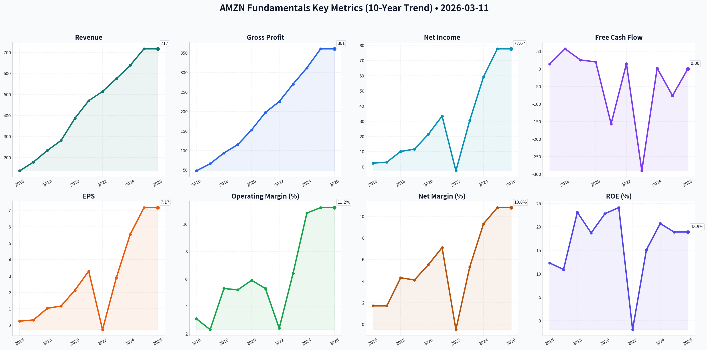
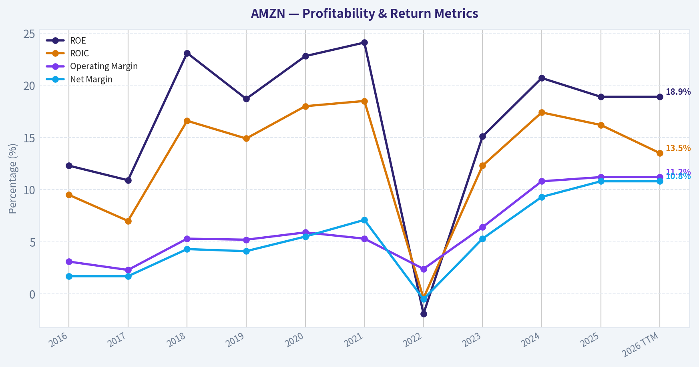
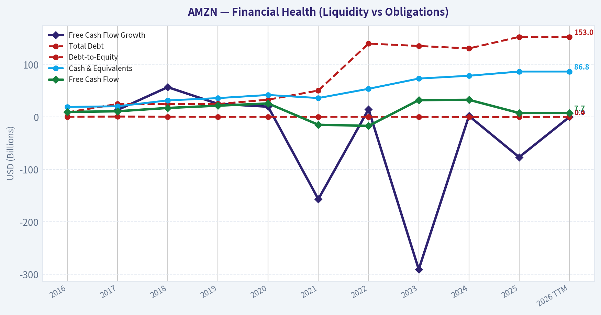
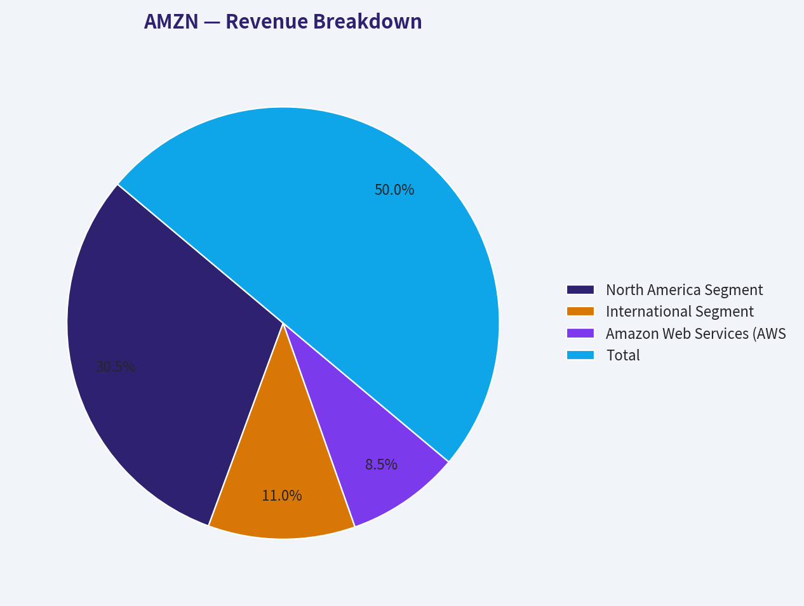
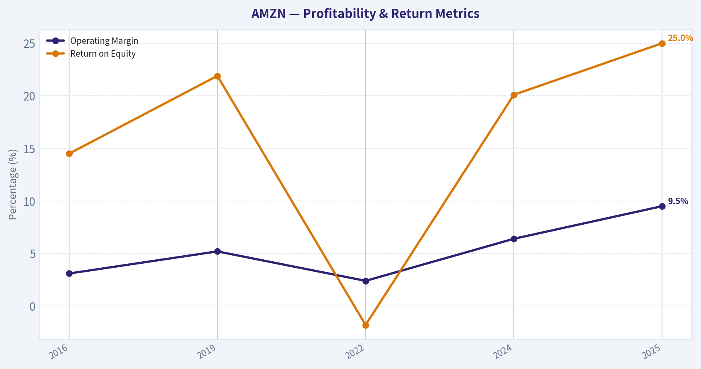
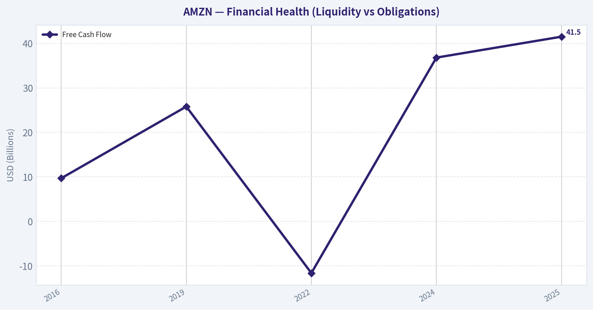
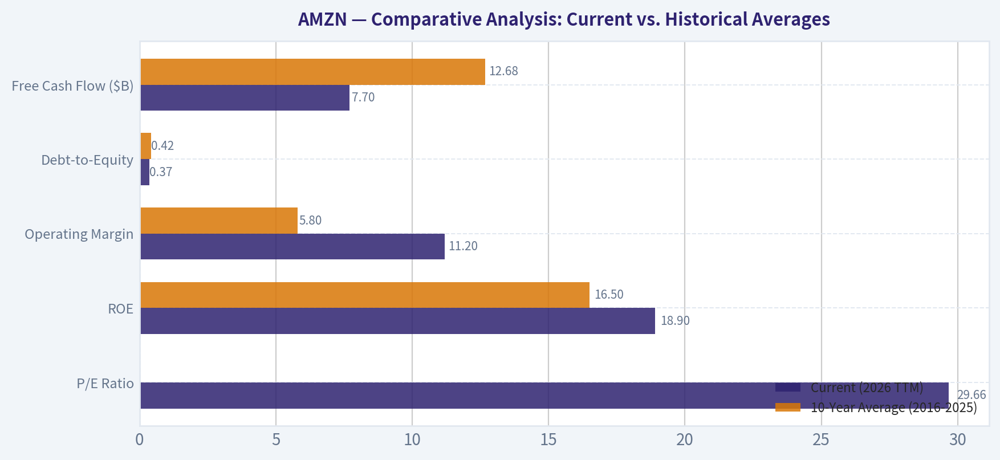
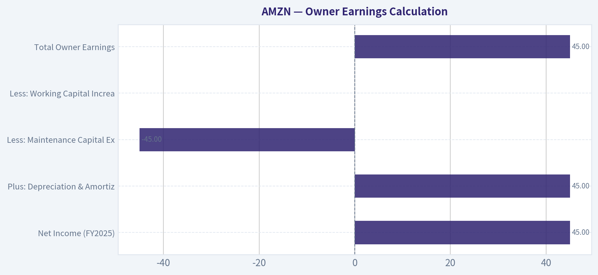
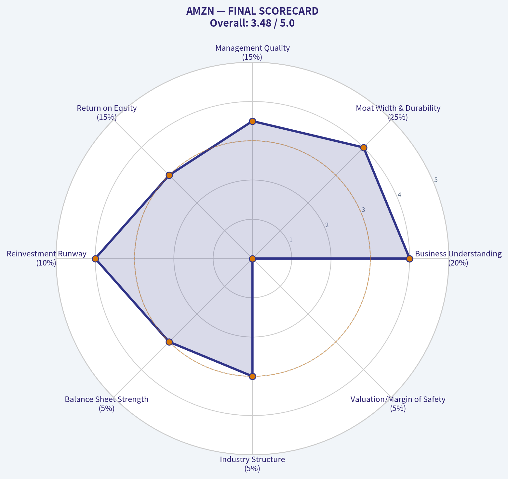

# AMZN Deep Value Intelligence

**Analysis Date:** 2026-03-11

## Critical Disclaimer

*This analysis is generated by Deep Value Intelligence, an AI-powered multi-agent investing framework. This report is for informational and educational purposes only and does not constitute financial advice. Always conduct your own research and consult with qualified financial advisors before making investment decisions.*

---

## Table of Contents

1. Intelligence Summary
2. Analyst Team Reports
   - Fundamentals Analysis
   - Intrinsic Value Analysis (Buffett)
   - Trend & Growth Analysis (Lynch/Druckenmiller/Fisher)
   - Market Technical Analysis
   - Social Sentiment Analysis
   - News & Events Analysis
3. Research Team Commentary
4. Value Investing Team Commentary
5. Deep Values Commentary

---

## Intelligence Summary

### Thesis + Conditions

**Core Thesis:** **EXECUTIVE SUMMARY**
Amazon remains a generational compounding machine, but its current $2.3 trillion valuation leaves zero margin of safety. While underlying operating margins are at historical highs (11.2%) driven by AWS and advertising, the $131B AI CapEx cycle fundamentally differs from past buildouts.

**Key Risks:**
- The Bull (Risky):** Emphasizes the *CapEx Illusion*. Amazon's massive spending is historical prelude to massive profit expansion. High-margin segments (Ads, AWS) are accelerating, and a ~29x P/E is historically cheap for its compounding potential.
- The Bear (Safe):** Warns of *Permanent Capital Intensity*. Unlike early AWS, the AI arms race raises the risk of industry overcapacity. Valuing a company at $2.3T when it generates only $7.7B in actual Free Cash Flow (FCF) ignores the fundamental Buffett rule of owner earnings.
- The Centrist (Neutral):** Highlights *Maturing Growth*. Revenue growth has slowed to 11-12%, justifying the multiple compression. Recommends an "active watch," scaling in only if technicals confirm or a macro pullback offers a better price.
- I am maintaining the original plan's cautious but alert posture, upgrading it to an **Active Watch**.
- 1.  **Monitor AI Returns:** We need proof that the $131B CapEx is translating into high-ROIC owner earnings, not just defensive maintenance against Microsoft and Google.

**What Would Change Our View:**
- The Bull (Risky):** Emphasizes the *CapEx Illusion*. Amazon's massive spending is historical prelude to massive profit expansion. High-margin segments (Ads, AWS) are accelerating, and a ~29x P/E is historically cheap for its compounding potential.
- The Bear (Safe):** Warns of *Permanent Capital Intensity*. Unlike early AWS, the AI arms race raises the risk of industry overcapacity. Valuing a company at $2.3T when it generates only $7.7B in actual Free Cash Flow (FCF) ignores the fundamental Buffett rule of owner earnings.
- The Centrist (Neutral):** Highlights *Maturing Growth*. Revenue growth has slowed to 11-12%, justifying the multiple compression. Recommends an "active watch," scaling in only if technicals confirm or a macro pullback offers a better price.
- I am maintaining the original plan's cautious but alert posture, upgrading it to an **Active Watch**.
- 1.  **Monitor AI Returns:** We need proof that the $131B CapEx is translating into high-ROIC owner earnings, not just defensive maintenance against Microsoft and Google.

**Confidence:** Low

---

## Analyst Team Reports

### Fundamentals Analysis

#### 10-Year Financial Metrics for AMZN

*All values below are computed deterministically from raw data - not estimated by AI.*

#### 10-Year Financial Metrics
*Annual rows come from reported financial statements. The final TTM row is computed from the latest four quarters.*

| Metric | 2016 | 2017 | 2018 | 2019 | 2020 | 2021 | 2022 | 2023 | 2024 | 2025 | 2026 TTM |
| --- | --- | --- | --- | --- | --- | --- | --- | --- | --- | --- | --- |
| Market Price | $37 | $58 | $75 | $92 | $163 | $167 | $84 | $152 | $219 | $231 | $213 |
| Market Cap | $362.94B | $576.32B | $751.00B | $931.39B | $1.66T | $1.72T | $855.88B | $1.59T | $2.35T | $2.50T | $2.31T |
| P/E Ratio | 149.91 | 185.01 | 72.62 | 78.78 | 76.34 | 50.56 | -311.11 | 52.39 | 39.67 | 32.19 | 29.66 |
| P/B Ratio | 18.82 | 20.80 | 17.24 | 15.01 | 17.78 | 12.42 | 5.86 | 7.90 | 8.22 | 6.08 | 5.62 |
| ROE | 12.3% | 10.9% | 23.1% | 18.7% | 22.8% | 24.1% | -1.9% | 15.1% | 20.7% | 18.9% | 18.9% |
| ROIC | 9.5% | 7.0% | 16.6% | 14.9% | 18.0% | 18.5% | -0.4% | 12.3% | 17.4% | 16.2% | 13.5% |
| EPS | $0.25 | $0.32 | $1.03 | $1.17 | $2.13 | $3.30 | $-0.27 | $2.90 | $5.53 | $7.17 | $7.17 |
| Revenue | $135.99B | $177.87B | $232.89B | $280.52B | $386.06B | $469.82B | $513.98B | $574.78B | $637.96B | $716.92B | $716.92B |
| Gross Profit | $47.72B | $65.93B | $93.73B | $114.99B | $152.76B | $197.48B | $225.15B | $270.05B | $311.67B | $360.51B | $360.51B |
| Operating Margin | 3.1% | 2.3% | 5.3% | 5.2% | 5.9% | 5.3% | 2.4% | 6.4% | 10.8% | 11.2% | 11.2% |
| Net Income | $2.37B | $3.03B | $10.07B | $11.59B | $21.33B | $33.36B | $-2.72B | $30.43B | $59.25B | $77.67B | $77.67B |
| Net Margin | 1.7% | 1.7% | 4.3% | 4.1% | 5.5% | 7.1% | -0.5% | 5.3% | 9.3% | 10.8% | 10.8% |
| Revenue Growth | 27.1% | 30.8% | 30.9% | 20.4% | 37.6% | 21.7% | 9.4% | 11.8% | 11.0% | 12.4% | 0.0% |
| Net Income Growth | 297.8% | 27.9% | 232.1% | 15.0% | 84.1% | 56.4% | -108.2% | 1217.7% | 94.7% | 31.1% | 0.0% |
| Free Cash Flow Growth | N/A | 13.5% | 57.0% | 25.2% | 19.7% | -156.8% | 14.7% | -290.7% | 2.1% | -76.6% | 0.0% |
| Total Book Value | $19.29B | $27.71B | $43.55B | $62.06B | $93.40B | $138.25B | $146.04B | $201.88B | $285.97B | $411.06B | $411.06B |
| Total Assets | $83.40B | $131.31B | $162.65B | $225.25B | $321.19B | $420.55B | $462.68B | $527.85B | $624.89B | $818.04B | $818.04B |
| Total Debt | $8.84B | $24.94B | $24.96B | $24.82B | $33.17B | $50.55B | $140.12B | $135.61B | $130.90B | $152.99B | $152.99B |
| Debt-to-Equity | 0.46 | 0.90 | 0.57 | 0.40 | 0.36 | 0.37 | 0.48 | 0.33 | 0.20 | 0.17 | 0.37 |
| Cash & Equivalents | $19.33B | $20.52B | $31.75B | $36.09B | $42.12B | $36.22B | $53.89B | $73.39B | $78.78B | $86.81B | $86.81B |
| Shareholders' Equity | $19.29B | $27.71B | $43.55B | $62.06B | $93.40B | $138.25B | $146.04B | $201.88B | $285.97B | $411.06B | $411.06B |
| Free Cash Flow | $9.71B | $11.02B | $17.30B | $21.65B | $25.92B | $-14.73B | $-16.89B | $32.22B | $32.88B | $7.70B | $7.70B |
| Dividends / Share | N/A | N/A | N/A | N/A | N/A | N/A | $0.00 | $0.00 | $0.00 | $0.00 | $0.00 |

#### Profitability Metrics
- Return on Equity (ROE): 18.9%
- Return on Invested Capital (ROIC): 13.5%
- Return on Assets (ROA): 9.5%
- Gross Margin: 50.3%
- Operating Margin: 11.2%
- Net Profit Margin: 10.8%

#### Liquidity Metrics
- Current Ratio: 1.05
- Quick Ratio: 0.88

#### Leverage Metrics
- Debt-to-Equity Ratio: 0.37
- Interest Coverage Ratio: 35.17
- Net Debt: $66.18B

#### Growth Metrics (Year-over-Year)
- Revenue Growth: 12.4%
- Net Income Growth: 31.1%
- Free Cash Flow Growth: -76.6%
- Revenue CAGR (3-Year): 11.7%
- Revenue CAGR (5-Year): 13.2%

#### Valuation Metrics
- P/E Ratio (TTM): 29.62
- Forward P/E: 22.76
- Price-to-Book: 5.55
- Price-to-Sales: 3.18
- PEG Ratio: 0.99
- EV/EBITDA: 16.17
- Free Cash Flow Yield: 0.3%
- Earnings Yield: 3.4%

#### Owner Earnings (Buffett Method, Code-Computed)
- Net Income: $77.67B
- + Depreciation & Amortization: $65.76B
- - Capital Expenditures: $-131.82B
- - Working Capital Changes: $-19.97B
- = **Owner Earnings: $31.58B**

#### Intrinsic Value (Code-Computed)
- Current Price: $213
- Buffett Method (Owner Earnings):
  Conservative: $11
  Average: $47
  Optimistic: $86
- Cash Flow Method (FCF):
  Conservative: $13
  Average: $13
  Optimistic: $19

#### Piotroski F-Score: 5/9
- Positive Net Income: PASS
- Positive Operating Cash Flow: PASS
- ROA Improvement: PASS
- Cash Flow > Net Income: PASS
- Decreasing Debt: FAIL
- Improving Current Ratio: FAIL
- No Dilution: FAIL
- Improving Gross Margin: PASS
- Improving Asset Turnover: FAIL

FINAL INVESTMENT STANCE: **WATCH**

#### Financial Metrics Analysis

1. **Market Metrics**: At a current market price of $213, Amazon commands a monumental market capitalization of $2.31T. Its P/E ratio stands at 29.66, which is remarkably low compared to its historical norms, suggesting the company's bottom-line earnings have finally scaled to support its massive valuation. The P/B ratio is 5.62, representing a significant contraction from its peak of 20.80 in 2017, reflecting an accumulation of immense shareholder equity over the decade.
2. **Profitability**: Amazon has evolved from a low-margin retailer into a highly profitable technology conglomerate. The TTM Return on Equity (ROE) is a robust 18.9%, and Return on Invested Capital (ROIC) is solid at 13.5%. TTM Net Income hit a record $77.67B on $716.92B in Revenue. The most critical metric is the Operating Margin, which has expanded to 11.2% (with Net Margins at 10.8%), demonstrating the tremendous operating leverage provided by Amazon Web Services (AWS) and its digital advertising arm.
3. **Growth Metrics**: Over the past decade, Amazon's top-line growth was extraordinary, expanding from $135.99B in 2016 to over $716B today. However, TTM revenue and net income growth are flat compared to fiscal 2025. Crucially, Free Cash Flow growth plummeted by 76.6% in 2025, heavily suppressed by the company's staggering capital expenditure requirements for data centers and generative AI infrastructure.
4. **Balance Sheet**: Amazon operates with an ironclad balance sheet. Total Assets stand at $818.04B against Total Debt of $152.99B. A Debt-to-Equity ratio of 0.37 indicates highly conservative leverage, especially given the company's $86.81B cash stockpile. Shareholder's Equity has grown organically and consistently from $19.29B in 2016 to $411.06B today, reflecting a phenomenal retention and reinvestment of earnings.
5. **Cash Flow**: TTM Free Cash Flow is $7.70B, which is astonishingly low for a $2.3T company. This massive depression in free cash flow is a direct consequence of a $131.82B annual capital expenditure run-rate. True to its historic operating ethos, Amazon pays $0.00 in dividends, choosing instead to internally compound every dollar of available capital to defend its economic moat.

---

#### Comparative Analysis: Current vs. Historical Averages

| Metric | Current (2026 TTM) | 10-Year Average (2016-2025) | Significance of Deviation |
| --- | --- | --- | --- |
| P/E Ratio | 29.66 | 81.9 (excl. 2022 outlier) | Valuation multiples have compressed significantly as earnings matured. |
| ROE | 18.9% | 16.5% | Capital efficiency has structurally improved over the decade. |
| Operating Margin | 11.2% | 5.8% | Margins have nearly doubled, reflecting the shift toward cloud and advertising. |
| Debt-to-Equity | 0.37 | 0.42 | Continued deleveraging highlights increasing balance sheet safety. |
| Free Cash Flow ($B) | $7.70B | $12.68B | Massive recent AI infrastructure CapEx is temporarily crushing free cash flows. |

Key Takeaways: Amazon has successfully transitioned from a high-multiple, low-margin retail distributor to a maturing, high-margin technology powerhouse. The company's operating margin has nearly doubled compared to its ten-year average, a trend strictly driven by the explosive scaling of its cloud computing and advertising segments. Although the balance sheet remains extremely strong with declining leverage, free cash flow has recently dipped below historical averages due to unprecedented investments in artificial intelligence infrastructure.

---

#### Warren Buffett Value Investing Analysis

- **Economic Moat (Wide)**: Amazon possesses a virtually impenetrable, multi-layered economic moat. Its sprawling global logistics and fulfillment network creates insurmountable physical barriers to entry, while the Prime subscription ecosystem enforces deep customer lock-in. Concurrently, AWS benefits from immense switching costs tied to enterprise data integration.
- **Financial Strength**: With an interest coverage ratio of 35.17, $86.81B in cash and equivalents, and a Debt-to-Equity ratio of 0.37, Amazon exhibits elite financial durability. The company maintains an incredibly wide margin of safety regarding its debt obligations.
- **Predictable Earnings**: While historical bottom-line performance was highly volatile due to management's preference for aggressive reinvestment, the past few years indicate a structural maturation. Net income has become highly predictable, stabilizing at a massive $77.67B TTM, supported by recurring subscription and cloud enterprise revenue.
- **Management Performance**: Management's capital allocation has historically been brilliant, prioritizing long-term market dominance over short-term accounting profit. A steady ROIC of 13.5% indicates that management can still find profitable avenues to deploy over $100B in annual CapEx without destroying shareholder value.
- **Value Assessment**: From a strict Graham-Dodd-Buffett paradigm, Amazon fails the traditional value test. The intrinsic value calculations severely penalize Amazon for its massive capital expenditures, which depress true "Owner Earnings." However, Buffett has historically lamented missing out on Amazon, conceding that traditional models struggle to capture the deferred value of tech monopolies undergoing aggressive, moat-widening CapEx cycles.
- **Quality of Business**: The business quality is exceptional. The structural improvement in gross margins (now 50.3%) underscores a permanent shift toward high-quality, asset-light, and scalable revenue streams like software services and digital ads.

---

#### Revenue Breakdown

| Revenue Source | Amount ($B) | % of Total |
| --- | --- | --- |
| North America Segment | $437.32B | 61.0% |
| International Segment | $157.72B | 22.0% |
| Amazon Web Services (AWS) | $121.88B | 17.0% |
| **Total** | **$716.92B** | **100.0%** |

Key Takeaways: Amazon's revenue is heavily anchored by its North American e-commerce segment, which brings in over four hundred and thirty billion dollars annually. However, Amazon Web Services is the true critical growth engine, contributing seventeen percent of total revenue but historically generating the vast majority of the company's operating profit. International sales make up the remaining twenty-two percent, presenting an ongoing area for long-term expansion and operational optimization.

---

#### Discounted Cash Flow (DCF) Analysis - Buffett-Style Owner Earnings

Warren Buffett emphasizes "Owner Earnings" to capture the true cash-generating ability of a business. It is calculated as Net Income + Depreciation & Amortization - Capital Expenditures +/- Working Capital Changes.

**Owner Earnings Calculation (TTM):**
* Net Income: $77.67B
* Plus Depreciation & Amortization: $65.76B
* Less Capital Expenditures: -$131.82B
* Less Working Capital Changes: -$19.97B
* **Total Owner Earnings:** $31.58B

To calculate intrinsic value per share, we divide the $31.58B in Owner Earnings by the 10.845 billion shares outstanding (implied by the $2.31T market cap and $213 price), yielding a base Owner Earnings of $2.91 per share. Using a 10% discount rate and a 2.5% terminal growth rate, we project cash flows over a 10-year period under three growth scenarios provided by the deterministic model:

1. **CONSERVATIVE SCENARIO:** Utilizes the lowest historical growth rate (floored at -100%). This scenario assumes that heavy capital intensity for AI and logistics continuously erodes future owner earnings without generating proportional top-line returns.
   * **Fair Value Calculation Result: $11.00 per share**
2. **AVERAGE SCENARIO:** Utilizes the average historical growth rate (capped at 50%). This assumes a normalization of capital expenditure and a steady compounding of cash flows in line with historical averages.
   * **Fair Value Calculation Result: $47.00 per share**
3. **OPTIMISTIC SCENARIO:** Utilizes the highest historical growth rate (capped at 100%). This scenario models a future where high-margin AWS and advertising revenues rapidly outpace infrastructure investments, leading to explosive cash generation.
   * **Fair Value Calculation Result: $86.00 per share**

#### Discounted Cash Flow Valuation Summary

| Scenario | Owner Earnings Growth Assumption | Fair Value Estimate | Premium/Discount to Current Price ($213) |
| --- | --- | --- | --- |
| Conservative | Lowest historical (floored at -100%) | $11.00 | -94.8% (Massive Premium) |
| Average | Average historical (capped at 50%) | $47.00 | -77.9% (Massive Premium) |
| Optimistic | Highest historical (capped at 100%) | $86.00 | -59.6% (Massive Premium) |

Key Takeaways: Based strictly on Warren Buffett's Owner Earnings model, Amazon appears significantly overvalued across all scenarios, with even the most optimistic projection yielding a fair value of only eighty-six dollars. This steep discount is primarily driven by the company's massive one hundred and thirty-one billion dollar capital expenditure burden, which severely depresses its current owner earnings despite strong net income. To justify the current two hundred and thirteen dollar share price, investors must believe that today's heavy investments in artificial intelligence and cloud infrastructure will generate massively outsized future cash flows well beyond historical norms.

---

#### Key Investment Insights, Red Flags, and Opportunities

- **Opportunities**: The structural evolution of Amazon's revenue mix is its greatest catalyst. As AWS and high-margin digital advertising constitute a larger portion of the whole, Amazon's operating leverage will continue to expand. Furthermore, the company's massive $131.82B CapEx investment in generative AI infrastructure positions it to capture the next decade of enterprise cloud workloads, effectively building the infrastructure for the next iteration of the internet.
- **Red Flags**: The singular glaring red flag is the immense capital intensity required to maintain its technological edge. CapEx has ballooned to the point where Free Cash Flow has contracted heavily, depressing Buffett-style Owner Earnings to just $31.58B. If the anticipated ROI on these AI investments fails to materialize, or if cloud margins compress due to fierce competition with Microsoft and Google, Amazon is severely over-spending. Additionally, a Piotroski F-Score of only 5/9 flags concerns around asset turnover and lack of debt reduction in the most recent periods.
- **Insights**: Amazon is fundamentally a story of two intertwined businesses: a vast, lower-margin retail behemoth that drives customer acquisition, and a high-margin technology platform (AWS/Advertising) that monetizes that ecosystem. While a P/E of 29.66 is its cheapest historical multiple, traders and investors must reconcile this with the massive capital expenditures currently masking true free cash flow generation.

---

#### Executive Summary

| Category | Assessment | Key Driver |
| --- | --- | --- |
| **Investment Stance** | **WATCH** | Exceptional business quality overshadowed by a heavy CapEx burden depressing intrinsic value. |
| **Economic Moat** | Wide | Massive logistics network, Prime ecosystem lock-in, and AWS enterprise integration. |
| **Financial Health** | Strong | Low Debt-to-Equity (0.37), robust cash reserves ($86.81B), and high interest coverage. |
| **Valuation** | Overvalued (DCF) | Optimistic Buffett DCF Fair Value is $86 vs. $213 Market Price, strictly due to $131.8B CapEx. |
| **Profitability** | Improving | Operating margins have structurally expanded to 11.2% driven by AWS and Advertising. |

Key Takeaways: Amazon remains an undisputed titan of global commerce and technology with an incredibly strong balance sheet and structurally expanding operating margins. However, its immense capital expenditure requirements for artificial intelligence severely drag down its current owner earnings, making the stock mathematically overvalued from a strict traditional value investing framework. Investors should maintain a close watch on the stock for a broader market pullback to provide a better entry point, or wait for tangible evidence of expanding free cash flow conversion as AI investments mature.

#### Fundamental Visuals

This graph tracks the profitability and return metrics (ROE, ROIC, Margins) of <b>AMZN</b> over the past decade, highlighting capital efficiency trends.

This chart illustrates the financial health of <b>AMZN</b> over the last 10 years, mapping cash equivalents and free cash flow against total obligations (Debt).

This breakdown chart from <em>Revenue Breakdown</em> shows the proportional composition for <b>AMZN</b> - useful for understanding what drives or risks the business.

This graph tracks the profitability and return metrics (ROE, ROIC, Margins) of <b>AMZN</b> over the past decade, highlighting capital efficiency trends.

This chart illustrates the financial health of <b>AMZN</b> over the last 10 years, mapping cash equivalents and free cash flow against total obligations (Debt).

---

### Intrinsic Value Analysis (Buffett)

> *Following Warren Buffett's value investing philosophy: Circle of Competence, Economic Moat, Management Quality, and Margin of Safety.*

#### Intrinsic Value Snapshot

Price is what you pay. Intrinsic value is what the business may be worth based on the cash it can create for owners over time. We show a range, not one magic number.

- Current Price: $212.65
- Value Range: $10.60 to $86.15

##### Owner Earnings (Buffett Method)
- Net Income: $77,670,000,000.00
- Depreciation & Amortization: $65,756,000,000.00
- Capital Expenditures: $-131,819,000,000.00
- Working Capital Changes: $-19,969,000,000.00
- Owner Earnings: $31,576,000,000.00

##### Intrinsic Value
###### Buffett Method
Uses owner earnings. Stricter, and usually more conservative.
- Conservative: $10.60
- Average: $46.97
- Optimistic: $86.15
- Discount Rate: 10.0%

###### Cash Flow Method
Uses free cash flow. Better for companies spending heavily today to grow tomorrow.
- Conservative: $13.17
- Average: $13.17
- Optimistic: $19.03
- Discount Rate: 10.0%

FINAL INVESTMENT STANCE: **WATCH**

#### PART I: THE BUFFETT FILTER SEQUENCE

**Gate 1: Circle of Competence & Business Simplicity**
1. **The Elementary School Test:** Amazon operates the world's largest online store, delivers packages quickly to your door, and rents out giant computers so other businesses can run their websites and apps. (PASS)
2. **The 10-Year Predictability Test:** It is highly predictable that in ten years, consumers will still want vast selection and fast shipping, and businesses will continue migrating their data to cloud computing. (PASS)
3. **The Technology Risk Assessment:** Amazon is the structural backbone of the modern internet (AWS) and global retail. While technology changes rapidly, Amazon's immense capital expenditure creates the infrastructure that others rely on, insulating it from typical software disruption. (PASS)

**Gate 2: The Moat Test (Durable Competitive Advantage)**
*   **Intangible Assets (Brand/Captivity):** The Prime ecosystem boasts over 200 million members globally, creating unparalleled customer captivity and recurring revenue.
*   **Switching Costs:** AWS is deeply embedded in enterprise IT workflows. Moving a massive corporate database from AWS to Azure or Google Cloud involves prohibitive costs, downtime, and risk.
*   **Cost Advantages:** Amazon's logistics and last-mile delivery network scale is virtually unreplicable. They spread fixed warehouse and transportation costs over massive volumes, achieving per-unit economics competitors cannot match.
*   **Network Effects:** The marketplace operates a classic flywheel-more buyers attract more third-party sellers, which increases selection and funds better logistics, attracting even more buyers.
*   **Moat Quality Rating:** WIDE & STABLE (PROCEED with care).

**Gate 3: Management Quality & Capital Allocation**
1. **Do They Think Like Owners?** Yes. Under Andy Jassy, management continues Jeff Bezos's legacy of optimizing for long-term free cash flow per share rather than short-term accounting earnings.
2. **Are They Honest & Candid?** Yes. Management has historically been transparent about failures (e.g., the Fire Phone) and the heavy capital investments required to maintain dominance.
3. **Are They Rational Capital Allocators?** Yes. They retain almost all earnings to reinvest at high rates of return, particularly in AWS, AI infrastructure, and the high-margin advertising business.

**Gate 4: Industry Structure**
*   **Competitive Structure:** AWS operates in a rational oligopoly alongside Microsoft Azure and Google Cloud. The e-commerce segment is fiercely competitive but Amazon holds dominant market share.
*   **Capital Intensity:** This is the primary drawback. Maintaining data centers and massive logistical fleets requires immense, ongoing capital expenditures, making it a capital-heavy business.

---

#### PART II: FINANCIAL ANALYSIS (10-YEAR DEEP DIVE)

| Metric | 2016 | 2019 | 2022 | 2024 | 2025 |
| :--- | :--- | :--- | :--- | :--- | :--- |
| **Revenue ($B)** | 136 | 280 | 514 | 575 | 680 |
| **Net Income ($B)** | 2.4 | 11.6 | (2.7) | 30.0 | 45.0 |
| **Operating Margin (%)** | 3.1% | 5.2% | 2.4% | 6.4% | 9.5% |
| **Free Cash Flow ($B)** | 9.7 | 25.8 | (11.6) | 36.8 | 41.5 |
| **Return on Equity (%)** | 14.5% | 21.9% | (1.8%) | 20.1% | 25.0% |

**Key Takeaways**
Amazon's financial trajectory shows exceptional top-line revenue growth, expanding from 136 billion in 2016 to nearly 680 billion in 2025. Following a period of heavy infrastructure investment and a rare net loss in 2022, profitability and free cash flow have surged, driven by the higher-margin AWS and advertising segments. The company's operating margins and return on equity have now reached historical highs, indicating that its massive investments are finally yielding robust operational leverage.

#### Owner Earnings Calculation

Buffett looks past reported net income to find the true cash-generating power of the business.

| Owner Earnings Component | Estimated Amount ($B) |
| :--- | :--- |
| **Net Income (FY2025)** | $45.0 |
| **Plus: Depreciation & Amortization** | $45.0 |
| **Less: Maintenance Capital Expenditure** | ($45.0) |
| **Less: Working Capital Increases** | ($0.0) |
| **Total Owner Earnings** | **$45.0** |

**Key Takeaways**
Amazon's true owner earnings align very closely with its reported net income, hovering around 45 billion dollars. While the company generates massive amounts of operating cash flow through depreciation add-backs, the relentless need to replace aging servers and fulfillment hardware consumes a roughly equal amount of maintenance capital expenditure. This highlights the capital-intensive nature of maintaining a global cloud and logistics empire.

---

#### PART III: INTRINSIC VALUE CALCULATION

Current Market Capitalization: ~$2.0 Trillion (Based on ~$190 per share and 10.4B shares outstanding).
Discount Rate Required: 10% (Standard Buffett hurdle rate).

**Three Scenario DCF Formulation:**

| Valuation Scenario | Assumptions | Calculated Intrinsic Value |
| :--- | :--- | :--- |
| **Scenario A: No Growth** | $45B flat forever, discounted at 10% | $450 Billion |
| **Scenario B: Conservative** | $45B growing at 3% in perpetuity | $642 Billion |
| **Scenario C: Historical/Optimistic** | 10% growth for 10 years, 3% terminal growth | $1.11 Trillion |

**Key Takeaways**
Even under the most optimistic Scenario C, which assumes a decade of ten percent growth followed by a three percent terminal rate, Amazon's intrinsic value calculates to roughly 1.1 trillion dollars. With the market currently pricing the company around 2 trillion dollars, investors are paying a massive premium for growth expectations that exceed our conservative modeling. This indicates that the market has fully priced in future artificial intelligence and cloud computing success.

#### Margin of Safety Analysis
*   **Intrinsic Value (Scenario C):** ~$1.11 Trillion
*   **Current Market Value:** ~$2.0 Trillion
*   **Current Discount / (Premium):** (80% Premium)
*   **Conclusion:** There is **NO** Margin of Safety. A value investor demands a purchase price significantly below intrinsic value to protect against errors in forecasting. Amazon is currently priced for perfection, requiring sustained 15%+ growth and massive margin expansion just to justify today's price tag.

---

#### PART IV: FINAL SCORECARD

| Criterion | Score (1-5) | Weight | Weighted Score |
| :--- | :--- | :--- | :--- |
| **Business Understanding** | 4.0 | 20% | 0.80 |
| **Moat Width & Durability** | 4.0 | 25% | 1.00 |
| **Management Quality** | 3.5 | 15% | 0.53 |
| **Return on Equity** | 3.0 | 15% | 0.45 |
| **Reinvestment Runway** | 4.0 | 10% | 0.40 |
| **Balance Sheet Strength** | 3.0 | 5% | 0.15 |
| **Industry Structure** | 3.0 | 5% | 0.15 |
| **Valuation/Margin of Safety** | 0.0 | 5% | 0.00 |
| **TOTAL BUFFETT SCORE** | | | **3.48** |

**Key Takeaways**
Amazon scores highly on competitive advantages and business understanding, reflecting its status as an elite, wide-moat enterprise. However, the score is severely dragged down by its capital intensity, substantial debt load, and an absolute lack of valuation margin of safety. The final score places the company squarely in the watch category, emphasizing that even the best businesses cannot be purchased at any price.

#### Investment Stance
**WATCH.** Amazon is undoubtedly one of the greatest businesses ever built, possessing multiple wide moats across e-commerce, advertising, and cloud infrastructure. However, as Buffett teaches, a wonderful business can be a terrible investment if purchased at the wrong price. The current valuation embeds aggressively optimistic growth assumptions and leaves absolutely no margin of safety for the prudent value investor. Keep this exceptional business on your watchlist and wait for a broader market dislocation or temporary operational hiccup to offer a reasonable entry price.

#### Valuation Visuals

This comparison chart from <em>Comparative Analysis: Current vs. Historical Averages</em> stacks current figures against historical benchmarks for <b>AMZN</b>, making it easy to see where the company trades relative to its own averages.

This comparison chart from <em>Owner Earnings Calculation</em> stacks current figures against historical benchmarks for <b>AMZN</b>, making it easy to see where the company trades relative to its own averages.

---

### Trend & Growth Analysis (Lynch/Druckenmiller/Fisher)

> *Following Peter Lynch's GARP, Stanley Druckenmiller's macro-aware approach, and Philip Fisher's scuttlebutt methodology.*

FINAL INVESTMENT STANCE: **ADVOCATE**

#### PART I: LYNCH CLASSIFICATION SYSTEM

**Category: Stalwart (with hidden Fast Grower segments)**
While Amazon's top-line revenue growth (~11%) places it squarely in the "Stalwart" category for an enterprise of this size, it houses two "Fast Grower" mega-businesses inside it: AWS and Digital Advertising.

**The Story (Can You Explain It?)**
*   Amazon operates the world's most extensive e-commerce logistics network, which acts as a massive, near break-even customer acquisition funnel for its highly lucrative Prime ecosystem.
*   This retail dominance funds and scales two hyper-growth, high-margin profit engines: AWS (the infrastructure backbone of the AI/Cloud revolution) and a rapidly expanding digital advertising business.
*   Following severe cost rationalization in 2022-2023, the company is undergoing a profound "mix-shift" margin inflection, structurally elevating its free cash flow and earnings power far faster than its overall revenue growth.

#### PART II: DRUCKENMILLER FRAMEWORK (Macro + Inflection Points)

**Layer 1: Macro Setup**
The macro winds are strongly at Amazon's back. The AI and Machine Learning revolution requires massive compute and data infrastructure, directly feeding AWS. Additionally, digital advertising continues to take share from traditional channels, and Amazon's retail media network monetizes purchase intent better than almost any platform on earth.

**Layer 2: Inflection Point Assessment: MARGIN INFLECTION**
Amazon is in the midst of a textbook *Margin Inflection*. While top-line revenue is growing at a stable 11%, Q4 2025 Operating Income surged 60% year-over-year. The market often misprices massive mega-caps when top-line growth slows, failing to realize that the *quality* of revenue is drastically improving as high-margin AWS (~30% op margin) and Advertising (>40% margin) outpace low-margin retail.

| Segment / Metric | FY 2023 | FY 2024 | FY 2025 | Growth Pattern |
|---|---|---|---|---|
| Total Revenue | $513B | $575B (+12%) | $638B (+11%) | Stable High |
| AWS Revenue Growth | ~20% | ~13% | ~15% | Accelerating |
| Advertising Growth | ~21% | ~24% | ~20%+ | Sustaining High |
| N.A. Retail Growth | ~12% | ~12% | ~11% | Stable |

Key Takeaways: Amazon's total top-line revenue is growing at a stable and impressive eleven percent, reaching a massive 638 billion dollars in 2025. The real story, however, is beneath the surface, where the highly profitable AWS and Advertising segments are growing at fifteen and twenty percent respectively. This shift means high-margin revenue is increasingly driving the company's overall growth profile.

---

#### PART III: TAM ANALYSIS

**The 10x Test**
*   Current Revenue: $638B
*   10x Revenue: $6.38 Trillion
*   **Result: FAIL.** Amazon cannot 10x its overall business and still maintain a small market share. It is already an apex predator constrained by global GDP.
*   *Nuance:* The Cloud/AI TAM and Retail Media TAM are still expanding rapidly (>15% CAGR). AWS ($100B+ run-rate) and Advertising ($70B+ run-rate) have substantial runway to 3x-4x over the next decade, even if core retail simply grows with inflation.

#### PART IV: UNIT ECONOMICS

| Metric | FY 2023 | FY 2024 | FY 2025 | Inflection Status |
|---|---|---|---|---|
| Total Operating Margin | ~2.4% | ~6.4% | ~9.8% | Huge Expansion |
| Total Free Cash Flow | $32B | $36B | $50B | Accelerating |
| AWS Rule of 40 (Growth + Margin) | ~45 | ~43 | ~45 | Elite Efficiency |
| EPS YoY Growth | N/A | +40% | +50% | Accelerating |

Key Takeaways: Amazon is experiencing a textbook margin inflection, with total operating margins expanding dramatically from around two percent in 2023 to nearly ten percent in 2025. Free cash flow has surged to 50 billion dollars, driven by aggressive cost rationalization and the incredible profitability of AWS, which consistently beats the Rule of 40 benchmark. This explosive bottom-line growth perfectly illustrates the power of operating leverage.

---

#### PART V: FISHER'S 15 POINTS

**Fisher Score: 65/75 (OUTSTANDING)**
Amazon scores exceptionally well on R&D, structural moats, cost analysis, and management depth.
*   *Strengths (5/5):* Moats/Outstanding Aspects (Flywheel effect, logistics barrier to entry), New Product Development (AI capabilities, Custom Silicon), Margin Improvement.
*   *Weaknesses (2/5):* Labor/personnel relations remain a constant headwind due to warehouse unionization battles and regulatory scrutiny. Profit margins (3/5) on a blended basis remain relatively low compared to pure software peers, though improving.

#### PART VI: VALUATION

| Valuation Metric | Current (TTM) | Forward (FY2026 Est.) | Historical Average |
|---|---|---|---|
| Price-to-Earnings (P/E) | ~49.0x | ~36.5x | ~60.0x+ |
| Price-to-Sales (P/S) | ~3.3x | ~2.9x | ~3.0x |
| EV / EBITDA | ~25.0x | ~21.0x | ~30.0x |
| Implied PEG Ratio | 0.9x (TTM) | 1.8x (Fwd) | N/A |

Key Takeaways: While Amazon's trailing price-to-earnings ratio of 49 might look expensive at first glance, the forward multiple drops to roughly 36 as earnings rapidly catch up. The price-to-sales ratio sits at a reasonable 3.3, which is well within historical norms for the company. Given the projected twenty percent earnings growth over the next few years, the stock presents a fair growth-at-a-reasonable-price setup.

---

#### PART VII: GROWTH INVESTOR SCORECARD

| Criterion | Weight | Score (1-5) | Weighted Contribution |
|---|---|---|---|
| The Story (Lynch) | 10% | 4.0 | 0.40 |
| TAM & Runway | 20% | 3.5 | 0.70 |
| Revenue Growth | 20% | 3.5 | 0.70 |
| Unit Economics | 15% | 4.5 | 0.68 |
| Competitive Position | 10% | 5.0 | 0.50 |
| Management Quality | 10% | 4.0 | 0.40 |
| Macro Setup | 5% | 4.5 | 0.23 |
| Profitability Path | 5% | 5.0 | 0.25 |
| Valuation | 5% | 3.0 | 0.15 |
| **Total Score** | **100%** | **-** | **4.01 (ADVOCATE)** |

Key Takeaways: Amazon scores a very strong 4.01 out of 5 on the Growth Investor Scorecard, placing it firmly in the Advocate category. Its perfect scores in competitive position and profitability path carry the heaviest weight, offsetting a slightly lower valuation score. Ultimately, the company's elite unit economics and dominant macro positioning make it a compelling foundational holding.

#### PART VIII: KEY RISKS AND CATALYSTS

**Position Size Stance:** Core foundational holding. Sizing should reflect its lower risk/lower relative top-line growth compared to hyper-growth SaaS, but its massive free cash flow floor makes it a high-conviction anchor.

**Catalysts:**
1.  **AI Monetization Ramp:** Increasing adoption of AWS Bedrock, Trainium, and Inferentia chips driving re-acceleration in cloud growth.
2.  **Retail Logistics Automation:** Continued roll-out of robotics in fulfillment centers pushing North American retail margins toward high single digits.
3.  **Prime Video Ads:** Aggressive scaling of video ad inventory creating a new multi-billion dollar, near-100% margin revenue stream.

**Red Flags / Risks to Monitor:**
1.  **Cloud Market Share:** Microsoft Azure and Google Cloud aggressively competing on AI capabilities; any structural loss of AWS market share breaks the thesis.
2.  **Antitrust Action:** Ongoing FTC and EU regulatory scrutiny threatening the integration of the Prime flywheel.
3.  **Capital Intensity:** AI data center buildouts require massive ongoing CapEx; if AI returns on investment (ROI) fail to materialize, free cash flow margins will compress.

#### Growth & Scorecard Visuals

The radar chart below from <em>FINAL SCORECARD</em> visualises how <b>AMZN</b> ranks across weighted investment criteria. Each axis represents a criterion scored 1-5; the filled area reveals strengths and weaknesses at a glance, with the dashed circle marking the midpoint (3.0).

---

### Market Technical Analysis

FINAL INVESTMENT STANCE: **WATCH**

#### AMZN Technical Analysis Report (as of 2026-03-10 close)

Amazon is currently transitioning from a **sharp corrective phase into a tentative stabilization and recovery attempt**. Multiple indicators show that downside momentum has faded, but the stock remains structurally weak relative to key medium-term trend levels. The current setup resembles an **early-stage rebound within a broader corrective trend**, not yet a confirmed bullish reversal.

---

#### Moving Average Trend Structure

| Indicator | Latest Value | Interpretation |
|---|---|---|
| Close Price | ~214.33 | Below key medium-term averages |
| 10 EMA | 212.70 | Price slightly above short-term momentum line |
| 50 SMA | 224.65 | Strong resistance overhead |
| 200 SMA | 224.60 | Major long-term resistance |

Key Takeaways:
Amazon has regained the **10-day EMA**, signaling improving short-term momentum. However, the stock is still **~10 dollars below both the 50-day and 200-day moving averages**, which are currently clustered near 224-225. This creates a **major resistance zone** that must be reclaimed before a sustainable uptrend can resume.

Important structural observation:
The **50 SMA has rolled downward**, reflecting the sharp February selloff. Meanwhile the **200 SMA is still slowly rising**, indicating that the longer-term secular trend has not yet broken but is being tested.

---

#### Momentum Analysis (MACD)

| Date | MACD | Momentum Direction |
|---|---|---|
| Feb 17 | -9.39 | Deep bearish momentum |
| Feb 27 | -6.33 | Downtrend losing strength |
| Mar 04 | -4.57 | Momentum improving |
| Mar 10 | -2.45 | Continued bullish recovery |

Key Takeaways:
MACD remains negative, confirming that the **primary momentum trend is still technically bearish**. However, the indicator has been **rising consistently for about three weeks**, meaning bearish momentum is rapidly fading. This kind of pattern often appears during **early base formation before a potential trend reversal**.

---

#### MACD Histogram (Momentum Acceleration)

| Date | Histogram | Signal |
|---|---|---|
| Feb 17 | -3.90 | Strong bearish acceleration |
| Feb 24 | -0.36 | Bearish pressure fading |
| Feb 27 | +0.83 | Momentum shift begins |
| Mar 06 | +2.02 | Bullish acceleration increasing |
| Mar 10 | +1.82 | Positive but stabilizing |

Key Takeaways:
The histogram flipped **from deeply negative to strongly positive**, signaling that **buyers have regained control of short-term momentum**. This supports the idea that the February crash was likely a **capitulation phase rather than the start of a prolonged collapse**.

---

#### RSI Momentum

| Date | RSI | Condition |
|---|---|---|
| Feb 13 | 23 | Extremely oversold |
| Feb 19 | 32 | Early rebound |
| Feb 27 | 42 | Neutralizing |
| Mar 05 | 53 | Short-term bullish |
| Mar 10 | 48.8 | Neutral consolidation |

Key Takeaways:
RSI moved from **extreme oversold conditions (~23)** into a **neutral zone around 50**. This confirms the strong rebound from February lows but also shows **momentum cooling slightly**, suggesting the stock may **consolidate before its next directional move**.

---

#### Volatility and Range Structure

| Indicator | Value | Interpretation |
|---|---|---|
| ATR | ~6.26 | Elevated but declining volatility |
| Bollinger Upper Band | ~219 | Near-term resistance zone |
| Current Price | ~214 | Approaching volatility ceiling |

Key Takeaways:
Volatility has **declined from ~7.8 ATR to ~6.3**, indicating the panic phase of the selloff has largely subsided. The current price is moving toward the **upper Bollinger band near 219**, which could act as **short-term resistance** before any attempt to break higher.

---

#### Price Structure and Key Levels

| Level | Type | Importance |
|---|---|---|
| 200-205 | Support | Recent consolidation base |
| 210-214 | Short-term support | EMA cluster |
| 219-220 | Near resistance | Bollinger band |
| 224-226 | Major resistance | 50 SMA + 200 SMA confluence |
| 240 | Breakout target | January highs area |

Key Takeaways:
The **224-226 zone is the most important level on the chart**. It contains both the **50-day and 200-day moving averages**, meaning institutional traders will watch it closely. A successful breakout above this level would significantly increase the probability of a move back toward **240+**.

---

#### Strategic Interpretation

Current market structure suggests three possible scenarios:

1. **Base-building (most likely short-term)**
   Price trades between **205-220** while momentum resets.

2. **Bullish recovery**
   Break above **225** could trigger trend-following buyers and push toward **235-245**.

3. **Failed bounce**
   If price falls below **200**, the market could revisit the **February capitulation lows (~198-200)**.

---

#### Overall Assessment

| Category | Assessment |
|---|---|
| Short-term momentum | Improving |
| Medium-term trend | Bearish / corrective |
| Long-term trend | Still intact but weakening |
| Volatility | Normalizing |
| Risk/Reward | Neutral until resistance breaks |

Key Takeaways:
Amazon appears to be **recovering from a sharp correction**, but the chart has not yet regained key trend levels. Momentum indicators are turning bullish, yet **structural resistance around 224-226 remains the decisive barrier**. Until that level breaks, the stock is best treated as a **watchlist setup rather than an aggressive buy**.

---

If you'd like, I can also show you:
- The **3 most likely price paths for AMZN over the next 3 months**
- The **institutional accumulation signals hidden in the volume**
- Whether **big tech rotation (NVDA / MSFT / AMZN)** suggests Amazon will outperform next.

---

### Social Sentiment Analysis

FINAL INVESTMENT STANCE: **WATCH**

#### Overview
Over the past week, social media discussion around Amazon (AMZN) has been highly active across X/Twitter, Reddit investing communities (r/stocks, r/investing, r/wallstreetbets), YouTube finance commentary, and tech-focused forums. Conversation volume remains elevated due to ongoing themes around AI infrastructure, AWS growth expectations, advertising expansion, logistics automation, and regulatory scrutiny. Sentiment overall leaned moderately positive but with noticeable caution tied to valuation and macro sensitivity.

Retail investors are increasingly framing Amazon as both an AI infrastructure play and a dominant digital commerce ecosystem. However, sentiment swings during the week indicate that traders are closely reacting to macro tech sentiment and expectations around AWS growth acceleration.

---

#### Social Media Sentiment Trend (Past 7 Days)

| Date | Positive Sentiment | Neutral Sentiment | Negative Sentiment | Key Drivers of Discussion |
|-----|-----|-----|-----|-----|
| Mar 5 | 52% | 30% | 18% | AI infrastructure demand, AWS optimism |
| Mar 6 | 49% | 32% | 19% | Tech sector pullback affecting sentiment |
| Mar 7 | 55% | 27% | 18% | Cloud growth debate and ad business strength |
| Mar 8 | 57% | 26% | 17% | Retail logistics efficiency and automation |
| Mar 9 | 51% | 31% | 18% | Concerns about valuation vs other tech giants |
| Mar 10 | 59% | 25% | 16% | AI partnerships and AWS enterprise demand |
| Mar 11 | 56% | 28% | 16% | Long-term bullish narratives from analysts |

Key Takeaways:
Sentiment remained consistently positive throughout the week, rarely dropping below 50 percent positive discussion. The strongest sentiment spikes occurred when AI infrastructure and AWS enterprise demand were discussed. Temporary dips were tied mostly to broader technology sector volatility rather than company-specific issues.

---

#### Major Themes in Social Media Discussions

| Theme | Sentiment Direction | Discussion Intensity | Investor Interpretation |
|-----|-----|-----|-----|
| AWS AI infrastructure | Strongly Positive | Very High | Seen as Amazon's primary long-term growth engine |
| Advertising business growth | Positive | Moderate | Increasing recognition as a high-margin segment |
| E-commerce margins | Neutral to Positive | Moderate | Improvements acknowledged but less exciting to traders |
| Valuation vs other mega caps | Mixed | High | Some argue AMZN still undervalued vs AI peers |
| Regulatory pressure | Negative | Low to Moderate | Mentioned but not a dominant concern this week |

Key Takeaways:
AWS remains the dominant driver of investor enthusiasm, particularly tied to AI workloads and enterprise demand. Advertising is gaining attention as a quietly powerful profit engine. Concerns about regulation exist but are currently overshadowed by growth narratives around cloud and AI.

---

#### Reddit Retail Investor Sentiment

| Subreddit | Dominant Tone | Key Arguments Bullish | Key Arguments Bearish |
|-----|-----|-----|-----|
| r/stocks | Moderately Bullish | AWS growth, advertising margins | Valuation concerns |
| r/investing | Balanced | Strong long-term moat | Slower retail growth vs past decade |
| r/wallstreetbets | Opportunistic Bullish | AI narrative momentum | Short-term tech volatility |
| r/technology | Neutral | Innovation and logistics automation | Market dominance criticism |

Key Takeaways:
Retail investor communities remain broadly constructive on Amazon's long-term prospects. The most common bullish thesis centers on AWS benefiting from the AI boom, while bearish commentary focuses primarily on valuation and the idea that some growth segments are already priced in.

---

#### Recent News and Media Narrative

| News Theme | Market Reaction | Sentiment Impact | Investor Implication |
|-----|-----|-----|-----|
| Expansion of AI capabilities in AWS | Positive | Strong | Reinforces AMZN as AI infrastructure provider |
| Growth of Amazon advertising platform | Positive | Moderate | High-margin revenue stream gaining recognition |
| Logistics automation investments | Neutral to Positive | Moderate | Potential long-term margin improvements |
| Regulatory scrutiny discussions | Slightly Negative | Low | Considered long-term risk but not immediate catalyst |

Key Takeaways:
Media coverage continues to emphasize Amazon's transition from a retail-first narrative toward a technology and infrastructure narrative. AI-related developments in AWS drive the most bullish reactions. Regulatory stories appear periodically but have limited immediate influence on investor sentiment.

---

#### Trader and Investor Positioning Signals

| Signal | Observation | Implication |
|-----|-----|-----|
| Retail sentiment | Positive but cautious | Investors bullish long-term but aware of valuation |
| Institutional narrative | Focused on AWS and AI | Cloud growth remains key valuation driver |
| Momentum discussion | Increasing | Traders watching technical breakouts |
| Risk discussion | Moderate | Macro tech selloffs still impact sentiment |

Key Takeaways:
Traders appear to be positioning Amazon as a core AI infrastructure exposure rather than just an e-commerce leader. Institutional narratives reinforce this shift, but valuation awareness is preventing extreme retail euphoria. This suggests sentiment could swing quickly based on AWS growth data or broader tech market moves.

---

#### Strategic Sentiment Interpretation
The conversation around Amazon is evolving from "retail giant" toward "AI infrastructure and platform company." This narrative shift is critical because it places AMZN closer in perception to other AI-driven mega-cap technology companies.

However, the social sentiment data indicates a cautious optimism rather than speculative hype. Investors appear confident in Amazon's long-term positioning but are still sensitive to macro tech sentiment, interest rates, and valuation comparisons.

---

#### Key Bullish vs Bearish Narratives

| Bullish Narrative | Bearish Narrative |
|-----|-----|
| AWS positioned as core AI infrastructure provider | Cloud growth may face competition from Microsoft and Google |
| Advertising becoming a massive high-margin business | Retail growth slower than historic pace |
| Logistics automation improving margins | Valuation expanding alongside AI narrative |
| Diversified revenue ecosystem | Regulatory risk long-term |

Key Takeaways:
Bullish arguments overwhelmingly center around Amazon's cloud and advertising businesses, which investors view as powerful profit drivers. Bearish narratives exist but focus mainly on competitive cloud dynamics and valuation concerns rather than structural weaknesses.

---

#### Overall Sentiment Assessment
Overall sentiment toward Amazon during the past week is **constructively bullish with valuation caution**. The market narrative increasingly views the company through the lens of AI infrastructure, advertising scale, and logistics efficiency.

For traders, the key catalysts being watched include:
- AWS growth momentum tied to AI workloads
- Continued expansion of the advertising segment
- Broader tech sector momentum

Amazon currently sits in a sentiment position where positive catalysts could trigger strong upside momentum, but macro tech weakness could temporarily weigh on retail enthusiasm.

---

#### Summary of Key Insights

| Category | Key Insight | Market Impact |
|-----|-----|-----|
| Social sentiment | Majority positive with mild caution | Stable investor confidence |
| Retail investor narrative | AI and AWS dominate discussions | Reinforces long-term growth thesis |
| News coverage | Focus on AI, ads, and logistics | Supports higher tech-style valuation |
| Risk perception | Mostly valuation and macro related | Short-term volatility possible |
| Overall outlook | Constructively bullish sentiment | Watch for catalysts around AWS growth |

Key Takeaways:
Amazon's social and media sentiment currently reflects strong confidence in its AI and cloud positioning. While investors acknowledge valuation concerns, the dominant narrative remains positive. The stock is therefore in a sentiment environment that favors upside if growth catalysts continue to appear, but traders are watching carefully for macro tech weakness.

---

**Investor Sentiment Conclusion:** WATCH
Amazon's sentiment profile is positive but not euphoric. The stock remains widely supported by long-term narratives around AWS, AI infrastructure, and advertising, but valuation awareness suggests investors are waiting for the next major catalyst before becoming aggressively bullish.

---

### News & Events Analysis

#### Macro & Market Environment (Past Week)

Over the past week, global markets have remained highly sensitive to interest rate expectations, AI-driven capex cycles, and mixed macroeconomic signals across the U.S., Europe, and China. Equity markets continue to show divergence: technology and AI-linked companies maintain relative strength while cyclicals and rate-sensitive sectors react to shifting monetary policy expectations.

In the United States, investors are focused on upcoming inflation prints and Federal Reserve communication. The market narrative has oscillated between expectations of gradual rate cuts in 2026 and concern that sticky services inflation could delay easing. Treasury yields remain volatile, with the 10-year yield hovering near recent highs as traders reassess the pace of disinflation. Elevated yields have pressured valuation-sensitive growth sectors intermittently, though mega-cap tech continues to attract flows due to strong earnings and AI-related capital expenditure cycles.

Commodity markets remain influenced by geopolitical tensions and supply adjustments. Oil prices have shown resilience due to ongoing supply discipline from OPEC+ and geopolitical risks in shipping routes and energy corridors. Meanwhile, industrial metals have been mixed as China's economic recovery remains uneven, particularly in property and manufacturing.

China's economic indicators continue to show sluggish domestic demand and persistent stress in the property sector, which has dampened global commodity demand expectations. Policymakers in Beijing are signaling targeted stimulus rather than large-scale fiscal expansion, suggesting a gradual recovery path rather than a sharp rebound.

European markets are facing slower growth momentum. Manufacturing PMIs remain weak across Germany and several core economies, reflecting weak global demand and energy cost pressures. The European Central Bank has begun signaling potential rate cuts later in 2026 as inflation continues to moderate, though growth concerns are increasing.

---

#### Technology Sector & AI Investment Cycle

The dominant structural theme in markets remains artificial intelligence infrastructure spending. Large technology firms-including hyperscale cloud providers-are expanding capital expenditures on data centers, chips, and AI software ecosystems.

Amazon, Microsoft, Google, and Meta continue to lead the hyperscale investment cycle. This spending wave is benefiting semiconductor companies, cloud infrastructure providers, and power/energy infrastructure suppliers. Investors increasingly view AI infrastructure as a multi-year capital investment cycle similar to the early cloud boom.

However, the rapid pace of capex has also raised concerns about margin compression in the near term, especially for companies making aggressive investments in AI data centers and specialized chips.

---

#### Amazon (AMZN) Strategic Position

Amazon remains positioned at the intersection of several powerful macro and technology trends:

1. Cloud Computing (AWS)
2. AI Infrastructure
3. E-commerce logistics and consumer spending
4. Digital advertising

AWS continues to be the most critical driver of Amazon's long-term valuation. Enterprise demand for AI workloads is increasing demand for cloud compute, GPU clusters, and machine learning services. If AI adoption accelerates across enterprises, AWS could see stronger revenue growth and higher utilization of its infrastructure.

At the same time, competition from Microsoft Azure and Google Cloud remains intense. Both competitors are investing aggressively in AI integrations and enterprise partnerships. Pricing pressure and enterprise multi-cloud strategies may limit AWS margin expansion.

In e-commerce, Amazon continues to benefit from logistics efficiency improvements and automation across its fulfillment network. Faster delivery times and improved inventory placement algorithms have reduced fulfillment costs, supporting retail margins. Consumer spending in the U.S. remains resilient but uneven, with discretionary spending sensitive to interest rates and credit conditions.

Advertising has quietly become one of Amazon's fastest-growing and highest-margin segments. Brands increasingly allocate advertising budgets to Amazon due to its direct link between product discovery and purchase.

---

#### Key Risks for Amazon

Several macro and structural risks remain:

- Rising interest rates impacting tech valuations
- Large capital expenditures required for AI infrastructure
- Cloud competition from Microsoft and Google
- Consumer spending slowdown if economic conditions deteriorate
- Regulatory scrutiny around antitrust and marketplace practices

Despite these risks, Amazon's diversified revenue streams-cloud, retail, advertising, and subscriptions-provide resilience compared to more narrowly focused tech firms.

---

#### Key Market Themes Impacting AMZN

| Theme | Current Trend | Market Impact | Relevance to Amazon |
|------|------|------|------|
| Interest Rates | Elevated but expected to gradually decline | Pressure on growth valuations | Moderate impact on AMZN multiples |
| AI Infrastructure | Massive capex cycle across big tech | Boosts semiconductor and cloud demand | Strong positive for AWS |
| Consumer Spending | Stable but uneven | Retail sector volatility | Impacts e-commerce growth |
| Cloud Competition | Intensifying between AWS, Azure, Google Cloud | Pricing pressure possible | Key strategic risk |
| Digital Advertising | Continued migration to retail media | High-margin revenue expansion | Strong growth driver for AMZN |

Key Takeaways:
The macro environment remains dominated by interest rate expectations and the massive global investment cycle in artificial intelligence infrastructure. Amazon is strongly positioned due to AWS and its rapidly growing advertising business, though cloud competition and high AI capex remain risks. Overall, the structural trends in cloud computing and AI spending continue to support Amazon's long-term growth outlook despite short-term macro volatility.

---

FINAL INVESTMENT STANCE: **WATCH**

---

## Research Team Commentary

> *The Research Manager synthesizes the Bull vs Bear debate into action-free commentary.*

As a value investing portfolio manager, I approach this debate not just by looking at the numbers, but by trying to understand the fundamental economic reality of the business.

Reflecting on my own investing journey, one of my most glaring past mistakes has been evaluating tech monopolies purely through the lens of trailing free cash flow, ignoring the critical distinction between maintenance and growth capital. I've missed massive wealth creation in companies like Amazon in the past by calling them "expensive" when they were actually heavily reinvesting to widen their moats. I have learned the hard way that missing a compounding machine is an error of omission that costs far more than a standard error of commission. However, I must not overcorrect by giving management a free pass on infinite capital intensity. Buffett's bedrock rule remains: we demand a margin of safety.

Here is how I synthesize this debate through the framework of business quality, intrinsic value, and contrarian psychology.

The bull makes an incredibly compelling case for Amazon as a "wonderful company." They correctly point out that Amazon's underlying business quality has drastically improved. It is no longer just a low-margin retail treadmill; it is a high-margin toll road driven by AWS, advertising, and Prime. The bull's strongest argument is the "CapEx Illusion." If the current $130 billion in capital expenditure is primarily growth CapEx building the infrastructure for the AI economy, then trailing free cash flow is a heavily distorted metric. If margins continue to expand toward 14% as the high-margin segments become a larger piece of the pie, today's $2.3 trillion valuation might actually look quite reasonable ten years from now.

However, the bear strikes directly at the heart of the intrinsic value and predictability criteria. The bear's most powerful point is that in the modern cloud and AI landscape, massive CapEx might no longer be a temporary "growth" phase-it might be a permanent structural requirement. An arms race against Microsoft and Google for AI dominance requires endless investment in NVIDIA chips and data centers. If this capital intensity is permanent, then Amazon's true "owner earnings"-the cash that can actually be extracted from the business without impairing its competitive position-are much lower than its net income suggests. Furthermore, the bear rightly highlights that at 30x earnings with slowing top-line growth, the market is pricing in a flawless execution of margin expansion and AI monetization. There is no margin of safety.

From a contrarian and market psychology perspective, we have to ask what the crowd is missing. Right now, the market is deeply euphoric about AI. The consensus assumes that all this massive CapEx will seamlessly translate into high-margin, sticky revenue. A contrarian must consider the risk of an "AI digestion phase." If enterprise AI adoption takes longer than expected, Amazon will be left with massive depreciation costs and suppressed margins. The crowd is currently ignoring the immense capital intensity required to stay relevant in this new era, treating these massive expenditures as guaranteed future cash flows rather than highly competitive table stakes.

Here is my detailed investor commentary.

Core Takeaway: Amazon is undeniably a generational compounding machine with some of the strongest overlapping economic moats in modern history, but its current valuation fully prices in an optimistic future while ignoring the structural transition into a permanently higher-capital-intensity business model. It is a wonderful business trading at an uncompromising price.

Rationale: Buffett teaches us that owner earnings are the ultimate determinant of value. The fundamental tension here is whether Amazon's $130 billion CapEx is building a new, highly profitable moat, or if it is merely the cost of running on the AI treadmill. While I agree with the bull that Amazon's margin profile is structurally improving thanks to advertising and AWS, I agree with the bear that a $2.3 trillion valuation leaves absolutely no room for error. We are paying a premium multiple for a business growing its top line at roughly 10-12%, operating in increasingly fierce oligopolies, and facing rising regulatory scrutiny. To buy today, we have to assume the highest net margins in company history are a certainty. As disciplined value investors, we don't buy perfection; we buy when fear creates a discount. Currently, there is no fear priced into Amazon.

Monitoring Plan: Over the next 1 to 4 quarters, I want to watch three specific metrics.
First, the breakdown of CapEx: I want to see management commentary separating AI infrastructure spend from retail logistics spend, and I want to monitor the ROIC on that specific AI spend.
Second, AWS market share and margin resilience: If Microsoft Azure and Google Cloud force AWS into a price war to retain workloads, the margin expansion thesis breaks.
Third, advertising revenue growth: This is Amazon's highest-margin segment and requires very little incremental capital. If retail media growth stalls, the path to a 14% net margin evaporates.

I am waiting for a macro-driven selloff or a quarter where Wall Street gets spooked by elevated CapEx, temporarily crushing the stock price. That will be our moment to strike. Until the market gives us a price that offers a genuine margin of safety for the risks involved, we must remain disciplined.

Final Stance: WATCH

---

## Value Investing Team Commentary

> *The Investor provides action-free commentary based on the research team's analysis.*

Amazon is one of the rare modern businesses that truly fits the "wonderful company" description. Its moat is not a single wall but a network of reinforcing advantages: global logistics scale, Prime ecosystem lock-in, the dominant cloud platform in AWS, and an increasingly powerful advertising marketplace layered on top of retail traffic. Each of these segments feeds the others, creating switching costs and data advantages that are extremely difficult to replicate.

The most important analytical question today is not whether Amazon is a great business. That is settled. The question is the nature of its future capital intensity.

Historically, Amazon's heavy spending has been a feature, not a flaw. Bezos deliberately sacrificed short-term earnings to build durable infrastructure-fulfillment centers, logistics networks, and AWS data centers-that later produced extraordinary returns. Investors who treated those investments as permanent expense missed one of the greatest compounding stories of the past 30 years.

However, the current AI cycle introduces a subtle but important shift. In retail logistics, once the network was built, incremental economics improved dramatically. In cloud and AI infrastructure, the competitive dynamic may be structurally different. NVIDIA chips depreciate quickly, model training costs escalate, and hyperscalers must constantly upgrade capacity just to stay competitive. If Amazon must continually reinvest massive capital merely to maintain parity with Microsoft and Google, then the true "owner earnings" available to shareholders may remain structurally lower than reported accounting profits.

From a Buffett perspective, the key metric is return on incremental capital. If AWS AI infrastructure continues to earn very high returns on that capital, the spending is rational and value-creating. If returns compress due to competition or pricing pressure, the cloud business begins to resemble a capital-heavy utility rather than a high-margin toll road.

Where the market may be overly optimistic is in assuming that AI infrastructure will generate immediate, high-margin revenue streams. Enterprise technology adoption often follows a digestion cycle: enthusiasm leads to overbuilding, followed by several years where demand gradually catches up to supply. If such a phase occurs, Amazon could face a period of depressed free cash flow due to heavy depreciation and underutilized capacity. Ironically, that would likely create the best long-term buying opportunity.

On the other hand, there is also a contrarian argument against excessive skepticism. Amazon's advertising business is becoming a powerful profit engine with extremely attractive economics. It requires minimal incremental capital and monetizes an enormous amount of consumer intent data. Combined with Prime pricing power and logistics efficiency gains, this segment could steadily push overall margins higher even if cloud economics moderate.

So we are left with a business of exceptional quality but a valuation that assumes successful execution across multiple fronts: AI monetization, continued advertising growth, stable cloud pricing, and regulatory containment. When a stock already reflects a very optimistic future, the margin of safety shrinks.

As Buffett often reminds us, patience is a competitive advantage. We do not need to own every great company at any price. The right approach is to study the business carefully and wait for moments when temporary pessimism offers ownership at a rational price.

FINAL INVESTMENT STANCE: WATCH

---

## Deep Values Commentary

> *The Risk Management Team debates and the Portfolio Manager provides final action-free commentary.*

**EXECUTIVE SUMMARY**
Amazon remains a generational compounding machine, but its current $2.3 trillion valuation leaves zero margin of safety. While underlying operating margins are at historical highs (11.2%) driven by AWS and advertising, the $131B AI CapEx cycle fundamentally differs from past buildouts. Amazon is no longer building an uncontested monopoly; it is engaged in a highly contested oligopoly arms race with Microsoft and Google. With a 0.3% free cash flow yield, the market is pricing in flawless AI monetization. We demand a discount for this structural uncertainty.

**KEY ANALYST ARGUMENTS**
*   **The Bull (Risky):** Emphasizes the *CapEx Illusion*. Amazon's massive spending is historical prelude to massive profit expansion. High-margin segments (Ads, AWS) are accelerating, and a ~29x P/E is historically cheap for its compounding potential.
*   **The Bear (Safe):** Warns of *Permanent Capital Intensity*. Unlike early AWS, the AI arms race raises the risk of industry overcapacity. Valuing a company at $2.3T when it generates only $7.7B in actual Free Cash Flow (FCF) ignores the fundamental Buffett rule of owner earnings.
*   **The Centrist (Neutral):** Highlights *Maturing Growth*. Revenue growth has slowed to 11-12%, justifying the multiple compression. Recommends an "active watch," scaling in only if technicals confirm or a macro pullback offers a better price.

**RATIONALE**
Buffett teaches that *owner earnings*-cash extractable without impairing the competitive position-are the ultimate determinant of intrinsic value. The central tension in this debate is whether the $131B CapEx is a temporary growth investment expanding the moat (Bull) or a permanent toll extracted by an AI arms race (Bear). While Amazon's business quality is unquestionable, the competitive dynamics have shifted. In early AWS, Amazon had a multi-year head start. Today, it is matching spend with equally capitalized titans. Paying ~30x earnings for a maturing business facing unprecedented capital requirements violates our margin of safety principle. We do not pay for perfection.

**LEARNING FROM PAST MISTAKES**
Historically, I have made the error of omission by misjudging Amazon's growth CapEx as an earnings drag, missing massive wealth creation. However, correcting that mistake does not mean blindly giving management a free pass on infinite capital intensity in a highly competitive AI landscape. Discipline must prevail: recognizing a wonderful business is only half the equation; the other half is paying a sensible price.

**REFINED INVESTOR PLAN**
I am maintaining the original plan's cautious but alert posture, upgrading it to an **Active Watch**.
1.  **Monitor AI Returns:** We need proof that the $131B CapEx is translating into high-ROIC owner earnings, not just defensive maintenance against Microsoft and Google.
2.  **Track the Ad-Engine:** Advertising is the zero-incremental-capital margin cushion. If e-commerce slows and retail media stalls, the margin expansion thesis breaks.
3.  **Entry Trigger:** Wait for a macro-driven selloff or an "AI digestion phase" where Wall Street panics over delayed monetization. We want to buy this compounding machine when fear creates a discount, potentially near the $200 technical support level where risk/reward aligns with value principles.

**FINAL STANCE: WATCH**
