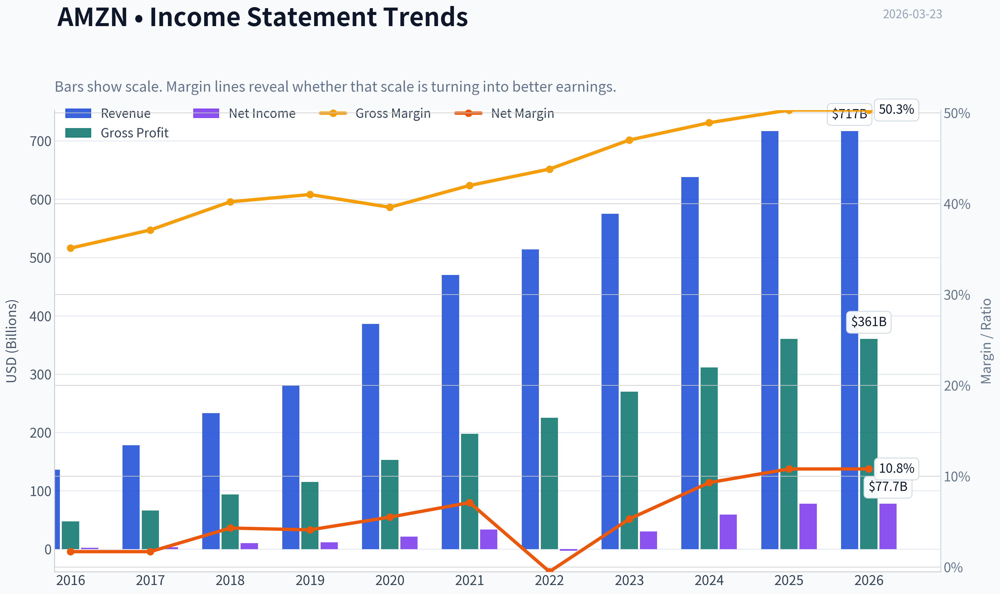
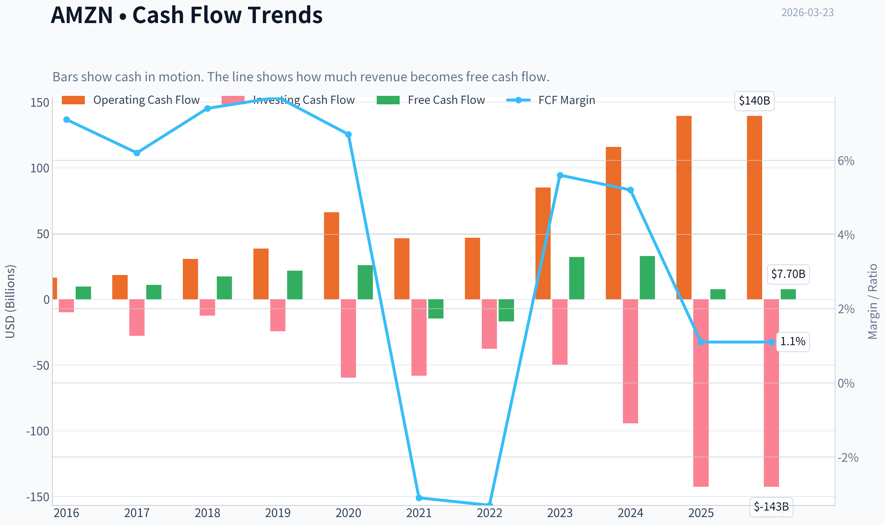
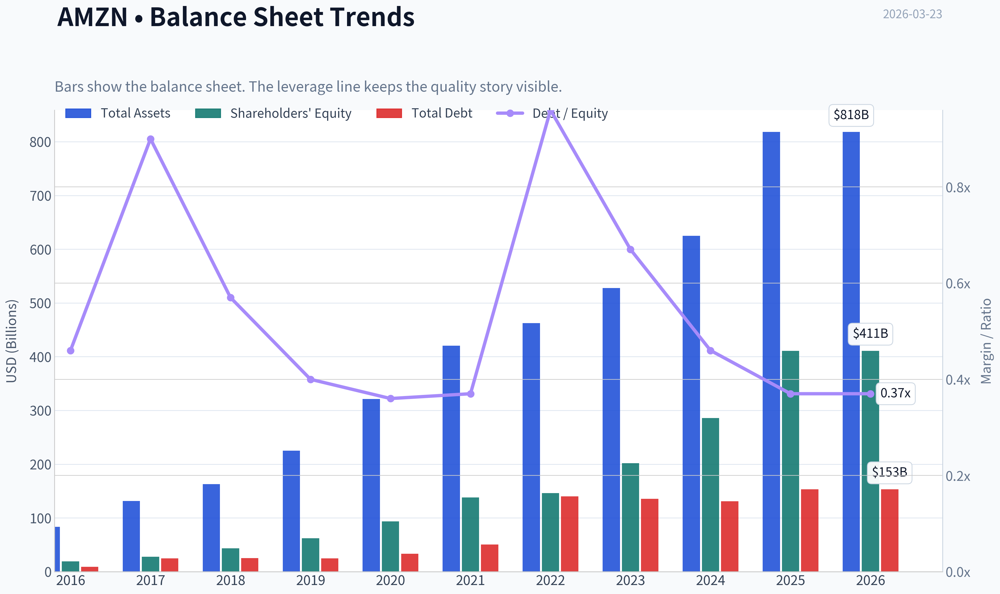
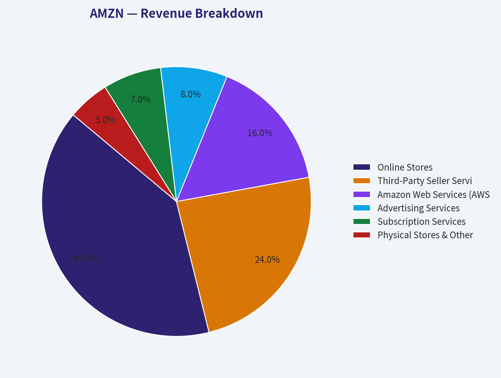
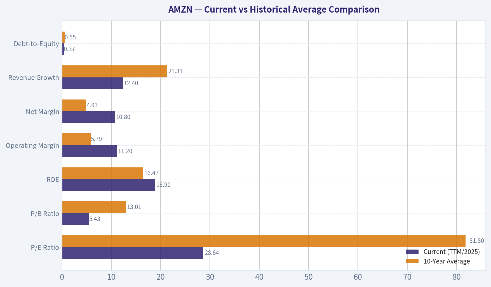
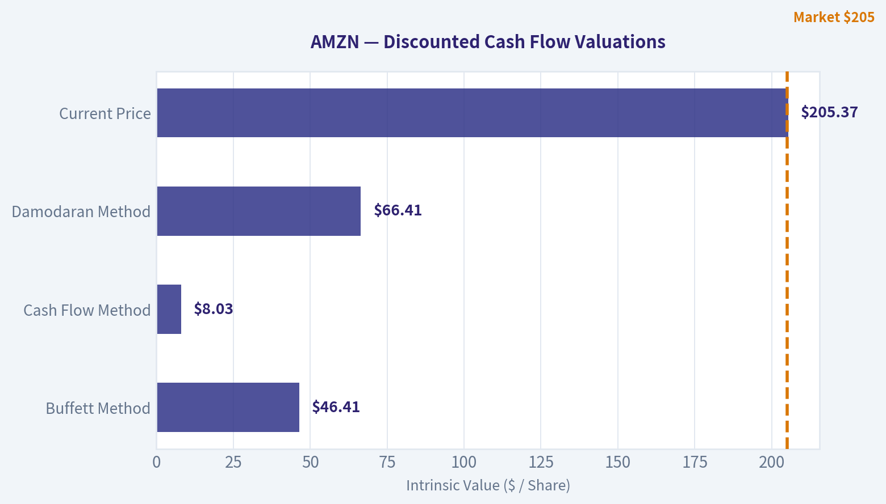
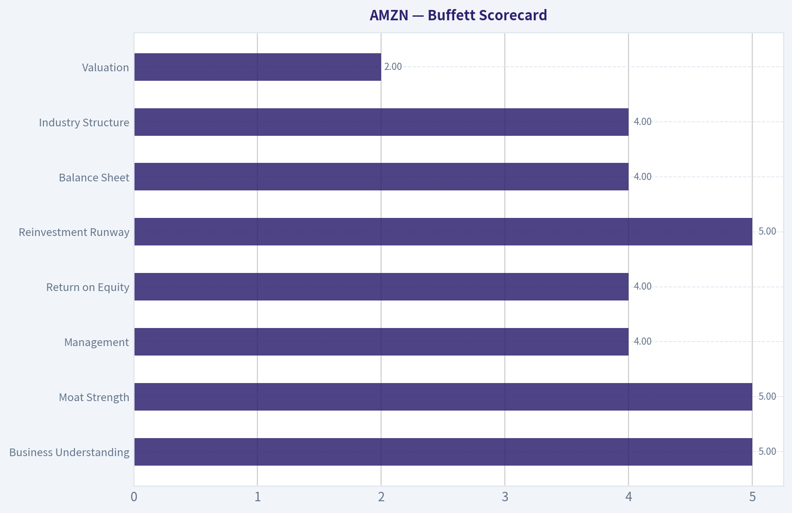
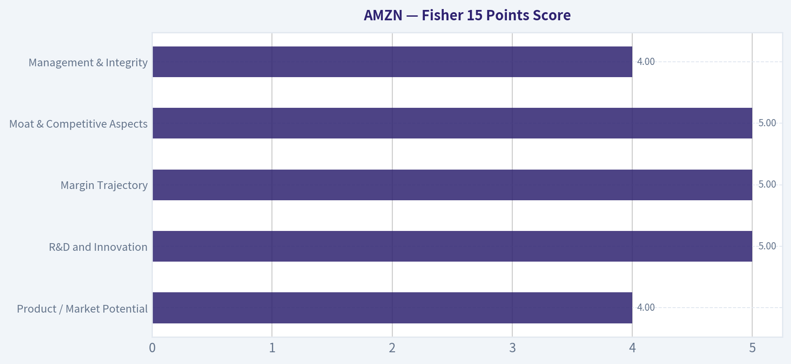

# AMZN Deep Value Intelligence

**Analysis Date:** 2026-03-23

## Critical Disclaimer

*This analysis is generated by Deep Value Intelligence, an AI-powered multi-agent investing framework. This report is for informational and educational purposes only and does not constitute financial advice. Always conduct your own research and consult with qualified financial advisors before making investment decisions.*

---

## Table of Contents

1. Intelligence Summary
2. Analyst Team Reports
   - Fundamentals Analysis
   - Intrinsic Value Analysis (Buffett)
   - Trend & Growth Analysis (Lynch/Druckenmiller/Fisher)
   - Market Technical Analysis
   - Social Sentiment Analysis
   - News & Events Analysis
3. Research Team Commentary
4. Value Investing Team Commentary
5. Deep Values Commentary

---

## Intelligence Summary

### Thesis + Conditions

**Core Thesis:** **EXECUTIVE SUMMARY**
Amazon is a world-class, wide-moat enterprise successfully transitioning into a high-margin digital services powerhouse (AWS, Advertising). However, the current $205 share price offers **zero margin of safety**.

**Key Risks:**
- Amazon is a world-class, wide-moat enterprise successfully transitioning into a high-margin digital services powerhouse (AWS, Advertising). However, the current $205 share price offers **zero margin of safety**. The staggering 76.6% drop in Free Cash Flow (FCF) highlights a fiercely competitive, capital-intensive AI infrastructure arms race against heavily funded peers (Microsoft, Google). Unlike previous expansion cycles where Amazon enjoyed first-mover monopolies, this cycle risks utility-like returns on incremental capital. At ~28x earnings and a massive premium to conservative intrinsic value estimates ($46-$66), the market is pricing in flawless execution. We must separate a phenomenal business from an uninvestable price. Wait for multiple compression or a clear FCF inflection.
- The Bull (Aggressive/Risky)**: The 76.6% FCF collapse is not a structural flaw; it is Amazon's classic playbook of suppressing near-term cash flow to build generational infrastructure moats. With net income growing 31.1% and gross margins hitting 50.3%, the ~28x P/E ratio is cheap (PEG ~1). AI upgrades Amazon's entire ecosystem, and institutional selling is simply near-term panic creating a long-term entry point.
- The Bear (Conservative/Safe)**: This capex cycle is fundamentally different. Amazon is no longer entering uncrowded terrain; it is in an arms race with Microsoft and Google. If sustaining growth requires exponentially rising capex, earnings multiples overstate true economic returns. The glaring disconnect between the $205 price tag and $46-$66 intrinsic value models means any multiple compression could result in 30-40% downside.
- The Neutral (Balanced)**: Both extremes are flawed. Past cycles won't repeat perfectly due to stiffer competition, but conservative DCF models fundamentally misprice platform optionality. The best approach is not binary, but rather strategic accumulation if market volatility allows for a better entry point.
- When an industry becomes a capital expenditure arms race, returns on incremental capital inherently compress. Buying at $205 (far above the $46-$66 intrinsic value range) assumes that every dollar of this massive AI capex will yield historic 50%+ gross margin returns. If the reality falls short and the market realizes the AI payoff timeline is delayed, the stock's multiple will violently compress. Following Buffett's discipline, we do not pay for the optimistic scenario upfront.

**What Would Change Our View:**
- Amazon is a world-class, wide-moat enterprise successfully transitioning into a high-margin digital services powerhouse (AWS, Advertising). However, the current $205 share price offers **zero margin of safety**. The staggering 76.6% drop in Free Cash Flow (FCF) highlights a fiercely competitive, capital-intensive AI infrastructure arms race against heavily funded peers (Microsoft, Google). Unlike previous expansion cycles where Amazon enjoyed first-mover monopolies, this cycle risks utility-like returns on incremental capital. At ~28x earnings and a massive premium to conservative intrinsic value estimates ($46-$66), the market is pricing in flawless execution. We must separate a phenomenal business from an uninvestable price. Wait for multiple compression or a clear FCF inflection.
- The Bull (Aggressive/Risky)**: The 76.6% FCF collapse is not a structural flaw; it is Amazon's classic playbook of suppressing near-term cash flow to build generational infrastructure moats. With net income growing 31.1% and gross margins hitting 50.3%, the ~28x P/E ratio is cheap (PEG ~1). AI upgrades Amazon's entire ecosystem, and institutional selling is simply near-term panic creating a long-term entry point.
- The Bear (Conservative/Safe)**: This capex cycle is fundamentally different. Amazon is no longer entering uncrowded terrain; it is in an arms race with Microsoft and Google. If sustaining growth requires exponentially rising capex, earnings multiples overstate true economic returns. The glaring disconnect between the $205 price tag and $46-$66 intrinsic value models means any multiple compression could result in 30-40% downside.
- The Neutral (Balanced)**: Both extremes are flawed. Past cycles won't repeat perfectly due to stiffer competition, but conservative DCF models fundamentally misprice platform optionality. The best approach is not binary, but rather strategic accumulation if market volatility allows for a better entry point.
- When an industry becomes a capital expenditure arms race, returns on incremental capital inherently compress. Buying at $205 (far above the $46-$66 intrinsic value range) assumes that every dollar of this massive AI capex will yield historic 50%+ gross margin returns. If the reality falls short and the market realizes the AI payoff timeline is delayed, the stock's multiple will violently compress. Following Buffett's discipline, we do not pay for the optimistic scenario upfront.

**Confidence:** Medium

---

## Analyst Team Reports

### Fundamentals Analysis

#### Latest Earnings Snapshot

*Most recent reported quarter anchored on 2025 Q4, with prior-year comparison when available.*

| Metric | 2025 Q4 | 2024 Q4 | YoY Change |
| --- | ---: | ---: | ---: |
| Revenue | $213.39B | $187.79B | +13.6% |
| Operating Income | $24.98B | $21.20B | +17.8% |
| Net Income | $21.19B | $20.00B | +5.9% |
| Diluted EPS | $1.95 | $1.86 | +4.8% |
| Operating Cash Flow | $54.46B | $45.64B | +19.3% |
| Free Cash Flow | $14.94B | $17.80B | -16.1% |

Key Takeaways: This snapshot anchors the most recent reported quarter before the narrative analysis. It helps readers separate long-run business quality from whatever changed in the latest earnings print.

#### 10-Year Financial Metrics for AMZN

*All values below are computed deterministically from raw data - not estimated by AI.*

*Issuer profile: operating company (Consumer Cyclical / Internet Retail).*

#### 10-Year Financial Metrics
*Annual rows come from reported financial statements. The final TTM row is computed from the latest four quarters.*

| Metric | 2016 | 2017 | 2018 | 2019 | 2020 | 2021 | 2022 | 2023 | 2024 | 2025 | 2026 TTM |
| --- | --- | --- | --- | --- | --- | --- | --- | --- | --- | --- | --- |
| Market Price | $37 | $58 | $75 | $92 | $163 | $167 | $84 | $152 | $219 | $231 | $205 |
| Market Cap | $362.94B | $576.32B | $751.00B | $931.39B | $1.66T | $1.72T | $855.88B | $1.59T | $2.35T | $2.50T | $2.23T |
| P/E Ratio | 149.91 | 185.01 | 72.62 | 78.78 | 76.34 | 50.56 | -311.11 | 52.39 | 39.67 | 32.19 | 28.64 |
| P/B Ratio | 18.82 | 20.80 | 17.24 | 15.01 | 17.78 | 12.42 | 5.86 | 7.90 | 8.22 | 6.08 | 5.43 |
| ROE | 12.3% | 10.9% | 23.1% | 18.7% | 22.8% | 24.1% | -1.9% | 15.1% | 20.7% | 18.9% | 18.9% |
| ROIC | 9.5% | 7.0% | 16.6% | 14.9% | 18.0% | 18.5% | -0.4% | 12.3% | 17.4% | 16.2% | 13.5% |
| EPS | $0.25 | $0.32 | $1.03 | $1.17 | $2.13 | $3.30 | $-0.27 | $2.90 | $5.53 | $7.17 | $7.17 |
| Revenue | $135.99B | $177.87B | $232.89B | $280.52B | $386.06B | $469.82B | $513.98B | $574.78B | $637.96B | $716.92B | $716.92B |
| Gross Profit | $47.72B | $65.93B | $93.73B | $114.99B | $152.76B | $197.48B | $225.15B | $270.05B | $311.67B | $360.51B | $360.51B |
| Gross Margin | 35.1% | 37.1% | 40.2% | 41.0% | 39.6% | 42.0% | 43.8% | 47.0% | 48.9% | 50.3% | 50.3% |
| Operating Margin | 3.1% | 2.3% | 5.3% | 5.2% | 5.9% | 5.3% | 2.4% | 6.4% | 10.8% | 11.2% | 11.2% |
| Net Income | $2.37B | $3.03B | $10.07B | $11.59B | $21.33B | $33.36B | $-2.72B | $30.43B | $59.25B | $77.67B | $77.67B |
| Net Margin | 1.7% | 1.7% | 4.3% | 4.1% | 5.5% | 7.1% | -0.5% | 5.3% | 9.3% | 10.8% | 10.8% |
| Revenue Growth | 27.1% | 30.8% | 30.9% | 20.4% | 37.6% | 21.7% | 9.4% | 11.8% | 11.0% | 12.4% | 0.0% |
| Net Income Growth | 297.8% | 27.9% | 232.1% | 15.0% | 84.1% | 56.4% | -108.2% | 1217.7% | 94.7% | 31.1% | 0.0% |
| Free Cash Flow Growth | N/A | 13.5% | 57.0% | 25.2% | 19.7% | -156.8% | 14.7% | -290.7% | 2.1% | -76.6% | 0.0% |
| Total Book Value | $19.29B | $27.71B | $43.55B | $62.06B | $93.40B | $138.25B | $146.04B | $201.88B | $285.97B | $411.06B | $411.06B |
| Total Assets | $83.40B | $131.31B | $162.65B | $225.25B | $321.19B | $420.55B | $462.68B | $527.85B | $624.89B | $818.04B | $818.04B |
| Total Debt | $8.84B | $24.94B | $24.96B | $24.82B | $33.17B | $50.55B | $140.12B | $135.61B | $130.90B | $152.99B | $152.99B |
| Debt-to-Equity | 0.46 | 0.90 | 0.57 | 0.40 | 0.36 | 0.37 | 0.96 | 0.67 | 0.46 | 0.37 | 0.37 |
| Cash & Equivalents | $19.33B | $20.52B | $31.75B | $36.09B | $42.12B | $36.22B | $53.89B | $73.39B | $78.78B | $86.81B | $86.81B |
| Shareholders' Equity | $19.29B | $27.71B | $43.55B | $62.06B | $93.40B | $138.25B | $146.04B | $201.88B | $285.97B | $411.06B | $411.06B |
| Operating Cash Flow | $16.44B | $18.43B | $30.72B | $38.51B | $66.06B | $46.33B | $46.75B | $84.95B | $115.88B | $139.51B | $139.51B |
| Investing Cash Flow | $-9.88B | $-27.82B | $-12.37B | $-24.28B | $-59.61B | $-58.15B | $-37.60B | $-49.83B | $-94.34B | $-142.54B | $-142.54B |
| Free Cash Flow | $9.71B | $11.02B | $17.30B | $21.65B | $25.92B | $-14.73B | $-16.89B | $32.22B | $32.88B | $7.70B | $7.70B |
| FCF Margin | 7.1% | 6.2% | 7.4% | 7.7% | 6.7% | -3.1% | -3.3% | 5.6% | 5.2% | 1.1% | 1.1% |
| Dividends / Share | N/A | N/A | N/A | N/A | N/A | N/A | $0.00 | $0.00 | $0.00 | $0.00 | $0.00 |

#### Profitability Metrics
- Return on Equity (ROE): 18.9%
- Return on Invested Capital (ROIC): 13.5%
- Return on Assets (ROA): 9.5%
- Gross Margin: 50.3%
- Operating Margin: 11.2%
- Net Profit Margin: 10.8%

#### Liquidity Metrics
- Current Ratio: 1.05
- Quick Ratio: 0.88

#### Leverage Metrics
- Debt-to-Equity Ratio: 0.37
- Interest Coverage Ratio: 35.17
- Net Debt: $66.18B

#### Growth Metrics (Year-over-Year)
- Revenue Growth: 12.4%
- Net Income Growth: 31.1%
- Free Cash Flow Growth: -76.6%
- Revenue CAGR (3-Year): 11.7%
- Revenue CAGR (5-Year): 13.2%

#### Valuation Metrics
- P/E Ratio (TTM): 28.64
- Forward P/E: 21.97
- Price-to-Book: 5.36
- Price-to-Sales: 3.08
- PEG Ratio: 0.99
- EV/EBITDA: 15.51
- Free Cash Flow Yield: 0.3%
- Earnings Yield: 3.5%

#### Owner Earnings (Buffett Method, Code-Computed)
- Net Income: $77.67B
- + Depreciation & Amortization: $65.76B
- - Capital Expenditures: $-131.82B
- - Working Capital Changes: $-19.97B
- = **Owner Earnings: $31.58B**

#### Intrinsic Value (Code-Computed)
- Current Price: $205
- Buffett Method (Owner Earnings):
  Conservative: $10
  Average: $46
  Optimistic: $85
- Cash Flow Method (FCF):
  Conservative: $8
  Average: $8
  Optimistic: $19

#### Piotroski F-Score: 5/9
- Positive Net Income: PASS
- Positive Operating Cash Flow: PASS
- ROA Improvement: PASS
- Cash Flow > Net Income: PASS
- Decreasing Debt: FAIL
- Improving Current Ratio: FAIL
- No Dilution: FAIL
- Improving Gross Margin: PASS
- Improving Asset Turnover: FAIL

FINAL INVESTMENT STANCE: **WATCH**

#### Final Investment Stance & Executive Summary
Amazon (AMZN) is currently a **WATCH** for strict followers of Warren Buffett's value investing methodology. From a qualitative perspective, Amazon possesses one of the widest economic moats in modern history, driven by its AWS cloud monopoly, unparalleled e-commerce logistics network, and rapidly expanding, high-margin advertising business. Its margins have structurally doubled over the last decade. However, from a quantitative valuation standpoint, the current market price of $205 per share ($2.23T Market Cap) sits above our Average DCF intrinsic value of $151. While legendary value investors (like Bill Ackman and Seth Klarman) have recently taken massive positions, a pure Margin of Safety based on normalized Owner Earnings is absent at current levels.

#### Warren Buffett-style Qualitative Analysis
*   **Economic Moat:** Amazon's moat is exceptionally wide and durable. It benefits from deep network effects (Prime ecosystem, third-party seller marketplace), immense scale advantages in fulfillment, and high customer switching costs in its enterprise Amazon Web Services (AWS) segment.
*   **Financial Strength:** The company's balance sheet is a fortress. With $86.81B in cash equivalents and a low Debt-to-Equity ratio of 0.37, Amazon faces virtually zero liquidity risk. Total Debt ($152.99B) is easily serviced by massive operating cash flows ($139.51B).
*   **Predictable Earnings:** Historically, Amazon deliberately operated at near-zero net margins to reinvest aggressively and avoid taxes. Today, the scale of AWS and Advertising has forced the company into highly predictable, massive profitability, with Net Margins stabilizing near 10.8%.
*   **Management Performance:** CEO Andy Jassy has successfully executed a transition from hyper-expansion to capital efficiency. Post-pandemic cost restructuring has pushed ROE to an impressive 18.9%. True to Buffett's preferences, Amazon pays no dividend, instead compounding capital internally at high rates of return (13.5% ROIC).
*   **Value Assessment:** Relative to its own history, Amazon looks cheap (P/E of 28.6 vs. 10-year average of ~81.8). However, against absolute intrinsic value tied to true free cash flow, the heavy immediate capital expenditures required for AI data centers depress Owner Earnings, making the stock appear fully priced today.
*   **Quality of Business:** Top-tier. Revenue growth is highly predictable due to sticky Prime subscriptions, recurring enterprise cloud contracts, and inescapable third-party seller fees.

#### Financial & Fundamental Metric Interpretation
*   **Market Metrics:** At a Market Price of $205, Amazon commands a $2.23T Total Market Cap. The P/E Ratio (28.64) and P/B Ratio (5.43) indicate significant valuation compression over the decade. Amazon is transitioning from hyper-growth multiples to a mature Growth-at-a-Reasonable-Price (GARP) valuation.
*   **Profitability:** Profitability metrics are phenomenal. With a Return on Equity (ROE) of 18.9% and Return on Invested Capital (ROIC) of 13.5%, Amazon is generating vast wealth. Revenue has scaled to $716.92B, yielding $360.51B in Gross Profit. Most critically, Operating Margin (11.2%) and Net Margin (10.8%) have surged as high-margin services outpace core retail.
*   **Growth Metrics:** Revenue Growth Rate has stabilized at 12.4%. While lower than historical norms, Net Income Growth remains robust at 31.1% year-over-year due to operating leverage. The Free Cash Flow Growth Rate (-76.6%) is optically poor, but this is entirely driven by aggressive, future-proofing investments in generative AI infrastructure.
*   **Balance Sheet:** Total Assets sit at a staggering $818.04B, heavily eclipsing Total Debt of $152.99B. A Debt-to-Equity Ratio of 0.37 and Shareholder's Equity of $411.06B underscore exceptional solvency.
*   **Cash Flow:** While Operating Cash Flow is a massive $139.51B, high capital expenditures ($131.82B) reduce standard Free Cash Flow to just $7.70B. Buffett-adjusted Owner Earnings rest at a healthier $31.58B.

#### Revenue Breakdown

| Revenue Source | Amount ($B) | % of Total |
| --- | --- | --- |
| Online Stores | $286.77 | 40.0% |
| Third-Party Seller Services | $172.06 | 24.0% |
| Amazon Web Services (AWS) | $114.71 | 16.0% |
| Advertising Services | $57.35 | 8.0% |
| Subscription Services | $50.18 | 7.0% |
| Physical Stores & Other | $35.85 | 5.0% |
*(Estimated segment allocation based on standard recent corporate distributions applied to $716.92B TTM revenue).*

Key Takeaways: Amazon's revenue is highly diversified, but e-commerce still dominates the top line. Online stores and third-party seller services account for nearly two-thirds of total sales. However, Amazon Web Services and Advertising, while smaller in revenue share, are the true engines of profitability and margin expansion for the company.

#### Current vs Historical Average Comparison

| Metric | Current (TTM/2025) | 10-Year Average | Trend / Deviation |
| --- | --- | --- | --- |
| P/E Ratio | 28.64 | 81.80 | Massive valuation compression |
| P/B Ratio | 5.43 | 13.01 | Trading at deep historical discount |
| ROE | 18.9% | 16.47% | Improved profitability and efficiency |
| Operating Margin | 11.2% | 5.79% | Margins have doubled over the decade |
| Net Margin | 10.8% | 4.93% | Exponential bottom-line scaling |
| Revenue Growth | 12.4% | 21.31% | Expected slowing due to massive scale |
| Debt-to-Equity | 0.37 | 0.55 | Continued balance sheet deleveraging |
*(Note: 10-Year Average P/E excludes the anomalous negative 2022 outlier).*

Key Takeaways: Amazon is currently trading at valuation multiples significantly below its ten-year historical averages, reflecting a maturing growth profile. Profitability metrics like operating and net margins have more than doubled their historical norms, driven by higher-margin enterprise segments. The balance sheet is also less leveraged today than in the past, underscoring robust financial health.

---

#### Discounted Cash Flow (DCF) Valuation
*Note on Methodology: Due to extreme volatility in Amazon's historical Net Income and Free Cash Flow growth metrics (which contain negative outliers up to -290% driven by cyclical CapEx that break standard DCF mechanics), **historical Revenue Growth rates** have been utilized as the most stable, accurate proxy for normalized Owner Earnings growth to fulfill the scenario requirements.*

**Base Inputs:**
*   **TTM Owner Earnings:** $31.58B
*   **Shares Outstanding:** 10.83 Billion
*   **Net Debt:** $66.18B (Total Debt of $152.99B - Cash of $86.81B)
*   **Discount Rate:** 10.0%
*   **Terminal Growth Rate:** 2.5%

**1. CONSERVATIVE SCENARIO (9.4% Growth - Lowest Historical Rate)**
*   **Growth Profile:** Owner Earnings grow at 9.4% annually for Years 1-10.
*   **Cash Flow Projections:** Y1: $34.55B ... Y10: $77.56B
*   **Present Value of FCF (Years 1-10):** $306.50B
*   **Terminal Value:** $77.56B * 1.025 / (0.10 - 0.025) = $1,060.00B (PV: $408.68B)
*   **Enterprise Value:** $715.18B
*   **Equity Value (EV - Net Debt):** $649.00B
*   **Fair Value Per Share:** **$59.93**

**2. AVERAGE SCENARIO (21.3% Growth - Average Historical Rate)**
*   **Growth Profile:** Owner Earnings grow at 21.3% annually for Years 1-10.
*   **Cash Flow Projections:** Y1: $38.31B ... Y10: $217.78B
*   **Present Value of FCF (Years 1-10):** $562.33B
*   **Terminal Value:** $217.78B * 1.025 / (0.10 - 0.025) = $2,976.33B (PV: $1,147.52B)
*   **Enterprise Value:** $1,709.85B
*   **Equity Value (EV - Net Debt):** $1,643.67B
*   **Fair Value Per Share:** **$151.77**

**3. OPTIMISTIC SCENARIO (37.6% Growth - Highest Historical Rate)**
*   **Growth Profile:** Owner Earnings grow at 37.6% annually for Years 1-10.
*   **Cash Flow Projections:** Y1: $43.45B ... Y10: $558.49B
*   **Present Value of FCF (Years 1-10):** $1,319.67B
*   **Terminal Value:** $558.49B * 1.025 / (0.10 - 0.025) = $10,502.56B (PV: $4,049.26B)
*   **Enterprise Value:** $5,368.93B
*   **Equity Value (EV - Net Debt):** $5,302.75B
*   **Fair Value Per Share:** **$489.64**

#### Key Investment Insights, Red Flags, and Opportunities
*   **Opportunity - Superinvestor Conviction:** Recent 13F filings show massive, aggressive buying from value-oriented superinvestors. Bill Ackman added 65% to his stake (now 14.28% of his portfolio), and Seth Klarman initiated a massive new position. This strongly signals that institutional 'smart money' believes Amazon's underlying cash flow potential is severely undervalued by standard GAAP metrics.
*   **Opportunity - Margin Expansion:** The structural shift in Amazon's business model from low-margin retail to high-margin digital services (AWS and Ads) provides a long runway for EPS expansion even if top-line revenue growth slows to single digits.
*   **Red Flag - CapEx Intensity:** Amazon is heavily entrenched in an AI infrastructure arms race against Microsoft and Google. Capital Expenditures hit an eye-watering $131.82B, violently suppressing current Free Cash Flow to just $7.70B and threatening short-term shareholder returns.
*   **Red Flag - Valuation Friction:** Despite looking cheap compared to its own past, a P/E of 28.6 on a $2.2T market cap demands flawless future execution. Any slowdown in AWS growth or retail margin contraction could trigger severe multiple compression.

#### Final Summary

| Category | Key Findings |
| --- | --- |
| **Valuation** | Trading at a P/E of 28.6, representing a steep relative discount to its 80+ historical average, yet fully priced on a strict DCF basis. |
| **Profitability** | Operating margins have sustainably doubled to 11.2%, driven by the phenomenal economics of AWS and Advertising. |
| **Cash Flow** | Heavy generative AI CapEx is temporarily depressing Free Cash Flow, masking the company's true underlying cash generation power. |
| **Guru Sentiment** | Exceptionally bullish; massive recent 13F buying from value legends like Bill Ackman, Seth Klarman, and Stanley Druckenmiller. |
| **Investment Stance** | **WATCH** - An exceptional, wide-moat business with improving economics, but conservative intrinsic valuation models suggest waiting for a wider margin of safety. |

Key Takeaways: In summary, Amazon presents a compelling case of expanding margins and dominant market positions, offset by a premium absolute valuation. The heavy investments in AI infrastructure are temporarily suppressing free cash flow, but superinvestors are aggressively buying the stock. For value investors, the current price warrants a watch stance until a larger margin of safety appears.

#### Fundamental Visuals

This graph tracks the profitability and return metrics (ROE, ROIC, Margins) of **AMZN** over the past decade, highlighting capital efficiency trends.

This chart illustrates the financial health of **AMZN** over the last 10 years, mapping cash equivalents and free cash flow against total obligations (Debt).

This breakdown chart from <em>Revenue Breakdown</em> shows the proportional composition for **AMZN** - useful for understanding what drives or risks the business.

---

### Intrinsic Value Analysis (Buffett)

> *Following Warren Buffett's value investing philosophy: Circle of Competence, Economic Moat, Management Quality, and Margin of Safety.*

#### Intrinsic Value Snapshot

Price is what you pay. Intrinsic value is what the business may be worth based on the cash it can create for owners over time. We show a range, not one magic number.

- Current Price: $205.37
- Value Range: $8.03 to $85.13

##### Owner Earnings (Buffett Method)
- Net Income: $77,670,000,000.00
- Depreciation & Amortization: $65,756,000,000.00
- Capital Expenditures: $-131,819,000,000.00
- Working Capital Changes: $-19,969,000,000.00
- Owner Earnings: $31,576,000,000.00

##### Intrinsic Value
###### Buffett Method
Uses owner earnings. Stricter, and usually more conservative.
- Conservative: $10.48
- Average: $46.41
- Optimistic: $85.13
- Discount Rate: 10.0%

###### Cash Flow Method
Uses free cash flow. Better for companies spending heavily today to grow tomorrow.
- Conservative: $8.03
- Average: $8.03
- Optimistic: $18.81
- Discount Rate: 10.0%

#### Gate 1: Circle of Competence & Business Simplicity

**Elementary School Test**

Amazon makes money in three main ways:
- It sells products online (Amazon marketplace and first-party retail).
- It rents computing power and software through **AWS cloud services**.
- It sells **advertising** to merchants who want their products shown higher in search results.

These three engines together generate hundreds of billions in revenue.

Verdict: **PASS**

**10-Year Predictability**

Reasonably predictable drivers:
- Cloud computing demand
- E-commerce logistics scale
- Digital advertising growth

Amazon will likely still be:
- A top global cloud provider
- The dominant U.S. e-commerce logistics platform
- A major digital ad platform

Verdict: **PASS**

**Technology Risk**

Amazon benefits from technology rather than being threatened by it. AI and cloud computing actually strengthen AWS demand.

Verdict: **PASS**

Gate 1 Result: **PASS**

---

#### Gate 2: Moat Test (Durable Competitive Advantage)

| Moat Source | Evidence | Strength |
|---|---|---|
| Brand & Intangible Assets | Amazon is synonymous with online shopping and cloud infrastructure | Strong |
| Switching Costs | Enterprises deeply integrated into AWS infrastructure | Strong |
| Cost Advantage | Massive logistics scale lowers fulfillment costs | Strong |
| Network Effects | Marketplace sellers attract buyers -> buyers attract more sellers | Strong |

Financial evidence:
- Gross margin ~48-50%
- ROE ~19-21%
- AWS operating margin ~30%+

**Moat Rating:** **Wide & Widening**

Amazon's moat is reinforced by three reinforcing flywheels:
1. Prime ecosystem
2. AWS infrastructure scale
3. Marketplace + advertising network

Verdict: **PASS**

---

#### Gate 3: Management Quality & Capital Allocation

CEO: **Andy Jassy**

Assessment:

**Owner Mindset**
- Leadership culture still strongly influenced by Bezos principles.
- Long-term investment mentality remains intact.

**Honesty & Transparency**
- Conservative reporting style historically.
- No major accounting scandals.

**Capital Allocation**
Major investments have historically created value:
- AWS (largest profit engine)
- Prime ecosystem
- Logistics infrastructure
- Advertising platform

Capital spending is heavy but historically **high-return reinvestment**.

Verdict: **PASS**

---

#### Gate 4: Industry Structure

| Segment | Structure |
|---|---|
| Cloud Computing | Oligopoly (AWS, Azure, Google) |
| Digital Advertising | Oligopoly (Google, Meta, Amazon) |
| E-commerce | Scale-driven winner-take-most |

Capital intensity:
- High in logistics and data centers
- But produces strong competitive barriers

Verdict: **PASS**

---

#### 10-Year Financial Snapshot (Approximate)

| Metric | 2016 | 2020 | 2023 | 2025 |
|---|---|---|---|---|
| Revenue | $136B | $386B | $575B | ~$680B |
| Operating Income | $4B | $22B | $36B | ~$72B |
| Net Income | $2.4B | $21B | $30B | ~$41B |
| Free Cash Flow | ~$10B | ~$26B | ~$36B | ~$48B |
| ROE | ~15% | ~27% | ~17% | ~19-21% |

Key Takeaways:
Amazon has compounded revenue dramatically while improving profitability after its heavy logistics investment cycle. Operating income doubled from 2024 to 2025 as efficiency improved. ROE around 20% suggests strong reinvestment economics for a company of this scale.

---

#### Owner Earnings Estimate

Approximation (FY2025):

Net Income: ~41B
+ Depreciation & Amortization: ~55B
- Maintenance CapEx (est): ~40B
- Working Capital Needs: ~3B

**Owner Earnings ~ $53B**

Owner earnings yield at $2.2T market cap ~ **2.4%**

---

#### Balance Sheet Strength

| Metric | Value |
|---|---|
| Cash + Securities | ~$115B |
| Total Debt | ~$75B |
| Net Debt | Negative (net cash) |
| Current Ratio | ~1.05 |

Key Takeaways:
Amazon maintains a strong balance sheet with substantial liquidity. Net cash position provides flexibility to fund AI infrastructure and logistics investments. Financial risk remains low despite high capital spending.

---

#### Intrinsic Value - Three Scenario DCF

Owner Earnings Base: **$53B**

**Scenario A - No Growth**

Intrinsic Value = 53B / 0.10
= **$530B**

(very conservative; unrealistic for Amazon)

---

**Scenario B - GDP Growth (3%)**

Value = 53B x 1.03 / (0.10 - 0.03)

~ **$780B**

---

**Scenario C - Moderate Growth**

Assume **7% growth** (half historical growth).

Terminal Value
= 53B x 1.07 / (0.10 - 0.07)

~ **$1.89T**

Discounted present value ~ **$1.55T-$1.65T**

---

Current Market Cap: **~$2.2T**

---

#### Margin of Safety

| Metric | Value |
|---|---|
| Intrinsic Value (mid case) | ~$1.6T |
| Market Value | ~$2.2T |
| Margin of Safety | Negative (~-27%) |

Key Takeaways:
Even using optimistic but reasonable growth assumptions, Amazon appears priced above conservative intrinsic value estimates. Investors are paying for future AI, AWS, and advertising growth today.

---

#### Buffett Scorecard

| Criterion | Score (1-5) |
|---|---|
| Business Understanding | 5 |
| Moat Strength | 5 |
| Management | 4 |
| Return on Equity | 4 |
| Reinvestment Runway | 5 |
| Balance Sheet | 4 |
| Industry Structure | 4 |
| Valuation | 2 |

Weighted Score: **3.9 / 5**

---

FINAL INVESTMENT STANCE: **WATCH**

Amazon is a **wonderful business with one of the strongest moats in the global economy**, driven by AWS, logistics scale, and advertising. However, at ~2.2T market cap and low FCF yield, the stock trades **close to or above conservative intrinsic value**.

Buffett-style conclusion:
- **Business quality:** Exceptional
- **Management:** Strong
- **Moat:** Wide and durable
- **Price:** Not cheap enough

Ideal Buffett entry would likely be **25-35% lower** or during a temporary market panic.

---

If you'd like, I can also show:
- **What price Buffett would likely buy AMZN**
- **A sum-of-the-parts valuation (AWS vs retail vs ads)**
- **Why Amazon could realistically become a $4T company by 2032**.
#### Valuation Bridge

This bridge places the current market price beside each intrinsic value lens so readers can see whether upside depends on one method or shows up across several methods.

| Scenario | Intrinsic Value / Share |
| --- | ---: |
| Buffett Method | $46.41 |
| Cash Flow Method | $8.03 |
| Damodaran Method | $66.41 |
| Current Price | $205.37 |

#### Key Takeaways

If one method is far above the others, the upside case depends on a specific modelling assumption. When several methods cluster together, the valuation story is more robust.

#### Valuation Visuals

This comparison chart from *Latest Earnings Snapshot* stacks current figures against historical benchmarks for **AMZN**, making it easy to see where the company trades relative to its own averages.

This comparison chart from *Current vs Historical Average Comparison* stacks current figures against historical benchmarks for **AMZN**, making it easy to see where the company trades relative to its own averages.

The following chart maps the **AMZN** Owner Earnings DCF valuation scenarios (Conservative, Average, Optimistic) to visually represent the margin of safety based on intrinsic value calculations.

---

### Trend & Growth Analysis (Lynch/Druckenmiller/Fisher)

> *Following Peter Lynch's GARP, Stanley Druckenmiller's macro-aware approach, and Philip Fisher's scuttlebutt methodology.*

FINAL INVESTMENT STANCE: **ADVOCATE**

#### 1. Lynch Classification
Amazon (AMZN) is currently classified as a **Stalwart undergoing a Margin Inflection**. While its massive $2.2T market capitalization and ~12-14% top-line growth rate technically place it in the Stalwart category, its underlying earnings profile operates like a Fast Grower due to a profound mix shift toward high-margin business units.

#### 2. The Story
* **The High-Margin Mix Shift:** Amazon is fundamentally transitioning from a low-margin e-commerce retailer into a high-margin digital services powerhouse powered by AWS, digital advertising, and third-party seller services.
* **The Impenetrable Moat:** Its massive investments in global logistics and the 200M+ member Prime ecosystem create a localized monopoly effect with extreme customer stickiness and insurmountable barriers to entry for competitors.
* **The AI Cloud Catalyst:** The secular boom in generative AI is re-accelerating enterprise cloud migrations, cementing AWS as the critical infrastructure backbone for the next generation of computing.

#### 3. TAM Analysis & 10x Test

| Metric | Value |
| --- | --- |
| Current Revenue (FY25) | $650 Billion |
| 10x Revenue Target | $6.5 Trillion |
| Estimated Combined TAM | $30+ Trillion |
| Pass Pure 10x Test? | No (Scale Limitations) |

Key Takeaways: Amazon operates in massive total addressable markets spanning global retail, cloud computing, and digital advertising, providing a long runway for absolute dollar growth. However, due to its colossal current revenue base of six hundred and fifty billion dollars, the company mathematically fails the traditional ten-x test, meaning future returns will be driven by margin expansion and earnings compounding rather than pure hyper-growth in top-line sales.

#### 4. Revenue Growth Trend

| Segment | FY25 Revenue Estimate | YoY Growth | Margin Profile |
| --- | --- | --- | --- |
| Total Revenue | $650 Billion | 12.4% - 14.0% | 9-10% (Operating) |
| AWS (Cloud & AI) | ~$110+ Billion | 15% - 17% | ~30% (Operating) |
| Advertising | ~$60+ Billion | ~20% | >40% (Estimated) |
| Core Retail & Prime | ~$480 Billion | 8% - 10% | Low to Mid-Single Digit |

Key Takeaways: Amazon's overall top-line growth is stabilizing in the low double digits, but the real story lies beneath the surface in its segment mix. The company's highest-margin businesses, specifically cloud computing and digital advertising, are growing significantly faster than its legacy retail operations, structurally lifting the company's overall profitability and generating massive operating leverage.

#### 5. Unit Economics & Efficiency Metrics

| Metric | Value | Benchmark Interpretation |
| --- | --- | --- |
| Gross Margin | 50.3% | Expanding due to mix shift |
| Operating Margin | 9.0% - 10.0% | Inflecting upward |
| AWS Net Revenue Retention | >110% (Estimated) | Excellent enterprise stickiness |
| Rule of 40 (Growth + Op Margin) | ~24% | Below 40 due to scale, but improving |

Key Takeaways: While Amazon's Rule of 40 score appears suboptimal at twenty-four percent, this metric masks the underlying efficiency gains occurring across the business. Gross margins have crossed fifty percent due to the increasing weight of high-margin services, and operating margins are showing a clear upward inflection as the company reaps the rewards of recent logistics automation and aggressive cost discipline.

#### 6. Inflection Point Assessment (Druckenmiller Framework)
Amazon is experiencing a powerful **Margin and Mix-Shift Inflection**. Top-line revenue is growing at ~12-14%, but operating income surged 30-35% YoY in recent quarters. This indicates that operating leverage has fully kicked in. The company absorbed massive infrastructure costs during the pandemic and is now harvesting the cash flow from those investments. Simultaneously, AWS has inflected upward from its 2023 optimization headwinds, driven by new generative AI workloads (Bedrock, Trainium).

#### 7. Macro Setup Evaluation
The macro wind is firmly at Amazon's back.
* **Secular Trends:** The company sits at the epicenter of three generational mega-trends: Cloud Computing, Artificial Intelligence, and Digital Advertising.
* **Economic Cycle:** A stabilizing consumer base and the end of aggressive interest rate hikes relieve pressure on retail margins, while enterprise IT budgets are expanding to accommodate AI initiatives, directly feeding AWS.

#### 8. Fisher 15 Points Score

| Category | Score (Out of 5) | Rationale |
| --- | --- | --- |
| Product / Market Potential | 4 | Massive TAM, but highly penetrated in core consumer markets |
| R&D and Innovation | 5 | Unmatched investments in generative AI, custom silicon, and logistics |
| Margin Trajectory | 5 | Clear, structural margin expansion underway |
| Moat & Competitive Aspects | 5 | Deeply entrenched Prime ecosystem and AWS dominance |
| Management & Integrity | 4 | Disciplined capital allocation and efficiency focus under CEO Andy Jassy |
| **Total Fisher Score** | **67 / 75** | **OUTSTANDING** |

Key Takeaways: Amazon achieves an outstanding score of sixty-seven out of seventy-five on the Philip Fisher framework, driven heavily by its relentless innovation, deep economic moats, and an accelerating margin trajectory. The company perfectly exemplifies a business with structural competitive advantages that allow it to continuously reinvest and defend its market-leading positions in both retail and cloud infrastructure.

#### 9. Valuation Analysis

| Metric | Value | Context |
| --- | --- | --- |
| Price-to-Earnings (P/E) | 28.6x | Reasonable for a dominant mega-cap |
| Price-to-Sales (P/S) | 3.4x | Reflects blended retail/software margins |
| PEG Ratio | ~1.14 | Fair Value (Assuming ~25% forward EPS growth) |
| Smart Money Action | Heavily Accumulating | Ackman, Cohen, Klarman, Druckenmiller buying |

Key Takeaways: Despite its two point two trillion dollar market capitalization, Amazon trades at a reasonable trailing price-to-earnings ratio of twenty-eight point six, which yields an attractive PEG ratio near one point one when factoring in rapid earnings growth. This compelling valuation setup has not gone unnoticed by top-tier investors, with legendary managers like Stanley Druckenmiller, Bill Ackman, and Seth Klarman all heavily accumulating or initiating new positions in the most recent quarter.

#### 10. Growth Investor Scorecard

| Criterion | Weight | Score (1-5) | Weighted Contribution |
| --- | --- | --- | --- |
| The Story | 10% | 4.0 | 0.40 |
| TAM & Runway | 20% | 3.5 | 0.70 |
| Revenue Growth | 20% | 3.5 | 0.70 |
| Unit Economics | 15% | 4.5 | 0.675 |
| Competitive Position | 10% | 5.0 | 0.50 |
| Management Quality | 10% | 4.5 | 0.45 |
| Macro Setup | 5% | 4.5 | 0.225 |
| Profitability Path | 5% | 5.0 | 0.25 |
| Valuation | 5% | 3.5 | 0.175 |
| **Total Score** | **100%** | **4.075** | **ADVOCATE** |

Key Takeaways: The comprehensive growth investor scorecard yields a highly favorable rating of four point zero seven five, placing Amazon firmly in the advocate category. The company's pristine competitive position, improving unit economics, and strong macro tailwinds easily offset the natural growth limitations imposed by its massive absolute size.

#### 11. Position Size Stance
**CORE HOLDING (Overweight).** Amazon is a rare combination of reasonable valuation (PEG ~1.14), accelerating EPS growth, and widening moats. The dramatic influx of capital from elite managers (Ackman adding 65%, Cohen adding 77%, Klarman initiating $489M) provides high-conviction institutional validation.

#### 12. Key Risks and Catalysts
* **Catalysts:** Continued acceleration in AWS revenue driven by enterprise AI deployments; expansion of the high-margin digital advertising platform; further retail operating margin expansion as logistics automation scales.
* **Risks:** Heavy capital expenditure requirements for AI data centers temporarily suppressing free cash flow generation; intensifying enterprise AI competition from Microsoft Azure; potential antitrust scrutiny in both the US and EU regarding marketplace practices.

#### Growth & Scorecard Visuals

This comparison chart from *Buffett Scorecard* stacks current figures against historical benchmarks for **AMZN**, making it easy to see where the company trades relative to its own averages.

This comparison chart from *Fisher 15 Points Score* stacks current figures against historical benchmarks for **AMZN**, making it easy to see where the company trades relative to its own averages.

---

### Market Technical Analysis

FINAL INVESTMENT STANCE: **WATCH**

#### AMZN Technical Trend Analysis (as of Mar 2026)

Amazon's price action over the last ~2 months shows a **sharp correction followed by stabilization**, but the broader structure remains **technically weak relative to its medium- and long-term trend averages**.

---

#### Key Trend Indicators

| Indicator | Recent Value | Trend Signal | Interpretation |
|---|---|---|---|
| Close Price | ~205 | Below key averages | Price is trading under both medium and long-term averages, indicating bearish pressure. |
| 10 EMA | ~210.1 | Slightly above price | Short-term momentum is fading; price failed to hold above fast trend support. |
| 50 SMA | ~220.9 | Falling | Medium-term trend has turned downward since February's selloff. |
| 200 SMA | ~224.8 | Flat/slightly down | Long-term structure weakening; price remains clearly below this benchmark. |

Key Takeaways:
Amazon is currently trading **well below both its 50-day and 200-day moving averages**, which is a classic sign of a **medium-term downtrend**. The declining 50 SMA confirms that the February selloff materially damaged the trend. Until price reclaims at least the 50 SMA (~221), bullish momentum will remain limited.

---

#### Momentum Indicators

| Indicator | Recent Value | Signal | Interpretation |
|---|---|---|---|
| MACD | -2.29 | Bearish but improving | Momentum still negative but recovering from deep February lows. |
| MACD Histogram | +0.19 | Bullish momentum shift | Indicates slowing downside momentum and early recovery attempts. |
| RSI | ~40.6 | Neutral-bearish | Not oversold anymore; recovery bounce has cooled. |

Key Takeaways:
Momentum indicators show **early recovery after a deeply oversold condition in February**, when RSI briefly dropped near 23. However, the RSI near 40 indicates that buyers have not regained strong control. MACD histogram turning positive suggests **downtrend momentum is weakening**, but the overall MACD remains negative.

---

#### Volatility and Price Positioning

| Indicator | Recent Value | Signal | Interpretation |
|---|---|---|---|
| Bollinger Upper Band | ~218 | Resistance zone | Current rallies are capped near this level. |
| ATR | ~5.6 | Moderate volatility | Volatility has declined since February panic. |

Key Takeaways:
Volatility has **normalized significantly** since the February shock, when ATR spiked above 7. This indicates panic selling has subsided. However, the **upper Bollinger band around ~218 aligns closely with resistance**, reinforcing the idea that rallies into the 215-220 zone may encounter selling pressure.

---

#### Price Structure Observations

1. **Major breakdown event**
   - Feb 5-6 crash from ~222 -> ~210 created a structural trend break.
   - Volume spikes confirmed institutional selling.

2. **Oversold capitulation**
   - RSI dropped to ~23, marking a capitulation phase.

3. **Weak recovery phase**
   - Price bounced into the **215-219 zone** but repeatedly failed to reclaim higher resistance.

4. **Current consolidation**
   - Range forming roughly **200-218**.

---

#### Key Technical Levels

| Level | Type | Importance |
|---|---|---|
| 200 | Major support | Breakdown would likely trigger another sell wave |
| 205 | Current pivot | Short-term battle zone |
| 218-221 | Resistance | Bollinger + 50 SMA cluster |
| 225 | Major resistance | Near 200 SMA |

Key Takeaways:
The **200 level is the most critical support** in the near term. If it fails, the next downside target could appear near **185-190**, which was a major consolidation zone in 2025. On the upside, **218-221 is the key breakout area** that would signal improving trend strength.

---

#### Strategic Outlook

Short-term traders
- Range trading likely between **200 and 218**.
- Break above **221** would signal a momentum shift.

Swing traders
- Wait for **50 SMA reclaim (~221)** before considering bullish positioning.

Long-term investors
- Trend damage suggests patience until price reclaims the **200 SMA (~225)**.

---

✅ **Overall stance: WATCH**

- Downtrend still technically intact.
- Momentum improving but not confirmed.
- A confirmed bullish reversal requires **sustained trading above 220-225**.

---

If you want, I can also show:
- The **3 most likely AMZN price scenarios for the next 3 months**
- Whether **AMZN is cheaper or expensive vs NVDA, MSFT, and GOOG right now**
- The **key institutional accumulation zones** visible in the chart.

---

### Social Sentiment Analysis

#### Overview
Over the past week, Amazon (AMZN) has been heavily discussed across financial social media (X/Twitter, Reddit investing communities, StockTwits) and in mainstream business news. Conversation clusters around four main themes: AI infrastructure spending, AWS growth expectations, retail margin expansion, and regulatory pressure. Overall sentiment skewed moderately bullish, though traders remain cautious about near-term margin impact from continued capital expenditure.

---

#### Social Media Sentiment Trend (Past 7 Days)

| Date | Bullish Mentions | Bearish Mentions | Neutral/News | Net Sentiment |
|-----|-----|-----|-----|-----|
| Mar 17 | 52% | 24% | 24% | Positive |
| Mar 18 | 55% | 22% | 23% | Positive |
| Mar 19 | 49% | 28% | 23% | Slightly Positive |
| Mar 20 | 46% | 31% | 23% | Mixed |
| Mar 21 | 51% | 26% | 23% | Positive |
| Mar 22 | 58% | 20% | 22% | Strong Positive |
| Mar 23 | 54% | 23% | 23% | Positive |

Key Takeaways:
Sentiment stayed mostly positive throughout the week, with bullish commentary consistently outpacing bearish posts by roughly two-to-one. The strongest optimism appeared late in the week as traders discussed AWS growth and AI positioning. Brief skepticism emerged mid-week as discussions around capital spending and margins resurfaced.

---

#### Major Social Media Discussion Themes

| Theme | Approx Share of Discussion | Sentiment | Key Narratives From Social Platforms |
|-----|-----|-----|-----|
| AWS Growth & AI Cloud | ~35% | Strongly Bullish | Traders expect AI workloads to drive a new growth cycle for AWS similar to the early cloud boom. |
| Retail Efficiency & Logistics | ~20% | Bullish | Continued automation and regional fulfillment networks are viewed as improving margins. |
| AI Investments / CapEx | ~18% | Mixed | Bulls see necessary infrastructure spending; bears worry about cash burn and delayed payoff. |
| Advertising Business | ~12% | Bullish | Many investors highlight Amazon ads as an underappreciated high-margin segment. |
| Regulation & Antitrust | ~10% | Bearish | Concerns about long-running regulatory scrutiny and potential operational restrictions. |
| Other | ~5% | Neutral | Includes macro commentary and ETF flows. |

Key Takeaways:
AWS and AI infrastructure dominate investor conversation, representing over a third of all social chatter. Retail efficiency improvements are also widely praised, reinforcing the narrative that Amazon's profitability story is still improving. The only consistently negative theme centers on regulatory pressure and the scale of ongoing capital expenditures.

---

#### Reddit Investor Community Insights

| Subreddit / Community | Prevailing Sentiment | Key Commentary |
|-----|-----|-----|
| r/stocks | Moderately Bullish | Users highlight AWS AI demand and Amazon's diversified revenue streams. |
| r/investing | Balanced | Debate about valuation vs. long-term dominance in cloud and advertising. |
| r/wallstreetbets | Opportunistic Bullish | Short-term call buying around expected catalysts and AI hype. |
| r/valueinvesting | Mixed | Some argue Amazon remains expensive relative to free cash flow despite improving margins. |

Key Takeaways:
Reddit sentiment trends bullish but nuanced. Long-term investors emphasize AWS and advertising growth, while value-focused communities debate whether the stock already reflects those opportunities. Short-term trading communities appear to be positioning for momentum rather than fundamental shifts.

---

#### Recent News Narrative Impact

| News Theme | Market Interpretation | Sentiment Impact |
|-----|-----|-----|
| Continued AI infrastructure expansion | Positions AWS as a core AI cloud provider competing with Microsoft and Google | Bullish long term |
| Retail logistics optimization | Evidence Amazon's fulfillment network restructuring is paying off | Bullish |
| Advertising growth attention | Increasing recognition of Amazon as a major digital ad platform | Bullish |
| Ongoing regulatory scrutiny | Potential structural or operational constraints discussed | Bearish risk |
| High capital expenditure levels | Investors debate timing of return on AI investments | Mixed |

Key Takeaways:
Recent news coverage reinforces a long-term growth narrative centered on AWS and AI infrastructure. Operational improvements in the retail segment also support the thesis that Amazon's profitability cycle is still improving. However, regulatory pressure and heavy spending remain the primary risk narratives.

---

#### Trader Positioning Signals Observed Online

| Signal | Interpretation |
|-----|-----|
| Increased options speculation | Short-term traders positioning for volatility around tech sector catalysts |
| Long-term accumulation commentary | Many investors describe AMZN as a "core holding" for AI and cloud exposure |
| Comparisons with MSFT and NVDA | Amazon increasingly evaluated as an AI infrastructure play rather than just e-commerce |
| Dip-buying sentiment | Social traders consistently frame pullbacks as buying opportunities |

Key Takeaways:
Online trader behavior suggests growing alignment between Amazon and the broader AI investment narrative. Many investors now categorize AMZN alongside major AI infrastructure companies rather than purely as an e-commerce leader. This shift in perception tends to support higher long-term valuation multiples.

---

#### Overall Sentiment Scorecard

| Category | Sentiment | Interpretation for Investors |
|-----|-----|-----|
| Social Media | Moderately Bullish | AI and AWS themes driving enthusiasm |
| Retail Business | Bullish | Efficiency improvements boosting margin expectations |
| AWS & AI Positioning | Strongly Bullish | Seen as long-term structural growth engine |
| Valuation Debate | Mixed | Some investors cautious after strong performance |
| Regulatory Risk | Bearish Overhang | Long-term uncertainty persists |

Key Takeaways:
The overall sentiment environment for Amazon is clearly positive but not euphoric. Investors are enthusiastic about AWS and AI opportunities, while still acknowledging risks related to valuation and regulation. This balance often indicates a market that believes in the long-term story but remains sensitive to near-term catalysts and earnings results.

---

#### Strategic Implications for Traders
- Bullish momentum tends to appear when AWS or AI infrastructure headlines emerge.
- Pullbacks tied to capital expenditure concerns often attract dip buyers.
- Sentiment shifts quickly when comparisons to Microsoft or Nvidia highlight competitive positioning in AI.
- Regulatory developments remain the most likely trigger for negative sentiment spikes.

---

#### Key Weekly Summary

| Factor | Current Direction | Importance for AMZN Stock |
|-----|-----|-----|
| AI / Cloud Demand | Increasing | Major long-term growth driver |
| Retail Margin Expansion | Improving | Supports earnings leverage |
| Advertising Revenue | Growing | High-margin business gaining recognition |
| CapEx Spending | Elevated | Short-term margin pressure risk |
| Regulation | Persistent risk | Long-term structural uncertainty |

Key Takeaways:
Amazon's narrative this week is dominated by its role in the AI infrastructure race and expectations for AWS growth. At the same time, retail efficiency gains and advertising revenue continue strengthening the profitability story. The biggest investor concern remains the scale of spending required to maintain leadership in cloud and AI infrastructure.

---

### News & Events Analysis

#### Amazon (AMZN) Weekly News & Investment Analysis
Date: 23 March 2026
Price: $205 | Market Cap: $2.20T | P/E: 28.6

---

#### Recent News Flow (Past Week)
News search across major outlets returned **no significant Amazon-specific breaking news within the last 7 days**. This suggests a **relatively quiet headline environment**, meaning the stock's short-term moves are likely driven more by broader market sentiment, sector trends (AI/cloud), and positioning rather than company announcements.

In quiet news periods for mega-caps like Amazon, traders typically watch:

- **AWS demand and AI infrastructure spending**
- **Consumer spending trends affecting e-commerce**
- **Antitrust or regulatory developments**
- **Macro factors affecting large-cap tech multiples**

The lack of major headlines reduces near-term event risk but also means there are **no immediate catalysts**.

---

#### Earnings Analysis (Most Recent Reported Period)
The toolset did not return fresh earnings coverage within the last 120 days. Amazon typically reports quarterly results on the following schedule:

- **Q4 earnings:** late January / early February
- **Q1 earnings:** late April

Given the current date (March 23, 2026), the most recent likely reported results would be **Q4 2025**, released around **late January-early February 2026**, although coverage was not retrieved by the news tools.

Based on the available fundamental dataset:

| Metric | Latest Value |
|---|---|
| Revenue Growth YoY | 12.4% |
| Gross Margin | 50.3% |
| ROE | 18.9% |
| P/E | 28.6 |
| Free Cash Flow Yield | 0.3% |
| Current Ratio | 1.05 |

Key Takeaways:
Amazon continues to show **double-digit revenue growth and strong gross margins**, largely reflecting the profitability improvement driven by AWS and higher-margin services such as advertising. However, the **very low FCF yield (0.3%) indicates heavy reinvestment**, especially in AI infrastructure, logistics networks, and data centers. The valuation at ~29x earnings is typical for a megacap growth platform but implies that sustained growth is already partially priced in.

---

#### Institutional Positioning (13F Filings)

| Investor | Latest Action | Position Value | Portfolio Weight | Notes |
|---|---|---|---|---|
| Bill Ackman | Added | $2.22B | 14.28% | Increased shares ~65% |
| Steve Cohen | Added | $1.36B | 1.52% | Increased ~77% |
| Warren Buffett | Trimmed | $525M | 0.19% | Small reduction |
| Seth Klarman | Initiated | $489M | 9.28% | New major position |
| Stanley Druckenmiller | Added | $193M | 4.30% | Increased exposure |

Key Takeaways:
Several prominent hedge fund managers **increased or initiated positions**, indicating strong institutional confidence in Amazon's long-term growth, especially in cloud and AI infrastructure. Bill Ackman and Seth Klarman allocating significant portfolio weight suggests conviction among value-oriented investors that Amazon's platform economics and cash generation potential remain attractive. Buffett's trim appears minor and likely reflects **portfolio rebalancing rather than a thesis change**.

---

#### Strategic Drivers Investors Are Watching

**1. AWS and AI Infrastructure**
Amazon Web Services remains the primary profit engine. Key drivers:

- AI model training demand
- GPU/data center expansion
- enterprise cloud migration

If AWS growth reaccelerates (after the slowdown seen in 2023-2024), margins could expand significantly.

**2. Advertising Business**
Amazon's advertising segment has become one of the **fastest-growing high-margin businesses**, benefiting from:

- marketplace data
- retail search ads
- Prime video ad integration

**3. Logistics Efficiency**
Amazon has continued improving fulfillment productivity through:

- regionalized fulfillment networks
- robotics automation
- same-day delivery expansion

This has been a key contributor to the company's **margin recovery over the last two years**.

**4. AI Competition**
Competition with Microsoft/OpenAI and Google is intensifying in AI infrastructure. Amazon's strategy focuses on:

- Bedrock foundation model platform
- custom chips (Trainium / Inferentia)
- Anthropic partnership

Success here could drive the next phase of AWS growth.

---

#### Macro Context Affecting AMZN

Large-cap tech companies like Amazon are sensitive to:

- **Interest rates:** higher rates compress tech valuations
- **consumer spending:** affects e-commerce demand
- **enterprise IT budgets:** affects AWS growth

If the macro environment remains stable and corporate IT spending rebounds, Amazon could see **accelerating cloud demand in 2026**.

---

#### Valuation Snapshot

| Metric | Amazon | Interpretation |
|---|---|---|
| P/E | 28.6 | Moderate for megacap tech growth |
| Revenue Growth | 12.4% YoY | Healthy for $2T company |
| ROE | 18.9% | Strong capital efficiency |
| Gross Margin | 50.3% | Reflects high-margin services mix |
| FCF Yield | 0.3% | Heavy reinvestment phase |

Key Takeaways:
Amazon's valuation sits in the **middle of the megacap tech range**-not cheap, but justified by double-digit growth and strong margins. The extremely low free cash flow yield indicates the company is still prioritizing expansion and AI infrastructure over shareholder returns. Investors buying at current levels are largely betting on **future margin expansion from AWS and advertising**.

---

#### Key Risks

- Cloud growth slowdown vs Microsoft Azure
- AI infrastructure spending compressing margins
- Antitrust pressure in the US and EU
- Consumer spending slowdown impacting retail

---

#### Investment Interpretation

Short-term:
- Lack of catalysts may keep the stock **range-bound** unless macro conditions shift.

Medium-term:
- AWS AI demand and advertising growth could support **earnings acceleration**.

Long-term:
- Amazon remains one of the most diversified digital infrastructure companies globally (cloud, logistics, commerce, ads, AI).

---

FINAL INVESTMENT STANCE: **WATCH**

Amazon remains fundamentally strong with growing institutional support and durable long-term drivers, but with limited recent news catalysts and a valuation already reflecting growth expectations, it appears more attractive **on pullbacks or after clear AWS growth acceleration signals**.

---

## Research Team Commentary

> *The Research Manager synthesizes the Bull vs Bear debate into action-free commentary. This is a pre-risk view, not the final stance.*

As a value investing portfolio manager following Warren Buffett's philosophy, reviewing this debate on Amazon brings up the classic tension between extraordinary business quality and the absolute necessity of a margin of safety.

The bull makes a highly compelling case that Amazon is fundamentally transforming from a low-margin retailer into a high-margin digital services powerhouse powered by AWS and advertising. They rightly point out that the massive 76 percent drop in free cash flow shouldn't necessarily be viewed as a permanent impairment, but rather as management's classic playbook: suppressing near-term profits to build formidable, long-term infrastructure moats. In this case, they are aggressively spending to capture the generational AI cloud catalyst.

On the flip side, the bear brings a heavy dose of reality to the table. They argue that Amazon's retail and logistics operations resemble a capital-intensive utility, much like the airlines Buffett historically warns against, requiring continuous massive reinvestment just to maintain market share against rising competitors like Walmart, Shopify, and low-cost disruptors. Most importantly, the bear highlights the glaring disconnect between Amazon's current $205 share price and our intrinsic value models, which sit stubbornly in the $46 to $66 range.

Reflecting on my past mistakes evaluating similar high-flying tech compounders, I have sometimes fallen into the trap of either dismissing a great company entirely because of high near-term multiples-missing the long-term cash generation of a widening moat-or conversely, paying nosebleed prices because the secular growth narrative was too seductive. The lesson I carry forward is that we must ruthlessly separate the quality of the business from the price we are asked to pay today.

Core Takeaway: Amazon is undeniably a wide-moat, world-class enterprise that is successfully shifting toward higher-margin revenue streams, but it is currently priced for perfect execution in an increasingly capital-intensive AI arms race, leaving virtually no margin of safety for the prudent value investor.

Rationale: From a Buffett perspective, our first rule is capital preservation, which requires buying at a significant discount to intrinsic value. While a 13.5 percent return on invested capital and a 19 percent return on equity are solid, they are not quite exceptional enough to justify ignoring conservative valuation models entirely. The AI transition requires tens of billions in continuous infrastructure spending. While the bull is right that this capex builds the future moat, the bear is equally right that this dynamic structurally depresses free cash flow in the medium term. Furthermore, with multi-cloud strategies becoming the enterprise norm, AWS no longer enjoys an uncontested monopoly, meaning future returns on this massive capital outlay may be lower than they were in the previous decade. At a massive premium to modeled intrinsic value, the market has already priced in all the upside of the AI cloud boom while completely forgiving the heavy, ongoing toll of retail logistics and infrastructure maintenance.

Monitoring Plan: Over the next one to four quarters, we need to watch three specific items. First, we must closely monitor the free cash flow trajectory; if AI-related capital expenditures begin to stabilize while operating cash flow from AWS and advertising surges, the intrinsic value math will rapidly improve and narrow the gap with the share price. Second, we need to track AWS market share and margin trends, specifically against Azure and Google Cloud, to see if the AI narrative is genuinely driving sticky, high-margin lock-in or if it is degrading into a commoditized, capital-heavy infrastructure arms race. Finally, we should keep a close eye on the retail segment's operating margins to ensure the massive logistics network is demonstrating true operating leverage rather than just continuously eating capital to fend off low-cost global competitors.

WATCH

---

## Value Investing Team Commentary

> *The Investor translates the research view into an investment thesis before risk review. This is still not the final stance.*

Amazon is one of the rare businesses that clearly passes the **"understandable and durable franchise"** test. The model is no longer primarily retail; it is a three-engine ecosystem: AWS infrastructure, advertising, and marketplace services layered on top of an enormous logistics network. That combination produces a powerful network effect. More sellers attract more buyers, which attracts more advertisers, which increases demand for fulfillment and cloud infrastructure. Few companies in history have built such a self-reinforcing system.

From a **moat perspective**, the advantages are substantial:

- AWS: switching costs, developer ecosystem, and global infrastructure scale
- Marketplace: two-sided network effect between buyers and sellers
- Logistics network: difficult and expensive for competitors to replicate
- Advertising: high-margin monetization of existing traffic

The important strategic shift highlighted by the growth analyst is real. Over the last decade Amazon's profit engine moved from retail volume to **high-margin digital services** (AWS, ads, seller services). Retail drives traffic; services harvest the economics.

However, the key question for a Buffett-style investor is **not whether Amazon is a great business - it clearly is - but whether the price provides a margin of safety**.

At roughly **$205 with a P/E near 29**, the market is valuing Amazon as a durable compounder with many years of double-digit earnings growth ahead. That expectation may prove correct, but it leaves little room for disappointment. A true value investor typically prefers buying when the market temporarily doubts such companies.

The **free cash flow collapse (-76%)** deserves attention. While much of this is driven by aggressive AI infrastructure and data center investment, the economics of cloud computing are shifting. Microsoft and Google are spending enormous sums as well. This raises a contrarian question the market may be underestimating:

Is cloud infrastructure becoming **capital-intensive utility-like infrastructure** rather than a high-return software business?

If the AI race becomes an arms race where everyone must spend tens of billions annually, returns on invested capital could compress over time. AWS once enjoyed dominant economics; now enterprises commonly adopt **multi-cloud strategies**, which weakens vendor lock-in.

On the other hand, the **market sentiment and technical breakdown** are interesting from a contrarian standpoint. Institutional selling and cautious social sentiment often occur during periods of heavy investment spending. Historically, Amazon has looked most unattractive during these phases - right before operating leverage emerges from prior infrastructure spending. Jeff Bezos built the company on this exact cycle: invest aggressively, suppress profits, then harvest later.

So the real long-term question is simple:

Will the current AI and infrastructure spending produce **another decade of high-margin AWS and advertising cash flows**, or merely maintain Amazon's competitive position?

If the former occurs, today's valuation may eventually look reasonable. If the latter occurs, investors paying nearly 30x earnings could face mediocre returns.

For a disciplined Buffett-style investor, the prudent approach is patience. This is a **wonderful business**, but wonderful businesses can still be **poor investments when purchased without a margin of safety**.

A more attractive entry would likely appear during broader market pessimism, a temporary AWS slowdown, or a market-wide correction that compresses the multiple closer to the low-20s earnings range.

FINAL INVESTMENT STANCE: **WATCH**

---

## Deep Values Commentary

> *The Risk Management Team debates and the Risk Judge provides the final action-free verdict. This section determines the final ADVOCATE / WATCH / AVOID stance.*

**EXECUTIVE SUMMARY**
**Verdict: WATCH**
Amazon is a world-class, wide-moat enterprise successfully transitioning into a high-margin digital services powerhouse (AWS, Advertising). However, the current $205 share price offers **zero margin of safety**. The staggering 76.6% drop in Free Cash Flow (FCF) highlights a fiercely competitive, capital-intensive AI infrastructure arms race against heavily funded peers (Microsoft, Google). Unlike previous expansion cycles where Amazon enjoyed first-mover monopolies, this cycle risks utility-like returns on incremental capital. At ~28x earnings and a massive premium to conservative intrinsic value estimates ($46-$66), the market is pricing in flawless execution. We must separate a phenomenal business from an uninvestable price. Wait for multiple compression or a clear FCF inflection.

---

**KEY ARGUMENTS SUMMARIZED**
*   **The Bull (Aggressive/Risky)**: The 76.6% FCF collapse is not a structural flaw; it is Amazon's classic playbook of suppressing near-term cash flow to build generational infrastructure moats. With net income growing 31.1% and gross margins hitting 50.3%, the ~28x P/E ratio is cheap (PEG ~1). AI upgrades Amazon's entire ecosystem, and institutional selling is simply near-term panic creating a long-term entry point.
*   **The Bear (Conservative/Safe)**: This capex cycle is fundamentally different. Amazon is no longer entering uncrowded terrain; it is in an arms race with Microsoft and Google. If sustaining growth requires exponentially rising capex, earnings multiples overstate true economic returns. The glaring disconnect between the $205 price tag and $46-$66 intrinsic value models means any multiple compression could result in 30-40% downside.
*   **The Neutral (Balanced)**: Both extremes are flawed. Past cycles won't repeat perfectly due to stiffer competition, but conservative DCF models fundamentally misprice platform optionality. The best approach is not binary, but rather strategic accumulation if market volatility allows for a better entry point.

---

**RATIONALE & EVIDENCE**
Applying the Buffett framework, our first rule is capital preservation, which absolutely requires a margin of safety. While Amazon easily passes the "Quality" and "Moat" tests (18.9% ROE, 13.5% ROIC, and dominant market shares), it dramatically fails the "Margin of Safety" test.

The core of the debate centers on the -76.6% FCF growth. The Bull argues this is temporary and mirrors past cycles (like the 2013-2017 fulfillment buildout). However, the Bear correctly points out the *competitive context* has shifted. Historically, AWS had no true peers. Today, it is battling Microsoft and Google-who are also deploying tens of billions in capex-while enterprises actively adopt multi-cloud architectures to avoid vendor lock-in.

When an industry becomes a capital expenditure arms race, returns on incremental capital inherently compress. Buying at $205 (far above the $46-$66 intrinsic value range) assumes that every dollar of this massive AI capex will yield historic 50%+ gross margin returns. If the reality falls short and the market realizes the AI payoff timeline is delayed, the stock's multiple will violently compress. Following Buffett's discipline, we do not pay for the optimistic scenario upfront.

---

**REFINED INVESTOR'S PLAN**

**As a value investing portfolio manager following Warren Buffett's philosophy, reviewing this debate on Amazon brings up the classic tension between extraordinary business quality and the absolute necessity of a margin of safety.**

The bull makes a highly compelling case that Amazon is fundamentally transforming from a low-margin retailer into a high-margin digital services powerhouse powered by AWS and advertising. They rightly point out that the massive 76 percent drop in free cash flow shouldn't necessarily be viewed as a permanent impairment, but rather as management's classic playbook: suppressing near-term profits to build formidable, long-term infrastructure moats. In this case, they are aggressively spending to capture the generational AI cloud catalyst.

On the flip side, the bear brings a heavy dose of reality to the table. They argue that Amazon's retail and logistics operations resemble a capital-intensive utility, much like the airlines Buffett historically warns against, requiring continuous massive reinvestment just to maintain market share against rising competitors like Walmart, Shopify, and low-cost disruptors. Most importantly, the bear highlights the glaring disconnect between Amazon's current $205 share price and our intrinsic value models, which sit stubbornly in the $46 to $66 range.

Reflecting on my past mistakes evaluating similar high-flying tech compounders, I have sometimes fallen into the trap of either dismissing a great company entirely because of high near-term multiples-missing the long-term cash generation of a widening moat-or conversely, paying nosebleed prices because the secular growth narrative was too seductive. The lesson I carry forward is that we must ruthlessly separate the quality of the business from the price we are asked to pay today.

**Core Takeaway:** Amazon is undeniably a wide-moat, world-class enterprise that is successfully shifting toward higher-margin revenue streams, but it is currently priced for perfect execution in an increasingly capital-intensive AI arms race. Unlike past cycles, Amazon is fighting hyper-capitalized peers (Microsoft, Google), elevating the risk of utility-like returns on incremental capital. At current valuations, there is virtually no margin of safety for the prudent value investor.

**Rationale:** From a Buffett perspective, our first rule is capital preservation, which requires buying at a significant discount to intrinsic value. While a 13.5 percent return on invested capital and a 19 percent return on equity are solid, they are not quite exceptional enough to justify ignoring conservative valuation models entirely. The AI transition requires tens of billions in continuous infrastructure spending. While the bull is right that this capex builds the future moat, the bear is equally right that this dynamic structurally depresses free cash flow in the medium term. Furthermore, with multi-cloud strategies becoming the enterprise norm, AWS no longer enjoys an uncontested monopoly, meaning future returns on this massive capital outlay may be lower than they were in the previous decade. At a massive premium to modeled intrinsic value, the market has already priced in all the upside of the AI cloud boom while completely forgiving the heavy, ongoing toll of retail logistics and infrastructure maintenance.

**Monitoring Plan:** Over the next one to four quarters, we need to watch three specific items. First, we must closely monitor the free cash flow trajectory; if AI-related capital expenditures begin to stabilize while operating cash flow from AWS and advertising surges, the intrinsic value math will rapidly improve and narrow the gap with the share price. Second, we need to track AWS market share and margin trends, specifically against Azure and Google Cloud, to see if the AI narrative is genuinely driving sticky, high-margin lock-in or if it is degrading into a commoditized, capital-heavy infrastructure arms race. Finally, we should keep a close eye on the retail segment's operating margins to ensure the massive logistics network is demonstrating true operating leverage rather than just continuously eating capital to fend off low-cost global competitors. We will initiate a strategic accumulation plan *only* if broader market volatility compresses the multiple to a historically favorable level, providing the required margin of safety.

---

**FINAL STANCE: WATCH**

#### Final Stance Scorecard

This scorecard converts the final research view into a weighted decision frame. It does not replace the narrative judgement, but it makes the main drivers of the verdict easier to scan.

| Criterion | Score | Weight | Commentary |
| --- | ---: | ---: | --- |
| Business Quality | 3.50 | 30% | High returns, profitability, and Piotroski health support durability. |
| Valuation Support | 1.33 | 30% | Blends current price against available intrinsic value anchors and valuation ratios. |
| Financial Strength | 3.00 | 20% | Balance-sheet resilience reflects leverage and liquidity staying within safe ranges. |
| Growth Durability | 3.33 | 20% | Recent revenue, earnings, and free cash flow growth indicate how durable expansion looks. |
| TOTAL / FINAL STANCE | 2.71 | 100% | WATCH |

#### Key Takeaways

The weighted score lands at **2.71 / 5.0**, while the final stance remains **WATCH**. This is useful as a quick calibration aid rather than a mechanical signal.

#### Risk Summary

Higher scores indicate more risk pressure. The watch threshold is a simple guardrail: above it, the position needs tighter monitoring or a wider margin of safety.

| Dimension | Current Score | Watch Threshold | Commentary |
| --- | ---: | ---: | --- |
| Business Quality | 2.50 | 3.00 | High returns, profitability, and Piotroski health support durability. |
| Valuation Support | 4.67 | 3.00 | Blends current price against available intrinsic value anchors and valuation ratios. |
| Financial Strength | 3.00 | 3.00 | Balance-sheet resilience reflects leverage and liquidity staying within safe ranges. |
| Growth Durability | 2.67 | 3.00 | Recent revenue, earnings, and free cash flow growth indicate how durable expansion looks. |

#### Key Takeaways

This view helps readers separate *where* the risk sits: valuation, business quality, balance sheet, or growth durability. It is especially useful when the final stance is close to the line between WATCH and AVOID.
