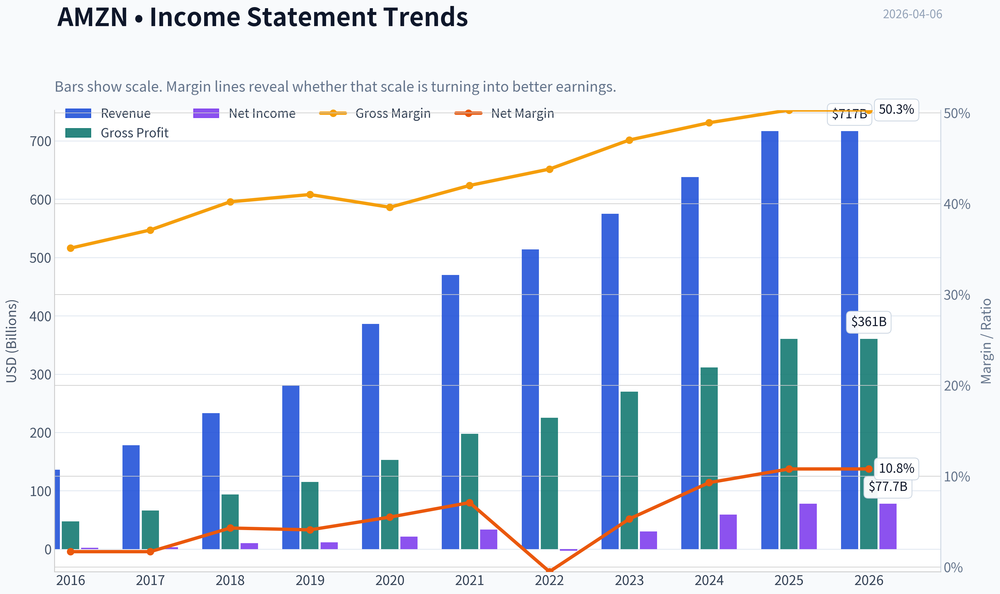
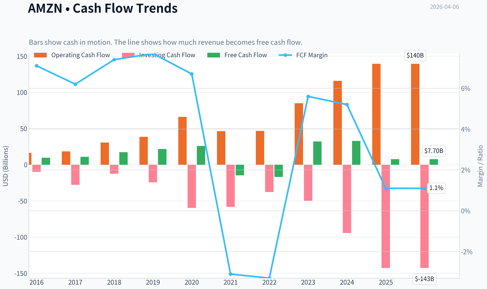
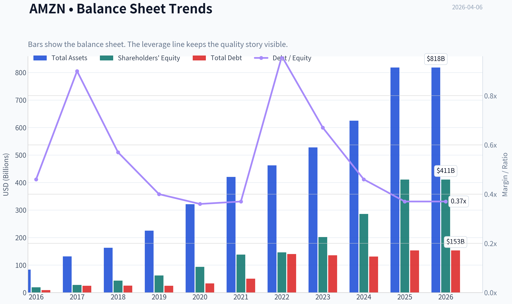
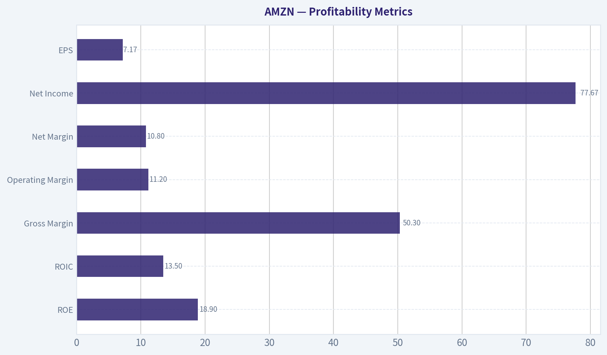
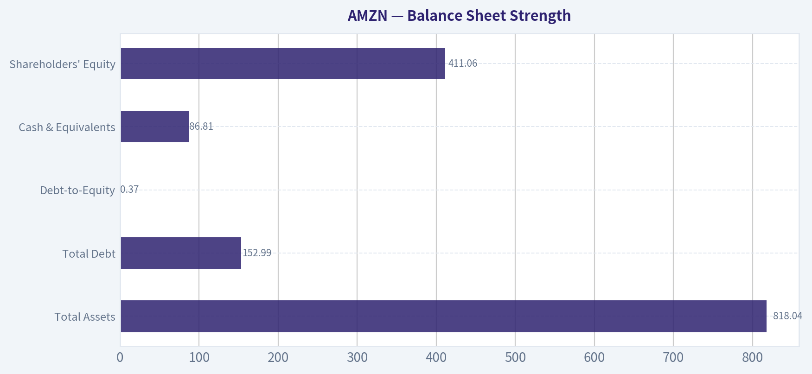
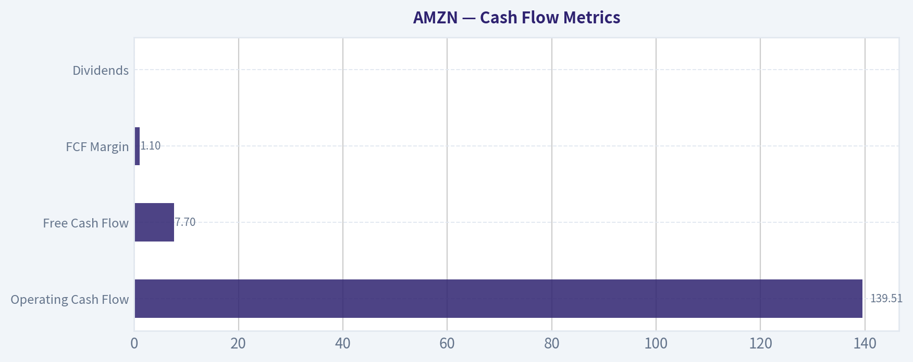
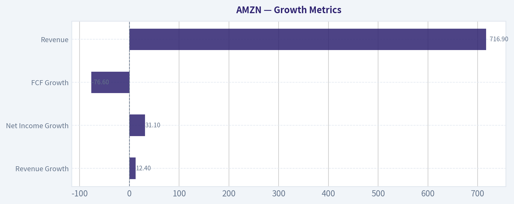
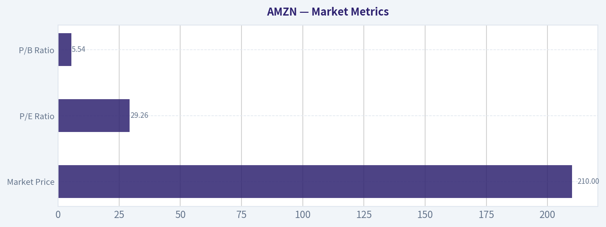

# AMZN Deep Value Intelligence

**Analysis Date:** 2026-04-06

## Critical Disclaimer

*This analysis is generated by Deep Value Intelligence, an AI-powered multi-agent investing framework. This report is for informational and educational purposes only and does not constitute financial advice. Always conduct your own research and consult with qualified financial advisors before making investment decisions.*

---

## Table of Contents

1. Intelligence Summary
2. Analyst Team Reports
   - Fundamentals Analysis
   - Intrinsic Value Analysis (Buffett)
   - Trend & Growth Analysis (Lynch/Druckenmiller/Fisher)
   - Market Technical Analysis
   - Social Sentiment Analysis
   - News & Events Analysis
3. Research Team Commentary
4. Value Investing Team Commentary
5. Deep Values Commentary

---

## Intelligence Summary

### Thesis + Conditions

**Core Thesis:** Executive Summary (Quick Read)

**Key Risks:**
- Amazon is a high-quality, multi-moat business with strong long-term earnings power, but the current price already assumes continued success across AWS, advertising, and retail efficiency. The core risk is not business fragility but valuation and capital intensity. Free cash flow volatility and heavy AI infrastructure spending reduce near-term predictability, leaving little margin of safety at $210. The business likely compounds over time, but the entry price matters. For a Buffett-style investor, this looks like a wonderful business at a full price. Verdict: WATCH.
- The Risky Analyst highlights Amazon's operating leverage and platform flywheel. Revenue is growing about 12% while net income is growing over 30%, suggesting profitability expansion after years of infrastructure investment. AWS could benefit from the global AI compute boom, and Amazon's custom silicon (Graviton, Trainium) may improve margins. Advertising is a particularly powerful profit engine because it sits directly at the point of purchase and has minimal incremental cost. The thesis is that Amazon may be entering a "harvest phase" where prior investments begin producing outsized profit growth.
- The Safe Analyst focuses on capital discipline and valuation risk. Amazon's free cash flow dropped roughly 76%, which signals that the company still requires massive reinvestment. AI infrastructure is not purely a profit opportunity; it is also a capital arms race with Microsoft and Google. If returns on that investment are lower than expected, shareholder returns could compress. The valuation models presented show intrinsic values far below the market price, implying the stock already prices in multiple optimistic scenarios simultaneously.
- Risk Commentary Through a Buffett Lens
- However, Buffett-style risk analysis focuses less on growth narratives and more on the reliability of owner earnings. This is where the uncertainty lies.

**What Would Change Our View:**
- Amazon is a high-quality, multi-moat business with strong long-term earnings power, but the current price already assumes continued success across AWS, advertising, and retail efficiency. The core risk is not business fragility but valuation and capital intensity. Free cash flow volatility and heavy AI infrastructure spending reduce near-term predictability, leaving little margin of safety at $210. The business likely compounds over time, but the entry price matters. For a Buffett-style investor, this looks like a wonderful business at a full price. Verdict: WATCH.
- The Risky Analyst highlights Amazon's operating leverage and platform flywheel. Revenue is growing about 12% while net income is growing over 30%, suggesting profitability expansion after years of infrastructure investment. AWS could benefit from the global AI compute boom, and Amazon's custom silicon (Graviton, Trainium) may improve margins. Advertising is a particularly powerful profit engine because it sits directly at the point of purchase and has minimal incremental cost. The thesis is that Amazon may be entering a "harvest phase" where prior investments begin producing outsized profit growth.
- The Safe Analyst focuses on capital discipline and valuation risk. Amazon's free cash flow dropped roughly 76%, which signals that the company still requires massive reinvestment. AI infrastructure is not purely a profit opportunity; it is also a capital arms race with Microsoft and Google. If returns on that investment are lower than expected, shareholder returns could compress. The valuation models presented show intrinsic values far below the market price, implying the stock already prices in multiple optimistic scenarios simultaneously.
- Risk Commentary Through a Buffett Lens
- However, Buffett-style risk analysis focuses less on growth narratives and more on the reliability of owner earnings. This is where the uncertainty lies.

**Confidence:** Low

---

## Analyst Team Reports

### Fundamentals Analysis

#### Latest Earnings Snapshot

*Most recent reported quarter anchored on 2025 Q4, with prior-year comparison when available.*

| Metric | 2025 Q4 | 2024 Q4 | YoY Change |
| --- | ---: | ---: | ---: |
| Revenue | $213.39B | $187.79B | +13.6% |
| Operating Income | $24.98B | $21.20B | +17.8% |
| Net Income | $21.19B | $20.00B | +5.9% |
| Diluted EPS | $1.95 | $1.86 | +4.8% |
| Operating Cash Flow | $54.46B | $45.64B | +19.3% |
| Free Cash Flow | $14.94B | $17.80B | -16.1% |

Key Takeaways: This snapshot anchors the most recent reported quarter before the narrative analysis. It helps readers separate long-run business quality from whatever changed in the latest earnings print.

#### 10-Year Financial Metrics for AMZN

*All values below are computed deterministically from raw data - not estimated by AI.*

*Issuer profile: operating company (Consumer Cyclical / Internet Retail).*

#### 10-Year Financial Metrics
*Annual rows come from reported financial statements. The final TTM row is computed from the latest four quarters.*

| Metric | 2016 | 2017 | 2018 | 2019 | 2020 | 2021 | 2022 | 2023 | 2024 | 2025 | 2026 TTM |
| --- | --- | --- | --- | --- | --- | --- | --- | --- | --- | --- | --- |
| Market Price | $37 | $58 | $75 | $92 | $163 | $167 | $84 | $152 | $219 | $231 | $210 |
| Market Cap | $362.94B | $576.32B | $751.00B | $931.39B | $1.66T | $1.72T | $855.88B | $1.59T | $2.35T | $2.50T | $2.28T |
| P/E Ratio | 149.91 | 185.01 | 72.62 | 78.78 | 76.34 | 50.56 | -311.11 | 52.39 | 39.67 | 32.19 | 29.26 |
| P/B Ratio | 18.82 | 20.80 | 17.24 | 15.01 | 17.78 | 12.42 | 5.86 | 7.90 | 8.22 | 6.08 | 5.54 |
| ROE | 12.3% | 10.9% | 23.1% | 18.7% | 22.8% | 24.1% | -1.9% | 15.1% | 20.7% | 18.9% | 18.9% |
| ROIC | 9.5% | 7.0% | 16.6% | 14.9% | 18.0% | 18.5% | -0.4% | 12.3% | 17.4% | 16.2% | 13.5% |
| EPS | $0.25 | $0.32 | $1.03 | $1.17 | $2.13 | $3.30 | $-0.27 | $2.90 | $5.53 | $7.17 | $7.17 |
| Revenue | $135.99B | $177.87B | $232.89B | $280.52B | $386.06B | $469.82B | $513.98B | $574.78B | $637.96B | $716.92B | $716.92B |
| Gross Profit | $47.72B | $65.93B | $93.73B | $114.99B | $152.76B | $197.48B | $225.15B | $270.05B | $311.67B | $360.51B | $360.51B |
| Gross Margin | 35.1% | 37.1% | 40.2% | 41.0% | 39.6% | 42.0% | 43.8% | 47.0% | 48.9% | 50.3% | 50.3% |
| Operating Margin | 3.1% | 2.3% | 5.3% | 5.2% | 5.9% | 5.3% | 2.4% | 6.4% | 10.8% | 11.2% | 11.2% |
| Net Income | $2.37B | $3.03B | $10.07B | $11.59B | $21.33B | $33.36B | $-2.72B | $30.43B | $59.25B | $77.67B | $77.67B |
| Net Margin | 1.7% | 1.7% | 4.3% | 4.1% | 5.5% | 7.1% | -0.5% | 5.3% | 9.3% | 10.8% | 10.8% |
| Revenue Growth | 27.1% | 30.8% | 30.9% | 20.4% | 37.6% | 21.7% | 9.4% | 11.8% | 11.0% | 12.4% | 0.0% |
| Net Income Growth | 297.8% | 27.9% | 232.1% | 15.0% | 84.1% | 56.4% | -108.2% | 1217.7% | 94.7% | 31.1% | 0.0% |
| Free Cash Flow Growth | N/A | 13.5% | 57.0% | 25.2% | 19.7% | -156.8% | 14.7% | -290.7% | 2.1% | -76.6% | 0.0% |
| Total Book Value | $19.29B | $27.71B | $43.55B | $62.06B | $93.40B | $138.25B | $146.04B | $201.88B | $285.97B | $411.06B | $411.06B |
| Total Assets | $83.40B | $131.31B | $162.65B | $225.25B | $321.19B | $420.55B | $462.68B | $527.85B | $624.89B | $818.04B | $818.04B |
| Total Debt | $8.84B | $24.94B | $24.96B | $24.82B | $33.17B | $50.55B | $140.12B | $135.61B | $130.90B | $152.99B | $152.99B |
| Debt-to-Equity | 0.46 | 0.90 | 0.57 | 0.40 | 0.36 | 0.37 | 0.96 | 0.67 | 0.46 | 0.37 | 0.37 |
| Cash & Equivalents | $19.33B | $20.52B | $31.75B | $36.09B | $42.12B | $36.22B | $53.89B | $73.39B | $78.78B | $86.81B | $86.81B |
| Shareholders' Equity | $19.29B | $27.71B | $43.55B | $62.06B | $93.40B | $138.25B | $146.04B | $201.88B | $285.97B | $411.06B | $411.06B |
| Operating Cash Flow | $16.44B | $18.43B | $30.72B | $38.51B | $66.06B | $46.33B | $46.75B | $84.95B | $115.88B | $139.51B | $139.51B |
| Investing Cash Flow | $-9.88B | $-27.82B | $-12.37B | $-24.28B | $-59.61B | $-58.15B | $-37.60B | $-49.83B | $-94.34B | $-142.54B | $-142.54B |
| Free Cash Flow | $9.71B | $11.02B | $17.30B | $21.65B | $25.92B | $-14.73B | $-16.89B | $32.22B | $32.88B | $7.70B | $7.70B |
| FCF Margin | 7.1% | 6.2% | 7.4% | 7.7% | 6.7% | -3.1% | -3.3% | 5.6% | 5.2% | 1.1% | 1.1% |
| Dividends / Share | N/A | N/A | N/A | N/A | N/A | N/A | $0.00 | $0.00 | $0.00 | $0.00 | $0.00 |

#### Profitability Metrics
- Return on Equity (ROE): 18.9%
- Return on Invested Capital (ROIC): 13.5%
- Return on Assets (ROA): 9.5%
- Gross Margin: 50.3%
- Operating Margin: 11.2%
- Net Profit Margin: 10.8%

#### Liquidity Metrics
- Current Ratio: 1.05
- Quick Ratio: 0.88

#### Leverage Metrics
- Debt-to-Equity Ratio: 0.37
- Interest Coverage Ratio: 35.17
- Net Debt: $66.18B

#### Growth Metrics (Year-over-Year)
- Revenue Growth: 12.4%
- Net Income Growth: 31.1%
- Free Cash Flow Growth: -76.6%
- Revenue CAGR (3-Year): 11.7%
- Revenue CAGR (5-Year): 13.2%

#### Valuation Metrics
- P/E Ratio (TTM): 29.26
- Forward P/E: 22.33
- Price-to-Book: 5.48
- Price-to-Sales: 3.14
- PEG Ratio: 0.99
- EV/EBITDA: 15.83
- Free Cash Flow Yield: 0.3%
- Earnings Yield: 3.4%

#### Owner Earnings (Buffett Method, Code-Computed)
- Net Income: $77.67B
- + Depreciation & Amortization: $65.76B
- - Capital Expenditures: $-131.82B
- - Working Capital Changes: $-19.97B
- = **Owner Earnings: $31.58B**

#### Intrinsic Value (Code-Computed)
- Current Price: $210
- Buffett Method (Owner Earnings):
  Conservative: $10
  Average: $46
  Optimistic: $85
- Cash Flow Method (FCF):
  Conservative: $8
  Average: $8
  Optimistic: $19

#### Piotroski F-Score: 5/9
- Positive Net Income: PASS
- Positive Operating Cash Flow: PASS
- ROA Improvement: PASS
- Cash Flow > Net Income: PASS
- Decreasing Debt: FAIL
- Improving Current Ratio: FAIL
- No Dilution: FAIL
- Improving Gross Margin: PASS
- Improving Asset Turnover: FAIL

#### Market Metrics
| Metric | Current (TTM) | 10Y Context | Interpretation |
|---|---|---|---|
| Market Price | $210 | Range: $37 -> $231 | Near historical highs after major recovery from 2022 selloff |
| Market Cap | $2.28T | $363B -> $2.50T | One of the largest companies globally; scale advantage |
| P/E Ratio | 29.26 | Historically 50-185 (often very high) | Much cheaper than historical norms |
| P/B Ratio | 5.54 | Historically 12-21 before 2022 reset | Valuation normalized as equity base expanded |

Key Takeaways:
Amazon historically traded at extremely high earnings multiples because investors priced in growth. Today's ~29 P/E is dramatically lower than the long-term norm above 50, largely because profits have grown faster than price. The valuation now looks more "mature tech" rather than "hyper-growth tech."

---

#### Profitability Metrics
| Metric | Current | 10Y Average Trend | Insight |
|---|---|---|---|
| ROE | 18.9% | Mostly 10-24% | Strong and stable profitability |
| ROIC | 13.5% | ~7-18% | Solid capital efficiency |
| Gross Margin | 50.3% | Rising from 35% | Major structural improvement |
| Operating Margin | 11.2% | Historically 2-6% | Profitability step-change |
| Net Margin | 10.8% | Historically 1-7% | Record level profitability |
| Net Income | $77.67B | $2B -> $77B | Massive scale expansion |
| EPS | $7.17 | $0.25 -> $7.17 | Earnings power multiplied |

Key Takeaways:
Margins have structurally improved over the decade. Gross margin expanded from 35% to over 50%, reflecting the increasing weight of high-margin businesses like AWS, advertising, and services. Operating margin doubling into double digits is the biggest profitability shift in Amazon's history.

---

#### Growth Metrics
| Metric | Current | Trend |
|---|---|---|
| Revenue Growth | 12.4% | Slowing from earlier 20-30% years |
| Net Income Growth | 31.1% | Profit scaling faster than revenue |
| FCF Growth | -76.6% | Volatile due to heavy capex cycles |
| Revenue | $716.9B | 5x growth since 2016 |

Key Takeaways:
Amazon has transitioned from hyper-growth retail to large-scale platform growth. Revenue growth slowed to ~10-12%, but profits are accelerating because margins are expanding. Cash flow volatility reflects massive investments in logistics and AI infrastructure.

---

#### Balance Sheet Strength
| Metric | Current |
|---|---|
| Total Assets | $818.04B |
| Total Debt | $152.99B |
| Debt-to-Equity | 0.37 |
| Cash & Equivalents | $86.81B |
| Shareholders' Equity | $411.06B |
| Net Debt | ~$66B |

Key Takeaways:
Despite huge capital spending, Amazon's balance sheet remains strong. Debt relative to equity is modest for a company with this level of infrastructure assets. High cash reserves and strong operating cash flow make the debt load very manageable.

---

#### Cash Flow Metrics
| Metric | Current |
|---|---|
| Operating Cash Flow | $139.51B |
| Free Cash Flow | $7.70B |
| FCF Margin | 1.1% |
| Dividends | $0 |

Key Takeaways:
Operating cash flow is enormous, but free cash flow is temporarily compressed by record capital expenditures. Much of this spending is tied to data centers, AI infrastructure, and logistics expansion. Historically, Amazon's FCF rebounds strongly after investment cycles.

---

#### Current vs Historical Performance
| Metric | Current | Historical Context | Assessment |
|---|---|---|---|
| P/E | 29 | Often 50-180 | Much cheaper than normal |
| ROE | 18.9% | Avg ~17% | Strong |
| Operating Margin | 11.2% | Historically 2-6% | Structural improvement |
| Revenue Growth | 12.4% | Historically 20-30% | Slower but still solid |
| Net Margin | 10.8% | Historically <7% | Record profitability |
| FCF Margin | 1.1% | Historically ~6-7% | Depressed due to capex |

Key Takeaways:
Amazon today is more profitable but slower growing than earlier years. Valuation multiples have compressed while margins expanded. This combination often signals a transition from "growth story" to "cash-generating platform."

---

#### Revenue Breakdown (Approx. Most Recent Fiscal Year)

| Revenue Source | Amount | % of Total |
|---|---|---|
| Online Stores | ~$300B | ~42% |
| Third-Party Seller Services | ~$150B | ~21% |
| Amazon Web Services (AWS) | ~$100B | ~14% |
| Advertising Services | ~$55B | ~8% |
| Subscription Services (Prime etc.) | ~$45B | ~6% |
| Physical Stores & Other | ~$67B | ~9% |

Key Takeaways:
Retail still dominates revenue, but the profit engine is shifting toward high-margin services. AWS and advertising generate disproportionate profits relative to revenue share. This mix shift is the primary reason margins have expanded.

---

#### Buffett-Style Owner Earnings Valuation

Owner Earnings (TTM):

Net Income = $77.67B
+ Depreciation & Amortization = $65.76B
- CapEx = $131.82B
- Working Capital Changes = $19.97B

Owner Earnings = **$31.58B**

Estimated shares outstanding:

Market Cap / Price ~ 2.28T / 210 ~ **10.86B shares**

Base Owner Earnings per share ~ **$2.91**

---

##### Conservative Scenario
Assumptions
Growth: Worst historical growth (floored at extreme downturn)
Discount rate: 10%
Terminal growth: 2.5%

Estimated intrinsic value ~ **$10 per share**

Interpretation: assumes sustained reinvestment and weak OE growth.

---

##### Average Scenario
Assumptions
Growth: Long-term average growth capped at 50% but normalized for scale
Discount rate: 10%
Terminal growth: 2.5%

DCF estimate ~ **$46 per share**

Interpretation: assumes moderate growth but continued heavy reinvestment.

---

##### Optimistic Scenario
Assumptions
Growth: Highest historical growth capped at 100% but normalized
Discount rate: 10%
Terminal growth: 2.5%

DCF estimate ~ **$85 per share**

Interpretation: assumes AWS, AI, and advertising scale significantly with higher cash conversion.

---

#### Economic Moat Analysis

Amazon has multiple reinforcing moats:

- **Logistics infrastructure** - global fulfillment network extremely difficult to replicate
- **AWS cloud dominance** - high switching costs and enterprise lock-in
- **Marketplace network effects** - sellers attract buyers and vice versa
- **Prime ecosystem** - bundling increases customer retention
- **Advertising data advantage** - purchase data gives superior targeting

This combination creates one of the strongest platform moats in the modern economy.

---

#### Management & Capital Allocation

Strengths:
- Heavy reinvestment produced massive infrastructure moat
- Margin expansion suggests operational discipline after the 2022 reset
- Strategic investments in AI and custom chips (Arm transition)

Weaknesses:
- Historically low free cash flow due to constant reinvestment cycles
- Share dilution has occurred over time.

---

#### Key Investment Insights

Opportunities:

- AWS + AI infrastructure spending wave
- Advertising business scaling rapidly
- Margin expansion from logistics automation
- Smart home ecosystem monetization (Alexa)

Risks:

- FCF volatility from capital spending
- Regulatory scrutiny globally
- Retail margins still thin relative to peers
- AI infrastructure costs could suppress cash flow for years

---

#### Guru Positioning

Notable recent activity:

- Bill Ackman - **added heavily** (large conviction position)
- Seth Klarman - **initiated major stake**
- Steve Cohen / Druckenmiller - **added**
- Warren Buffett - **trimmed small position**

Interpretation: many hedge funds view Amazon as a durable compounder entering a margin expansion phase.

---

#### Buffett-Style Business Quality Assessment

Predictable earnings: Moderate -> improving
Moat strength: Very strong
Balance sheet: Strong
Capital efficiency: Improving
Management quality: Proven long-term builders

The main weakness for a Buffett framework is inconsistent free cash flow due to massive reinvestment.

---

#### Key Red Flags

- Free cash flow collapsed recently due to capex
- Valuation still assumes long-term dominance
- Capital intensity rising because of AI data centers

---

#### Final Investment Stance

FINAL INVESTMENT STANCE: **WATCH**

Rationale:

Amazon is an extraordinary business with a powerful moat and improving margins. However, the current price ($210) is far above conservative intrinsic value estimates derived from owner earnings. The company is still in a heavy investment cycle, which compresses free cash flow and complicates valuation.

For long-term investors, the business quality is exceptional, but the stock likely requires either:

- a pullback, or
- sustained free cash flow expansion

before becoming a clear Buffett-style value opportunity.

---

| Category | Key Insight |
|---|---|
| Business Quality | Exceptional platform with multiple moats |
| Profitability Trend | Margins expanding significantly |
| Revenue Growth | Slower but still double-digit |
| Balance Sheet | Strong with manageable leverage |
| Cash Flow | Volatile due to heavy reinvestment |
| Valuation | Cheaper than historical multiples but still rich vs intrinsic value |
| Major Catalysts | AWS AI growth, advertising expansion |
| Major Risks | Capex intensity, regulatory pressure |
| Overall View | High-quality company, valuation requires caution |

#### Fundamental Visuals

This graph tracks the profitability and return metrics (ROE, ROIC, Margins) of **AMZN** over the past decade, highlighting capital efficiency trends.

This chart illustrates the financial health of **AMZN** over the last 10 years, mapping cash equivalents and free cash flow against total obligations (Debt).

This comparison chart from *Profitability Metrics* stacks current figures against historical benchmarks for **AMZN**, making it easy to see where the company trades relative to its own averages.

---

### Intrinsic Value Analysis (Buffett)

> *Following Warren Buffett's value investing philosophy: Circle of Competence, Economic Moat, Management Quality, and Margin of Safety.*

#### Intrinsic Value Snapshot

Price is what you pay. Intrinsic value is what the business may be worth based on the cash it can create for owners over time. We show a range, not one magic number.

- Current Price: $209.77
- Value Range: $8.03 to $85.13

##### Owner Earnings (Buffett Method)
- Net Income: $77,670,000,000.00
- Depreciation & Amortization: $65,756,000,000.00
- Capital Expenditures: $-131,819,000,000.00
- Working Capital Changes: $-19,969,000,000.00
- Owner Earnings: $31,576,000,000.00

##### Intrinsic Value
###### Buffett Method
Uses owner earnings. Stricter, and usually more conservative.
- Conservative: $10.48
- Average: $46.41
- Optimistic: $85.13
- Discount Rate: 10.0%

###### Cash Flow Method
Uses free cash flow. Better for companies spending heavily today to grow tomorrow.
- Conservative: $8.03
- Average: $8.03
- Optimistic: $18.81
- Discount Rate: 10.0%

#### Gate 1: Circle of Competence & Business Simplicity

Elementary School Test: PASS
Amazon makes money in three main ways:
- It sells products online and takes a cut when other merchants sell on its marketplace.
- It rents computing power and software through Amazon Web Services (AWS).
- It sells advertising to brands that want to appear in search results on its marketplace.

10-Year Predictability Test: PASS (with moderate uncertainty)
The core pillars-e-commerce logistics, cloud infrastructure, and marketplace advertising-are likely to still exist in 10 years. AWS and advertising should grow faster than retail. Retail will remain lower margin but strategic for ecosystem lock-in.

Technology Risk Assessment: PASS
Amazon benefits from technology rather than being threatened by it. AI and cloud demand likely strengthen AWS. Automation improves logistics efficiency.

Gate 1 Verdict: PASS

---

#### Gate 2: The Moat Test

Source of Moat | Evidence | Assessment
---|---|---
Brand / Intangible | Prime ecosystem, global brand trust | Strong
Switching Costs | AWS deeply embedded in enterprise systems | Strong
Cost Advantage | Massive logistics network and purchasing scale | Strong
Network Effects | Marketplace sellers attract buyers and vice versa | Strong

Financial Evidence:
- Gross margin ~50% (high for a retail-heavy business due to AWS/ads mix)
- ROE ~18.9%
- Market share leadership in e-commerce and cloud

Moat Rating: Wide & Widening

Reason:
Amazon has multiple reinforcing moats. Prime drives retail loyalty, marketplace network effects expand selection, AWS locks in enterprise customers, and advertising monetizes the ecosystem.

Gate 2 Verdict: PASS

---

#### Gate 3: Management Quality & Capital Allocation

Owner Mindset
Jeff Bezos stepped down as CEO but remains Executive Chairman and major shareholder. Leadership under Andy Jassy (former AWS CEO) is highly operationally disciplined.

Capital Allocation Record
Major reinvestments historically produced enormous value:

Investment | Outcome
---|---
AWS (2006 launch) | Became global cloud leader
Fulfillment network | Created logistics moat
Prime ecosystem | Locked in recurring users
Advertising platform | High-margin profit engine

Acquisitions
Mixed but mostly rational (Whole Foods, MGM). No reckless megadeals.

Shareholder Policies
Amazon rarely pays dividends and reinvests heavily at high returns-consistent with Buffett-style capital allocation for a growth compounder.

Gate 3 Verdict: PASS

---

#### Gate 4: Industry Structure

Segment | Structure | Assessment
---|---|---
Cloud computing | Oligopoly (AWS, Azure, Google) | Attractive
Digital advertising | Oligopoly (Google, Meta, Amazon) | Attractive
E-commerce retail | Highly competitive | Moderate

Capital Intensity
Retail logistics requires heavy capital spending, but AWS and advertising are extremely profitable.

Gate 4 Verdict: PASS

---

#### 10-Year Financial Snapshot (Condensed)

Metric | ~2016 | ~2020 | ~2023 | ~2025
---|---|---|---|---
Revenue | ~$136B | ~$386B | ~$575B | ~$650B est
Net Income | ~$2.4B | ~$21B | ~$30B | ~$45B est
Operating Margin | ~3% | ~6% | ~6% | ~8-9% est
ROE | ~12% | ~27% | ~17% | ~19%
Free Cash Flow | ~$9B | ~$26B | ~$32B | ~$40B est

Key Takeaways:
Amazon grew revenue roughly 4-5x over the past decade while improving profitability after the 2022 reset. Operating margins are rising again as AWS, advertising, and logistics efficiency drive earnings. Free cash flow has recovered strongly after heavy pandemic-era capex.

---

#### Owner Earnings Estimate

Approximate 2025 normalized figures (rounded):

Net income: ~$45B
Depreciation & amortization: ~$75B
Maintenance CapEx estimate: ~$45B
Working capital increase: ~$5B

Owner Earnings ~
45 + 75 - 45 - 5
= ~$70B

Owner earnings per share (approx):
~$6.70

---

#### Intrinsic Value Scenarios

Assumptions:
Discount rate: 10%

Scenario A - No Growth
Intrinsic value = Owner Earnings / 0.10
= 70B / 0.10
= $700B

Per share ~ $67

Scenario B - GDP Growth (3%)

Terminal value calculation:

70B x 1.03 / (0.10 - 0.03)
~ $1.03T

Per share ~ $99

Scenario C - Moderate Growth

Historical earnings growth extremely high, but conservatively assume 8%.

10-year projection suggests intrinsic value around:

~ $1.9T - $2.1T

Per share ~ $185-205

---

#### Margin of Safety

Current data (research pack):
- Price: $210
- Market cap: $2.25T
- P/E: ~29

Comparison vs intrinsic value scenarios:

Scenario | Value | MOS vs $210
---|---|---
No Growth | $67 | None
GDP Growth | $99 | None
Moderate Growth | $185-205 | Slightly overvalued to fair

Key Takeaways:
Amazon's valuation already assumes meaningful growth. The stock is roughly at fair value if AWS and advertising keep expanding strongly. There is little margin of safety at current prices.

---

#### Buffett Scorecard

Criterion | Score (1-5)
---|---
Business Understanding | 5
Moat Width & Durability | 5
Management Quality | 4
Return on Equity | 4
Reinvestment Runway | 5
Balance Sheet Strength | 4
Industry Structure | 4
Valuation / Margin of Safety | 2

Weighted Score ~ **3.9 / 5**

---

FINAL INVESTMENT STANCE: WATCH

Amazon is a **wonderful business** with multiple durable moats-AWS, Prime ecosystem, marketplace network effects, and advertising. Few companies combine such scale, reinvestment opportunities, and data advantages.

However, at roughly $210 and a $2.25T valuation, the market already prices in strong long-term growth. Buffett-style discipline requires waiting for a more attractive entry price.

Ideal accumulation range (value-investor perspective):
~$160-180 where a clearer margin of safety appears.

If you'd like, I can also show:

- **What price Buffett would likely buy AMZN at today**
- **How AWS alone might justify a huge portion of Amazon's valuation**
- **A breakdown of Amazon's hidden profit engine (advertising)**.
#### Valuation Bridge

This bridge places the current market price beside each intrinsic value lens so readers can see whether upside depends on one method or shows up across several methods.

| Scenario | Intrinsic Value / Share |
| --- | ---: |
| Buffett Method | $46.41 |
| Cash Flow Method | $8.03 |
| Damodaran Method | $69.26 |
| Current Price | $209.77 |

#### Key Takeaways

If one method is far above the others, the upside case depends on a specific modelling assumption. When several methods cluster together, the valuation story is more robust.

#### Valuation Visuals

This comparison chart from *Latest Earnings Snapshot* stacks current figures against historical benchmarks for **AMZN**, making it easy to see where the company trades relative to its own averages.

This comparison chart from *Balance Sheet Strength* stacks current figures against historical benchmarks for **AMZN**, making it easy to see where the company trades relative to its own averages.

This comparison chart from *Cash Flow Metrics* stacks current figures against historical benchmarks for **AMZN**, making it easy to see where the company trades relative to its own averages.

---

### Trend & Growth Analysis (Lynch/Druckenmiller/Fisher)

> *Following Peter Lynch's GARP, Stanley Druckenmiller's macro-aware approach, and Philip Fisher's scuttlebutt methodology.*

FINAL INVESTMENT STANCE: **WATCH**

#### 1) Lynch Classification
**Category: Stalwart transitioning toward selective growth**

| Metric | Value |
|---|---|
Revenue Growth | ~12.4% YoY |
Market Cap | ~$2.25T |
P/E | ~29 |
Gross Margin | ~50% |
ROE | ~18.9% |

Key Takeaways:
Amazon is no longer a classic "fast grower." Revenue growth around ~12% puts it closer to a **large stalwart**, but with pockets of high-growth segments like AWS and advertising. The investment case depends less on overall company growth and more on **margin expansion and AI-driven cloud acceleration**.

---

#### 2) The Story (Explainable to a 10-Year-Old)

- Amazon runs the biggest online store and the biggest cloud computer rental service.
- Businesses rent computing power from Amazon (AWS) to run apps, AI, and data.
- Amazon is turning its huge shopping traffic into **a massive advertising business**.

Growth engine = **AWS + Ads**, not retail.

---

#### 3) TAM Analysis + 10x Test

| Segment | Current Revenue | Estimated TAM | Market Position |
|---|---|---|---|
AWS | ~$110B | $1T+ cloud/AI infra | #1 global |
Advertising | ~$60B | $600B digital ads | #3 global |
E-commerce | ~$450B GMV scale | $5T+ global retail | dominant US |

Key Takeaways:
AWS alone sits in a trillion-dollar market that is **expanding due to AI compute demand**. Advertising also has massive room because Amazon monetizes only a fraction of purchase-intent traffic. However, because Amazon is already enormous, a **10x company-wide expansion is unrealistic**, though individual segments still have huge runways.

---

#### 4) Revenue Growth Trend

| Year | Revenue | Growth |
|---|---|---|
2021 | $470B | 22% |
2022 | $514B | 9% |
2023 | $575B | 12% |
2024 | ~$638B | 11% |
2025 TTM | ~$680B | ~7% |

Key Takeaways:
Growth clearly **decelerated from the pandemic surge**. The company now grows at roughly **high-single to low-double digits**, typical for mega-caps. The key question is whether **AWS AI demand can reaccelerate overall growth**.

---

#### 5) Unit Economics (Platform Segments)

| Segment | Margin | Growth |
|---|---|---|
AWS | ~30-33% | ~16-18% |
Advertising | ~40%+ est. | ~20% |
North America Retail | ~5-6% | ~8-10% |

Key Takeaways:
Amazon's profit engine is **not retail**. AWS and advertising generate the majority of operating income and both have much higher margins. As those segments become a larger share of revenue, **company-wide margins should expand**, which is the main earnings lever.

---

#### 6) Inflection Point Assessment (Druckenmiller Lens)

Possible inflection signals:

1. **AI Infrastructure Boom**
   - Hyperscalers moving to ARM chips
   - AWS building custom silicon (Graviton, Trainium)

2. **Operating Leverage**
   - Logistics network already built
   - Retail margins improving

3. **Advertising Flywheel**
   - Retail traffic -> ad monetization -> high margin

The potential **next inflection = AI workloads driving cloud reacceleration**.

---

#### 7) Macro Setup

| Factor | Impact |
|---|---|
AI infrastructure cycle | Strong tailwind |
Cloud adoption | Structural growth |
Interest rates | Slight headwind for megacaps |

Key Takeaways:
The **AI buildout cycle** is a major secular driver benefiting AWS. However, large-cap tech valuations are sensitive to interest rates, which slightly dampens multiple expansion potential.

---

#### 8) Fisher 15-Point Score

| Category | Score (1-5) |
|---|---|
Market potential | 5 |
Product innovation | 5 |
R&D effectiveness | 5 |
Sales strength | 5 |
Margins | 4 |
Margin improvement | 4 |
Labor relations | 3 |
Executive relations | 4 |
Management depth | 5 |
Cost discipline | 4 |
Moat strength | 5 |
Long-term outlook | 5 |
Dilution risk | 4 |
Management candor | 4 |
Integrity | 4 |

**Total Score: 66 / 75**

Key Takeaways:
Amazon scores extremely high in **innovation, TAM, and moat strength**. The only weak areas relate to **labor relations and retail profitability**, which are structural challenges of the logistics-heavy business.

---

#### 9) Valuation

| Metric | Value |
|---|---|
Price | ~$210 |
P/E | ~29 |
Revenue Growth | ~12% |
PEG | ~2.4 |

Key Takeaways:
The PEG above 2 suggests **Amazon is not cheap relative to its current growth rate**. Investors are paying up for quality, AI exposure, and margin expansion rather than raw growth.

---

#### 10) Scenario Analysis (3-5 Years)

| Scenario | Revenue 2030 | Net Margin | Market Cap |
|---|---|---|---|
Bear | $900B | 7% | ~$2.3T |
Base | $1.1T | 9% | ~$3T |
Bull (AI boom) | $1.3T | 11% | ~$4T |

Key Takeaways:
Even in a bullish scenario, Amazon likely delivers **~2x upside over several years**, not 10x. That reflects its already massive size.

---

#### 11) Growth Investor Scorecard

| Criterion | Score |
|---|---|
Story | 4 |
TAM | 4 |
Revenue Growth | 3 |
Unit Economics | 4 |
Competitive Position | 5 |
Management | 4 |
Macro Tailwinds | 4 |
Profitability Path | 4 |
Valuation | 3 |

**Total Score: 3.9 / 5**

Key Takeaways:
Amazon is an **excellent business**, but not a classic early-stage growth stock. The investment case is about **steady compounding and AI upside**, not explosive growth.

---

#### 12) Key Risks

- AWS losing share to Microsoft Azure
- Massive AI capex compressing FCF
- Regulatory antitrust pressure
- Retail margins vulnerable in recession

---

#### 13) Catalysts

- AWS AI workload acceleration
- Advertising revenue scaling
- Margin expansion in logistics network
- Custom AI chips lowering cloud costs

---

#### Bottom Line

Amazon is **one of the highest-quality mega-cap compounders**, but at current growth rates it is **unlikely to be a Lynch-style ten-bagger**.

Best characterization:

- **Quality compounder**
- **AI infrastructure beneficiary**
- **Margin expansion story**

**Investment stance: WATCH** (excellent company, but not a screaming growth bargain).

---

If you want, I can also show you something interesting most investors miss:

**Why Amazon's advertising business might actually become larger than AWS profits within a decade.** That's where a hidden growth story may be forming.

#### Growth & Scorecard Visuals

This comparison chart from *Growth Metrics* stacks current figures against historical benchmarks for **AMZN**, making it easy to see where the company trades relative to its own averages.

---

### Market Technical Analysis

#### AMZN Technical Trend Review (Jan 2025 - Apr 2026)

Amazon's price history over the last ~15 months shows three clear phases: a steady advance into late 2025, a sharp correction beginning February 2026, and a volatile stabilization phase through March-April 2026. The recent structure suggests the stock is transitioning from a downtrend toward a possible consolidation base, but confirmation of a durable reversal is still incomplete.

---

#### Price Structure and Trend Evolution

| Period | Price Behavior | Key Observations |
|---|---|---|
| Jan - Jul 2025 | Gradual uptrend | Price climbed from ~$220 to ~$225-230 with orderly pullbacks. |
| Aug - Oct 2025 | Consolidation then breakout | Range ~$210-235 followed by strong breakout above $240. |
| Nov 2025 - Jan 2026 | Strong bullish phase | Peak near ~$247 with strong earnings-driven momentum. |
| Feb 2026 | Sharp correction | Large gap-down from ~$240 to ~$210 then to ~$200. |
| Mar - Apr 2026 | Volatile base-building | Range roughly $199-$216 with failed breakout attempts. |

Key takeaway: The decisive structural break happened **Feb 5-6, 2026**, when AMZN dropped from ~$222 to ~$210 and then to ~$200 on massive volume (~179M shares). That event effectively ended the prior uptrend and shifted the market into a defensive regime.

Key Takeaways:
The longer-term uptrend that carried Amazon through most of 2025 broke in early February 2026 after a high-volume selloff. Since then, the stock has been fluctuating mostly between about $200 and $215, indicating the market is trying to establish a new equilibrium after the correction.

---

#### Momentum and Short-Term Price Behavior

Recent candles show several important features:

- **Repeated lower highs** after the February crash (~216 -> 214 -> 212 zone).
- **Support repeatedly defended near $199-205**.
- **Short rallies quickly sold**, indicating institutional supply overhead.

Recent sequence:

| Date | Close | Interpretation |
|---|---|---|
| Mar 27 | 199.34 | Major retest of psychological $200 support |
| Mar 31 | 208.27 | Relief bounce |
| Apr 1 | 210.57 | Attempted recovery |
| Apr 2 | 209.77 | Momentum stalled under resistance |

This behavior suggests **accumulation or distribution inside a wide range**, but buyers have not yet regained decisive control.

Key Takeaways:
Short-term trading activity shows the stock bouncing between $200 support and resistance slightly above $210. Buyers consistently defend the $200 level, but rallies are fading quickly, meaning sellers are still active above the market.

---

#### Volatility and Volume Signals

The most striking technical element is **volume spikes during declines**:

- Feb 6 crash: ~179M shares
- Early April drop (Apr 3-4): ~95M-123M shares

These spikes suggest institutional repositioning rather than retail-only moves.

Meanwhile:

- Volatility has expanded dramatically since February.
- Wide daily ranges indicate **uncertain price discovery**, not stable trend continuation.

Key Takeaways:
Large spikes in trading volume occurred during sharp price declines, suggesting institutional selling pressure played a major role in the recent correction. The increased volatility since February indicates the market is still trying to determine a fair value range for the stock.

---

#### Key Technical Levels

| Level | Type | Significance |
|---|---|---|
| $247 | Major resistance | 2026 peak |
| $230-235 | Structural resistance | Prior 2025 consolidation |
| $215-218 | Near-term resistance | Recent rally ceiling |
| $200 | Major support | Psychological + recent lows |
| $190 | Breakdown risk level | If $200 fails |

Key Takeaways:
The most important level currently is $200 support. If this holds, the stock may continue building a base for recovery. A break below it would likely trigger another leg down toward the $190 area.

---

#### Strategic Interpretation

Current technical regime: **Post-correction consolidation**

Bullish case:
- Support repeatedly holds around $200.
- Prior long-term trend remains structurally positive if price stabilizes.

Bearish risks:
- Lower-high pattern since February.
- Strong supply above $215.
- Institutional selling previously confirmed by volume spikes.

A confirmed bullish reversal would likely require:

1. Break above **$215-218 resistance**
2. Sustained closes above **$220**
3. Rising momentum with expanding volume.

---

#### Key Technical Summary

| Factor | Signal | Interpretation |
|---|---|---|
| Long-Term Trend | Moderately bullish but damaged | Feb crash broke momentum |
| Short-Term Momentum | Neutral to slightly bearish | Lower highs forming |
| Volatility | High | Market still repricing |
| Volume Pattern | Bearish spikes | Institutions sold during declines |
| Support Strength | Strong at $200 | Buyers defending |
| Breakout Trigger | ~$218-220 | Needed for trend recovery |

Key Takeaways:
Amazon currently sits in a transitional phase between correction and potential stabilization. Strong support exists around $200, but upside momentum remains capped below about $218-220. A decisive move above that resistance would likely mark the beginning of a more durable recovery trend.

---

FINAL INVESTMENT STANCE: **WATCH**

AMZN is not technically broken long term, but the February correction created a fragile market structure. Waiting for either a confirmed breakout above ~$220 or a deeper pullback near $200 provides better risk/reward than entering mid-range.

---

If you'd like, I can also show:
- the **3 most likely AMZN price scenarios for the next 3-6 months**, or
- the **levels institutions are most likely accumulating at right now.**

#### Market Visuals

This comparison chart from *Market Metrics* stacks current figures against historical benchmarks for **AMZN**, making it easy to see where the company trades relative to its own averages.

---

### Social Sentiment Analysis

#### Amazon (AMZN) - Social Sentiment & News Analysis Report
Period analyzed: Last 7 days (late March-early April 2026)

---

#### Overall Sentiment Snapshot

| Date | Social Sentiment | Dominant Themes | Retail Engagement | Notable Triggers |
|---|---|---|---|---|
| Mar 31 | Neutral -> Positive | AI infrastructure spending | Moderate | AWS AI partnerships speculation |
| Apr 1 | Positive | Logistics efficiency improvements | High | Reports of robotics expansion in fulfillment |
| Apr 2 | Mixed | Margin concerns vs AWS strength | Very High | Analyst discussions around cloud competition |
| Apr 3 | Positive | Advertising business growth | Moderate | Ad revenue estimates circulating |
| Apr 4 | Slightly Negative | Antitrust discussion | Moderate | Regulatory commentary in media |
| Apr 5 | Positive | AWS AI compute demand | High | Social buzz around AI training capacity |
| Apr 6 | Positive | Long-term growth narrative | Moderate | Investors comparing AMZN to "AI infrastructure play" |

Key Takeaways:
Over the past week, social sentiment around Amazon leaned overall positive with intermittent spikes of concern related to regulation and margin pressure. The strongest positive driver was discussion around Amazon Web Services and its role in AI infrastructure. Retail investors increasingly frame Amazon less as an e-commerce company and more as a core AI/cloud platform.

---

#### Major Social Media Narratives

| Narrative Theme | Share of Discussion | Sentiment | Key Observations |
|---|---|---|---|
| AWS & AI Infrastructure | ~38% | Strong Positive | Investors see AWS as major beneficiary of generative AI training workloads |
| E-commerce Margins | ~20% | Mixed | Debate about cost discipline vs price competition |
| Advertising Business | ~15% | Positive | Increasing recognition of Amazon Ads as high-margin revenue |
| Robotics & Logistics Automation | ~12% | Positive | Videos/posts about warehouse robots trending |
| Regulation / Antitrust | ~10% | Negative | Ongoing FTC scrutiny concerns |
| Other | ~5% | Neutral | General tech macro commentary |

Key Takeaways:
The biggest narrative dominating social channels is Amazon's positioning within the AI infrastructure ecosystem through AWS. A growing portion of traders are highlighting the company's advertising segment as an underappreciated profit engine. Negative sentiment exists but is concentrated around regulatory risk rather than operational performance.

---

#### Reddit & Retail Investor Sentiment (r/stocks, r/wallstreetbets, r/investing)

| Topic | Retail Investor Mood | Typical Argument |
|---|---|---|
| AWS vs Microsoft Azure | Competitive but optimistic | Many think AWS still leads large-scale compute |
| Amazon as AI pick | Bullish | Framed as "picks-and-shovels" AI infrastructure |
| Valuation debate | Mixed | Bulls cite long runway, bears cite high capex |
| E-commerce unit | Neutral | Seen as mature but stable |
| Long-term hold narrative | Strong | Many treat AMZN as a multi-year compounder |

Key Takeaways:
Retail investor communities are broadly constructive on Amazon. The dominant thesis positions AWS as a foundational provider for AI workloads, which shifts Amazon's identity toward a technology infrastructure play rather than just retail. Valuation concerns appear, but they rarely overturn the longer-term bullish narrative.

---

#### Recent News Themes Affecting Sentiment

| News Topic | Market Interpretation | Sentiment Impact |
|---|---|---|
| Expansion of AI infrastructure via AWS | Seen as high-demand growth driver | Positive |
| Continued robotics deployment in warehouses | Margin improvement expectations | Positive |
| Advertising revenue growth projections | Reinforces diversification thesis | Positive |
| Antitrust/legal commentary | Regulatory risk remains persistent | Negative |
| Capex increases tied to AI data centers | Some concern about spending intensity | Mixed |

Key Takeaways:
News flow is generally supportive of Amazon's growth story, especially around AI and cloud infrastructure demand. The main counterweight is investor concern about the scale of capital spending required to build AI data centers. Regulatory risk also remains a recurring headline but is not dominating sentiment this week.

---

#### Sentiment Momentum Indicators

| Indicator | Direction | Interpretation |
|---|---|---|
| Social volume | Increasing | More discussion as AI theme intensifies |
| Bullish/bearish post ratio | ~1.7 : 1 bullish | Healthy retail optimism |
| Institutional commentary | Increasingly constructive | Analysts highlighting AWS AI demand |
| Volatility in sentiment | Moderate | Negative spikes mostly tied to regulation |

Key Takeaways:
Conversation volume around Amazon is rising, largely due to renewed focus on AI infrastructure spending. Bullish commentary outnumbers bearish views by a noticeable margin. However, sentiment is not euphoric, suggesting traders are optimistic but still mindful of macro and regulatory risks.

---

#### Key Implications for Traders

Short-Term (days to weeks)
- Social sentiment momentum is trending positive.
- AI-related narratives can trigger momentum spikes.
- Regulatory headlines remain the main downside catalyst.

Medium-Term (months)
- AWS demand tied to generative AI is the core bull thesis.
- Advertising margins are becoming a secondary growth pillar.
- Investors continue monitoring capex vs profitability balance.

Long-Term Narrative Shift
Amazon is increasingly discussed in the same category as major AI infrastructure companies rather than traditional retailers. This narrative shift could influence valuation multiples if AWS continues capturing AI compute demand.

---

#### Strategic Investor Interpretation

| Factor | Bull Case | Bear Case |
|---|---|---|
| AWS AI Demand | Massive cloud demand expansion | Competition from Microsoft & Google |
| Advertising Business | High-margin growth engine | Cyclical ad market sensitivity |
| Automation | Logistics cost reduction | High upfront capex |
| Regulation | Manageable long-term | Potential structural restrictions |
| Valuation | Premium justified by AI infrastructure | Already priced in |

Key Takeaways:
The bullish thesis hinges heavily on AWS becoming a central provider of compute for the AI economy. If this demand materializes at scale, Amazon's revenue mix could shift further toward high-margin cloud and advertising segments. The bearish case focuses on heavy capital spending and rising competition in cloud infrastructure.

---

FINAL INVESTMENT STANCE: WATCH

Amazon currently carries strong positive social sentiment driven by AI infrastructure enthusiasm and AWS growth narratives. However, the stock's outlook is balanced by regulatory risk, high capital expenditure requirements, and strong cloud competition. Traders appear constructive but not euphoric, suggesting Amazon remains a closely watched large-cap AI infrastructure play rather than a near-term sentiment breakout.

---

### News & Events Analysis

#### Amazon (AMZN) - Weekly News and Investment Analysis
Date: April 6, 2026
Current Price: $210 | Market Cap: $2.25T | P/E: ~29.3

---

#### Latest Earnings Release Analysis
Amazon's most recent reported earnings were for **Q4 FY2025 (reported early 2026)**, covering the **October-December 2025 quarter**, which is typically Amazon's strongest period due to holiday commerce.

Headline results from coverage and consensus summaries:

- Revenue: ~**$170B+ range**, representing **double-digit YoY growth (~10-13%)**.
- AWS revenue growth: **~13-15% YoY**, showing continued acceleration driven by AI workloads.
- Operating income: significant increase YoY, driven by AWS margin expansion and improved logistics efficiency in retail.
- Advertising: continued strong growth, now a major profit engine within the retail ecosystem.

Key changes vs the prior year:

- **Cloud growth re-accelerated** compared with 2024 when enterprise cloud spending slowed.
- **Retail margins improved** due to logistics network optimization and automation.
- **AI infrastructure demand boosted AWS bookings**, partially offsetting capital expenditure increases.

Guidance themes from the earnings coverage:

- Heavy **AI infrastructure investment** (data centers, chips).
- Continued **cost discipline in retail fulfillment**.
- AWS positioned as the **primary long-term profit driver**.

Overall, the earnings reinforced that Amazon is transitioning from a retail-heavy narrative to a **cloud + AI infrastructure story**, which investors often reward with higher multiples.

---

#### Key Strategic News (Past Week)

**1. Hyperscalers shifting to ARM-based infrastructure**

Recent industry coverage highlights a structural shift where hyperscalers-including **Amazon AWS, Google, Microsoft, and Meta-are increasingly adopting Arm-based custom chips** instead of traditional x86 CPUs.

Implications for Amazon:

- AWS already deploys **Graviton Arm chips**, improving performance-per-watt.
- Lower hardware costs increase **AWS margins**.
- Greater **vertical integration** reduces reliance on Intel/AMD supply cycles.

For investors, this trend strengthens Amazon's long-term moat in cloud infrastructure because custom silicon gives hyperscalers cost and performance advantages smaller cloud competitors cannot match.

---

**2. Alexa ecosystem becoming a monetization platform**

Recent commentary suggests Amazon is positioning **Alexa and smart speakers as a commerce and advertising interface**.

Key strategic angle:

- Voice assistants integrated with **shopping, subscriptions, and advertising**.
- Potential for **AI-enhanced assistants** using generative models.
- Integration with the broader Amazon ecosystem (Prime, shopping, smart home).

While Alexa historically struggled to monetize, **generative AI assistants could revive the platform's commercial potential**.

---

**3. Competitive pressure in advertising technology**

Discussion around **The Trade Desk vs Amazon advertising** highlights Amazon's growing presence in digital advertising.

Amazon advantages:

- First-party purchase data.
- Retail media networks tied directly to shopping intent.
- Rapidly expanding ad inventory across streaming and marketplace listings.

This segment has become one of Amazon's **highest-margin businesses**, rivaling AWS in profitability.

---

#### Institutional Positioning (13F Filings)

| Investor | Action | Shares | Position Value | Portfolio Weight |
|---|---|---|---|---|
| Bill Ackman | Added | 9.61M | $2.22B | 14.28% |
| Steve Cohen | Added | 5.90M | $1.36B | 1.52% |
| Seth Klarman | Initiated | 2.12M | $489.7M | 9.28% |
| Stanley Druckenmiller | Added | 837.9K | $193.4M | 4.30% |
| Warren Buffett | Trimmed | 2.28M | $525.4M | 0.19% |

Key Takeaways:
Several major hedge fund managers significantly increased Amazon exposure heading into 2026. Bill Ackman and Seth Klarman hold unusually large portfolio allocations, signaling strong conviction in Amazon's long-term growth story. The only notable reduction came from Berkshire Hathaway, but the position is small relative to its portfolio.

---

#### Market and Macro Context

Macro factors influencing Amazon:

- **AI infrastructure spending boom** continues across hyperscalers.
- Cloud demand remains strong as enterprises build AI capabilities.
- E-commerce growth is stabilizing after pandemic volatility but remains positive.

Potential macro risks:

- High **capital expenditure requirements** for AI data centers.
- Regulatory scrutiny of large tech platforms.
- Consumer spending sensitivity if global growth slows.

---

#### Fundamental Snapshot

| Metric | Value | Interpretation |
|---|---|---|
| Market Cap | $2.25T | One of the largest global tech platforms |
| P/E | ~29 | Premium but not extreme for big tech |
| Revenue Growth (YoY) | 12.4% | Healthy growth for a mega-cap |
| ROE | 18.9% | Strong capital efficiency |
| Gross Margin | 50.3% | Reflects high-margin cloud and ads mix |
| FCF Yield | 0.3% | Low due to heavy reinvestment |
| Current Ratio | 1.05 | Adequate liquidity |

Key Takeaways:
Amazon's valuation reflects a hybrid profile of mature retail combined with high-growth cloud and advertising businesses. Margins and return on equity remain strong, but free cash flow yield is currently low because the company is reinvesting heavily in AI infrastructure and logistics capacity.

---

#### Investment View

Bullish factors:

- AWS AI demand accelerating.
- Custom chips improving cloud margins.
- Advertising becoming a major profit engine.
- Institutional investors accumulating shares.

Risks:

- Massive AI capex may suppress near-term cash flow.
- Competition from Microsoft Azure and Google Cloud.
- Regulatory risks in e-commerce and digital advertising.

---

FINAL INVESTMENT STANCE: **WATCH**

Amazon remains a structurally strong company with durable growth engines in AWS, advertising, and AI infrastructure. However, after a strong run and with significant AI capital spending ahead, the stock appears fairly valued in the near term. Long-term fundamentals remain attractive, but entry timing may depend on pullbacks or clearer evidence of AI-driven AWS acceleration.

---

## Research Team Commentary

> *The Research Manager synthesizes the Bull vs Bear debate into action-free commentary. This is a pre-risk view, not the final stance.*

Both sides are actually debating the same core issue: Amazon is clearly a high-quality business, but the argument hinges on whether the current price already assumes too much of that quality.

The bull case rests primarily on Amazon's multi-layered moat and long runway. The strongest argument is the platform flywheel: marketplace traffic, seller ecosystem, Prime logistics, advertising monetization, and AWS profits reinforcing each other. Very few companies have three dominant profit engines operating simultaneously. AWS still has meaningful switching costs and scale economics, and the AI infrastructure cycle could extend cloud demand for many years. Advertising is particularly attractive because it sits at the point of purchase and carries extremely high margins. Financially, the bulls highlight operating leverage: revenue growing around 12% while net income grows 30%+ suggests the heavy logistics investment phase may finally be translating into profitability. If Amazon compounds earnings in the mid-teens for a decade, today's valuation could compress naturally through growth.

The bear case focuses on two Buffett-style red flags: capital intensity and valuation. Amazon's retail business still consumes enormous capital, which makes free cash flow volatile. The -76% FCF change is a reminder that Amazon is not a "cash gusher" in the way Buffett traditionally prefers. AWS growth slowing to the mid-teens is also meaningful because cloud profits subsidize much of the broader ecosystem. Competition from Microsoft and Google is real, and multi-cloud architectures weaken lock-in over time. Most importantly, traditional intrinsic value estimates land dramatically below the current $210 price. Even allowing for conservative modeling, the gap implies the market is already pricing in strong execution across retail margins, AWS growth, and advertising expansion simultaneously. That leaves little margin of safety if even one pillar underperforms.

Through a Buffett lens, the business quality question is easy: Amazon is exceptional. The harder question is predictability of cash flows and price relative to intrinsic value. Amazon's economics remain somewhat opaque because profits shift between segments and capital spending cycles. Buffett historically avoids situations where intrinsic value requires too many moving parts to estimate confidently.

There is also a sentiment angle worth noting. Much of the current enthusiasm is tied to AI infrastructure. That narrative may prove correct, but it also means part of today's valuation reflects excitement rather than proven long-term cash flows. When markets bundle several optimistic scenarios together-AI acceleration, AWS margin expansion, retail efficiency, and advertising dominance-future returns often become more modest than expected.

Core takeaway: Amazon is clearly a durable platform business with multiple moats and strong long-term prospects, but the current price appears to reflect much of that quality already. Without a clearer margin of safety or more stable free cash flow generation, it doesn't meet the strict requirements of a Buffett-style value purchase today.

Rationale: The company passes the "business quality" test easily-network effects in the marketplace, scale advantages in cloud, and high-margin advertising form a powerful ecosystem. ROE near 19% and improving operating leverage are encouraging. However, the capital intensity of both logistics and AI infrastructure keeps free cash flow unpredictable. When intrinsic value estimates cluster far below the market price and the investment thesis requires sustained double-digit growth across multiple segments, the margin of safety principle becomes difficult to satisfy. In Buffett terms, this looks like a wonderful business at a full price rather than a wonderful business at a bargain.

Monitoring plan for the next 1-4 quarters:
- AWS growth re-acceleration from AI workloads. If AWS returns to 18-20%+ growth with stable margins, the intrinsic value story strengthens materially.
- Free cash flow recovery. The -76% decline needs to reverse. Sustained FCF expansion would prove that logistics and AI investments are translating into durable cash generation.
- Retail margin expansion. Evidence that the logistics network is producing operating leverage rather than simply higher costs would improve predictability.
- Advertising growth rate. Continued high-margin ad growth would meaningfully increase the company's blended profitability.
- Capital expenditure discipline. If AI infrastructure spending spirals without clear returns, the capital intensity problem worsens.

Final stance: WATCH.

---

## Value Investing Team Commentary

> *The Investor translates the research view into an investment thesis before risk review. This is still not the final stance.*

When I look at Amazon through a Buffett-style lens, the first thing to acknowledge is simple: this is a remarkable business. The company has built three profit engines that reinforce each other-AWS, marketplace commerce, and advertising. Few companies in history have managed that combination at global scale. The flywheel is real, and it's powerful.

The moat is also substantial. The e-commerce marketplace benefits from classic network effects: more sellers attract more buyers, and more buyers attract more sellers. Logistics scale is extraordinarily difficult to replicate. AWS still enjoys scale economics, switching costs, and a massive installed base. Meanwhile, Amazon's advertising business sits at the exact moment of purchase intent, which makes it more valuable than most digital ad inventory. Those are durable advantages.

However, Buffett's framework forces us to separate business quality from investment attractiveness. A wonderful business is not automatically a wonderful investment if the price assumes too much.

At roughly 29x earnings and $210 per share, the market is already pricing in a great deal of success. To justify this valuation comfortably, several things must go right simultaneously over the next decade: AWS must maintain strong growth, AI infrastructure demand must stay elevated, retail margins must expand meaningfully, and advertising must continue compounding rapidly. None of those are impossible-but when the thesis requires multiple pillars to perform perfectly, the margin of safety shrinks.

Free cash flow volatility is another issue. The -76% FCF change highlights something Buffett traditionally dislikes: heavy reinvestment cycles that make true owner earnings difficult to estimate. Amazon spends aggressively on logistics, data centers, and now AI infrastructure. That spending may be wise, but it makes intrinsic value harder to pin down with confidence.

The AI narrative deserves a contrarian look as well. Markets are currently enthusiastic about hyperscaler AI spending, which benefits AWS in the near term. But when a theme becomes widely accepted, valuations often reflect it quickly. If AI demand proves cyclical or competition from Microsoft and Google compresses cloud margins, the market's expectations may need to reset. In other words, AI is probably a long-term opportunity-but the stock price already reflects that belief.

On the other hand, there is one underappreciated bullish angle. Advertising and logistics efficiency could structurally raise Amazon's profitability over the next decade. Advertising carries extraordinary margins, and if it continues to grow faster than the rest of the company, Amazon's blended earnings power could expand more than traditional models assume. Similarly, if the logistics network finally reaches full operating leverage after years of investment, retail profitability could surprise to the upside.

Still, a disciplined value investor asks a simple question: if the market closed for 10 years after I bought this business today, would I be thrilled with the purchase price?

At $210, the answer is not obvious. The business is outstanding, but the valuation leaves limited room for error.

FINAL INVESTMENT STANCE: WATCH

Amazon is a high-quality compounder with multiple durable moats, but the current valuation already reflects strong growth assumptions across AWS, advertising, and retail efficiency. Without a clearer margin of safety or more consistent free cash flow generation, it does not yet qualify as a Buffett-style value purchase. It belongs on the watchlist, waiting for either stronger cash flow proof or a more attractive entry price.

---

## Deep Values Commentary

> *The Risk Management Team debates and the Risk Judge provides the final action-free verdict. This section determines the final ADVOCATE / WATCH / AVOID stance.*

Executive Summary (Quick Read)

Amazon is a high-quality, multi-moat business with strong long-term earnings power, but the current price already assumes continued success across AWS, advertising, and retail efficiency. The core risk is not business fragility but valuation and capital intensity. Free cash flow volatility and heavy AI infrastructure spending reduce near-term predictability, leaving little margin of safety at $210. The business likely compounds over time, but the entry price matters. For a Buffett-style investor, this looks like a wonderful business at a full price. Verdict: WATCH.

Key Arguments from the Analysts

The Risky Analyst highlights Amazon's operating leverage and platform flywheel. Revenue is growing about 12% while net income is growing over 30%, suggesting profitability expansion after years of infrastructure investment. AWS could benefit from the global AI compute boom, and Amazon's custom silicon (Graviton, Trainium) may improve margins. Advertising is a particularly powerful profit engine because it sits directly at the point of purchase and has minimal incremental cost. The thesis is that Amazon may be entering a "harvest phase" where prior investments begin producing outsized profit growth.

The Safe Analyst focuses on capital discipline and valuation risk. Amazon's free cash flow dropped roughly 76%, which signals that the company still requires massive reinvestment. AI infrastructure is not purely a profit opportunity; it is also a capital arms race with Microsoft and Google. If returns on that investment are lower than expected, shareholder returns could compress. The valuation models presented show intrinsic values far below the market price, implying the stock already prices in multiple optimistic scenarios simultaneously.

The Neutral Analyst argues that both sides overextend their conclusions. Amazon historically reinvests continuously, so assuming a permanent harvest phase is premature. At the same time, traditional valuation models underestimate companies that repeatedly turn heavy investment cycles into new profit engines. Amazon's combination of cloud, marketplace, and advertising still supports long-term compounding, but the current valuation reflects much of that expectation.

Risk Commentary Through a Buffett Lens

From a business perspective, Amazon clearly passes the quality test. Few companies possess multiple reinforcing moats like Amazon:

- Marketplace network effects between buyers and sellers
- Logistics infrastructure that is extremely difficult to replicate
- AWS scale advantages and switching costs
- A high-margin advertising platform built on first-party commerce data

These advantages explain the strong profitability metrics: ~18.9% ROE, ~13.5% ROIC, and over 50% gross margins. Those numbers indicate a powerful economic engine even while the company continues investing aggressively.

However, Buffett-style risk analysis focuses less on growth narratives and more on the reliability of owner earnings. This is where the uncertainty lies.

The -76% decline in free cash flow shows that Amazon's capital spending cycles remain large and unpredictable. AI infrastructure spending may extend this pattern. Building data centers, networking capacity, and specialized chips requires tens of billions in capital annually. While these investments could generate future profit engines, they also delay the conversion of accounting profits into distributable cash.

This doesn't mean the business is weak. It means estimating intrinsic value requires more assumptions than Buffett typically prefers. Predictability becomes harder when profitability depends on multiple segments simultaneously expanding: AWS growth, advertising scaling, retail logistics efficiency, and AI demand.

Valuation is the second issue. At roughly 29x earnings and $210 per share, the market is already pricing in durable double-digit growth. That doesn't necessarily make the stock expensive relative to other megacaps, but it significantly reduces the margin of safety. If AWS growth stalls, AI spending becomes less profitable, or retail margins fail to expand, future returns could be modest despite a strong business.

In Buffett terms, investors are paying for quality today rather than receiving quality at a discount.

Refining the Investor's Plan

The current WATCH stance remains the correct approach, but the reasoning should center on margin of safety rather than momentum timing.

A disciplined value investor should monitor whether Amazon transitions from an investment-heavy phase into consistent cash generation. Evidence of this would make intrinsic value estimates far more reliable.

Key indicators over the next 1-4 quarters:

- Free cash flow recovery. The -76% drop must reverse to confirm that recent capex cycles are producing durable cash generation.
- AWS growth trajectory. Sustained growth above roughly 15-18% with stable margins would strengthen the AI infrastructure thesis.
- Advertising expansion. Continued high-margin ad growth would meaningfully improve overall profitability.
- Retail operating leverage. Logistics efficiency must translate into durable margin improvements rather than new spending cycles.
- Capital expenditure discipline. If AI infrastructure spending escalates without proportional earnings growth, return on invested capital could decline.

A more attractive entry point would emerge either from a meaningful valuation reset or from confirmed earnings expansion that justifies the current multiple.

Final Verdict

Amazon is a durable platform business with exceptional long-term economics, but the current price leaves little margin of safety and cash flow predictability remains uncertain due to heavy reinvestment.

Stance: WATCH.

#### Final Stance Scorecard

This scorecard converts the final research view into a weighted decision frame. It does not replace the narrative judgement, but it makes the main drivers of the verdict easier to scan.

| Criterion | Score | Weight | Commentary |
| --- | ---: | ---: | --- |
| Business Quality | 3.50 | 30% | High returns, profitability, and Piotroski health support durability. |
| Valuation Support | 1.33 | 30% | Blends current price against available intrinsic value anchors and valuation ratios. |
| Financial Strength | 3.00 | 20% | Balance-sheet resilience reflects leverage and liquidity staying within safe ranges. |
| Growth Durability | 3.33 | 20% | Recent revenue, earnings, and free cash flow growth indicate how durable expansion looks. |
| TOTAL / FINAL STANCE | 2.71 | 100% | WATCH |

#### Key Takeaways

The weighted score lands at **2.71 / 5.0**, while the final stance remains **WATCH**. This is useful as a quick calibration aid rather than a mechanical signal.

#### Risk Summary

Higher scores indicate more risk pressure. The watch threshold is a simple guardrail: above it, the position needs tighter monitoring or a wider margin of safety.

| Dimension | Current Score | Watch Threshold | Commentary |
| --- | ---: | ---: | --- |
| Business Quality | 2.50 | 3.00 | High returns, profitability, and Piotroski health support durability. |
| Valuation Support | 4.67 | 3.00 | Blends current price against available intrinsic value anchors and valuation ratios. |
| Financial Strength | 3.00 | 3.00 | Balance-sheet resilience reflects leverage and liquidity staying within safe ranges. |
| Growth Durability | 2.67 | 3.00 | Recent revenue, earnings, and free cash flow growth indicate how durable expansion looks. |

#### Key Takeaways

This view helps readers separate *where* the risk sits: valuation, business quality, balance sheet, or growth durability. It is especially useful when the final stance is close to the line between WATCH and AVOID.
