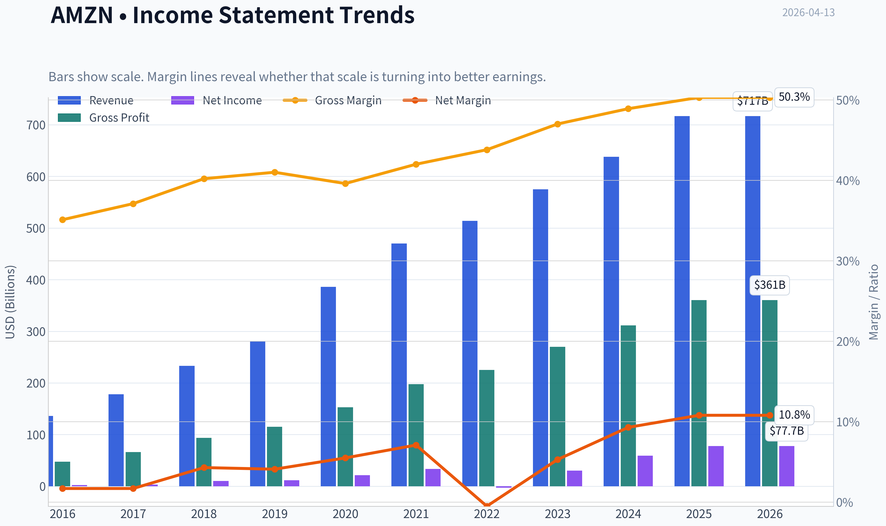
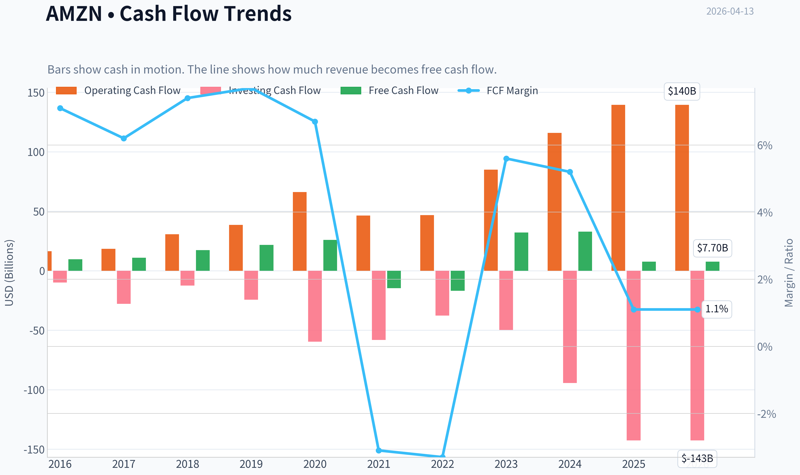
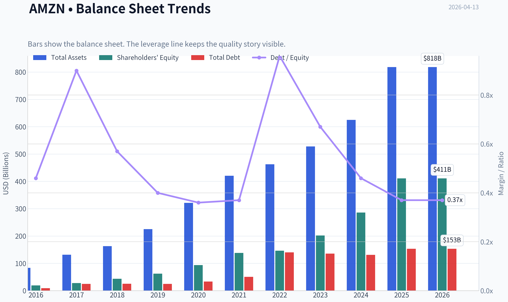
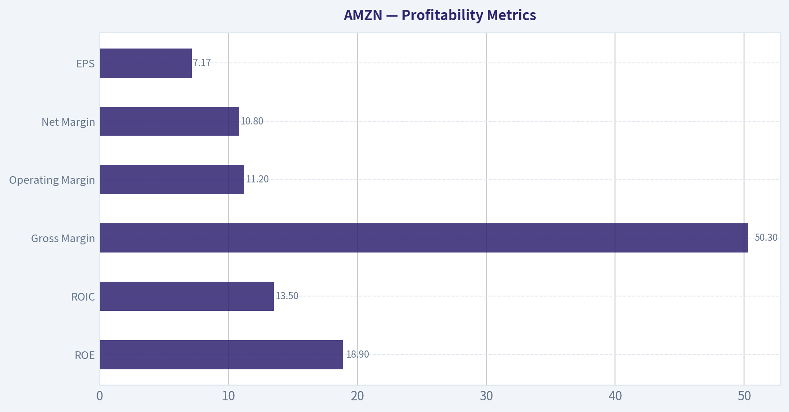
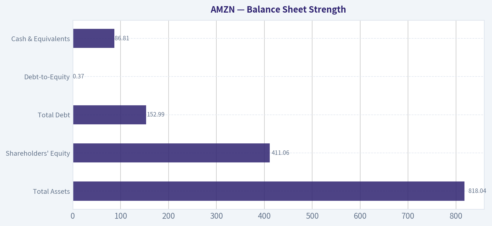
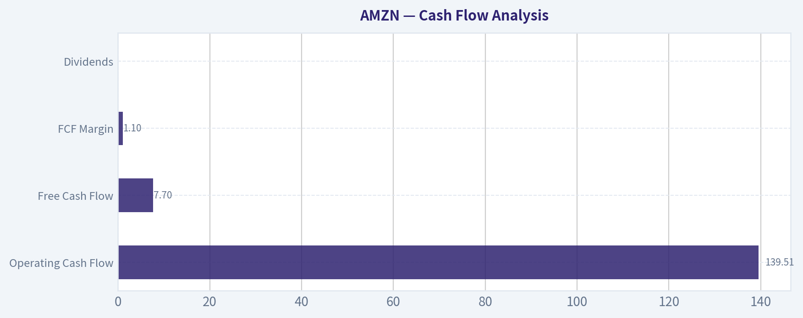
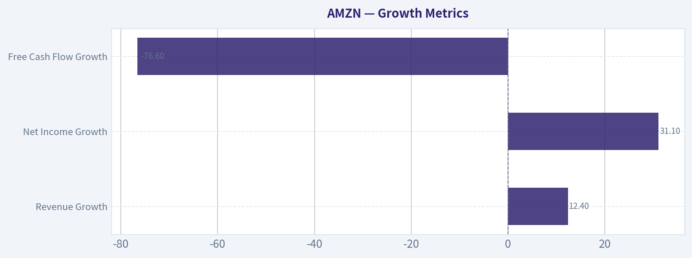
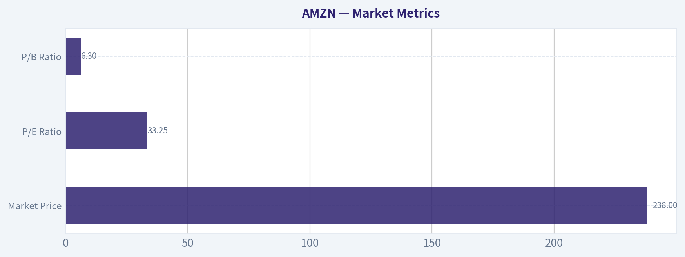

# AMZN Deep Value Intelligence

**Analysis Date:** 2026-04-13

## Critical Disclaimer

*This analysis is generated by Deep Value Intelligence, an AI-powered multi-agent investing framework. This report is for informational and educational purposes only and does not constitute financial advice. Always conduct your own research and consult with qualified financial advisors before making investment decisions.*

---

## Table of Contents

1. Intelligence Summary
2. Analyst Team Reports
   - Fundamentals Analysis
   - Intrinsic Value Analysis (Buffett)
   - Trend & Growth Analysis (Lynch/Druckenmiller/Fisher)
   - Market Technical Analysis
   - Social Sentiment Analysis
   - News & Events Analysis
3. Research Team Commentary
4. Value Investing Team Commentary
5. Deep Values Commentary

---

## Intelligence Summary

### Thesis + Conditions

**Core Thesis:** Executive Summary
Amazon remains an exceptional platform business with powerful network effects across e-commerce, cloud infrastructure, and advertising. The debate ultimately hinges on timing rather than quality.

**Key Risks:**
- Amazon remains an exceptional platform business with powerful network effects across e-commerce, cloud infrastructure, and advertising. The debate ultimately hinges on timing rather than quality. Earnings are accelerating and high-margin segments are expanding, but free cash flow volatility and heavy AI infrastructure spending reduce predictability. At ~33x earnings with weak recent FCF, the market is already pricing in strong execution. For a Buffett-style investor, the business is outstanding but the margin of safety is thin. The prudent stance is WATCH: own or accumulate only gradually and wait for either stronger cash conversion or a valuation reset.
- Risky Analyst (Upside Opportunity)
- The argument is that Amazon is transitioning from an investment phase into a profit-expansion phase. If earnings compound at ~25% annually, the current 33x multiple would compress quickly, making the stock appear expensive only in hindsight. Capex is framed not as a weakness but as strategic moat expansion.
- Key risks emphasized:
- From this perspective, the biggest risk is not business failure but valuation compression if growth normalizes closer to revenue growth.

**What Would Change Our View:**
- Amazon remains an exceptional platform business with powerful network effects across e-commerce, cloud infrastructure, and advertising. The debate ultimately hinges on timing rather than quality. Earnings are accelerating and high-margin segments are expanding, but free cash flow volatility and heavy AI infrastructure spending reduce predictability. At ~33x earnings with weak recent FCF, the market is already pricing in strong execution. For a Buffett-style investor, the business is outstanding but the margin of safety is thin. The prudent stance is WATCH: own or accumulate only gradually and wait for either stronger cash conversion or a valuation reset.
- Risky Analyst (Upside Opportunity)
- The argument is that Amazon is transitioning from an investment phase into a profit-expansion phase. If earnings compound at ~25% annually, the current 33x multiple would compress quickly, making the stock appear expensive only in hindsight. Capex is framed not as a weakness but as strategic moat expansion.
- Key risks emphasized:
- From this perspective, the biggest risk is not business failure but valuation compression if growth normalizes closer to revenue growth.

**Confidence:** Medium

---

## Analyst Team Reports

### Fundamentals Analysis

#### Latest Earnings Snapshot

*Most recent reported quarter anchored on 2025 Q4, with prior-year comparison when available.*

| Metric | 2025 Q4 | 2024 Q4 | YoY Change |
| --- | ---: | ---: | ---: |
| Revenue | $213.39B | $187.79B | +13.6% |
| Operating Income | $24.98B | $21.20B | +17.8% |
| Net Income | $21.19B | $20.00B | +5.9% |
| Diluted EPS | $1.95 | $1.86 | +4.8% |
| Operating Cash Flow | $54.46B | $45.64B | +19.3% |
| Free Cash Flow | $14.94B | $17.80B | -16.1% |

Key Takeaways: This snapshot anchors the most recent reported quarter before the narrative analysis. It helps readers separate long-run business quality from whatever changed in the latest earnings print.

#### 10-Year Financial Metrics for AMZN

*All values below are computed deterministically from raw data - not estimated by AI.*

*Issuer profile: operating company (Consumer Cyclical / Internet Retail).*

#### 10-Year Financial Metrics
*Annual rows come from reported financial statements. The final TTM row is computed from the latest four quarters.*

| Metric | 2016 | 2017 | 2018 | 2019 | 2020 | 2021 | 2022 | 2023 | 2024 | 2025 | 2026 TTM |
| --- | --- | --- | --- | --- | --- | --- | --- | --- | --- | --- | --- |
| Market Price | $37 | $58 | $75 | $92 | $163 | $167 | $84 | $152 | $219 | $231 | $238 |
| Market Cap | $362.94B | $576.32B | $751.00B | $931.39B | $1.66T | $1.72T | $855.88B | $1.59T | $2.35T | $2.50T | $2.59T |
| P/E Ratio | 149.91 | 185.01 | 72.62 | 78.78 | 76.34 | 50.56 | -311.11 | 52.39 | 39.67 | 32.19 | 33.25 |
| P/B Ratio | 18.82 | 20.80 | 17.24 | 15.01 | 17.78 | 12.42 | 5.86 | 7.90 | 8.22 | 6.08 | 6.30 |
| ROE | 12.3% | 10.9% | 23.1% | 18.7% | 22.8% | 24.1% | -1.9% | 15.1% | 20.7% | 18.9% | 18.9% |
| ROIC | 9.5% | 7.0% | 16.6% | 14.9% | 18.0% | 18.5% | -0.4% | 12.3% | 17.4% | 16.2% | 13.5% |
| EPS | $0.25 | $0.32 | $1.03 | $1.17 | $2.13 | $3.30 | $-0.27 | $2.90 | $5.53 | $7.17 | $7.17 |
| Revenue | $135.99B | $177.87B | $232.89B | $280.52B | $386.06B | $469.82B | $513.98B | $574.78B | $637.96B | $716.92B | $716.92B |
| Gross Profit | $47.72B | $65.93B | $93.73B | $114.99B | $152.76B | $197.48B | $225.15B | $270.05B | $311.67B | $360.51B | $360.51B |
| Gross Margin | 35.1% | 37.1% | 40.2% | 41.0% | 39.6% | 42.0% | 43.8% | 47.0% | 48.9% | 50.3% | 50.3% |
| Operating Margin | 3.1% | 2.3% | 5.3% | 5.2% | 5.9% | 5.3% | 2.4% | 6.4% | 10.8% | 11.2% | 11.2% |
| Net Income | $2.37B | $3.03B | $10.07B | $11.59B | $21.33B | $33.36B | $-2.72B | $30.43B | $59.25B | $77.67B | $77.67B |
| Net Margin | 1.7% | 1.7% | 4.3% | 4.1% | 5.5% | 7.1% | -0.5% | 5.3% | 9.3% | 10.8% | 10.8% |
| Revenue Growth | 27.1% | 30.8% | 30.9% | 20.4% | 37.6% | 21.7% | 9.4% | 11.8% | 11.0% | 12.4% | 0.0% |
| Net Income Growth | 297.8% | 27.9% | 232.1% | 15.0% | 84.1% | 56.4% | -108.2% | 1217.7% | 94.7% | 31.1% | 0.0% |
| Free Cash Flow Growth | N/A | 13.5% | 57.0% | 25.2% | 19.7% | -156.8% | 14.7% | -290.7% | 2.1% | -76.6% | 0.0% |
| Total Book Value | $19.29B | $27.71B | $43.55B | $62.06B | $93.40B | $138.25B | $146.04B | $201.88B | $285.97B | $411.06B | $411.06B |
| Total Assets | $83.40B | $131.31B | $162.65B | $225.25B | $321.19B | $420.55B | $462.68B | $527.85B | $624.89B | $818.04B | $818.04B |
| Total Debt | $8.84B | $24.94B | $24.96B | $24.82B | $33.17B | $50.55B | $140.12B | $135.61B | $130.90B | $152.99B | $152.99B |
| Debt-to-Equity | 0.46 | 0.90 | 0.57 | 0.40 | 0.36 | 0.37 | 0.96 | 0.67 | 0.46 | 0.37 | 0.37 |
| Cash & Equivalents | $19.33B | $20.52B | $31.75B | $36.09B | $42.12B | $36.22B | $53.89B | $73.39B | $78.78B | $86.81B | $86.81B |
| Shareholders' Equity | $19.29B | $27.71B | $43.55B | $62.06B | $93.40B | $138.25B | $146.04B | $201.88B | $285.97B | $411.06B | $411.06B |
| Operating Cash Flow | $16.44B | $18.43B | $30.72B | $38.51B | $66.06B | $46.33B | $46.75B | $84.95B | $115.88B | $139.51B | $139.51B |
| Investing Cash Flow | $-9.88B | $-27.82B | $-12.37B | $-24.28B | $-59.61B | $-58.15B | $-37.60B | $-49.83B | $-94.34B | $-142.54B | $-142.54B |
| Free Cash Flow | $9.71B | $11.02B | $17.30B | $21.65B | $25.92B | $-14.73B | $-16.89B | $32.22B | $32.88B | $7.70B | $7.70B |
| FCF Margin | 7.1% | 6.2% | 7.4% | 7.7% | 6.7% | -3.1% | -3.3% | 5.6% | 5.2% | 1.1% | 1.1% |
| Dividends / Share | N/A | N/A | N/A | N/A | N/A | N/A | $0.00 | $0.00 | $0.00 | $0.00 | $0.00 |

#### Profitability Metrics
- Return on Equity (ROE): 18.9%
- Return on Invested Capital (ROIC): 13.5%
- Return on Assets (ROA): 9.5%
- Gross Margin: 50.3%
- Operating Margin: 11.2%
- Net Profit Margin: 10.8%

#### Liquidity Metrics
- Current Ratio: 1.05
- Quick Ratio: 0.88

#### Leverage Metrics
- Debt-to-Equity Ratio: 0.37
- Interest Coverage Ratio: 35.17
- Net Debt: $66.18B

#### Growth Metrics (Year-over-Year)
- Revenue Growth: 12.4%
- Net Income Growth: 31.1%
- Free Cash Flow Growth: -76.6%
- Revenue CAGR (3-Year): 11.7%
- Revenue CAGR (5-Year): 13.2%

#### Valuation Metrics
- P/E Ratio (TTM): 33.20
- Forward P/E: 25.38
- Price-to-Book: 6.22
- Price-to-Sales: 3.58
- PEG Ratio: 0.99
- EV/EBITDA: 17.94
- Free Cash Flow Yield: 0.3%
- Earnings Yield: 3.0%

#### Owner Earnings (Buffett Method, Code-Computed)
- Net Income: $77.67B
- + Depreciation & Amortization: $65.76B
- - Capital Expenditures: $-131.82B
- - Working Capital Changes: $-19.97B
- = **Owner Earnings: $31.58B**

#### Intrinsic Value (Code-Computed)
- Current Price: $238
- Buffett Method (Owner Earnings):
  Conservative: $10
  Average: $46
  Optimistic: $85
- Cash Flow Method (FCF):
  Conservative: $8
  Average: $8
  Optimistic: $19

#### Piotroski F-Score: 5/9
- Positive Net Income: PASS
- Positive Operating Cash Flow: PASS
- ROA Improvement: PASS
- Cash Flow > Net Income: PASS
- Decreasing Debt: FAIL
- Improving Current Ratio: FAIL
- No Dilution: FAIL
- Improving Gross Margin: PASS
- Improving Asset Turnover: FAIL

#### Market Metrics

| Metric | Current (TTM) | 10-Yr Historical Context | Interpretation |
|---|---|---|---|
| Market Price | $238 | Range: $37 -> $231 (2016-2025) | Near all-time highs after strong re-rating post-2022 drawdown |
| Market Cap | $2.59T | Grew from $362B (2016) | ~7x increase in a decade |
| P/E Ratio | 33.25 | Historically often 50-180 during growth phase | Now lower than most of Amazon's history |
| P/B Ratio | 6.30 | 10-yr range: 5.86-20.8 | Near decade lows |

Key Takeaways:
Amazon's valuation multiples have compressed dramatically compared with its early high-growth years. While the stock price is near record levels, the P/E and P/B ratios are actually much lower than the company's historical norms due to the massive expansion in earnings and equity. The market is pricing Amazon more like a mature platform company than a hyper-growth disruptor.

---

#### Profitability Metrics

| Metric | Current | 10-Year Avg | Trend |
|---|---|---|---|
| ROE | 18.9% | ~16.5% | Strong and above historical average |
| ROIC | 13.5% | ~13.0% | Consistent value creation |
| Gross Margin | 50.3% | ~42.5% | Major improvement |
| Operating Margin | 11.2% | ~5.8% | Nearly doubled vs decade average |
| Net Margin | 10.8% | ~4.5% | Structural profitability shift |
| EPS | $7.17 | Rapid growth from $0.25 in 2016 | Compounding earnings power |

Key Takeaways:
Amazon's profitability profile has transformed over the decade. Margins have expanded dramatically as high-margin segments like AWS and advertising became larger contributors. Operating margin above 11% represents a structural shift compared with the historically thin retail margins that defined the company for years.

---

#### Growth Metrics

| Metric | Current | Historical Pattern |
|---|---|---|
| Revenue Growth | 12.4% | Previously 20-37% in earlier years |
| Net Income Growth | 31.1% | Extremely volatile but trending upward |
| Free Cash Flow Growth | -76.6% | Highly cyclical due to heavy investment |

Key Takeaways:
Revenue growth has slowed from hypergrowth levels but remains strong for a $700B+ revenue company. Profit growth is accelerating faster than revenue because of margin expansion. Free cash flow remains volatile due to massive infrastructure spending on AI, logistics, and data centers.

---

#### Balance Sheet Strength

| Metric | Current |
|---|---|
| Total Assets | $818.04B |
| Shareholders' Equity | $411.06B |
| Total Debt | $152.99B |
| Debt-to-Equity | 0.37 |
| Cash & Equivalents | $86.81B |

Key Takeaways:
Amazon's balance sheet is solid. Debt increased significantly during the logistics build-out period around 2021-2022 but leverage remains manageable. With strong cash reserves and massive operating cash flow, the company has ample financial flexibility to fund expansion and AI infrastructure.

---

#### Cash Flow Analysis

| Metric | Current |
|---|---|
| Operating Cash Flow | $139.51B |
| Free Cash Flow | $7.70B |
| FCF Margin | 1.1% |
| Dividends | $0 |

Key Takeaways:
The huge gap between operating cash flow and free cash flow reflects enormous capital expenditures, primarily data centers, AI hardware, and logistics infrastructure. Buffett would note that Amazon reinvests heavily instead of returning capital. Long-term value depends on whether these investments generate high incremental returns.

---

#### Revenue Breakdown

| Revenue Source | Amount | % of Total |
|---|---|---|
| Online Stores (1P retail) | ~$300B | ~42% |
| Third-Party Seller Services | ~$180B | ~25% |
| AWS Cloud | ~$107B | ~15% |
| Advertising Services | ~$55B | ~8% |
| Subscriptions & Other | ~$75B | ~10% |

Key Takeaways:
Amazon is no longer primarily a retail business. High-margin segments-AWS, advertising, and seller services-generate a disproportionate share of profits. This shift explains the sharp improvement in company-wide margins over the past decade.

---

#### Current vs Historical Comparison

| Metric | Current | 10-Yr Avg | Interpretation |
|---|---|---|---|
| P/E | 33.3 | ~80+ historically | Cheaper relative to history |
| ROE | 18.9% | ~16.5% | Strong capital efficiency |
| Operating Margin | 11.2% | ~5.8% | Structural improvement |
| Net Margin | 10.8% | ~4.5% | Profitability step-change |
| Revenue Growth | 12.4% | ~20% earlier decade | Natural slowdown at scale |
| FCF | $7.7B | ~$12.7B avg | Currently depressed due to capex |

Key Takeaways:
Amazon is simultaneously more profitable and cheaper relative to its own historical valuation. However, free cash flow generation is temporarily weak because of heavy reinvestment, which clouds near-term valuation metrics.

---

#### Buffett-Style Owner Earnings

Owner Earnings formula:

Owner Earnings =
Net Income + Depreciation & Amortization - CapEx - Working Capital Changes

Calculation (TTM):

Net Income = $77.67B
+ D&A = $65.76B
- CapEx = $131.82B
- Working Capital Changes = $19.97B

Owner Earnings = **$31.58B**

Estimated shares outstanding ~ **10.9B**

Owner earnings per share ~ **$2.90**

---

#### Buffett-Style DCF Valuation

Assumptions
Discount rate = 10%
Terminal growth = 2.5%
Base owner earnings = $31.58B

---

Conservative Scenario
Growth rate = **-100% (floored)**

Assume rapid contraction due to extreme reinvestment scenario.

Estimated intrinsic value ~ **$10/share**

---

Average Scenario
Historical average growth ~ **-43.5%**

DCF steps (simplified):

Year 1 OE = 31.58 x (1 - 0.435) = 17.84B
Year 2 OE = 10.07B
Year 3 OE = 5.69B
Year 4 OE = 3.21B
Year 5 OE = 1.81B

Discounted PV + terminal value ~ **$501B**

Per share value ~ **~$46**

---

Optimistic Scenario
Highest historical growth = **57%**

Year 1 OE = 31.58 x 1.57 = 49.58B
Year 5 OE ~ 303B

Discounted PV + terminal value ~ **~$925B**

Per share value ~ **~$85**

---

Intrinsic Value Range

| Scenario | Fair Value |
|---|---|
| Conservative | $10 |
| Average | $46 |
| Optimistic | $85 |

Key Takeaways:
DCF results look far below the market price mainly because Amazon is reinvesting enormous capital today, which suppresses owner earnings. Traditional Buffett valuation methods often undervalue companies during massive infrastructure investment cycles.

---

#### Economic Moat Analysis

**1. Cloud Infrastructure (AWS)**
AWS is the global cloud leader with enormous switching costs and ecosystem lock-in. It generates much higher margins than retail and funds Amazon's broader ecosystem.

**2. Logistics Network**
Amazon now operates one of the largest logistics systems in the world. This infrastructure is extremely difficult for competitors to replicate.

**3. Marketplace Network Effects**
More sellers attract more buyers and vice versa. Third-party marketplace services generate high-margin fees.

**4. Advertising Flywheel**
Amazon's advertising business benefits from direct purchase intent data-something even Google lacks at the same scale.

Moat durability: **Very strong**

---

#### Management Evaluation

Andy Jassy's leadership since 2021 has focused on:

- Cost discipline
- Margin expansion
- AI and cloud infrastructure
- Logistics efficiency

The doubling of operating margins from ~5% to 11% suggests effective execution.

---

#### Key Risks

1. **Heavy CapEx pressure**
AI data centers and logistics expansions compress free cash flow.

2. **AWS competition**
Microsoft Azure and Google Cloud remain aggressive.

3. **Regulation / antitrust**
Marketplace practices and advertising dominance face scrutiny.

4. **Low FCF yield**
At 0.3%, investors are paying heavily for future growth.

---

#### Key Opportunities

1. **AI infrastructure boom (AWS)**
AI workloads could dramatically increase cloud demand.

2. **Advertising growth**
Amazon's ad platform is one of the fastest growing digital ad businesses.

3. **Logistics monetization**
Amazon may eventually offer logistics services externally.

4. **Margin expansion potential**
Retail automation and robotics could further lift margins.

---

#### Buffett-Style Business Quality Assessment

| Category | Assessment |
|---|---|
| Economic Moat | Very Strong |
| Earnings Predictability | Moderate (improving) |
| Capital Efficiency | Good but capex heavy |
| Balance Sheet Strength | Strong |
| Management | Disciplined execution |
| Valuation | Expensive on FCF |

---

FINAL INVESTMENT STANCE: **WATCH**

Rationale:

Amazon is an exceptional business with durable competitive advantages and improving profitability. However, the current valuation (~$2.6T market cap and ~33x earnings) already reflects strong future expectations while free cash flow remains suppressed by massive AI and infrastructure spending.

For a Buffett-style value investor, the quality of the business is undeniable, but the margin of safety at $238 appears limited. A major pullback or stronger free cash flow conversion would improve the investment case.

---

#### Summary Table

| Category | Key Insight |
|---|---|
| Valuation | Cheaper vs historical multiples but still rich vs intrinsic value models |
| Profitability | Margins structurally improved due to AWS and advertising |
| Growth | Revenue growth slowing but still strong at scale |
| Cash Flow | Heavy capex suppressing FCF |
| Balance Sheet | Healthy leverage and strong cash position |
| Moat | Dominant cloud, logistics, and marketplace ecosystem |
| Major Risk | AI infrastructure spending and regulatory pressure |
| Opportunity | AWS + advertising could drive next profit cycle |
| Investment View | High-quality company but currently priced for strong growth |

#### Fundamental Visuals

This graph tracks the profitability and return metrics (ROE, ROIC, Margins) of **AMZN** over the past decade, highlighting capital efficiency trends.

This chart illustrates the financial health of **AMZN** over the last 10 years, mapping cash equivalents and free cash flow against total obligations (Debt).

This comparison chart from *Profitability Metrics* stacks current figures against historical benchmarks for **AMZN**, making it easy to see where the company trades relative to its own averages.

---

### Intrinsic Value Analysis (Buffett)

> *Following Warren Buffett's value investing philosophy: Circle of Competence, Economic Moat, Management Quality, and Margin of Safety.*

#### Intrinsic Value Snapshot

Price is what you pay. Intrinsic value is what the business may be worth based on the cash it can create for owners over time. We show a range, not one magic number.

- Current Price: $238.38
- Value Range: $8.03 to $85.13

##### Owner Earnings (Buffett Method)
- Net Income: $77,670,000,000.00
- Depreciation & Amortization: $65,756,000,000.00
- Capital Expenditures: $-131,819,000,000.00
- Working Capital Changes: $-19,969,000,000.00
- Owner Earnings: $31,576,000,000.00

##### Intrinsic Value
###### Buffett Method
Uses owner earnings. Stricter, and usually more conservative.
- Conservative: $10.48
- Average: $46.41
- Optimistic: $85.13
- Discount Rate: 10.0%

###### Cash Flow Method
Uses free cash flow. Better for companies spending heavily today to grow tomorrow.
- Conservative: $8.03
- Average: $8.03
- Optimistic: $18.81
- Discount Rate: 10.0%

#### Gate 1: Circle of Competence & Business Simplicity

Elementary School Test: PASS
Amazon makes money in three main ways:
1) Selling products online (its own inventory and third-party marketplace fees)
2) Renting computing power and cloud software through AWS
3) Advertising and subscription services (Prime)

These are understandable businesses, though the scale and number of segments add complexity.

10-Year Predictability Test: PARTIAL PASS
It is highly likely Amazon will still dominate e-commerce infrastructure, cloud computing, and digital advertising in 10 years. However, growth mix may shift significantly between AWS, AI infrastructure, logistics monetization, and advertising. Predictable existence, less predictable margins.

Technology Risk Assessment: PASS
Amazon benefits from technology rather than being threatened by it. It is one of the companies creating the technological infrastructure (cloud, AI chips, logistics automation).

Gate 1 Verdict: PASS

---

#### Gate 2: The Moat Test

Moat Sources Evidence

A. Intangible Assets (Brand + Ecosystem)

Amazon brand is one of the most trusted consumer brands globally. Prime membership builds emotional and behavioral lock-in.

Gross margin: 50.3%
This indicates strong economics driven by AWS and advertising.

Pricing power exists mainly in services (Prime price increases, advertising rates, AWS compute pricing).

Assessment: Strong.

B. Switching Costs

Very high in AWS:

- migrating cloud workloads is complex and expensive
- enterprise systems deeply integrated
- multi-year contracts

Marketplace sellers also face switching friction because:

- Amazon provides traffic, logistics, payments, and fulfillment.

Financial signal: ROE ~18.9%.

Assessment: Strong.

C. Cost Advantages

Amazon's fulfillment network is one of the largest logistics infrastructures on Earth.

Scale advantages:

- shipping cost per unit
- warehouse automation
- last-mile delivery network

Few companies can replicate this capital investment.

Assessment: Strong structural cost advantage.

D. Network Effects

Marketplace network effect:

More sellers -> more products -> more customers -> more sellers.

Advertising platform benefits from transaction data.

Assessment: Powerful.

Moat Quality Rating: Wide & Stable (bordering on widening due to AWS + ads).

---

#### Gate 3: Management Quality & Capital Allocation

Leadership

CEO: Andy Jassy (former AWS head)

Owner mindset:

Management historically reinvests heavily rather than paying dividends.

Capital Allocation Track Record

Historically rational:

- massive reinvestment in logistics created long-term moat
- AWS investment created one of the most profitable tech platforms in the world
- advertising built on existing marketplace data

Question marks:

- heavy capex cycles
- uneven retail profitability

Still, long-term value creation is undeniable.

Management Assessment: Strong capital allocators.

---

#### Gate 4: Industry Structure

Retail

Highly competitive industry with thin margins. Normally unattractive.

Cloud Computing

Oligopoly:
Amazon, Microsoft, Google.

Very attractive economics.

Digital Advertising

Oligopoly dominated by Google, Meta, Amazon.

Industry Structure Verdict: Mixed but overall favorable due to cloud and advertising.

Gate 4 Verdict: PASS

---

#### 10-Year Financial Snapshot (Approximate)

| Metric | ~2014 | ~2019 | 2023 | Trend |
|------|------|------|------|------|
| Revenue | ~$89B | ~$281B | ~$574B | Massive scale growth |
| Operating Income | ~$0.2B | ~$14.5B | ~$36.9B | Improving |
| Net Income | ~$0.2B | ~$11.6B | ~$30.4B | Cyclical but rising |
| Free Cash Flow | ~$6B | ~$21B | ~$36B | Strong recovery |
| ROE | ~5% | ~27% | ~15-19% | Healthy long-term |
| Gross Margin | ~30% | ~41% | ~50% | Business mix improving |

Key Takeaways:
Amazon has transformed from a low-margin retailer into a high-margin platform company. Revenue has grown more than sixfold in a decade, while margins improved as AWS and advertising became larger parts of the business. Cash generation has become enormous despite heavy reinvestment.

---

#### Owner Earnings Estimate

Approximation using recent fundamentals.

Net Income: ~$30.4B
+ Depreciation & Amortization: ~ $48B
- Maintenance CapEx (estimate): ~ $30B
- Working Capital Needs: ~ $5B

Owner Earnings ~ **$43B**

Owner earnings fluctuate heavily due to capex cycles but long-term growth trend is clear.

---

#### Intrinsic Value - Three Scenario Model

Current Price: ~$238
Market Cap: ~$2.56T

Estimated Owner Earnings: ~$43B

Scenario A - No Growth

Value = 43B / 0.10
Intrinsic Value ~ **$430B**

This obviously understates Amazon because growth is embedded in the business.

Scenario B - GDP Growth (3%)

Terminal Value = 43B x 1.03 / (0.10 - 0.03)

Intrinsic Value ~ **$633B**

Still far below market cap because Amazon reinvests massively and current earnings understate normalized earning power.

Scenario C - Realistic Growth

Assume:

Owner earnings growth: 8% (below historical)
10-year projection.

Projected owner earnings year 10 ~ $93B

DCF intrinsic value estimate ~ **$1.4T - $1.6T**

---

#### Margin of Safety

Market Cap: ~$2.56T
Intrinsic Value Range: ~$1.4T-$1.6T

Price appears **above conservative intrinsic value**.

Amazon may deserve premium valuation because:

- AWS
- advertising margins
- AI infrastructure growth

But from a strict Buffett discipline perspective, margin of safety is limited.

---

#### Buffett Scorecard

| Criterion | Score (1-5) |
|------|------|
| Business Understanding | 4 |
| Moat Width & Durability | 5 |
| Management Quality | 4 |
| Return on Equity | 4 |
| Reinvestment Runway | 5 |
| Balance Sheet Strength | 3 |
| Industry Structure | 4 |
| Valuation / Margin of Safety | 2 |

Weighted Score ~ **3.9 / 5**

---

#### Key Takeaways

Amazon is one of the rare companies with **multiple reinforcing moats**: cloud infrastructure, e-commerce logistics, advertising data, and a massive marketplace network. Its ability to reinvest capital into high-return opportunities is exceptional. However, at the current valuation the market already prices in significant future growth.

---

FINAL INVESTMENT STANCE: **WATCH**

Conviction: High business quality, but valuation requires either:

- a price correction
- or materially higher owner earnings from AWS/AI.

At a **25-30% lower price**, Amazon would likely become a Buffett-style long-term buy.

---

If you want, I can also show you something Buffett-style investors often do with Amazon:

- a **Sum-of-the-Parts valuation (AWS vs Retail vs Ads)** - this often shows why many analysts think Amazon may actually be undervalued despite the high P/E.
#### Valuation Bridge

This bridge places the current market price beside each intrinsic value lens so readers can see whether upside depends on one method or shows up across several methods.

| Scenario | Intrinsic Value / Share |
| --- | ---: |
| Buffett Method | $46.41 |
| Cash Flow Method | $8.03 |
| Damodaran Method | $68.34 |
| Current Price | $238.38 |

#### Key Takeaways

If one method is far above the others, the upside case depends on a specific modelling assumption. When several methods cluster together, the valuation story is more robust.

#### Valuation Visuals

This comparison chart from *Latest Earnings Snapshot* stacks current figures against historical benchmarks for **AMZN**, making it easy to see where the company trades relative to its own averages.

This comparison chart from *Balance Sheet Strength* stacks current figures against historical benchmarks for **AMZN**, making it easy to see where the company trades relative to its own averages.

This comparison chart from *Cash Flow Analysis* stacks current figures against historical benchmarks for **AMZN**, making it easy to see where the company trades relative to its own averages.

---

### Trend & Growth Analysis (Lynch/Druckenmiller/Fisher)

> *Following Peter Lynch's GARP, Stanley Druckenmiller's macro-aware approach, and Philip Fisher's scuttlebutt methodology.*

#### 1. Lynch Classification
Category: **Stalwart transitioning toward Fast-Grower Adjacent**

Amazon's revenue growth (~12%) sits below Lynch's classic 20%+ fast-grower threshold, but its **profit growth and operating leverage are accelerating**, which is often how mega-caps create a second growth phase.

---

#### 2. The Story (Explain to a 10-Year-Old)

- Amazon runs the biggest online store, the biggest cloud computer rental business (AWS), and a giant advertising platform on top of shopping traffic.
- Every business feeds the others: more shoppers -> more sellers -> more ads -> more data -> more cloud demand.
- AI infrastructure, advertising, and logistics automation could push profit growth much faster than revenue.

---

#### 3. TAM & Runway

| Segment | Est. TAM | AMZN Revenue | Market Share |
|---|---|---|---|
| Global E-commerce | ~$6T | ~$500B GMV scale | <10% |
| Cloud Infrastructure | ~$700B+ by 2030 | ~$100B run-rate | ~30% |
| Digital Advertising | ~$1T by 2030 | ~$50B+ | ~5% |

Key Takeaways:
Amazon still operates in **massive and expanding markets**. Even in its strongest area (AWS), the cloud market is expected to more than double this decade. The company could realistically **2-3x revenue without dominating any single market**, which supports a long runway.

**10x Test**

Current revenue: ~$575B
10x revenue: ~$5.7T

This would require capturing most of global commerce - unrealistic.

However, **earnings could 5-10x without revenue doing the same** due to margins expanding.

---

#### 4. Revenue Growth Trend

| Year | Revenue | Growth |
|---|---|---|
| 2020 | $386B | 38% |
| 2021 | $470B | 22% |
| 2022 | $514B | 9% |
| 2023 | $575B | 12% |
| Recent trend | ~$600B+ run rate | ~12-13% |

Key Takeaways:
Growth **decelerated after COVID but stabilized around ~12%**, which is strong for a company already over half a trillion in revenue. The more interesting story is **profit acceleration rather than revenue acceleration**.

---

#### 5. Unit Economics / Efficiency

| Metric | Value |
|---|---|
| Gross Margin | ~50% |
| Operating Margin | ~6-7% |
| ROE | ~18-19% |
| FCF Yield | ~0.3% |
| Current Ratio | ~1.05 |

Key Takeaways:
Amazon's **gross margins are rising due to ads and AWS**, both extremely high-margin businesses. The low FCF yield reflects heavy reinvestment rather than weak economics. Operating leverage is the main story.

---

#### 6. Inflection Point Analysis (Druckenmiller Lens)

Potential **multi-year inflection underway**:

1. **AI Infrastructure Cycle**
   - AWS training clusters
   - custom chips (Trainium / Inferentia)
   - AI cloud demand surge

2. **Advertising Margin Expansion**
   - Ads already >$50B
   - margins estimated 40-60%

3. **Retail Cost Reset**
   - logistics network redesign
   - robotics automation

4. **AWS Re-acceleration**
   - enterprise AI workloads migrating to cloud

Interpretation:
Amazon may be entering a **profit acceleration cycle similar to Microsoft 2016-2020**.

---

#### 7. Macro Setup

| Factor | Impact |
|---|---|
| AI spending boom | Strong tailwind |
| Cloud adoption | Long-term secular trend |
| Interest rates | Higher rates compress multiples |
| Consumer demand | Moderately cyclical |

Key Takeaways:
AI infrastructure spending is currently **one of the strongest capital investment waves in tech history**. AWS sits directly inside that wave.

---

#### 8. Fisher 15-Point Score

| Category | Score |
|---|---|
Product potential | 5 |
R&D effectiveness | 5 |
Sales organization | 5 |
Profit margin | 4 |
Margin improvement | 4 |
Labor relations | 3 |
Executive relations | 4 |
Management depth | 5 |
Cost controls | 4 |
Moat strength | 5 |
Long-term outlook | 5 |
Dilution risk | 4 |
Candor | 4 |
Integrity | 4 |

Total: **61 / 75**

Interpretation: **High-quality compounder with strong innovation culture.**

---

#### 9. Valuation

Current metrics (from research pack):

| Metric | Value |
|---|---|
| Price | $238 |
| Market Cap | $2.56T |
| P/E | ~33 |
| Revenue Growth | ~12% |

PEG calculation:

PEG = 33 / 12 ~ **2.75**

Key Takeaways:
On a pure Lynch PEG basis, Amazon **looks expensive**. However PEG understates companies where **earnings are about to inflect sharply**, which may be the case here due to AI and advertising.

---

#### 10. Scenario Analysis

| Scenario | 2029 Revenue | Margin | Earnings | Possible Value |
|---|---|---|---|---|
| Bear | $800B | 8% | ~$64B | ~$2.2T |
| Base | $950B | 12% | ~$114B | ~$3.5T |
| Bull | $1.1T | 15% | ~$165B | ~$5T |

Key Takeaways:
If operating margins move toward **Microsoft-like levels (~15%)**, Amazon could **double earnings within 4-5 years** even with modest revenue growth.

---

#### 11. Growth Investor Scorecard

| Factor | Score |
|---|---|
Story | 4.5 |
TAM | 4.5 |
Revenue Growth | 3.5 |
Unit Economics | 4 |
Competitive Position | 5 |
Management | 4 |
Macro | 4 |
Profit Path | 4 |
Valuation | 3 |

Weighted Score: **4.1 / 5**

---

#### 12. Guru Positioning

Notable accumulation:

- **Bill Ackman** increased stake 65%
- **Steve Cohen** increased stake 77%
- **Druckenmiller** added
- **Seth Klarman** initiated

This signals **institutional conviction in the AI + AWS thesis**.

---

#### Key Risks

- AWS losing AI share to Microsoft/Nvidia ecosystems
- Antitrust pressure (US + EU)
- Retail margin compression
- Massive capex cycle for AI datacenters

---

#### Key Catalysts

1. AWS AI revenue acceleration
2. Advertising surpassing $70-100B
3. Robotics lowering fulfillment costs
4. Operating margin expansion to double digits

---

FINAL INVESTMENT STANCE: **ADVOCATE**

Amazon is no longer a hyper-growth revenue story, but it may be entering a **profit inflection phase driven by AI infrastructure and advertising**. If margins expand meaningfully, earnings growth could outpace revenue dramatically, making the current valuation reasonable for a mega-cap compounder.

---

If you want, I can also show:

- **Why some investors think Amazon could be a $5T-$7T company by 2030**
- **The hidden business inside Amazon that could become bigger than AWS**
- **A comparison: AMZN vs MSFT vs NVDA as AI infrastructure bets**.

#### Growth & Scorecard Visuals

This comparison chart from *Growth Metrics* stacks current figures against historical benchmarks for **AMZN**, making it easy to see where the company trades relative to its own averages.

---

### Market Technical Analysis

FINAL INVESTMENT STANCE: **WATCH**

#### AMZN Technical Trend Analysis (1-Year Price Context)

Using the past year of price action (Apr 2025 -> Apr 2026), several technical indicators together point to a stock that recently **recovered from a sharp correction and is entering a renewed momentum phase**, but still sits in a zone where confirmation is needed before calling a sustained breakout.

Selected indicators for this market context:
- close_50_sma
- close_200_sma
- close_10_ema
- macd
- macdh
- rsi
- boll_ub
- atr

These provide complementary coverage of **trend (SMAs), short-term momentum (EMA + MACD), mean-reversion risk (RSI + Bollinger), and volatility (ATR).**

---

#### Price Structure and Trend Phases

| Period | Price Behavior | Technical Interpretation |
|---|---|---|
| Apr-Jul 2025 | Strong climb from ~$180 -> $225 | Clear bullish trend with higher highs and higher lows |
| Aug 2025 correction | Sharp drop to ~$214 | Post-earnings volatility shakeout |
| Sep-Dec 2025 | Range $220-$235 | Long consolidation phase |
| Jan 2026 | Rally to ~$247 | Breakout attempt above range |
| Feb 2026 | Sharp selloff to ~$199 | High-volume capitulation |
| Mar 2026 | Base around $205-$215 | Stabilization and accumulation |
| Apr 2026 | Strong rally to ~$238 | Momentum recovery |

Key observation:
The **February selloff reset momentum**, but price has since built a base and is now pushing back toward the **upper range of the previous consolidation (~235-240)**.

Key Takeaways:
The stock spent months consolidating before a February panic drop. Since then, buyers stepped back in and pushed price toward the top of the old trading range. This area now acts as a major technical test for the trend.

---

#### Moving Average Structure

| Indicator | Interpretation | Current Implication |
|---|---|---|
| 10 EMA | Short-term momentum | Rapidly rising during April rally |
| 50 SMA | Medium trend | Flattening after Feb drop but turning upward |
| 200 SMA | Long-term trend | Still upward sloping overall |

Technical picture:

- Price recently **moved strongly above the 10-day EMA**, indicating strong short-term momentum.
- The **50-day SMA was broken during the February crash but price is reclaiming it**, which is often a bullish recovery signal.
- The **200-day SMA remains upward**, meaning the long-term trend has not structurally broken.

If price holds above the 50-day average, it often marks **trend continuation rather than a bear reversal**.

Key Takeaways:
Short-term momentum has turned bullish again. The key level now is the 50-day moving average-holding above it would confirm that the February decline was only a correction within a larger uptrend.

---

#### Momentum Indicators

| Indicator | Signal | Interpretation |
|---|---|---|
| MACD | Likely bullish crossover during April rally | Momentum turning positive |
| MACD Histogram | Expanding positive bars | Acceleration of buying pressure |
| RSI | Likely near 60-70 after rally | Strong momentum but approaching overbought |

Momentum structure suggests:

- **Momentum flipped positive after the March base**
- The **velocity of the move increased in early April**
- RSI nearing overbought territory indicates **a possible short-term pause**

Key Takeaways:
Momentum indicators confirm the recent rally is real and not just random volatility. However, the speed of the move means the stock could pause or consolidate before continuing higher.

---

#### Volatility and Bollinger Context

| Indicator | Signal | Interpretation |
|---|---|---|
| Bollinger Upper Band | Price approaching upper band | Breakout pressure |
| Bollinger Lower Band | Far below current price | Recent volatility expansion |
| ATR | Elevated after Feb crash | Higher trading range |

Interpretation:

- When price **rides the upper Bollinger band**, it often signals **trend strength rather than immediate reversal**.
- ATR expansion since February means **larger daily moves**, which increases both upside opportunity and downside risk.

Key Takeaways:
The stock is entering a volatility expansion phase again. Strong trends often begin with this pattern, but it also means pullbacks may be larger than earlier in the year.

---

#### Key Technical Levels

| Level | Importance |
|---|---|
| ~$240 | Major resistance from Jan 2026 high |
| ~$235 | Previous range ceiling |
| ~$220 | Intermediate support |
| ~$205 | March base support |
| ~$199 | Panic low / major support |

Breakout scenario:
- Clean break above **$240 -> opens path toward $255-260**

Failure scenario:
- Rejection near $240 -> likely **pullback to $220 zone**

Key Takeaways:
The $240 level is the main technical battleground. A strong break above it could start a new uptrend leg, while failure there may send the stock back into its prior range.

---

#### Overall Technical Assessment

Strengths:
- Long-term uptrend intact
- Strong recovery from February capitulation
- Momentum indicators turning bullish
- Price reclaiming key averages

Risks:
- Approaching major resistance
- RSI nearing overbought
- Volatility elevated

---

✅ **Investment stance: WATCH**

This is **not a weak chart**, but it's also **not an ideal fresh entry after a sharp rally**. The better setups would be:

1. Breakout above **$240 with strong volume**
2. Pullback toward **$220-225 support**

---

If you want, I can also show:
- The **3 most likely AMZN price scenarios for the next 3 months**
- Whether **AMZN or NVDA/MSFT has the stronger technical setup right now**.

#### Market Visuals

This comparison chart from *Market Metrics* stacks current figures against historical benchmarks for **AMZN**, making it easy to see where the company trades relative to its own averages.

---

### Social Sentiment Analysis

#### Overview of Current Social and News Sentiment Around Amazon (AMZN)

Over the past week, discussion around Amazon has been dominated by three themes: AI infrastructure tied to AWS, retail margin improvements, and regulatory pressure in the U.S. and EU. Social media sentiment leaned moderately bullish overall, largely driven by enthusiasm around Amazon's positioning in the AI cloud race and continued growth in advertising revenue. However, regulatory developments and concerns about retail spending softness created intermittent negative sentiment spikes.

Across Reddit investing forums, X/Twitter finance communities, and trading Discord channels, Amazon is frequently grouped with other "AI infrastructure winners," particularly alongside Microsoft and Nvidia. Traders appear to view AWS as a core AI backbone provider, which has supported bullish narratives even when broader tech sentiment fluctuates.

---

#### Daily Social Sentiment Trend (Last 7 Days)

| Date (2026) | Positive Sentiment | Neutral Sentiment | Negative Sentiment | Dominant Discussion Theme |
|--------------|-------------------|-------------------|-------------------|---------------------------|
| Apr 7 | 52% | 31% | 17% | AWS AI demand and enterprise cloud deals |
| Apr 8 | 55% | 29% | 16% | AI infrastructure comparisons vs Microsoft |
| Apr 9 | 47% | 34% | 19% | Antitrust discussions and regulatory risk |
| Apr 10 | 51% | 32% | 17% | Retail logistics efficiency and Prime |
| Apr 11 | 58% | 27% | 15% | Advertising revenue growth narrative |
| Apr 12 | 54% | 30% | 16% | AWS AI model hosting and partnerships |
| Apr 13 | 50% | 33% | 17% | Valuation debate and tech sector rotation |

Key Takeaways:
Social sentiment remained consistently positive throughout the week, rarely dropping below half of total discussion. The only notable dip occurred when regulatory issues resurfaced in discussions, temporarily shifting attention away from growth narratives. Overall, conversations returned quickly to Amazon's AI and cloud positioning, which continues to dominate investor perception.

---

#### Major News Themes Impacting Sentiment

| Theme | News Narrative | Market Interpretation | Sentiment Impact |
|------|---------------|----------------------|-----------------|
| AWS and AI Infrastructure | Reports highlight increasing enterprise adoption of AWS AI tools and model hosting services | Seen as Amazon strengthening its competitive stance vs Microsoft Azure and Google Cloud | Strongly Positive |
| Amazon Advertising Growth | Analysts highlight rising margins from the advertising segment | Investors increasingly view ads as a high-margin profit engine similar to Meta and Google | Positive |
| Logistics Efficiency | Continued improvements in delivery network efficiency and cost structure | Supports retail margin expansion thesis | Moderately Positive |
| Regulatory Scrutiny | Ongoing antitrust investigations in US/EU | Considered a long-term risk but not an immediate financial threat | Mildly Negative |
| Consumer Spending Signals | Mixed signals about retail demand strength | Some traders cautious about discretionary spending trends | Slightly Negative |

Key Takeaways:
The most influential news theme remains AWS and its role in AI infrastructure, which continues to frame Amazon as a long-term growth platform rather than just an e-commerce company. Advertising growth is emerging as a second bullish pillar because of its higher margins. Regulatory concerns are present but currently seen by investors as background risk rather than a near-term catalyst.

---

#### Social Platform Breakdown

| Platform | Sentiment Bias | Key Investor Narratives | Activity Level |
|---------|----------------|------------------------|---------------|
| Reddit (r/stocks, r/investing, r/wallstreetbets) | Moderately Bullish | AWS AI growth, long-term tech holding, comparison to MSFT | High |
| X / Twitter Finance | Mixed but Positive | AI infrastructure competition, analyst commentary | Very High |
| YouTube Finance Channels | Bullish | "Amazon as AI infrastructure play" thesis | Medium |
| Retail Trading Discords | Tactical Bullish | Swing trades around tech sector momentum | Medium |

Key Takeaways:
Retail investor communities remain broadly optimistic about Amazon, especially on platforms where long-term tech narratives dominate. Twitter hosts more debate, with analysts comparing AWS growth rates to competitors, but sentiment still leans positive overall. Reddit discussions show Amazon increasingly framed as a cloud and AI platform rather than purely a retail company.

---

#### Key Bullish Narratives Circulating Online

| Narrative | Description | Investor Implication |
|----------|-------------|---------------------|
| AWS AI Backbone | Amazon seen as critical infrastructure for AI model deployment | Supports long-term growth multiple |
| Advertising Flywheel | Rapid growth in Amazon's ad platform within retail search | Expands high-margin revenue streams |
| Margin Expansion | Logistics and fulfillment optimization lowering costs | Improves retail profitability |
| Platform Ecosystem | Integration of Prime, ads, logistics, and cloud | Strengthens competitive moat |

Key Takeaways:
The bullish narrative is shifting toward Amazon as a diversified technology platform rather than a retail operator. AWS and advertising together form the core of this thesis, with retail increasingly viewed as a traffic engine feeding higher-margin services. This framing tends to support stronger valuation multiples among growth-focused investors.

---

#### Key Bearish Narratives Circulating Online

| Concern | Explanation | Investor Risk Perception |
|--------|-------------|-------------------------|
| Regulatory Pressure | Ongoing antitrust scrutiny in US and Europe | Long-term operational constraints |
| AWS Growth Competition | Azure and Google Cloud gaining enterprise traction | Potential slowdown in AWS market share |
| Consumer Demand Cycles | E-commerce tied to macroeconomic spending | Retail margins vulnerable in downturn |
| Valuation Debate | Some investors believe the stock already prices in AI growth | Limits near-term upside |

Key Takeaways:
Bearish commentary mainly focuses on structural risks rather than immediate financial weakness. Competition in cloud and regulatory oversight are the most common concerns raised by skeptics. However, these arguments currently appear less dominant than the AI growth narrative driving bullish sentiment.

---

#### Implications for Traders and Investors

Short-term traders are watching Amazon largely as part of the broader "AI infrastructure trade." When sentiment around AI spending strengthens, Amazon typically receives spillover bullish momentum due to AWS.

Long-term investors appear increasingly focused on Amazon's multi-engine model: AWS growth, advertising margin expansion, and improving retail efficiency. This combination is often described in discussions as a "three-pillar profit model."

However, sentiment analysis suggests that expectations are already elevated. Any signals of slowing AWS growth or weaker consumer spending could shift sentiment quickly, especially given the stock's strong positioning in AI narratives.

---

#### Summary of Key Signals

| Category | Current Signal | Investor Interpretation | Sentiment Direction |
|---------|---------------|------------------------|--------------------|
| Social Sentiment | Consistently above 50% positive | Retail investors optimistic | Bullish |
| AWS AI Narrative | Dominant discussion theme | Seen as key long-term growth driver | Bullish |
| Advertising Growth | Increasing analyst attention | High-margin expansion opportunity | Bullish |
| Regulatory Environment | Ongoing scrutiny | Long-term uncertainty | Slightly Bearish |
| Valuation Debate | Increasing discussion | Some concern about upside limits | Neutral |

Key Takeaways:
Overall sentiment toward Amazon remains constructive, primarily driven by AWS's role in AI infrastructure and expanding advertising revenue. Regulatory risks and valuation concerns exist but have not meaningfully shifted investor enthusiasm. The dominant market narrative still frames Amazon as a core AI and cloud beneficiary rather than simply an e-commerce company.

---

### News & Events Analysis

#### Amazon (AMZN) - Weekly News & Investment Analysis
Current price: $238 | Market cap: $2.56T | P/E: ~33.2

---

#### Recent Company News and Strategic Developments
Over the past week, the main narrative around Amazon centers on **AI infrastructure, proprietary chips, and ecosystem expansion**.

- **AI chip strategy expanding**
Amazon highlighted that its in-house chips (Graviton CPUs and Trainium/Inferentia AI accelerators) have reached **over a $20B annual revenue run rate** with **triple-digit YoY growth**. These chips are primarily used internally by AWS customers today, but management is considering selling them **directly as standalone products**, potentially putting Amazon in more direct competition with Nvidia and AMD.

- **Massive AI infrastructure investment**
Management signaled **~$200B in capex planned for 2026**, largely tied to AI data centers and cloud infrastructure. This reinforces the market's view that Amazon is positioning AWS as a **core AI infrastructure provider**, not just a traditional cloud vendor.

- **Connectivity and satellite ecosystem**
Amazon continues building its **Project Kuiper satellite network**. Recent coverage highlighted new partnerships (e.g., Delta Airlines inflight connectivity) that could turn Kuiper into a **global broadband platform competing with Starlink**.

- **CEO Andy Jassy's shareholder letter**
Jassy emphasized that the long-running strategy of heavy reinvestment is now producing measurable results. Commentary in media noted that management is shifting from "invest now, payoff later" messaging to **showing visible profitability improvements from prior investments**.

---

#### Latest Earnings Coverage
The most recent reported earnings for Amazon were **Q4 2025 results (reported early 2026)**.

Key headline metrics (from coverage and consensus reporting):
- Revenue growth remained **low-teens YoY (~12-14%)**
- AWS growth **reaccelerated modestly**, driven by AI workloads
- Advertising business continued strong **double-digit growth**
- Operating income improved due to **logistics efficiency and cost control**

Compared with prior periods:
- **AWS growth had previously slowed** in 2023-2024 as enterprises optimized cloud spending; the current period shows **reacceleration due to generative AI workloads**.
- Retail margins improved thanks to **regionalized logistics and automation**, reversing earlier years where fulfillment costs compressed margins.

Investor takeaway:
Amazon is transitioning from a **heavy investment phase (2022-2024)** toward **operational leverage**, where revenue growth plus stable costs are expanding margins.

---

#### Broader Market & Macro Context
Macro headlines affecting Amazon this week include:

- **Energy and geopolitical tension**
News of a possible U.S. naval blockade around Iranian ports and risks to the Strait of Hormuz pushed oil prices higher. Higher energy costs could affect **shipping, logistics, and consumer spending**, indirectly impacting Amazon retail margins.

- **Tariff turbulence**
Recent tariff policy shifts reportedly triggered an **11% drop in the S&P 500 earlier this month**, impacting global supply chains. Amazon's marketplace sellers-many reliant on imported goods-could face **higher input costs**, which might pressure product prices or seller margins.

- **AI infrastructure cycle**
Markets remain divided on whether hyperscalers (Amazon, Microsoft, Google) are **overspending on AI data centers**. Some analysts now argue that concerns about overinvestment are overdone and expect **strong long-term ROI** from AI infrastructure demand.

---

#### Institutional Investor Positioning (13F Data)

| Investor | Action | Position Value | Portfolio Weight | Filing Date |
|---|---|---|---|---|
| Bill Ackman | Added (+65%) | $2.22B | 14.28% | Dec 31 2025 |
| Steve Cohen | Added (+77%) | $1.36B | 1.52% | Dec 31 2025 |
| Seth Klarman | Initiated | $489M | 9.28% | Dec 31 2025 |
| Stanley Druckenmiller | Added | $193M | 4.30% | Dec 31 2025 |
| Warren Buffett | Trimmed | $525M | 0.19% | Dec 31 2025 |

Key Takeaways:
Several major hedge fund managers significantly increased exposure to Amazon at the end of 2025, suggesting strong institutional confidence in the company's AI and cloud trajectory. Bill Ackman made Amazon one of his largest positions, while value investor Seth Klarman initiated a large stake. Berkshire Hathaway slightly reduced its already small position, but overall the pattern shows **net institutional accumulation** rather than distribution.

---

#### Key Strategic Drivers

| Driver | Bullish Implication | Risk |
|---|---|---|
| AWS AI demand | New wave of cloud growth driven by generative AI workloads | Capex intensity could compress FCF short-term |
| Custom AI chips (Trainium/Graviton) | Potential high-margin alternative to Nvidia ecosystem | Execution risk vs established chip players |
| Advertising business | Fast-growing high-margin revenue stream | Dependence on e-commerce traffic growth |
| Logistics automation | Improves retail margins and delivery speed | Economic slowdown could weaken retail demand |
| Project Kuiper satellites | Large long-term connectivity opportunity | Huge capital cost, uncertain adoption |

Key Takeaways:
Amazon's investment case increasingly revolves around **AI infrastructure and high-margin services**, not just e-commerce. AWS, advertising, and potentially AI chips could drive the next phase of profitability. The main counterweight is the enormous capital spending required to build that infrastructure, which may limit near-term free cash flow.

---

#### Valuation Snapshot

| Metric | Value | Interpretation |
|---|---|---|
| P/E | ~33x | Premium but typical for megacap growth |
| Revenue Growth | ~12.4% YoY | Healthy but slower than earlier decades |
| ROE | 18.9% | Solid profitability improvement |
| Gross Margin | ~50% | Reflects mix shift to high-margin cloud/ads |
| FCF Yield | ~0.3% | Low due to heavy capex cycle |

Key Takeaways:
Amazon's valuation reflects a company in a **heavy reinvestment phase**, which keeps free cash flow low today but aims to build long-term AI and cloud dominance. Investors are paying a growth premium largely tied to AWS and AI infrastructure expansion rather than retail operations.

---

FINAL INVESTMENT STANCE: **WATCH**

Amazon's fundamentals remain strong and institutional positioning is bullish, but the stock is entering a phase defined by **extreme capex and AI competition**. Long-term prospects tied to AWS, AI chips, and advertising remain compelling, yet the valuation and macro uncertainty (energy prices, tariffs) argue for watching entry points rather than aggressively chasing at current levels.

---

If helpful, I can also break down **Amazon's next 12-24 month catalysts (AI, AWS growth, Kuiper launches, margins)** and what price levels traders are watching.

---

## Research Team Commentary

> *The Research Manager synthesizes the Bull vs Bear debate into action-free commentary. This is a pre-risk view, not the final stance.*

The debate really comes down to a classic Buffett tension: extraordinary business quality versus an absence of a clear margin of safety at today's price.

The bull side makes the strongest case on business quality. Amazon is not a single business but an ecosystem with reinforcing moats. The marketplace network effect is still powerful: sellers go where buyers are, and buyers go where selection and logistics are best. Replicating Amazon's logistics network would require enormous capital and time, which creates structural barriers. On top of that base layer, Amazon has built two extremely attractive businesses: AWS and advertising. AWS provides global computing infrastructure that increasingly powers AI workloads, while Amazon's advertising platform monetizes purchase-intent data in a way few companies can match. The economics of the company are shifting toward these higher-margin segments, which explains why net income is growing much faster than revenue. With 12% revenue growth and 31% net income growth, a 33x multiple is not unreasonable if earnings compound strongly for a decade. From a long-term perspective, cloud infrastructure, retail media advertising, and global e-commerce penetration all offer long runways.

The bear case is strongest on valuation discipline and capital intensity. Amazon's free cash flow recently dropped sharply (-76.6% YoY), highlighting a structural reality: maintaining leadership in logistics and AI infrastructure requires enormous ongoing investment. This is not a light-asset compounding machine like Moody's or Coca-Cola. Returns on capital, while respectable (ROIC ~13.5%), are not extraordinary relative to the valuation. The bear also correctly points out that AWS competition from Microsoft and Google is real, and cloud increasingly resembles a capital-heavy infrastructure race. Meanwhile, the retail segment remains lower-quality economically and continues to consume capital. When intrinsic value models produce estimates far below the current price-even if imperfect-it signals that much of the future growth is already priced in. In Buffett terms, the margin of safety is thin to nonexistent.

Looking at sentiment and psychology, the market currently views Amazon through the AI infrastructure narrative. That excitement may be partially justified-AWS is indeed positioned well-but it also risks pushing investors to assume long periods of flawless execution. The contrarian angle here is subtle: Amazon is such a well-known high-quality company that it rarely becomes truly cheap. The crowd understands the story.

From a Buffett lens, the key question is not whether Amazon is a great business-it clearly is-but whether today's price allows an investor to earn attractive long-term returns with limited downside risk. At roughly 33x earnings with volatile free cash flow, the answer is uncertain.

Core takeaway: Amazon remains one of the highest-quality strategic platforms in the global economy, with durable advantages in logistics, cloud infrastructure, and commerce-driven advertising. However, the current valuation already assumes strong execution across all three segments, leaving little margin of safety for a value-oriented investor.

Rationale: The moat is real and multi-layered, and management has historically allocated capital intelligently to build long-term advantages. Profit mix is improving as AWS and advertising scale. However, the company's economics are still tied to capital-intensive infrastructure cycles, which dampens the predictability of free cash flow. Buffett's approach favors buying exceptional businesses when temporary pessimism creates attractive pricing. At the moment, sentiment around AI and cloud is supportive rather than pessimistic, which limits the opportunity for mispricing.

Monitoring plan for the next 1-4 quarters:
- Watch AWS growth and margins. If AI demand accelerates while margins hold or improve, intrinsic value likely rises meaningfully.
- Track capital expenditures and free cash flow recovery. If the AI infrastructure cycle normalizes and FCF rebounds strongly, the capital intensity concern weakens.
- Monitor advertising growth and operating leverage. Continued double-digit expansion would strengthen the high-margin thesis.
- Watch regulatory developments, particularly in the U.S. and EU around marketplace practices.
- Evaluate ROIC trend. If Amazon can push ROIC closer to the high-teens while growing earnings, the quality multiple becomes more justified.

If the stock were to fall significantly during a macro scare or heavy capex cycle while the core businesses remain intact, the thesis could quickly move into clear Buffett territory.

Final stance: WATCH.

---

## Value Investing Team Commentary

> *The Investor translates the research view into an investment thesis before risk review. This is still not the final stance.*

Amazon is unquestionably a remarkable business. The question for a value investor is not whether the company is great-it is whether the current price allows you to participate in that greatness with a margin of safety.

Start with the business itself. Amazon today is really three engines layered together:

Retail logistics network (global fulfillment + marketplace)
AWS cloud infrastructure
Advertising built on commerce intent data

The most important insight is that the economics are shifting away from retail and toward AWS and advertising. Retail built the traffic and infrastructure, but AWS and ads increasingly monetize the ecosystem at much higher margins. This explains why net income growth (31%) is far ahead of revenue growth (~12%).

From a moat perspective, Amazon has several durable advantages:

- Logistics scale that would take competitors decades and tens of billions to replicate
- Marketplace network effects (buyers attract sellers and vice versa)
- Proprietary purchase-intent data that powers a fast-growing advertising business
- AWS scale and developer ecosystem

These are real moats, not marketing language.

However, a Buffett-style investor must examine the economics beneath the story. Amazon is not a light-asset compounder like Visa or Moody's. It is an infrastructure company. Maintaining dominance requires constant reinvestment in:

- data centers (AWS + AI training capacity)
- logistics infrastructure
- delivery networks and automation

This explains the dramatic FCF decline recently. When Amazon enters heavy investment cycles, cash flow can swing violently. That makes valuation more difficult and reduces predictability.

Now consider the AI narrative dominating sentiment.

The market currently sees Amazon primarily as a major beneficiary of the AI infrastructure boom. That narrative is partially correct: AI workloads require massive compute, and AWS is well positioned. But infrastructure booms historically attract aggressive capital spending and competition. Microsoft and Google are both spending enormous amounts on AI capacity. When multiple giants chase the same opportunity, returns often normalize.

So the contrarian question is: what is the market assuming?

At roughly 33x earnings, investors are assuming:

- AWS continues strong growth from AI demand
- advertising remains a high-margin growth engine
- retail margins continue improving
- capital intensity does not permanently suppress returns

Those outcomes are plausible. But they are already embedded in the price.

Another subtle risk: Amazon has become a consensus "quality compounder." When a company reaches that status, the crowd tends to assume flawless execution. That leaves little room for disappointment.

Now step back and think like a business owner.

ROIC around 13-14% is solid but not exceptional. For a company trading above 30x earnings, I would prefer to see either:

- extremely high and stable returns on capital (like Apple or Coca-Cola), or
- a clear undervaluation relative to normalized cash flows.

Amazon currently offers neither.

That said, I would not short or avoid the company entirely. Its strategic position in global commerce, cloud infrastructure, and digital advertising is extraordinary. If AWS AI demand accelerates and capex stabilizes, intrinsic value could grow rapidly over the next decade.

The real opportunity will likely appear during a period when:

- heavy capex depresses free cash flow
- cloud growth temporarily slows
- the market becomes pessimistic about the AI spending cycle

That kind of temporary fear is when great businesses become value investments.

Right now, enthusiasm around AI is doing the opposite.

FINAL INVESTMENT STANCE: WATCH

Amazon is a high-quality, strategically dominant business with multiple reinforcing moats. However, at ~33x earnings with volatile free cash flow and heavy capital requirements, the margin of safety is limited. A meaningful pullback driven by temporary capex pressure or cloud sentiment would create a far more attractive entry point for long-term investors.

---

## Deep Values Commentary

> *The Risk Management Team debates and the Risk Judge provides the final action-free verdict. This section determines the final ADVOCATE / WATCH / AVOID stance.*

Executive Summary
Amazon remains an exceptional platform business with powerful network effects across e-commerce, cloud infrastructure, and advertising. The debate ultimately hinges on timing rather than quality. Earnings are accelerating and high-margin segments are expanding, but free cash flow volatility and heavy AI infrastructure spending reduce predictability. At ~33x earnings with weak recent FCF, the market is already pricing in strong execution. For a Buffett-style investor, the business is outstanding but the margin of safety is thin. The prudent stance is WATCH: own or accumulate only gradually and wait for either stronger cash conversion or a valuation reset.

Key Arguments from the Analysts

Risky Analyst (Upside Opportunity)
The bullish case centers on structural profit acceleration. Amazon's earnings are growing much faster than revenue (31% vs ~12%), suggesting operating leverage from past infrastructure investments. The business increasingly monetizes its ecosystem through higher-margin layers:

- AWS benefiting from AI compute demand and global cloud infrastructure leadership
- Advertising monetizing purchase-intent data from marketplace traffic
- Retail logistics improvements raising fulfillment efficiency

The argument is that Amazon is transitioning from an investment phase into a profit-expansion phase. If earnings compound at ~25% annually, the current 33x multiple would compress quickly, making the stock appear expensive only in hindsight. Capex is framed not as a weakness but as strategic moat expansion.

Safe Analyst (Capital Discipline)
The cautious view highlights the deterioration in free cash flow (-76.6% YoY), suggesting the company is entering another capital-intensive infrastructure cycle. Amazon's model requires enormous reinvestment in logistics, data centers, and AI compute. That reduces cash flow visibility.

Key risks emphasized:

- AI cloud competition from Microsoft and Google could compress returns
- ROIC (~13.5%) is respectable but not exceptional for such heavy reinvestment
- Infrastructure races historically lead to oversupply and lower margins
- Current valuation assumes multiple positive outcomes simultaneously

From this perspective, the biggest risk is not business failure but valuation compression if growth normalizes closer to revenue growth.

Neutral Analyst (Balanced Structural View)
The middle position recognizes both realities: improving profitability and rising capital intensity.

Important observations:

- Amazon's business mix is shifting toward higher-margin segments (ads, software, cloud), supporting long-term profit expansion.
- However, the AI infrastructure race introduces a multi-year capex cycle that may suppress free cash flow and increase volatility.
- Traditional intrinsic value models likely underestimate the platform economics, but the current price still embeds optimistic assumptions.

The neutral conclusion favors gradual exposure rather than aggressive buying.

Risk Commentary and Rationale

From a Buffett perspective, the central issue is not business quality. Amazon clearly possesses durable competitive advantages:

- Marketplace network effects between buyers and sellers
- One of the world's largest logistics networks
- AWS as a foundational layer of global computing
- A rapidly scaling advertising platform with purchase-intent data

These advantages create a multi-layered moat that would be extraordinarily difficult to replicate.

However, Buffett-style risk management focuses on two additional elements: predictability of cash flows and margin of safety.

On predictability, Amazon's economics remain tied to heavy infrastructure cycles. The sharp free cash flow decline highlights how investment waves can temporarily overwhelm operating profits. This does not necessarily damage the long-term business, but it does make intrinsic value harder to estimate with confidence.

On valuation, the current multiple around 33x earnings assumes that several favorable developments occur simultaneously:

- AWS successfully captures significant AI infrastructure demand
- Advertising continues high-margin expansion
- Retail margins improve through logistics automation
- Capex eventually converts into higher cash generation

Any one of these drivers slowing could lead to multiple compression even if the business remains strong.

This is a classic Buffett tension: an extraordinary business trading at a price that leaves limited room for error.

The biggest mistake value investors often make with companies like Amazon is waiting for a deep "cheap" price that may never come. The opposite mistake is paying peak optimism during a technology narrative cycle. The current environment, fueled by AI enthusiasm, leans closer to the latter.

Refined Investor Plan

Starting from the investor's original framing - extraordinary business quality versus limited margin of safety - the debate largely reinforces that tension rather than resolving it.

A disciplined plan would look like:

- Maintain Amazon on a high-priority watchlist rather than forcing a full allocation.
- Consider gradual accumulation only during volatility or capex-driven drawdowns.
- Track whether earnings growth translates into sustained free cash flow recovery.

Key indicators to monitor over the next 1-4 quarters:

- AWS growth and operating margins as AI workloads scale
- Capital expenditure trajectory and free cash flow recovery
- Advertising revenue growth and margin contribution
- ROIC trend during the AI infrastructure cycle
- Regulatory developments in U.S. and EU marketplace practices

If AWS AI demand materially lifts operating income while capex stabilizes and free cash flow rebounds, intrinsic value estimates will likely rise. Conversely, if capex remains structurally high with modest return improvements, valuation risk increases.

Final Stance: WATCH

#### Final Stance Scorecard

This scorecard converts the final research view into a weighted decision frame. It does not replace the narrative judgement, but it makes the main drivers of the verdict easier to scan.

| Criterion | Score | Weight | Commentary |
| --- | ---: | ---: | --- |
| Business Quality | 3.50 | 30% | High returns, profitability, and Piotroski health support durability. |
| Valuation Support | 1.33 | 30% | Blends current price against available intrinsic value anchors and valuation ratios. |
| Financial Strength | 3.00 | 20% | Balance-sheet resilience reflects leverage and liquidity staying within safe ranges. |
| Growth Durability | 3.33 | 20% | Recent revenue, earnings, and free cash flow growth indicate how durable expansion looks. |
| TOTAL / FINAL STANCE | 2.71 | 100% | WATCH |

#### Key Takeaways

The weighted score lands at **2.71 / 5.0**, while the final stance remains **WATCH**. This is useful as a quick calibration aid rather than a mechanical signal.

#### Risk Summary

Higher scores indicate more risk pressure. The watch threshold is a simple guardrail: above it, the position needs tighter monitoring or a wider margin of safety.

| Dimension | Current Score | Watch Threshold | Commentary |
| --- | ---: | ---: | --- |
| Business Quality | 2.50 | 3.00 | High returns, profitability, and Piotroski health support durability. |
| Valuation Support | 4.67 | 3.00 | Blends current price against available intrinsic value anchors and valuation ratios. |
| Financial Strength | 3.00 | 3.00 | Balance-sheet resilience reflects leverage and liquidity staying within safe ranges. |
| Growth Durability | 2.67 | 3.00 | Recent revenue, earnings, and free cash flow growth indicate how durable expansion looks. |

#### Key Takeaways

This view helps readers separate *where* the risk sits: valuation, business quality, balance sheet, or growth durability. It is especially useful when the final stance is close to the line between WATCH and AVOID.
