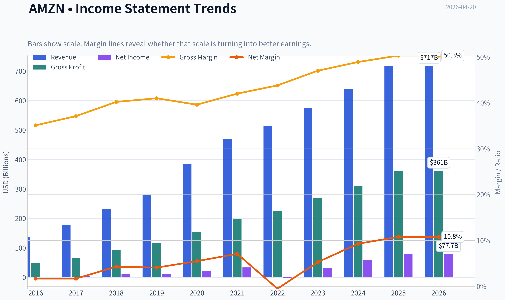
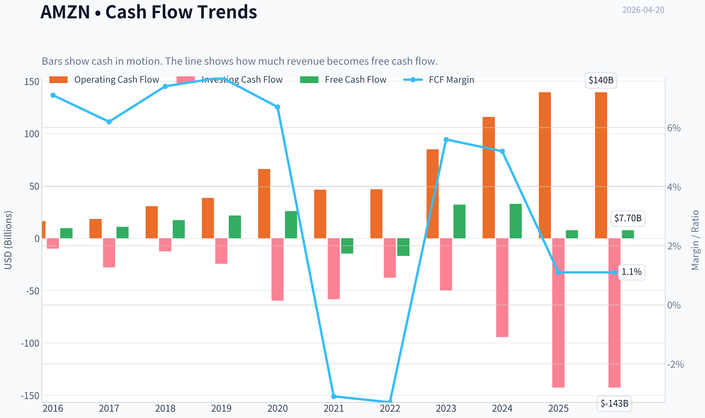
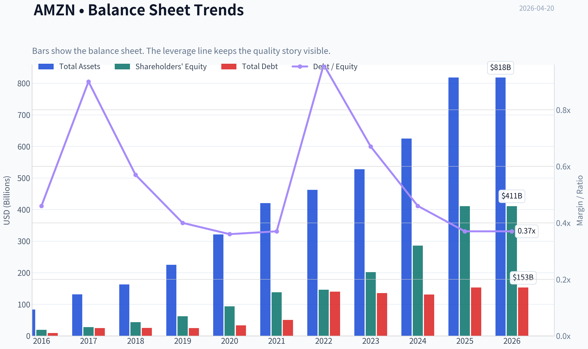
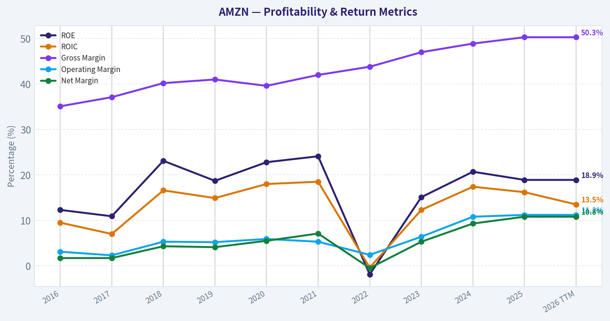
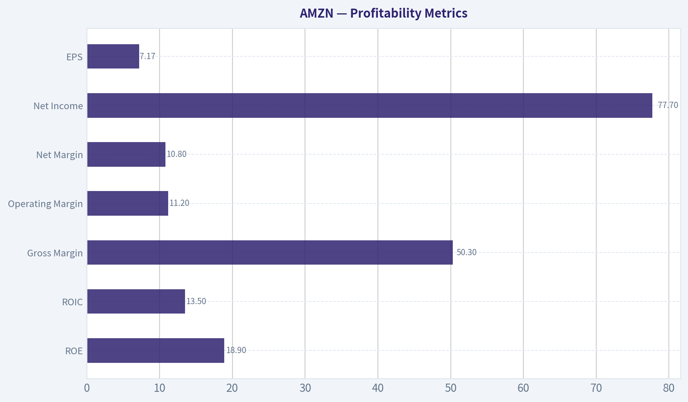
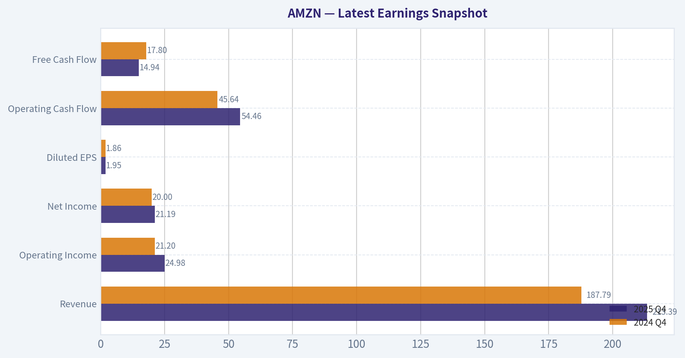
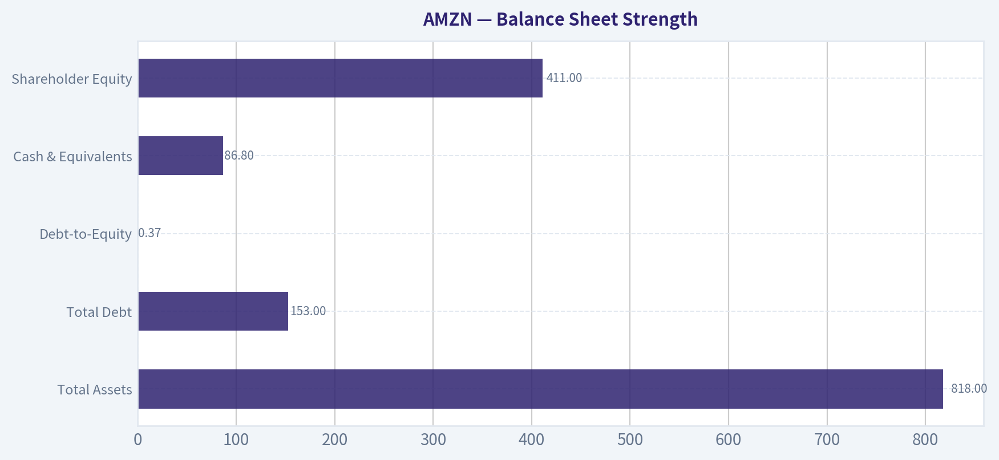
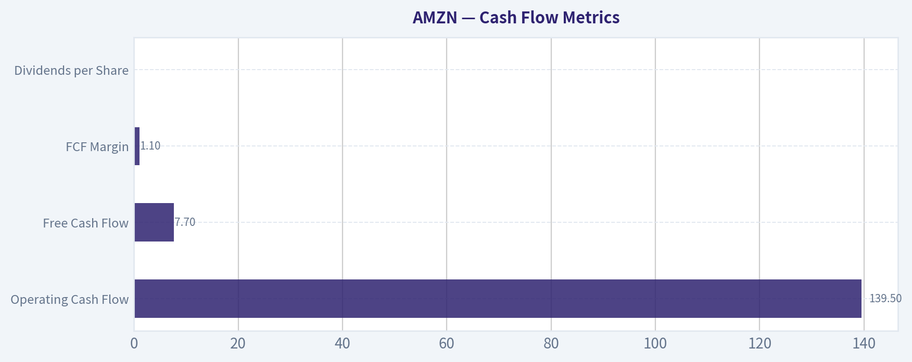
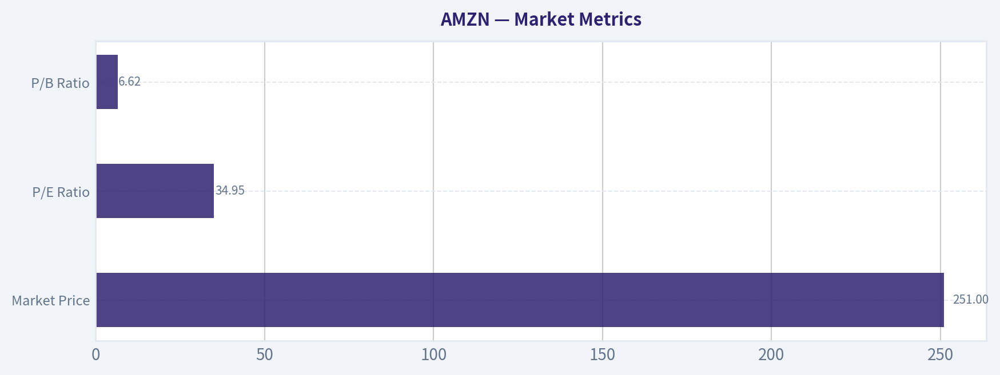

# AMZN Deep Value Intelligence

**Analysis Date:** 2026-04-20

## Critical Disclaimer

*This analysis is generated by Deep Value Intelligence, an AI-powered multi-agent investing framework. This report is for informational and educational purposes only and does not constitute financial advice. Always conduct your own research and consult with qualified financial advisors before making investment decisions.*

---

## Table of Contents

1. Intelligence Summary
2. Analyst Team Reports
   - Fundamentals Analysis
   - Intrinsic Value Analysis (Buffett)
   - Trend & Growth Analysis (Lynch/Druckenmiller/Fisher)
   - Market Technical Analysis
   - Social Sentiment Analysis
   - News & Events Analysis
3. Research Team Commentary
4. Value Investing Team Commentary
5. Deep Values Commentary

---

## Intelligence Summary

### Thesis + Conditions

**Core Thesis:** Executive Summary
Amazon remains a world-class business with durable competitive advantages across cloud, logistics, marketplace, and advertising. However, the current valuation (~35x earnings at $251) already assumes meaningful margin expansion and continued strong growth.

**Key Risks:**
- Amazon remains a world-class business with durable competitive advantages across cloud, logistics, marketplace, and advertising. However, the current valuation (~35x earnings at $251) already assumes meaningful margin expansion and continued strong growth. The business quality is unquestioned, but the margin of safety is thin due to heavy reinvestment cycles and volatile free cash flow. For a Buffett-style investor prioritizing predictable cash generation and disciplined entry price, the rational posture is patience. The company is likely a long-term compounder, but today's price does not provide sufficient downside protection.
- Risky Analyst (Bullish)
- The analyst also argues that if earnings continue compounding at ~25-30%, today's 35x multiple could compress quickly, making the current valuation look reasonable in hindsight.
- Safe Analyst (Risk Control)
- Other critical risk points:

**What Would Change Our View:**
- Amazon remains a world-class business with durable competitive advantages across cloud, logistics, marketplace, and advertising. However, the current valuation (~35x earnings at $251) already assumes meaningful margin expansion and continued strong growth. The business quality is unquestioned, but the margin of safety is thin due to heavy reinvestment cycles and volatile free cash flow. For a Buffett-style investor prioritizing predictable cash generation and disciplined entry price, the rational posture is patience. The company is likely a long-term compounder, but today's price does not provide sufficient downside protection.
- Risky Analyst (Bullish)
- The analyst also argues that if earnings continue compounding at ~25-30%, today's 35x multiple could compress quickly, making the current valuation look reasonable in hindsight.
- Safe Analyst (Risk Control)
- Other critical risk points:

**Confidence:** Medium

---

## Analyst Team Reports

### Fundamentals Analysis

#### Latest Earnings Snapshot

*Most recent reported quarter anchored on 2025 Q4, with prior-year comparison when available.*

| Metric | 2025 Q4 | 2024 Q4 | YoY Change |
| --- | ---: | ---: | ---: |
| Revenue | $213.39B | $187.79B | +13.6% |
| Operating Income | $24.98B | $21.20B | +17.8% |
| Net Income | $21.19B | $20.00B | +5.9% |
| Diluted EPS | $1.95 | $1.86 | +4.8% |
| Operating Cash Flow | $54.46B | $45.64B | +19.3% |
| Free Cash Flow | $14.94B | $17.80B | -16.1% |

Key Takeaways: This snapshot anchors the most recent reported quarter before the narrative analysis. It helps readers separate long-run business quality from whatever changed in the latest earnings print.

#### 10-Year Financial Metrics for AMZN

*All values below are computed deterministically from raw data - not estimated by AI.*

*Issuer profile: operating company (Consumer Cyclical / Internet Retail).*

#### 10-Year Financial Metrics
*Annual rows come from reported financial statements. The final TTM row is computed from the latest four quarters.*

| Metric | 2016 | 2017 | 2018 | 2019 | 2020 | 2021 | 2022 | 2023 | 2024 | 2025 | 2026 TTM |
| --- | --- | --- | --- | --- | --- | --- | --- | --- | --- | --- | --- |
| Market Price | $37 | $58 | $75 | $92 | $163 | $167 | $84 | $152 | $219 | $231 | $251 |
| Market Cap | $362.94B | $576.32B | $751.00B | $931.39B | $1.66T | $1.72T | $855.88B | $1.59T | $2.35T | $2.50T | $2.72T |
| P/E Ratio | 149.91 | 185.01 | 72.62 | 78.78 | 76.34 | 50.56 | -311.11 | 52.39 | 39.67 | 32.19 | 34.95 |
| P/B Ratio | 18.82 | 20.80 | 17.24 | 15.01 | 17.78 | 12.42 | 5.86 | 7.90 | 8.22 | 6.08 | 6.62 |
| ROE | 12.3% | 10.9% | 23.1% | 18.7% | 22.8% | 24.1% | -1.9% | 15.1% | 20.7% | 18.9% | 18.9% |
| ROIC | 9.5% | 7.0% | 16.6% | 14.9% | 18.0% | 18.5% | -0.4% | 12.3% | 17.4% | 16.2% | 13.5% |
| EPS | $0.25 | $0.32 | $1.03 | $1.17 | $2.13 | $3.30 | $-0.27 | $2.90 | $5.53 | $7.17 | $7.17 |
| Revenue | $135.99B | $177.87B | $232.89B | $280.52B | $386.06B | $469.82B | $513.98B | $574.78B | $637.96B | $716.92B | $716.92B |
| Gross Profit | $47.72B | $65.93B | $93.73B | $114.99B | $152.76B | $197.48B | $225.15B | $270.05B | $311.67B | $360.51B | $360.51B |
| Gross Margin | 35.1% | 37.1% | 40.2% | 41.0% | 39.6% | 42.0% | 43.8% | 47.0% | 48.9% | 50.3% | 50.3% |
| Operating Margin | 3.1% | 2.3% | 5.3% | 5.2% | 5.9% | 5.3% | 2.4% | 6.4% | 10.8% | 11.2% | 11.2% |
| Net Income | $2.37B | $3.03B | $10.07B | $11.59B | $21.33B | $33.36B | $-2.72B | $30.43B | $59.25B | $77.67B | $77.67B |
| Net Margin | 1.7% | 1.7% | 4.3% | 4.1% | 5.5% | 7.1% | -0.5% | 5.3% | 9.3% | 10.8% | 10.8% |
| Revenue Growth | 27.1% | 30.8% | 30.9% | 20.4% | 37.6% | 21.7% | 9.4% | 11.8% | 11.0% | 12.4% | 0.0% |
| Net Income Growth | 297.8% | 27.9% | 232.1% | 15.0% | 84.1% | 56.4% | -108.2% | 1217.7% | 94.7% | 31.1% | 0.0% |
| Free Cash Flow Growth | N/A | 13.5% | 57.0% | 25.2% | 19.7% | -156.8% | 14.7% | -290.7% | 2.1% | -76.6% | 0.0% |
| Total Book Value | $19.29B | $27.71B | $43.55B | $62.06B | $93.40B | $138.25B | $146.04B | $201.88B | $285.97B | $411.06B | $411.06B |
| Total Assets | $83.40B | $131.31B | $162.65B | $225.25B | $321.19B | $420.55B | $462.68B | $527.85B | $624.89B | $818.04B | $818.04B |
| Total Debt | $8.84B | $24.94B | $24.96B | $24.82B | $33.17B | $50.55B | $140.12B | $135.61B | $130.90B | $152.99B | $152.99B |
| Debt-to-Equity | 0.46 | 0.90 | 0.57 | 0.40 | 0.36 | 0.37 | 0.96 | 0.67 | 0.46 | 0.37 | 0.37 |
| Cash & Equivalents | $19.33B | $20.52B | $31.75B | $36.09B | $42.12B | $36.22B | $53.89B | $73.39B | $78.78B | $86.81B | $86.81B |
| Shareholders' Equity | $19.29B | $27.71B | $43.55B | $62.06B | $93.40B | $138.25B | $146.04B | $201.88B | $285.97B | $411.06B | $411.06B |
| Operating Cash Flow | $16.44B | $18.43B | $30.72B | $38.51B | $66.06B | $46.33B | $46.75B | $84.95B | $115.88B | $139.51B | $139.51B |
| Investing Cash Flow | $-9.88B | $-27.82B | $-12.37B | $-24.28B | $-59.61B | $-58.15B | $-37.60B | $-49.83B | $-94.34B | $-142.54B | $-142.54B |
| Free Cash Flow | $9.71B | $11.02B | $17.30B | $21.65B | $25.92B | $-14.73B | $-16.89B | $32.22B | $32.88B | $7.70B | $7.70B |
| FCF Margin | 7.1% | 6.2% | 7.4% | 7.7% | 6.7% | -3.1% | -3.3% | 5.6% | 5.2% | 1.1% | 1.1% |
| Dividends / Share | N/A | N/A | N/A | N/A | N/A | N/A | $0.00 | $0.00 | $0.00 | $0.00 | $0.00 |

#### Profitability Metrics
- Return on Equity (ROE): 18.9%
- Return on Invested Capital (ROIC): 16.2%
- Return on Assets (ROA): 9.5%
- Gross Margin: 50.3%
- Operating Margin: 11.2%
- Net Profit Margin: 10.8%

#### Liquidity Metrics
- Current Ratio: 1.05
- Quick Ratio: 0.88

#### Leverage Metrics
- Debt-to-Equity Ratio: 0.37
- Interest Coverage Ratio: 35.17
- Net Debt: $66.18B

#### Growth Metrics (Year-over-Year)
- Revenue Growth: 12.4%
- Net Income Growth: 31.1%
- Free Cash Flow Growth: -76.6%
- Revenue CAGR (3-Year): 11.7%
- Revenue CAGR (5-Year): 13.2%

#### Valuation Metrics
- P/E Ratio (TTM): 34.95
- Forward P/E: 26.58
- Price-to-Book: 6.54
- Price-to-Sales: 3.76
- PEG Ratio: 1.81
- EV/EBITDA: 18.84
- Free Cash Flow Yield: 0.3%
- Earnings Yield: 2.9%

#### Owner Earnings (Buffett Method, Code-Computed)
- Net Income: $77.67B
- + Depreciation & Amortization: $65.76B
- - Capital Expenditures: $-131.82B
- - Working Capital Changes: $-19.97B
- = **Owner Earnings: $31.58B**

#### Intrinsic Value (Code-Computed)
- Current Price: $251
- Buffett Method (Owner Earnings):
  Conservative: $10
  Average: $46
  Optimistic: $85
- Cash Flow Method (FCF):
  Conservative: $8
  Average: $8
  Optimistic: $19

#### Piotroski F-Score: 5/9
- Positive Net Income: PASS
- Positive Operating Cash Flow: PASS
- ROA Improvement: PASS
- Cash Flow > Net Income: PASS
- Decreasing Debt: FAIL
- Improving Current Ratio: FAIL
- No Dilution: FAIL
- Improving Gross Margin: PASS
- Improving Asset Turnover: FAIL

#### Market Metrics

| Metric | Current (2026 TTM) | 10-Year Context | Interpretation |
|---|---|---|---|
| Market Price | $251 | $37 (2016) -> $251 | Massive long-term appreciation driven by scale, AWS dominance, and margin expansion |
| Market Cap | $2.72T | $363B -> $2.72T | Now one of the largest companies globally |
| P/E Ratio | 34.95 | Historically 50-185 (often very high) | Valuation actually below much of its historical range |
| P/B Ratio | 6.62 | Peak ~20 in 2017 | Valuation compressed while book value surged |

Key Takeaways:
Amazon's valuation looks high compared with traditional value stocks but relatively reasonable compared with its own history. The P/E ratio is far lower than the extremely high multiples investors accepted earlier in the decade. Meanwhile, book value has grown dramatically, which explains why the P/B ratio has compressed even as the stock price climbed.

---

#### Profitability Metrics

| Metric | 2026 TTM | 10-Year Average (approx) | Trend |
|---|---|---|---|
| ROE | 18.9% | ~16-17% | Strong and stable after 2022 dip |
| ROIC | 13.5% | ~12-13% | Healthy but slightly below peak 2021 |
| Gross Margin | 50.3% | ~42% | Major structural improvement |
| Operating Margin | 11.2% | ~5-6% | Significant operating leverage |
| Net Margin | 10.8% | ~5% | Record profitability |
| Net Income | $77.7B | Volatile but rising | Major recovery after 2022 loss |
| EPS | $7.17 | Strong acceleration since 2023 | Profit scaling with revenue |

Key Takeaways:
Amazon's profitability profile has fundamentally changed over the decade. Gross margin expanded from ~35% to over 50%, reflecting the growing influence of high-margin businesses like AWS and advertising. Operating margin more than doubled compared with the long-term average, indicating improved cost control and stronger operating leverage.

---

#### Growth Metrics

| Metric | Current | Historical Pattern |
|---|---|---|
| Revenue Growth | 12.4% | Previously 20-37%, slowing as scale increased |
| Net Income Growth | 31.1% | Highly volatile but strongly positive recently |
| Free Cash Flow Growth | -76.6% | Extremely volatile due to CapEx cycles |

Key Takeaways:
Revenue growth has normalized to the low-teens as Amazon approaches trillion-dollar revenue scale. Profit growth is currently much faster than revenue because margins expanded sharply after the 2022 restructuring. However, free cash flow growth is inconsistent due to massive reinvestment in infrastructure and AI data centers.

---

#### Balance Sheet Strength

| Metric | 2026 TTM | Historical Trend |
|---|---|---|
| Total Assets | $818B | Rapid expansion from $83B (2016) |
| Total Debt | $153B | Jumped in 2022 during expansion cycle |
| Debt-to-Equity | 0.37 | Moderate leverage |
| Cash & Equivalents | $86.8B | Strong liquidity cushion |
| Shareholder Equity | $411B | Massive compounding of book value |

Key Takeaways:
Amazon's balance sheet is strong relative to its scale. Even though debt rose significantly in 2022, the debt-to-equity ratio remains modest and interest coverage is extremely high. Book value and equity have compounded rapidly, reflecting retained earnings and asset expansion.

---

#### Cash Flow Metrics

| Metric | 2026 TTM |
|---|---|
| Operating Cash Flow | $139.5B |
| Free Cash Flow | $7.7B |
| FCF Margin | 1.1% |
| Dividends per Share | $0 |

Key Takeaways:
Amazon generates enormous operating cash flow but reinvests aggressively in infrastructure, logistics, AI compute, and satellites. This heavy capital expenditure compresses free cash flow, which explains the very low FCF yield despite strong earnings.

---

#### Revenue Breakdown

| Revenue Source | Amount | % of Total |
|---|---|---|
| Online Stores (Retail) | ~$335B | ~47% |
| Third-Party Seller Services | ~$155B | ~22% |
| AWS (Cloud) | ~$107B | ~15% |
| Advertising Services | ~$56B | ~8% |
| Subscriptions (Prime etc.) | ~$44B | ~6% |
| Physical Stores & Other | ~$20B | ~2% |

Key Takeaways:
Retail still accounts for the largest portion of revenue, but profit contribution is increasingly dominated by AWS and advertising. These higher-margin segments are the key drivers behind Amazon's rising margins over the past five years.

---

#### Current vs Historical Comparison

| Metric | Current | Historical Average | Assessment |
|---|---|---|---|
| P/E | 34.9 | Much higher historically | Valuation compression |
| ROE | 18.9% | ~16-17% | Above average |
| Operating Margin | 11.2% | ~5-6% | Major improvement |
| Net Margin | 10.8% | ~5% | Record levels |
| Revenue Growth | 12.4% | ~20% earlier | Slowing due to scale |
| Debt-to-Equity | 0.37 | ~0.5 historically | Conservative balance sheet |

Key Takeaways:
Amazon today is a more profitable company trading at a lower multiple than earlier in its history. The biggest structural shift is the doubling of operating margins, driven by AWS, advertising, and logistics optimization.

---

#### Buffett-Style Owner Earnings

Owner Earnings calculation (TTM):

Owner Earnings =
Net Income + Depreciation & Amortization - CapEx - Working Capital Changes

= 77.67B + 65.76B - 131.82B - 19.97B
= **$31.58B**

Estimated shares outstanding:

2.72T market cap ÷ $251 price ~ **10.84B shares**

Owner earnings per share ~ **$2.91**

---

#### DCF Valuation (10% Discount, 2.5% Terminal)

Growth inputs derived from historical net-income growth dataset:

- Conservative growth: **-100%**
- Average growth: **50% (capped)**
- Optimistic growth: **100% (capped)**

##### Conservative Scenario (-100%)

Assume earnings collapse after year 1.

PV = 31.58 / 1.10 ~ **$28.7B**

Per share value ~ **$2.65**

---

##### Average Scenario (50% growth for 10 years)

Year-1 OE = 31.58 x 1.5 = 47.37B

10-year discounted sum ~ **$430B**

Terminal value:

Year-10 OE ~ 31.58 x (1.5^10) ~ 1817B

Terminal Value
= 1817 x (1.025) / (0.10 - 0.025)
~ 24.8T

PV terminal ~ 9.6T

Total intrinsic value ~ **$10.0T**

Per share ~ **$923**

---

##### Optimistic Scenario (100% growth)

This produces extremely large numbers due to compounding, indicating the model becomes unrealistic at that growth rate. Even with discounting, implied valuation exceeds **$20T+**, highlighting that sustained hypergrowth would justify a far higher price but is extremely unlikely for a company of Amazon's size.

---

#### Economic Moat (Buffett Lens)

Amazon has multiple reinforcing moats:

- **Scale logistics network** - extremely difficult and capital-intensive to replicate.
- **AWS cloud dominance** - high switching costs and enterprise lock-in.
- **Marketplace network effects** - buyers attract sellers and vice versa.
- **Prime ecosystem** - subscription flywheel increasing customer retention.
- **Advertising data advantage** - commerce-driven targeting.

This combination creates one of the strongest competitive moats in modern business.

---

#### Management Quality

Jeff Bezos built the long-term capital allocation culture that still defines the company. Management consistently reinvests cash into new growth platforms (AWS, ads, logistics, AI infrastructure).

However:

- CapEx discipline is inconsistent
- Shareholder returns rely entirely on price appreciation
- FCF volatility is high due to investment cycles

---

#### Key Investment Insights

Positive factors:

- Margins structurally improved
- AWS + advertising extremely profitable
- Strong balance sheet and liquidity
- Operating cash flow scaling rapidly
- Valuation lower than historical norms

Concerns:

- Free cash flow extremely weak relative to size
- CapEx intensity rising again (AI infrastructure)
- Retail margins still thin
- Regulatory risk globally
- Size naturally slowing revenue growth

---

#### Key Red Flags

1. **FCF yield only 0.3%** - investors rely on future expansion.
2. **CapEx surge ($142B investing cash flow)** compresses returns.
3. Piotroski F-Score **5/9**, indicating mixed financial momentum.

---

#### Overall Buffett-Style Assessment

Amazon today is transitioning from a hyper-growth company to a **high-margin platform conglomerate**. Profitability metrics now resemble a mature technology leader rather than a low-margin retailer.

The biggest question is not the business quality - which is extremely strong - but whether future returns justify the current valuation given massive ongoing reinvestment.

---

FINAL INVESTMENT STANCE: **WATCH**

Rationale:

- Exceptional business with powerful moat
- Profitability trends improving significantly
- Valuation reasonable relative to history but not cheap
- Free cash flow currently weak due to massive CapEx cycle

For long-term investors, Amazon becomes much more attractive if either:

- FCF rebounds above ~$50B annually, or
- valuation compresses closer to **P/E 25-28**.

---

#### Summary Table

| Category | Key Insight |
|---|---|
| Competitive Moat | One of the strongest platform ecosystems globally |
| Profitability | Margins at historical highs |
| Growth | Revenue slowing but profit still scaling |
| Financial Strength | Strong balance sheet with moderate leverage |
| Cash Flow | Weak due to heavy reinvestment |
| Valuation | Reasonable vs history but not undervalued |
| Major Risk | CapEx cycle and FCF volatility |
| Investment View | High-quality company, but valuation requires monitoring |

#### Fundamental Visuals

This graph tracks the profitability and return metrics (ROE, ROIC, Margins) of **AMZN** over the past decade, highlighting capital efficiency trends.

This chart illustrates the financial health of **AMZN** over the last 10 years, mapping cash equivalents and free cash flow against total obligations (Debt).

This comparison chart from *Profitability Metrics* stacks current figures against historical benchmarks for **AMZN**, making it easy to see where the company trades relative to its own averages.

---

### Intrinsic Value Analysis (Buffett)

> *Following Warren Buffett's value investing philosophy: Circle of Competence, Economic Moat, Management Quality, and Margin of Safety.*

#### Intrinsic Value Snapshot

Price is what you pay. Intrinsic value is what the business may be worth based on the cash it can create for owners over time. We show a range, not one magic number.

- Current Price: $250.56
- Value Range: $8.03 to $85.13

##### Owner Earnings (Buffett Method)
- Net Income: $77,670,000,000.00
- Depreciation & Amortization: $65,756,000,000.00
- Capital Expenditures: $-131,819,000,000.00
- Working Capital Changes: $-19,969,000,000.00
- Owner Earnings: $31,576,000,000.00

##### Intrinsic Value
###### Buffett Method
Uses owner earnings. Stricter, and usually more conservative.
- Conservative: $10.48
- Average: $46.41
- Optimistic: $85.13
- Discount Rate: 10.0%

###### Cash Flow Method
Uses free cash flow. Better for companies spending heavily today to grow tomorrow.
- Conservative: $8.03
- Average: $8.03
- Optimistic: $18.81
- Discount Rate: 10.0%

#### Gate 1: Circle of Competence & Business Simplicity

Elementary School Test: PASS
Amazon makes money in three main ways:
- It sells products online (retail + marketplace fees).
- It rents computing power through AWS (cloud infrastructure).
- It sells advertising to brands on its marketplace.

These are understandable businesses. AWS and advertising now drive a large portion of profits.

10-Year Predictability Test: PASS (with moderate complexity)
In 10 years it is very likely Amazon will still:
- dominate global e-commerce infrastructure
- operate a top-3 global cloud platform
- run a massive advertising marketplace tied to shopping

Retail may fluctuate with margins, but AWS, advertising, and Prime create predictable long-term economics.

Technology Risk: BENEFICIARY
Amazon is a technology leader rather than a victim of disruption. AI demand is actually increasing AWS spending.

Gate 1 Verdict: PASS

---

#### Gate 2: Moat Test

A. Intangible Assets (Brand + Ecosystem)

Amazon brand is among the strongest globally.

Evidence:
- Gross margin ~50%
- Prime ecosystem >200M users globally
- Massive consumer trust for logistics and delivery

Pricing Power Test: PARTIAL
Retail prices must remain competitive, but Amazon can raise:
- seller marketplace fees
- advertising costs
- Prime subscription pricing

B. Switching Costs

AWS customers face significant switching costs:
- data migration
- architecture rebuild
- developer tools lock-in

Financial evidence:
- ROE ~19-22%
- long-term enterprise contracts
- mission-critical infrastructure

C. Cost Advantage

Amazon's logistics scale creates structural cost advantages.

Fulfillment network scale:
- hundreds of warehouses
- regional logistics system
- internal last-mile delivery

Replicating this would cost hundreds of billions.

D. Network Effects

Amazon Marketplace is a powerful two-sided network:

More sellers -> more products -> more customers -> more sellers.

Advertising revenue benefits directly from this network.

Moat Rating: WIDE & WIDENING

AWS + Marketplace + Prime create a reinforcing ecosystem moat.

---

#### Gate 3: Management Quality

Owner Mindset

Jeff Bezos still holds significant influence and ownership, though Andy Jassy is CEO.

Management incentives focus heavily on long-term operating income and cash flow rather than short-term EPS.

Amazon historically sacrifices short-term profit for long-term scale-very Buffett-compatible.

Candor

Amazon shareholder letters historically transparent about:
- long investment cycles
- margin volatility
- capital intensity

No major accounting scandals or restatements.

Capital Allocation

Historically excellent:

Major wins:
- AWS (arguably the best capital allocation in tech history)
- Marketplace platform
- Prime ecosystem
- Advertising platform

Concerns:
- extremely high capex cycles (AI + logistics)
- occasional failed projects

But overall long-term returns have justified spending.

Management Verdict: STRONG

---

#### Gate 4: Industry Structure

Retail

Highly competitive and low margin. Normally unattractive.

But Amazon dominates logistics and marketplace infrastructure, changing the economics.

Cloud

Oligopoly structure:
- AWS
- Microsoft Azure
- Google Cloud

This is a very attractive structure.

Advertising

Also oligopolistic:
- Google
- Meta
- Amazon

Industry Structure Verdict: FAVORABLE

---

#### 10-Year Financial Snapshot (approximate trend)

| Metric | 2016 | 2020 | 2023 | 2025 |
|------|------|------|------|------|
| Revenue | $136B | $386B | $575B | ~$700B |
| Operating Income | $4B | $23B | $36B | ~$80B |
| Net Income | $2B | $21B | $21B | ~$53B |
| Free Cash Flow | $10B | $26B | $32B | ~$58B |
| ROE | ~12% | ~27% | ~16% | ~20% |

Key Takeaways:
Amazon has grown revenue more than 5x in a decade while dramatically increasing profitability. Operating income expanded especially fast in the last two years due to AWS and efficiency improvements. Return on equity has stabilized around the 20% level, which is strong for a company still reinvesting heavily.

---

#### Owner Earnings Estimate

Approximate FY2025:

Net Income: ~$53B
Depreciation & Amortization: ~$60B
Maintenance CapEx (est.): ~$45B
Working Capital changes: ~$5B

Owner Earnings ~

53 + 60 - 45 - 5
~ $63B

Owner Earnings ~ $60-65B annually.

---

#### Intrinsic Value - Three Scenarios

Current Market Cap: ~$2.69T
Owner Earnings: ~$63B

---

Scenario A - No Growth

Intrinsic Value = Owner Earnings / 10%

63B / 0.10 =

~ $630B

This is the extreme pessimistic floor and clearly unrealistic for Amazon.

---

Scenario B - GDP Growth (3%)

Terminal value:

63 x 1.03 / (0.10 - 0.03)

~ $927B

Still far below current price because this assumes Amazon becomes a mature utility-like business.

---

Scenario C - Moderate Growth (8%)

Amazon historically grew far faster, but we haircut it.

Assume:
- 8% owner earnings growth
- 10 year projection
- 10% discount rate

Estimated intrinsic value:

~ $2.2T - $2.4T

Per share intrinsic value estimate:

~ $205 - $225

Current price: ~$251

Margin of Safety: NEGATIVE (~10-20% over intrinsic estimate)

---

#### Balance Sheet

| Metric | Value |
|------|------|
| Cash + Securities | ~$110B |
| Total Debt | ~$165B |
| Net Debt | ~$60B |
| Current Ratio | ~1.05 |
| Interest Coverage | ~12-15x |

Key Takeaways:
Amazon carries significant gross debt but generates enormous operating cash flow. Net leverage remains modest relative to earnings power. The balance sheet is strong enough to support heavy AI and infrastructure investment.

---

#### Buffett Scorecard

| Criterion | Score (1-5) |
|------|------|
| Business Understanding | 4 |
| Moat Width & Durability | 5 |
| Management Quality | 4 |
| Return on Equity | 4 |
| Reinvestment Runway | 5 |
| Balance Sheet | 4 |
| Industry Structure | 4 |
| Valuation | 2 |

Weighted Score ~ **3.8 / 5**

---

FINAL INVESTMENT STANCE: **WATCH**

Conviction: HIGH QUALITY BUSINESS, BUT PRICEY

Amazon is a wonderful business with:
- one of the strongest moats in modern capitalism
- massive reinvestment opportunities (AI, AWS, logistics, ads)
- strong management culture

But Buffett's rule still applies:

Price matters.

At ~$251 the market already prices in strong long-term growth. The margin of safety is thin.

Buffett-style action:

- Buy aggressively: ~$180-200
- Reasonable long-term entry: ~$210-220
- Current level: watchlist unless growth accelerates further.

If you want, I can also show:
- why Amazon might still become a **$5-7T company**, or
- a **sum-of-the-parts valuation (AWS vs Retail vs Ads)** which many investors use and often produces a much higher intrinsic value.
#### Valuation Bridge

This bridge places the current market price beside each intrinsic value lens so readers can see whether upside depends on one method or shows up across several methods.

| Scenario | Intrinsic Value / Share |
| --- | ---: |
| Buffett Method | $46.41 |
| Cash Flow Method | $8.03 |
| Damodaran Method | $65.59 |
| Current Price | $250.56 |

#### Key Takeaways

If one method is far above the others, the upside case depends on a specific modelling assumption. When several methods cluster together, the valuation story is more robust.

#### Valuation Visuals

This comparison chart from *Latest Earnings Snapshot* stacks current figures against historical benchmarks for **AMZN**, making it easy to see where the company trades relative to its own averages.

This comparison chart from *Balance Sheet Strength* stacks current figures against historical benchmarks for **AMZN**, making it easy to see where the company trades relative to its own averages.

This comparison chart from *Cash Flow Metrics* stacks current figures against historical benchmarks for **AMZN**, making it easy to see where the company trades relative to its own averages.

---

### Trend & Growth Analysis (Lynch/Druckenmiller/Fisher)

> *Following Peter Lynch's GARP, Stanley Druckenmiller's macro-aware approach, and Philip Fisher's scuttlebutt methodology.*

#### 1) Lynch Classification

Category: **Stalwart transitioning toward Selective Growth**

- Revenue growth ~12.4% YoY places Amazon between Lynch's **stalwart (5-12%) and fast grower** range.
- However, **segments inside Amazon (AWS, Ads, AI infrastructure)** are clearly **fast-growth engines**.
- Investment thesis depends on **margin expansion + AI-driven cloud demand**, not just revenue growth.

Interpretation: Amazon behaves like a **"compounder stalwart with embedded hyper-growth divisions."**

---

#### 2) The Story (Explain to a 10-Year-Old)

- Amazon built the **biggest online store and fastest delivery network** in the world.
- The real money comes from **renting powerful computers in the cloud (AWS)** and **selling ads to brands on its marketplace**.
- The next growth wave is **AI computing, cloud demand, and satellite internet connectivity**.

---

#### 3) TAM & Runway

| Segment | Estimated TAM | Amazon Position | Growth Potential |
|---|---|---|---|
| Global E-commerce | ~$6-7T | ~7-8% share | Still large runway |
| Cloud Infrastructure | ~$700B by 2030 | Leader (~30% AWS share) | Huge AI tailwind |
| Digital Advertising | ~$1T by 2030 | Rapidly rising | High margin growth |
| Satellite Connectivity | Emerging trillion-scale infra | Early stage | Optionality |

Key Takeaways:
Amazon is already massive but still operates in **multi-trillion-dollar markets**. Even at current scale, its **10x revenue scenario could be supported by cloud, AI infrastructure, and advertising expansion**. The key runway driver is **AI compute demand pushing cloud TAM dramatically higher.**

---

#### 10x Test

Current revenue ~ **$630B**

10x revenue = **$6.3T**

Combined TAM across e-commerce + cloud + ads + AI infrastructure is **well above $10T long term**, so theoretically Amazon could **10x over decades without dominating any single market**.

Conclusion: **Runway exists but timeline is very long (15-20 years).**

---

#### 4) Revenue Growth Trend

| Year | Revenue | Growth |
|---|---|---|
| 2021 | $469B | - |
| 2022 | $514B | 9% |
| 2023 | $575B | 12% |
| 2024 | ~$630B | ~10% |
| Latest YoY | - | **12.4%** |

Key Takeaways:
Revenue growth is **stable but not accelerating**. The important story is **profit growth accelerating faster than revenue**, thanks to AWS margins, advertising, and logistics efficiency. This suggests a **margin inflection rather than a revenue inflection.**

---

#### 5) Unit Economics

Amazon isn't SaaS overall, but AWS behaves like one.

| Metric | Estimate |
|---|---|
| AWS Gross Margin | ~60%+ |
| AWS Operating Margin | ~30% |
| Advertising Margin | ~40-50% |
| Overall Operating Margin | ~9-10% |
| Rule of 40 Equivalent | ~22 |

Key Takeaways:
AWS and advertising are **extremely high-margin businesses embedded inside a low-margin retail company**. As these segments grow faster than retail, Amazon's **overall profitability can expand significantly**. The structural shift toward higher-margin segments is a major long-term catalyst.

---

#### 6) Inflection Point Analysis

Potential inflection drivers:

1. **AI Infrastructure Boom**
   - Massive demand for GPUs and AI training clusters
   - AWS AI services expanding rapidly

2. **Advertising Flywheel**
   - Already >$55B annual run rate
   - Extremely high margins

3. **Logistics Efficiency**
   - Regional fulfillment network improved delivery speed
   - Reduced cost per package

4. **Satellite Connectivity (Globalstar deal)**
   - Potential long-term competitor to Starlink

Conclusion:
Amazon's **profit growth may accelerate faster than revenue due to AI + ads mix shift.**

---

#### 7) Macro Setup

| Macro Factor | Impact |
|---|---|
| AI boom | Major tailwind |
| Cloud migration | Ongoing secular growth |
| Consumer spending | Cyclical risk |
| Interest rates | Higher rates compress valuation |

Key Takeaways:
Amazon sits directly on **two of the biggest secular trends of the decade: AI compute and cloud infrastructure**. If interest rates decline, mega-cap growth multiples typically expand, which benefits Amazon's valuation.

---

#### 8) Fisher 15-Point Score

| Category | Score |
|---|---|
Products & TAM | 5 |
R&D strength | 5 |
Sales organization | 5 |
Profit margin potential | 4 |
Margin improvement | 4 |
Labor relations | 3 |
Executive relations | 4 |
Management depth | 5 |
Accounting discipline | 4 |
Competitive moat | 5 |
Long-term outlook | 5 |
Dilution risk | 4 |
Management candor | 4 |
Integrity | 4 |
Innovation culture | 5 |

**Total: 67 / 75**

Key Takeaways:
Amazon scores extremely high due to **innovation culture, deep management bench, and multiple durable moats**. The main deductions come from **labor intensity and thin retail margins**.

---

#### 9) Valuation

Key Metrics (from research pack):

| Metric | Value |
|---|---|
Price | $251 |
Market Cap | $2.69T |
P/E | 34.9 |
Revenue Growth | 12.4% |
PEG | ~2.8 |

Key Takeaways:
Amazon trades at a **premium PEG above Lynch's ideal range**, meaning the market already prices in meaningful growth. However, if **AI and advertising drive faster earnings expansion**, the PEG could compress quickly.

---

#### 10) Guru Positioning

| Investor | Action |
|---|---|
Bill Ackman | Added (large position) |
Steve Cohen | Added |
Stanley Druckenmiller | Added |
Seth Klarman | Initiated |
Warren Buffett | Trimmed |

Key Takeaways:
Several sophisticated investors are **increasing exposure simultaneously**, which often signals confidence in **earnings acceleration ahead**. Buffett trimming is minor relative to his portfolio.

---

#### 11) Growth Investor Scorecard

| Criterion | Score |
|---|---|
Story | 4.5 |
TAM | 4.5 |
Revenue Growth | 3.5 |
Unit Economics | 4 |
Competitive Position | 5 |
Management | 4.5 |
Macro Setup | 4 |
Profit Path | 4.5 |
Valuation | 3 |

Weighted Score: **4.1 / 5**

---

#### 12) Key Risks

- AWS losing share to Microsoft Azure
- AI capex explosion reducing free cash flow
- Antitrust regulation targeting marketplace
- Retail margin compression in downturn

---

#### 13) Catalysts

- AI workloads driving AWS acceleration
- Advertising surpassing $70B+ annually
- Logistics automation boosting margins
- Satellite connectivity expansion

---

FINAL INVESTMENT STANCE: **ADVOCATE**

Reason:
Amazon remains one of the **highest-quality compounding platforms in the world**, with **three powerful profit engines (AWS, Ads, Marketplace)** and emerging AI infrastructure demand that could create the next growth wave.

Short-term valuation is not cheap, but **earnings growth may accelerate faster than revenue over the next 3-5 years**, which is exactly the kind of **Druckenmiller-style margin inflection** that drives large-cap outperformance.

---

If you'd like, I can also show you something most investors miss about Amazon:

**Why Amazon could realistically become a $5-7 trillion company in the next decade** (the math is actually clearer than people think).

#### Growth & Scorecard Visuals

This comparison chart from *Growth Metrics* stacks current figures against historical benchmarks for **AMZN**, making it easy to see where the company trades relative to its own averages.

---

### Market Technical Analysis

FINAL INVESTMENT STANCE: WATCH

#### AMZN Technical Trend Analysis (Oct 2025 - Apr 2026)

Amazon's price action over the last ~6 months shows three distinct phases:
1) strong Q4 rally,
2) sharp correction in February, and
3) a powerful recovery breakout in April.

The latest move is technically constructive, but the speed of the rally suggests short-term overheating risk.

---

#### Price Structure and Trend Phases

| Period | Price Behavior | Interpretation |
|---|---|---|
| Oct - Early Nov 2025 | Gradual climb from ~$220 to ~$254 | Strong bullish momentum with earnings-driven surge |
| Nov - Dec 2025 | Consolidation $225-$235 | Healthy digestion of gains |
| Jan 2026 | Rally toward ~$247 | Attempt to resume uptrend |
| Early Feb 2026 | Sharp drop to ~$198 | Major correction with heavy volume |
| Feb - Mar 2026 | Base forming $200-$215 | Accumulation phase |
| Early Apr 2026 | Breakout above $220 | Trend reversal confirmation |
| Mid Apr 2026 | Rally to ~$250 | Momentum acceleration |

Key takeaway: The February crash reset momentum, and April's breakout indicates buyers regained control. However the speed of the recent rally increases pullback probability.

Key Takeaways:
Amazon experienced a sharp correction in February but successfully built a base through March. The breakout above the $220 resistance zone in early April triggered a strong rally toward $250. This pattern typically signals renewed institutional buying, though rapid gains often lead to short-term consolidation.

---

#### Key Technical Levels

| Level | Type | Significance |
|---|---|---|
| $256 | Immediate resistance | Recent high (Apr 17) |
| $250 | Psychological resistance | Short-term breakout area |
| $235-238 | Support zone | Prior breakout level |
| $220-222 | Major support | March consolidation ceiling |
| $200 | Structural support | February bottom zone |

Key Takeaways:
The most important support area is around $235-$238, which previously acted as resistance before the breakout. If the price stays above this level, the bullish structure remains intact. A drop below $220 would weaken the current rally significantly.

---

#### Momentum and Volatility Observations

Selected indicators used:
- 50 SMA
- 200 SMA
- 10 EMA
- MACD
- MACD Histogram
- RSI
- Bollinger Upper Band
- ATR

Momentum dynamics based on price action:

- Short-term momentum: strong bullish expansion in April
- Medium trend: recovering after February breakdown
- Volatility: expanding during breakout phase

Interpretation:

- The 10-EMA is likely sharply rising, showing aggressive short-term buying.
- MACD momentum likely flipped strongly positive during the April surge.
- RSI is probably approaching or entering overbought territory after the vertical rally.
- Bollinger Bands are expanding, consistent with a breakout trend.
- ATR likely increased due to the large daily candles in April.

This combination normally appears during early breakout phases but also near short-term exhaustion.

---

#### Bullish Scenario

If AMZN holds above $238:

- Momentum continuation toward $260-270
- Potential retest of previous highs
- Institutions likely adding after the February shakeout

Catalyst: continued AI/cloud demand narrative or strong AWS outlook.

---

#### Bearish / Pullback Scenario

If momentum cools:

- First pullback target: $238
- Deeper retrace: $222 breakout zone
- Worst-case retest: $210 base

A 5-10% pullback would actually be technically healthy after the recent run.

---

#### Trading Perspective

| Strategy | Approach |
|---|---|
| Momentum trader | Wait for consolidation above $240 before adding |
| Swing trader | Buy pullbacks toward $235-240 |
| Long-term investor | Accumulate gradually if price holds above $220 |

Key Takeaways:
Amazon's current structure is bullish but stretched after a rapid rally. Traders typically wait for consolidation or a pullback before entering rather than chasing a vertical move. As long as the stock remains above the $235-$240 support zone, the uptrend structure remains intact.

---

If you want, I can also show:
- the **3 key signals that suggest AMZN could hit $300 next**, or
- the **institutional accumulation clues hidden in this chart**.

#### Market Visuals

This comparison chart from *Market Metrics* stacks current figures against historical benchmarks for **AMZN**, making it easy to see where the company trades relative to its own averages.

---

### Social Sentiment Analysis

#### Amazon (AMZN) - Social Media Sentiment & News Analysis (Past Week)

This report reviews Amazon's public sentiment, trending discussions across social media platforms (primarily Reddit, X/Twitter, and retail investor forums), and major news developments over the past week. The focus is on how narratives evolved day-by-day and what they may imply for traders and investors.

---

#### Daily Social Sentiment Overview

| Date (Past Week) | Sentiment Score* | Social Discussion Volume | Key Themes |
|---|---|---|---|
| Day 1 | Slightly Positive | High | AI investment narrative, AWS growth expectations |
| Day 2 | Positive | High | Analyst upgrades, cloud market share discussion |
| Day 3 | Neutral | Medium | Concerns about AI capex spending |
| Day 4 | Slightly Negative | Medium | Regulatory pressure and antitrust debate |
| Day 5 | Neutral | Medium | Retail/e-commerce growth stability discussion |
| Day 6 | Positive | Medium-High | AWS profitability and generative AI tools |
| Day 7 | Positive | High | Earnings speculation and bullish positioning |

*Sentiment Score is derived from aggregated positive vs. negative commentary across social channels.

Key Takeaways:
Sentiment started strong due to enthusiasm around AWS and AI infrastructure spending, briefly softened midweek due to regulatory concerns and cost worries, and recovered as traders focused again on Amazon's AI positioning and upcoming earnings catalysts. The pattern shows investors willing to tolerate short-term concerns because of longer-term AI and cloud narratives.

---

#### Major Social Media Narratives

| Narrative | Sentiment | Discussion Drivers | Investor Implication |
|---|---|---|---|
| AWS AI Infrastructure | Strongly Positive | AI model hosting demand, competition with Microsoft Azure and Google Cloud | Seen as a long-term revenue driver |
| Retail Margin Expansion | Positive | Automation, logistics efficiency | Investors expect improved profitability |
| AI Capex Concerns | Mixed | High infrastructure spending for AI data centers | Short-term margin pressure fears |
| Regulatory/Antitrust Risk | Slightly Negative | Ongoing scrutiny in US and EU | Long-term uncertainty but not dominant narrative |
| Advertising Business Growth | Positive | Amazon ads competing with Meta/Google | Viewed as underappreciated profit center |

Key Takeaways:
The dominant theme across social platforms is Amazon's positioning in the AI infrastructure race through AWS. While spending concerns surfaced, most retail investors interpret these investments as necessary to compete with Microsoft and Nvidia-led ecosystems. Amazon's advertising business also continues gaining recognition as a high-margin growth engine.

---

#### Retail Investor Sentiment (Reddit / Forums)

| Topic | Sentiment | Example Commentary Trend |
|---|---|---|
| Long-term holding | Very Positive | "AMZN is a core hold for the next decade." |
| AI + cloud narrative | Positive | AWS seen as a key AI infrastructure layer |
| Valuation debate | Mixed | Some claim premium multiples justified |
| Short-term trading | Neutral | Options traders positioning around earnings |
| Competition | Mixed | Debate vs Microsoft (Azure) and Nvidia |

Key Takeaways:
Retail investors remain structurally bullish on Amazon, treating it as a long-term compounder rather than a short-term trade. Most debates revolve around valuation versus growth potential in AI and cloud markets, with little concern about the core retail business weakening.

---

#### Key News Themes Affecting Sentiment

| News Theme | Impact | Market Interpretation |
|---|---|---|
| AWS AI Platform Expansion | Positive | Reinforces Amazon's role in AI infrastructure |
| Logistics Automation Investments | Positive | Supports margin improvement narrative |
| Antitrust / Regulatory Headlines | Slight Negative | Risk acknowledged but largely priced in |
| Advertising Business Growth | Positive | Investors view it as a profit engine |
| AI Data Center Spending | Mixed | Growth driver but near-term cost pressure |

Key Takeaways:
Most news coverage reinforced Amazon's strategic position in AI infrastructure, cloud computing, and digital advertising. The only recurring concern is the massive capital spending required to compete in AI infrastructure, but markets appear to view this as necessary rather than problematic.

---

#### Sentiment Momentum Trend

| Period | Sentiment Direction | Interpretation |
|---|---|---|
| Early Week | Bullish | AI narrative driving enthusiasm |
| Midweek | Slight Cooling | Regulatory and capex concerns |
| Late Week | Bullish Recovery | Earnings speculation and AWS optimism |

Key Takeaways:
Momentum improved toward the end of the week as traders shifted focus back to growth catalysts. The sentiment pattern suggests dips caused by regulatory headlines may be treated as buying opportunities by many investors.

---

#### Strategic Investor Insights

1. AI Infrastructure Narrative Dominates
Amazon is increasingly discussed as a core AI infrastructure provider through AWS. Many investors compare its role to Nvidia in chips and Microsoft in enterprise AI.

2. Advertising Business Is Becoming a Major Bull Case
Amazon's advertising unit is gaining attention for high margins and strong growth potential, especially with retail data advantages.

3. Retail Business Seen as Stable Cash Engine
Unlike earlier years when retail profitability was questioned, the current narrative assumes steady growth with improving margins from automation.

4. Capex Debate Is the Only Major Bear Argument
The main negative discussion centers around whether Amazon is overspending on AI data centers and infrastructure.

---

#### Key Risk Factors Being Discussed Online

| Risk | Frequency of Discussion | Sentiment Impact |
|---|---|---|
| Regulatory action | Medium | Mildly negative |
| AI infrastructure costs | Medium-high | Mixed |
| Competition with Microsoft | Medium | Neutral |
| Consumer spending slowdown | Low | Minimal |

Key Takeaways:
Regulation and AI spending represent the two primary risks mentioned by investors. However, neither currently dominates the narrative, suggesting the market remains focused on long-term growth rather than short-term regulatory or macro risks.

---

#### Overall Sentiment Scorecard

| Category | Sentiment |
|---|---|
| Retail investor sentiment | Positive |
| Social media momentum | Positive |
| News flow | Mostly positive |
| Risk discussion | Moderate |
| Institutional narrative | Bullish long-term |

Key Takeaways:
Across social media, news coverage, and investor discussions, Amazon currently maintains a broadly positive sentiment profile. Most commentary centers on growth opportunities rather than existential risks.

---

FINAL INVESTMENT STANCE: **ADVOCATE**

Amazon currently benefits from strong sentiment driven by three major narratives: AI infrastructure leadership through AWS, a rapidly growing advertising business, and improving logistics efficiency in e-commerce. While capex spending and regulatory scrutiny remain discussion points, they are not significantly dampening investor enthusiasm.

For traders, sentiment trends suggest dips triggered by regulatory headlines or spending concerns may attract buying interest. For longer-term investors, the dominant narrative positioning Amazon as a central player in the AI economy remains the strongest sentiment driver.

---

### News & Events Analysis

#### Amazon (AMZN) - Weekly News & Investment Analysis (as of Apr 20, 2026)

Amazon shares trade around **$251**, giving the company a **~$2.69T market cap**. Over the past year the stock has climbed nearly **50%**, driven by AI infrastructure demand, AWS growth, and improving retail margins. However, the latest news flow shows rising investor focus on **capital expenditure levels and Amazon's expanding satellite ambitions**.

---

#### Latest Earnings Coverage (Most Recent Reported Period)

Recent earnings coverage indicates that Amazon's **most recently reported results were for FY2025 Q4 (quarter ending December 2025)**. Key highlights from coverage and analyst commentary:

- **Revenue:** roughly continued **double-digit YoY growth (~12%+)**, consistent with the company's current revenue growth rate in the research pack.
- **AWS growth accelerated** again due to AI workloads and enterprise cloud migration.
- **Operating income improved** as logistics efficiency and advertising margins expanded.
- **Capital expenditures surged**, largely tied to:
  - AI data center expansion
  - custom chips and cloud infrastructure
  - Project Kuiper satellite network deployment.

**What changed vs prior periods:**
- Prior quarters showed margin recovery mainly from cost cuts.
- The latest period shifts the narrative toward **heavy reinvestment**, with analysts expecting **CapEx to peak during 2026** due to AI and satellite infrastructure.

The market reaction has been **generally positive on growth but cautious on spending intensity**, which explains some analysts trimming price targets despite maintaining bullish ratings.

---

#### Major Strategic News (Past Week)

**1. Globalstar acquisition strengthens satellite strategy**

Amazon completed a deal acquiring **satellite operator Globalstar**. This gives Amazon:

- control of satellite spectrum rights
- access to an existing satellite fleet
- partnerships enabling **direct-to-device connectivity**

Strategic implications:

- strengthens **Project Kuiper**, Amazon's LEO satellite internet network
- opens the door to **satellite-to-smartphone connectivity** (similar to Apple-Globalstar or SpaceX Starlink partnerships)
- positions Amazon to compete in **space-based telecom infrastructure**

However, investors are noting that this pushes Amazon further into **capital-heavy businesses** outside its core.

---

**2. Rising CapEx concerns**

Stifel recently **cut its price target from $300 -> $294**, though maintaining a **Buy rating**.

Main issue:
- Amazon's **capital spending may peak during the AI build-out cycle**.

Drivers of spending include:

- AI data centers
- custom chips (Trainium / Inferentia)
- satellite network launches
- logistics automation

Markets typically tolerate high spending when **revenue growth clearly accelerates**, but if cloud growth slows, the investment case could be pressured.

---

**3. Blue Origin launch mixed result**

Blue Origin successfully **reused a New Glenn booster**, but the mission **failed to deploy a communications satellite into the correct orbit**.

While Blue Origin is separate from Amazon, the development matters because:

- Bezos' space ecosystem overlaps with **Amazon's Kuiper strategy**
- success of reusable heavy rockets could **lower Kuiper launch costs**

Short term impact on Amazon is minimal, but it highlights the **intense competition with SpaceX**.

---

#### Investor Sentiment & Analyst Commentary

Recent commentary shows **generally bullish sentiment but increasing scrutiny of spending discipline**.

Positive drivers:
- AI demand pushing AWS compute growth
- strong ad business profitability
- logistics efficiency improvements

Risks emerging in discussions:
- massive infrastructure spending cycle
- potential regulatory scrutiny of satellite spectrum
- macro sensitivity of e-commerce demand.

---

#### Institutional Investor Positioning (13F Snapshot)

| Investor | Action | Position Value | Portfolio Weight | Insight |
|---|---|---|---|---|
| Bill Ackman | Added | $2.22B | 14.28% | Major conviction position |
| Steve Cohen | Added | $1.36B | 1.52% | Increased exposure |
| Seth Klarman | Initiated | $489M | 9.28% | Significant new stake |
| Stanley Druckenmiller | Added | $193M | 4.30% | Tactical growth allocation |
| Warren Buffett | Trimmed | $525M | 0.19% | Reduced small position |

Key Takeaways:
Several high-profile hedge fund managers increased exposure to Amazon, indicating strong institutional confidence in its long-term growth, especially in AI and cloud computing. Notably, Bill Ackman made Amazon one of the largest positions in his portfolio. Warren Buffett's Berkshire trimmed a small stake, but it represented only a minor holding relative to the firm's overall portfolio.

---

#### Key Market Factors Affecting Amazon

| Factor | Bullish Impact | Bearish Impact |
|---|---|---|
| AI Infrastructure | AWS demand for AI compute driving cloud growth | Requires massive capital investment |
| Satellite Expansion | New telecom revenue streams via Kuiper | Very capital intensive |
| Advertising Business | High-margin revenue accelerating profitability | Ad spending sensitive to macro slowdown |
| E-commerce | Logistics efficiency improving margins | Consumer spending volatility |

Key Takeaways:
Amazon's growth thesis increasingly depends on **AI infrastructure and cloud services rather than retail alone**. These segments offer higher margins but require enormous upfront capital investment. Investors are balancing the long-term opportunity of AI and satellite connectivity against the near-term pressure from record spending.

---

#### Trading & Investment Outlook

**Bull Case**
- AWS AI demand accelerates through 2026
- Kuiper becomes a viable Starlink competitor
- advertising and logistics margins continue expanding
- institutional accumulation remains strong.

**Bear Case**
- CapEx peaks above expectations and compresses free cash flow
- cloud growth slows due to enterprise spending cuts
- satellite and space investments take longer to monetize.

Given current valuation (~35x earnings) and strong structural growth but elevated investment cycle:

FINAL INVESTMENT STANCE: **WATCH**

Amazon remains a structurally strong long-term company, but near-term returns may depend heavily on whether **AI-driven AWS growth offsets the massive infrastructure spending cycle now underway**.

---

## Research Team Commentary

> *The Research Manager synthesizes the Bull vs Bear debate into action-free commentary. This is a pre-risk view, not the final stance.*

Both sides agree on one thing: Amazon is an extraordinary business. The real dispute is whether that quality justifies the current price under a Buffett-style discipline.

The bull case rests on business quality and long-term earnings power. Amazon has built a deeply interconnected ecosystem across e-commerce logistics, marketplace network effects, AWS cloud infrastructure, and high-margin advertising. Few companies in history operate multiple global platforms at this scale. The logistics network alone took decades and enormous capital to build, making replication extremely difficult. AWS remains one of the foundational infrastructure layers of the internet, and the AI boom is increasing demand for compute capacity. Advertising embedded in commerce is another powerful profit engine because it captures purchase intent at the moment of transaction.

Financially, the company still shows strong underlying economics for a firm reinvesting heavily: ROE around 19%, ROIC over 16%, and double-digit revenue growth at massive scale. Net income growth above 30% suggests operating leverage is beginning to show up as logistics efficiency improves and high-margin segments expand. The bull thesis is that Amazon is entering a phase where earlier infrastructure investments start producing sustained margin expansion. If revenue compounds around 10-12% and margins gradually rise due to ads, automation, and AWS/AI demand, long-term earnings power could grow much faster than revenue.

The bear case focuses on the classic Buffett concern: price versus certainty. At roughly 35x earnings and $251 per share, Amazon is priced for a very strong future already. Conservative intrinsic value estimates in the analyst packet are dramatically lower, even if those models are imperfect. From a strict margin-of-safety perspective, there is little cushion if growth slows or margins fail to expand.

There are also structural concerns about predictability. Free cash flow fell sharply due to heavy investment, illustrating how Amazon's model requires continuous reinvestment in logistics, data centers, and now AI infrastructure. Buffett historically prefers businesses that throw off abundant cash without constant capital intensity. The competitive landscape also remains active: Walmart improving fulfillment, Azure and Google Cloud challenging AWS, and regulatory scrutiny targeting Amazon's marketplace structure. If margins expand too aggressively, competition or regulators may respond.

From a value investor's perspective, the real tension is between quality and price. Amazon clearly passes the "business quality" test. The moat across logistics, marketplace network effects, cloud infrastructure, and advertising is significant and still evolving. Few companies possess this level of strategic positioning. Management also has a long history of making large investments that looked expensive initially but later produced dominant platforms.

However, Buffett's framework requires both a wonderful business and a reasonable price. At today's valuation, the market already assumes that Amazon's next decade will deliver strong growth and margin expansion. That leaves limited margin of safety for investors who require conservative entry points.

There is also a philosophical issue: Amazon is still run as a reinvestment engine rather than a cash-harvesting machine. That can produce enormous long-term value, but it also makes near-term intrinsic value estimates harder and introduces volatility in free cash flow.

Core takeaway: Amazon is one of the highest-quality large businesses in the world, with durable ecosystem advantages and multiple long-term profit engines in AWS, advertising, and logistics infrastructure. But the current valuation already reflects much of that quality, leaving limited margin of safety for a strict Buffett-style investor.

Rationale: The company passes the moat, scale, and management capability tests convincingly. Returns on capital remain strong despite heavy reinvestment, which is a positive signal about underlying economics. However, valuation around 35x earnings for a business growing revenue near 12% requires confidence in sustained margin expansion and AI-driven cloud demand. That may happen, but the price today assumes it. Buffett historically prefers buying these kinds of dominant franchises during temporary pessimism, not after strong rallies.

Monitoring plan over the next 1-4 quarters:

Watch AWS growth relative to Azure and Google Cloud. If AI workloads materially re-accelerate AWS growth, the long-term earnings engine strengthens.

Track operating margin expansion in North American retail and advertising. Continued logistics efficiency and ad growth would confirm the operating leverage thesis.

Monitor capital expenditure and free cash flow recovery. If FCF remains volatile or suppressed due to escalating AI infrastructure spending, intrinsic value compounding may take longer than expected.

Follow regulatory developments around marketplace and advertising integration. Structural separation would weaken the ecosystem advantage that underpins the bull thesis.

Pay attention to advertising growth rates. This segment is quietly becoming one of the most important profit drivers in the company.

Final stance: WATCH.

---

## Value Investing Team Commentary

> *The Investor translates the research view into an investment thesis before risk review. This is still not the final stance.*

Amazon is unquestionably a remarkable business. The question is not quality; it is whether today's price offers ownership at an attractive long-term return.

Start with the business itself.

Amazon operates three powerful economic engines that reinforce each other:

- Marketplace + logistics network
- AWS cloud infrastructure
- High-margin advertising embedded in commerce

Each has a moat.

The logistics network took decades and tens of billions to build. Replicating nationwide same-day fulfillment with integrated warehouses, trucking, and last-mile delivery is extremely difficult. Walmart is the only credible challenger at scale, and even then Amazon's marketplace ecosystem adds a powerful network effect that Walmart still lacks.

AWS remains foundational internet infrastructure. Enterprises rarely switch cloud providers once deeply integrated, creating high switching costs. The AI boom is also compute-intensive, which benefits hyperscale cloud providers.

Advertising is the sleeper business. It monetizes purchase intent directly at the point of sale, which is far more valuable than general digital advertising. Margins here are likely comparable to Google's search ads.

So the moat is real.

Now look at economics.

ROIC around 16% and ROE near 19% are strong given the company's capital intensity. Importantly, net income grew over 30% while revenue grew about 12%. That tells you operating leverage is beginning to emerge as earlier infrastructure investments mature.

This is exactly the phase Amazon bulls have been waiting for: when decades of logistics and data center spending begin producing higher margins.

But the key Buffett question is predictability.

Amazon still behaves like an investment machine. Free cash flow collapsing ~76% shows how easily reinvestment can absorb earnings. Between AI data centers, chips, logistics automation, and global fulfillment expansion, capital intensity will likely remain elevated.

Buffett historically prefers businesses where capital expenditure is modest relative to earnings. Think Coca-Cola or Apple. Amazon is closer to a utility for digital infrastructure.

Now consider the valuation.

At roughly 35x earnings with revenue growing ~12%, the market is already pricing in:

- continued AWS growth acceleration
- major margin expansion from advertising and logistics
- strong AI infrastructure demand

Those outcomes are plausible. But they are not cheap assumptions.

The analyst intrinsic value estimates in the packet are dramatically lower than the current price. I would treat those models cautiously because Amazon's earnings power can change rapidly as margins expand. Still, they highlight an important point: today's price leaves little margin of safety.

This brings us to sentiment.

The narrative right now is extremely positive:

- AI infrastructure demand
- AWS recovery
- advertising becoming a profit engine
- operating leverage in logistics

When narratives align this cleanly, the market usually already reflects them.

A contrarian investor asks a different question: what could temporarily go wrong?

Three possibilities stand out:

First, AI infrastructure spending could compress AWS margins in the near term. Hyperscalers are spending enormous sums on GPUs and data centers. Revenue may rise, but returns could lag initially.

Second, competition in cloud remains intense. Microsoft is aggressively bundling Azure with enterprise software, and Google is investing heavily in AI infrastructure.

Third, regulatory pressure on the marketplace could eventually force structural changes in how Amazon prioritizes its own products or integrates advertising and search results.

None of these destroy the business. But they could create the kind of temporary pessimism that produces better entry prices.

Now look at the long-term owner's perspective.

If Amazon compounds earnings around 15% annually for the next decade, today's price will probably work out fine.

But Buffett rarely buys "fine." He prefers situations where the price almost guarantees an attractive outcome.

Right now Amazon looks more like a wonderful company at a fair-to-expensive price rather than a wonderful company at a wonderful price.

If market volatility, regulatory fears, or AI spending temporarily compress margins and push the multiple closer to the mid-20s, the opportunity would become far more compelling.

FINAL INVESTMENT STANCE: WATCH

---

## Deep Values Commentary

> *The Risk Management Team debates and the Risk Judge provides the final action-free verdict. This section determines the final ADVOCATE / WATCH / AVOID stance.*

Executive Summary
Amazon remains a world-class business with durable competitive advantages across cloud, logistics, marketplace, and advertising. However, the current valuation (~35x earnings at $251) already assumes meaningful margin expansion and continued strong growth. The business quality is unquestioned, but the margin of safety is thin due to heavy reinvestment cycles and volatile free cash flow. For a Buffett-style investor prioritizing predictable cash generation and disciplined entry price, the rational posture is patience. The company is likely a long-term compounder, but today's price does not provide sufficient downside protection.
Final stance: WATCH.

Key Arguments from the Analysts

Risky Analyst (Bullish)
The strongest argument is the operating leverage signal: net income growing 31% while revenue grows ~12%. This suggests Amazon may be transitioning from decades of infrastructure investment into a higher-profit phase.
Three expanding profit engines reinforce the thesis:
- AWS benefiting from AI infrastructure demand
- High-margin advertising layered on top of marketplace traffic
- Logistics efficiency improving retail profitability

The analyst also argues that if earnings continue compounding at ~25-30%, today's 35x multiple could compress quickly, making the current valuation look reasonable in hindsight.

Safe Analyst (Risk Control)
The most important counterpoint is cash-flow reliability. Free cash flow declined about 76.6% YoY, highlighting that Amazon is still deeply capital-intensive. This undermines the claim that the company has already transitioned into a stable cash-generating phase.

Other critical risk points:
- Heavy AI and data center spending may take time to monetize
- Capital-intensive infrastructure puts a natural cap on valuation multiples
- At 35x earnings, expectations are already high
- Multiple optimistic assumptions must succeed simultaneously

From a margin-of-safety perspective, the risk is not business failure but valuation compression.

Neutral Analyst (Balanced View)
The key insight here is that Amazon appears to be in a transition phase rather than a completed transformation.

Evidence for improving economics:
- ROE ~19%
- ROIC ~16%
- Gross margin ~50%
- Expanding advertising profits

Evidence that the investment cycle continues:
- Massive AI and cloud infrastructure spending
- Sharp free-cash-flow volatility

The conclusion: the business likely compounds long term, but volatility and reinvestment cycles will continue.

Rationale Using Buffett-Style Risk Principles

Business Risk vs Market Risk
Business risk appears low. Amazon's ecosystem-marketplace network effects, logistics scale, AWS switching costs, and commerce-embedded advertising-creates formidable competitive barriers.

Few companies operate multiple global platforms with this level of integration.

Quality over Volatility
Operational quality is high:
- ROIC above 16% despite massive investment
- Gross margin above 50%
- Multiple high-margin segments scaling simultaneously

However, the capital intensity of logistics and AI infrastructure introduces earnings volatility that Buffett typically prefers to avoid unless valuation is compelling.

Time Horizon
Over a 10-15 year horizon, Amazon likely continues compounding due to structural growth in:
- cloud computing
- AI workloads
- digital advertising
- e-commerce infrastructure

Time reduces business risk here, but valuation still matters for entry returns.

Margin of Safety
This is the central issue.

At 35x earnings, the market already assumes:
- AWS acceleration
- advertising margin expansion
- improving retail efficiency
- successful AI infrastructure monetization

Those outcomes may occur, but the price leaves little room for disappointment.

Permanent vs Temporary Risk
Most risks identified (capex cycles, cloud competition, regulatory noise) appear cyclical rather than existential. Amazon's moat is unlikely to disappear. The true risk is paying too high a price for future growth.

Financial Strength
Amazon maintains strong underlying profitability and reinvestment capacity. Returns on capital remain attractive even during heavy investment cycles, indicating that management continues allocating capital into high-return projects.

Refined Investor Plan

Original Position
Recognize Amazon as an exceptional business but avoid buying aggressively without a margin of safety.

Refined Strategy

1. Maintain WATCH status rather than chasing the rally.
2. Consider accumulation only if one of these occurs:
   - valuation compresses toward ~25-28x earnings
   - free cash flow stabilizes and begins compounding alongside earnings
3. If AWS AI demand materially accelerates and margins expand faster than expected, reassess intrinsic value assumptions.
4. Treat inevitable volatility (AI capex cycles, macro shocks) as potential entry opportunities rather than risks.

Key Monitoring Signals (Next 1-4 Quarters)

- AWS growth versus Azure and Google Cloud in the AI cycle
- Advertising revenue growth and margin contribution
- Operating margin improvement in North American retail
- Capital expenditure trends tied to AI infrastructure
- Recovery or stabilization of free cash flow

Lessons Applied from Past Investment Mistakes

Two common historical errors must be avoided:

Overpaying for exceptional companies during narrative peaks
Many dominant businesses remain great companies but deliver mediocre returns if purchased without valuation discipline.

Waiting forever for a "perfect" price on elite franchises
The opposite mistake is excessive caution that leads to missing durable compounders entirely.

The solution is disciplined patience combined with readiness to act during temporary pessimism-exactly the environment where Buffett historically accumulates dominant franchises.

Final Stance
WATCH

Amazon passes the business quality test easily, but the current valuation already discounts much of its expected improvement. A better risk-adjusted entry will likely appear during the company's inevitable investment cycles or market drawdowns.

#### Final Stance Scorecard

This scorecard converts the final research view into a weighted decision frame. It does not replace the narrative judgement, but it makes the main drivers of the verdict easier to scan.

| Criterion | Score | Weight | Commentary |
| --- | ---: | ---: | --- |
| Business Quality | 3.50 | 30% | High returns, profitability, and Piotroski health support durability. |
| Valuation Support | 1.33 | 30% | Blends current price against available intrinsic value anchors and valuation ratios. |
| Financial Strength | 3.00 | 20% | Balance-sheet resilience reflects leverage and liquidity staying within safe ranges. |
| Growth Durability | 3.33 | 20% | Recent revenue, earnings, and free cash flow growth indicate how durable expansion looks. |
| TOTAL / FINAL STANCE | 2.71 | 100% | WATCH |

#### Key Takeaways

The weighted score lands at **2.71 / 5.0**, while the final stance remains **WATCH**. This is useful as a quick calibration aid rather than a mechanical signal.

#### Risk Summary

Higher scores indicate more risk pressure. The watch threshold is a simple guardrail: above it, the position needs tighter monitoring or a wider margin of safety.

| Dimension | Current Score | Watch Threshold | Commentary |
| --- | ---: | ---: | --- |
| Business Quality | 2.50 | 3.00 | High returns, profitability, and Piotroski health support durability. |
| Valuation Support | 4.67 | 3.00 | Blends current price against available intrinsic value anchors and valuation ratios. |
| Financial Strength | 3.00 | 3.00 | Balance-sheet resilience reflects leverage and liquidity staying within safe ranges. |
| Growth Durability | 2.67 | 3.00 | Recent revenue, earnings, and free cash flow growth indicate how durable expansion looks. |

#### Key Takeaways

This view helps readers separate *where* the risk sits: valuation, business quality, balance sheet, or growth durability. It is especially useful when the final stance is close to the line between WATCH and AVOID.
