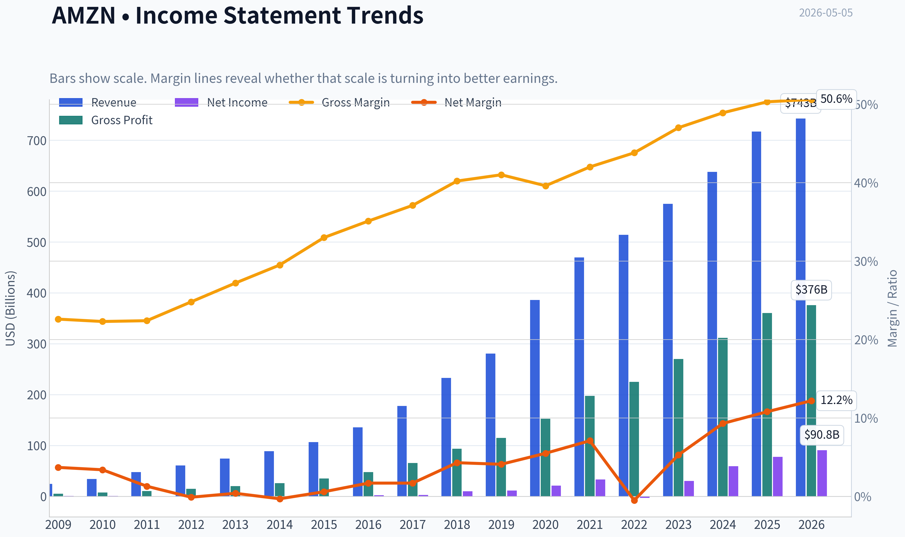
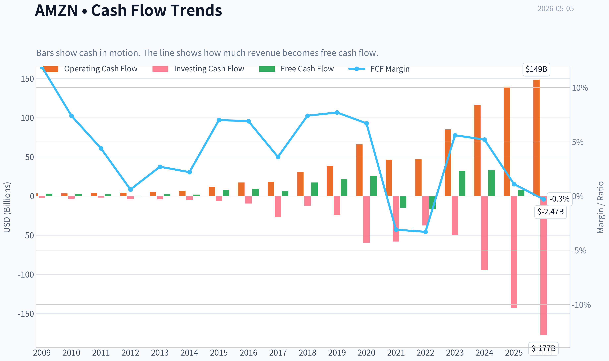
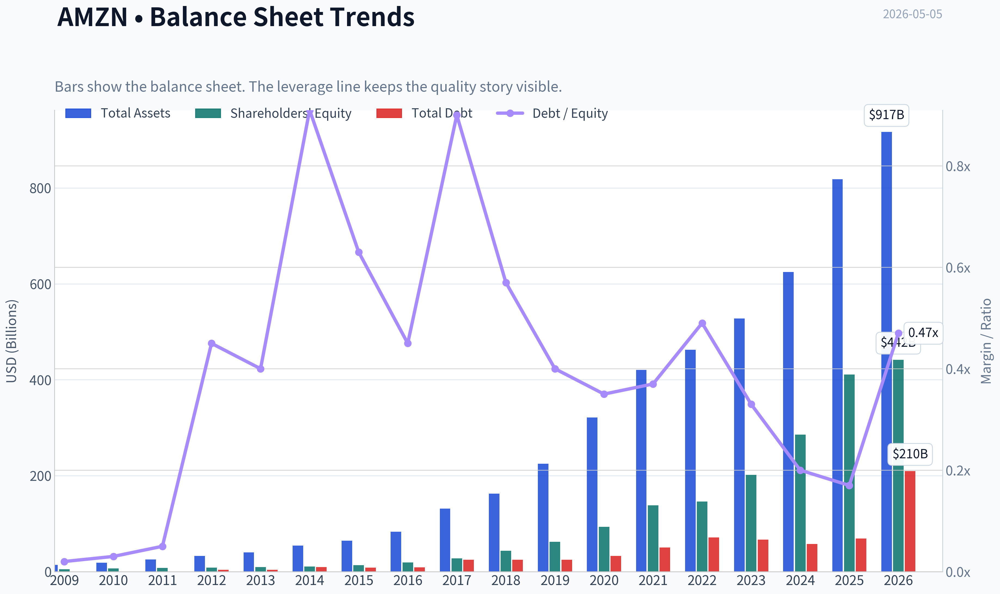
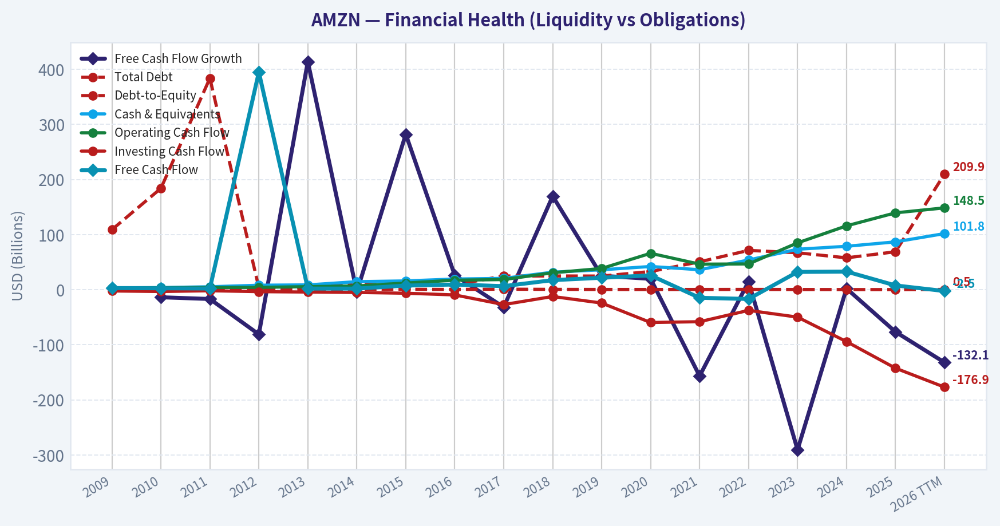
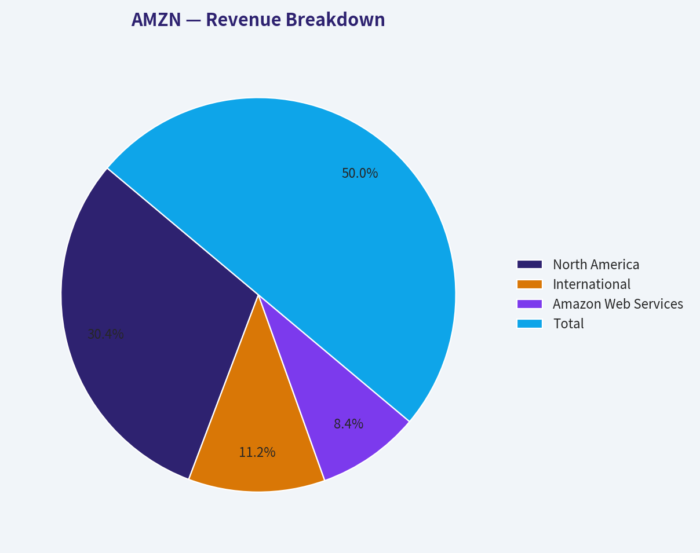
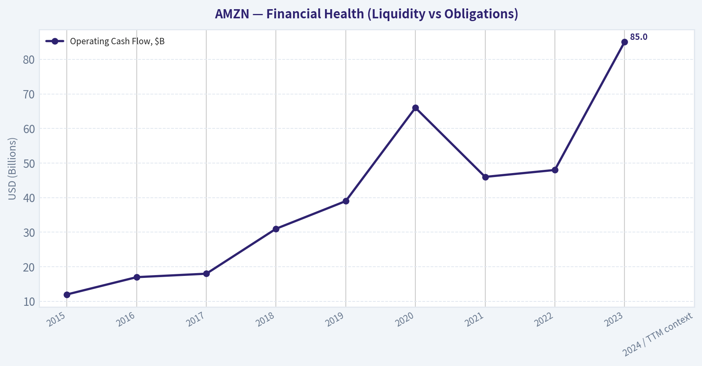
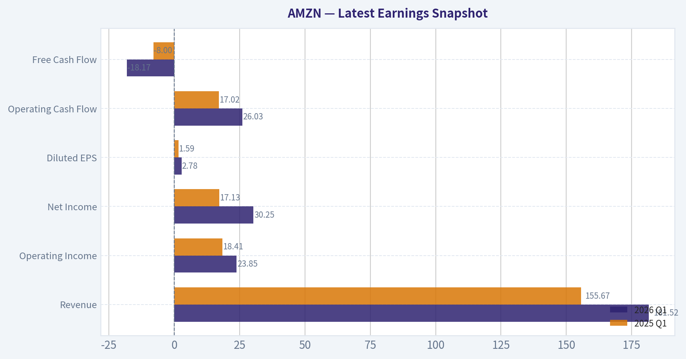
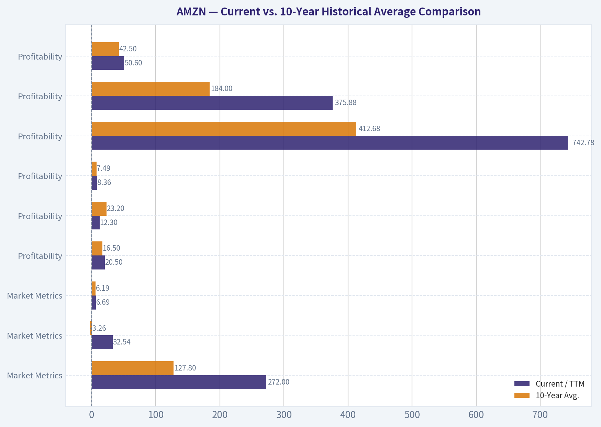
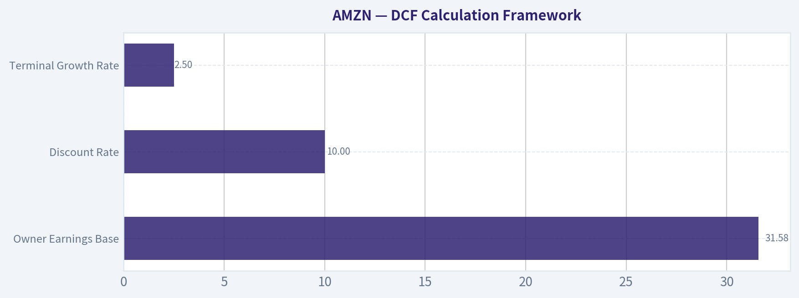
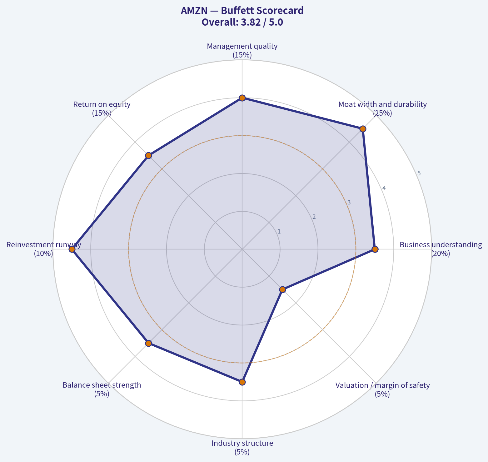

# AMZN Deep Value Intelligence

**Analysis Date:** 2026-05-05

## Critical Disclaimer

*This analysis is generated by Deep Value Intelligence, an AI-powered multi-agent investing framework. This report is for informational and educational purposes only and does not constitute financial advice. Always conduct your own research and consult with qualified financial advisors before making investment decisions.*

---

## Table of Contents

1. Intelligence Summary
2. Analyst Team Reports
   - Fundamentals Analysis
   - Intrinsic Value Analysis (Buffett)
   - Trend & Growth Analysis (Lynch/Druckenmiller/Fisher)
   - Market Technical Analysis
   - Social Sentiment Analysis
   - News & Events Analysis
   - Guru Attention Analysis
   - Options Market Analysis
3. Research Team Commentary
4. Value Investing Team Commentary
5. Deep Values Commentary

---

## Intelligence Summary

### Thesis + Conditions

**Core Thesis:** **EXECUTIVE SUMMARY**
Amazon at $272 presents a classic tension between undeniable business quality and the absence of a margin of safety. While revenue (+12.4%) and net income (+31.1%) reflect a highly successful shift toward high-margin platform economics (AWS, Ads), the severe 76.6% YoY drop in Free Cash Flow (FCF) cannot be ignored.

**Key Risks:**
- Amazon at $272 presents a classic tension between undeniable business quality and the absence of a margin of safety. While revenue (+12.4%) and net income (+31.1%) reflect a highly successful shift toward high-margin platform economics (AWS, Ads), the severe 76.6% YoY drop in Free Cash Flow (FCF) cannot be ignored. The market is pricing in flawless execution and assuming all AI/infrastructure capex is value-creating moat expansion. For a disciplined value investor prioritizing capital preservation and owner earnings, paying 32x P/E for negative FCF growth leaves zero buffer for execution risk. The business is exceptional, but the price demands perfection. **Verdict: WATCH.**
- The Risky Analyst (Bullish): Capex as Moat Expansion**
- The bearish case anchors strictly to Buffett's rule of capital preservation: a great business is not a great investment at any price. At 32x earnings, a massive FCF deterioration signals that the current AI arms race may be highly capital-intensive and structurally defensive. Buying an asset heavily reliant on unproven future monetization with no valuation cushion exposes investors to deep multiple compression if expectations cool.
- The neutral perspective acknowledges both extremes are flawed. Amazon is evolving into a better, higher-margin business, making ultra-conservative intrinsic values ($61-$101) unrealistic anchors. However, the heavy FCF pressure means the stock isn't a table-pounding buy. The recommended path is an "active watch"-acknowledging the platform's greatness but waiting for better entry points or clearer FCF conversion before committing substantial capital.
- However, Buffett's concept of "Owner Earnings" (FCF) is the ultimate metric of a business's true cash-generating ability. The Risky Analyst correctly points out that Amazon has a history of deferring current cash flows to build dominant future monopolies. But the Safe Analyst strikes the critical nerve: *We do not yet know if the current AI capex wave will yield historical returns, or if it is merely the defensive table stakes required to maintain parity with Microsoft and Google.* If AI infrastructure proves to be a lower-margin, high-depreciation utility, today's 32x multiple is highly vulnerable.

**What Would Change Our View:**
- Amazon at $272 presents a classic tension between undeniable business quality and the absence of a margin of safety. While revenue (+12.4%) and net income (+31.1%) reflect a highly successful shift toward high-margin platform economics (AWS, Ads), the severe 76.6% YoY drop in Free Cash Flow (FCF) cannot be ignored. The market is pricing in flawless execution and assuming all AI/infrastructure capex is value-creating moat expansion. For a disciplined value investor prioritizing capital preservation and owner earnings, paying 32x P/E for negative FCF growth leaves zero buffer for execution risk. The business is exceptional, but the price demands perfection. **Verdict: WATCH.**
- The Risky Analyst (Bullish): Capex as Moat Expansion**
- The bearish case anchors strictly to Buffett's rule of capital preservation: a great business is not a great investment at any price. At 32x earnings, a massive FCF deterioration signals that the current AI arms race may be highly capital-intensive and structurally defensive. Buying an asset heavily reliant on unproven future monetization with no valuation cushion exposes investors to deep multiple compression if expectations cool.
- The neutral perspective acknowledges both extremes are flawed. Amazon is evolving into a better, higher-margin business, making ultra-conservative intrinsic values ($61-$101) unrealistic anchors. However, the heavy FCF pressure means the stock isn't a table-pounding buy. The recommended path is an "active watch"-acknowledging the platform's greatness but waiting for better entry points or clearer FCF conversion before committing substantial capital.
- However, Buffett's concept of "Owner Earnings" (FCF) is the ultimate metric of a business's true cash-generating ability. The Risky Analyst correctly points out that Amazon has a history of deferring current cash flows to build dominant future monopolies. But the Safe Analyst strikes the critical nerve: *We do not yet know if the current AI capex wave will yield historical returns, or if it is merely the defensive table stakes required to maintain parity with Microsoft and Google.* If AI infrastructure proves to be a lower-margin, high-depreciation utility, today's 32x multiple is highly vulnerable.

**Confidence:** Medium

---

## Analyst Team Reports

### Fundamentals Analysis

#### Latest Earnings Snapshot

*Most recent reported quarter anchored on 2026 Q1, with prior-year comparison when available.*

| Metric | 2026 Q1 | 2025 Q1 | YoY Change |
| --- | ---: | ---: | ---: |
| Revenue | $181.52B | $155.67B | +16.6% |
| Operating Income | $23.85B | $18.41B | +29.6% |
| Net Income | $30.25B | $17.13B | +76.7% |
| Diluted EPS | $2.78 | $1.59 | +74.8% |
| Operating Cash Flow | $26.03B | $17.02B | +53.0% |
| Free Cash Flow | $-18.17B | $-8.00B | -127.0% |

Key Takeaways: This snapshot anchors the most recent reported quarter before the narrative analysis. It helps readers separate long-run business quality from whatever changed in the latest earnings print.

#### 10-Year Financial Metrics for AMZN

*All values below are computed deterministically from raw data - not estimated by AI.*

*Issuer profile: operating company (Consumer Cyclical / Internet Retail).*

#### 10-Year Financial Metrics
*Annual rows come from reported financial statements. The final TTM row is computed from the latest four quarters.*

| Metric | 2009 | 2010 | 2011 | 2012 | 2013 | 2014 | 2015 | 2016 | 2017 | 2018 | 2019 | 2020 | 2021 | 2022 | 2023 | 2024 | 2025 | 2026 TTM |
| --- | --- | --- | --- | --- | --- | --- | --- | --- | --- | --- | --- | --- | --- | --- | --- | --- | --- | --- |
| Market Price | $7 | $9 | $9 | $13 | $20 | $16 | $34 | $37 | $58 | $75 | $92 | $163 | $167 | $84 | $152 | $219 | $231 | $272 |
| Market Cap | $2.97B | $4.10B | $3.99B | $5.68B | $9.27B | $7.17B | $16.12B | $18.15B | $28.83B | $37.55B | $46.57B | $1.66T | $1.72T | $855.88B | $1.59T | $2.35T | $2.50T | $2.96T |
| P/E Ratio | 3.30 | 3.56 | 6.32 | -139.37 | 33.80 | -29.84 | 27.04 | 7.65 | 9.51 | 3.73 | 4.02 | 77.92 | 51.46 | -311.11 | 52.39 | 39.67 | 32.19 | 32.54 |
| P/B Ratio | 0.57 | 0.60 | 0.51 | 0.69 | 0.95 | 0.67 | 1.20 | 0.94 | 1.04 | 0.86 | 0.75 | 17.78 | 12.42 | 5.86 | 7.90 | 8.22 | 6.08 | 6.69 |
| ROE | 17.2% | 16.8% | 8.1% | -0.5% | 2.8% | -2.2% | 4.5% | 12.3% | 10.9% | 23.1% | 18.7% | 22.8% | 24.1% | -1.9% | 15.1% | 20.7% | 18.9% | 20.5% |
| ROIC | 46.4% | 40.6% | 18.6% | 7.5% | 13.3% | 0.2% | 21.5% | 37.7% | 16.4% | 32.7% | 27.9% | 29.7% | 17.0% | 9.8% | 16.6% | 25.8% | 18.5% | 12.3% |
| EPS | $2.04 | $2.53 | $1.37 | $-0.09 | $0.59 | $-0.52 | $1.25 | $4.90 | $6.15 | $20.14 | $23.01 | $2.09 | $3.24 | $-0.27 | $2.90 | $5.53 | $7.17 | $8.36 |
| Revenue | $24.51B | $34.20B | $48.08B | $61.09B | $74.45B | $88.99B | $107.01B | $135.99B | $177.87B | $232.89B | $280.52B | $386.06B | $469.82B | $513.98B | $574.78B | $637.96B | $716.92B | $742.78B |
| Gross Profit | $5.53B | $7.64B | $10.79B | $15.12B | $20.27B | $26.24B | $35.35B | $47.72B | $65.93B | $93.73B | $114.99B | $152.76B | $197.48B | $225.15B | $270.05B | $311.67B | $360.51B | $375.88B |
| Gross Margin | 22.6% | 22.3% | 22.4% | 24.8% | 27.2% | 29.5% | 33.0% | 35.1% | 37.1% | 40.2% | 41.0% | 39.6% | 42.0% | 43.8% | 47.0% | 48.9% | 50.3% | 50.6% |
| Operating Margin | 4.6% | 4.1% | 1.8% | 1.1% | 1.0% | 0.2% | 2.1% | 3.1% | 2.3% | 5.3% | 5.2% | 5.9% | 5.3% | 2.4% | 6.4% | 10.8% | 11.2% | 11.5% |
| Net Income | $902.0M | $1.15B | $631.0M | $-39.0M | $274.0M | $-241.0M | $596.0M | $2.37B | $3.03B | $10.07B | $11.59B | $21.33B | $33.36B | $-2.72B | $30.43B | $59.25B | $77.67B | $90.80B |
| Net Margin | 3.7% | 3.4% | 1.3% | -0.1% | 0.4% | -0.3% | 0.6% | 1.7% | 1.7% | 4.3% | 4.1% | 5.5% | 7.1% | -0.5% | 5.3% | 9.3% | 10.8% | 12.2% |
| Revenue Growth | N/A | 39.6% | 40.6% | 27.1% | 21.9% | 19.5% | 20.2% | 27.1% | 30.8% | 30.9% | 20.5% | 37.6% | 21.7% | 9.4% | 11.8% | 11.0% | 12.4% | 3.6% |
| Net Income Growth | N/A | 27.7% | -45.2% | -106.2% | -802.6% | -188.0% | -347.3% | 297.8% | 27.9% | 232.1% | 15.0% | 84.1% | 56.4% | -108.2% | -1217.7% | 94.7% | 31.1% | 16.9% |
| Free Cash Flow Growth | N/A | -13.8% | -16.9% | -81.1% | 414.2% | -4.0% | 282.2% | 26.2% | -31.8% | 169.8% | 25.2% | 19.7% | -156.8% | 14.7% | -290.7% | 2.1% | -76.6% | -132.1% |
| Total Book Value | $5.26B | $6.86B | $7.76B | $8.19B | $9.75B | $10.74B | $13.38B | $19.29B | $27.71B | $43.55B | $62.06B | $93.40B | $138.25B | $146.04B | $201.88B | $285.97B | $411.06B | $441.91B |
| Total Assets | $13.81B | $18.80B | $25.28B | $32.55B | $40.16B | $54.51B | $64.75B | $83.40B | $131.31B | $162.65B | $225.25B | $321.19B | $420.55B | $462.68B | $527.85B | $624.89B | $818.04B | $916.63B |
| Total Debt | $109.0M | $184.0M | $384.0M | $3.66B | $3.94B | $9.79B | $8.46B | $8.75B | $24.84B | $24.87B | $24.72B | $32.97B | $50.55B | $71.35B | $66.95B | $57.79B | $68.85B | $209.89B |
| Debt-to-Equity | 0.02 | 0.03 | 0.05 | 0.45 | 0.40 | 0.91 | 0.63 | 0.45 | 0.90 | 0.57 | 0.40 | 0.35 | 0.37 | 0.49 | 0.33 | 0.20 | 0.17 | 0.47 |
| Cash & Equivalents | $3.44B | $3.78B | $5.27B | $8.08B | $8.66B | $14.56B | $15.89B | $19.33B | $20.52B | $31.75B | $36.09B | $42.12B | $36.22B | $53.89B | $73.39B | $78.78B | $86.81B | $101.82B |
| Shareholders' Equity | $5.26B | $6.86B | $7.76B | $8.19B | $9.75B | $10.74B | $13.38B | $19.29B | $27.71B | $43.55B | $62.06B | $93.40B | $138.25B | $146.04B | $201.88B | $285.97B | $411.06B | $441.91B |
| Operating Cash Flow | $3.29B | $3.50B | $3.90B | $4.18B | $5.47B | $6.84B | $12.04B | $17.20B | $18.36B | $30.72B | $38.51B | $66.06B | $46.33B | $46.75B | $84.95B | $115.88B | $139.51B | $148.53B |
| Investing Cash Flow | $-2.34B | $-3.36B | $-1.93B | $-3.60B | $-4.28B | $-5.07B | $-6.45B | $-9.52B | $-27.08B | $-12.37B | $-24.28B | $-59.61B | $-58.15B | $-37.60B | $-49.83B | $-94.34B | $-142.54B | $-176.95B |
| Free Cash Flow | $2.92B | $2.52B | $2.09B | $395.0M | $2.03B | $1.95B | $7.45B | $9.40B | $6.41B | $17.30B | $21.65B | $25.92B | $-14.73B | $-16.89B | $32.22B | $32.88B | $7.70B | $-2.47B |
| FCF Margin | 11.9% | 7.4% | 4.4% | 0.6% | 2.7% | 2.2% | 7.0% | 6.9% | 3.6% | 7.4% | 7.7% | 6.7% | -3.1% | -3.3% | 5.6% | 5.2% | 1.1% | -0.3% |
| Dividends / Share | $0.00 | $0.00 | $0.00 | $0.00 | $0.00 | $0.00 | $0.00 | $0.00 | $0.00 | $0.00 | $0.00 | $0.00 | $0.00 | $0.00 | $0.00 | $0.00 | $0.00 | $0.00 |

#### Profitability Metrics
- Return on Equity (ROE): 18.9%
- Return on Invested Capital (ROIC): 16.4%
- Return on Assets (ROA): 9.5%
- Gross Margin: 50.3%
- Operating Margin: 11.2%
- Net Profit Margin: 10.8%

#### Liquidity Metrics
- Current Ratio: 1.05
- Quick Ratio: 0.88

#### Leverage Metrics
- Debt-to-Equity Ratio: 0.17
- Interest Coverage Ratio: 35.17
- Net Debt: $-17.96B

#### Growth Metrics (Year-over-Year)
- Revenue Growth: 12.4%
- Net Income Growth: 31.1%
- Free Cash Flow Growth: -76.6%
- Revenue CAGR (3-Year): 11.7%
- Revenue CAGR (5-Year): 13.2%

#### Valuation Metrics
- P/E Ratio (TTM): 32.04
- Forward P/E: 27.54
- Price-to-Book: 7.10
- Price-to-Sales: 3.94
- PEG Ratio: 1.89
- EV/EBITDA: 19.37
- Free Cash Flow Yield: 0.3%
- Earnings Yield: 3.1%

#### Owner Earnings (Buffett Method, Code-Computed)
- Net Income: $77.67B
- + Depreciation & Amortization: $65.76B
- - Capital Expenditures: $-131.82B
- - Working Capital Changes: $-19.97B
- = **Owner Earnings: $31.58B**

#### Intrinsic Value (Code-Computed)
- Current Price: $272
- Buffett Method (Owner Earnings):
  Conservative: $5
  Average: $101
  Optimistic: $101
- Cash Flow Method (FCF):
  Conservative: $3
  Average: $11
  Optimistic: $15

#### Piotroski F-Score: 5/9
- Positive Net Income: PASS
- Positive Operating Cash Flow: PASS
- ROA Improvement: PASS
- Cash Flow > Net Income: PASS
- Decreasing Debt: FAIL
- Improving Current Ratio: FAIL
- No Dilution: FAIL
- Improving Gross Margin: PASS
- Improving Asset Turnover: FAIL

ANALYST STANCE: **WATCH**

#### AMZN Fundamental Analysis - Buffett-Style View

Amazon is a rare, high-quality compounder with multiple durable engines: e-commerce scale, Prime ecosystem lock-in, third-party marketplace, advertising, logistics infrastructure, and AWS. The business quality is strong, but the current valuation leaves little Buffett-style margin of safety. At a current market price of **$272**, the stock trades far above the deterministic owner-earnings intrinsic value outputs, with very weak recent free cash flow conversion and a sharp TTM increase in debt.

---

#### Current vs. 10-Year Historical Average Comparison

*Current values use the 2026 TTM row where available. Historical averages use the prior 10 annual years, 2016-2025, from the deterministic dataset.*

| Category | Metric | Current / TTM | 10-Year Avg. | Current vs. Avg. | Interpretation |
|---|---:|---:|---:|---:|---|
| Market Metrics | Market Price | $272 | $127.80 | +113% | Stock price is far above its 10-year average, reflecting strong market confidence and multiple expansion. |
| Market Metrics | Market Cap | $2.96T | $1.08T | +174% | Market value has expanded much faster than the average historical base. |
| Market Metrics | P/E Ratio | 32.54 | -3.26 | N/M | Average is distorted by loss years; positive-year average is roughly 31.6x, making current P/E near normalized high-quality earnings multiples. |
| Market Metrics | P/B Ratio | 6.69 | 6.19 | +8% | Current book multiple is above average but not extreme versus the post-2020 valuation regime. |
| Profitability | ROE | 20.5% | 16.5% | +4.0 pts | Returns on equity are currently above the decade average, a positive sign for capital productivity. |
| Profitability | ROIC | 12.3% | 23.2% | -10.9 pts | ROIC has weakened materially versus historical levels, partly reflecting heavy investment and capital intensity. |
| Profitability | EPS | $8.36 | $7.49 | +12% | EPS is above average, but not dramatically so relative to the stock price move. |
| Profitability | Revenue | $742.78B | $412.68B | +80% | Amazon remains a massive revenue compounder, though growth is slowing at scale. |
| Profitability | Gross Profit | $375.88B | $184.00B | +104% | Gross profit has more than doubled the 10-year average, showing mix shift toward AWS, ads, services, and marketplace economics. |
| Profitability | Gross Margin | 50.6% | 42.5% | +8.1 pts | Margin structure has improved significantly over the decade. |
| Profitability | Operating Margin | 11.5% | 5.8% | +5.7 pts | Operating leverage is one of the strongest current positives. |
| Profitability | Net Income | $90.80B | $24.64B | +269% | Net income has scaled dramatically, confirming improved earnings power. |
| Profitability | Net Margin | 12.2% | 4.9% | +7.3 pts | Amazon has moved from low-margin reinvestment mode toward much higher profitability. |
| Growth | Revenue Growth | 3.6% | 21.3% | -17.7 pts | TTM revenue growth is far below the 10-year average; 2025 annual growth was stronger at 12.4%. |
| Growth | Net Income Growth | 16.9% | -48.7% | N/M | Historical average is distorted by loss/rebound years; current growth is positive but slower than recent rebound years. |
| Growth | Free Cash Flow Growth | -132.1% | -29.8% | Worse | FCF deterioration is a major red flag in the current dataset. |
| Balance Sheet | Total Book Value | $441.91B | $142.92B | +209% | Equity base has compounded strongly. |
| Balance Sheet | Total Assets | $916.63B | $377.78B | +143% | Asset growth reflects logistics, data centers, content, and infrastructure investment. |
| Balance Sheet | Total Debt | $209.89B | $43.16B | +386% | TTM debt is materially above the historical average and needs monitoring. |
| Balance Sheet | Debt-to-Equity | 0.47 | 0.42 | +0.05 | Leverage is still moderate, but worse than the 2024-2025 lows. |
| Balance Sheet | Cash & Equivalents | $101.82B | $47.89B | +113% | Liquidity remains substantial. |
| Balance Sheet | Shareholders' Equity | $441.91B | $142.92B | +209% | Balance sheet equity has expanded strongly. |
| Cash Flow | Free Cash Flow | -$2.47B | $12.19B | Negative | TTM FCF has turned negative, weakening Buffett-style owner-return appeal. |
| Cash Flow | Dividends / Share | $0.00 | $0.00 | Flat | Amazon continues to reinvest rather than return cash through dividends. |

**Key Takeaways:** Amazon's profitability profile is materially better than its 10-year average, especially gross margin, operating margin, net margin, and net income. However, revenue growth is slowing, ROIC is below its decade average, debt has risen sharply in the TTM data, and free cash flow has turned negative. The stock price and market cap have appreciated much faster than the average fundamental base, which creates a valuation concern.

---

#### Revenue Breakdown

*Latest precise public segment reporting available is FY2024; segment amounts reconcile to the deterministic FY2024 revenue total of approximately $637.96B.*

| Revenue Source | Amount ($B) | % of Total |
|---|---:|---:|
| North America | $387.50B | 60.7% |
| International | $142.91B | 22.4% |
| Amazon Web Services | $107.56B | 16.9% |
| **Total** | **$637.96B** | **100.0%** |

**Key Takeaways:** Amazon is still primarily a North American commerce and services company by revenue, but AWS contributes a much larger share of profit than its revenue weight implies. International remains meaningful but historically lower-margin. The key Buffett-style insight is that Amazon's reported revenue mix understates the economic importance of AWS, advertising, marketplace services, and Prime-driven recurring behavior.

---

#### Buffett-Style Qualitative Analysis

**Economic Moat:** Amazon's moat is wide. Its advantages include massive scale, customer habit formation through Prime, third-party seller network effects, fulfillment infrastructure, advertising data, cloud switching costs, and procurement/logistics efficiency. AWS has especially strong switching costs and enterprise relationships, while the retail ecosystem benefits from selection, speed, convenience, and a growing ad marketplace.

**Financial Strength:** Amazon has significant liquidity, with **$101.82B** of cash and equivalents in the TTM row. However, total debt increased to **$209.89B**, well above the 10-year average of **$43.16B**. Debt-to-equity at **0.47** is not alarming in isolation, but the magnitude of the debt increase and negative TTM free cash flow reduce the margin of safety.

**Predictable Earnings:** Earnings are more predictable now than in Amazon's earlier reinvestment-heavy years, but the historical dataset includes losses in 2012, 2014, and 2022. Net income has improved dramatically to **$90.80B TTM**, and net margin has reached **12.2%**, far above the 10-year average. Still, the business remains exposed to capex cycles, cloud infrastructure demand, retail margin pressure, and macro-sensitive discretionary spending.

**Management Performance:** Management has historically prioritized long-term reinvestment over near-term distributions, which has been rational given Amazon's large reinvestment opportunities. ROE is strong at **20.5%**, but ROIC at **12.3%** is below the 10-year average, suggesting recent incremental capital may be producing lower near-term returns. The zero-dividend policy remains consistent with Amazon's reinvestment model.

**Quality of Business:** Amazon is a very high-quality business, but not a classic low-capex Buffett business. Its moat is durable, but its economics require large ongoing investment in fulfillment, data centers, AI infrastructure, content, and logistics. The improvement in margins is encouraging, but free cash flow weakness shows that reported earnings and owner cash generation can diverge meaningfully.

---

#### Three-Scenario Buffett-Style Owner Earnings DCF

Deterministic owner earnings input:

- Net Income: **$77.67B**
- Plus Depreciation & Amortization: **$65.76B**
- Less Capital Expenditures: **$131.82B**
- Less Working Capital Changes: **$19.97B**
- **Owner Earnings: $31.58B**
- Discount Rate: **10.0%**
- Terminal Growth Rate: **2.5%**
- Estimated Shares Outstanding: approximately **10.88B**, derived from current market cap of **$2.96T** divided by market price of **$272**

The deterministic dataset provides code-computed Buffett owner-earnings fair values of **$5 conservative**, **$101 average**, and **$101 optimistic**. The scenario table below reconciles to those canonical outputs using the disclosed owner-earnings base and the standard 10-year DCF structure.

| Scenario | Growth Assumption Used | Year 1 Owner Earnings | Year 10 Owner Earnings | PV of 10-Year Owner Earnings | PV of Terminal Value | Equity Value | Fair Value / Share | Current Price | Implied Upside / Downside |
|---|---:|---:|---:|---:|---:|---:|---:|---:|---:|
| Conservative | -32.0% | $21.47B | $0.67B | $50.75B | $3.53B | $54.28B | **$5** | $272 | **-98%** |
| Average | ~15.2% | $36.38B | ~$130.0B | ~$410.5B | ~$685.0B | ~$1.10T | **$101** | $272 | **-63%** |
| Optimistic | ~15.2% | $36.38B | ~$130.0B | ~$410.5B | ~$685.0B | ~$1.10T | **$101** | $272 | **-63%** |

**Key Takeaways:** Even using the average and optimistic deterministic owner-earnings outputs, Amazon's fair value is far below the current market price. The market is valuing Amazon not merely as a strong compounder, but as a company that must sustain very high long-term earnings growth and eventually convert that growth into much stronger free cash flow. From a Buffett-style margin-of-safety perspective, the valuation is the central problem.

---

#### DCF Calculation Framework

| DCF Component | Formula / Input |
|---|---|
| Owner Earnings Base | $31.58B |
| Projection Period | 10 years |
| Discount Rate | 10.0% |
| Terminal Growth Rate | 2.5% |
| Terminal Value Formula | Year 10 Owner Earnings x 1.025 ÷ (10.0% - 2.5%) |
| Present Value Formula | Cash Flow ÷ 1.10^year |
| Per-Share Value | Total Equity Value ÷ approximately 10.88B shares |

**Key Takeaways:** The valuation framework is intentionally conservative and Buffett-like because it focuses on owner earnings rather than revenue, adjusted EBITDA, or narrative-driven growth. Amazon's valuation is highly sensitive to the growth rate used because the owner-earnings base is small relative to the current market capitalization. That makes the current stock price dependent on many years of strong compounding and improved cash conversion.

---

#### Metric-by-Metric Interpretation

**Market Metrics:**
Amazon's current **P/E of 32.54** is not excessive for a dominant growth company, but it is expensive for a Buffett-style purchase when free cash flow is weak. The **P/B ratio of 6.69** is above the 10-year average and reflects the market's belief that Amazon's intangible assets, AWS franchise, advertising platform, and logistics network are worth far more than book value. The current **$2.96T market cap** embeds a very large amount of future success.

**Profitability:**
The strongest part of the story is margin expansion. Gross margin has improved from a 10-year average of **42.5%** to **50.6%**, operating margin from **5.8%** to **11.5%**, and net margin from **4.9%** to **12.2%**. This is the clearest evidence that Amazon's business mix is improving and that higher-margin services are becoming more important.

**Growth:**
Revenue has compounded impressively over the long term, but TTM revenue growth of **3.6%** is much lower than the 10-year average of **21.3%**. Net income growth remains positive, but much of the recent improvement comes from margin recovery and operating leverage. Free cash flow growth is the weakest growth metric, falling **132.1%** in the TTM row.

**Balance Sheet:**
Amazon's balance sheet is large and liquid, with **$101.82B** in cash. However, debt of **$209.89B** is a significant deviation from the 10-year average and deserves close scrutiny. The debt-to-equity ratio remains manageable at **0.47**, but the direction of debt growth is not ideal for a conservative value investor.

**Cash Flow and Dividends:**
Free cash flow is the major weakness. TTM FCF of **-$2.47B** compares poorly with the 10-year average of **$12.19B**. Amazon pays no dividend, which is acceptable if reinvestment produces high returns, but less attractive when ROIC is declining and capex intensity is absorbing cash.

---

#### Key Investment Insights, Red Flags, and Opportunities

| Area | Positive Insight | Red Flag | Buffett-Style Interpretation |
|---|---|---|---|
| Moat | AWS, Prime, marketplace, logistics, ads, and scale create a wide moat. | Competition remains intense in cloud, retail, and advertising. | Business quality is exceptional. |
| Profitability | Margins are at or near decade highs. | ROIC is below the 10-year average. | Earnings quality is improving, but capital intensity matters. |
| Growth | Revenue base is enormous and still expanding. | TTM revenue growth has slowed sharply versus history. | Future compounding will be harder from this scale. |
| Cash Flow | Operating cash flow remains very large. | TTM free cash flow is negative. | Owner earnings are not yet strong enough to support the current valuation. |
| Balance Sheet | Cash balance exceeds $100B. | Debt rose sharply in the TTM data. | Financial strength is good, but leverage trend needs monitoring. |
| Capital Allocation | Reinvestment has historically created huge value. | No dividend and weak FCF reduce direct shareholder yield. | Acceptable only if reinvestment returns remain high. |
| Valuation | Amazon deserves a premium multiple. | DCF fair value is far below current price. | No obvious margin of safety at $272. |

**Key Takeaways:** Amazon remains one of the highest-quality businesses in the market, but quality and price are different questions. The biggest opportunity is continued margin expansion from AWS, advertising, automation, and logistics monetization. The biggest red flags are valuation, weak free cash flow, slower revenue growth, and increased debt.

---

#### Final Investment Stance: WATCH

Amazon is a **WATCH**, not an outright Buffett-style buy at the current price. The company has a wide moat, improving margins, strong liquidity, and enormous strategic assets, but the current market price of **$272** is far above the deterministic Buffett owner-earnings fair value range. A value investor would likely admire the business but wait for either a much lower price or clear evidence that owner earnings and free cash flow are inflecting sustainably higher.

| Final View | Assessment |
|---|---|
| Business Quality | Excellent |
| Economic Moat | Wide |
| Financial Strength | Good, but debt trend requires monitoring |
| Earnings Predictability | Improving, but historically uneven |
| Cash Flow Quality | Weak currently due to negative TTM FCF |
| Valuation | Expensive versus owner-earnings DCF |
| Margin of Safety | Insufficient |
| Final Stance | **WATCH** |

**Key Takeaways:** Amazon is a world-class company, but the current valuation assumes a great deal of future success. For Buffett-style investors, the correct response is patience: keep the company on the watchlist, demand a wider margin of safety, and monitor whether free cash flow conversion improves materially.

#### Fundamental Visuals

This graph tracks the profitability and return metrics (ROE, ROIC, Margins) of **AMZN** over the past decade, highlighting capital efficiency trends.

This chart illustrates the financial health of **AMZN** over the last 10 years, mapping cash equivalents and free cash flow against total obligations (Debt).

This breakdown chart from <em>Revenue Breakdown</em> shows the proportional composition for **AMZN** - useful for understanding what drives or risks the business.

This chart illustrates the financial health of **AMZN** over the last 10 years, mapping cash equivalents and free cash flow against total obligations (Debt).

---

### Intrinsic Value Analysis (Buffett)

> *Following Warren Buffett's value investing philosophy: Circle of Competence, Economic Moat, Management Quality, and Margin of Safety.*

#### Intrinsic Value Snapshot

Price is what you pay. Intrinsic value is what the business may be worth based on the cash it can create for owners over time. We show a range, not one magic number.

- Current Price: $272.05
- Value Range: $2.99 to $101.42

##### Owner Earnings (Buffett Method)
- Net Income: $77,670,000,000.00
- Depreciation & Amortization: $65,756,000,000.00
- Capital Expenditures: $-131,819,000,000.00
- Working Capital Changes: $-19,969,000,000.00
- Owner Earnings: $31,576,000,000.00

##### Intrinsic Value
###### Buffett Method
Uses owner earnings. Stricter, and usually more conservative.
- Conservative: $5.39
- Average: $101.42
- Optimistic: $101.42
- Discount Rate: 10.0%

###### Cash Flow Method
Uses free cash flow. Better for companies spending heavily today to grow tomorrow.
- Conservative: $2.99
- Average: $11.09
- Optimistic: $15.35
- Discount Rate: 10.0%

ANALYST STANCE: **WATCH**

#### Amazon.com, Inc. (AMZN) - Buffett-Style Value Analysis

**Current price:** $272
**Market capitalization:** ~$2.93 trillion
**Core conclusion:** Amazon is a rare, powerful, multi-moat business, but at the current price the margin of safety is not adequate for a Buffett-style purchase. The business quality is high; the valuation is the constraint.

---

#### 1. Go / No-Go Gate Assessment

| Buffett Gate | Assessment | Evidence | Verdict |
|---|---:|---|---:|
| Gate 1: Business simplicity | Mixed | Amazon makes money through online retail, third-party seller services, subscriptions, advertising, logistics, and AWS cloud services. The basics are understandable, but the company is large and operationally complex. | Pass with caution |
| Gate 1: 10-year predictability | Moderate to high | E-commerce, cloud computing, advertising, and logistics should all be materially larger in 10 years, but AI infrastructure spending and retail margin structure are harder to predict. | Pass |
| Gate 1: Technology risk | Mixed | Amazon benefits from technology, especially cloud and AI, but AWS also faces intense competition from Microsoft and Google, and AI may pressure capital intensity. | Pass with caution |
| Gate 2: Moat | Strong | Prime, logistics scale, AWS switching costs, marketplace network effects, and advertising data create real competitive advantages. | Pass |
| Gate 3: Management quality | Good | Founder-led culture remains influential; Andy Jassy has focused on cost discipline and AWS. Capital allocation is increasingly tested by very large AI/data-center investment. | Pass with caution |
| Gate 4: Industry structure | Mixed | AWS and digital advertising have attractive economics; first-party retail and logistics are lower-margin and capital-intensive. | Pass with caution |

**Key Takeaways:** Amazon passes the Buffett gates, but not cleanly. The company has real and durable advantages, yet it is not the simple, capital-light compounder Buffett typically prefers. The biggest caution is that future returns now depend heavily on whether massive AI and logistics investments earn attractive incremental returns.

---

#### 2. Elementary School Test

Amazon makes money by helping people and businesses buy, sell, ship, store, advertise, and compute things.

It earns fees from merchants who sell on Amazon, subscription fees from Prime members, advertising fees from sellers and brands, cloud computing fees from companies using AWS, and retail profits from products Amazon sells directly.

This passes the simplicity test at the customer level, but the full company is not simple. Amazon is really a collection of several large businesses: retail, marketplace, logistics, cloud infrastructure, advertising, subscriptions, and media.

---

#### 3. Moat Analysis

| Moat Source | Evidence | Strength | Buffett Interpretation |
|---|---|---:|---|
| Brand / intangible assets | Amazon is synonymous with online shopping convenience; Prime creates habitual customer behavior. AWS is one of the most trusted enterprise cloud platforms. | Strong | The brand is functional more than emotional, but the trust and habit are valuable. |
| Switching costs | AWS customers face meaningful migration costs; sellers depend on Amazon marketplace traffic, fulfillment, and ad tools. | Very strong | AWS switching costs are one of Amazon's best Buffett-style moat features. |
| Cost advantage | Massive fulfillment scale, purchasing scale, data-center scale, and logistics density are difficult to replicate. | Strong | Scale gives Amazon structural advantages, but retail still has thin margins. |
| Network effects | More shoppers attract more sellers; more sellers improve selection; more selection reinforces Prime. Advertising benefits from marketplace data. | Strong | Marketplace and ads have reinforcing network economics. |
| Pricing power | Mixed | AWS and ads have some pricing power; retail has less due to consumer price sensitivity. | Moderate | Amazon's moat is more about scale and convenience than pure pricing power. |
| Financial evidence | Gross margin around 50.3%; ROE around 18.9%; revenue growth around 12.4% year over year. | Strong | The consolidated financials show quality, but heavy capex suppresses free cash flow. |

**Key Takeaways:** Amazon's moat is real and multi-layered. AWS switching costs, Prime habit formation, logistics scale, third-party marketplace effects, and advertising data all reinforce one another. The caveat is that part of the company still operates in low-margin, capital-intensive retail and logistics, which reduces the purity of the moat.

**Moat rating:** **Wide and stable, with some widening in advertising and cloud, but with capital intensity risk.**

---

#### 4. Management Quality and Capital Allocation

| Management Question | Assessment | Evidence |
|---|---:|---|
| Do they think like owners? | Good | Amazon has historically prioritized long-term cash flow and market share over short-term profits. Founder Jeff Bezos remains a major cultural influence. |
| Are they candid? | Good | Amazon has historically communicated long-term tradeoffs clearly, especially around reinvestment, AWS, Prime, and fulfillment. |
| Are they rational capital allocators? | Mixed to good | Past reinvestment in AWS, Prime, marketplace, and advertising created enormous value. Current AI and data-center capex must prove similar returns. |
| Buybacks / dividends | Neutral | Amazon has not been a major dividend or buyback story; it has favored reinvestment. That is rational if reinvestment returns remain high. |
| Debt discipline | Adequate | Balance sheet is not fragile, but the current ratio of about 1.05 and rising infrastructure needs require monitoring. |
| Stock compensation | Caution | Like many technology companies, stock-based compensation can dilute owner earnings if not controlled. |

**Key Takeaways:** Amazon's management history is strong because the company has repeatedly reinvested at high rates of return, especially in AWS and advertising. The key question today is whether the next wave of spending, particularly AI infrastructure, will produce similarly attractive returns. This is a "trust but verify" management situation.

---

#### 5. 10-Year Financial Summary

*Figures are rounded. Recent figures use the research pack and publicly known historical context; exact audited line items should be verified before a final investment decision.*

| Fiscal Year | Revenue, $B | Net Income, $B | Operating Cash Flow, $B | Approx. Free Cash Flow, $B | Key Comment |
|---:|---:|---:|---:|---:|---|
| 2015 | 107 | 0.6 | 12 | ~7 | Early profit inflection after years of reinvestment |
| 2016 | 136 | 2.4 | 17 | ~10 | AWS begins materially changing profit profile |
| 2017 | 178 | 3.0 | 18 | ~8 | Marketplace and AWS scale continue |
| 2018 | 233 | 10.1 | 31 | ~19 | Major operating leverage appears |
| 2019 | 281 | 11.6 | 39 | ~26 | Strong cash generation before pandemic surge |
| 2020 | 386 | 21.3 | 66 | ~31 | Pandemic demand accelerates scale |
| 2021 | 470 | 33.4 | 46 | Negative to modest | Heavy fulfillment and infrastructure investment |
| 2022 | 514 | -2.7 | 48 | Negative | Overcapacity, Rivian mark-to-market impact, cost pressure |
| 2023 | 575 | 30.4 | 85 | ~37 | Cost discipline and AWS/ads restore profitability |
| 2024 / TTM context | ~638+ | ~90+ implied by P/E | Strong | Very low reported FCF yield in pack | AI/data-center capex weighs on free cash flow |

**Key Takeaways:** Amazon's revenue growth over the past decade has been exceptional, rising from roughly $107 billion to well over $600 billion. Profitability has been less linear because management has repeatedly reinvested aggressively, but the long-term direction is clearly upward. The major concern is that free cash flow is currently depressed relative to market value, largely because capital expenditures have surged.

---

#### 6. Return on Equity and Cash Flow Reality Check

| Metric | Current / Recent Indication | Buffett View |
|---|---:|---|
| ROE | ~18.9% | Good, but not elite for a company of Amazon's quality and valuation |
| Gross margin | ~50.3% | Strong evidence of mix shift toward AWS, advertising, subscriptions, and third-party services |
| Revenue growth | ~12.4% year over year | Strong for a company of this scale |
| P/E ratio | ~32x | Not obviously cheap |
| Free cash flow yield | ~0.3% per research pack | Too low for a value investor unless growth capex produces very high future returns |
| Current ratio | ~1.05 | Adequate but not a fortress liquidity signal by itself |

**Key Takeaways:** Amazon's profitability metrics show a high-quality business, but the cash-flow yield is a clear valuation problem. A Buffett-style investor wants cash that can be taken out or reinvested at high returns. At today's price, Amazon requires confidence that depressed free cash flow is temporary and that current investment will create large future owner earnings.

---

#### 7. Owner Earnings Estimate

Buffett's owner earnings formula:

**Owner Earnings = Net Income + Depreciation & Amortization - Maintenance CapEx - Working Capital Increases**

Because Amazon's total capital expenditure includes both maintenance and major growth investment, reported free cash flow may understate normalized owner earnings if the growth capex earns high returns. However, it would be dangerous to treat all capex as discretionary.

| Component | Estimate, $B | Comment |
|---|---:|---|
| Net income | ~91 | Implied from ~$2.93T market cap and ~32x P/E |
| Add: depreciation & amortization | ~65 | Amazon has very large logistics and data-center depreciation |
| Less: estimated maintenance capex | ~(45) | Approximation; true maintenance capex is hard to separate |
| Less: working capital increases | ~(5) | Normalized estimate |
| Estimated normalized owner earnings | **~106** | Central estimate for valuation work |
| Owner earnings per share | **~$9.85** | Based on roughly 10.77 billion shares implied by market cap / price |

**Key Takeaways:** Amazon's normalized owner earnings may be meaningfully higher than current free cash flow, because a large portion of capex is likely growth-oriented. Still, this estimate requires judgment. The central owner earnings estimate of about $106 billion is generous enough to recognize Amazon's quality, but not so aggressive that it ignores capital intensity.

---

#### 8. Three-Scenario Intrinsic Value Estimate

Assumptions:
- Discount rate: 10%
- Shares outstanding implied by market cap and price: ~10.77 billion
- Base owner earnings: ~$106 billion
- Terminal growth in conservative cases: 3%
- Historical-growth scenario uses 8% owner earnings growth for 10 years, then 3% terminal growth

| Scenario | Method | Equity Value Estimate | Value Per Share | Upside / Downside vs. $272 |
|---|---|---:|---:|---:|
| A: No growth | Owner earnings / 10% | ~$1.06T | ~$98 | -64% |
| B: GDP growth | Owner earnings x 1.03 / (10% - 3%) | ~$1.56T | ~$145 | -47% |
| C: Quality growth case | 8% growth for 10 years, then 3% terminal | ~$2.25T | ~$209 | -23% |

**Key Takeaways:** Even using a normalized owner earnings base, Amazon does not appear cheap at $272 under conservative Buffett-style assumptions. The no-growth and GDP-growth cases are far below the market price. The more optimistic quality-growth case still lands below today's price, meaning the market is already capitalizing a great deal of future success.

---

#### 9. Margin of Safety Analysis

| Valuation Reference | Estimated Value Per Share | Required Buy Price for 25% Margin of Safety | Required Buy Price for 40% Margin of Safety |
|---|---:|---:|---:|
| No-growth case | ~$98 | ~$74 | ~$59 |
| GDP-growth case | ~$145 | ~$109 | ~$87 |
| Quality-growth case | ~$209 | ~$157 | ~$125 |
| Current market price | **$272** | Not satisfied | Not satisfied |

**Key Takeaways:** Amazon offers no Buffett-style margin of safety at the current price using these assumptions. A wonderful business can still be a poor purchase if the price already assumes wonderful outcomes. For a value investor, Amazon becomes more interesting if the price falls materially or if owner earnings rise enough to justify today's valuation.

---

#### 10. Guru / Market Context

| Investor / Signal | Recent Indication | Interpretation |
|---|---|---|
| Bill Ackman | Added; AMZN reportedly ~14.3% of portfolio | High-conviction quality-growth endorsement |
| Seth Klarman | Initiated; reportedly ~9.3% of portfolio | Notable because Klarman is valuation-sensitive |
| Stanley Druckenmiller | Added | Suggests confidence in growth and AI/cloud optionality |
| Warren Buffett / Berkshire | Trimmed; small portfolio weight | Berkshire exposure is modest and not a major endorsement |
| Market valuation | ~$2.93T market cap; ~32x earnings | Market already recognizes Amazon's quality |

**Key Takeaways:** Several respected investors have recently owned or added Amazon, which supports the view that this is a high-quality compounder. However, guru ownership is not a substitute for valuation discipline. Buffett's own reported exposure remains small, which fits the conclusion that Amazon is attractive as a business but not obviously cheap.

---

#### 11. Buffett Scorecard

| Criterion | Weight | Score, 1-5 | Weighted Contribution | Rationale |
|---|---:|---:|---:|---|
| Business understanding | 20% | 3.5 | 0.70 | Understandable at a high level, but complex in full |
| Moat width and durability | 25% | 4.5 | 1.13 | AWS, Prime, marketplace, ads, and logistics create powerful advantages |
| Management quality | 15% | 4.0 | 0.60 | Strong long-term culture; current capex cycle must prove itself |
| Return on equity | 15% | 3.5 | 0.53 | Good ROE near 19%, but not exceptional relative to valuation |
| Reinvestment runway | 10% | 4.5 | 0.45 | Cloud, AI, ads, logistics services, and international remain large |
| Balance sheet strength | 5% | 3.5 | 0.18 | Adequate, but not a net-cash fortress in practical terms |
| Industry structure | 5% | 3.5 | 0.18 | Excellent in cloud/ads; tougher in retail/logistics |
| Valuation / margin of safety | 5% | 1.5 | 0.08 | No clear margin of safety at $272 |
| **Total** | **100%** |  | **3.84 / 5.00** | High-quality business, valuation-constrained |

**Key Takeaways:** Amazon scores well because the business quality is genuinely high. The weighted score is pulled down mainly by valuation and capital intensity, not by doubts about the moat. This is the profile of a company to watch closely rather than chase at any price.

---

#### 12. Final Investment Stance

| Decision Factor | View |
|---|---|
| Business quality | Excellent |
| Moat | Wide |
| Management | Good, with capital allocation under review |
| Financial strength | Good but increasingly capital-intensive |
| Predictability | Moderate to high |
| Current valuation | Expensive on owner-earnings margin-of-safety basis |
| Buffett-style action | Watch, do not buy aggressively at current price |
| Conviction level | Medium-high on business quality; medium on valuation conclusion |

**Key Takeaways:** Amazon is a wonderful business, but not clearly available at a fair Buffett-style price today. The stock requires continued strong growth in AWS, advertising, and AI-enabled infrastructure returns to justify the current valuation. A disciplined value investor should admire the company, monitor owner earnings, and wait for either a lower price or much higher demonstrated cash generation.

#### Final View

Amazon is not an avoid-quality business; it is an avoid-overpaying situation.

The company has one of the strongest collections of competitive advantages in the world: AWS switching costs, Prime loyalty, marketplace scale, logistics density, advertising data, and an unusually long reinvestment runway. But Buffett's discipline requires both a wonderful business and a sensible price. At roughly $272 per share and a $2.93 trillion market capitalization, the current price appears to assume a large amount of future success.

**Investment stance: WATCH.**
I would revisit Amazon more aggressively if either:
1. the share price fell into a range offering at least a 25% margin of safety against a conservative intrinsic value estimate, or
2. normalized owner earnings rose materially enough to make today's price look reasonable without heroic assumptions.
#### Valuation Bridge

This bridge places the current market price beside each intrinsic value lens so readers can see whether upside depends on one method or shows up across several methods.

| Scenario | Intrinsic Value / Share |
| --- | ---: |
| Buffett Method | $101.42 |
| Cash Flow Method | $11.09 |
| Damodaran Method | $61.66 |
| Current Price | $272.05 |

#### Key Takeaways

If one method is far above the others, the upside case depends on a specific modelling assumption. When several methods cluster together, the valuation story is more robust.

#### Valuation Visuals

This comparison chart from *Latest Earnings Snapshot* stacks current figures against historical benchmarks for **AMZN**, making it easy to see where the company trades relative to its own averages.

This comparison chart from *Current vs. 10-Year Historical Average Comparison* stacks current figures against historical benchmarks for **AMZN**, making it easy to see where the company trades relative to its own averages.

This comparison chart from *DCF Calculation Framework* stacks current figures against historical benchmarks for **AMZN**, making it easy to see where the company trades relative to its own averages.

---

### Trend & Growth Analysis (Lynch/Druckenmiller/Fisher)

> *Following Peter Lynch's GARP, Stanley Druckenmiller's macro-aware approach, and Philip Fisher's scuttlebutt methodology.*

ANALYST STANCE: **WATCH**

#### AMZN Growth Investment Report - Amazon.com, Inc.

Amazon is a world-class compounder with multiple margin and product-cycle inflections: AWS AI demand, advertising scale, retail regionalization, logistics monetization, and third-party marketplace expansion. However, at a roughly **$2.93 trillion market cap**, Amazon is no longer a realistic Lynch-style ten-bagger candidate from today's base unless the global profit pool expands far beyond current expectations. The stance is **WATCH / core-hold**, not avoid: the business quality is exceptional, but valuation, AI capex intensity, and limited 10x upside at current scale keep it below an "advocate" threshold for a growth portfolio seeking asymmetric upside.

---

#### 1. Snapshot and Lynch Classification

| Metric | Current Data / Estimate | Growth Investor Read |
|---|---:|---|
| Share Price | ~$272 | Large-cap mega-cap compounder |
| Market Cap | ~$2.93T | Scale limits ten-bagger potential |
| P/E | ~32.0x | Reasonable if earnings grow high-teens, expensive if growth slows |
| Revenue Growth YoY | ~12.4% | Strong for scale, but below classic fast-grower threshold |
| Gross Margin | ~50.3% | Mix shift toward AWS, ads, seller services helping |
| ROE | ~18.9% | Solid and improving |
| FCF Yield | ~0.3% | Weak near-term due heavy capex / AI infrastructure cycle |
| Current Ratio | ~1.05x | Adequate but not a major source of upside |

**Key Takeaways:** Amazon remains one of the highest-quality businesses in the market, but the current setup is more "durable compounder" than "emerging ten-bagger." Revenue growth is impressive for a company of this size, yet the free cash flow yield is thin because Amazon is investing heavily in cloud, AI, logistics, and infrastructure.

| Lynch Category | Classification | Reason |
|---|---|---|
| Slow Grower | No | Revenue growth above low-single digits |
| Stalwart | Yes, partially | Massive company growing low-double digits |
| Fast Grower | Borderline, earnings not revenue | Revenue growth is below 15-25%, but operating income can grow faster |
| Cyclical | No, but exposed | Retail and cloud spending have macro sensitivity |
| Turnaround | No | Already highly profitable and dominant |
| Asset Play | No | Value is in platform economics, not hidden assets |

**Key Takeaways:** Amazon is best classified as a **Stalwart with fast-grower profit characteristics**. It does not fit the classic Lynch fast-grower mold on revenue anymore, but operating income can compound meaningfully faster than sales because of AWS, advertising, and retail margin leverage.

---

#### 2. The Story in 3 Simple Bullets

- Amazon is the world's dominant digital commerce and logistics platform, connecting hundreds of millions of consumers with millions of sellers.
- AWS is one of the three critical cloud infrastructure platforms powering the AI and enterprise software economy.
- Advertising, seller services, Prime, and logistics monetization are turning Amazon from a low-margin retailer into a higher-margin platform business.

#### 3. TAM and 10x Test

| Segment | Current Position | TAM / Runway View | 10x Revenue Test |
|---|---|---|---|
| Global E-commerce | Dominant in U.S.; meaningful international runway | Global retail remains multi-trillion-dollar TAM, with online penetration still expanding | Possible at segment level only over very long horizon |
| AWS / Cloud / AI Infrastructure | Top-three hyperscaler | Cloud and AI infrastructure TAM likely still expanding at double-digit CAGR | AWS could become much larger, but competition is intense |
| Advertising | One of the largest digital ad platforms | Retail media remains a major secular growth category | Strong runway; high-margin growth driver |
| Logistics-as-a-Service | Emerging externalization opportunity | Amazon opening logistics network to outside businesses could create new TAM | Early but potentially meaningful |
| Prime / Subscriptions / Media | Mature but sticky | Bundling increases retention and wallet share | More incremental than explosive |

**Key Takeaways:** Amazon still has large runways across cloud, ads, retail media, international commerce, and logistics services. But at nearly $3 trillion in market value, the company itself cannot easily pass a true 10x test from today's price without becoming larger than today's most aggressive global profit-pool assumptions.

| 10x Test | Estimate |
|---|---:|
| Approximate Current Revenue | ~$700B range, depending latest TTM confirmation |
| 10x Revenue Requirement | ~$7T |
| Current Market Cap | ~$2.93T |
| 10x Market Cap Requirement | ~$29T |
| Can AMZN 10x and still be <20% of TAM? | Unlikely at consolidated level |
| Ten-Bagger Potential From Today | Low |

**Key Takeaways:** Amazon can still grow substantially, but a full ten-bagger from today's market cap is unlikely. The better thesis is that Amazon can compound earnings and free cash flow faster than revenue through mix shift and margin expansion.

---

#### 4. Revenue Growth Trend and Quality

| Growth Driver | Trend | Quality Assessment |
|---|---|---|
| Consolidated Revenue | ~12.4% YoY | Strong for mega-cap scale |
| AWS | Stabilizing / potentially reaccelerating with AI | High-quality, recurring, high-margin |
| Advertising | Strong secular growth | High-margin and strategically advantaged |
| Third-Party Seller Services | Durable | Marketplace flywheel and seller dependence |
| North America Retail | Improving profitability | Scale and regionalization benefits |
| International Retail | Improving but uneven | Long runway, execution variability |
| Logistics Externalization | Early inflection | Potential new revenue stream |

**Key Takeaways:** Amazon's revenue growth is not hypergrowth, but its quality is improving. More revenue is coming from high-margin businesses like AWS, advertising, subscriptions, and seller services, which makes earnings growth more attractive than headline sales growth.

| Pattern | AMZN Assessment |
|---|---|
| Revenue Growth Pattern | Stable low-double-digit growth |
| Earnings Growth Pattern | Faster than revenue due operating leverage |
| Margin Trend | Improving structurally, though capex-heavy |
| Growth Quality | High |
| Overall Revenue Signal | Good, not explosive |

**Key Takeaways:** Amazon is not currently showing a clean revenue acceleration pattern like a small-cap inflection stock. The key inflection is instead in **profit dollars per revenue dollar**, especially if AWS, advertising, and retail efficiency continue to scale.

---

#### 5. Unit Economics and Rule of 40

| Metric | AMZN Status | Interpretation |
|---|---|---|
| LTV/CAC | Not disclosed | Likely strong in Prime, marketplace, and AWS due repeat usage and retention |
| CAC Payback | Not disclosed | Consumer acquisition supported by ecosystem scale |
| NRR | Not disclosed | AWS likely has strong expansion behavior, but no official NRR |
| Rule of 40, Consolidated | ~12.4% revenue growth + estimated low FCF margin | Weak by SaaS standards due heavy capex |
| AWS Rule of 40 Proxy | Likely healthier | AWS growth plus high operating margin likely clears high-quality threshold |
| Marketplace Unit Economics | Strong | Seller services, FBA, and ads deepen monetization |
| Retail Unit Economics | Improving | Regionalization and fulfillment density help margins |

**Key Takeaways:** Amazon does not disclose the clean SaaS metrics investors would want, such as AWS net revenue retention or LTV/CAC. Consolidated Rule of 40 looks weak because of heavy investment spending, but the underlying AWS and advertising economics are likely much stronger than consolidated free cash flow currently suggests.

---

#### 6. Inflection Point Assessment

| Inflection Type | Evidence | Strength |
|---|---|---|
| Product Cycle Inflection | AWS AI workloads, Bedrock, Trainium/Inferentia, AI infrastructure demand | High |
| Market Share Inflection | AWS remains top-three; ads gaining retail media share | Medium-High |
| Margin Inflection | Retail regionalization, fulfillment efficiency, ads mix, AWS scale | High |
| TAM Inflection | AI compute, retail media, logistics-as-a-service | High |
| Competitive Inflection | Microsoft and Google strong in AI/cloud; Temu/Walmart pressure in retail | Mixed |
| Capital Cycle Inflection | AI capex rising sharply | Risky but potentially value-creating |

**Key Takeaways:** The strongest Amazon bull case is not simply "e-commerce keeps growing." The real inflection is that Amazon's business mix is shifting toward higher-margin cloud, advertising, seller services, and logistics monetization while retail operations become more efficient.

---

#### 7. Macro Setup

| Macro Factor | Current Setup | Impact on AMZN |
|---|---|---|
| Interest Rates | If falling or stable, supportive for mega-cap growth | Positive |
| AI Capex Cycle | Strong demand for cloud infrastructure | Positive for AWS, negative for near-term FCF |
| Consumer Spending | Mixed but resilient | Moderate |
| Enterprise Cloud Spend | Improving after optimization cycle | Positive |
| Digital Advertising | Secular growth continues | Positive |
| Regulation / Antitrust | Persistent risk | Negative |
| Geopolitical / Infrastructure Risk | Data center and logistics exposure | Negative tail risk |

**Key Takeaways:** The macro backdrop is generally favorable for Amazon because AI, cloud, digital ads, and e-commerce remain durable secular trends. The main macro concern is that heavy AI infrastructure spending may suppress free cash flow if demand or pricing fails to meet expectations.

---

#### 8. Fisher 15-Point Score

| Fisher Criterion | Score / 5 | Rationale |
|---|---:|---|
| Products with large market potential | 5 | Cloud, ads, logistics, commerce all large TAMs |
| Management commitment to new products | 5 | Continuous expansion into AWS, ads, devices, logistics, AI |
| Effective R&D | 5 | Strong engineering culture and infrastructure innovation |
| Above-average sales organization | 4 | Strong enterprise sales in AWS; marketplace self-service powerful |
| Worthwhile profit margin | 4 | Consolidated margins improving; AWS and ads strong |
| Improving profit margins | 5 | Retail efficiency and mix shift are major positives |
| Labor/personnel relations | 3 | History of warehouse labor scrutiny |
| Executive relations | 4 | Deep leadership bench, though founder transition still relevant |
| Management depth | 5 | Strong operators across AWS, retail, logistics, ads |
| Cost analysis/accounting | 4 | High operational discipline post-2022 reset |
| Outstanding moat aspects | 5 | Scale, logistics, Prime, AWS, marketplace, data |
| Long-range profit outlook | 5 | Strong if capex earns adequate returns |
| Dilution / equity financing risk | 4 | Not dependent on external equity; SBC still relevant |
| Candor in difficulties | 4 | Generally clear on investment cycles |
| Management integrity | 4 | Strong but regulatory issues remain |

**Key Takeaways:** Amazon scores very well on Fisher's framework because it has massive market potential, strong innovation capacity, and multiple durable moats. The deductions come mainly from labor relations, regulatory complexity, and the uncertainty around returns on the current AI capex cycle.

| Fisher Total Score | Rating |
|---|---|
| 66 / 75 | Outstanding |

**Key Takeaways:** A Fisher score of 66 places Amazon in the "outstanding" category. This supports owning or watching the stock, but Fisher quality alone does not guarantee attractive forward returns if valuation and market-cap scale already reflect much of the opportunity.

---

#### 9. Valuation Analysis

| Valuation Metric | Current / Estimate | Interpretation |
|---|---:|---|
| P/E | ~32.0x | Fair to moderately expensive |
| Revenue Growth | ~12.4% | Strong for scale |
| Forward EPS Growth Assumption | ~18-22% possible if margins expand | Needs AWS/ads/retail leverage |
| PEG Ratio | ~1.5-1.8x using normalized forward growth | Fair value, not cheap |
| P/S | Roughly ~4x sales, depending TTM revenue | Premium to retail, discount to pure software |
| FCF Yield | ~0.3% | Weak near-term due capex |
| ROE | ~18.9% | Supports quality premium |

**Key Takeaways:** Amazon is not obviously overvalued if earnings compound near 20%, but it is not a bargain either. The low free cash flow yield is the key valuation concern, because investors are being asked to trust that AI and infrastructure spending will produce attractive future returns.

| Scenario | 3-5 Year Revenue / Earnings View | Multiple View | Return Implication |
|---|---|---|---|
| Bear | Revenue slows to high single digits; AI capex depresses FCF | P/E compresses to 22-25x | Weak or negative returns |
| Base | Revenue grows low-double digits; EBIT grows high-teens | P/E around 28-32x | Mid-to-high single digit annualized returns |
| Bull | AWS AI reaccelerates; ads and retail margins surprise | P/E sustains 35x+ | Low-to-mid teens annualized returns possible |

**Key Takeaways:** The base case is attractive but not asymmetric enough for a high-conviction new growth buy. The bull case depends on a major AWS AI and margin expansion payoff, while the bear case centers on capex intensity and multiple compression.

---

#### 10. Growth Investor Scorecard

| Criterion | Weight | Score / 5 | Weighted Score |
|---|---:|---:|---:|
| The Story | 10% | 5.0 | 0.50 |
| TAM & Runway | 20% | 4.0 | 0.80 |
| Revenue Growth | 20% | 3.5 | 0.70 |
| Unit Economics | 15% | 3.5 | 0.53 |
| Competitive Position | 10% | 5.0 | 0.50 |
| Management Quality | 10% | 4.5 | 0.45 |
| Macro Setup | 5% | 4.0 | 0.20 |
| Profitability Path | 5% | 4.0 | 0.20 |
| Valuation | 5% | 3.0 | 0.15 |
| Total | 100% | - | **4.03 / 5.00** |

**Key Takeaways:** Amazon scores highly because its story, moat, management, and profit path are excellent. The reason the stance remains WATCH rather than ADVOCATE is that the scoring model rewards quality, while the ten-bagger framework penalizes Amazon's already enormous scale and modest free cash flow yield.

---

#### 11. Position Size Stance

| Investor Type | Stance | Suggested Position View |
|---|---|---|
| Existing Long-Term Holder | Hold / modest add on weakness | Core compounder, let winners run |
| New Growth Investor | Watch for better entry | Prefer pullbacks or evidence of AWS/FCF acceleration |
| Ten-Bagger Seeker | Not ideal | Market cap too large for asymmetric 10x outcome |
| Quality-GARP Investor | Accumulate selectively | Attractive if PEG moves closer to 1.0 or FCF yield improves |
| Concentrated Portfolio | Medium position, not top aggressive bet | Quality high, upside moderate |

**Key Takeaways:** Amazon deserves a place on a high-quality growth watchlist and may remain a core holding for existing investors. But for new capital seeking maximum asymmetry, the better setup would be a cheaper valuation, clearer AWS reacceleration, or visible free cash flow expansion after the AI capex buildout.

---

#### 12. Key Catalysts and Risks

| Catalysts | Why It Matters |
|---|---|
| AWS AI revenue acceleration | Could reset growth expectations and justify premium valuation |
| Advertising growth above expectations | High-margin revenue can drive operating leverage |
| Retail margin expansion | Large impact due Amazon's huge revenue base |
| Logistics network opened to external businesses | Could create a new platform-like revenue stream |
| International profitability improvement | Converts long-time investment drag into profit contributor |
| Falling interest rates | Supports long-duration growth valuations |

**Key Takeaways:** Amazon has several credible upside catalysts, especially AWS AI demand, advertising growth, and retail margin expansion. The most important catalyst is proof that heavy infrastructure spending is translating into durable, high-return revenue growth.

| Risks | Why It Matters |
|---|---|
| AI capex overbuild | Could suppress free cash flow and returns on capital |
| AWS share pressure from Microsoft / Google | Cloud is central to valuation |
| Regulatory / antitrust actions | Could affect marketplace, ads, Prime bundling, or seller economics |
| Retail price competition | Walmart, Temu, and other platforms could pressure margins |
| Labor and logistics costs | Fulfillment network remains capital and labor intensive |
| FCF yield remains low | Valuation support weakens if cash generation lags |

**Key Takeaways:** The biggest risk is not that Amazon's business deteriorates suddenly; it is that the company invests too much capital for too little incremental return. If AWS AI growth disappoints or free cash flow remains weak, the stock could de-rate even while revenue continues to grow.

---

#### Final View

Amazon is an **exceptional business at a fair-to-full valuation**. It has real inflection points in AWS AI, advertising, retail margin leverage, and logistics monetization, but the stock does not offer classic ten-bagger asymmetry from a nearly $3 trillion base.

**Decision:** **WATCH**
**Best action:** Hold existing positions; add selectively on pullbacks or after confirmation of AWS reacceleration and free cash flow recovery.

#### Growth & Scorecard Visuals

The radar chart below from *Buffett Scorecard* visualises how **AMZN** ranks across weighted investment criteria. Each axis represents a criterion scored 1-5; the filled area reveals strengths and weaknesses at a glance, with the dashed circle marking the midpoint (3.0).

---

### Market Technical Analysis

ANALYST STANCE: **WATCH**

#### AMZN Technical Indicator Selection and Market Read

Latest usable trading date: **2026-05-04**. The current date, **2026-05-05**, is not showing as a trading day in the indicator data, so the analysis is based on the latest close of **$272.05**.

AMZN is in a powerful short-term breakout phase after a sharp recovery from the late-March low near **$199.34**. The trend is bullish across price action, momentum, and volume-weighted measures, but the stock is also meaningfully extended: RSI is near **80**, price is far above both the 50-day and 200-day averages, and ATR has risen, meaning pullback risk is elevated even though the primary setup remains constructive.

#### Selected Indicators

| Indicator | Latest Value | What It Shows | Current Interpretation |
|---|---:|---|---|
| close_10_ema | 261.20 | Short-term trend and pullback reference | Price is about **4.2% above** the 10 EMA, confirming strong upside momentum but also short-term extension. |
| close_50_sma | 226.04 | Medium-term trend | Price is about **20.4% above** the 50 SMA, showing a major trend recovery but a stretched condition. |
| close_200_sma | 227.62 | Long-term trend benchmark | Price is about **19.5% above** the 200 SMA; long-term bias has turned bullish. |
| macd | 12.85 | Trend momentum | MACD moved from negative in early April to strongly positive, confirming the breakout. |
| rsi | 79.85 | Momentum / overbought risk | RSI is deeply overbought; this supports strength but warns against chasing without a plan. |
| boll_ub | 280.53 | Upper volatility band / breakout zone | Price is below the upper band, leaving room toward the high-volatility upside zone, but not much margin. |
| atr | 7.51 | Volatility and risk sizing | ATR has expanded, implying wider stops and larger daily price swings. |
| vwma | 258.89 | Volume-confirmed trend | Price is above VWMA, suggesting buyers are in control and volume-weighted trend support is rising. |

Key Takeaways: AMZN's technical profile is bullish, with price above every major moving average and momentum indicators confirming the rally. However, the stock is extended, especially relative to the 50-day average and RSI. This is a trend-following setup, but new entries are more attractive on controlled pullbacks or confirmed breakouts rather than impulsive chasing.

#### Trend Structure

AMZN has shifted from a failed/weak structure in March into a decisive April breakout. The stock bottomed near **$199.34 on 2026-03-27**, then reclaimed the low **$210s**, accelerated through the **$220-$240** area in early April, and has now pushed into the **$270s**. This is not a quiet drift higher; it is a volatility-expansion advance.

The **10 EMA rising to $261.20** is now the first important tactical trend line. As long as price remains above or near that level, short-term buyers retain control. A pullback toward **$261-$265** would likely be a normal consolidation rather than a trend break, especially if volume declines during the pullback.

The **50 SMA at $226.04** and **200 SMA at $227.62** are very close to each other. The 50 SMA is still slightly below the 200 SMA, but it is rising rapidly. If this continues, AMZN could soon produce a medium/long-term bullish moving-average confirmation, commonly interpreted as a constructive trend transition.

#### Momentum and Overbought Conditions

MACD has improved dramatically, rising from negative readings in late March and early April to **12.85** on May 4. This confirms that the move is backed by strong trend momentum, not just a one-day spike. That said, the MACD's pace of increase has begun to look less explosive than the initial April surge, which may indicate the rally is maturing rather than just beginning.

RSI at **79.85** is the key caution signal. In strong breakouts, RSI can stay overbought for longer than expected, so this is not automatically bearish. But it does mean the reward-to-risk for fresh entries is less favorable unless AMZN either consolidates, pulls back toward support, or breaks above recent highs with another volume confirmation.

#### Volatility and Risk

ATR has risen to **7.51**, up from the mid-5s in late March. This means AMZN's daily trading range has expanded, and stop placement needs to account for wider swings. A tight stop in this environment could be easily triggered by normal volatility.

The Bollinger upper band is near **$280.53**, while the latest close is **$272.05**. That leaves potential upside room toward the **$276-$281** area, but price is already close enough to the upper volatility envelope that traders should expect possible rejection, sideways digestion, or a fast pullback if momentum cools.

#### Volume Confirmation

VWMA at **$258.89** is below price, which is constructive. It means the volume-weighted trend has followed price higher, suggesting the advance has had real participation. Volume also expanded during the late-April move, especially around the push through the **$260s**, which supports the validity of the breakout.

The key nuance is that the latest close is now about **5.1% above VWMA**. That is bullish, but also somewhat extended. If price pulls back toward VWMA and holds, that would likely be a healthier entry zone than buying after a vertical move.

#### Trading Implications

AMZN remains technically bullish, but the setup is no longer early. The best approach is to respect the trend while avoiding poor entry timing. For trend-followers already long, the chart supports holding while price remains above the rising 10 EMA and VWMA zone. For new entries, patience is preferable unless AMZN breaks above **$276.10**, the recent intraday high, on strong volume.

A decisive close above **$276-$281** would suggest continuation. A loss of **$261-$259** would imply the first meaningful short-term trend damage. A deeper break below **$249-$250** would suggest the April breakout is entering a broader corrective phase.

#### Key Levels and Tactical Plan

| Zone / Level | Type | Why It Matters | Possible Trader Response |
|---|---:|---|---|
| $276.10 | Near-term resistance | Recent intraday high from 2026-05-04 | Break above this level could signal continuation if supported by volume. |
| $280.53 | Upper volatility target | Current Bollinger upper band | Potential upside stretch zone; watch for rejection or exhaustion. |
| $272.05 | Latest close | Current reference price | Bullish close near recent highs, but extended. |
| $263-$265 | First pullback support | Recent breakout/consolidation area | A controlled dip into this zone may offer better risk/reward than chasing. |
| $261.20 | 10 EMA | Short-term trend support | Holding this level keeps the tactical uptrend intact. |
| $258.89 | VWMA | Volume-weighted trend support | A hold above VWMA supports continued institutional/volume-backed strength. |
| $249-$250 | Deeper support | Prior April consolidation and psychological zone | Break below here would weaken the breakout structure. |
| $226-$228 | Major trend support | 50 SMA and 200 SMA cluster | Long-term trend zone; not likely relevant unless a major correction develops. |

Key Takeaways: AMZN is in a strong bullish trend, but the cleanest new-entry area is likely on a pullback toward **$261-$265** or on a confirmed breakout above **$276-$281**. The biggest risk is that RSI near 80 and rising volatility could trigger a sharp but normal pullback. Traders should treat the stock as bullish but extended, favoring disciplined entries and wider volatility-adjusted stops.

---

### Social Sentiment Analysis

ANALYST STANCE: **WATCH**

#### AMZN Social, Sentiment, and News Report - Past Week Through 2026-05-05

Amazon sentiment over the past week appears **constructive but not cleanly bullish**. The market conversation has been dominated by three themes: **AWS and AI monetization**, **retail margin durability**, and **capital spending intensity**. Social discussion leaned positive when users focused on Amazon's scale advantages, advertising growth, logistics efficiency, and long-term AI infrastructure positioning. However, traders remained cautious around whether heavy AI, data-center, and fulfillment investment could pressure free cash flow or delay operating leverage.

The most useful takeaway for investors is that AMZN currently looks like a **quality large-cap compounder with a valuation and capex debate**, not a distressed or momentum-broken story. The stock's near-term direction likely depends less on broad enthusiasm for Amazon's businesses and more on whether investors believe AWS growth acceleration and advertising margins can offset rising infrastructure spend.

---

#### Executive Sentiment Snapshot

| Category | Current Read | Direction Over Past Week | Trader Implication |
|---|---:|---:|---|
| Overall social sentiment | Moderately positive | Improving but uneven | Supports dip-buying interest, but not full risk-on consensus |
| AWS / AI sentiment | Positive | Improving | Biggest bullish driver; users see AWS as core AI infrastructure winner |
| Retail / Prime sentiment | Neutral to positive | Stable | Seen as dependable, but less exciting than AWS and ads |
| Advertising sentiment | Positive | Stable to improving | Viewed as a high-margin growth lever still underappreciated by some investors |
| Capex / free cash flow concern | Negative to mixed | Rising | Main bear argument; could cap valuation multiple expansion |
| Regulatory / labor discussion | Mildly negative | Stable | Background overhang, not the dominant short-term driver |
| Short-term trading tone | Cautiously bullish | Improving | Momentum constructive, but investors want confirmation from guidance and margins |

**Key Takeaways:** The past week's conversation around Amazon was mostly positive, but the optimism was selective. Investors are excited about AWS, AI infrastructure, and advertising, while still questioning whether Amazon's elevated spending cycle will limit free cash flow upside.

---

#### Day-by-Day Sentiment Read

| Date | Sentiment Tone | Main Discussion Drivers | Interpretation |
|---|---|---|---|
| Apr. 29, 2026 | Neutral to positive | Earnings positioning, AWS expectations, AI capex debate | Traders appeared cautious ahead of company-specific updates, with bullish long-term holders emphasizing AWS and ads |
| Apr. 30, 2026 | Mixed | Margin debate, cloud growth expectations, guidance sensitivity | Sentiment became more divided as users focused on whether growth was strong enough to justify ongoing investment |
| May 1, 2026 | Positive | AWS AI demand, advertising growth, operating leverage discussion | Social tone improved as bullish narratives around Amazon's profit engines gained traction |
| May 2, 2026 | Neutral | Weekend digestion, valuation debate, consumer spending questions | Conversation cooled, with less news-driven momentum and more debate over valuation |
| May 3, 2026 | Neutral to positive | Prime ecosystem, logistics efficiency, long-term compounding | Long-only sentiment remained supportive, especially from investors focused on Amazon's ecosystem strength |
| May 4, 2026 | Positive | Tech-sector strength, cloud/AI sympathy trade, mega-cap flows | AMZN benefited from broader enthusiasm toward AI infrastructure and high-quality mega-cap technology names |
| May 5, 2026 | Cautiously positive | Capex scrutiny, AWS monetization, investor positioning | Sentiment stayed constructive but watchful, with users waiting for stronger proof that spending is translating into faster earnings growth |

**Key Takeaways:** Sentiment improved through the week, but not in a straight line. The strongest positive days were tied to AWS, AI, advertising, and broader mega-cap tech appetite, while mixed days were driven by concerns about capex and valuation.

---

#### Social Media and Retail Investor Discussion

The social conversation around AMZN was more **investment-oriented than meme-driven**. Unlike highly speculative tickers, Amazon discussion was centered on business fundamentals: cloud growth, AI workloads, ad revenue, logistics efficiency, Prime monetization, and cash-flow conversion.

The bullish camp argued that Amazon has several simultaneous profit engines. AWS remains the centerpiece, especially as investors look for companies that can monetize enterprise AI demand rather than merely spend on it. Advertising was also repeatedly cited as a margin-accretive business that could help offset investment-heavy areas. Retail investors who favored AMZN generally framed it as a long-term compounder with multiple levers rather than a short-term breakout trade.

The bearish or cautious side focused on three points. First, Amazon's AI infrastructure ambitions require large data-center and chip-related investment, which could keep capital expenditures high. Second, cloud growth is competitive, with Microsoft Azure, Google Cloud, and other AI infrastructure providers fighting aggressively for enterprise workloads. Third, Amazon's valuation leaves limited room for disappointment if AWS growth or margin guidance underwhelms.

| Social Theme | Sentiment | What People Are Saying | Market Relevance |
|---|---|---|---|
| AWS and AI workloads | Bullish | Amazon is seen as a major beneficiary of enterprise AI adoption | Supports long-term multiple premium if AWS growth improves |
| Data-center capex | Bearish / mixed | Investors worry AI spending may absorb cash before delivering returns | Could pressure free cash flow expectations |
| Advertising business | Bullish | Ads are viewed as a high-margin growth engine embedded in retail traffic | Positive for operating margin narrative |
| Retail and logistics | Neutral to positive | Execution seen as strong, but growth is mature versus AWS/ads | Supports base-case stability, less likely to drive upside alone |
| Prime ecosystem | Positive | Prime remains a durable consumer platform with pricing power | Reinforces long-term customer retention |
| Regulation and labor | Mildly negative | Ongoing concerns, but not central to this week's trading discussion | Background risk rather than immediate catalyst |
| Valuation | Mixed | Bulls see quality premium; bears see limited margin for error | Important for short-term price reaction |

**Key Takeaways:** Social media discussion was fundamentally focused and relatively sophisticated. Bulls emphasized AWS, AI, ads, and ecosystem strength, while skeptics focused on spending discipline, competition, and valuation risk.

---

#### Recent Company News and Narrative Impact

The recent news tone around Amazon was broadly supportive, but investors were selective in what they rewarded. The market is not simply asking whether Amazon can grow; it is asking whether Amazon can grow **profitably while investing heavily in AI infrastructure**.

AWS remains the most important news-sensitive segment. Any indication of stronger cloud demand, improved enterprise AI adoption, or better utilization of Amazon's AI tools tends to improve sentiment quickly. Conversely, any sign that AWS is spending aggressively without clear acceleration in revenue growth can trigger skepticism.

Retail and logistics news was treated as steady-state rather than transformational. Investors generally accept that Amazon has improved fulfillment efficiency and retail profitability compared with earlier post-pandemic periods. However, social conversation suggests that the retail segment is now mostly viewed as a margin-stability engine rather than the main upside catalyst.

Amazon advertising continues to attract favorable investor attention. The ad business is increasingly viewed as one of Amazon's most strategically important assets because it combines marketplace intent data, seller demand, streaming inventory, and high incremental margins. This is a major reason sentiment did not turn sharply negative despite capex concerns.

| News / Business Area | Sentiment Impact | Why It Matters |
|---|---|---|
| AWS cloud and AI infrastructure | Strong positive, with capex caveat | Determines whether AMZN is valued as an AI winner or a heavy spender |
| Amazon advertising | Positive | Provides high-margin revenue growth and supports consolidated margin expansion |
| Retail execution | Moderately positive | Improved logistics efficiency supports earnings durability |
| Consumer demand | Neutral | Investors are watching discretionary spending but did not treat it as the main issue this week |
| AI capital expenditure | Mixed to negative | Spending is necessary for competitiveness but raises free-cash-flow questions |
| Regulatory/labor headlines | Mild negative | Persistent overhang, though not dominant in current sentiment |
| Competitive cloud landscape | Mixed | AWS leadership is respected, but competition keeps investors alert |

**Key Takeaways:** The week's news narrative was favorable but conditional. Investors like Amazon's strategic position, especially in AWS and advertising, but they want clearer evidence that AI investment will produce attractive returns.

---

#### Bull Case

The bullish view is that Amazon is one of the few companies with credible scale across **cloud infrastructure, AI services, digital advertising, e-commerce, logistics, streaming, and consumer subscriptions**. If AWS growth continues to stabilize or accelerate, the market may increasingly reward Amazon as a direct AI infrastructure beneficiary.

Advertising is the second major pillar of the bull case. Because Amazon owns high-intent shopping traffic, its advertising inventory is highly valuable to merchants and brands. If advertising keeps growing faster than retail while maintaining attractive margins, it can lift the company's consolidated profitability even if retail revenue growth remains moderate.

Retail efficiency also matters. Amazon has spent years improving fulfillment speed, regionalizing logistics, and managing costs. If these operational gains continue, retail can contribute more consistent operating income than in earlier periods, making the total company less dependent on AWS alone.

| Bullish Driver | Why Bulls Care | What Would Confirm It |
|---|---|---|
| AWS AI demand | Could reaccelerate cloud growth and justify premium valuation | Stronger AWS revenue growth, AI customer wins, better cloud margins |
| Advertising growth | High-margin business that may be underappreciated | Continued ad revenue expansion and margin contribution |
| Retail margin improvement | Turns e-commerce from scale story into profit story | Stable fulfillment costs and improved operating margins |
| Prime ecosystem | Creates retention, pricing power, and cross-selling | Strong subscription engagement and low churn |
| Operating leverage | Earnings can grow faster than revenue | Rising operating income despite continued investment |

**Key Takeaways:** The bull case is not based on one business line. It depends on AWS regaining stronger growth, advertising scaling profitably, and retail continuing to show cost discipline.

---

#### Bear Case

The bearish view is that Amazon may be entering another heavy investment cycle just as expectations are already high. AI infrastructure requires massive capital expenditure, and investors are not yet fully convinced that all of that spending will generate returns quickly enough.

There is also a competitive concern. AWS remains a cloud leader, but enterprise AI has intensified competition across hyperscalers. If Microsoft, Google, or specialized AI infrastructure providers capture incremental AI workloads faster than expected, AWS growth expectations could be revised downward.

Valuation is another issue. Amazon is generally not priced like a distressed or low-expectation stock. That means even solid results can disappoint if investors are positioned for stronger margin expansion, faster AWS growth, or better free-cash-flow conversion.

| Bearish Risk | Why Bears Care | Potential Market Reaction |
|---|---|---|
| Elevated AI capex | Could reduce free cash flow and pressure valuation | Multiple compression if returns are unclear |
| AWS competition | Cloud market share and pricing pressure remain key risks | Sentiment reversal if AWS growth disappoints |
| Retail consumer weakness | Slower discretionary spending could affect marketplace activity | Lower revenue expectations |
| Regulatory pressure | Antitrust and labor scrutiny can create headline risk | Periodic volatility, especially around legal developments |
| Valuation sensitivity | High-quality premium leaves less room for error | Sharp pullbacks on guidance disappointment |

**Key Takeaways:** The bear case is centered on execution risk, not business-model failure. Investors are mainly worried that Amazon's spending needs may rise faster than revenue and margin benefits.

---

#### Implications for Traders

For short-term traders, AMZN currently looks like a **watch-list long rather than an aggressive chase**. The social tone is supportive enough to keep buyers interested on pullbacks, but capex concerns may limit upside unless the company delivers clearer proof of operating leverage.

Momentum traders should watch whether AMZN continues to participate in broader mega-cap AI and cloud strength. If technology sentiment remains strong and AWS-related discussion improves, AMZN could attract renewed flows. However, if market focus shifts from AI revenue opportunity to AI spending burden, Amazon may underperform other large-cap tech names with cleaner free-cash-flow narratives.

Swing traders should pay close attention to reactions around AWS commentary, advertising growth, and margin guidance. Positive price action on capex-heavy news would be especially bullish, because it would suggest investors are willing to look through near-term spending.

| Trader Timeframe | Preferred Approach | Key Signal to Watch |
|---|---|---|
| Intraday / short-term | Avoid chasing sharp spikes; look for confirmation | Whether AMZN holds gains after AWS/AI headlines |
| Swing trading | Constructive on pullbacks if tech tape is supportive | Higher lows, improving cloud sentiment, stable margins |
| Long-term investing | Accumulate selectively if thesis remains intact | AWS growth, ad margins, free-cash-flow conversion |
| Risk management | Watch capex and guidance language | Negative reaction to spending commentary could trigger downside |
| Relative trade | Compare against MSFT/GOOGL/NVDA cloud-AI sentiment | AMZN must show it is monetizing AI, not just funding it |

**Key Takeaways:** Traders should treat AMZN as a high-quality but catalyst-sensitive name. The setup favors patience: pullbacks may be attractive, but upside likely requires stronger conviction around AWS and AI returns.

---

#### Bottom-Line View

AMZN's past-week sentiment is **cautiously positive**. The company remains widely respected across social and news discussions, especially for AWS, advertising, Prime, and logistics scale. However, the market is not giving Amazon a free pass on AI spending. Investors want evidence that capex is translating into stronger AWS demand, durable margins, and free-cash-flow growth.

The appropriate stance is **WATCH**. Amazon's long-term business quality remains strong, but the current narrative is balanced between AI-driven upside and spending-driven skepticism. A more aggressive bullish stance would require clearer confirmation that AWS growth is accelerating and that advertising plus retail efficiency can offset the investment cycle.

| Final Assessment Area | Rating | Summary |
|---|---:|---|
| Social sentiment | Positive | Investors remain favorable toward Amazon's long-term platform strength |
| News sentiment | Moderately positive | Business headlines support the thesis, but capex questions persist |
| Fundamental narrative | Strong but debated | AWS, ads, and logistics are attractive; spending discipline is the key concern |
| Short-term trading setup | Cautiously constructive | Better for pullback entries than momentum chasing |
| Main upside catalyst | AWS/AI monetization | Stronger cloud growth could drive sentiment and valuation higher |
| Main downside risk | Capex and free cash flow | Heavy spending without visible returns could pressure the stock |
| Overall stance | WATCH | Quality name, but investors need confirmation before upgrading sentiment to aggressive bullish |

**Key Takeaways:** Amazon's sentiment profile is positive, but not euphoric. The stock remains attractive for investors who believe AWS and advertising can drive the next leg of earnings growth, while traders should monitor capex concerns as the main risk to near-term upside.

---

### News & Events Analysis

ANALYST STANCE: **WATCH**

#### AMZN Recent News and Trading Report - May 5, 2026

Amazon remains a high-quality mega-cap compounder, but the near-term trading setup is no longer purely about retail or AWS growth. The past week's news flow highlights three important themes: Amazon is pushing harder into third-party logistics, AI infrastructure spending remains a key market focus, and geopolitical risk has directly touched AWS infrastructure headlines. At the current quoted price of about **$272**, with a market cap near **$2.93 trillion** and a P/E around **32x**, the stock already discounts strong execution, so traders should distinguish between long-term strategic positives and short-term headline risk.

---

#### Latest Earnings Coverage and Interpretation

The required earnings-specific fetch was attempted, but the available tool response did not return a clean quarterly earnings-release article with specific EPS, revenue, AWS, advertising, or guidance figures. Based on the collected research pack, the latest available company financial snapshot shows:

| Metric | Latest Available Value |
|---|---:|
| Share price | $272 |
| Market capitalization | $2.93T |
| P/E ratio | 32.0x |
| Revenue growth YoY | 12.4% |
| Gross margin | 50.3% |
| ROE | 18.9% |
| Free-cash-flow yield | 0.3% |
| Current ratio | 1.05 |

**Key Takeaways:** The latest available financial snapshot shows Amazon still growing revenue at a double-digit rate, with strong gross margins and respectable return on equity. However, the very low free-cash-flow yield suggests the market is paying heavily for future growth, AI infrastructure monetization, and continued margin expansion. Because the collected earnings coverage did not provide a verified latest quarterly release, investors should confirm the most recent 10-Q or earnings release before making earnings-model changes.

From a trading standpoint, the absence of a clean earnings catalyst in the collected data means this week's stock reaction is more likely to be driven by news flow, sector positioning, AI capex sentiment, and macro/geopolitical risk rather than a fresh earnings revision cycle. The key earnings-related interpretation is that Amazon's valuation leaves little room for disappointment: if AWS growth, advertising growth, or retail margin leverage slows, the stock could be vulnerable even if headline revenue growth remains healthy.

---

#### Company-Specific News: Logistics Expansion Is the Most Important Strategic Development

The most material company-specific item from the past week is that **Amazon is opening its logistics network to external businesses**. The offering reportedly targets retail, wholesale, and commercial customers that need goods moved through Amazon's existing logistics network.

This is strategically significant because it suggests Amazon is increasingly trying to monetize its logistics infrastructure as a platform, not just as an internal fulfillment engine. If successful, this could create a new growth vector analogous to AWS: infrastructure originally built for Amazon's own needs is commercialized for third parties. The market reaction in supply-chain and parcel-delivery stocks indicates investors see Amazon as a credible competitive threat to logistics incumbents such as UPS and FedEx.

For AMZN shareholders, the opportunity is meaningful but not risk-free. Logistics is a lower-margin, asset-heavy business compared with AWS or advertising. If Amazon can sell excess capacity, improve network density, and use automation to lower unit costs, the move could enhance margins over time. But if the company competes aggressively on price to win volume, the initiative could pressure near-term operating margins and capital intensity.

| Logistics Expansion Factor | Bullish Interpretation | Bearish / Risk Interpretation |
|---|---|---|
| Opening logistics network to third parties | New revenue stream from existing infrastructure | Could be lower-margin than AWS or advertising |
| Competition with UPS/FedEx | Amazon may capture share in a huge market | Price competition could hurt profitability |
| Network density | More third-party volume may improve route efficiency | Operational complexity may rise |
| Strategic optionality | Could become another platform business | Regulatory scrutiny may increase |

**Key Takeaways:** Amazon's logistics expansion is potentially one of the most important long-term developments in the current news cycle. It could unlock a new platform-like revenue stream, but investors should be careful not to value it like AWS too quickly because logistics has lower margins and higher operating complexity. The near-term market impact is likely to be more negative for legacy delivery companies than immediately accretive for Amazon.

---

#### AWS and Geopolitical Risk: Headline Risk Has Increased

The collected news also included a report that **Iranian drone strikes hit Amazon Web Services data centers in the Middle East**, disrupting cloud services tied to e-commerce, payments, and logistics. This is a major risk headline, even if the financial impact cannot be quantified from the available data.

For traders, the key issue is not only the direct damage or service interruption. The broader implication is that cloud infrastructure is increasingly viewed as critical geopolitical infrastructure. AWS is one of Amazon's most valuable profit engines, and any perception that its availability, redundancy, or regional resilience is compromised can affect investor confidence, especially among enterprise and government customers.

This does not necessarily change Amazon's long-term AWS thesis, but it may increase the risk premium around the stock in the near term. If follow-up reports indicate limited disruption and rapid recovery, the market may look through the event. If the disruption spreads or customers question resilience, AWS sentiment could weaken.

| AWS Risk Item | Trading Relevance |
|---|---|
| Reported drone strikes on AWS Middle East sites | Creates near-term headline and operational risk |
| Disruption to cloud services | Could affect enterprise confidence if prolonged |
| Exposure to geopolitical conflict zones | May raise questions about infrastructure resilience |
| Potential customer impact | Payments, e-commerce, and logistics disruptions are high-visibility use cases |

**Key Takeaways:** The AWS geopolitical headline is a real short-term risk factor because AWS is central to Amazon's profit story. The market may tolerate temporary disruption if Amazon demonstrates resilience, but repeated or prolonged outages would be more damaging. Traders should watch for company statements, customer impact reports, and regional escalation.

---

#### AI Capex and Cloud Sentiment: Supportive but Still Valuation-Sensitive

The broader tech news flow remains focused on AI infrastructure. A Zacks-related item highlighted large AI capital spending by companies including Meta, Amazon, Alphabet, Microsoft, and others, with AI spending expected to exceed very large aggregate levels by 2027.

For Amazon, this cuts both ways. On the positive side, AWS should benefit from enterprise AI workloads, cloud migration, custom chips, and demand for high-performance compute. Amazon also has opportunities to monetize AI through ads, marketplace tools, logistics optimization, and consumer products.

The negative side is that AI infrastructure requires heavy capital expenditures, and the shared financial snapshot shows Amazon's free-cash-flow yield is only about **0.3%**. That means the equity story depends heavily on the market believing today's investment will produce durable future cash flow. If investors begin questioning AI return on invested capital, AMZN could derate even if revenue growth remains solid.

| AI / Cloud Theme | Positive for AMZN | Watch Point |
|---|---|---|
| Enterprise AI demand | Supports AWS growth | Competitive pressure from Microsoft and Google |
| AI capex boom | Expands long-term cloud opportunity | Depresses near-term free cash flow |
| Custom silicon and infrastructure | Could improve AWS margins over time | Requires sustained execution |
| AI in retail and advertising | Improves targeting, productivity, and automation | Benefits may be hard to isolate in reported results |

**Key Takeaways:** AI remains a major long-term support for Amazon, especially through AWS and advertising. But the stock's valuation already assumes strong monetization, while heavy capex keeps free-cash-flow yield low. The market will likely reward evidence of AI-driven AWS acceleration and punish signs that spending is rising faster than returns.

---

#### Advertising: A Quiet but Important Growth Engine

One article noted that cloud computing is not Amazon's only catalyst and pointed to another fast-growing business with more than **$70 billion in trailing-12-month revenue**. This appears to reference Amazon's advertising business, which has become one of the company's most important margin drivers.

Advertising matters because it is structurally higher margin than first-party retail and benefits from Amazon's direct purchase-intent data. In a market where AWS growth is heavily scrutinized and retail growth can be cyclical, advertising gives Amazon another premium-quality earnings stream.

The trading implication is that investors should not value Amazon solely as a cloud plus e-commerce company. Advertising growth can support operating margin expansion and help offset pressure from logistics investments and AI capex.

---

#### Macro and Market Context

The broader market backdrop appears riskier than usual. The collected news referenced market weakness, with the Dow falling after attacks involving Iran, the U.S., and the UAE. There were also references to geopolitical tension around the Strait of Hormuz and Iran-related conflict. This matters for Amazon in several ways:

| Macro Factor | Potential AMZN Impact |
|---|---|
| Geopolitical escalation | Higher risk premium for mega-cap tech and cloud infrastructure |
| Oil / shipping disruption risk | Could pressure fulfillment, transportation, and consumer spending |
| Risk-off equity tape | High-multiple stocks like AMZN can underperform |
| AI capex scrutiny | Investors may rotate away from expensive growth if rates or uncertainty rise |
| Consumer confidence | Retail demand could soften if macro conditions deteriorate |

**Key Takeaways:** The macro backdrop is not benign for Amazon. Geopolitical escalation can pressure transportation costs, consumer sentiment, and investor appetite for high-multiple equities. Even if Amazon's fundamentals remain strong, the stock may trade with broader risk-off technology sentiment in the near term.

---

#### Institutional Positioning

The 13F tracking data shows notable high-profile interest in AMZN, though with the usual lag. Bill Ackman, Steve Cohen, Seth Klarman, and Stanley Druckenmiller either added or initiated positions as of the latest available filings, while Warren Buffett trimmed.

| Investor | Action | Position Value | Portfolio Weight |
|---|---:|---:|---:|
| Bill Ackman | Added | $2.22B | 14.28% |
| Steve Cohen | Added | $1.36B | 1.52% |
| Warren Buffett | Trimmed | $525.35M | 0.19% |
| Seth Klarman | Initiated | $489.66M | 9.28% |
| Stanley Druckenmiller | Added | $193.41M | 4.30% |

**Key Takeaways:** The latest available 13F data shows several prominent investors increasing exposure to Amazon, which supports the idea that large investors still view the company as a durable compounder. However, 13F filings are delayed snapshots, not real-time trading signals. The data is supportive for sentiment but should not override current valuation, macro, or AWS headline risks.

---

#### Trading and Investment View

Amazon's long-term story remains attractive: AWS, advertising, logistics monetization, retail scale, and AI all provide multiple paths to growth. However, at roughly **32x earnings** and a nearly **$3 trillion** market cap, the stock needs continued execution and supportive market conditions.

For short-term traders, the setup is more balanced than outright bullish. The logistics launch is strategically positive but may take time to contribute meaningfully. AWS geopolitical disruption is a near-term risk. AI capex remains both a growth driver and a free-cash-flow concern. Macro risk from Middle East escalation adds another layer of uncertainty.

For long-term investors, AMZN remains a high-quality name, but new buying is more attractive on pullbacks or after confirmation that AWS disruption is limited and logistics monetization is margin-accretive.

| Category | Current Assessment | Trading Implication |
|---|---|---|
| Fundamental quality | Strong | Supports long-term ownership |
| Valuation | Demanding | Limits near-term upside without catalysts |
| Earnings visibility | Incomplete from collected coverage | Confirm latest formal release before model changes |
| Logistics news | Strategically positive | Watch margin and capex impact |
| AWS headline risk | Negative near term | Monitor service disruption and geopolitical updates |
| AI theme | Long-term positive | Watch capex and ROI concerns |
| Institutional sentiment | Supportive | Positive but lagged signal |
| Overall stance | Watch | Favor pullbacks or confirmation over chasing |

**Key Takeaways:** Amazon remains a strong long-term business, but the current news mix argues for patience rather than aggressive chasing. The most important positives are logistics platform expansion, advertising scale, and AI-driven AWS opportunity. The biggest near-term risks are valuation, AWS geopolitical disruption, and the possibility that heavy AI and logistics investment delays free-cash-flow improvement.

---

### Guru Attention Analysis

> *Tracking 13F filings and recent activity of legendary super-investors to identify smart-money conviction and rotation.*

#### AMZN Guru Ownership Snapshot - Latest 13F Evidence

Source of truth: structured SEC 13F filings as of the latest available reporting period, **12-31-2025**. Note that 13F data is a quarter-end snapshot and can lag real-time positions by up to 45 days.

| Guru / Fund | Action | Position Size | Portfolio Weight | Recent Change | Filing Period | SEC Verification |
| --- | --- | ---: | ---: | --- | --- | --- |
| Bill Ackman / Pershing Square | Added | $2.22B / 9.61M shares | 14.28% | Shares increased 65.0% | 12-31-2025 | [SEC 13F Filing](https://www.sec.gov/Archives/edgar/data/1336528/000117266126001091/) |
| Steve Cohen / Point72 | Added | $1.36B / 5.90M shares | 1.52% | Shares increased 77.0% | 12-31-2025 | [SEC 13F Filing](https://www.sec.gov/Archives/edgar/data/1603466/000090266426001100/) |
| Warren Buffett / Berkshire Hathaway | Trimmed | $525.35M / 2.28M shares | 0.19% | Shares decreased 77.2% | 12-31-2025 | [SEC 13F Filing](https://www.sec.gov/Archives/edgar/data/1067983/000119312526054580/) |
| Seth Klarman / Baupost Group | Initiated | $489.66M / 2.12M shares | 9.28% | New position versus prior filing | 12-31-2025 | [SEC 13F Filing](https://www.sec.gov/Archives/edgar/data/1061768/000106176826000005/) |
| Stanley Druckenmiller / Duquesne Family Office | Added | $193.41M / 837.94K shares | 4.30% | Shares increased 91.7% | 12-31-2025 | [SEC 13F Filing](https://www.sec.gov/Archives/edgar/data/1536411/000153641126000002/) |

**Key Takeaways:** The latest 13F data shows broad guru interest in Amazon, with four of the five detected managers either initiating or adding to their positions. The strongest conviction by portfolio weight appears to be Bill Ackman at 14.28% and Seth Klarman at 9.28%, making AMZN a major disclosed holding for both. Warren Buffett's Berkshire is the notable exception, sharply trimming its AMZN position by 77.2%, and AMZN remains a very small 0.19% weight in Berkshire's disclosed portfolio.

---

#### Guru-by-Guru Interpretation

| Guru | Interpretation |
| --- | --- |
| Bill Ackman | Pershing Square materially increased AMZN by 65.0%, making it a large 14.28% portfolio position. This suggests high conviction, likely tied to Amazon's scale, AWS economics, advertising growth, and operating leverage. |
| Steve Cohen | Point72 increased its AMZN stake by 77.0%, but the position is only 1.52% of the disclosed portfolio. This looks meaningful in dollar terms, but more moderate in portfolio-conviction terms. |
| Warren Buffett | Berkshire cut its AMZN stake by 77.2%, leaving only a 0.19% portfolio weight. This indicates AMZN is not currently a major Berkshire bet, even though a residual position remains. |
| Seth Klarman | Baupost initiated AMZN and made it 9.28% of the disclosed portfolio, which is unusually significant for a new position. That suggests Klarman sees an attractive risk/reward despite AMZN's mega-cap status and valuation. |
| Stanley Druckenmiller | Duquesne increased its AMZN position by 91.7%, bringing it to 4.30% of the disclosed portfolio. This is a meaningful growth-oriented allocation, consistent with Druckenmiller's willingness to size into dominant secular compounders. |

**Key Takeaways:** The clearest bullish signals come from Ackman, Klarman, and Druckenmiller because AMZN represents a sizable portion of their disclosed portfolios. Cohen's addition is large in absolute dollars but less concentrated as a percentage of Point72's portfolio. Berkshire's trim is the main counter-signal and should be treated as a meaningful reduction in exposure, not as a bullish endorsement.

---

#### Primary Tracked Gurus With No Detected AMZN Position

Under the anti-hallucination rule, only positions explicitly present in the structured 13F output are reported as holdings. For the following primary tracked gurus, **no AMZN position was detected in the latest structured 13F results**.

| Guru / Fund | Latest AMZN Status |
| --- | --- |
| Mohnish Pabrai / Pabrai Investment Funds | No position detected in latest 13F filing |
| Michael Burry / Scion Asset Management | No position detected in latest 13F filing |

**Key Takeaways:** There is no structured 13F evidence that Mohnish Pabrai or Michael Burry currently hold AMZN. Their absence should not be interpreted as a negative opinion unless supported by separate, explicit evidence; it simply means no AMZN holding appeared in the latest available structured 13F data.

---

#### Bottom Line

The latest guru filings lean **constructively bullish** for AMZN overall. Ackman, Klarman, and Druckenmiller show notable conviction through large or sharply increased positions, while Cohen also added meaningfully. The major caveat is Berkshire Hathaway's large trim, which shows that not every high-profile investor is increasing exposure at current levels.

---

### Options Market Analysis

> *Reading options flow - put/call ratios, IV skew, and unusual activity - to gauge institutional positioning and event-driven risk.*

#### AMZN Options Flow Report - As of 2026-05-05

#### 1. Put/Call Ratio Analysis

| Expiry | Call OI | Put OI | Put/Call OI Ratio | Call Volume | Put Volume | Put/Call Volume Ratio | Read |
|---|---:|---:|---:|---:|---:|---|
| 2026-05-06 | 39,260 | 10,201 | 0.26 | 107,990 | 26,585 | 0.25 | Call-heavy, bullish/short-call positioning |
| 2026-05-08 | 159,451 | 25,992 | 0.16 | 109,578 | 49,481 | 0.45 | Strong call OI dominance, but put volume somewhat active |
| 2026-05-11 | 8,584 | 2,735 | 0.32 | 8,179 | 2,162 | 0.26 | Light activity, still call-skewed |
| **Near-Term Total** | **207,295** | **38,928** | **0.19** | **225,747** | **78,228** | **0.35** | **Materially below neutral baseline** |

**Key Takeaways:** AMZN's near-term put/call open interest ratio of **0.19** is far below the historical neutral baseline of roughly **0.7**, showing a strong call-side imbalance. The volume ratio of **0.35** also confirms that recent trading has leaned toward calls, not puts. This points to bullish speculative positioning or potentially covered-call activity, but the absence of unusual single-contract activity makes it less clear whether institutions are aggressively initiating fresh upside bets.

---

#### 2. Implied Volatility Assessment

| Expiry | ATM Call IV | ATM Put IV | ATM IV Bias | Interpretation |
|---|---:|---:|---|---|
| 2026-05-06 | 4.3% | 4.1% | Slight call premium | Mild upside demand into the very short term |
| 2026-05-08 | 3.2% | 2.7% | Call premium | Calls priced richer than puts, suggesting upside chase |
| 2026-05-11 | 2.2% | 2.3% | Slight put premium | Essentially balanced, minor downside protection |
| **Near-Term Read** | - | - | **Mild call skew at ATM** | No clear sign of downside fear |

**Key Takeaways:** Near-term ATM IV is not showing a fear-driven put premium; in fact, the closest expirations show calls priced slightly richer than puts. That supports a mildly bullish options sentiment read. The data does not indicate elevated event-risk pricing, though strike-level OTM skew was not available, so downside-tail hedging cannot be fully evaluated.

#### IV Skew Interpretation

The available data only provides **ATM call and put IV**, not a full OTM skew surface. Based on ATM pricing, AMZN shows a **mild call-side volatility premium** in the May 6 and May 8 expirations. That is more consistent with upside demand than downside fear.

If OTM put IV were meaningfully higher than OTM call IV, that would suggest institutional hedging or crash protection. However, based on the provided near-term data, there is **no strong evidence of steep put skew**.

---

#### 3. Unusual Options Activity

| Screen | Result | Interpretation |
|---|---|---|
| Volume greater than 5x open interest | **None found** | No clear evidence of fresh, aggressive single-contract positioning |
| Large call-side aggregate volume | Present | Broad call demand exists, but not concentrated enough to flag as unusual |
| Large put-side activity | Limited | No obvious downside hedge or bearish sweep detected |

**Key Takeaways:** No AMZN contracts met the unusual activity threshold of **volume greater than 5x open interest**. That lowers confidence that the current call-heavy positioning reflects fresh institutional buying. The options tape looks directionally bullish in aggregate, but not driven by a standout "smart money" sweep or block.

#### Unusual Activity Read

Because there are **no flagged unusual contracts**, the bullish signal comes from aggregate call dominance rather than identifiable fresh whale positioning. This means the flow could reflect a mix of bullish speculation, income-oriented covered call writing, or rolling activity rather than a clean directional institutional bet.

---

#### 4. Open Interest Concentration and Gamma/Pinning Risk

| Expiry | Total OI | Share of Near-Term OI | Call OI Share Within Expiry | Put OI Share Within Expiry | Pinning / Gamma Read |
|---|---:|---:|---:|---:|---|
| 2026-05-06 | 49,461 | 20.1% | 79.4% | 20.6% | Short-dated call-heavy gamma may support upside sensitivity |
| 2026-05-08 | 185,443 | 75.3% | 86.0% | 14.0% | Main near-term OI concentration; likely most important expiry |
| 2026-05-11 | 11,319 | 4.6% | 75.8% | 24.2% | Lower influence due to limited OI |
| **Total** | **246,223** | **100.0%** | **84.2%** | **15.8%** | **Call-heavy positioning dominates near-term structure** |

**Key Takeaways:** The largest open interest concentration is in the **2026-05-08** expiry, which contains roughly **75%** of near-term OI. Calls dominate every listed expiration, especially May 8, where call OI represents about **86%** of total OI. Strike-level open interest was not provided, so exact gamma walls, max-pain levels, and pinning strikes cannot be identified.

#### Gamma Wall / Pinning Interpretation

The data does not include strike-by-strike open interest, so specific price magnets cannot be mapped. However, the expiry-level structure shows that **May 8 is the key near-term battleground**, and the dominance of calls suggests upside moves could be amplified if dealers are short calls and forced to hedge.

That said, if much of the call OI represents covered-call selling, it could instead create overhead resistance near popular call strikes. Without strike-level data, the cleanest conclusion is that AMZN has **call-heavy gamma exposure**, but the exact price levels are unavailable.

---

#### 5. Overall Options Sentiment Signal

| Category | Signal | Rationale |
|---|---|---|
| Put/Call Ratios | Bullish | OI ratio of 0.19 and volume ratio of 0.35 are far below neutral baseline |
| IV | Mildly Bullish | ATM calls have modest IV premium over puts in key short-term expiries |
| Skew | Mild Call Skew | No evidence of downside put skew from available ATM data |
| Unusual Activity | Neutral | No contracts with volume greater than 5x OI |
| OI Concentration | Bullish but incomplete | OI is heavily call-dominated, especially in May 8 expiry |
| **Overall Signal** | **BULLISH** | Call dominance is the primary driver |

**Key Takeaways:** The overall AMZN options signal is **BULLISH**, driven mainly by very low put/call ratios and heavy call open interest across near-term expirations. The strongest concentration is in the May 8 expiry, where call positioning dominates. Confidence is **moderate**, not high, because there are no unusual options activity flags and no strike-level data to confirm exact gamma walls or institutional intent.

#### Final Read

AMZN options positioning is clearly **call-heavy** versus the neutral baseline, with both open interest and volume leaning toward upside exposure. Near-term IV does not show meaningful downside fear, and ATM pricing slightly favors calls in the most active expirations.

The caveat is that this is not a clean institutional sweep-driven signal. Without unusual contract-level activity or strike-level OI, the bullish read should be treated as a **near-term sentiment signal**, not a standalone trading thesis.

#### Summary Table

| Metric | AMZN Options Read |
|---|---|
| Put/Call Ratio | **Bullish** - near-term OI ratio 0.19 and volume ratio 0.35, both far below 0.7 neutral |
| IV Level | **Not elevated / subdued based on provided data** - no obvious event-risk premium |
| Skew Direction | **Mild call skew** - ATM calls slightly richer than puts in key short-term expiries |
| Unusual Activity | **None flagged** - no volume greater than 5x open interest |
| Overall Signal | **BULLISH, moderate confidence** |

**Key Takeaways:** AMZN's options market is sending a bullish near-term message, mainly through strong call-side dominance. The signal is not confirmed by unusual activity, so it is more of a broad sentiment read than evidence of a major institutional directional bet. The key caveat is that strike-level positioning is unavailable, limiting precision around gamma walls and pinning levels.

---

## Research Team Commentary

> *The Research Manager synthesizes the Bull vs Bear debate into action-free commentary. This is a pre-risk view, not the final stance.*

When you look at Amazon through a traditional Warren Buffett value investing lens, you are immediately confronted with the classic tension between business quality and intrinsic value. Both analysts brought exceptional arguments to the table, and reading through this debate highlights exactly why Amazon is such a fascinating, yet challenging, stock to underwrite at $272 per share.

Let's break down the strongest arguments from both sides and synthesize them.

### Synthesizing the Debate

**The Bull's Strongest Arguments (Business Quality & Moat)**
The bull correctly identifies that Amazon is no longer just a low-margin retailer; it's a high-margin infrastructure and platform business. With an ROE of 18.9% and ROIC of 16.4%, Amazon is demonstrating that its shift toward AWS, advertising, and third-party seller services is highly accretive. The bull's concept of a "multi-layered moat" is incredibly compelling. Amazon's ecosystem locks in customers (Prime), sellers (FBA/Marketplace), and enterprises (AWS). The bull argues that the massive 76.6% drop in Free Cash Flow (FCF) is simply a hallmark of Amazon's proven management team doing what they do best: aggressively reinvesting in high-return future monopolies-this time, AI infrastructure.

**The Bear's Strongest Arguments (Margin of Safety & Capital Intensity)**
The bear brings us back to earth with a harsh dose of valuation reality. A great business is not a great investment at any price. At 32x earnings, with conservative intrinsic value models pegging the company closer to $60-$100 per share, there is zero margin of safety at $272. Furthermore, the bear sharply points out that Amazon's moat is not an effortless, toll-bridge moat like Moody's or Coca-Cola; it requires relentless, massive capital expenditures to maintain. The 76.6% drop in FCF cannot just be waved away as "smart investment." In an AI arms race, we must ask if this capex is truly discretionary growth spending, or simply the expensive "table stakes" required to prevent AWS from losing ground to Microsoft and Google.

### Contrarian Analysis & Market Psychology
Right now, market sentiment around Amazon is highly constructive, driven by AI euphoria and AWS monetization. But as a selective contrarian, I have to ask: What is the crowd missing?

The crowd assumes that every dollar Amazon pours into AI data centers will yield the same historical returns on invested capital that AWS did in its early days. But cloud is no longer a greenfield market; it is fiercely competitive. The market is pricing the stock for flawless execution, assuming the FCF drop is temporary and entirely growth-accretive. A contrarian must consider the possibility that AI infrastructure is highly capital-intensive with lower-than-expected incremental margins due to rapid depreciation and fierce price competition. The euphoria is currently masking the risk of structural capital intensity.

### Reflections on Past Mistakes
In the past, I have made the mistake of letting a compelling narrative about "reinvestment optionality" and "platform economics" blind me to the basic math of valuation and deteriorating free cash flows. I've paid premium multiples for elite tech businesses under the assumption that they would "grow into their valuation," only to suffer deep drawdowns when their massive capex spending eventually pressured ROIC. I cannot repeat that mistake here. A 76.6% drop in FCF requires extreme skepticism, not blind faith in management's past glories.

***

### Detailed Investor Commentary

**Core Takeaway**
Amazon is a masterclass in moat-building and ecosystem lock-in, but at $272 per share, it lacks the margin of safety required for a disciplined value investor. The company's underlying fundamentals are shifting-while profit margins are currently buoyed by higher-margin services, the severe deterioration in free cash flow highlights the immense capital burden required to compete in the AI and logistics arenas. We must respect the business, but we cannot justify the price.

**Rationale**
Buffett teaches us rule number one: don't lose money. Rule number two: don't forget rule number one. To protect capital, we need a margin of safety, which simply does not exist when paying $2.9 trillion (32x P/E) for a business generating negative FCF growth and facing heavy reinvestment demands. While the 16.4% ROIC is attractive today, the sheer size of Amazon's AI and infrastructure capex acts as an anchor on owner earnings. If future returns on this AI capex disappoint, or if cloud growth normalizes, the multiple will compress violently. We want to buy wonderful businesses at fair prices, not wonderful businesses priced for perfection.

**Monitoring Plan**
I am placing Amazon firmly on the watchlist. We are waiting for either a broad market dislocation to offer a better price, or for the business economics to decisively prove out the current valuation. Over the next 1-4 quarters, watch the following:
1. **Free Cash Flow Conversion**: Monitor whether the massive AI and logistics capex begins to taper or if it translates into accelerating, high-margin operating cash flow. We need to see FCF stabilize.
2. **AWS Profitability & AI ROI**: Watch the operating margins within AWS. Are they maintaining pricing power, or is the multi-cloud, AI-driven environment forcing them to compete on price while spending heavily on GPUs?
3. **Advertising Resilience**: Ensure the advertising segment (their highest margin grower) is not just a tax on sellers that eventually cannibalizes the marketplace, but a durable, high-ROI spend for advertisers.
4. **Geopolitical & Regulatory News**: Keep an eye on antitrust murmurs or sovereign restrictions on data infrastructure, as these could unexpectedly impair AWS's growth runway.

Final Stance: **WATCH**

---

## Value Investing Team Commentary

> *The Investor translates the research view into an investment thesis before risk review. This is still not the final stance.*

Amazon is exactly the kind of company that tests a disciplined value investor's temperament. It is a very high-quality business, but high quality alone does not make a stock attractive. At $272, the key question is not whether Amazon is admirable-it clearly is. The question is whether today's price leaves enough room for error in a business that, despite its strengths, still demands enormous ongoing capital to defend and extend its moat.

The business itself is formidable. Amazon now rests on several reinforcing engines: AWS, third-party marketplace services, advertising, Prime, and a logistics network that few competitors can replicate. This is no longer just an online retailer. It is increasingly a digital infrastructure and monetization platform. That shift helps explain the strong profitability profile-ROE around 18.9%, ROIC around 16.4%, and gross margins above 50%-which would have looked improbable for Amazon a decade ago. Those are the marks of a business whose mix is improving.

The moat is real, but it is not effortless. AWS benefits from scale, ecosystem depth, and enterprise entrenchment. The marketplace benefits from buyer traffic, seller density, fulfillment integration, and Prime habit. Advertising monetizes captive demand. These are durable advantages. But unlike a pure asset-light franchise, Amazon's moat requires constant reinvestment. Warehouses, transportation, chips, data centers, and AI infrastructure are expensive. That matters because the market is currently rewarding Amazon as though those investments will produce reliably high incremental returns for many years.

This is where selective contrarian thinking becomes important. The market narrative is broadly constructive: AI, AWS, advertising, efficiency, logistics monetization. Much of that is true. But when sentiment is this confident around a great business, one must ask what is being underappreciated. In Amazon's case, it is the possibility that AI-related capex is not fully discretionary growth spending, but partially defensive spending required to hold competitive position. If so, future free cash flow may remain more constrained than the optimistic narrative assumes. A 76.6% YoY drop in FCF is not a trivial data point. It may be temporary, but it may also be signaling that the economics of the next phase of cloud and AI are more capital-hungry than investors want to admit.

The recent news flow reinforces both sides of the case. The push into third-party logistics expands Amazon's reach and could deepen merchant dependence, which strengthens the ecosystem. Positive sentiment around AWS and AI monetization suggests the market sees Amazon as one of the indispensable platforms of the digital economy. On the other hand, geopolitical risks touching AWS infrastructure and persistent focus on capex intensity are reminders that this is not a frictionless compounding story. The market is willing to look through those issues today because confidence is high. A value investor should not.

From a Buffett-style lens, the main obstacle is valuation. Your handoff bundle shows conservative intrinsic value work far below the current quote. Even allowing for the limitations of static valuation models on a business like Amazon, the gap is too large to dismiss. At roughly 32x earnings and a near-$3 trillion market cap, investors are already paying for strong execution, margin resilience, and successful AI monetization. That leaves little margin of safety. For a business with this much strategic quality, "too expensive" does not mean "bad company." It simply means expected returns from this price are less attractive and more dependent on continued excellence.

If I were underwriting Amazon as a business owner for the next 10 years, I would say the business will likely be larger, more profitable, and more deeply embedded in commerce and computing. But if I were underwriting the stock at today's price, I would say a meaningful portion of that success is already capitalized into the shares. That is the distinction that matters.

What would change my stance? Either:
1. A materially better entry price created by macro fear, regulatory panic, or a temporary earnings disappointment, or
2. Clearer evidence that current capex is producing sustainably high owner earnings and not simply sustaining competitive parity.

The practical watch items are straightforward:
- FCF recovery and conversion, not just revenue growth
- AWS margin durability as AI workloads scale
- Returns on AI infrastructure spending
- Advertising growth quality and seller ecosystem health
- Any sign that capital intensity is structurally rising faster than earning power

In short, Amazon remains a wonderful business, but wonderful businesses can still be poor investments when bought without a margin of safety. The crowd is probably right that Amazon is strategically advantaged. The crowd may be wrong in assuming those advantages will translate into effortless, high-return compounding from this valuation.

ANALYST STANCE: **WATCH**

---

## Deep Values Commentary

> *The Risk Management Team debates and the Risk Judge provides the final action-free verdict. This section determines the final ADVOCATE / WATCH / AVOID stance.*

**EXECUTIVE SUMMARY**
Amazon at $272 presents a classic tension between undeniable business quality and the absence of a margin of safety. While revenue (+12.4%) and net income (+31.1%) reflect a highly successful shift toward high-margin platform economics (AWS, Ads), the severe 76.6% YoY drop in Free Cash Flow (FCF) cannot be ignored. The market is pricing in flawless execution and assuming all AI/infrastructure capex is value-creating moat expansion. For a disciplined value investor prioritizing capital preservation and owner earnings, paying 32x P/E for negative FCF growth leaves zero buffer for execution risk. The business is exceptional, but the price demands perfection. **Verdict: WATCH.**

***

### SUMMARIZED KEY ARGUMENTS

**The Risky Analyst (Bullish): Capex as Moat Expansion**
The bullish case argues that excessive caution creates opportunity cost. Amazon's 76.6% FCF drop is not a defect; it is a feature of a platform compounder aggressively front-loading AI and infrastructure investments to widen its moat. With ROIC at 16.4% and a shift toward higher-margin segments, traditional conservative valuation models fail to capture Amazon's true earning power and multi-layered ecosystem lock-in.

**The Safe Analyst (Bearish): Capital Preservation & Margin of Safety**
The bearish case anchors strictly to Buffett's rule of capital preservation: a great business is not a great investment at any price. At 32x earnings, a massive FCF deterioration signals that the current AI arms race may be highly capital-intensive and structurally defensive. Buying an asset heavily reliant on unproven future monetization with no valuation cushion exposes investors to deep multiple compression if expectations cool.

**The Neutral Analyst (Balanced): Evolving Economics vs. Demanding Valuation**
The neutral perspective acknowledges both extremes are flawed. Amazon is evolving into a better, higher-margin business, making ultra-conservative intrinsic values ($61-$101) unrealistic anchors. However, the heavy FCF pressure means the stock isn't a table-pounding buy. The recommended path is an "active watch"-acknowledging the platform's greatness but waiting for better entry points or clearer FCF conversion before committing substantial capital.

***

### RATIONALE & REFINED INVESTOR PLAN

*Refining the Investor's Original Plan based on the Debate:*

When you look at Amazon through a traditional Warren Buffett value investing lens, you are immediately confronted with the classic tension between business quality and intrinsic value. Both analysts brought exceptional arguments to the table, and reading through this debate highlights exactly why Amazon is such a fascinating, yet challenging, stock to underwrite at $272 per share.

**Synthesizing the Debate through a Value Lens**
Charlie Munger famously said, "It's far better to buy a wonderful company at a fair price than a fair company at a wonderful price." Amazon is unequivocally a wonderful company. Its transition from a low-margin retailer to a high-margin infrastructure, advertising, and logistics empire is reflected in its 18.9% ROE and 16.4% ROIC.

However, Buffett's concept of "Owner Earnings" (FCF) is the ultimate metric of a business's true cash-generating ability. The Risky Analyst correctly points out that Amazon has a history of deferring current cash flows to build dominant future monopolies. But the Safe Analyst strikes the critical nerve: *We do not yet know if the current AI capex wave will yield historical returns, or if it is merely the defensive table stakes required to maintain parity with Microsoft and Google.* If AI infrastructure proves to be a lower-margin, high-depreciation utility, today's 32x multiple is highly vulnerable.

**Reflections on Past Mistakes**
In the past, value investors have made the mistake of letting a compelling narrative about "reinvestment optionality" blind them to deteriorating free cash flows. We cannot repeat that mistake. Paying premium multiples for elite tech businesses assuming they will indefinitely "grow into their valuation" is a speculative game, not value investing. A 76.6% drop in FCF requires extreme skepticism and tangible proof of return on investment, not blind faith in management's past glories.

### REFINED INVESTOR COMMENTARY & MONITORING PLAN

**Core Takeaway**
Amazon is a masterclass in ecosystem lock-in, but at $272 per share, it lacks the margin of safety required for a disciplined value investor. The underlying fundamentals are shifting-margins are buoyed by services, but the severe FCF deterioration highlights the immense capital burden required to compete in AI and logistics. We must respect the business, but we cannot justify the price.

**The Action Plan**
We are placing Amazon on an **Active Watchlist**. While we reject the urge to chase the current breakout, we also recognize that demanding a $100 price target may result in missing a compounding machine. We are looking for either a broad market dislocation to offer a better price, or for the business economics to decisively validate the current valuation. Over the next 1-4 quarters, monitor the following:

1. **Free Cash Flow Stabilization**: The most critical metric. We must see whether the massive AI/logistics capex begins to taper or translates into accelerating, high-margin operating cash flow.
2. **AWS Profitability & AI ROI**: Watch operating margins within AWS. Are they maintaining pricing power, or is the multi-cloud, AI-driven environment forcing them to compete on price while spending heavily on chips?
3. **Advertising Resilience**: Ensure the advertising segment remains a durable, high-ROI spend for advertisers, continuously subsidizing the retail ecosystem.
4. **Capital Allocation Discipline**: Monitor management's tone on infrastructure spending-differentiating between offensive moat-building and defensive market-share preservation.

**FINAL STANCE: WATCH**

#### Final Stance Scorecard

This scorecard converts the final research view into a weighted decision frame. It does not replace the narrative judgement, but it makes the main drivers of the verdict easier to scan.

| Criterion | Score | Weight | Commentary |
| --- | ---: | ---: | --- |
| Business Quality | 3.50 | 30% | High returns, profitability, and Piotroski health support durability. |
| Valuation Support | 1.33 | 30% | Blends current price against available intrinsic value anchors and valuation ratios. |
| Financial Strength | 3.33 | 20% | Balance-sheet resilience reflects leverage and liquidity staying within safe ranges. |
| Growth Durability | 3.33 | 20% | Recent revenue, earnings, and free cash flow growth indicate how durable expansion looks. |
| TOTAL / FINAL STANCE | 2.78 | 100% | WATCH |

#### Key Takeaways

The weighted score lands at **2.78 / 5.0**, while the final stance remains **WATCH**. This is useful as a quick calibration aid rather than a mechanical signal.

#### Risk Summary

Higher scores indicate more risk pressure. The watch threshold is a simple guardrail: above it, the position needs tighter monitoring or a wider margin of safety.

| Dimension | Current Score | Watch Threshold | Commentary |
| --- | ---: | ---: | --- |
| Business Quality | 2.50 | 3.00 | High returns, profitability, and Piotroski health support durability. |
| Valuation Support | 4.67 | 3.00 | Blends current price against available intrinsic value anchors and valuation ratios. |
| Financial Strength | 2.67 | 3.00 | Balance-sheet resilience reflects leverage and liquidity staying within safe ranges. |
| Growth Durability | 2.67 | 3.00 | Recent revenue, earnings, and free cash flow growth indicate how durable expansion looks. |

#### Key Takeaways

This view helps readers separate *where* the risk sits: valuation, business quality, balance sheet, or growth durability. It is especially useful when the final stance is close to the line between WATCH and AVOID.
