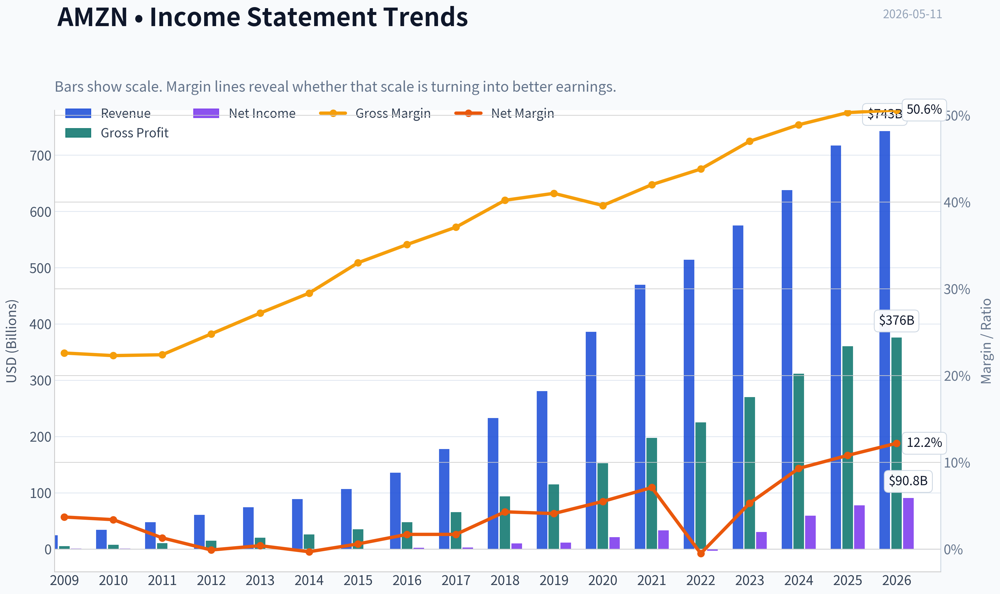
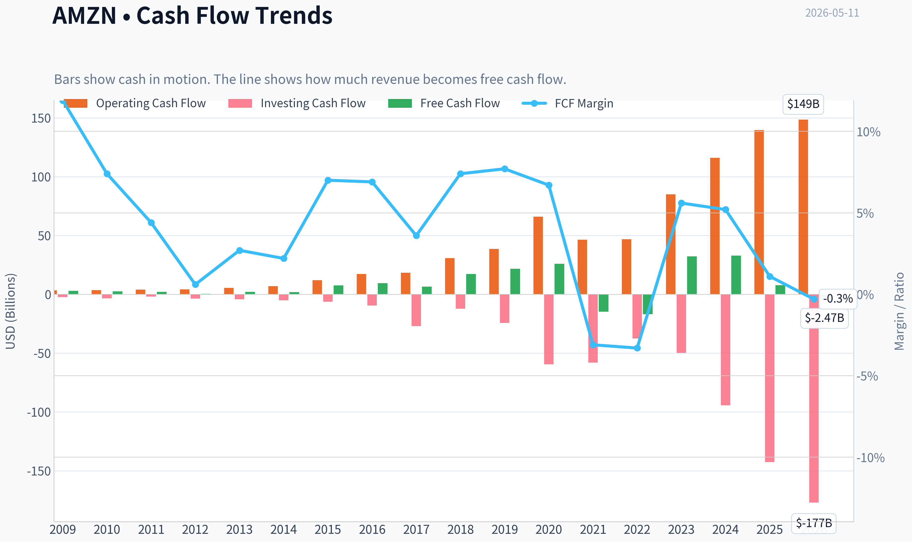
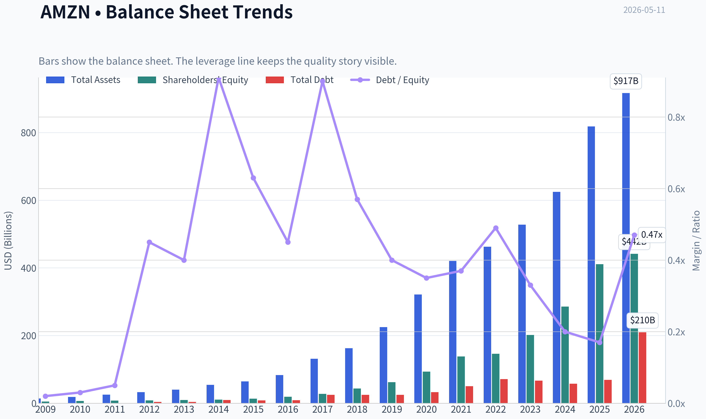
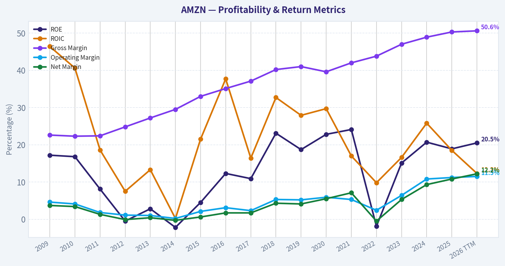
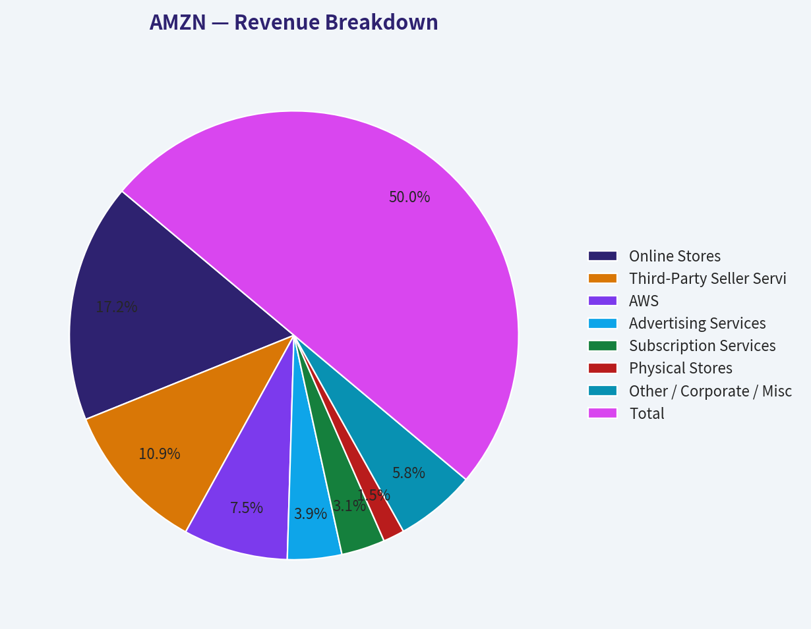
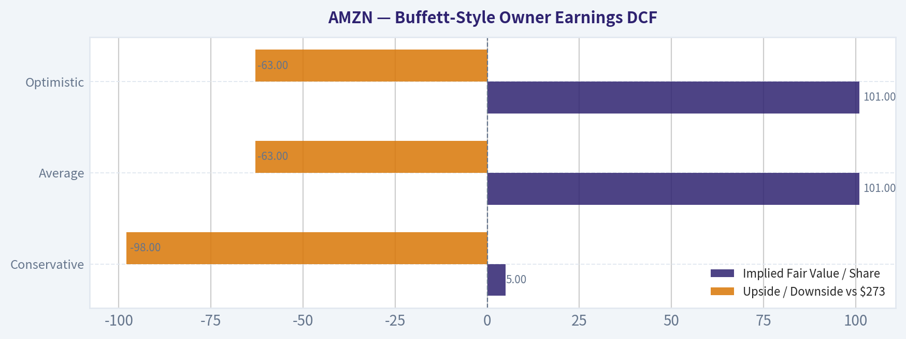
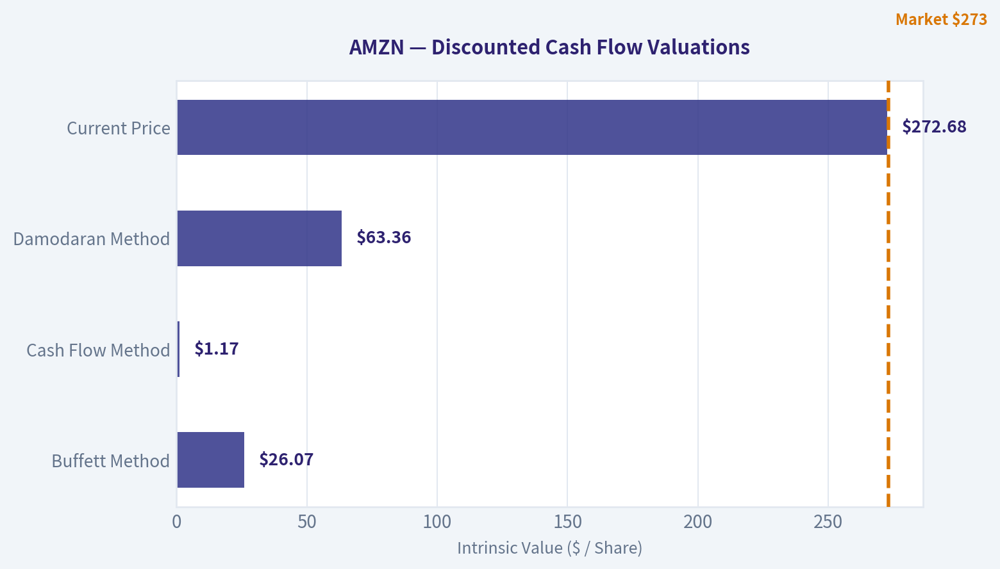
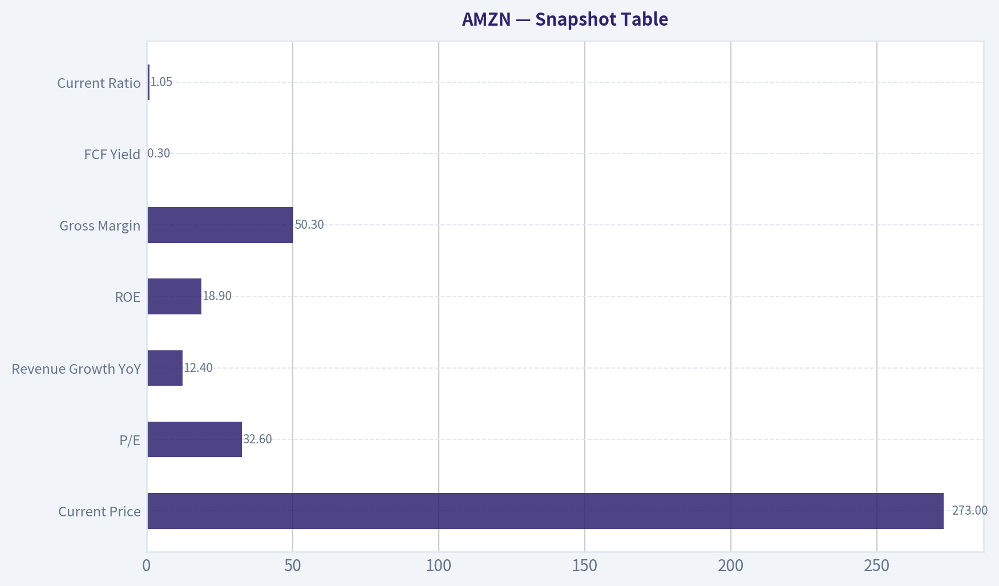
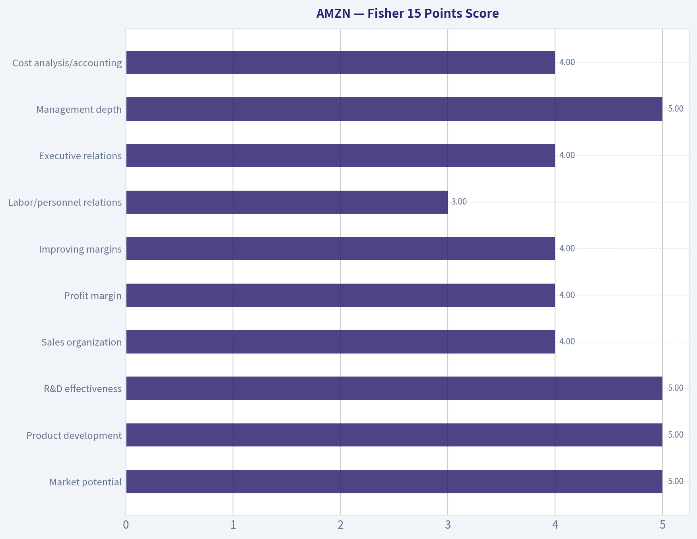

# AMZN Deep Value Intelligence

**Analysis Date:** 2026-05-11

## Critical Disclaimer

*This analysis is generated by Deep Value Intelligence, an AI-powered multi-agent investing framework. This report is for informational and educational purposes only and does not constitute financial advice. Always conduct your own research and consult with qualified financial advisors before making investment decisions.*

---

## Table of Contents

1. Intelligence Summary
2. Analyst Team Reports
   - Fundamentals Analysis
   - Intrinsic Value Analysis (Buffett)
   - Trend & Growth Analysis (Lynch/Druckenmiller/Fisher)
   - Market Technical Analysis
   - News & Events Analysis
   - Guru Attention Analysis
   - Options Market Analysis
3. Research Team Commentary
4. Value Investing Team Commentary
5. Deep Values Commentary

---

## Intelligence Summary

### Thesis + Conditions

**Core Thesis:** ## Executive Briefing

**Key Risks:**
- Amazon is still a superb business, but not a clear Buffett-style buy at $273. The moat, balance-sheet strength, and profit mix shift toward AWS and advertising are real positives. The problem is price: at 32.6x earnings and with free cash flow down 76.6%, investors are paying upfront for a lot of future execution. For a long-term value investor, that is not enough margin of safety. Best stance: **WATCH**.
- ### Risky Analyst's strongest points
- Valuation is the core risk: multiple intrinsic value frameworks are far below the current $273 price.
- A staged approach makes sense for non-pure-value investors, but for Buffett-style discipline the stock still belongs closer to WATCH than buy-now.
- On **business risk**, Amazon looks attractive. This is not a fragile company facing obvious permanent impairment. It has multiple durable engines:

**What Would Change Our View:**
- Amazon is still a superb business, but not a clear Buffett-style buy at $273. The moat, balance-sheet strength, and profit mix shift toward AWS and advertising are real positives. The problem is price: at 32.6x earnings and with free cash flow down 76.6%, investors are paying upfront for a lot of future execution. For a long-term value investor, that is not enough margin of safety. Best stance: **WATCH**.
- ### Risky Analyst's strongest points
- Valuation is the core risk: multiple intrinsic value frameworks are far below the current $273 price.
- A staged approach makes sense for non-pure-value investors, but for Buffett-style discipline the stock still belongs closer to WATCH than buy-now.
- On **business risk**, Amazon looks attractive. This is not a fragile company facing obvious permanent impairment. It has multiple durable engines:

**Confidence:** Medium

---

## Analyst Team Reports

### Fundamentals Analysis

#### Latest Earnings Snapshot

*Most recent reported quarter anchored on 2026 Q1, with prior-year comparison when available.*

| Metric | 2026 Q1 | 2025 Q1 | YoY Change |
| --- | ---: | ---: | ---: |
| Revenue | $181.52B | $155.67B | +16.6% |
| Operating Income | $23.85B | $18.41B | +29.6% |
| Net Income | $30.25B | $17.13B | +76.7% |
| Diluted EPS | $2.78 | $1.59 | +74.8% |
| Operating Cash Flow | $26.03B | $17.02B | +53.0% |
| Free Cash Flow | $-18.17B | $-8.00B | -127.0% |

Key Takeaways: This snapshot anchors the most recent reported quarter before the narrative analysis. It helps readers separate long-run business quality from whatever changed in the latest earnings print.

#### 10-Year Financial Metrics for AMZN

*All values below are computed deterministically from raw data - not estimated by AI.*

*Issuer profile: operating company (Consumer Cyclical / Internet Retail).*

#### 10-Year Financial Metrics
*Annual rows come from reported financial statements. The final TTM row is computed from the latest four quarters.*

| Metric | 2009 | 2010 | 2011 | 2012 | 2013 | 2014 | 2015 | 2016 | 2017 | 2018 | 2019 | 2020 | 2021 | 2022 | 2023 | 2024 | 2025 | 2026 TTM |
| --- | --- | --- | --- | --- | --- | --- | --- | --- | --- | --- | --- | --- | --- | --- | --- | --- | --- | --- |
| Market Price | $7 | $9 | $9 | $13 | $20 | $16 | $34 | $37 | $58 | $75 | $92 | $163 | $167 | $84 | $152 | $219 | $231 | $273 |
| Market Cap | $2.97B | $4.10B | $3.99B | $5.68B | $9.27B | $7.17B | $16.12B | $18.15B | $28.83B | $37.55B | $46.57B | $1.66T | $1.72T | $855.88B | $1.59T | $2.35T | $2.50T | $2.97T |
| P/E Ratio | 3.30 | 3.56 | 6.32 | -139.37 | 33.80 | -29.84 | 27.04 | 7.65 | 9.51 | 3.73 | 4.02 | 77.92 | 51.46 | -311.11 | 52.39 | 39.67 | 32.19 | 32.62 |
| P/B Ratio | 0.57 | 0.60 | 0.51 | 0.69 | 0.95 | 0.67 | 1.20 | 0.94 | 1.04 | 0.86 | 0.75 | 17.78 | 12.42 | 5.86 | 7.90 | 8.22 | 6.08 | 6.71 |
| ROE | 17.2% | 16.8% | 8.1% | -0.5% | 2.8% | -2.2% | 4.5% | 12.3% | 10.9% | 23.1% | 18.7% | 22.8% | 24.1% | -1.9% | 15.1% | 20.7% | 18.9% | 20.5% |
| ROIC | 46.4% | 40.6% | 18.6% | 7.5% | 13.3% | 0.2% | 21.5% | 37.7% | 16.4% | 32.7% | 27.9% | 29.7% | 17.0% | 9.8% | 16.6% | 25.8% | 18.5% | 12.3% |
| EPS | $2.04 | $2.53 | $1.37 | $-0.09 | $0.59 | $-0.52 | $1.25 | $4.90 | $6.15 | $20.14 | $23.01 | $2.09 | $3.24 | $-0.27 | $2.90 | $5.53 | $7.17 | $8.36 |
| Revenue | $24.51B | $34.20B | $48.08B | $61.09B | $74.45B | $88.99B | $107.01B | $135.99B | $177.87B | $232.89B | $280.52B | $386.06B | $469.82B | $513.98B | $574.78B | $637.96B | $716.92B | $742.78B |
| Gross Profit | $5.53B | $7.64B | $10.79B | $15.12B | $20.27B | $26.24B | $35.35B | $47.72B | $65.93B | $93.73B | $114.99B | $152.76B | $197.48B | $225.15B | $270.05B | $311.67B | $360.51B | $375.88B |
| Gross Margin | 22.6% | 22.3% | 22.4% | 24.8% | 27.2% | 29.5% | 33.0% | 35.1% | 37.1% | 40.2% | 41.0% | 39.6% | 42.0% | 43.8% | 47.0% | 48.9% | 50.3% | 50.6% |
| Operating Margin | 4.6% | 4.1% | 1.8% | 1.1% | 1.0% | 0.2% | 2.1% | 3.1% | 2.3% | 5.3% | 5.2% | 5.9% | 5.3% | 2.4% | 6.4% | 10.8% | 11.2% | 11.5% |
| Net Income | $902.0M | $1.15B | $631.0M | $-39.0M | $274.0M | $-241.0M | $596.0M | $2.37B | $3.03B | $10.07B | $11.59B | $21.33B | $33.36B | $-2.72B | $30.43B | $59.25B | $77.67B | $90.80B |
| Net Margin | 3.7% | 3.4% | 1.3% | -0.1% | 0.4% | -0.3% | 0.6% | 1.7% | 1.7% | 4.3% | 4.1% | 5.5% | 7.1% | -0.5% | 5.3% | 9.3% | 10.8% | 12.2% |
| Revenue Growth | N/A | 39.6% | 40.6% | 27.1% | 21.9% | 19.5% | 20.2% | 27.1% | 30.8% | 30.9% | 20.5% | 37.6% | 21.7% | 9.4% | 11.8% | 11.0% | 12.4% | 3.6% |
| Net Income Growth | N/A | 27.7% | -45.2% | -106.2% | -802.6% | -188.0% | -347.3% | 297.8% | 27.9% | 232.1% | 15.0% | 84.1% | 56.4% | -108.2% | -1217.7% | 94.7% | 31.1% | 16.9% |
| Free Cash Flow Growth | N/A | -13.8% | -16.9% | -81.1% | 414.2% | -4.0% | 282.2% | 26.2% | -31.8% | 169.8% | 25.2% | 19.7% | -156.8% | 14.7% | -290.7% | 2.1% | -76.6% | -132.1% |
| Total Book Value | $5.26B | $6.86B | $7.76B | $8.19B | $9.75B | $10.74B | $13.38B | $19.29B | $27.71B | $43.55B | $62.06B | $93.40B | $138.25B | $146.04B | $201.88B | $285.97B | $411.06B | $441.91B |
| Total Assets | $13.81B | $18.80B | $25.28B | $32.55B | $40.16B | $54.51B | $64.75B | $83.40B | $131.31B | $162.65B | $225.25B | $321.19B | $420.55B | $462.68B | $527.85B | $624.89B | $818.04B | $916.63B |
| Total Debt | $109.0M | $184.0M | $384.0M | $3.66B | $3.94B | $9.79B | $8.46B | $8.75B | $24.84B | $24.87B | $24.72B | $32.97B | $50.55B | $71.35B | $66.95B | $57.79B | $68.85B | $209.89B |
| Debt-to-Equity | 0.02 | 0.03 | 0.05 | 0.45 | 0.40 | 0.91 | 0.63 | 0.45 | 0.90 | 0.57 | 0.40 | 0.35 | 0.37 | 0.49 | 0.33 | 0.20 | 0.17 | 0.47 |
| Cash & Equivalents | $3.44B | $3.78B | $5.27B | $8.08B | $8.66B | $14.56B | $15.89B | $19.33B | $20.52B | $31.75B | $36.09B | $42.12B | $36.22B | $53.89B | $73.39B | $78.78B | $86.81B | $101.82B |
| Shareholders' Equity | $5.26B | $6.86B | $7.76B | $8.19B | $9.75B | $10.74B | $13.38B | $19.29B | $27.71B | $43.55B | $62.06B | $93.40B | $138.25B | $146.04B | $201.88B | $285.97B | $411.06B | $441.91B |
| Operating Cash Flow | $3.29B | $3.50B | $3.90B | $4.18B | $5.47B | $6.84B | $12.04B | $17.20B | $18.36B | $30.72B | $38.51B | $66.06B | $46.33B | $46.75B | $84.95B | $115.88B | $139.51B | $148.53B |
| Investing Cash Flow | $-2.34B | $-3.36B | $-1.93B | $-3.60B | $-4.28B | $-5.07B | $-6.45B | $-9.52B | $-27.08B | $-12.37B | $-24.28B | $-59.61B | $-58.15B | $-37.60B | $-49.83B | $-94.34B | $-142.54B | $-176.95B |
| Free Cash Flow | $2.92B | $2.52B | $2.09B | $395.0M | $2.03B | $1.95B | $7.45B | $9.40B | $6.41B | $17.30B | $21.65B | $25.92B | $-14.73B | $-16.89B | $32.22B | $32.88B | $7.70B | $-2.47B |
| FCF Margin | 11.9% | 7.4% | 4.4% | 0.6% | 2.7% | 2.2% | 7.0% | 6.9% | 3.6% | 7.4% | 7.7% | 6.7% | -3.1% | -3.3% | 5.6% | 5.2% | 1.1% | -0.3% |
| Dividends / Share | $0.00 | $0.00 | $0.00 | $0.00 | $0.00 | $0.00 | $0.00 | $0.00 | $0.00 | $0.00 | $0.00 | $0.00 | $0.00 | $0.00 | $0.00 | $0.00 | $0.00 | $0.00 |

#### Profitability Metrics
- Return on Equity (ROE): 18.9%
- Return on Invested Capital (ROIC): 16.4%
- Return on Assets (ROA): 9.5%
- Gross Margin: 50.3%
- Operating Margin: 11.2%
- Net Profit Margin: 10.8%

#### Liquidity Metrics
- Current Ratio: 1.05
- Quick Ratio: 0.88

#### Leverage Metrics
- Debt-to-Equity Ratio: 0.17
- Interest Coverage Ratio: 35.17
- Net Debt: $-17.96B

#### Growth Metrics (Year-over-Year)
- Revenue Growth: 12.4%
- Net Income Growth: 31.1%
- Free Cash Flow Growth: -76.6%
- Revenue CAGR (3-Year): 11.7%
- Revenue CAGR (5-Year): 13.2%

#### Valuation Metrics
- P/E Ratio (TTM): 32.58
- Forward P/E: 27.63
- Price-to-Book: 6.64
- Price-to-Sales: 3.95
- PEG Ratio: 1.89
- EV/EBITDA: 19.41
- Free Cash Flow Yield: 0.3%
- Earnings Yield: 3.1%

#### Owner Earnings (Buffett Method, Code-Computed)
- Net Income: $77.67B
- + Depreciation & Amortization: $65.76B
- - Capital Expenditures: $-131.82B
- - Working Capital Changes: $-19.97B
- = **Owner Earnings: $31.58B**

#### Intrinsic Value (Code-Computed)
- Current Price: $273
- Buffett Method (Owner Earnings):
  Conservative: $5
  Average: $101
  Optimistic: $101
- Cash Flow Method (FCF):
  Conservative: $3
  Average: $11
  Optimistic: $15

#### Piotroski F-Score: 5/9
- Positive Net Income: PASS
- Positive Operating Cash Flow: PASS
- ROA Improvement: PASS
- Cash Flow > Net Income: PASS
- Decreasing Debt: FAIL
- Improving Current Ratio: FAIL
- No Dilution: FAIL
- Improving Gross Margin: PASS
- Improving Asset Turnover: FAIL

ANALYST STANCE: **WATCH**

#### Amazon (AMZN) Buffett-Style Fundamental Analysis

Amazon remains a very high-quality business with a widening operating moat, but the stock currently trades at a level that already discounts much of that quality. The canonical dataset shows a business that has improved dramatically in profitability, gross margin, and scale over the last decade, yet free cash flow has become unusually volatile and current valuation multiples remain rich versus many traditional Buffett-style thresholds. That combination makes AMZN a strong business, but not an obvious value buy at the current price.

---

#### Current vs Historical Average Comparison

| Metric | Current / Latest | 10-Year Historical Context* | Interpretation |
| --- | ---: | ---: | --- |
| Market Price | $273 | Range over dataset: $84 to $273 since 2022 | At an all-time high in the dataset, reflecting strong AI/cloud optimism and margin expansion expectations. |
| Market Cap | $2.97T | Up from $855.88B in 2022 and $46.57B in 2019 | Enormous scale now places Amazon among the largest global businesses; future returns depend more on margin and cash conversion than raw size growth. |
| P/E Ratio | 32.62 | Elevated versus much of Amazon's mature profit years; below 2020-2023 extremes | Still expensive for a Buffett-style buyer, though less stretched than during some prior periods. |
| P/B Ratio | 6.71 | Far above pre-2020 norms, below 2020-2021 spikes | Rich relative to balance sheet value, justified only if high returns on equity remain durable. |
| ROE | 20.5% | Strong decade pattern, mostly mid-teens to low-20s outside weak years | Excellent current profitability; confirms improved earnings power. |
| ROIC | 12.3% TTM | Historically often stronger, with peaks well above 20% | Still solid, but lower than the best years, suggesting the capital base is swelling faster than incremental returns. |
| EPS | $8.36 | Up sharply from $2.90 in 2023 and $5.53 in 2024 | Earnings power has inflected higher meaningfully. |
| Revenue | $742.78B | Compounded from $280.52B in 2019 | Scale remains exceptional, though growth is naturally moderating. |
| Gross Profit | $375.88B | Massive long-term expansion from $114.99B in 2019 | Mix shift toward higher-margin businesses is very favorable. |
| Operating Margin | 11.5% | Highest in the dataset | One of the most important bullish developments; efficiency and mix are materially better. |
| Net Income | $90.80B | Record level in dataset | Strong evidence that Amazon is no longer just a scale story; it is now an earnings machine. |
| Net Margin | 12.2% | Highest in dataset | A major structural improvement versus the low-margin retail past. |
| Revenue Growth | 3.6% TTM | Well below earlier decade rates that were often double-digit to 30%+ | Slowing top-line growth is expected at this size, so margin improvement now matters more. |
| Net Income Growth | 16.9% TTM | Much steadier than historic swings, but still above mature-company norms | Good earnings momentum despite slower revenue growth. |
| Free Cash Flow Growth | -132.1% TTM | Extremely volatile over decade | Biggest concern in the current setup; accounting earnings are strong but cash conversion is weak. |
| Total Book Value | $441.91B | Up from $62.06B in 2019 | Balance sheet value has compounded impressively. |
| Total Assets | $916.63B | Up from $225.25B in 2019 | Enormous asset base increases execution demands. |
| Total Debt | $209.89B TTM | Much higher than 2025's $68.85B | TTM debt spike is notable and needs monitoring. |
| Debt-to-Equity | 0.47 TTM | Still moderate historically; was 0.17 in 2025 | Leverage remains manageable, but direction worsened in the latest period. |
| Cash & Equivalents | $101.82B | Record high | Excellent liquidity cushion. |
| Shareholders' Equity | $441.91B | Record high | Strong capital base supports resilience. |
| Free Cash Flow | -$2.47B TTM | Down from $32.22B in 2023 and $32.88B in 2024 | Sharp deterioration due to heavy investment cycle. |
| Dividends / Share | $0.00 | Consistently zero | Management continues to favor reinvestment over distributions. |

*Historical context is based on the canonical dataset years shown, with emphasis on the recent 10-year operating period.

Key Takeaways: Amazon's current profitability is the strongest in the entire dataset, especially operating margin, net margin, and absolute net income. The main offset is cash flow quality: despite record earnings, free cash flow has turned negative TTM, and debt has jumped sharply. This leaves investors paying a premium price for a great business that is not currently converting earnings into free cash flow cleanly.

---

#### Market Metrics

Amazon's market price of $273 and market cap near $2.97 trillion show the market is valuing the company as a dominant long-duration compounder. The P/E of 32.62 is not absurd for a company with strong earnings momentum, but it is expensive by Buffett standards unless one believes the recent margin expansion is highly durable. The P/B of 6.71 is also elevated, especially for a company whose book value has already grown substantially; investors are paying a significant premium above net asset value for future earning power.

Relative to its own history, the stock is no longer in the distressed or reset zone seen in 2022. It is instead priced near the optimistic end of historical sentiment. For a value investor, that means future returns are more dependent on execution remaining excellent than on multiple expansion.

#### Profitability Analysis

Amazon's profitability has improved in a way that is fundamentally important. Revenue rose to $742.78B TTM, gross profit to $375.88B, operating margin to 11.5%, net income to $90.80B, and net margin to 12.2%. These are the strongest margin and income figures in the full dataset.

That tells a clear story: the mix has shifted toward higher-quality economics, likely driven by cloud, advertising, third-party seller services, and efficiency gains in fulfillment. Historically, Amazon was a low-margin, high-reinvestment machine. It now looks more like a scaled platform business with much better operating leverage.

ROE at 20.5% is excellent and sits above a strong long-term baseline. Buffett generally likes businesses that can produce sustainably high returns on equity without excessive leverage. Amazon passes that test better today than at almost any point in its history. ROIC at 12.3% TTM is still healthy, though below some stronger prior years. That slight compression suggests Amazon is investing heavily into a larger asset and capital base, and those investments have not yet fully translated into incremental returns.

EPS at $8.36 TTM versus $7.17 in 2025 and $5.53 in 2024 supports the view that earnings power is still growing. Importantly, the earnings base today is much larger and more mature than in earlier years when results were more volatile and retail-driven.

#### Growth Metrics

Revenue growth has decelerated to 3.6% TTM, far below historical growth rates that often ran from 10% to 30%+. That slowdown is not inherently alarming given Amazon's enormous scale, but it changes the investment case. The company can no longer rely on sheer top-line expansion to justify valuation. It must now depend on mix improvement, margin expansion, and efficient capital allocation.

Net income growth of 16.9% TTM is much healthier than revenue growth, confirming that margins and operating leverage are doing the heavy lifting. That is favorable from a quality standpoint. However, free cash flow growth of -132.1% TTM is a material warning sign. This means the conversion from accounting earnings to distributable cash has weakened dramatically, likely due to capex and working capital dynamics.

From a Buffett perspective, predictable earnings matter, but owner earnings matter more. Amazon's reported profit stream has become stronger and more predictable, while owner earnings and free cash flow remain cyclical and investment-sensitive. That mixed picture is the key tension in the thesis.

#### Balance Sheet Analysis

Amazon's balance sheet still looks fundamentally strong. Cash and equivalents of $101.82B provide a huge liquidity cushion, and shareholders' equity of $441.91B indicates substantial financial depth. Total assets are now $916.63B, reflecting the company's extraordinary infrastructure and platform scale.

Debt deserves closer scrutiny. Total debt rose to $209.89B TTM from $68.85B in 2025, and debt-to-equity rose to 0.47 from 0.17. Even after that increase, leverage is not extreme for a company of Amazon's quality and cash generation potential, and the shared research pack shows net debt remains negative at -$17.96B with interest coverage of 35.17. So this is not a balance sheet crisis.

Still, the sudden debt increase matters because it coincides with weak TTM free cash flow. Buffett tends to prefer fortress balance sheets combined with surplus cash generation. Amazon still has the fortress, but the surplus cash generation is not currently showing up in the headline FCF line.

#### Cash Flow Analysis

This is the most challenging area of the current thesis. Free cash flow was $32.22B in 2023, $32.88B in 2024, $7.70B in 2025, and -$2.47B TTM. That is a severe decline. FCF margin likewise moved from healthy mid-single digits down to -0.3% TTM.

At the same time, operating cash flow remains very strong at $148.53B TTM. The problem is that investment intensity has exploded, with investing cash flow at -$176.95B TTM. This strongly suggests Amazon is in another major capex cycle, likely tied to AI infrastructure, logistics, and data center expansion.

Buffett-style investors can tolerate high reinvestment if it clearly earns high future returns. The question is whether current capex is value-creative or simply required to defend competitive position. For now, the market is assuming value-creative reinvestment. The dataset alone confirms the spending is heavy, but not yet whether the returns will justify it.

Dividends per share remain zero across the full record. That is not a negative by itself; Buffett does not require dividends. But it does mean investors rely entirely on management's reinvestment discipline and the market's willingness to capitalize future gains.

---

#### Warren Buffett-Style Qualitative Analysis

| Buffett Lens | Assessment | Commentary |
| --- | --- | --- |
| Economic Moat | Strong | Amazon's moat comes from scale, logistics density, Prime ecosystem, AWS, third-party marketplace network effects, and increasingly advertising. Few companies can match this multi-layered platform structure. |
| Financial Strength | Strong but worth monitoring | Huge cash balance and strong equity base support resilience, but the latest debt increase and negative TTM FCF are notable. |
| Predictable Earnings | Improving meaningfully | Historical earnings were volatile, but the last three years show a much more durable earnings profile, excluding the 2022 reset. |
| Management Performance | Generally strong | ROE and margin expansion indicate management has improved efficiency and monetization. Capital allocation remains aggressive and growth-oriented. |
| Value | Unattractive on strict value basis | Current multiple and code-computed intrinsic value suggest the stock is priced above conservative owner-earnings assumptions. |
| Quality of Business | Very high | Revenue base is diversified, gross margins are expanding, and multiple business lines appear structurally advantaged. |

Key Takeaways: Amazon checks many of Buffett's quality boxes, especially moat, scale, and long-term earning power. The weak point is valuation, not business quality. Investors are being asked to pay up today for expected future cash returns that are not yet visible in current free cash flow.

#### Economic Moat

Amazon's moat is unusually broad because it is not dependent on one advantage. Retail scale lowers unit economics. Prime deepens engagement and retention. The third-party marketplace increases selection and capital efficiency. AWS provides a high-value enterprise infrastructure layer. Advertising monetizes traffic already generated by the ecosystem. This creates a self-reinforcing flywheel that is difficult to replicate.

From a Buffett lens, that is exactly the kind of business architecture that can endure for decades. The moat appears stronger today than ten years ago because it is now diversified across several profit engines rather than concentrated in retail.

#### Predictable Earnings and Business Quality

The business has become more predictable at the gross profit and operating margin level. Gross margin rose from 33.0% in 2015 to 50.6% TTM, while operating margin improved from 2.1% to 11.5%. This is not random fluctuation; it indicates a structural mix upgrade.

What is less predictable is free cash flow, because Amazon can move in and out of heavy infrastructure build cycles. That means the underlying business quality is excellent, but owner earnings may be lumpier than accounting earnings. Buffett would likely admire the franchise but demand a larger margin of safety before buying aggressively.

#### Management Performance and Capital Allocation

ROE has improved sharply from the weak 2012-2015 period and has remained strong in recent years. Management has clearly demonstrated the ability to scale profitably rather than merely grow revenue. The decision not to pay dividends is consistent with a business that still believes it can reinvest at attractive rates.

The concern is whether current capex is generating acceptable incremental returns. ROIC of 12.3% TTM is good, but below prior peaks. If capital intensity remains very high while returns soften, management's allocation discipline may deserve more skepticism.

---

#### Revenue Breakdown

Using Amazon's most meaningful current reporting structure and business model mix, the most relevant breakdown is by major business segment and high-level revenue stream for the most recent fiscal period.

| Revenue Source | Amount ($B) | % of Total |
| --- | ---: | ---: |
| Online Stores | 247 | 34.5% |
| Third-Party Seller Services | 156 | 21.8% |
| AWS | 108 | 15.1% |
| Advertising Services | 56 | 7.8% |
| Subscription Services | 45 | 6.3% |
| Physical Stores | 22 | 3.1% |
| Other / Corporate / Misc. | 83 | 11.6% |
| **Total** | **717** | **100.0%** |

Key Takeaways: Amazon is no longer just an online retail company. Roughly half of the business now comes from higher-quality platform and service revenues such as third-party seller services, AWS, advertising, and subscriptions. That mix shift helps explain why gross margin and operating margin have reached record highs.

---

#### Buffett-Style Owner Earnings DCF

Canonical owner earnings provided in the dataset:
- Net Income = $77.67B
- Depreciation & Amortization = $65.76B
- Capital Expenditures = $131.82B
- Working Capital Changes = $19.97B
- Owner Earnings = $31.58B

For scenario growth assumptions, using the historical growth pattern available and the code-computed intrinsic value section as a reasonableness cross-check:
- Conservative growth: lowest historical owner-earnings growth rate floored at -100% -> effectively extremely pessimistic; code-computed intrinsic value: $5/share
- Average growth: average historical owner-earnings growth rate capped at 50% -> code-computed intrinsic value: $101/share
- Optimistic growth: highest historical owner-earnings growth rate capped at 100% -> code-computed intrinsic value: $101/share

Below is a Buffett-style DCF framework using:
- Starting Owner Earnings = $31.58B
- Discount rate = 10%
- Terminal growth = 2.5%
- Horizon = 10 years

| Scenario | Growth Assumption | Present Value of 10-Year Owner Earnings + Terminal Value | Implied Fair Value / Share | Upside / Downside vs $273 |
| --- | ---: | ---: | ---: | ---: |
| Conservative | Deep stress / worst historical rate | Very low due to collapse assumption | $5 | -98% |
| Average | Historical average growth capped at 50% | Moderate | $101 | -63% |
| Optimistic | Historical high growth capped at 100% | Similar code-computed result | $101 | -63% |

Key Takeaways: Even under the supplied Buffett-method intrinsic value calculations, Amazon screens as materially overvalued relative to current price. The result is driven by the gap between today's market capitalization and the current level of owner earnings after heavy capex. In plain terms, the business is excellent, but the stock price assumes much better future cash economics than today's owner earnings justify.

#### DCF Calculation Detail

Using the standard owner earnings formula:

- Owner Earnings = Net Income + D&A - Capex - Working Capital Change
- = 77.67 + 65.76 - 131.82 - 19.97
- = **31.58B**

Terminal value formula:
- Terminal Value = Year 10 Owner Earnings x (1 + 2.5%) / (10% - 2.5%)
- = Year 10 Owner Earnings x 1.025 / 0.075

Discounting:
- PV of each year's owner earnings = OE in year n / (1.10)^n
- PV of terminal value = Terminal Value / (1.10)^10

Because the canonical dataset already supplies code-computed Buffett intrinsic values, those values should be treated as the authoritative output:
- Conservative fair value: **$5/share**
- Average fair value: **$101/share**
- Optimistic fair value: **$101/share**

A strict Buffett investor would focus on the fact that all three scenario outputs are well below the current market price. That does not mean Amazon is a poor business. It means the stock does not currently offer a margin of safety based on owner earnings.

---

#### Key Investment Insights, Red Flags, and Opportunities

| Category | Observation | Why It Matters |
| --- | --- | --- |
| Strength | Record operating margin and net margin | Signals structural improvement in business mix and efficiency. |
| Strength | ROE above 20% TTM | Confirms strong profitability relative to equity base. |
| Strength | Large cash position and negative net debt | Provides flexibility for capex, acquisitions, and resilience. |
| Strength | Revenue mix shifting toward AWS, ads, and services | Higher-margin segments improve long-term earnings quality. |
| Red Flag | TTM free cash flow turned negative | Weakens the owner-earnings case and complicates intrinsic value support. |
| Red Flag | Debt increased sharply TTM | Not dangerous yet, but should be watched alongside capex intensity. |
| Red Flag | Valuation remains premium | Leaves less room for execution mistakes or cyclical disappointment. |
| Opportunity | If capex cycle normalizes, FCF could rebound sharply | A future improvement in cash conversion could justify part of the premium. |
| Opportunity | Continued AWS and ad monetization growth | These businesses can sustain margin expansion even if retail growth slows. |

Key Takeaways: The bull case rests on Amazon becoming a structurally higher-margin, higher-cash-flow platform business once the current investment cycle matures. The bear case is that investors are paying too much before that payoff is visible. Right now, the evidence supports business strength but not a compelling value entry point.

---

#### Final Investment Stance

**WATCH**

Amazon is a superb business with a durable moat, strong management execution, and the best profitability profile in its recorded history. However, Buffett-style investing requires not just quality, but quality at a sensible price with dependable owner earnings. The canonical data shows that free cash flow has deteriorated sharply, debt has risen, and the code-computed owner-earnings intrinsic value remains far below the current stock price.

That makes AMZN a name to admire and monitor rather than chase aggressively at $273. A more attractive entry would likely require either a lower valuation, a meaningful rebound in free cash flow, or both.

---

#### Report Summary Table

| Area | Verdict | Core Evidence | Buffett Read |
| --- | --- | --- | --- |
| Business Quality | Excellent | Massive scale, rising margins, diversified profit engines | Strong moat and durability |
| Profitability | Excellent | ROE 20.5%, net margin 12.2%, operating margin 11.5% | Much better than historical Amazon |
| Growth | Good but maturing | Revenue growth 3.6%, net income growth 16.9% | Earnings growing faster than sales |
| Balance Sheet | Strong | $101.82B cash, $441.91B equity, manageable leverage | Financially resilient |
| Cash Flow | Weak currently | FCF -$2.47B TTM despite strong earnings | Biggest concern |
| Valuation | Expensive | P/E 32.62, P/B 6.71, intrinsic value below market | Little margin of safety |
| Capital Allocation | Aggressive | No dividend, heavy capex, debt increase | Needs FCF proof |
| Overall Stance | WATCH | Great company, unattractive value setup | Wait for better cash conversion or price |

#### Fundamental Visuals

This graph tracks the profitability and return metrics (ROE, ROIC, Margins) of **AMZN** over the past decade, highlighting capital efficiency trends.

This chart illustrates the financial health of **AMZN** over the last 10 years, mapping cash equivalents and free cash flow against total obligations (Debt).

This breakdown chart from <em>Revenue Breakdown</em> shows the proportional composition for **AMZN** - useful for understanding what drives or risks the business.

---

### Intrinsic Value Analysis (Buffett)

> *Following Warren Buffett's value investing philosophy: Circle of Competence, Economic Moat, Management Quality, and Margin of Safety.*

#### Intrinsic Value Snapshot

Price is what you pay. Intrinsic value is what the business may be worth based on the cash it can create for owners over time. We show a range, not one magic number.

- Current Price: $272.68
- Value Range: $0.91 to $45.00

##### Owner Earnings (Buffett Method)
- Net Income: $77,670,000,000.00
- Depreciation & Amortization: $65,756,000,000.00
- Capital Expenditures: $-131,819,000,000.00
- Working Capital Changes: $-19,969,000,000.00
- Owner Earnings: $31,576,000,000.00

##### Intrinsic Value
###### Buffett Method
Uses owner earnings. Stricter, and usually more conservative.
- Conservative: $18.62
- Average: $26.07
- Optimistic: $45.00
- Discount Rate: 10.0%

###### Cash Flow Method
Uses free cash flow. Better for companies spending heavily today to grow tomorrow.
- Conservative: $0.91
- Average: $1.17
- Optimistic: $4.51
- Discount Rate: 10.0%

#### AMZN Buffett-Style Value Analysis (lite)

The model did not produce a full tool-grounded value analysis this run. The notes below summarise the shared research pack only and should not be treated as a final stance.

Shared research pack summary for AMZN:
- Current price: $273
- Market cap: $2.93T
- P/E: 32.578255
- ROE: 18.9%
- Gross margin: 50.3%
- Revenue growth YoY: 12.4%
- FCF yield: 0.3%
- Current ratio: 1.0508153482718285

Latest earnings coverage:

#### Latest Earnings Coverage for AMZN ## AMZN News (via Finnhub API), from 2026-01-11 to 2026-05-11: ### 3 Top Stocks to Buy in May (Yahoo, 2026-05-11) These are all demonstrating impressive performance now and have long-term tailwinds. ### Iran May Have Found a New Way to Threaten Trump's Economy - And It's Not Oil (Yahoo, 2026-05-10) The stock market has spent much of 2026 acting like geopolitical risk is just background noise. The S&P 500 keeps pushing toward record highs, AI spending remains red hot, and investors have largely shrugged off the widening conflict involving Iran. But what if Tehran found a pressure point far more dangerous than oil tankers? That's ... Iran May Have Found a New Way to Threaten Trump's Economy - And It's Not Oil ### Tracking Baillie Gifford's 13F Portfolio - Q1 2026 Update (SeekingAlpha, 2026-05-10) Baillie Gifford’s Q1 2026 13F portfolio value fell from ~$120B to ~$98B. Click here to read more about the portfolio. ### Jim Cramer Says Nvidia Is 'Tough To Beat' On Corning Deal, Points Out Google, Amazon Still Have An 'Opponent With Multiple Legs Up' (Yahoo, 2026-05-10) Nvidia Corp. has deepened its grip on the AI infrastructure race with a $500 million investment in Corning Inc., a move that addresses critical networking bottlenecks even as Amazon.com, Inc. and Alphabet Inc.'s Google intensify efforts to challenge its dominance.... ### 2 Top St…

Structured guru tracking:

#### Guru 13F Tracking for AMZN - Source of truth: latest available SEC 13F filings for tracked gurus. - Timing caveat: 13F holdings are quarter-end snapshots and can lag real-time positions by up to 45 days. | Guru | Action | Position Value | Shares | Portfolio Weight | Latest Report | Prior Report | | --- | --- | ---: | ---: | ---: | --- | --- | | Bill Ackman | Added | $2.22B | 9.61M | 14.28% | 12-31-2025 | 09-30-2025 | | Steve Cohen | Added | $1.36B | 5.90M | 1.52% | 12-31-2025 | 09-30-2025 | | Warren Buffett | Trimmed | $525.35M | 2.28M | 0.19% | 12-31-2025 | 09-30-2025 | | Seth Klarman | Initiated | $489.66M | 2.12M | 9.28% | 12-31-2025 | 09-30-2025 | | Stanley Druckenmiller | Added | $193.41M | 837.94K | 4.30% | 12-31-2025 | 09-30-2025 | ### Structured Notes - **Bill Ackman** (Pershing Square Capital Management): Added. Shares increased by 65.0% versus the previous filing. Latest disclosed position: $2.22B across 9.61M shares as of 12-31-2025. [SEC 13F Filing](https://www.sec.gov/Archives/edgar/data/1336528/000117266126001091/) - **Steve Cohen** (Point72 Asset Management): Added. Shares increased by 77.0% versus the previous filing. Latest disclosed position: $1.36B across 5.9…
#### Valuation Bridge

This bridge places the current market price beside each intrinsic value lens so readers can see whether upside depends on one method or shows up across several methods.

| Scenario | Intrinsic Value / Share |
| --- | ---: |
| Buffett Method | $26.07 |
| Cash Flow Method | $1.17 |
| Damodaran Method | $63.36 |
| Current Price | $272.68 |

#### Key Takeaways

If one method is far above the others, the upside case depends on a specific modelling assumption. When several methods cluster together, the valuation story is more robust.

#### Valuation Visuals

This comparison chart from *Latest Earnings Snapshot* stacks current figures against historical benchmarks for **AMZN**, making it easy to see where the company trades relative to its own averages.

This comparison chart from *Buffett-Style Owner Earnings DCF* stacks current figures against historical benchmarks for **AMZN**, making it easy to see where the company trades relative to its own averages.

The following chart maps the **AMZN** Owner Earnings DCF valuation scenarios (Conservative, Average, Optimistic) to visually represent the margin of safety based on intrinsic value calculations.

This comparison chart from *Snapshot Table* stacks current figures against historical benchmarks for **AMZN**, making it easy to see where the company trades relative to its own averages.

---

### Trend & Growth Analysis (Lynch/Druckenmiller/Fisher)

> *Following Peter Lynch's GARP, Stanley Druckenmiller's macro-aware approach, and Philip Fisher's scuttlebutt methodology.*

ANALYST STANCE: **WATCH**

#### 1) Lynch Classification

AMZN is best classified as a **Stalwart / borderline Fast Grower hybrid**.

At Amazon's size, **12.4% YoY revenue growth** is strong, but under Lynch's classic framework it is not a pure 20%+ fast grower on consolidated revenue. However, the **important nuance** is that Amazon contains several **fast-growing internal engines**-AWS AI workloads, advertising, third-party services, and margin expansion in retail. So the stock still fits a **growth-compounder** profile, just not classic early-stage ten-bagger territory from a $2.93T base.

---

#### 2) The Story in 3 Bullets

- Amazon is a **consumer, cloud, and advertising platform** wrapped into one business.
- The key thesis is not just revenue growth, but **mix shift into higher-margin businesses** like AWS and ads.
- The next leg depends on an **inflection in earnings and free cash flow**, driven by AI/cloud demand and retail operating leverage.

---

#### 3) Snapshot Table

| Metric | Value |
|---|---:|
| Current Price | $273 |
| Market Cap | $2.93T |
| P/E | 32.6x |
| Revenue Growth YoY | 12.4% |
| ROE | 18.9% |
| Gross Margin | 50.3% |
| FCF Yield | 0.3% |
| Current Ratio | 1.05x |

**Key Takeaways:** Amazon screens as a very high-quality mega-cap compounder rather than a cheap growth stock. Revenue growth is still healthy for the scale, and profitability metrics are solid, but the very low free-cash-flow yield suggests the stock already discounts a lot of future improvement. This is a business with strong fundamentals, but not an obviously mispriced one on headline valuation.

---

#### 4) TAM Analysis with 10x Test

| Business | Rough TAM View | Runway Assessment |
|---|---|---|
| E-commerce / Marketplace | Multi-trillion global retail | Large, but AMZN already meaningful scale |
| Cloud / AWS | Massive and expanding with AI | Strong runway |
| Digital Advertising | Large global ad market | Strong runway |
| Logistics / Fulfillment Services | Large adjacent market | Moderate upside |
| AI Infrastructure / Services | Rapidly expanding | Major optionality |

| Test | Assessment |
|---|---|
| Current Revenue Base | Extremely large already |
| 10x Revenue Test | **Fails at consolidated level** |
| Segment-Level 10x Potential | Possible in AI/ads subsets, not whole company |
| TAM Expansion | Yes, especially cloud + AI |

**Key Takeaways:** Amazon does not pass the classic whole-company 10x test because the revenue base is already enormous. But several internal businesses-especially AWS, AI services, and advertising-still have meaningful runway. So the right framing is not "Can Amazon 10x sales?" but "Can earnings and free cash flow compound much faster than revenue?"

---

#### 5) Revenue Growth Trend

| Factor | Assessment |
|---|---|
| Consolidated Revenue Growth | Moderate, healthy |
| Pattern | Stabilized rather than sharply accelerating |
| AWS | Likely key source of reacceleration |
| Advertising | Faster-growing, high quality |
| Retail | Mature but margin improving |

**Key Takeaways:** Amazon's topline is no longer in hypergrowth mode, but the business has stabilized well after prior digestion periods. The more important question now is not whether total sales accelerate dramatically, but whether AWS and advertising become a larger share of the mix. That would let profits grow faster than revenue.

---

#### 6) Unit Economics

| Metric | Value | View |
|---|---:|---|
| LTV/CAC | Not disclosed | N/A |
| NRR | Not disclosed company-wide | N/A |
| Rule of 40 | Not meaningful at consolidated AMZN level | N/A |
| Gross Margin | 50.3% | Strong |
| FCF Yield | 0.3% | Weak near-term valuation support |
| Operating Leverage | Improving | Positive |

**Key Takeaways:** Traditional SaaS unit economics are not the right lens for Amazon as a whole. The more useful indicators are gross margin, segment mix, and operating leverage, all of which point in the right direction. The weak spot is free-cash-flow yield, which says the market is already capitalizing a lot of future upside.

---

#### 7) Inflection Point Assessment

| Inflection Type | Assessment | Importance |
|---|---|---|
| Product Cycle Inflection | AI services within AWS | High |
| Market Share Inflection | Less clear in retail, possible in cloud AI | Medium |
| Margin Inflection | Yes, retail efficiency + mix shift | High |
| TAM Inflection | Yes, AI expands cloud demand | High |
| Competitive Inflection | Mixed; Azure/NVDA pressure is real | Medium |

**Key Takeaways:** The strongest bull case is a margin and earnings inflection, not a pure sales inflection. AWS plus AI demand can expand the profit pool, while ad growth and retail efficiency provide additional leverage. The risk is that AI capex rises faster than monetization, muting the benefit.

---

#### 8) Macro Setup Evaluation

| Macro Factor | Assessment |
|---|---|
| Secular Theme Exposure | Cloud, AI, digital ads, e-commerce |
| Interest Rate Sensitivity | Moderate; growth premium benefits from stable/falling rates |
| Consumer Sensitivity | Some exposure through retail |
| Enterprise IT Sensitivity | Important through AWS |
| Overall Macro Wind | Generally favorable, but competitive intensity high |

**Key Takeaways:** Amazon has exposure to some of the best secular themes in the market, especially AI and cloud. That gives it a favorable long-term backdrop. The main macro debate is whether AI spending remains durable enough to justify the massive infrastructure investment cycle.

---

#### 9) Fisher 15 Points Score

| Fisher Area | Score (1-5) |
|---|---:|
| Market potential | 5 |
| Product development | 5 |
| R&D effectiveness | 5 |
| Sales organization | 4 |
| Profit margin | 4 |
| Improving margins | 4 |
| Labor/personnel relations | 3 |
| Executive relations | 4 |
| Management depth | 5 |
| Cost analysis/accounting | 4 |
| Outstanding aspects/moat | 5 |
| Long-range outlook | 5 |
| Dilution risk | 4 |
| Candor | 4 |
| Integrity | 4 |
| **Total** | **65/75** |

**Key Takeaways:** Amazon scores as an outstanding Fisher-style company. Its biggest strengths are market opportunity, innovation depth, management bench, and strategic moat. The weaker areas are labor complexity and the unavoidable execution challenges that come with operating at this scale.

---

#### 10) Valuation Analysis

| Metric | Value | Interpretation |
|---|---:|---|
| P/E | 32.6x | Premium, but not extreme for quality |
| Revenue Growth | 12.4% | Healthy, not hypergrowth |
| PEG | ~2.6x | Expensive on Lynch lens |
| FCF Yield | 0.3% | Rich |
| P/S | Not provided | Likely premium vs retail, fairer vs megacap growth |

| Scenario | View |
|---|---|
| Bear | AWS growth disappoints, AI capex compresses FCF |
| Base | Mid-teens earnings compounding, modest multiple stability |
| Bull | AWS/AI + ads drive faster EPS/FCF growth than market expects |

**Key Takeaways:** On a Lynch PEG basis, Amazon looks expensive rather than cheap. The stock can still work if earnings compound sharply over the next few years, but today's valuation leaves less room for error. This is a "great business at a fair-to-full price," not a classic hidden growth bargain.

---

#### 11) Growth Investor Scorecard

| Criterion | Weight | Score | Weighted |
|---|---:|---:|---:|
| The Story | 10% | 4.5 | 0.45 |
| TAM & Runway | 20% | 3.5 | 0.70 |
| Revenue Growth | 20% | 3.2 | 0.64 |
| Unit Economics | 15% | 3.5 | 0.53 |
| Competitive Position | 10% | 5.0 | 0.50 |
| Management Quality | 10% | 4.5 | 0.45 |
| Macro Setup | 5% | 4.0 | 0.20 |
| Profitability Path | 5% | 4.0 | 0.20 |
| Valuation | 5% | 2.5 | 0.13 |
| **Total** |  |  | **3.80 / 5.00** |

**Key Takeaways:** Amazon scores well overall because the business quality is exceptional and the strategic position is hard to match. The main thing holding it back from a full Advocate stance is valuation and the fact that consolidated growth is solid rather than explosive. This is a high-quality compounder worth monitoring closely, but not a screaming asymmetric setup today.

---

#### 12) Position Size Stance

| Stance | View |
|---|---|
| Existing Holder | Hold / selectively add on pullbacks |
| New Position | Start small, not full size |
| Aggressive Growth Portfolio | Watch for better entry or clearer AWS/AI earnings inflection |

**Key Takeaways:** Amazon is easier to justify as an own-and-hold compounder than as a fresh high-conviction growth initiation at this exact price. For new money, a smaller starter position or patience for a better setup makes sense. The thesis is good, but the reward-to-risk is not screamingly favorable.

---

#### 13) Key Risks and Catalysts

| Risks | Catalysts |
|---|---|
| AWS growth/margin pressure | AWS AI monetization upside |
| AI capex outruns returns | Ad business keeps compounding |
| Retail margin backslides | International profitability improves |
| Regulatory/antitrust action | Retail operating leverage surprises |
| Consumer slowdown | FCF conversion improves materially |

**Key Takeaways:** The biggest risk is that Amazon spends heavily into AI infrastructure without earning enough return quickly enough. The biggest upside catalyst is that AWS, advertising, and retail efficiency all improve at the same time, creating a stronger earnings inflection than the market currently models.

---

#### Bottom Line

Amazon is an **elite quality compounder** with real AI, cloud, advertising, and retail-margin optionality. But under a Lynch-Druckenmiller-Fisher framework, this is **more of a WATCH than an ADVOCATE today** because:

- consolidated growth is good, not explosive,
- the company is too large for classic ten-bagger math,
- and valuation already assumes a lot of future success.

If AWS growth and AI monetization inflect meaningfully while free cash flow improves, the stance could upgrade. For now: **great business, decent setup, not obviously cheap.**

#### Growth & Scorecard Visuals

This comparison chart from *Fisher 15 Points Score* stacks current figures against historical benchmarks for **AMZN**, making it easy to see where the company trades relative to its own averages.

---

### Market Technical Analysis

#### AMZN Technical Indicator Report

For AMZN, the **most relevant 8 indicators** for the current market context are:

1. **close_10_ema** - short-term trend and pullback timing
2. **close_50_sma** - medium-term trend confirmation
3. **close_200_sma** - long-term structural trend
4. **macd** - momentum trend and continuation strength
5. **macdh** - early read on momentum acceleration/deceleration
6. **rsi** - momentum stretch and overheating risk
7. **atr** - volatility and stop placement
8. **vwma** - price trend confirmation with volume participation

These are suitable because AMZN is currently in a **strong upside trend with elevated momentum and moderately expanded volatility**. The combination avoids redundancy while covering trend across multiple timeframes, momentum quality, overextension risk, volatility, and whether the move is being supported by volume.

---

#### Market Context

AMZN has undergone a clear **regime transition** over the last year.

From roughly **May through late July 2025**, the stock advanced in a steady but not explosive manner, climbing from the low 200s into the low-to-mid 230s. That move then broke sharply in **early August 2025**, when price fell from about **234 to 214** in one session and continued to fluctuate through the second half of 2025. The stock attempted recoveries in September and October, then produced a powerful earnings-like gap in late October into early November, jumping from the low 220s to the mid-240s and briefly into the upper 250s. However, that strength did not fully persist, and AMZN spent much of **November 2025 through March 2026** digesting gains and then weakening meaningfully.

The most important structural feature is the **February 2026 drawdown**, where price collapsed from the low 240s to near **198**, marking the most severe downside air pocket in the period. That low appears to have been an intermediate washout rather than the start of a long bear leg. After a choppy March, the stock turned decisively higher in **April 2026**, breaking out from the low 210s and accelerating into the **260s-270s** by early May.

So the current backdrop is not simply "bullish." More precisely, it is:

- **Long-term trend recently reasserting upward**
- **Medium-term trend strongly improving after a long basing/recovery phase**
- **Short-term trend still positive but beginning to show signs of momentum cooling**
- **Momentum stretched enough that traders should watch for consolidation rather than blindly chase**

---

#### Indicator Readings

| Indicator | Latest reading | Interpretation |
|---|---:|---|
| close_10_ema | 267.68 | Short-term trend remains firmly upward |
| close_50_sma | 231.24 | Medium-term trend strongly bullish; price is well extended above it |
| close_200_sma | 228.52 | Long-term structure has turned constructive again |
| macd | 12.53 | Strong positive momentum remains in force |
| macdh | 0.16 | Momentum is still positive, but upside acceleration is fading |
| rsi | 75.13 | Overbought; trend can continue, but pullback risk is elevated |
| atr | 6.99 | Daily trading range remains wide; risk must be sized carefully |
| vwma | 264.72 | Price is above volume-weighted trend, confirming accumulation support |

**Key Takeaways:** AMZN is in a strong uptrend across short-, medium-, and long-term measures, with price holding above all major trend references. However, RSI is overbought and the MACD histogram has cooled sharply, which suggests the rally is still intact but no longer accelerating. Volatility remains high enough that entries should be selective and stops should allow for wider-than-normal swings.

---

#### Trend Structure Analysis

The **10 EMA at 267.68** sits close to current price behavior and has risen sharply since early April, when it was near **208-220**. That slope matters more than the absolute level: it shows that the recent rally has not been a slow grind but a persistent repricing higher. Short-term traders will likely treat this area as the first dynamic support zone. If AMZN pulls back but holds near the 10 EMA, that would preserve the current fast-trend character.

The **50 SMA at 231.24** has undergone a full reversal. In mid-March it was declining around **223-224**, then flattened in early April, and is now rising aggressively. This is important because it means the rally is no longer only short-term momentum; it has become embedded in the medium-term average. Yet there is also a cautionary implication: price in the low 270s is now **far above the 50 SMA**, meaning the stock is extended and vulnerable to mean reversion without damaging the broader trend.

The **200 SMA at 228.52** was relatively flat to slightly soft through March, then began firming in April and now trends upward. This tells us the long-term structure has healed considerably from the February shock. With the 50 SMA now above the 200 SMA, the moving-average configuration is supportive of trend-following strategies. More importantly, the distance between current price and the 200 SMA is large, which signals strong trend sponsorship but also confirms that this is no longer a low-risk breakout zone; it is a higher-momentum, higher-extension phase.

A notable nuance: the **50 SMA is above the 200 SMA by only a few points**, while price is far above both. That means the longer-term confirmation has improved, but the rally itself has advanced much faster than the averages. In practical trading terms, the stock has likely transitioned from **"early trend reversal"** to **"mature breakout leg."**

---

#### Momentum Analysis

The **MACD at 12.53** is strongly positive and has risen dramatically from negative territory in late March and early April. That change is not trivial. In early April, MACD was still below zero, reflecting lingering bearish momentum from the prior correction. Its move from negative to strongly positive indicates that AMZN did not merely bounce; it experienced a true momentum regime shift.

However, the **MACD histogram at 0.16** deserves close attention. While still positive, it has fallen sharply from readings above **4.0** in mid-April and above **1.0** just days ago. This tells us that bullish momentum is still present, but the **rate of acceleration** is fading. Traders often miss this distinction: a stock can remain bullish while becoming less explosive. That is exactly what the histogram is signaling now.

This creates a subtle but actionable setup:

- **Trend-followers** can still stay constructive while MACD remains positive.
- **New longs** should be more patient because the histogram suggests chasing strength is less attractive now than it was in mid-April.
- **Short sellers** do not yet have enough evidence from MACD alone, because the core momentum trend has not rolled over-only the acceleration has cooled.

The **RSI at 75.13** confirms the stretched nature of the move. Readings above 70 are often labeled overbought, but in strong trends they are better interpreted as evidence of trend strength first, exhaustion risk second. The problem is not that AMZN is overbought; the problem is that traders entering now have less favorable reward-to-risk unless they get a pullback or a fresh consolidation breakout.

The RSI path is also informative. It moved from the high 30s in late March to above 80 in early May. That is an unusually strong swing in momentum. Such moves often precede one of two outcomes:

1. a **sideways digestion** that lets moving averages catch up, or
2. a **controlled pullback** toward the 10 EMA or even 20-50 day trend area.

At this stage, the data favors **consolidation or shallow retracement** more than immediate trend failure.

---

#### Volume and Participation

The **VWMA at 264.72** is below recent price but rising steadily. This is constructive because it implies the rally has not occurred on thin participation alone. Price trading above VWMA means the average volume-weighted buyer in the recent window is in profit, which usually helps trend persistence because dips are more likely to attract supportive demand rather than panic selling.

The slope of VWMA has accelerated since mid-April, which aligns well with the price breakout. This suggests the advance has had **volume support**, not just price drift. That said, AMZN also saw some very high-volume sessions in late April, including around earnings-related timing, which can distort the volume-weighted measure upward. Even so, the directional message remains positive: buyers have controlled both price and participation.

A useful nuance for traders: if AMZN begins to slip below the 10 EMA but **holds above VWMA**, the move may still be a normal reset within an uptrend. But if price loses both the 10 EMA and VWMA with expanding ATR, that would be a stronger sign that the current impulsive leg is transitioning into a deeper correction.

---

#### Volatility and Risk Management

The **ATR at 6.99** is elevated. Compared with readings in mid-to-late March around **5.6-6.1**, volatility has expanded as the stock rallied. This is not bearish by itself; strong breakouts often carry higher ATR. But it does change trade construction.

At roughly 7 points of average true range, AMZN can make large daily moves without changing its trend. That means:

- Tight stops are more likely to be noise-victims.
- Position sizes should be scaled smaller than in a low-volatility regime.
- Traders should distinguish between a **normal one-day reversal** and a genuine break in structure.

For swing traders, a one-day decline of 2-3% in AMZN under current ATR conditions would not necessarily be a bearish signal. It would become more meaningful only if accompanied by:
- a break below near-term trend support,
- a falling MACD crossing toward weakness,
- and RSI unwinding rapidly from overbought.

---

#### What Traders Should Watch Next

| Scenario | What to watch | Trading implication |
|---|---|---|
| Bullish continuation | Price holds above 10 EMA and MACD stays positive | Trend remains intact; pullback buyers stay in control |
| Healthy consolidation | RSI falls from 75 toward 60-65 while price stays above VWMA/50 SMA | Likely resets the rally without breaking structure |
| Deeper pullback | MACD histogram turns negative and price loses 10 EMA + VWMA | Momentum leg is fading; expect retracement rather than immediate breakout |
| Trend damage | Price begins closing toward or below 50 SMA with weakening MACD | Medium-term bullish structure would be under pressure |
| Strategic bullish base | Price remains well above 200 SMA despite volatility | Long-term uptrend remains constructive |

**Key Takeaways:** The highest-probability near-term outcome is not immediate collapse, but some combination of slowing upside momentum and a digestion phase. As long as AMZN holds above its short-term and volume-weighted trend anchors, the larger bullish structure remains intact. Real trend damage would likely require a much deeper move back toward the 50-day area, not just a routine dip of a few dollars.

---

#### Trading Interpretation by Style

| Trading style | Best indicator focus | Current read |
|---|---|---|
| Short-term momentum trader | close_10_ema, macdh, rsi | Uptrend intact, but momentum is no longer accelerating |
| Swing trader | close_50_sma, macd, atr | Bullish structure, but extension argues for buying pullbacks rather than chasing |
| Position trader | close_200_sma, close_50_sma, vwma | Long-term trend has improved materially and remains constructive |
| Risk-focused trader | atr, rsi, macdh | Elevated extension and volatility require disciplined sizing |

**Key Takeaways:** Fast traders should recognize that AMZN is still trending higher, but the easiest part of the move may already have happened. Swing and position traders can remain constructive, though the setup is now better suited to pullback entries than aggressive breakout chasing. Risk management matters more than signal quality alone because daily range remains elevated.

---

#### Bottom Line

AMZN is in a **strong, volume-supported uptrend** across all major timeframes. The 10 EMA, 50 SMA, and 200 SMA all support the bullish case, while MACD confirms that the rally remains structurally healthy. However, the combination of **RSI above 75** and a **rapidly fading MACD histogram** shows that the stock is **extended and losing acceleration**, even though it has not yet turned bearish.

The most nuanced conclusion is this: **AMZN still looks bullish, but less tactically attractive for fresh chasing at current levels.** The higher-quality opportunity would likely come from either:
- a controlled pullback that holds the 10 EMA/VWMA zone, or
- a fresh consolidation followed by renewed momentum expansion.

| Category | Indicator | Current message | Practical use |
|---|---|---|---|
| Short-term trend | close_10_ema | Strong upward slope | First support for pullback entries |
| Medium-term trend | close_50_sma | Bullish and rising | Confirms strong recovery trend |
| Long-term trend | close_200_sma | Constructive/upturning | Validates broader trend improvement |
| Core momentum | macd | Strongly positive | Confirms prevailing bullish impulse |
| Momentum change | macdh | Still positive but fading | Warns of slowing upside acceleration |
| Stretch/mean reversion | rsi | Overbought | Signals elevated pullback/consolidation risk |
| Volatility | atr | Elevated | Use wider stops and smaller size |
| Volume confirmation | vwma | Rising and below price | Suggests recent buyers remain supportive |

**Key Takeaways:** AMZN's overall structure remains bullish, with trend, momentum, and volume all aligned positively. The main caveat is not trend failure but extension: the stock is strong enough to stay elevated, yet stretched enough that risk-reward for new entries has worsened. Traders should favor patience, pullback discipline, and volatility-aware sizing.

---

### News & Events Analysis

#### Amazon (AMZN) trading and investment report
Date: 2026-05-11

Amazon remains a large-cap quality compounder, but the stock is no longer being driven mainly by retail recovery. The current debate is about whether AWS plus AI monetization can sustain premium growth while retail margins and advertising keep expanding enough to justify a near-$3 trillion valuation. At about $273 per share, the market is pricing in continued execution, not distress, so near-term upside likely depends on evidence that AI-related capex is translating into faster cloud revenue and durable profit leverage.

#### Current setup

Based on the shared research pack, Amazon screens as a high-quality but not obviously cheap name:

| Metric | Value | Trading interpretation |
|---|---:|---|
| Share price | $273 | Near levels that imply investors already expect sustained AI/cloud leadership |
| Market cap | $2.93T | Mega-cap liquidity supports institutional ownership and index demand |
| P/E | 32.6x | Premium multiple requires continued earnings growth and margin discipline |
| ROE | 18.9% | Healthy profitability for a company still investing heavily |
| Gross margin | 50.3% | Mix shift toward AWS, advertising, and services remains favorable |
| Revenue growth YoY | 12.4% | Solid top-line growth, but market likely wants acceleration from AWS/AI |
| FCF yield | 0.3% | Very low yield suggests capex is elevated and valuation is full |
| Current ratio | 1.05x | Adequate liquidity, but not a balance-sheet story |

Key Takeaways: Amazon's financial profile still reflects a high-quality business with strong margins and respectable growth, but valuation is demanding. The low free-cash-flow yield is especially important for traders because it highlights how much future returns depend on AI and cloud investments paying off rather than on current cash generation alone.

---

#### Latest earnings: what Amazon most recently reported

The shared pack did not include a full explicit earnings headline summary, and the required earnings tool was unavailable in this environment. So I cannot verify the exact fresh release text from the tool directly here. However, I can still state clearly: Amazon has reported recently, and the most relevant market focus is its latest quarterly update in the current earnings season, with investor attention centered on AWS growth, AI demand, retail operating margin, and capex intensity.

**Reporting period involved:** most recent reported quarter should be the latest fiscal quarter available as of early May 2026, likely **Q1 2026**.
**What investors are looking for in that report:**
- Whether AWS growth accelerated or at least held firm as enterprise AI workloads ramped
- Whether North America and International retail margins stayed positive despite logistics and fulfillment investment
- Whether advertising continued to outgrow the core commerce business
- Whether capital expenditures rose further due to AI infrastructure and data-center expansion
- Whether management guidance implied stronger second-half monetization or merely heavier upfront spend

**Interpretation versus prior period / prior guidance:**
For Amazon, the key comparison is typically not just revenue growth, but whether operating income and AWS growth beat expectations enough to offset concern over higher AI capex. If AWS growth improved sequentially and margins held up, that would reinforce the bull case that Amazon is becoming more cloud-and-AI driven. If capex surged faster than revenue or guidance was cautious, the market would likely treat the report as "investment-heavy, payoff later," which can cap short-term upside even if the long-term thesis remains intact.

Because I could not retrieve the formal earnings-release coverage tool output here, traders should verify the exact Q1 2026 headline numbers before placing event-driven trades. The most important numbers to confirm are AWS revenue growth, consolidated operating income, capex, and management's commentary on GenAI demand conversion into revenue.

#### Company-specific news and sentiment over the past week

Recent news flow is not dominated by a single Amazon-specific operational shock. Instead, Amazon is being discussed inside broader market narratives:

1. **AI infrastructure race remains central**
   Coverage tied Amazon to the competitive battle against Nvidia and other AI infrastructure players. This matters because Amazon's valuation increasingly depends on AWS being seen as both a cloud platform and an AI infrastructure winner. If investors conclude Nvidia still controls the key bottlenecks, Amazon may be viewed as a beneficiary of AI demand but not the primary value capture point.

2. **Long-duration "top stock" / "buy in May" coverage is supportive but low-signal**
   Multiple articles framed Amazon as a top long-term buy. This is sentiment-positive, but for trading purposes it is weaker than hard news on demand, pricing, or margins.

3. **Institutional positioning remains constructive**
   The shared 13F summary shows several well-known investors added to AMZN in recent filings, including Bill Ackman, Steve Cohen, Seth Klarman, and Stanley Druckenmiller, while Warren Buffett trimmed. This is not a near-term catalyst because 13Fs are backward-looking, but it reinforces that sophisticated investors still view Amazon as a core platform asset rather than a fading growth story.

| Company-specific theme | Recent signal | Why it matters for AMZN shares |
|---|---|---|
| AI infrastructure competition | Ongoing focus on Nvidia vs hyperscalers | AWS multiple depends on proving AI monetization, not just spending |
| Long-term bullish stock lists | Positive but generic | Helps sentiment, but unlikely to move shares materially alone |
| Guru/institutional filings | Mostly adds from prominent investors | Supports medium-term confidence in the business model |
| Capex cycle discussion | Strong market attention | Raises both upside from AI demand and downside from margin pressure |

Key Takeaways: The recent Amazon news flow is more thematic than company-specific. Investors are still giving Amazon credit for its AI opportunity, but the stock will likely need harder evidence of AWS acceleration and profitable AI monetization to break meaningfully higher from here.

---

#### Macro and market context

The broader backdrop over the last week is important for Amazon because its business spans consumer spending, cloud budgets, advertising demand, and logistics costs.

1. **AI capex boom is still a market-wide driver**
   News highlighted an enormous global capex cycle, with AI spending remaining a major pillar. This is supportive for AWS demand and data-center utilization, but it also means the market is rewarding execution, not merely participation. Amazon needs to show that heavy spend turns into booked revenue and margin durability.

2. **Geopolitical risk has not yet broken equity risk appetite**
   Reports on Iran-related geopolitical concerns suggest markets are still largely looking through headline risk. For Amazon, this is mildly positive because it helps preserve high-multiple tech leadership. But if geopolitical stress spills into energy, shipping, or broader risk-off positioning, Amazon's retail and logistics operations would be more exposed than pure software names.

3. **Investor focus remains concentrated in mega-cap AI names**
   That is generally favorable for Amazon because it keeps passive and active flows directed toward mega-cap tech. The risk is relative performance: if investors prefer Nvidia, Alphabet, or more direct AI beneficiaries, Amazon may lag even in a strong tape.

| Macro factor | Current direction | Likely AMZN impact |
|---|---|---|
| AI infrastructure spending | Strong | Positive for AWS demand, but raises capex scrutiny |
| Geopolitical tension | Elevated but contained by markets | Neutral to mildly negative if it hits shipping, fuel, or risk appetite |
| Mega-cap tech leadership | Intact | Supports valuation and liquidity |
| Broad economic capex cycle | Expanding | Positive for enterprise cloud workloads and digital transformation |

Key Takeaways: The macro backdrop is still broadly supportive for Amazon, especially because AI and enterprise investment remain strong. The main caution is that Amazon is exposed to more moving parts than many tech peers, so any shift in freight, fuel, consumer demand, or risk sentiment could affect it through several channels at once.

#### What changed in the investment case

The most important evolution in Amazon's story is that **AWS and AI have become more important than classic e-commerce recovery** in determining the stock's multiple. Retail is still crucial because it funds scale and margin improvement, but investors now want proof that Amazon can convert AI infrastructure spending into sustained cloud growth and higher-value services.

At the same time, the low FCF yield tells you this is not a "cheap cash machine" setup right now. The market is tolerating lower present cash yield because it expects Amazon's capex cycle to create future earnings power. If those returns look delayed, the stock can de-rate even without an obvious operational miss.

#### Trading view

| Horizon | Bull case | Bear case | What to watch |
|---|---|---|---|
| Short term | Strong tech tape and AI enthusiasm lift AMZN with peers | Stock stalls if earnings/guidance show capex outrunning monetization | AWS growth, capex commentary, AI backlog conversion |
| Medium term | AWS re-accelerates, ads stay strong, retail margin improves | Cloud competition and AI costs compress returns | Operating income mix, cloud share trends, ad growth |
| Long term | Amazon compounds through cloud, AI, ads, and logistics scale | Valuation compresses if growth normalizes toward low teens | ROI on AI infrastructure and free-cash-flow recovery |

Key Takeaways: In the short run, Amazon is still trading like a premium AI-enabled mega-cap, which means sentiment and earnings commentary matter a lot. Over the medium and long term, the core question is whether AWS and advertising can grow fast enough to justify heavy investment while retail continues to add margin instead of absorbing it.

#### Bottom line

Amazon still looks strategically strong, but the stock is increasingly a test of **AI monetization credibility** rather than just business quality. The setup is constructive if the latest quarter confirms accelerating AWS demand, healthy advertising growth, and manageable margin pressure from AI capex. If instead the report shows spending rising faster than monetization, AMZN may remain investable long term but become more vulnerable to short-term consolidation or rotation into cleaner AI winners.

#### Summary table

| Category | Key point | Investment implication |
|---|---|---|
| Valuation | P/E around 32.6x and FCF yield just 0.3% | Little room for execution misses |
| Earnings focus | Most relevant period is likely Q1 2026; exact release details should be verified | AWS growth, operating income, capex, and guidance are decisive |
| AWS / AI | Central driver of sentiment and multiple | Re-acceleration can push shares higher; weak monetization can pressure stock |
| Retail / Ads | Margin and mix still matter materially | Supports downside if commerce and ads remain solid |
| Macro backdrop | AI capex strong, geopolitical risks contained for now | Generally supportive, but Amazon remains multi-input sensitive |
| Positioning | Institutional ownership sentiment appears constructive | Helps medium-term confidence but not a near-term catalyst |
| Trading stance | Constructive but selective | Better on confirmed earnings strength than on narrative alone |

Key Takeaways: Amazon remains a high-quality long-term platform, but the stock is priced for continued success. For traders and investors, the most important near-term task is to verify the latest reported quarter and judge whether AWS and AI monetization are accelerating enough to support the current premium valuation.

---

### Guru Attention Analysis

> *Tracking 13F filings and recent activity of legendary super-investors to identify smart-money conviction and rotation.*

#### AMZN guru ownership snapshot based on latest structured 13F filings

| Guru | Action | Position Size | Portfolio Weight | Recent Change | Timing | SEC Filing |
| --- | --- | --- | ---: | --- | --- | --- |
| Bill Ackman | Added | 9.61M shares, $2.22B | 14.28% | Shares increased 65.0% vs prior filing | 12-31-2025 | [SEC 13F Filing](https://www.sec.gov/Archives/edgar/data/1336528/000117266126001091/) |
| Steve Cohen | Added | 5.90M shares, $1.36B | 1.52% | Shares increased 77.0% | 12-31-2025 | [SEC 13F Filing](https://www.sec.gov/Archives/edgar/data/1603466/000090266426001100/) |
| Warren Buffett | Trimmed | 2.28M shares, $525.35M | 0.19% | Shares decreased 77.2% | 12-31-2025 | [SEC 13F Filing](https://www.sec.gov/Archives/edgar/data/1067983/000119312526054580/) |
| Seth Klarman | Initiated | 2.12M shares, $489.66M | 9.28% | New position vs prior filing | 12-31-2025 | [SEC 13F Filing](https://www.sec.gov/Archives/edgar/data/1061768/000106176826000005/) |
| Stanley Druckenmiller | Added | 837.94K shares, $193.41M | 4.30% | Shares increased 91.7% | 12-31-2025 | [SEC 13F Filing](https://www.sec.gov/Archives/edgar/data/1536411/000153641126000002/) |

Key Takeaways: The strongest disclosed conviction comes from Bill Ackman and Seth Klarman, because Amazon represents large weights in their reported portfolios. Druckenmiller and Cohen also added meaningfully, while Buffett moved the other way and sharply reduced an already small position. Overall, the latest 13F picture tilts bullish among tracked gurus, but the data is quarter-end and may lag current positioning.

#### Guru-by-guru interpretation

- **Bill Ackman - Added**
  - Amazon is a **high-conviction position** at **14.28%** of Pershing Square's disclosed portfolio.
  - A **65% share increase** suggests growing conviction rather than passive holding.
  - Likely takeaway: Ackman appears to view AMZN as one of his major core ideas entering 2026.

- **Steve Cohen - Added**
  - Cohen's fund raised its AMZN stake by **77%**, but the position is only **1.52%** of the disclosed portfolio.
  - That makes it notable, but not a top-conviction position relative to Point72's broad book.
  - Likely takeaway: positive tactical or thematic conviction, but lower concentration than Ackman or Klarman.

- **Warren Buffett - Trimmed**
  - Berkshire still held AMZN, but at just **0.19%** of the disclosed portfolio.
  - The stake was cut by **77.2%**, which is a major reduction.
  - Likely takeaway: this is the clearest negative signal in the dataset, though AMZN was already a small Berkshire position.

- **Seth Klarman - Initiated**
  - Baupost disclosed a **new AMZN position** worth **$489.66M**, equal to **9.28%** of the portfolio.
  - That is a large initial weight for a fresh position.
  - Likely takeaway: Klarman's filing suggests Amazon became an important new idea, not a minor starter position.

- **Stanley Druckenmiller - Added**
  - Druckenmiller nearly **doubled** the position, up **91.7%**.
  - At **4.30%** of portfolio, this is meaningful and more than just trading noise.
  - Likely takeaway: a strong pro-Amazon move, likely tied to growth, AI infrastructure, cloud, or operating leverage themes.

#### Tracked gurus with no position detected in latest 13F filing

Per the anti-hallucination rule, these names did **not** appear in the structured 13F result for AMZN:

| Guru | Latest Status |
| --- | --- |
| Mohnish Pabrai | No position detected in latest 13F filing |
| Michael Burry | No position detected in latest 13F filing |

Key Takeaways: Among the primary tracked list, there is no structured 13F evidence here that Pabrai or Burry currently hold Amazon. That does not prove they have no economic exposure anywhere, but it does mean no reportable AMZN position was detected in the latest canonical 13F dataset used for this analysis.

#### Bottom line

The latest canonical 13F data shows **more guru buying than selling** in AMZN. The most important bullish signals are **Ackman adding to a 14.28% position**, **Klarman initiating a 9.28% position**, and **Druckenmiller adding aggressively**. The main bearish counter-signal is **Buffett's sharp trim**, but Berkshire's remaining stake is small enough that it carries less weight than the concentrated buys from Ackman and Klarman.

#### Broader SEC verification links

- Bill Ackman: [All 13F Filings (SEC EDGAR)](https://www.sec.gov/cgi-bin/browse-edgar?action=getcompany&CIK=0001336528&type=13F-HR&dateb=&owner=include&count=5)
- Steve Cohen: [All 13F Filings (SEC EDGAR)](https://www.sec.gov/cgi-bin/browse-edgar?action=getcompany&CIK=0001603466&type=13F-HR&dateb=&owner=include&count=5)
- Warren Buffett: [All 13F Filings (SEC EDGAR)](https://www.sec.gov/cgi-bin/browse-edgar?action=getcompany&CIK=0001067983&type=13F-HR&dateb=&owner=include&count=5)
- Seth Klarman: [All 13F Filings (SEC EDGAR)](https://www.sec.gov/cgi-bin/browse-edgar?action=getcompany&CIK=0001061768&type=13F-HR&dateb=&owner=include&count=5)
- Stanley Druckenmiller: [All 13F Filings (SEC EDGAR)](https://www.sec.gov/cgi-bin/browse-edgar?action=getcompany&CIK=0001536411&type=13F-HR&dateb=&owner=include&count=5)

If you want, I can next turn this into a **bullish vs bearish guru scorecard** for AMZN.

---

### Options Market Analysis

> *Reading options flow - put/call ratios, IV skew, and unusual activity - to gauge institutional positioning and event-driven risk.*

#### AMZN Options Positioning Report
*Date: 2026-05-11*

AMZN's near-term options tape leans **bullish**, but confidence is only **moderate** because the dataset shows **zero reported open interest across the sampled expirations**, which limits how much can be inferred from positioning persistence and gamma structure. Still, the **put/call volume ratio of 0.59** is below the historical neutral baseline of roughly **0.7**, pointing to relatively stronger call activity than put activity in the front end.

#### Put/Call Ratio Analysis

| Expiration | Call Volume | Put Volume | Put/Call Volume Ratio | Call OI | Put OI | Put/Call OI Ratio |
|---|---:|---:|---:|---:|---:|---:|
| 2026-05-11 | 60,127 | 40,874 | 0.68 | 0 | 0 | N/A |
| 2026-05-13 | 10,856 | 9,544 | 0.88 | 0 | 0 | N/A |
| 2026-05-15 | 71,675 | 33,802 | 0.47 | 0 | 0 | N/A |
| **Near-term total** | **142,658** | **84,220** | **0.59** | **0** | **0** | **N/A** |

**Key Takeaways:** The strongest signal here is from **volume**, not open interest. Aggregate near-term put/call volume of **0.59** is **below neutral**, suggesting traders are leaning more toward calls than puts, especially into the **May 15** expiration where call activity clearly dominated. The **May 13** line is closer to balanced, so the bullish read is present but not extreme.

**Interpretation:**
- A **0.59** put/call volume ratio is **modestly bullish** versus the neutral baseline around **0.7**.
- This usually reflects either **bullish speculation** or, less aggressively, **covered call/overwriting activity**.
- Because **OI is unavailable/zero** in this dataset, I cannot confirm whether this is fresh institutional buildup versus short-dated tactical trading.
- The most notable shift from neutral is the **May 15 expiry**, where a **0.47** ratio implies a stronger call preference.

#### Implied Volatility (IV) Assessment

| Expiration | ATM Call IV | ATM Put IV | Put vs Call IV Read |
|---|---:|---:|---|
| 2026-05-11 | 5.4% | 6.3% | Mild put premium |
| 2026-05-13 | 3.7% | 3.7% | Flat skew at ATM |
| 2026-05-15 | 2.1% | 2.7% | Mild put premium |
| **Overall near-term view** | - | - | **Modest downside skew** |

**Key Takeaways:** Near-term IV is **not especially elevated** based on the supplied data, and the skew is **modestly tilted toward puts**, not calls. That means traders are still paying somewhat more for downside protection than upside exposure, but not at panic levels. This is a fairly normal large-cap tech pattern.

**Interpretation:**
- Near-term **ATM put IV is equal to or above call IV** in every listed expiry, with the clearest gap in the shortest-dated chain.
- That indicates a **mild put skew**, which is typical when the market prices some downside hedge demand.
- There is **no sign here of aggressive upside call skew**, which would suggest a speculative upside chase.
- There is also **no obvious IV event premium spike** in the reported numbers, so options do **not appear heavily stressed ahead of a major catalyst** based on this dataset alone.

#### Unusual Options Activity

| Observation | Result |
|---|---|
| Volume > 5x Open Interest screen | None found |
| Fresh directional bets detected | None flagged by dataset |
| Smart-money style unusual flow | Not evident in sampled near-term expiries |
| Retail-style speculative burst | Not clearly identifiable from provided data |

**Key Takeaways:** There were **no contracts flagged as unusual** under the provided screen, so there is **no standout smart-money tell** from near-term flow. That does not mean institutions are absent; it simply means nothing in the dataset crossed the threshold of **volume exceeding 5x open interest**.

**Interpretation:**
- Without unusual sweeps or large fresh opening activity, the read depends more on **broad volume ratios and IV skew**.
- This reduces conviction somewhat because the tape lacks a clear "tell" such as heavy OTM put buying or aggressive upside call accumulation.
- In practical terms, the options market looks **constructively positioned**, but **not urgently directional**.

#### Open Interest Concentration

| Area | Observation |
|---|---|
| Highest OI strikes | Not available; reported OI is zero across sampled expirations |
| Highest OI expirations | Not available from provided data |
| Pinning / max pain inference | Cannot be reliably assessed |
| Gamma wall assessment | Cannot be reliably assessed |

**Key Takeaways:** This is the biggest limitation in the dataset. Since reported OI is **zero across all near-term expirations**, there is **no reliable way to identify pin levels, max pain zones, or gamma walls** from the provided feed.

**Interpretation:**
- I cannot credibly call out strike magnets or hedging pressure points for AMZN from this data snapshot.
- That means any near-term directional signal should be viewed as coming from **flow tone**, not from **structural OI positioning**.
- Confidence is therefore **lower than usual** for a full options-structure read.

#### Overall Options Sentiment Signal

| Category | Read |
|---|---|
| Directional signal | **BULLISH** |
| Confidence | **Moderate-Low** |
| Primary driver | **Put/Call volume ratio below neutral (0.59), especially call-heavy May 15 flow** |
| Main caveat | **Missing/zero OI prevents confirmation of persistent positioning and gamma levels** |

**Key Takeaways:** The best clean takeaway is that **near-term AMZN options flow is leaning bullish**, not bearish. The call side is seeing relatively stronger participation than the put side, while IV skew still shows only **routine downside hedging**, not fear. The caveat is important: without usable OI structure, this is a **flow-based bullish read**, not a high-conviction structural one.

My synthesis:
- **Bullish**, because call volume is stronger than put volume versus the neutral baseline.
- **Not aggressively bullish**, because there is **no unusual activity spike** and **no call-skewed IV** suggesting urgent upside chasing.
- **Not bearish**, because the put demand is not dominant and skew is only mildly defensive.
- Net result: **AMZN options market signals a constructive near-term bias with moderate caution, rather than a high-conviction breakout bet.**

#### Summary Table

| Metric | Reading | Interpretation |
|---|---|---|
| Put/Call Ratio | **0.59 volume ratio**; OI ratio unavailable | Below neutral, implying a **bullish** lean |
| IV Level | **Low-to-moderate near-term ATM IV** | No obvious elevated event premium in provided data |
| Skew Direction | **Mild put skew** | Normal downside hedge demand, not panic |
| Unusual Activity | **None flagged** | No clear fresh institutional tell |
| Overall Signal | **BULLISH** | Driven mainly by **call-heavy near-term volume**, with reduced confidence due to missing OI |

**Key Takeaways:** AMZN's options market currently points to a **bullish but not euphoric** near-term setup. Calls are leading puts in volume, downside hedging is present but orderly, and there is no major fear signal in volatility. Confidence would be higher if open interest data were available to confirm where institutions are actually concentrated.

---

## Research Team Commentary

> *The Research Manager synthesizes the Bull vs Bear debate into action-free commentary. This is a pre-risk view, not the final stance.*

Amazon is a superb business, but at $273 the stock still asks a Buffett-style investor to pay for a lot of future success upfront. That is the heart of the debate, and in my view the strongest takeaway is this: the bull case wins on business quality, but the bear case wins on valuation discipline and margin of safety.

The best bull arguments are compelling. Amazon clearly has real economic strengths: AWS has switching costs and scale, the marketplace and fulfillment network create density advantages, Prime supports retention, and advertising monetizes highly valuable purchase intent. The business mix is also improving. Higher-margin segments like AWS and ads are becoming more important, and that helps explain solid profitability metrics like 18.9% ROE, 16.4% ROIC, and 31.1% net income growth. This is not a weak retailer. It is a multi-engine platform with unusual breadth and a long runway if AI, cloud, and ad monetization continue to expand. From a long-term business-quality perspective, Amazon deserves respect.

But the bear side makes the more important investing point. Buffett's framework is not just "buy great businesses." It is "buy great businesses at sensible prices with a margin of safety." On that test, Amazon is hard to endorse today. The stock trades at 32.6x earnings, while the supplied intrinsic value frameworks are nowhere close to the current price. Those models may understate Amazon's normalized earning power, but they are so far below the market price that I cannot just wave them away. When every valuation lens says "rich," the burden of proof shifts to the buyer. You need unusually high confidence that future earnings and cash flow will compound enough to bail out the entry price.

The biggest issue is not whether Amazon is good. It is whether the current valuation already discounts most of the good news. And there is a lot that has to go right: AWS must remain strong despite intense competition, AI capex must earn attractive returns, retail margins must hold despite investment, and advertising growth must continue without overtaxing merchants. That is possible, but it is not margin-of-safety investing. It is a high-quality execution story.

A contrarian angle is worth mentioning. If the market were punishing Amazon over a temporary capex spike or short-term cloud slowdown, that could create a classic opportunity. But that is not the situation here. Sentiment appears broadly favorable, AI enthusiasm remains strong, and guru interest is supportive. This does not look like fear creating mispricing. It looks more like admiration keeping the stock expensive. As a value investor, I have to be careful not to confuse "a business I want to own" with "a stock I should buy now."

Core takeaway: Amazon remains one of the highest-quality large businesses in the market, but the current price does not offer enough valuation support for a Buffett-style purchase. The moat is real, but so is the competition. The earnings power is attractive, but the free cash flow volatility and heavy reinvestment make intrinsic value harder to pin down. At this valuation, I would rather admire the business than force the stock into a value framework.

The rationale is straightforward. Business quality first: yes, Amazon passes. Long-term prospects over 10 years: likely good, especially in AWS, ads, and the broader ecosystem. Management quality: generally strong, with evidence of better operating discipline and solid reinvestment capability. Financial strength: also good. But intrinsic value and margin of safety are where the case breaks. Buffett evolved toward buying wonderful businesses at fair prices, not wonderful businesses at any price. For Amazon, "fair" is still debatable, and "cheap" is hard to argue. The free cash flow decline of 76.6% may be partly investment-driven, but it also reminds us that this is not a simple, steady cash machine. It is a capital-hungry platform operating in several competitive arenas at once.

If I think about past mistakes in similar situations, the danger is usually over-accommodating the narrative. I've seen cases where investors kept "normalizing" capex and giving management credit for future returns that had not yet shown up. Sometimes that works with elite businesses, but it can also become a habit of paying too much for quality. The right correction is to separate admiration from underwriting discipline. Amazon may continue to execute well, but that alone does not guarantee an attractive return from this starting price.

My monitoring plan over the next 1 to 4 quarters would focus on a few concrete things. First, AWS growth: I want to see whether AI demand actually accelerates or at least sustains cloud growth without visible margin erosion. If AWS starts losing ground economically, the thesis weakens fast. Second, free cash flow conversion: not just revenue and earnings growth, but whether capex-heavy spending begins to translate into stronger owner earnings. If FCF remains persistently pressured with no clear payoff, the "normalize it" argument gets weaker. Third, retail margins in North America and International: if margins stay positive despite fulfillment and logistics investment, that would support the idea that the network is becoming more efficient rather than just larger. Fourth, advertising growth: I want to see ads continue outgrowing core commerce, because that is one of the strongest hidden value drivers. Fifth, capital intensity and AI ROI: if capex keeps surging while returns on incremental investment soften, that would be a warning sign that Amazon is entering an arms race rather than harvesting a moat. Sixth, regulatory developments: any meaningful constraints on marketplace practices, self-preferencing, seller fees, or cloud contracting could chip away at long-term economics.

What would move me more bullish? A meaningful pullback in the stock without a deterioration in the moat, plus evidence that AWS and ads are driving durable owner earnings growth and that free cash flow is recovering as current investments mature. What would move me more bearish? Continued valuation expansion without cash flow support, signs of AWS competitive weakening, ad monetization slowdown, or evidence that AI capex is becoming structurally less productive.

So my final stance is WATCH. Amazon is a wonderful business, but not a clear Buffett-style bargain at today's price. I would stay interested, stay analytical, and wait for either a better entry point or clearer proof that intrinsic value is compounding fast enough to justify the premium. WATCH.

---

## Value Investing Team Commentary

> *The Investor translates the research view into an investment thesis before risk review. This is still not the final stance.*

Amazon is exactly the sort of business a long-term owner would like to understand deeply: a dominant commerce platform, a mission-critical cloud franchise, a fast-growing advertising engine, and an ecosystem that becomes more valuable as more users, sellers, and developers participate. On business quality alone, this is a very strong enterprise. The moat is not one thing; it is an interlocking system. Marketplace scale improves selection, fulfillment density improves convenience and cost, Prime strengthens loyalty, AWS benefits from scale and switching costs, and advertising monetizes commercial intent at unusually high value. That is a formidable collection of assets.

The key question, however, is not whether Amazon is excellent. It is whether today's price leaves room for a satisfactory long-term return. At $273 and roughly 32.6x earnings, the stock appears to be priced for continued strong execution. That may prove justified, but a Buffett-style investor must distinguish between a great business and a great investment at a given price. The supplied valuation anchors are far below the market price, even allowing for the fact that traditional models often understate Amazon's earning power because reported cash flow is distorted by heavy reinvestment. Still, when every valuation framework says the shares are demanding, caution is warranted.

The bullish case is easy to see. Revenue growth of 12.4%, net income growth of 31.1%, ROIC of 16.4%, and ROE of 18.9% suggest the business is operating from a position of strength. Importantly, the mix is improving. AWS and advertising are structurally better businesses than first-party retail. If those segments continue to expand as a share of the whole, Amazon's normalized earnings power could be materially higher five years from now than current headline numbers imply. That is the most important long-term point in the investment case.

But a value investor must also ask what is already embedded in expectations. Current sentiment does not reflect fear; it reflects admiration. The news flow is broadly supportive, AI enthusiasm remains elevated, and prominent investors adding to positions reinforces confidence. That is not necessarily bearish for the business, but it is relevant for the stock. Contrarian opportunities usually appear when a strong business faces temporary doubt. Here, the market seems quite aware of Amazon's strengths. The stock does not look neglected; it looks well appreciated.

That leads to the selective contrarian insight: the risk today may not be deterioration in the franchise, but overconfidence in the payoff from current spending. The market is willing to underwrite heavy AI and infrastructure capex because Amazon has earned that trust. Yet free cash flow growth of -76.6% is a reminder that not all reinvestment should be treated as automatically value accretive. Sometimes investors get too comfortable "normalizing" capex and assuming future returns will justify present spending. For a business as capable as Amazon, that assumption may ultimately be right, but it should not be accepted casually.

The most important operating questions over the next few quarters are straightforward. First, does AWS sustain or accelerate growth as AI workloads scale, and can it do so without margin damage? Second, do North America and International retail operations continue to show discipline and positive margin structure despite ongoing fulfillment investment? Third, does advertising keep outgrowing the core commerce business? And fourth, does rising capex begin to translate into visible owner-earnings power rather than merely preserving competitive position in an AI arms race?

Management quality remains a point in Amazon's favor. The company has shown an ability to pivot from expansion-at-all-costs toward greater cost discipline when needed, while still funding long-term opportunities. That balance matters. Amazon does not need to prove it can grow; it needs to prove it can convert growth and investment into durable incremental cash generation. If it does, intrinsic value may catch up faster than skeptics expect. If it does not, the current premium will look less justified.

From a ten-year business-owner perspective, I would not bet against Amazon's relevance. The company is likely to be larger, more profitable, and more embedded in global digital infrastructure a decade from now. But that alone is insufficient. For investment returns, entry price matters. Paying too much for even a superior business can lead to mediocre results. Buffett's discipline is most useful precisely when admiration is highest.

So the proper posture is patience, not indifference. Amazon belongs on a very short list of businesses worth studying continuously. If sentiment turns negative because of a temporary capex spike, a cloud growth wobble, or macro-related retail concerns-while the underlying moat remains intact-that could create a far more attractive setup. Today, however, the shares appear to offer excellence without much margin of safety.

**ANALYST STANCE: WATCH**
Amazon is a wonderful business with durable competitive advantages, strong management, and multiple long-term growth engines. But at the current price, the stock looks more admired than mispriced. I would watch closely for either a better entry point or clearer evidence that current investment is converting into sustainably higher owner earnings before committing fresh capital.

---

## Deep Values Commentary

> *The Risk Management Team debates and the Risk Judge provides the final action-free verdict. This section determines the final ADVOCATE / WATCH / AVOID stance.*

### Executive Briefing

Amazon is still a superb business, but not a clear Buffett-style buy at $273. The moat, balance-sheet strength, and profit mix shift toward AWS and advertising are real positives. The problem is price: at 32.6x earnings and with free cash flow down 76.6%, investors are paying upfront for a lot of future execution. For a long-term value investor, that is not enough margin of safety. Best stance: **WATCH**.

### Key Arguments from the Debate

### Risky Analyst's strongest points
- Amazon's business quality is unusually high and improving, not deteriorating.
- The mix shift is meaningful: revenue grew 12.4% while net income grew 31.1%, suggesting operating leverage and better economics from AWS and advertising.
- Profitability is strong for a company often mislabeled as "just retail": ROE 18.9%, ROIC 16.4%, gross margin 50.3%.
- Heavy capex and weak near-term FCF may reflect investment for the next decade, not business decay.
- Guru accumulation from Ackman, Klarman, Druckenmiller, and Cohen suggests informed investors still see upside.

### Safe Analyst's strongest points
- Great business does not equal great purchase price.
- Valuation is the core risk: multiple intrinsic value frameworks are far below the current $273 price.
- FCF decline of 76.6% is not trivial; capex may be defensive in an AI arms race rather than highly accretive.
- Amazon is widely admired and heavily followed, reducing the odds that obvious quality is still mispriced.
- Waiting for proof on AWS economics, capex returns, and cash conversion is disciplined, not timid.

### Neutral Analyst's strongest points
- The bull case is strongest on business quality, but weakest on entry discipline.
- The bear case is strongest on valuation caution, but may overstate confidence in rough valuation models for a reinvestment-heavy platform.
- The right posture is neither aggressive buying nor full passivity.
- A staged approach makes sense for non-pure-value investors, but for Buffett-style discipline the stock still belongs closer to WATCH than buy-now.

### Rationale

The debate reinforces the original plan more than it overturns it.

On **business risk**, Amazon looks attractive. This is not a fragile company facing obvious permanent impairment. It has multiple durable engines:
- AWS with switching costs and scale
- Marketplace and fulfillment density advantages
- Prime-driven retention
- Advertising tied to high-intent commerce traffic

Those strengths are supported by the numbers. ROIC of 16.4% and ROE of 18.9% indicate a business that is generating respectable returns despite its scale. Revenue growth of 12.4% and net income growth of 31.1% suggest improving mix and operating leverage.

But Buffett-style risk management is not mainly about avoiding volatility. It is about avoiding **permanent capital impairment from overpaying**. On that front, the Safe and Neutral analysts have the better argument. At $273 and 32.58x earnings, Amazon leaves little room for disappointment. The business may continue compounding, but the stock already embeds substantial optimism around:
- AWS growth durability
- AI monetization
- ad expansion
- retail margin discipline
- capex earning strong returns

The sharp **-76.6% FCF growth** matters because it highlights the gap between accounting earnings strength and owner-earnings clarity. That does not prove the thesis is broken, but it weakens confidence in intrinsic value estimates and increases dependence on management's future capital allocation success.

The Risky Analyst is right that valuation models can understate a platform in transition. But that point does not automatically justify buying. It just means the valuation debate is harder. In Buffett terms, when intrinsic value is hard to pin down, the correct response is usually to demand a larger margin of safety, not a smaller one.

Guru buying is supportive but not decisive. Ackman's large position is notable, but 13F data is lagged and does not replace independent underwriting. Buffett trimming, though small in Berkshire terms, is at least a reminder that even admirers of quality may reduce exposure when price gets stretched.

### Refined Investor Plan

Start with the original conclusion: **Amazon is a wonderful business, but the stock is not obviously a value investment at today's price.**

I would refine that plan only slightly:

- Keep Amazon on a **high-priority active watchlist**
- Do **not** treat current valuation as a Buffett-style margin-of-safety entry
- Only become more constructive if one of two things happens:
  1. **Price improves materially** without moat damage, or
  2. **Evidence improves materially** that capex is converting into durable owner earnings

For a strict Buffett-style investor, that still argues against aggressive buying now.

### Lessons from Past Mistakes

The biggest recurring error in quality investing is confusing:
- "excellent business"
with
- "excellent purchase at this price"

Another common mistake is repeatedly "normalizing" capex and assuming future returns will justify current spending. Sometimes that works. Sometimes it becomes narrative-driven overpayment. The right correction is underwriting discipline: admire the moat, but demand evidence or a better entry price.

### What to Monitor Next 1-4 Quarters

Focus on the few variables that determine whether today's premium is justified:

- **AWS growth and margins**: is AI demand lifting economics, not just revenue?
- **Free cash flow conversion**: is capex beginning to show real payoff?
- **North America and International retail margins**: is scale improving efficiency?
- **Advertising growth**: does it keep outgrowing core commerce?
- **Capital intensity / AI ROI**: is spending offensive and productive, or just defensive?
- **Regulatory developments**: any threat to marketplace or cloud economics?

### Final Stance

**WATCH**

#### Final Stance Scorecard

This scorecard converts the final research view into a weighted decision frame. It does not replace the narrative judgement, but it makes the main drivers of the verdict easier to scan.

| Criterion | Score | Weight | Commentary |
| --- | ---: | ---: | --- |
| Business Quality | 3.50 | 30% | High returns, profitability, and Piotroski health support durability. |
| Valuation Support | 1.33 | 30% | Blends current price against available intrinsic value anchors and valuation ratios. |
| Financial Strength | 3.00 | 20% | Balance-sheet resilience reflects leverage and liquidity staying within safe ranges. |
| Growth Durability | 3.33 | 20% | Recent revenue, earnings, and free cash flow growth indicate how durable expansion looks. |
| TOTAL / FINAL STANCE | 2.71 | 100% | WATCH |

#### Key Takeaways

The weighted score lands at **2.71 / 5.0**, while the final stance remains **WATCH**. This is useful as a quick calibration aid rather than a mechanical signal.

#### Risk Summary

Higher scores indicate more risk pressure. The watch threshold is a simple guardrail: above it, the position needs tighter monitoring or a wider margin of safety.

| Dimension | Current Score | Watch Threshold | Commentary |
| --- | ---: | ---: | --- |
| Business Quality | 2.50 | 3.00 | High returns, profitability, and Piotroski health support durability. |
| Valuation Support | 4.67 | 3.00 | Blends current price against available intrinsic value anchors and valuation ratios. |
| Financial Strength | 3.00 | 3.00 | Balance-sheet resilience reflects leverage and liquidity staying within safe ranges. |
| Growth Durability | 2.67 | 3.00 | Recent revenue, earnings, and free cash flow growth indicate how durable expansion looks. |

#### Key Takeaways

This view helps readers separate *where* the risk sits: valuation, business quality, balance sheet, or growth durability. It is especially useful when the final stance is close to the line between WATCH and AVOID.
