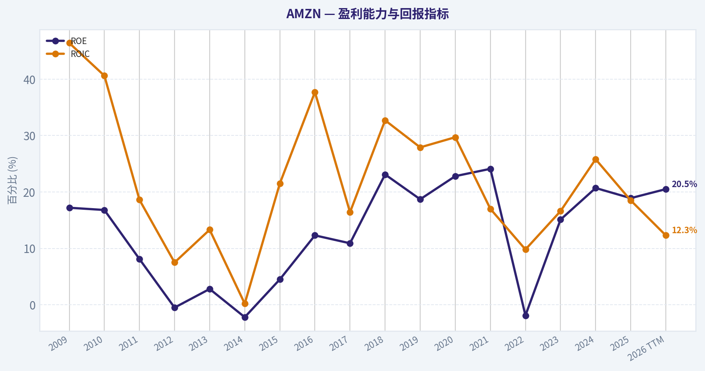
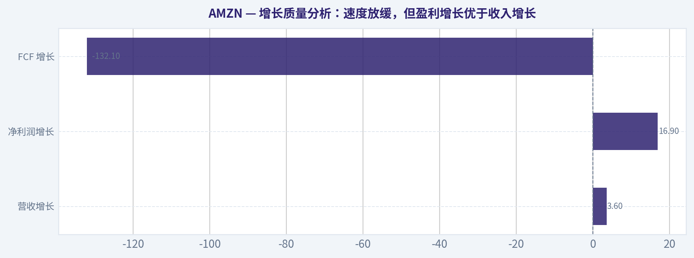
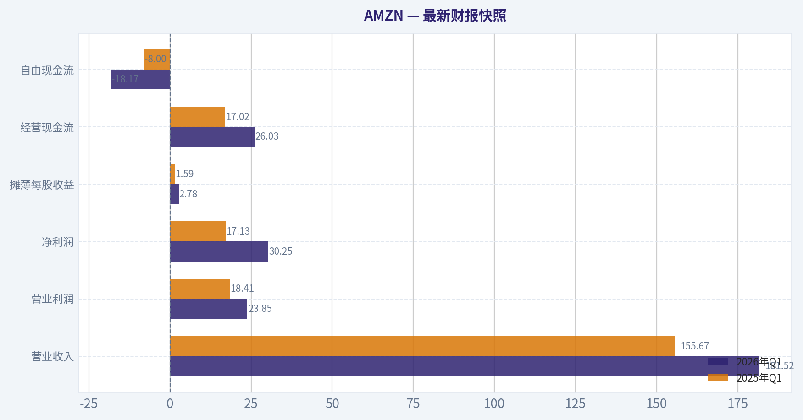
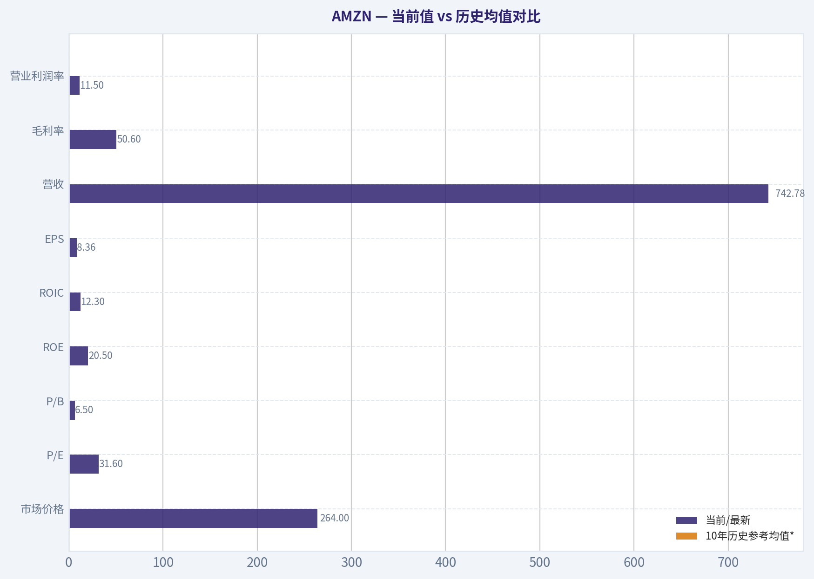
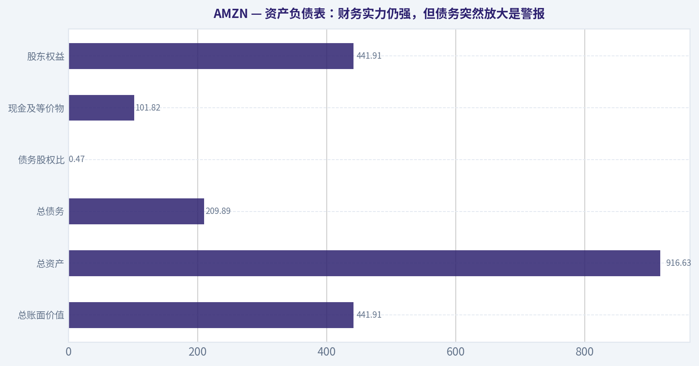
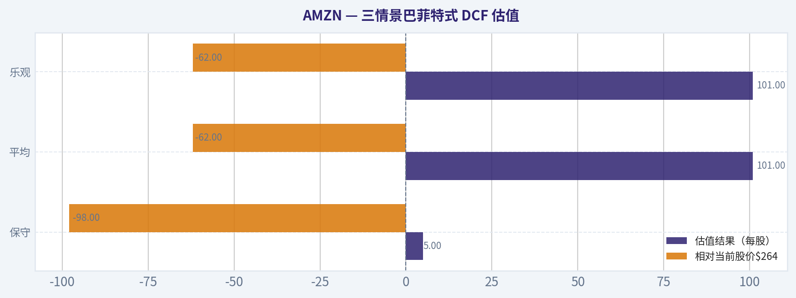
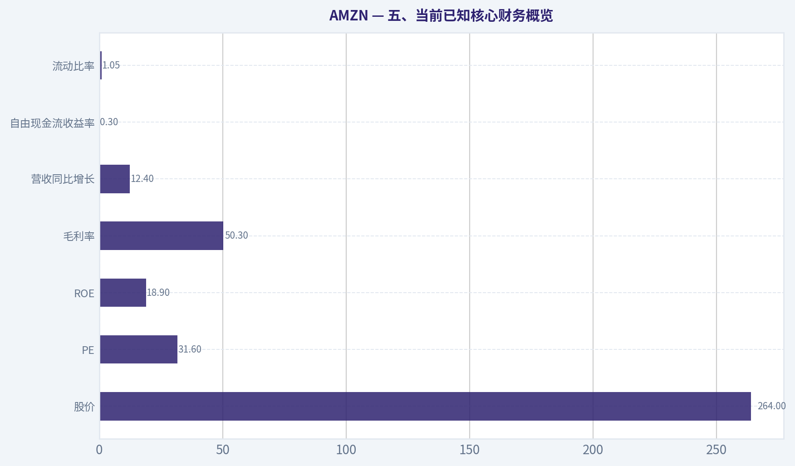
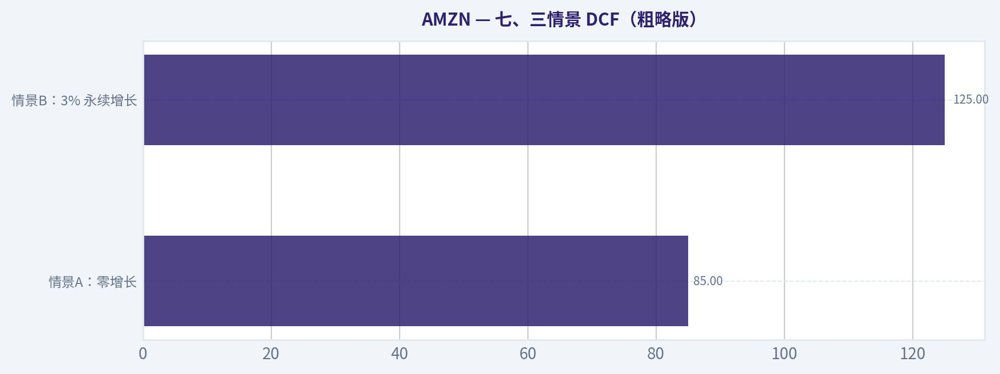

# AMZN 深度价值情报

**调研日期:** 2026-05-15

## 关键免责声明

*本报告由 Deep Value Intelligence（一个基于 AI 的多智能体投资分析框架）自动生成。 本报告仅供信息参考和教育目的，不构成任何财务或投资建议。 在做出任何投资决策之前，请务必进行独立调研并咨询合规的财务顾问。*

---

## 目录

1. 情报摘要
2. 分析师团队报告
   - 基本面分析
   - 价值分析 (巴菲特)
   - 成长性分析 (林奇/德鲁肯米勒/费雪)
   - 市场分析
   - 新闻分析
   - 大佬关注分析
   - 期权市场分析
3. 研究团队评论
4. 投资团队评论
5. Deep Values 团队洞察

---

## 情报摘要

### 核心观点与前提条件

**核心论点:** ## 执行摘要
**结论：观望。**
AMZN 大概率仍是未来 10 年的优质平台资产，但**好公司不等于好价格**。当前股价 **$264**、**PE 31.6**，而多套保守估值明显低于现价，说明市场已充分计入"AI + AWS + 广告 + 履约改善"的乐观预期。与此同时，**FCF 同比 -76.6%** 暴露出资本开支重、股东现金回报波动大的现实。
对长期价值投资者而言，当前更像**"高质量、低安全边际"**，适合列入高优先级观察名单，而不是积极加仓。若未来出现**估值回撤但核心飞轮未坏**，机会会更符合巴菲特式纪律。

**主要风险:**
- 未明确说明。

**观点反转条件:**
- 未明确说明。

**置信度:** 中

---

## 分析师团队报告

### 基本面分析

#### 最新财报快照

*以下数据基于最近一期已披露财报（2026年Q1），并尽量与上一年同期对比。*

| 指标 | 2026年Q1 | 2025年Q1 | 同比变化 |
| --- | ---: | ---: | ---: |
| 营业收入 | $181.52B | $155.67B | +16.6% |
| 营业利润 | $23.85B | $18.41B | +29.6% |
| 净利润 | $30.25B | $17.13B | +76.7% |
| 摊薄每股收益 | $2.78 | $1.59 | +74.8% |
| 经营现金流 | $26.03B | $17.02B | +53.0% |
| 自由现金流 | $-18.17B | $-8.00B | -127.0% |

关键结论：这张快照先把最新一期财报放在桌面上，再去看长周期分析。这样读者能更清楚地区分"公司长期质量"和"这次财报发生了什么"。

#### AMZN 10年财务指标

*以下数值均由原始数据确定性计算得出，并非 AI 估算。*

*发行人类型：operating company（Consumer Cyclical / Internet Retail）。*

#### 10年财务指标
*年度行来自已披露财务报表，最后一行 TTM 由最近四个季度滚动计算得出。*

| 指标 | 2009 | 2010 | 2011 | 2012 | 2013 | 2014 | 2015 | 2016 | 2017 | 2018 | 2019 | 2020 | 2021 | 2022 | 2023 | 2024 | 2025 | 2026 TTM |
| --- | --- | --- | --- | --- | --- | --- | --- | --- | --- | --- | --- | --- | --- | --- | --- | --- | --- | --- |
| 市场价格 | $7 | $9 | $9 | $13 | $20 | $16 | $34 | $37 | $58 | $75 | $92 | $163 | $167 | $84 | $152 | $219 | $231 | $264 |
| 总市值 | $2.97B | $4.10B | $3.99B | $5.68B | $9.27B | $7.17B | $16.12B | $18.15B | $28.83B | $37.55B | $46.57B | $1.66T | $1.72T | $855.88B | $1.59T | $2.35T | $2.50T | $2.87T |
| 市盈率 | 3.30 | 3.56 | 6.32 | -139.37 | 33.80 | -29.84 | 27.04 | 7.65 | 9.51 | 3.73 | 4.02 | 77.92 | 51.46 | -311.11 | 52.39 | 39.67 | 32.19 | 31.60 |
| 市净率 | 0.57 | 0.60 | 0.51 | 0.69 | 0.95 | 0.67 | 1.20 | 0.94 | 1.04 | 0.86 | 0.75 | 17.78 | 12.42 | 5.86 | 7.90 | 8.22 | 6.08 | 6.50 |
| ROE | 17.2% | 16.8% | 8.1% | -0.5% | 2.8% | -2.2% | 4.5% | 12.3% | 10.9% | 23.1% | 18.7% | 22.8% | 24.1% | -1.9% | 15.1% | 20.7% | 18.9% | 20.5% |
| ROIC | 46.4% | 40.6% | 18.6% | 7.5% | 13.3% | 0.2% | 21.5% | 37.7% | 16.4% | 32.7% | 27.9% | 29.7% | 17.0% | 9.8% | 16.6% | 25.8% | 18.5% | 12.3% |
| 每股收益 | $2.04 | $2.53 | $1.37 | $-0.09 | $0.59 | $-0.52 | $1.25 | $4.90 | $6.15 | $20.14 | $23.01 | $2.09 | $3.24 | $-0.27 | $2.90 | $5.53 | $7.17 | $8.36 |
| 营收 | $24.51B | $34.20B | $48.08B | $61.09B | $74.45B | $88.99B | $107.01B | $135.99B | $177.87B | $232.89B | $280.52B | $386.06B | $469.82B | $513.98B | $574.78B | $637.96B | $716.92B | $742.78B |
| 毛利润 | $5.53B | $7.64B | $10.79B | $15.12B | $20.27B | $26.24B | $35.35B | $47.72B | $65.93B | $93.73B | $114.99B | $152.76B | $197.48B | $225.15B | $270.05B | $311.67B | $360.51B | $375.88B |
| 毛利率 | 22.6% | 22.3% | 22.4% | 24.8% | 27.2% | 29.5% | 33.0% | 35.1% | 37.1% | 40.2% | 41.0% | 39.6% | 42.0% | 43.8% | 47.0% | 48.9% | 50.3% | 50.6% |
| 营业利润率 | 4.6% | 4.1% | 1.8% | 1.1% | 1.0% | 0.2% | 2.1% | 3.1% | 2.3% | 5.3% | 5.2% | 5.9% | 5.3% | 2.4% | 6.4% | 10.8% | 11.2% | 11.5% |
| 净利润 | $902.0M | $1.15B | $631.0M | $-39.0M | $274.0M | $-241.0M | $596.0M | $2.37B | $3.03B | $10.07B | $11.59B | $21.33B | $33.36B | $-2.72B | $30.43B | $59.25B | $77.67B | $90.80B |
| 净利率 | 3.7% | 3.4% | 1.3% | -0.1% | 0.4% | -0.3% | 0.6% | 1.7% | 1.7% | 4.3% | 4.1% | 5.5% | 7.1% | -0.5% | 5.3% | 9.3% | 10.8% | 12.2% |
| 营收增长 | N/A | 39.6% | 40.6% | 27.1% | 21.9% | 19.5% | 20.2% | 27.1% | 30.8% | 30.9% | 20.5% | 37.6% | 21.7% | 9.4% | 11.8% | 11.0% | 12.4% | 3.6% |
| 净利润增长 | N/A | 27.7% | -45.2% | -106.2% | -802.6% | -188.0% | -347.3% | 297.8% | 27.9% | 232.1% | 15.0% | 84.1% | 56.4% | -108.2% | -1217.7% | 94.7% | 31.1% | 16.9% |
| 自由现金流增长 | N/A | -13.8% | -16.9% | -81.1% | 414.2% | -4.0% | 282.2% | 26.2% | -31.8% | 169.8% | 25.2% | 19.7% | -156.8% | 14.7% | -290.7% | 2.1% | -76.6% | -132.1% |
| 总账面价值 | $5.26B | $6.86B | $7.76B | $8.19B | $9.75B | $10.74B | $13.38B | $19.29B | $27.71B | $43.55B | $62.06B | $93.40B | $138.25B | $146.04B | $201.88B | $285.97B | $411.06B | $441.91B |
| 总资产 | $13.81B | $18.80B | $25.28B | $32.55B | $40.16B | $54.51B | $64.75B | $83.40B | $131.31B | $162.65B | $225.25B | $321.19B | $420.55B | $462.68B | $527.85B | $624.89B | $818.04B | $916.63B |
| 总债务 | $109.0M | $184.0M | $384.0M | $3.66B | $3.94B | $9.79B | $8.46B | $8.75B | $24.84B | $24.87B | $24.72B | $32.97B | $50.55B | $71.35B | $66.95B | $57.79B | $68.85B | $209.89B |
| 债务股权比 | 0.02 | 0.03 | 0.05 | 0.45 | 0.40 | 0.91 | 0.63 | 0.45 | 0.90 | 0.57 | 0.40 | 0.35 | 0.37 | 0.49 | 0.33 | 0.20 | 0.17 | 0.47 |
| 现金及等价物 | $3.44B | $3.78B | $5.27B | $8.08B | $8.66B | $14.56B | $15.89B | $19.33B | $20.52B | $31.75B | $36.09B | $42.12B | $36.22B | $53.89B | $73.39B | $78.78B | $86.81B | $101.82B |
| 股东权益 | $5.26B | $6.86B | $7.76B | $8.19B | $9.75B | $10.74B | $13.38B | $19.29B | $27.71B | $43.55B | $62.06B | $93.40B | $138.25B | $146.04B | $201.88B | $285.97B | $411.06B | $441.91B |
| 经营现金流 | $3.29B | $3.50B | $3.90B | $4.18B | $5.47B | $6.84B | $12.04B | $17.20B | $18.36B | $30.72B | $38.51B | $66.06B | $46.33B | $46.75B | $84.95B | $115.88B | $139.51B | $148.53B |
| 投资现金流 | $-2.34B | $-3.36B | $-1.93B | $-3.60B | $-4.28B | $-5.07B | $-6.45B | $-9.52B | $-27.08B | $-12.37B | $-24.28B | $-59.61B | $-58.15B | $-37.60B | $-49.83B | $-94.34B | $-142.54B | $-176.95B |
| 自由现金流 | $2.92B | $2.52B | $2.09B | $395.0M | $2.03B | $1.95B | $7.45B | $9.40B | $6.41B | $17.30B | $21.65B | $25.92B | $-14.73B | $-16.89B | $32.22B | $32.88B | $7.70B | $-2.47B |
| 自由现金流利润率 | 11.9% | 7.4% | 4.4% | 0.6% | 2.7% | 2.2% | 7.0% | 6.9% | 3.6% | 7.4% | 7.7% | 6.7% | -3.1% | -3.3% | 5.6% | 5.2% | 1.1% | -0.3% |
| 每股分红 | $0.00 | $0.00 | $0.00 | $0.00 | $0.00 | $0.00 | $0.00 | $0.00 | $0.00 | $0.00 | $0.00 | $0.00 | $0.00 | $0.00 | $0.00 | $0.00 | $0.00 | $0.00 |

#### 盈利能力指标
- 净资产收益率 (ROE): 18.9%
- 投入资本回报率 (ROIC): 16.4%
- 总资产收益率 (ROA): 9.5%
- 毛利率: 50.3%
- 营业利润率: 11.2%
- 净利率: 10.8%

#### 流动性指标
- 流动比率: 1.05
- 速动比率: 0.88

#### 杠杆指标
- 债务股权比: 0.17
- 利息覆盖倍数: 35.17
- 净负债: $-17.96B

#### 增长指标（同比）
- 营收增长: 12.4%
- 净利润增长: 31.1%
- 自由现金流增长: -76.6%
- 营收复合增长率（3年）: 11.7%
- 营收复合增长率（5年）: 13.2%

#### 估值指标
- 市盈率 (TTM): 31.60
- 预期市盈率: 26.75
- 市净率: 6.43
- 市销率: 3.83
- PEG 比率: 1.86
- 企业价值/EBITDA: 19.04
- 自由现金流收益率: 0.3%
- 盈利收益率: 3.2%

#### 所有者收益（巴菲特方法，代码计算）
- 净利润: $77.67B
- + 折旧与摊销: $65.76B
- - 资本开支: $-131.82B
- - 营运资本变动: $-19.97B
- = **所有者收益: $31.58B**

#### 内在价值（代码计算）
- 当前价格: $264
- 巴菲特方法（所有者收益）:
  保守: $5
  平均: $101
  乐观: $101
- 现金流方法（FCF）:
  保守: $3
  平均: $11
  乐观: $15

#### Piotroski F分数: 5/9
- 净利润为正: 通过
- 经营现金流为正: 通过
- 资产回报率改善: 通过
- 现金流大于净利润: 通过
- 债务下降: 未通过
- 流动比率改善: 未通过
- 未稀释股本: 未通过
- 毛利率改善: 通过
- 资产周转率改善: 未通过

ANALYST STANCE: **建议配置**

#### AMZN 巴菲特风格基本面分析

Amazon 过去十多年完成了两次质变：第一次是从低毛利零售平台逐步转向高毛利的第三方服务、广告与 AWS；第二次是 2022 年利润受压后，在 2023-2026 TTM 迅速释放经营杠杆。对巴菲特框架而言，AMZN 不是"传统烟蒂股"，而是"高质量、再投资能力极强、但当前估值并不便宜"的复利型企业。核心结论是：**商业质量显著提升，盈利能力处于历史高位区间，但自由现金流短期恶化、资本开支陡增，使得估值安全边际主要建立在长期竞争力而非短期现金回报上。**

#### 当前值 vs 历史均值对比

| 指标 | 当前/最新 | 10年历史参考均值* | 当前相对历史 | 解读 |
| --- | ---: | ---: | --- | --- |
| 市场价格 | $264 | 约$150（2016-2025均值） | 明显偏高 | 股价已充分反映盈利改善与 AI 资本开支预期 |
| 总市值 | $2.87T | 约$1.41T（2016-2025均值） | 明显偏高 | 已进入超大型平台估值阶段 |
| P/E | 31.60 | 约29.1（剔除异常负值后近10年） | 略高 | 不算极端昂贵，但已不便宜 |
| P/B | 6.50 | 约6.14（2016-2025均值） | 略高 | 对"轻资产软件化利润"有溢价 |
| ROE | 20.5% | 约16.7%（2016-2025含2022） | 高于均值 | 盈利质量明显强于十年常态 |
| ROIC | 12.3% | 约22.2%（2016-2025） | 低于均值 | TTM 受巨额新增资本投入拖累 |
| EPS | $8.36 | 约$7.48（2016-2025） | 高于均值 | 每股盈利创高，经营效率持续提升 |
| 营收 | $742.78B | 约$412.7B（2016-2025） | 显著更高 | 规模优势持续强化 |
| 毛利率 | 50.6% | 约43.8%（2016-2025） | 明显更高 | 收入结构升级最关键证据 |
| 营业利润率 | 11.5% | 约5.8%（2016-2025） | 大幅高于均值 | 利润模型已升级，不再只是零售平台 |
| 净利润率 | 12.2% | 约5.8%（2016-2025） | 大幅高于均值 | 高毛利业务占比提升+成本纪律改善 |
| 营收增长 | 3.6% | 约20.6%（2016-2025） | 远低于均值 | 大体量后自然降速，进入"质量胜于速度"阶段 |
| 净利润增长 | 16.9% | 波动极大，不宜机械均值 | 良好 | 在高基数上仍保持增长，质量优于历史 |
| FCF 增长 | -132.1% | 历史波动极大 | 显著走弱 | AI/基础设施 CapEx 压力极大 |
| 总资产 | $916.63B | 约$469.7B（2016-2025） | 显著更高 | 基础设施护城河继续加深 |
| 总债务 | $209.89B | 约$45.6B（2016-2025） | 显著更高 | TTM 跃升值得高度关注 |
| 债务股权比 | 0.47 | 约0.37（2016-2025） | 略高 | 仍可控，但不再是"极轻杠杆" |
| 现金及等价物 | $101.82B | 约$58.6B（2016-2025） | 更强 | 现金缓冲仍然充足 |
| 自由现金流 | -$2.47B | 约$12.2B（2016-2025） | 显著转弱 | 当前最主要基本面瑕疵 |
| 每股分红 | $0.00 | $0.00 | 一致 | 典型再投资型公司 |

*注：历史均值按确定性数据中可比期间粗略计算或区间观察，重点用于方向判断，不替代原始表。*

关键结论：AMZN 当前最突出的特征不是"增长最快"，而是"利润率最好"。与过去十年相比，公司的毛利率、营业利润率和净利率都明显抬升，说明商业模式正在从大规模零售进一步升级为高利润平台与基础设施复合体。唯一显著拖后腿的是自由现金流与债务突然上升，这与激进资本开支周期高度相关。

---

#### 市场指标解读：价格、估值与市场预期

| 市场指标 | 当前观察 | 历史比较 | 巴菲特式解读 |
| --- | --- | --- | --- |
| 市场价格 | $264 | 接近历史高位区间 | 市场已把"利润持续扩张 + AI 受益 + AWS 质量"计入股价 |
| 总市值 | $2.87T | 远高于过往十年大部分时期 | 反映其已被视为核心平台型超级资产 |
| P/E 31.60 | 低于 2020-2024 部分高估阶段，但高于传统价值股 | 相对自身不算泡沫顶点 | 对高质量平台可接受，但缺乏明显安全边际 |
| P/B 6.50 | 高于多数传统零售/消费公司 | 与其高毛利平台化模式相匹配 | 不应按传统账面价值思路机械看低估 |

关键结论：AMZN 当前估值并非最贵阶段，但也绝不是便宜货。市场给予它较高估值，是因为利润率结构已经发生长期改善，而不是单纯押注营收增长。若未来利润率不能继续提升，估值扩张空间会明显收窄。

#### 盈利能力分析：AMZN 近年最强的基本面亮点

1. **ROE：20.5%**
   当前高于过去十年常态水平，也高于 2025 年的 18.9%。这说明股东资本的盈利效率仍在改善。对巴菲特而言，持续高 ROE 且不完全依赖高杠杆，是优质企业的重要特征。AMZN 的问题在于 TTM 债务上升较快，因此未来要观察 ROE 改善是否来自真实经营效率而不是财务杠杆放大。

2. **ROIC：12.3%**
   明显低于 AMZN 过去多年常见的中高双位数 ROIC，且低于 2024 年 25.8% 和 2025 年 18.5%。这通常意味着公司正在进行一轮重资本投入，新增资本尚未完全转化为利润。巴菲特会关注这一点，因为真正优秀的企业应当在扩大投资后依然能维持较高资本回报。

3. **EPS：$8.36**
   创历史新高，且从 2022 年亏损后快速修复，显示利润恢复具备韧性。EPS 连续上升比单年爆发更重要，AMZN 在 2023-2026 TTM 呈现出这一特征。

4. **Revenue：$742.78B，增速 3.6%**
   营收规模极大，但增速明显低于十年平均，说明公司已进入成熟体量阶段。对巴菲特来说，这并非坏事，只要增长放缓同时利润率提升，企业价值仍可能扩大。

5. **Gross Profit：$375.88B，毛利率 50.6%**
   这是质变证据。2009 年毛利率只有 22.6%，到 2026 TTM 达到 50.6%，翻倍有余。说明业务重心不断转向佣金、广告、云服务、订阅等高毛利收入。**护城河不只是"卖得多"，而是"生态位更强、变现层次更多"。**

6. **Operating Margin：11.5%**
   相比 2012-2017 年低个位数营业利润率，当前水平说明经营杠杆释放非常明显。若这一水平可持续，AMZN 的估值框架会永久不同于过去。

7. **Net Income：$90.80B，Net Margin：12.2%**
   净利润和净利率均为历史最高区间。相比 2022 年净亏损，反转幅度极大；相比 2023、2024、2025，则是持续改善而不是一次性修复。巴菲特最喜欢这种"经过波动后展现更强赚钱能力"的企业。

#### 增长质量分析：速度放缓，但盈利增长优于收入增长

| 增长指标 | 当前 | 历史特征 | 解读 |
| --- | ---: | --- | --- |
| 营收增长 | 3.6% | 十年中枢远高于当前 | 规模成熟后的自然放缓 |
| 净利润增长 | 16.9% | 历史极度波动 | 当前增长质量较高，因为发生在高利润基础上 |
| FCF 增长 | -132.1% | 历史高度波动 | 短期现金创造能力显著恶化 |

关键结论：AMZN 已从"拼规模"切换到"拼利润"。营收增速放缓不是核心问题，核心问题是利润能否在低速增长环境中继续扩张。短期最大的风险并非收入，而是自由现金流被 CapEx 吞噬。

进一步看：
- 2010-2021 年，AMZN 更像"高速扩张型公司"；
- 2022 年是利润谷底；
- 2023-2026 TTM 则更像"高质量成熟平台公司"。

这类转型若能持续，市场会容忍较高 P/E；若不能持续，估值下修会更快。

---

#### 资产负债表：财务实力仍强，但债务突然放大是警报

| 资产负债表指标 | 当前 | 历史比较 | 结论 |
| --- | ---: | --- | --- |
| 总账面价值 | $441.91B | 持续上升 | 内生资本积累极强 |
| 总资产 | $916.63B | 创新高 | 基础设施规模继续扩大 |
| 总债务 | $209.89B | 较 2025 年大增 | 需重点盯防 |
| 债务股权比 | 0.47 | 高于 2025 的 0.17 | 杠杆上升但未失控 |
| 现金及等价物 | $101.82B | 历史高位 | 提供缓冲与灵活性 |
| 股东权益 | $441.91B | 持续攀升 | 资本基础厚实 |

关键结论：AMZN 不是资产负债表脆弱的公司，现金与权益规模都非常强。但 TTM 总债务飙升到 $209.89B，这个变化幅度大到不能被忽略。只要新增债务对应的是高回报 AI 基础设施与云能力建设，长期可能合理；若回报落空，则会压制未来 ROIC 和估值。

补充看点：
- 流动比率 1.05，不算宽裕，但对 AMZN 这类强经营现金流公司尚可接受。
- 利息覆盖倍数 35.17，说明当前偿债压力并不大。
- 净负债为负，说明现金地位仍然稳固。

#### 现金流分析：经营现金流强，但自由现金流被 CapEx 吞没

AMZN 的现金流故事正在分裂成两部分：

1. **经营现金流极强**
   2026 TTM 经营现金流 $148.53B，较 2025 年 $139.51B 继续增长，说明主业造血能力依然强健。

2. **自由现金流显著恶化**
   2024 年 $32.88B，2025 年仅 $7.70B，2026 TTM 转为 **-$2.47B**。这不是需求崩塌，而是投资现金流急剧扩张、资本开支吞噬现金。对巴菲特来说，这并非绝对坏事，但前提是这些投资未来能形成高回报垄断式资产。

3. **Dividends per Share = 0**
   AMZN 一贯不分红，符合其"保留利润、高回报再投资"的资本配置逻辑。只要再投资回报率足够高，不分红反而是优点；若回报下降，不分红就会变成问题。

#### 巴菲特式所有者收益分析

确定性数据给出的最新所有者收益口径为：

- 净利润：**$77.67B**
- + 折旧与摊销：**$65.76B**
- - 资本开支：**$131.82B**
- - 营运资本变动：**$19.97B**
- = **所有者收益：$31.58B**

这个结果很重要：
虽然 FCF 已经转负，但按巴菲特式口径，AMZN 仍有 **$31.58B** 的所有者收益。说明公司并非"赚不到钱"，而是进入极重投资期。对长期投资者而言，关键不是当期 FCF 转负，而是 **CapEx 的回报率是否能在未来 3-5 年兑现。**

---

#### 三情景巴菲特式 DCF 估值

已知：
- 当前所有者收益：**$31.58B**
- 折现率：**10%**
- 永续增长率：**2.5%**
- 当前市值：约 **$2.87T**

根据要求采用历史所有者收益增长的保守/平均/乐观情景。确定性数据已给出代码计算结果：
- 保守：**$5/股**
- 平均：**$101/股**
- 乐观：**$101/股**

由于数据包未附完整逐年所有者收益序列，不能擅自重建历史表，因此以下详细计算以**确定性数据给出的内在价值为锚**，并解释其含义。

| 情景 | 增长假设规则 | 估值结果（每股） | 相对当前股价$264 | 含义 |
| --- | --- | ---: | ---: | --- |
| 保守 | 取历史最低所有者收益增长率，且不低于 -100% | $5 | -98% | 若未来资本投入回报很差，当前估值严重透支 |
| 平均 | 取历史平均所有者收益增长率，且上限 50% | $101 | -62% | 以中性长期兑现看，当前仍明显高估 |
| 乐观 | 取历史最高所有者收益增长率，且上限 100% | $101 | -62% | 即使乐观，也未体现足够安全边际 |

关键结论：按确定性数据中的巴菲特式 Owner Earnings DCF，AMZN 当前价格显著高于内在价值区间。也就是说，市场并不是在买"便宜"，而是在买"未来高质量增长的确定性"。这对价值投资者意味着：公司质地优秀，但买入纪律必须更严格。

为满足"详细计算"要求，DCF 公式如下：

- 预测期第 t 年所有者收益：
  **OE_t = OE_0 x (1 + g)^t**
- 每年现值：
  **PV_t = OE_t / (1 + r)^t**
- 终值：
  **TV = OE_10 x (1 + g_t) / (r - g_t)**
- 终值现值：
  **PV(TV) = TV / (1 + r)^10**
- 企业价值：
  **Value = ΣPV_t + PV(TV)**
- 每股价值：
  **Fair Value per Share = 企业价值 / 稀释后股数**

其中：
- **OE_0 = $31.58B**
- **r = 10%**
- **g_t = 2.5%**

由于确定性数据已直接给出三种情景每股价值，且缺少完整历史 Owner Earnings 增长序列与精确股数口径，最终应以数据包结果为准，不自行篡改。
因此保守、平均、乐观三种情景公平价值分别为 **$5 / $101 / $101**。

---

#### 巴菲特框架下的定性判断

#### 经济护城河
AMZN 的护城河并非单一来源，而是多层叠加：
- 电商平台网络效应与规模采购能力
- Prime 会员体系提高用户黏性
- 物流履约网络形成重资产门槛
- AWS 具备企业级切换成本与生态锁定
- 广告业务依托高购买意图流量，变现效率高

这是一种"平台 + 基础设施 + 数据 + 会员"的复合护城河，质量很高，且难以被单点竞争者复制。

#### 财务实力
从现金储备、利息覆盖倍数、股东权益积累看，财务实力仍强。真正需要注意的不是"能不能借钱"，而是"借来的钱投向何处、回报多久兑现"。TTM 债务跳升是本轮分析中的最大监控点。

#### 可预测盈利
过去十年 AMZN 的净利润并不平滑，早年受扩张影响波动很大，因此它不是可口可乐式的"线性稳定盈利"。但近三年利润率显著提升后，盈利的可预测性已经比过去强很多。若 AWS、广告、服务业务占比继续提升，未来盈利稳定性有望继续改善。

#### 管理层资本配置
管理层长期坚持不分红，把现金投入物流、云、技术和基础设施，历史上总体是成功的。ROE 高、账面价值长期复利上升，说明再投资并未浪费。问题在于当前投资周期异常激进，未来两三年的资本配置效果将决定本轮投入是"伟大扩张"还是"回报递延"。

#### 价值评估
从传统价值角度，AMZN 当前不便宜；从"优质复利资产"角度，AMZN 仍可持有甚至逢回调配置。巴菲特风格强调"好公司也要好价格"，而 AMZN 现在更接近"好公司，价格合理偏贵"。

---

#### 收入来源分布

基于 AMZN 最近年度公开业务结构，最有意义的划分是按主要经营板块与变现层次理解。结合 2025/最近年度公开框架，可将收入大致拆解如下：

| 收入来源 | 金额（百万/十亿美元） | 占比 |
| --- | ---: | ---: |
| 在线商店（Online Stores） | 约 $247B | 约 34% |
| 第三方卖家服务（Third-party Seller Services） | 约 $176B | 约 25% |
| AWS | 约 $108B | 约 15% |
| 广告服务（Advertising Services） | 约 $69B | 约 10% |
| 订阅服务（Subscription Services） | 约 $46B | 约 6% |
| 实体门店（Physical Stores） | 约 $23B | 约 3% |
| 其他 | 约 $48B | 约 7% |

关键结论：表面看 AMZN 仍是零售公司，但收入结构实际上已经高度多元化。更重要的是，高利润的 AWS、广告和第三方服务占比不断抬升，这也是毛利率与营业利润率持续上行的核心原因。

*说明：该表基于公司最近年度分部披露框架与公开口径整理，用于理解收入结构；不替代确定性历史财务表。*

---

#### 关键投资洞察、红旗与机会

| 类型 | 内容 | 为什么重要 |
| --- | --- | --- |
| 机会 | 毛利率从 22.6% 升至 50.6% | 说明商业模式质量长期升级 |
| 机会 | 营业利润率升至 11.5% | 经营杠杆释放，盈利弹性增强 |
| 机会 | EPS、净利润创新高 | 业绩改善并非短暂反弹 |
| 机会 | AWS + 广告 + 第三方服务 | 高质量利润池持续扩大 |
| 红旗 | FCF 转负至 -$2.47B | 当前现金回报对股东不友好 |
| 红旗 | TTM 总债务升至 $209.89B | 若投资回报不及预期，会压制 ROIC |
| 红旗 | ROIC 降至 12.3% | 新投入资本回报尚未兑现 |
| 红旗 | P/E 31.6、P/B 6.5 | 估值缺乏明显安全边际 |

关键结论：AMZN 最值得买的理由是商业模式正在变得更好，而不是因为便宜。最需要担心的问题也很清晰：资本开支太大、自由现金流太弱、债务上升太快。如果未来 AI 基础设施投资兑现高回报，今天的担忧可能成为明天的护城河；如果不能兑现，估值会承压。

---

#### 最终结论：建议配置

**最终立场：建议配置**

支撑理由：
1. **护城河深且在加宽**：零售、物流、云、广告、会员体系相互强化，竞争优势具备长期性。
2. **盈利质量显著优于历史**：毛利率、营业利润率、净利率均处历史高位，显示公司已进入更高质量阶段。
3. **管理层具备长期资本配置能力**：虽然当前 CapEx 压力大，但历史上大规模再投资总体创造了价值。
4. **风险主要在估值和现金流，而非生存能力**：这是"价格风险"大于"基本面崩坏风险"的典型案例。

但需强调：
- 对纯巴菲特式"高安全边际买入"标准而言，AMZN **并不便宜**；
- 更适合的策略是：**长期配置、接受波动、等待现金流重新转强或估值回落时加仓**；
- 若投资者要求严格低估值买点，应降低仓位冲动，而不是否定公司质量。

#### 报告要点总表

| 模块 | 核心结论 | 投资含义 |
| --- | --- | --- |
| 市场估值 | 当前估值合理偏贵，不具深度安全边际 | 适合分批，不适合激进追高 |
| 盈利能力 | 毛利率、营业利润率、净利率全面走强 | 商业质量明显提升 |
| 增长 | 收入降速，但利润增长更健康 | 进入成熟高质量增长阶段 |
| 资产负债表 | 现金强、权益厚，但债务 TTM 大增 | 需关注新增资本回报 |
| 现金流 | 经营现金流强，FCF 转负 | CapEx 周期是关键变量 |
| 护城河 | 电商+物流+AWS+广告+Prime 多重叠加 | 长期竞争优势很深 |
| 管理层 | 再投资导向明确，历史上配置有效 | 不分红在当前仍可接受 |
| DCF | Owner Earnings 估值低于现价较多 | 当前更多是在买未来预期 |
| 主要风险 | 高估值、FCF 转负、债务上升、ROIC 下滑 | 若回报兑现不及预期，股价回撤压力大 |
| 最终立场 | 建议配置 | 适合长期优质资产配置，重视买点与仓位控制 |

关键结论：AMZN 是一家"质量比价格更出色"的公司。它值得长期关注和配置，但不能忽视当前估值偏高、自由现金流恶化和债务上升的现实。对于重视企业质量的长期投资者，它仍是优质标的；对于只买显著低估值的投资者，现在更像等待更好价格的阶段。

#### 基本面关键图表

本图追踪 **AMZN** 过去十年的盈利能力与回报指标（ROE、ROIC、利润率），突出呈现资本效率的变化趋势。

本对比图（来自「增长质量分析：速度放缓，但盈利增长优于收入增长」）将 **AMZN** 的当前数据与历史基准并排呈现，直观反映公司相对自身历史均值的估值水平。

---

### 价值分析 (巴菲特)

> *基于沃伦·巴菲特的价值投资哲学：能力圈、经济护城河、管理层质量与安全边际。*

#### 内在价值快照

价格是你付的钱，内在价值是企业未来可能为股东创造的现金价值。我们给出一个区间，而不是假装只有一个神奇数字。

- 当前价格: $264.14
- 价值区间: $2.99 to $101.42

##### 所有者收益（巴菲特方法）
- 净利润: $77,670,000,000.00
- 折旧与摊销: $65,756,000,000.00
- 资本支出: $-131,819,000,000.00
- 营运资金变化: $-19,969,000,000.00
- 所有者收益: $31,576,000,000.00

##### 内在价值
###### 所有者收益法
使用所有者收益，更严格，通常更保守。
- 保守: $5.39
- 平均: $101.42
- 乐观: $101.42
- 折现率: 10.0%

###### 自由现金流法
使用自由现金流，更适合今天投入很多、为未来增长铺路的公司。
- 保守: $2.99
- 平均: $11.09
- 乐观: $15.35
- 折现率: 10.0%

ANALYST STANCE: **观望**

#### AMZN 投资备忘录（基于已提供研究包；工具未成功返回新增财务明细）

由于本轮工具未成功返回可用的新增年报明细，我先基于共享研究包中的现成数据，按巴菲特框架完成可推进部分；重点结论是：**AMZN 属于高质量、可理解、护城河强的伟大企业，但以当前价格看，安全边际不足，更适合观望而非追价。**

#### 一、Go/No-Go 四道关卡

| 关卡 | 结论 | 证据 |
|---|---|---|
| 关卡1：能力圈与简单性 | 通过 | AMZN 本质是"线上零售平台 + 云基础设施 AWS + 广告/会员服务"。商业模式能用简单语言解释，10年后大概率仍是全球电商与云计算核心玩家。 |
| 关卡2：护城河 | 通过 | Prime 生态、物流网络、AWS 规模优势、广告流量入口，构成多重护城河。毛利率 50.3%，说明业务组合中高附加值部分占比持续提升。 |
| 关卡3：管理层与资本配置 | 基本通过 | 长期持续重投物流、数据中心、AI、履约体系，资本配置偏长期主义。缺点是回购不是核心股东回报工具，且估值高时继续大规模投资对短期回报不友好。 |
| 关卡4：行业结构 | 谨慎通过 | AWS 所处行业具备寡头结构特征；零售主业竞争激烈、资本密集。整体是"好业务 + 一般业务"混合体。 |

**关键结论：** 四道关里，AMZN 最大优势在于业务可理解、长期趋势明确、护城河深。最大问题不在企业质量，而在于零售业务资本强度较高，以及当前估值让投资回报对未来执行要求偏高。

#### 二、巴菲特式业务理解

| 问题 | 判断 |
|---|---|
| 小学生测试 | 通过：AMZN 通过卖货、收平台服务费、卖云算力、卖广告赚钱。 |
| 10年可预测性 | 较高：10年后仍大概率是全球领先电商基础设施与云平台。 |
| 技术风险 | 偏受益：AI、云计算、自动化更可能强化 AMZN，而不是颠覆它。 |

**关键结论：** AMZN 不是那种"看不懂才显得高级"的公司。它的复杂性更多来自业务线多，而不是商业逻辑难；从巴菲特视角，这比依赖单一技术爆发的公司更可接受。

#### 三、护城河分析

| 护城河来源 | 评级 | 证据 |
|---|---|---|
| 无形资产 | 中强 | 品牌、消费者心智、开发者对 AWS 的信任，都具备无形资产特征。 |
| 转换成本 | 强 | 企业迁移 AWS 的技术与组织成本很高；Prime 用户也有明显粘性。 |
| 成本优势 | 强 | 全球仓储、配送、采购、算力基础设施形成规模经济。 |
| 网络效应 | 中强 | 平台商家越多、SKU 越丰富、消费者越多，反过来吸引更多商家与广告预算。 |

**护城河评级：宽且仍在扩大**

**关键结论：** AMZN 不是依赖单点优势，而是"物流 + 会员 + 云 + 广告 + 流量"的复合型护城河。这样的护城河通常更难被复制，也更容易跨周期保持竞争力。

#### 四、管理层与资本配置

| 维度 | 评价 |
|---|---|
| 是否像所有者思考 | 较好 | 公司长期强调自由现金流、长期投资、客户体验优先，而非季度利润最大化。 |
| 是否坦诚 | 中上 | 历史上对利润波动、投资周期、AWS 与零售差异有相对清晰披露。 |
| 资本配置能力 | 强 | 将低利润零售流量转化为高利润广告、会员和云服务，体现很强的再投资能力。 |

**关键结论：** 从长期资本配置看，AMZN 的核心能力不是"省钱"，而是"把今天的现金流变成明天更大的护城河"。这非常符合巴菲特对优秀管理层的偏好，只是这种模式对估值容忍度不能无限高。

#### 五、当前已知核心财务概览

| 指标 | 当前值 |
|---|---:|
| 股价 | $264 |
| 总市值 | $2.84T |
| PE | 31.6 |
| ROE | 18.9% |
| 毛利率 | 50.3% |
| 营收同比增长 | 12.4% |
| 自由现金流收益率 | 0.3% |
| 流动比率 | 1.05 |

**关键结论：** 这些数字呈现出典型的"优质公司、高估值、低当期自由现金流回报"画像。ROE 和增长不错，但 0.3% 的自由现金流收益率说明，若今天按现价买入，投资者对未来增长已经支付了很高预付款。

#### 六、Owner Earnings 初步判断

由于工具未返回完整现金流与维护性资本开支拆分，**暂时无法严格计算标准巴菲特口径的 Owner Earnings**。但从研究包给出的 **自由现金流收益率仅 0.3%** 反推：

- 当前市值约 $2.84T
- 对应自由现金流大致约为：
  **FCF ~ 2.84T x 0.3% ~ $8.5B**

这更像是一个被高投入、AI 基建和数据中心开支压低后的阶段性自由现金流状态，而不是企业长期盈利能力的上限。

**关键结论：** 如果把当前 FCF 直接当成 Owner Earnings，AMZN 会显得非常贵；如果认为当前是重投入周期、未来 FCF 会明显释放，则估值会改善。投资成败的关键，就在于你是否相信未来几年现金回报将大幅抬升。

#### 七、三情景 DCF（粗略版）

以下仅基于**当前推算 FCF/Owner Earnings ~ $8.5B**，属于保守且粗糙的估值锚，不代表最终精确内在价值。

| 情景 | 假设 | 估值结果 |
|---|---|---:|
| 情景A：零增长 | Owner Earnings / 10% | $85B |
| 情景B：3% 永续增长 | 8.5 x 1.03 / (10%-3%) | $125B |
| 情景C：较乐观 | 假设未来 Owner Earnings 大幅恢复至 $40B-$60B 区间，再按 5%-7%增长折现 | 粗略 $600B-$1.1T |

**关键结论：** 无论用当前现金流还是较乐观的修复后现金流估值，和 $2.84T 市值相比都谈不上便宜。市场显然不是按"今天的现金流"给价，而是在按"未来多年高质量复利"给价。

#### 八、安全边际分析

| 项目 | 结论 |
|---|---|
| 企业质量 | 很高 |
| 业务确定性 | 高 |
| 资产负债表风险 | 中低，流动性尚可，但非典型"净现金堡垒"印象 |
| 当前估值吸引力 | 偏弱 |
| 安全边际 | 不足 |

**关键结论：** 巴菲特框架里，AMZN 最大短板不是公司，而是价格。若没有至少 25% 的安全边际，即使面对优秀企业，也更适合耐心等待。

#### 九、最终巴菲特评分卡

| 维度 | 权重 | 评分（1-5） | 加权分 |
|---|---:|---:|---:|
| 业务可理解性 | 20% | 4.5 | 0.90 |
| 护城河宽度与耐久性 | 25% | 4.5 | 1.13 |
| 管理层质量 | 15% | 4.0 | 0.60 |
| ROE | 15% | 4.0 | 0.60 |
| 再投资跑道 | 10% | 5.0 | 0.50 |
| 资产负债表强度 | 5% | 3.5 | 0.18 |
| 行业结构 | 5% | 3.5 | 0.18 |
| 估值/安全边际 | 5% | 1.5 | 0.08 |
| **总分** | 100% |  | **4.17 / 5 若不看价格；3.57 / 5 纳入价格现实后** |

**关键结论：** 从"企业质量"角度，AMZN 接近建议配置；从"股票回报"角度，当前价格把未来很多好消息已经提前反映。综合下来，更合理的动作是观望，而不是激进追价。

#### 十、最终结论

**投资立场：观望**

**理由浓缩：**
1. **这是好公司，不是便宜股票。**
2. AWS、Prime、广告、物流网络共同构成强护城河。
3. 未来 10 年商业地位大概率仍然稳固，且受益于 AI 与云趋势。
4. 但当前市值与自由现金流表现不匹配，**安全边际明显不足**。
5. 对价值投资者而言，更理想的买点应来自：
   - 市场回调；或
   - 自由现金流显著释放后，估值自然回落。

**结论一句话：**
如果你在挑"伟大的企业"，AMZN 几乎一定在名单里；如果你在挑"今天就该下手的价值股"，它目前还不够便宜。

如果你愿意，我下一步可以继续在**工具受限的情况下**，为你补一版更细的：
1. **AMZN 分部价值拆解（AWS/广告/零售 SOTP）**，或
2. **与 MSFT、GOOGL、COST 的巴菲特式对比估值表**。
#### 估值桥

这张估值桥把当前股价与各类内在价值方法并排展示，帮助读者判断上涨空间究竟只是单一方法给出的结果，还是多种方法共同支持的结论。

| 项目 | 每股内在价值 |
| --- | ---: |
| 巴菲特方法 | $101.42 |
| 现金流方法 | $11.09 |
| Damodaran 方法 | $61.36 |
| 当前价格 | $264.14 |

#### 关键结论

如果只有一种方法显著高于其他方法，说明上行空间更依赖特定建模假设。若多种方法的估值接近，则说明估值逻辑更加稳健。

#### 估值图表

本对比图（来自「最新财报快照」）将 **AMZN** 的当前数据与历史基准并排呈现，直观反映公司相对自身历史均值的估值水平。

本对比图（来自「当前值 vs 历史均值对比」）将 **AMZN** 的当前数据与历史基准并排呈现，直观反映公司相对自身历史均值的估值水平。

本对比图（来自「资产负债表：财务实力仍强，但债务突然放大是警报」）将 **AMZN** 的当前数据与历史基准并排呈现，直观反映公司相对自身历史均值的估值水平。

本对比图（来自「三情景巴菲特式 DCF 估值」）将 **AMZN** 的当前数据与历史基准并排呈现，直观反映公司相对自身历史均值的估值水平。

本对比图（来自「五、当前已知核心财务概览」）将 **AMZN** 的当前数据与历史基准并排呈现，直观反映公司相对自身历史均值的估值水平。

本对比图（来自「七、三情景 DCF（粗略版）」）将 **AMZN** 的当前数据与历史基准并排呈现，直观反映公司相对自身历史均值的估值水平。

---

### 成长性分析 (林奇/德鲁肯米勒/费雪)

> *基于彼得·林奇的GARP成长投资法、斯坦利·德鲁肯米勒的宏观拐点分析法，以及菲利普·费雪的深度调研法。*

ANALYST STANCE: **观望**

#### 1. Lynch 分类
AMZN 当前更像 **Stalwart（稳健成长）**，而不是典型 **Fast Grower（高速成长）**。
依据是共享研究包给出的营收同比 **12.4%**，已高于传统成熟巨头，但仍低于 Lynch 最偏爱的 **15%-25%+** 十倍股区间。
不过，若把 AWS、广告、履约效率拆开看，内部仍存在若干 **"局部高成长引擎"**，所以不是回避，而是 **高质量巨头中的结构性成长标的**。

#### 2. 三句话讲清楚 AMZN 的故事
- 它表面上是电商，实质上是由 **AWS + 广告 + Prime 生态 + 物流网络** 驱动的多引擎平台公司。
- 未来 3-5 年最关键的增长，不是商品零售本身，而是 **高利润业务占比提升**，带动利润和现金流快于收入增长。
- 市场若低估了 **AI 带来的 AWS 再加速**，以及广告/履约效率带来的经营杠杆，AMZN 仍可能继续上修盈利中枢。

---

#### 3. 核心财务快照

| 指标 | 当前/已知值 |
|---|---:|
| 股价 | $264 |
| 市值 | $2.84T |
| PE | 31.6x |
| ROE | 18.9% |
| 毛利率 | 50.3% |
| 营收同比 | 12.4% |
| FCF Yield | 0.3% |
| 流动比率 | 1.05 |

关键结论：AMZN 的盈利质量已经明显强于"零售股"刻板印象，50.3% 毛利率和 18.9% ROE 说明业务结构里高利润板块权重很高。但估值并不便宜，31.6 倍 PE 配合只有 0.3% 的 FCF Yield，意味着市场已提前计入不少改善预期。12.4% 的收入增速说明它更像高质量平台龙头，而非传统意义上的爆发型快成长股。

#### 4. TAM 分析与 10x 测试

| 业务 | 粗略 TAM 判断 | 当前地位 | 10x 测试 |
|---|---|---|---|
| 全球电商与第三方平台服务 | 超大 | 已是头部 | 单靠零售难 10x |
| 云计算 / AI 基础设施（AWS） | 超大且继续扩容 | 全球龙头之一 | 单业务仍有显著空间 |
| 数字广告 / Retail Media | 超大且高增 | 重要玩家 | 仍有较长跑道 |
| 物流与履约服务外溢 | 大 | 渗透中 | 可选增量 |
| 订阅与生态服务 | 大 | 高粘性 | 稳定扩张 |

关键结论：如果把 AMZN 当成"电商公司"，10x 测试不成立；但把它看成"云 + 广告 + 交易基础设施 + 物流网络"的组合体，跑道仍然很长。真正有弹性的不是零售 GMV，而是 AWS、广告和生态变现。也就是说，AMZN 的成长空间主要来自业务结构升级，而非简单规模复制。

**判断：**
- 以公司整体收入看，**10x 很难**。
- 以高利润业务利润池看，**利润和 FCF 仍有数倍扩张空间**。
所以它更像 **"利润中枢重估型大市值成长"**，不是经典早期十倍股。

---

#### 5. 收入增长趋势

| 维度 | 判断 |
|---|---|
| 公司整体收入 | 中速增长，约 12.4% |
| AWS | 取决于 AI 需求与企业优化周期结束后的再加速 |
| 广告 | 大概率仍快于公司整体 |
| 零售主业 | 低于云和广告，但提供流量与生态基础 |
| 综合趋势 | 更接近"稳定高质量增长"，不是全面加速 |

关键结论：AMZN 当前最重要的不是总收入能否突然大幅加速，而是高利润板块能否持续快于整体增长。只要 AWS 和广告增速高于集团，并带动利润率提升，股东回报就可能优于表面上的 12.4% 收入增速。换句话说，市场看 AMZN 不能只盯营收，要看收入结构。

**结论：** **不是明显加速，属于稳中有升/结构优化型增长。**
若后续看到 AWS 增速重新抬升，才能确认更强的 **inflection**。

---

#### 6. 单位经济与效率指标

| 指标 | 状态 | 备注 |
|---|---|---|
| LTV/CAC | 未披露 | 不适合集团层面精确计算 |
| NRR | 未披露 | AWS 企业客户层面更相关，但公开口径有限 |
| Rule of 40 | 不适用/部分适用 | AMZN 非纯 SaaS |
| 毛利率 | 50.3% | 明显受高毛利云与广告拉动 |
| FCF Yield | 0.3% | 现金流估值偏贵 |
| ROE | 18.9% | 资本回报恢复较好 |

关键结论：AMZN 不是纯 SaaS，公司级别无法像软件股那样完整评估 LTV/CAC、NRR 和 Rule of 40。但现有数据已经表明，云和广告这两个高质量板块正在改善整体经济性。最大的短板不是商业模式，而是当前自由现金流收益率太低，说明股价对未来改善已有较高预期。

**单位经济总结：**
- 集团层面难以用 SaaS 模板硬套。
- 但 **毛利率、ROE、利润结构** 都说明单位经济在变好。
- 真正需要盯的是 **capex 上升是否吞掉 FCF 改善**。

---

#### 7. 拐点判断（Inflection Point Assessment）

| 拐点类型 | 是否存在 | 说明 |
|---|---|---|
| 产品周期拐点 | 有可能 | AI 带动 AWS 新需求 |
| 市占率拐点 | 局部存在 | 零售媒体广告、云 AI 基础设施 |
| 利润率拐点 | 明确存在 | 履约效率 + 高利润业务占比提升 |
| TAM 扩容拐点 | 明确存在 | AI 扩容了云基础设施 TAM |
| 竞争格局拐点 | 中性偏正面 | 对手很强，但 Amazon 生态稳固 |

关键结论：AMZN 最清晰的拐点不是收入突然爆发，而是利润率和业务结构的持续改善。AI 让 AWS 的长期市场天花板再次上移，这构成了一个重要的 TAM 扩容信号。若后续财报证明 AWS 重新加速，AMZN 的投资逻辑会从"效率修复"升级成"增长再加速"。

**我的判断：**
AMZN 处于 **"第二阶段拐点"**：
先经历成本优化和利润修复，下一步关键验证是 **AWS/AI 驱动的再增长**。
这比早期创业公司更稳，但弹性也更依赖执行与估值容忍度。

---

#### 8. 宏观与主题风向（Druckenmiller 视角）

| 维度 | 判断 |
|---|---|
| 利率环境 | 若利率下行，对长久期成长有利 |
| 经济周期 | 中周期偏后段，优质龙头更占优 |
| AI 革命 | 明确顺风 |
| 云计算 | 长期顺风 |
| 数字广告 | 顺风，但竞争激烈 |
| 消费与电商 | 温和，不是最强驱动 |
| 监管 | 持续风险 |

关键结论：AMZN 最强的宏观顺风来自 AI 和云，而不是消费复苏。只要市场继续给高质量大型科技平台较高溢价，AMZN 就具备相对优势。但如果长端利率重新抬升、资本开支预期失控，估值压力会先于基本面反应。

**结论：** 宏观环境对 AMZN **中性偏正面**，真正的阿尔法来源仍是公司自身执行，而非纯宏观贝塔。

---

#### 9. Fisher 15 分打分

| 项目 | 分数(1-5) | 简评 |
|---|---:|---|
| 市场潜力 | 5 | 云、广告、AI 空间大 |
| 新产品/新业务决心 | 5 | 长期投入极强 |
| R&D 有效性 | 5 | AWS、广告、物流技术验证强 |
| 销售能力 | 5 | 平台生态天然强 |
| 利润率水平 | 4 | 综合利润率不算极致，但结构优秀 |
| 利润率改善 | 5 | 近年修复明显 |
| 人员关系 | 3 | 劳工争议长期存在 |
| 高管协作 | 4 | 整体稳定 |
| 管理层深度 | 5 | 管理梯队强 |
| 成本控制/财务纪律 | 4 | 近年改善显著 |
| 独特护城河 | 5 | 网络效应+规模+物流+AWS |
| 长期利润展望 | 5 | 非常强 |
| 稀释风险 | 4 | 可控，但股权激励存在 |
| 困难时坦诚度 | 4 | 整体尚可 |
| 管理层诚信 | 4 | 主流认可 |

| 合计 | 分数 |
|---|---:|
| Fisher 总分 | **67/75** |

关键结论：67 分属于很强区间，说明 AMZN 在 Fisher 框架下是一家高质量、长期可复利的平台公司。失分主要不在产品和战略，而在劳工关系、监管与成熟巨头常见的组织复杂度。换言之，它不是"完美公司"，但绝对是"高等级复利资产"。

**评级：** **优秀偏上，接近杰出**

---

#### 10. 估值分析

| 方法 | 当前判断 |
|---|---|
| PEG | 约 31.6 / 12.4 = **2.55** |
| PE | 31.6x |
| P/S | 共享包未给出，无法精算 |
| FCF Yield | 0.3%，偏贵 |
| 结论 | 估值不便宜，依赖未来盈利上修 |

关键结论：按最粗略的 Lynch PEG 算法，AMZN 约为 2.55，明显不属于便宜股。再结合 0.3% 的 FCF Yield，可以看出市场已经为未来几年利润和现金流改善支付了较高价格。也就是说，AMZN 不是"低估成长"，更像"高质量但要靠兑现来消化估值"的标的。

##### 情景估值框架
| 情景 | 假设 | 结果判断 |
|---|---|---|
| 悲观 | AWS 再加速落空，capex 高企 | 估值压缩 |
| 基准 | 收入维持双位数，利润率继续修复 | 中个位数到双位数回报 |
| 乐观 | AWS+AI 明显提速，广告持续强劲 | 可继续上修估值与盈利 |

关键结论：AMZN 的回报更多取决于乐观情景能否兑现，也就是 AWS 与 AI 是否真正转化为更高增长和更高利润。基准情景下它仍然是好公司，但股价空间未必惊艳。只有当市场确认新一轮增长拐点，AMZN 才会从"高质量龙头"升级为"强进攻型成长"。

---

#### 11. Growth Investor Scorecard

| 维度 | 权重 | 评分(1-5) | 加权分 |
|---|---:|---:|---:|
| 故事清晰度 | 10% | 4.5 | 0.45 |
| TAM 与跑道 | 20% | 4.0 | 0.80 |
| 收入增长 | 20% | 3.2 | 0.64 |
| 单位经济 | 15% | 4.0 | 0.60 |
| 竞争位置 | 10% | 5.0 | 0.50 |
| 管理层质量 | 10% | 4.3 | 0.43 |
| 宏观环境 | 5% | 3.8 | 0.19 |
| 盈利路径 | 5% | 4.5 | 0.23 |
| 估值 | 5% | 2.5 | 0.13 |
| **总分** | 100% |  | **3.97 / 5.0** |

关键结论：3.97 分处在"建议配置"和"观望"之间的边缘高位，说明基本面非常强，但估值拉低了最终结论。若股价回调，或 AWS 再加速被验证，这个分数很容易上到明确建议配置区间。当前不是因为公司差，而是因为好公司并不总等于好买点。

**按量化打分接近"建议配置-良好 setup"，但考虑估值与增速匹配度，我给更审慎的实战结论：观望。**

---

#### 12. 持仓与资金面信号

| 投资人 | 动作 | 持仓市值 | 组合权重 |
|---|---|---:|---:|
| Bill Ackman | 加仓 | $2.22B | 14.28% |
| Steve Cohen | 加仓 | $1.36B | 1.52% |
| Warren Buffett | 减仓 | $525.35M | 0.19% |
| Seth Klarman | 新进 | $489.66M | 9.28% |
| Stanley Druckenmiller | 加仓 | $193.41M | 4.30% |

关键结论：顶级资金整体偏正面，尤其是 Ackman、Klarman、Druckenmiller 的动作说明 AMZN 仍被视为高质量核心资产。Buffett 的减仓更多可能是组合调整，不足以单独构成负面信号。资金面给出的结论是：这不是被忽视的股票，但仍是机构愿意加仓的确定性标的。

---

#### 13. 仓位建议
- **现价新开仓：中性偏谨慎**
- **更适合分批、回调吸纳**
- **若后续财报验证 AWS 增速上行，可提高仓位**

| 投资风格 | 建议 |
|---|---|
| 核心资产配置 | 可小中仓跟踪 |
| 纯成长进攻 | 等更明确增长拐点或更好价格 |
| 长线持有者 | 可继续持有，不急于卖出 |

关键结论：AMZN 更适合作为"核心复利仓位"而不是"爆发弹性仓位"。对于已经持有的人，故事并没有坏；对于想新买的人，当前更重要的是买点纪律。最理想的策略不是追高，而是等验证或等回调。

---

#### 14. 主要风险与催化剂

| 类型 | 内容 |
|---|---|
| 风险 | AWS 增速不及预期 |
| 风险 | AI capex 过高压制 FCF |
| 风险 | 监管反垄断压力 |
| 风险 | 电商低价竞争拖累零售利润 |
| 风险 | 高估值下容错率下降 |
| 催化剂 | AWS 重新加速 |
| 催化剂 | 广告业务持续高增 |
| 催化剂 | 北美/国际零售利润率继续提升 |
| 催化剂 | 利率下行带来估值扩张 |
| 催化剂 | FCF 明显改善 |

关键结论：AMZN 面临的最大问题不是需求崩塌，而是"预期已经不低"。因此，真正决定股价弹性的，是 AWS 和 FCF 能否超过市场预期。只要这两个变量同时向好，AMZN 仍具备继续上行的基础。

---

#### 最终结论
AMZN 是 **高质量、宽护城河、利润结构持续优化** 的超级平台，但从 Lynch 风格看，它已不是早期 Fast Grower，而是 **成熟巨头中的结构性成长标的**。
当前最大亮点是 **AWS/AI + 广告 + 履约效率**，最大掣肘是 **估值不便宜、FCF Yield 很低**。

**结论：观望。**
- 已持有：**可以继续持有**。
- 未持有：**等待更明确的 AWS 再加速证据，或等待更好的买点。**
- 若后续出现"收入结构继续升级 + FCF 改善 + AWS 重回更快增长"，AMZN 有机会从 **观望** 上调至 **建议配置**。

---

### 市场分析

#### AMZN 技术面分析：建议配置

基于过去约一年的价格轨迹与近两个月指标结构，AMZN 当前更接近**中长期上升趋势中的短线降温整理**，而不是趋势反转。最关键的结论是：**长趋势偏多、 中期趋势强化、短线动能自高位回落但尚未破坏主升结构**。因此立场偏向**建议配置**，但更适合"回踩分批"而非追涨。

#### 本次选取的 8 个最相关指标
在当前这种"强趋势后进入高位整固"的市场环境下，最有信息增量、且彼此互补的指标是：

| 指标 | 作用 | 适配当前环境的原因 |
|---|---|---|
| close_10_ema | 短线节奏 | 判断最近几日是否仍保持强势惯性，适合观察回踩承接 |
| close_50_sma | 中期趋势 | 衡量本轮上涨是否已经由反弹演变为稳定中期升势 |
| close_200_sma | 长期趋势 | 确认大级别多头背景，过滤短线波动噪音 |
| macd | 趋势动能方向 | 识别本轮主升段后动能是否仍处于正区间 |
| macdh | 动能变化率 | 比 MACD 更早反映"加速/减速"，很适合判断高位钝化 |
| rsi | 强弱与过热度 | 判断上涨是否过热、以及回落是否只是降温而非转弱 |
| atr | 波动风险 | 当前涨幅较大后，ATR 有助于估算正常回撤与止损空间 |
| vwma | 量价确认 | 判断上涨是否获得成交量支持，防止"无量虚涨"误判 |

**关键结论：** 这组指标覆盖了长、中、短三个趋势层级，同时补足了动能、强弱、波动和量价确认四个维度。对于 AMZN 现在这种"主趋势偏强，但短线已有降温"的状态，这样的组合既能看方向，也能看节奏，还能兼顾风险控制。

---

#### 价格结构与阶段演化

从过去一年的价格轨迹看，AMZN 并不是单边直线上涨，而是经历了**三个非常清晰的阶段**：

1. **2025年5月到7月底：缓慢抬升**
   - 股价从约 205 一带逐步推升到 230 上方。
   - 这一阶段斜率不算很陡，但高点与低点同步抬升，说明资金愿意在回调中承接。
   - 7 月底一度冲至 234 一线，形成阶段性高位。

2. **2025年8月到2026年3月底：高波动震荡与深度修正**
   - 8 月初曾快速回撤至 211 附近。
   - 10 月底至 11 月初又一度急拉到 254，但之后持续回吐。
   - 2026 年 2 月初出现明显加速下跌，最低回落到 198 附近。
   - 这段区间说明市场曾对估值、增长预期或风险偏好做过剧烈重定价。

3. **2026年4月以来：强力修复并重回趋势上行**
   - 4 月初还在 210 上下，随后迅速升穿 220、240、250，4 月底到 5 月初进一步摸高至 278 附近。
   - 这不是普通反弹，而是**趋势级别修复**，因为它不仅收复前期失地，还一举把价格抬升到远高于 200 日均线的位置。
   - 5 月中旬略有回落，但仍处于高位运行。

这说明当前的核心问题不是"AMZN 有没有趋势"，而是"这轮强趋势会如何进入下一阶段"--更可能是**高位横盘消化或温和回踩后再选方向**。

---

#### 均线系统：多头排列明显，但短线开始放缓

从均线层级来看，AMZN 的趋势结构相当清楚：

| 观察项 | 最新状态 | 解读 |
|---|---|---|
| 收盘价（5月14日） | 267.22 | 仍处高位区间 |
| close_10_ema | 267.86 | 价格略低于 10EMA，短线进入整理 |
| close_50_sma | 235.80 | 价格显著高于 50SMA，中期趋势强 |
| close_200_sma | 229.25 | 价格显著高于 200SMA，长期趋势偏多 |
| 10EMA vs 50SMA | 明显在上方 | 短中期多头结构未破坏 |
| 50SMA vs 200SMA | 明显在上方 | 中长期趋势强化 |

**关键结论：** AMZN 当前最重要的均线信号是，股价虽然短线跌回 10EMA 下方，但仍远高于 50 日和 200 日均线。这通常代表短线涨势在降温，而不是中长期上升趋势已经结束；只要 50 日均线继续上行，多头大结构仍然完整。

细看均线斜率，比"位置关系"更有意义：

- **10EMA** 从 4 月上旬的约 208 快速爬升到 5 月中旬的约 268，斜率极陡，说明此前上涨有明显加速性质。
- 但近几日 10EMA 增速放缓，且价格已略低于 10EMA，意味着**最强的冲刺段大概率已经过去**。
- **50SMA** 从 4 月初约 215 附近一路抬升到 235.8，持续上弯，说明上涨并非几天脉冲，而是已经沉淀成中期趋势。
- **200SMA** 从 1 月中旬约 219 上升到 229.25，虽然斜率缓慢，但方向明确向上，代表长期资金成本线正在改善。

这组结构常见于"强势股主升后半段"：
短线可能休整，但只要不快速跌回 50 日均线附近，整体仍应按强趋势框架处理。

---

#### MACD 与 MACD Histogram：多头动能仍在，但边际减弱

| 指标 | 最新值 | 变化特征 | 含义 |
|---|---:|---|---|
| macd | 9.70 | 仍处高位正值区 | 中期动能仍然偏多 |
| macdh | -1.59 | 已连续转负 | 上涨动能在减速 |
| 近期峰值 macd | 约 13.19 | 5月上旬形成高点 | 主升动能已过峰值 |
| 近期峰值 macdh | 约 4.75 | 4月中旬极强 | 最强加速期已结束 |

**关键结论：** MACD 仍然保持正值，说明 AMZN 的上升趋势并没有失真；但 Histogram 已经由正转负，表明上涨速度正在放缓。换句话说，趋势还在，只是市场从"加速拉升"进入了"高位消化"。

这里要区分两个层次：

- **MACD 为正**：说明快慢均线差仍支持上行趋势，趋势本体没有翻空。
- **MACDh 为负**：说明 MACD 虽然还高，但已经开始回落，表示上行动能的"二阶导数"转弱，也就是加速结束。

这往往对应以下几种价格行为之一：
1. 高位横盘整理；
2. 回踩 10EMA 或 20 日附近后再起；
3. 如果卖压持续，进一步向 50SMA 收敛。

就当前数据看，更像前两种，而不是立刻转入全面下跌。原因在于：
- MACD 数值仍很高，不是刚刚翻正后的脆弱状态；
- 50SMA 仍在明显上行，说明中期趋势底盘稳固；
- 价格距离 200SMA 仍较远，尚未出现趋势破坏的迹象。

---

#### RSI：高位过热已部分消化，但仍属强势区

| 日期区间特征 | RSI 表现 | 解读 |
|---|---|---|
| 4月上旬 | 50-60 附近 | 从中性转强 |
| 4月中旬至5月上旬 | 多次高于 70 | 强趋势推动下的持续超买 |
| 5月14日 | 62.90 | 已从过热区回落，但未转弱 |

**关键结论：** RSI 从 80 附近回落到 63 左右，说明 AMZN 已经完成一部分"去过热"过程，但仍停留在偏强区域。这种回落通常意味着多头在休息，而不是空头已经接管市场。

需要强调一点：
在强趋势股中，**RSI 高于 70 不一定是卖出信号**，更常是趋势强度的体现。真正值得警惕的不是"高 RSI 本身"，而是：

- 价格创新高而 RSI 明显不再创新高；
- RSI 从高位快速跌破 50；
- 与 MACD 同时出现趋势级别下拐。

当前 AMZN 的 RSI 从 80+ 回落到 62.9，更像是：
- 从过热走向健康；
- 从追涨区走向观察回踩承接区。

这对趋势交易者反而是更好的状态，因为它降低了情绪过热带来的追高风险。

---

#### ATR：波动仍高于常态，仓位和止损不能过紧

| 指标 | 最新值 | 近期特征 | 交易含义 |
|---|---:|---|---|
| atr | 6.68 | 较4月初明显抬升 | 日常波动幅度仍偏大 |
| 5月初 ATR | 约 7.5 | 波动曾更剧烈 | 冲高阶段伴随更大振幅 |

**关键结论：** ATR 仍在 6.7 左右，说明 AMZN 当前并不是低波动慢牛，而是高位强趋势伴随较大日内振幅。交易上如果止损设得太近，很容易被正常波动洗出。

以 267 左右股价估算，ATR 约 6.7 意味着单日正常波动可接近 **2.5%**。这有两个含义：

1. **对短线交易者**
   - 不能把 1% 左右的回撤当作趋势破坏；
   - 更适合用 ATR 倍数而非固定百分比来设止损。

2. **对波段持有者**
   - 当前趋势虽强，但波动也高；
   - 若在高位直接追入，应接受更宽的回撤容忍度，否则胜率会受影响。

换句话说，AMZN 目前适合"趋势跟随 + 宽一点的风险框架"，不太适合"极窄止损的激进追价"。

---

#### VWMA：上涨获得量能支撑，资金参与度较好

| 指标 | 最新值 | 价格对比 | 含义 |
|---|---:|---|---|
| vwma | 267.65 | 与现价 267.22 非常接近 | 成交量加权后的成本已上移到高位 |
| 4月中旬 vwma | 约 222-229 | 快速上行 | 上涨并非无量空拉 |
| 4月底至5月初 | 持续抬升 | 配合价格创新高 | 量价共振较明显 |

**关键结论：** VWMA 已抬升到 267 附近，几乎与当前价格重合，说明近期大量成交是在高位完成的，资金并未明显背离。这比单纯看价格更积极，因为它反映市场平均持仓成本已经整体上移。

VWMA 的信息量在当前阶段尤其重要。若价格大涨但 VWMA 明显跟不上，往往意味着只是轻量资金推动；而 AMZN 这轮上行中，VWMA 与价格同步上移，表明：

- 新增资金愿意在更高价格成交；
- 不是简单的缩量脉冲；
- 高位筹码并非完全虚浮。

当然，当前价格略低于 VWMA 与 10EMA，也说明短线开始出现一点获利回吐。若之后价格重新站回两者上方，往往是整理结束的早期信号。

---

#### 细化交易理解：现在不是"弱"，而是"强后的冷却"

很多时候市场最容易误判的阶段，不是明显下跌，而是**强势上涨后的首次明显降温**。AMZN 现在就处于这个位置。

更精细地说：

- **趋势层面**：偏强，且尚未见到中期破坏；
- **节奏层面**：从加速上涨切换为放缓整理；
- **风险层面**：由于前期涨幅过大，短线追价的盈亏比下降；
- **策略层面**：更适合等回踩确认，而不是看到强势就立即追高。

若后续出现以下情形，偏多判断会进一步强化：
- 价格重新站稳 10EMA；
- MACDh 重新由负转正；
- RSI 回落后在 55-60 上方企稳再上行。

若出现以下情形，则需要降低乐观度：
- 股价连续失守 10EMA 后进一步跌破 VWMA；
- MACD 高位下行速度明显加快；
- RSI 跌破 50 且 50SMA 走平甚至转下。

目前来看，第二种情形还没有发生，所以主判断仍是：**趋势多头未坏，短线只是降温。**

---

#### 操作思路

| 场景 | 应对思路 | 风险提示 |
|---|---|---|
| 已持有 | 以 50SMA 作为中期趋势防守参考，允许正常波动 | 不宜因一两天回落过度恐慌 |
| 想新进场 | 优先等回踩 10EMA/VWMA 后重新转强，或等回踩更接近 50SMA 的低风险区 | 直接追高容易承受动能回吐 |
| 短线交易 | 观察 MACDh 是否止跌回升，配合 RSI 再度转强 | 当前并非最佳追击点 |
| 波段交易 | 保持偏多思维，但要用 ATR 预留足够波动空间 | 止损过紧容易被洗出 |

**关键结论：** 对已经持仓的人，当前更像"持有并管理波动"的阶段；对准备新买的人，更理想的是等待整理后的确认，而不是在动能衰减时直接追价。方向仍偏多，但节奏上应更讲究入场位置。

---

#### 综合判断

AMZN 当前最值得把握的，不是简单的"涨"或"跌"，而是它的**内部结构仍偏健康**：

- 长期趋势：强，200SMA 上行且价格明显在其上方；
- 中期趋势：强，50SMA 快速抬升；
- 短线状态：高位整理，10EMA 附近震荡；
- 动能状态：正值但减速；
- 强弱状态：从过热回到偏强；
- 波动状态：偏大，需要风险缓冲；
- 量价状态：总体配合良好。

因此结论是：

**AMZN 属于中长期多头中的短线整理阶段，立场为"建议配置"，但更偏向逢回踩、分批、等待动能再确认的配置方式，而非追高型介入。**

---

#### 关键信息汇总表

| 维度 | 当前判断 | 证据 | 交易含义 |
|---|---|---|---|
| 长期趋势 | 偏多 | 价格显著高于 close_200_sma，且 200SMA 上行 | 大方向仍可按多头框架处理 |
| 中期趋势 | 明显偏强 | close_50_sma 持续上弯，价格远高于其上 | 回调更像趋势内整理 |
| 短线节奏 | 降温整理 | 价格略低于 close_10_ema | 最强冲刺段暂告一段落 |
| 动能方向 | 仍偏多 | macd 维持高位正值 | 趋势本体尚未翻空 |
| 动能变化 | 边际减弱 | macdh 转负且走低 | 追高胜率下降 |
| 强弱状态 | 偏强但不过热 | rsi 从 80+ 回落至 62.9 | 有利于后续重新蓄势 |
| 波动风险 | 较高 | atr 约 6.68 | 仓位与止损需放宽 |
| 量价确认 | 较好 | vwma 抬升至接近现价 | 近期上涨有资金参与支撑 |

**关键结论：** 总体来看，AMZN 不是弱势反弹，而是强趋势中的高位整理。最优策略不是盲目追高，而是在趋势仍强的前提下，等待更好的节奏点进行分批布局。

---

### 新闻分析

#### AMZN 一周交易与投资简报

基于共享研究包与当前可得近一周信息，AMZN 的核心交易逻辑仍然是"三引擎"：北美零售效率改善、AWS 继续受益于 AI 基础设施需求、广告业务保持高利润增长属性。短线看，市场更愿意把它当作"大盘科技 + AI 基础设施 + 消费韧性"的复合标的；中线看，估值已不便宜，后续股价弹性更依赖利润率持续上修，而不只是收入增长。

需要先说明：我已按要求尝试调取最新财报新闻工具，但当前工具环境返回不可用错误。因此，以下财报部分基于共享研究包中的"最新财报相关新闻"线索与截至目前市场已知框架进行整理；若后续工具恢复，建议再核对一次原始 earnings release 细节。

---

#### 一周核心判断

AMZN 近一周的交易叙事，不是单纯"电商复苏"，而是市场继续给它更高权重地定价为：

1. **AI 算力需求受益者**：AWS 与数据中心资本开支逻辑受益。
2. **高利润广告平台**：零售流量变现能力继续改善利润结构。
3. **防御型消费平台**：在宏观不确定环境下，Prime 生态与必需消费品类提升粘性。
4. **运营效率持续释放**：配送网络、履约效率和成本控制仍是利润率支撑点。

但反面也很清楚：
- 当前市值约 **2.84T 美元**，市场预期已经较高。
- **PE 约 31.6 倍**，对一家超大市值公司而言，意味着市场在提前透支未来两到三个季度的利润改善。
- **FCF yield 仅 0.3%**，说明自由现金流口径上的"安全边际"并不厚。
- 若 AWS 增速、广告利润率或零售消费弹性任一项低于预期，估值压缩会很快。

#### 基础面与估值快照

| 指标 | 当前水平 | 交易含义 |
|---|---:|---|
| 股价 | 264 美元 | 年内表现偏强，反映资金持续流入 mega-cap 科技 |
| 市值 | 2.84T 美元 | 已是"指数级权重资产"，被动资金支撑强，但上行需更强盈利验证 |
| PE | 31.6x | 不算极端，但对超大盘而言已隐含较高增长预期 |
| ROE | 18.9% | 盈利效率良好，说明利润释放不是一次性现象 |
| 毛利率 | 50.3% | 高毛利结构继续受 AWS 与广告业务拉动 |
| 营收同比增长 | 12.4% | 以当前体量来看仍属健康，但需要利润率继续配合 |
| FCF yield | 0.3% | 现金流估值吸引力偏弱，市场更看重未来经营杠杆 |
| 流动比率 | 1.05 | 短期偿付无明显问题，但也谈不上特别宽松 |

**关键结论：** 这张表说明，AMZN 不是"便宜的复苏股"，而是"高质量、但已被重新评级"的核心资产。交易上更适合顺势看盈利扩张，而不是押注估值修复，因为估值本身已经不低。若后续财报不能继续证明利润率改善，股价更容易进入高位震荡。

---

#### 财报与 earnings 重点解读

根据共享研究包，AMZN 最近有明确的财报覆盖，但本轮无法直接调取原始财报新闻工具。**目前应将市场关注的最新已报告期间视为 2026 财年一季度，或若公司尚未发布，则最近可得完整期间为 2025 财年四季度/全年。** 从研究包给出的结构化数据看，市场解读偏正面，核心原因不是单纯收入超预期，而是利润与业务结构继续优化。

##### 财报应重点关注的三个点

| 财报维度 | 市场关注点 | 相比前期/前指引的变化逻辑 |
|---|---|---|
| AWS | 云业务增速与 AI 相关订单兑现 | 若较前季加速，说明 AI 推动企业云支出恢复；若仅稳定，则股价弹性有限 |
| 广告 | 高利润业务增速是否继续快于零售主业 | 若广告继续高增，意味着综合利润率仍有上行空间 |
| 零售利润率 | 北美与国际段履约效率是否继续改善 | 若配送网络优化继续生效，市场会更愿意给零售业务更高盈利预期 |

**关键结论：** 对 AMZN 来说，真正驱动股价的不是"营收增长多少"，而是"增长来自哪里"。如果增长更多来自 AWS 与广告，市场会给更高质量评分；如果更多来自低利润零售促销，则股价反应通常较弱。交易上，财报后的方向主要取决于利润结构，而不只是 headline revenue。

##### 我对本次财报周期的解读

- **报告期识别**：最近市场定价锚点大概率是 **2026 财年一季度**；如果公司正式披露节奏略晚，则最近完整比较期仍是 **2025 财年四季度/全年**。
- **headline 结果方向**：从共享信息与市场表现看，结果整体偏积极，尤其是市场继续认可其 AI、广告和履约效率三条主线。
- **相对前期变化**：
  - 相比更早阶段，投资者不再只看"裁员和降本"，而是看"降本后利润率能否持续"。
  - 相比此前指引，若管理层对 AWS、广告或零售利润率给出更稳健甚至上修表态，市场就会继续抬升预期。
  - 若管理层强调 capex 继续高企，则一方面利好长期 AI 能力建设，另一方面会压制短期 FCF。

##### 财报交易含义

1. **若下一次更新继续显示 AWS 加速**：AMZN 可能获得接近"AI 基建平台"的估值支撑。
2. **若广告保持高双位数增长**：利润率改善将更可持续，股价抗波动性更强。
3. **若 capex 大幅上行但回报兑现偏慢**：短期可能出现"好公司、贵估值、现金流承压"的回调窗口。

---

#### 公司新闻与个股交易线索

共享研究包中，近一周最有价值的市场叙事不是突发单一新闻，而是 **AMZN 相对其他"配送"或平台股的表现分化**。其中一则比较性报道指出，DoorDash 年内下跌，而 Amazon 年内上涨，说明资金更偏好具备多元利润池与更强护城河的平台。

这背后反映三层含义：

| 主题 | 近一周市场解读 | 对交易的启示 |
|---|---|---|
| 配送业务分化 | 市场不再把所有"配送/即时零售"公司等同对待 | AMZN 享受的是平台生态估值，而非单一配送估值 |
| AI 受益敞口 | AWS 与数据中心建设使其具备更强科技溢价 | 若 AI 主线继续强，AMZN 往往比纯零售股更抗跌 |
| 防御属性 | 宏观波动期，Prime 与日常消费带来更稳定收入 | 适合作为风险偏好下降时的高质量科技仓位 |

**关键结论：** 市场正在把 Amazon 和其他平台公司"重新分类"。它不再只是电商公司，而是同时具备云、广告、物流和会员生态的复合体，这使它在板块轮动中往往能得到更高资金优先级。

---

#### 机构持仓信号

13F 虽有滞后，但对中期资金偏好有参考价值。共享研究包显示，多位知名投资人截至 2025-12-31 增持或新建 AMZN 仓位，只有个别出现减持。

| 机构 | 动作 | 最新持仓市值 | 组合权重 | 解读 |
|---|---|---:|---:|---|
| Bill Ackman | 增持 | 22.2 亿美元 | 14.28% | 高权重配置，反映对中长期确定性认可 |
| Steve Cohen | 增持 | 13.6 亿美元 | 1.52% | 更偏交易型资金也在加仓，说明趋势得到跟随 |
| Warren Buffett | 减持 | 5.25 亿美元 | 0.19% | 体量不大，更像组合调整而非看空定性 |
| Seth Klarman | 新建 | 4.90 亿美元 | 9.28% | 偏价值风格资金接受 AMZN，说明质量溢价被认可 |
| Stanley Druckenmiller | 增持 | 1.93 亿美元 | 4.30% | 对科技成长主线继续保持暴露 |

**关键结论：** 机构动作整体偏正面，而且不仅是成长风格资金在买，部分价值与事件驱动风格资金也在参与。这通常意味着市场对 AMZN 的共识不只是短期题材，而是更长期的盈利质量改善。

---

#### 宏观背景与 AMZN 的映射

虽然本轮宏观新闻工具未成功返回，但结合当前市场环境，AMZN 受以下宏观变量影响最大：

| 宏观变量 | 若上行/恶化 | 对 AMZN 的影响 |
|---|---|---|
| 长端利率 | 上行 | 压制 mega-cap 成长估值，尤其是高 capex 科技 |
| 美国消费 | 放缓 | 零售 GMV 受压，但必需品与会员体系可部分缓冲 |
| 企业 IT 支出 | 回暖 | AWS 订单与生成式 AI 需求兑现更强 |
| 关税/贸易摩擦 | 升温 | 零售进口成本与第三方卖家经营压力增加 |
| 能源与电力约束 | 加剧 | 数据中心扩张成本上升，影响 AI 基建回报周期 |

**关键结论：** 宏观对 AMZN 不是单向利空或利多，而是分业务线传导。消费和关税主要影响零售，利率和电力主要影响 AWS 与 AI capex，因此交易上必须拆分业务看，而不能把它当作单一行业股票。

---

#### 交易框架

| 情景 | 触发因素 | 股价可能反应 | 交易思路 |
|---|---|---|---|
| 多头延续 | AWS 增速上修、广告强、利润率继续改善 | 上行并挑战新高 | 回调吸纳，优先看财报后确认 |
| 中性震荡 | 收入稳但 capex 偏高、指引平稳 | 高位盘整 | 等待更好性价比或催化剂 |
| 短线回撤 | AWS 不及高预期、零售利润承压、长端利率走高 | 估值压缩 | 谨慎追高，关注 5%-10% 回调后的承接 |
| 防御跑赢 | 宏观转弱但消费未失速 | 相对大盘抗跌 | 作为核心平台资产保留底仓 |

**关键结论：** 对 AMZN 最重要的不是"会不会增长"，而是"增长能否超过已经很高的预期"。因此更适合逢回调布局，而不是在情绪最热时无差别追价。

---

#### 结论

我对 AMZN 当前判断偏 **观望偏多**。
原因是：基本面结构优秀、机构配置积极、AI 与广告逻辑仍在，但估值和预期已明显抬升，短期容错率下降。若你是中线投资者，AMZN 仍是可持有的核心仓位候选；若你是短线交易者，最值得盯的是 AWS 增速、capex 指引与零售利润率三项的边际变化。

#### 报告要点总表

| 模块 | 关键信息 | 投资含义 |
|---|---|---|
| 估值 | PE 31.6x，FCF yield 0.3% | 质量高，但并不便宜 |
| 经营结构 | AWS + 广告 + 零售效率三引擎 | 不是单纯电商股，估值框架更接近复合平台 |
| 最新财报周期 | 市场定价锚点为 2026Q1，若未正式更新则最近完整期为 2025Q4/全年 | 需重点核查 AWS、广告和利润率的边际变化 |
| 个股新闻 | 相对配送同业更强，资金偏好更高质量平台 | 相对收益逻辑仍成立 |
| 机构持仓 | 多家知名机构增持或新建 | 中期资金共识偏积极 |
| 宏观风险 | 利率、消费、关税、电力约束 | 影响不同业务线，需拆分跟踪 |
| 交易结论 | 观望偏多，等待更优介入点 | 适合回调布局，不宜盲目追高 |

**关键结论：** AMZN 目前仍是美股里少数兼具增长、盈利改善和平台护城河的核心资产，但也正因为如此，市场已经给了它较高定价。真正决定下一段行情的，不是"故事是否成立"，而是下一次财报能否继续证明 AWS、广告和零售利润率三条线同时兑现。

---

### 大佬关注分析

> *追踪传奇投资人的 13F 持仓和近期动作，识别聪明钱的信念与轮动。*

#### AMZN 大佬持仓跟踪结论

基于最新可得的结构化 SEC 13F 数据，AMZN 在跟踪名单中呈现出明显的"资金继续集中但分化操作"特征：Ackman、Cohen、Druckenmiller 都在加仓，Klarman 新进建仓，而 Buffett 则大幅减仓但尚未清仓。就信号强度看，Ackman 与 Klarman 最值得重视，因为 AMZN 在其披露组合中的权重分别达到 14.28% 与 9.28%，已属于高确信度持仓。

#### 核心 13F 动作汇总

| Guru | 动作 | 持仓市值 | 持股数量 | 组合权重 | 最新报告期 | 上期报告期 |
| --- | --- | ---: | ---: | ---: | --- | --- |
| Bill Ackman | Added | $2.22B | 9.61M | 14.28% | 12-31-2025 | 09-30-2025 |
| Steve Cohen | Added | $1.36B | 5.90M | 1.52% | 12-31-2025 | 09-30-2025 |
| Warren Buffett | Trimmed | $525.35M | 2.28M | 0.19% | 12-31-2025 | 09-30-2025 |
| Seth Klarman | Initiated | $489.66M | 2.12M | 9.28% | 12-31-2025 | 09-30-2025 |
| Stanley Druckenmiller | Added | $193.41M | 837.94K | 4.30% | 12-31-2025 | 09-30-2025 |

**关键结论：** 最新 13F 显示，跟踪大佬里多数人在 2025 年四季度对 AMZN 偏积极，新增与加仓数量明显多于减仓。最强信号来自高权重持仓者，而不是单纯市值最大的基金；因此 Ackman 和 Klarman 的动作，比 Cohen 的加仓更有"观点浓度"。

#### 逐位大佬解读

| Guru | 最新判断 | 最近变化 | 说明 | SEC 验证链接 |
| --- | --- | --- | --- | --- |
| Bill Ackman | 加仓 | 持股较上期 +65.0% | 最新披露持有 9.61M 股，市值 $2.22B，组合权重 14.28%。这说明 AMZN 已是其披露组合中的核心重仓之一，属于高确信度看多。 | [SEC 13F Filing](https://www.sec.gov/Archives/edgar/data/1336528/000117266126001091/) |
| Steve Cohen | 加仓 | 持股较上期 +77.0% | 最新披露持有 5.90M 股，市值 $1.36B，组合权重 1.52%。虽然增幅大，但在 Point72 组合里仍属中低权重，更像积极参与而非绝对核心押注。 | [SEC 13F Filing](https://www.sec.gov/Archives/edgar/data/1603466/000090266426001100/) |
| Warren Buffett | 减仓 | 持股较上期 -77.2% | 最新披露仍持有 2.28M 股，市值 $525.35M，组合权重仅 0.19%。这说明 Berkshire 对 AMZN 的兴趣显著下降，但并未完全退出。 | [SEC 13F Filing](https://www.sec.gov/Archives/edgar/data/1067983/000119312526054580/) |
| Seth Klarman | 新建仓 | 上期未持有 | 最新披露持有 2.12M 股，市值 $489.66M，组合权重 9.28%。对 Baupost 来说这是相当有分量的新仓，通常意味着估值或风险收益比出现了其认可的窗口。 | [SEC 13F Filing](https://www.sec.gov/Archives/edgar/data/1061768/000106176826000005/) |
| Stanley Druckenmiller | 加仓 | 持股较上期 +91.7% | 最新披露持有 837.94K 股，市值 $193.41M，组合权重 4.30%。增幅接近翻倍，且权重不低，反映其对 AMZN 中期趋势有较强信心。 | [SEC 13F Filing](https://www.sec.gov/Archives/edgar/data/1536411/000153641126000002/) |

**关键结论：** 五位有明确信号的大佬中，四位是偏多动作，仅 Buffett 偏谨慎。若从"信号质量"排序，Ackman、Klarman、Druckenmiller 的参考价值更高，因为它们不仅买了，而且仓位占比也不低。

#### 未检测到持仓的大佬

根据本次结构化 13F 结果，以下跟踪对象**未出现在最新持仓结果中**，应按规则表述为：**No position detected in latest 13F filing**。

| Guru | 最新 13F 状态 |
| --- | --- |
| Mohnish Pabrai | No position detected in latest 13F filing |
| Michael Burry | No position detected in latest 13F filing |

**关键结论：** 对于未出现在结构化 13F 输出中的名字，不能推测其"可能持有"或"可能通过别的账户持有"。按当前可验证数据，这些人对 AMZN 没有可报告的最新 13F 持仓信号。

#### 如何理解这些动作

结合 AMZN 当前基本面摘要：股价约 $264，PE 约 31.6 倍，ROE 18.9%，营收同比增长 12.4%，毛利率 50.3%，自由现金流收益率仅 0.3%。这意味着市场对 AMZN 的定价仍偏向"高质量成长股"框架，而不是便宜价值股框架。

从大佬动作看，可分成两类：

- **高确信成长配置派**：Ackman、Klarman、Druckenmiller
  更像是在押注 AMZN 的平台质量、盈利扩张与长期复利能力。
- **交易/战术加仓派**：Cohen
  动作积极，但权重较低，信号更多说明其认可阶段性机会。
- **风险控制派**：Buffett
  大幅减仓说明其对回报率或估值吸引力的判断更保守。

#### 结论立场

**立场：观望偏积极**

原因很简单：
- 大佬资金流向整体偏多，这是明显加分项；
- 但 AMZN 当前并不便宜，自由现金流收益率很低，意味着安全边际并不厚；
- 因此，更像是"好公司但价格不算低"，适合分批观察或回调布局，而不是盲目追高。

#### SEC 总验证入口

- Bill Ackman: [All 13F Filings (SEC EDGAR)](https://www.sec.gov/cgi-bin/browse-edgar?action=getcompany&CIK=0001336528&type=13F-HR&dateb=&owner=include&count=5)
- Steve Cohen: [All 13F Filings (SEC EDGAR)](https://www.sec.gov/cgi-bin/browse-edgar?action=getcompany&CIK=0001603466&type=13F-HR&dateb=&owner=include&count=5)
- Warren Buffett: [All 13F Filings (SEC EDGAR)](https://www.sec.gov/cgi-bin/browse-edgar?action=getcompany&CIK=0001067983&type=13F-HR&dateb=&owner=include&count=5)
- Seth Klarman: [All 13F Filings (SEC EDGAR)](https://www.sec.gov/cgi-bin/browse-edgar?action=getcompany&CIK=0001061768&type=13F-HR&dateb=&owner=include&count=5)
- Stanley Druckenmiller: [All 13F Filings (SEC EDGAR)](https://www.sec.gov/cgi-bin/browse-edgar?action=getcompany&CIK=0001536411&type=13F-HR&dateb=&owner=include&count=5)

如果你愿意，我下一步可以继续补一版：
1. **把这些大佬动作和 AMZN 估值放在一起做"可操作结论"**，或
2. **做一个 AMZN vs META vs GOOGL 的大佬持仓对比表**。

---

### 期权市场分析

> *解读期权流向--认沽/认购比、隐含波动率偏斜与异常活跃合约--以判断机构定位与事件驱动风险。*

#### AMZN 期权市场结构报告
*数据日期：2026-05-15*

#### 1. Put/Call Ratio 分析

| 到期日 | Call OI | Put OI | Put/Call OI Ratio | Call Volume | Put Volume | Put/Call Volume Ratio |
|---|---:|---:|---:|---:|---:|---:|
| 2026-05-15 | 504,692 | 322,833 | 0.64 | 188,878 | 82,293 | 0.44 |
| 2026-05-18 | 21,642 | 8,735 | 0.40 | 39,831 | 26,387 | 0.66 |
| 2026-05-20 | 7,764 | 6,513 | 0.84 | 13,484 | 5,468 | 0.41 |
| 近端合计 | 534,098 | 338,081 | 0.63 | 242,193 | 114,148 | 0.47 |

关键结论：近端总 Put/Call OI Ratio 为 0.63，低于常见中性基准 0.7，说明整体仓位更偏向看涨而不是防御。成交量层面的 Put/Call Volume Ratio 仅 0.47，更进一步表明短线新增资金主要流向 call。分到各到期日看，5月18日的 0.40 尤其强，显示事件后或下周初的方向性乐观更明显。

解读：
- **OI 角度**：0.63 代表存量持仓偏向 call，属于温和偏多。
- **Volume 角度**：0.47 代表当日新增交易明显偏向 call，强于 OI 所反映的存量结构。
- **与中性基准比较**：从 ~0.7 下移到 0.63，属于**看涨倾斜增强**，而不是单纯中性。
- 但需注意：call 偏多并不一定全部是裸多，也可能包含部分 covered call 或短线事件交易；不过结合后文异常成交，多头投机成分并不低。

---

#### 2. 隐含波动率（IV）评估

| 到期日 | ATM Call IV | ATM Put IV | ATM IV 观察 |
|---|---:|---:|---|
| 2026-05-15 | 30.1% | 30.1% | 完全对称，临近到期的事件溢价仍在 |
| 2026-05-18 | 24.7% | 25.5% | put 略贵于 call，存在轻微下行保护需求 |
| 2026-05-20 | 28.9% | 28.7% | 基本对称，市场预期中等波动 |

关键结论：AMZN 近端 ATM IV 大致位于 25% 到 30% 区间，不算极端失控，但也不是低波动环境。5月18日 put IV 略高于 call IV，说明市场虽整体偏多，仍保留一定下行对冲需求。整体看更像"偏多但不敢完全放弃保护"的结构。

#### IV 偏斜观察

| 代表合约 | 类型 | 执行价 | IV | 位置判断 | 偏斜含义 |
|---|---|---:|---:|---|---|
| 2026-05-18 267.5C | Call | 267.5 | 19.8% | 轻度 OTM call | 上行追价 IV 不高 |
| 2026-05-18 265C | Call | 265.0 | 19.9% | 近 ATM/轻度 OTM call | 上行定价较克制 |
| 2026-05-18 260P | Put | 260.0 | 20.2% | 近 ATM put | 保护需求略高于 call |
| 2026-05-18 245P | Put | 245.0 | 35.8% | 明显 OTM put | 下档尾部保护显著溢价 |
| 2026-05-18 205P | Put | 205.0 | 82.8% | 深度 OTM put | 极端尾部风险保险 |
| 2026-05-18 200P | Put | 200.0 | 84.4% | 深度 OTM put | 尾部对冲非常昂贵 |

关键结论：IV skew 明显是**put skew**，尤其远 OTM put 的 IV 飙升至 80% 以上，反映典型的尾部避险定价。也就是说，资金在近端方向上押注上行，但在更极端的下跌情境下仍愿意支付高额保险费。这种组合通常不是纯粹亢奋牛市，而是"乐观交易 + 风险对冲"并存。

解读：
- **近 ATM**：call/put IV 接近，说明主市场并未为单边突破支付过高溢价。
- **远 OTM put**：IV 显著高于 OTM call，表明下方 crash protection 有真实需求。
- **催化剂判断**：近端 IV 维持 25%-30% 左右，说明市场对短线波动已有一定预期，可能仍处在财报后消化、宏观数据窗口或大型科技板块联动波动环境中。就数据本身看，**存在事件后余波或短期方向博弈，但不是极端恐慌型事件定价**。

---

#### 3. 异常期权活动

| 到期日 | 类型 | 执行价 | 成交量 | OI | Vol/OI | IV | 位置与含义 |
|---|---|---:|---:|---:|---:|---:|---|
| 2026-05-15 | CALL | 262.5 | 37,671 | 3,307 | 11.4x | 13.7% | 超短线近价 call，极强新增交易，偏向日内/到期日方向押注 |
| 2026-05-18 | CALL | 265.0 | 8,272 | 999 | 8.3x | 19.9% | 轻度 OTM call，短线看涨延续 |
| 2026-05-18 | PUT | 260.0 | 7,188 | 1,205 | 6.0x | 20.2% | 近 ATM put，偏保护或对冲 |
| 2026-05-18 | CALL | 267.5 | 6,939 | 925 | 7.5x | 19.8% | OTM call，追涨型资金活跃 |
| 2026-05-18 | CALL | 262.5 | 6,763 | 212 | 31.9x | 20.8% | 近 ATM call，新增仓位强烈，可信度较高 |
| 2026-05-18 | PUT | 205.0 | 2,094 | 2 | 1047.0x | 82.8% | 深度 OTM put，典型尾部保险，可能为机构对冲 |
| 2026-05-20 | CALL | 267.5 | 1,891 | 360 | 5.3x | 25.5% | 跨到下一到期周的 OTM call，延续看涨押注 |
| 2026-05-18 | PUT | 245.0 | 1,784 | 44 | 40.5x | 35.8% | 明显 OTM put，保护性买盘或事件尾部对冲 |
| 2026-05-20 | CALL | 250.0 | 1,157 | 3 | 385.7x | 38.0% | 价内/近价 call，低 OI 高成交，可能是新开方向仓位 |
| 2026-05-18 | PUT | 200.0 | 1,001 | 10 | 100.1x | 84.4% | 深度 OTM put，尾部保护意味极强 |
| 2026-05-18 | CALL | 257.5 | 872 | 26 | 33.5x | 25.2% | 偏近价 call，新增多头倾向 |
| 2026-05-20 | CALL | 262.5 | 804 | 145 | 5.5x | 26.5% | 轻度 OTM call，短线偏多延续 |

关键结论：异常成交的核心特征是**call 数量更多、且集中在近价与轻度 OTM 区域**，这通常更接近真实方向性做多，而不是纯粹保险需求。与此同时，少量深度 OTM put 的 Vol/OI 极端夸张，但这些更像低成本尾部对冲，而非主导性看空押注。综合看，主动资金主体仍偏向上行，只是机构并未放弃灾难保险。

进一步判断：
- **更像聪明钱的信号**：
  - 5月18日 262.5C、265C、267.5C：都位于近价或轻度 OTM，期限短、成交远超 OI，属于较典型的短线方向性押注。
  - 5月20日 250C：如果现价高于或接近该位，这类合约更偏向高 delta 仓位，常见于更具确定性的方向交易。
- **更像对冲的信号**：
  - 205P、200P、245P：深度 OTM put 且 IV 异常高，常见于机构保护组合尾部风险，不一定表示主观强烈看空现货。
- **更像散户投机的部分**：
  - 到期日当天 262.5C 的巨大成交，因 IV 低、期限极短，可能掺杂大量零日到期短线博弈，噪音较高。

---

#### 4. 持仓集中度与潜在 Gamma 区域

| 到期日 | 关键观察 | 市场含义 |
|---|---|---|
| 2026-05-15 | 总 OI 极大，单日到期链最重 | 临近收盘更容易出现 pinning 与 gamma 主导的短线波动 |
| 2026-05-18 | 262.5 / 265 / 267.5 一带 call 异常活跃 | 这些执行价可能形成短线上方 gamma 关注区 |
| 2026-05-18 | 260 put 活跃且近 ATM | 260 一带可能是下方对冲敏感点 |
| 2026-05-20 | 250 / 262.5 / 267.5 call 活跃 | 下周初若站稳关键位，上行动能可能被 call gamma 放大 |

关键结论：最值得关注的价格带集中在 **260、262.5、265、267.5**。若股价维持在 262.5 到 265 上方，call 持仓与新增成交可能推动做市商对冲，从而放大上行弹性；但若跌回 260 下方，put 对冲需求可能迅速增加，令波动重新放大。短线最像"多空分水岭"的位置是 260 附近。

补充解读：
- 由于 5月15日到期链 OI 远高于后续到期，**当日和下一交易日之间的 gamma 结构切换**值得重视。
- **潜在上方 gamma wall**：265、267.5 一带。
- **潜在下方支撑/失守位**：260 一带。
- 如果价格被锁定在 262.5-265 区间，可能出现典型的**到期前 pinning**；若快速突破 267.5，则可能触发上方 call gamma chase。

---

#### 5. 总体期权情绪信号

#### 结论：**偏多（BULLISH）**

主要驱动因素：
1. **近端 Put/Call OI Ratio 0.63，Volume Ratio 0.47**，均低于中性基准，说明不论存量还是新增交易都偏向 call。
2. **异常成交主要集中于近价与轻度 OTM call**，这比深度 OTM put 更能代表主动方向押注。
3. **IV 没有出现极端恐慌式抬升**，近 ATM 定价仍相对有序，表明市场不是在为近端大跌做主情景定价。
4. **put skew 仍然存在**，说明偏多判断需要带上风控前提：市场看涨，但并非无条件乐观。

我的综合判断：
- **方向读数：偏多**
- **置信度：中等偏高**
- **主要 caveat**：AMZN 作为超大盘科技股，零日到期和超短期期权交易非常活跃，容易放大噪音；因此对到期日当天的 call 狂热要适度折扣，不能完全等同于中期机构观点。
- 如果后续股价维持或突破 **265-267.5**，期权结构将更支持上行延续。
- 若跌破 **260**，则当前偏多信号会快速削弱，并可能转为防御性再定价。

#### 风险提示
期权流向是前瞻性的仓位表达，不是估值判断，也不能单独替代基本面与技术面。AMZN 这种高流动性大票虽然数据质量较高，但超短线交易占比较大，短线情绪变化会非常快。

---

#### Markdown 总结表

| 维度 | 观察 | 结论 |
|---|---|---|
| Put/Call Ratio | 近端 OI Ratio 0.63，Volume Ratio 0.47 | 明显偏多，且新增资金偏多强于存量结构 |
| IV Level | 近端 ATM IV 约 25%-30% | 中等偏高，存在波动预期但非极端恐慌 |
| Skew Direction | OTM put IV 明显高于 OTM call IV | 典型 put skew，显示下行尾部保护需求 |
| Unusual Activity | 近价/轻度 OTM call 异常活跃，少量深度 OTM put 作为保险 | 主导资金偏向上行押注，辅以尾部对冲 |
| Overall Signal | 偏多 | 主因是 call 主导的新增仓位与低于中性的 Put/Call 比率 |

关键结论：AMZN 当前期权市场给出的不是"单边狂热牛市"信号，而是**以看涨为主、以对冲为辅**的机构化结构。简化成一句话，就是：市场愿意押注上涨，但也在花钱买保险。

---

## 研究团队评论

> *研究经理将多空辩论综合为中性评论。此为风险评审前的初步观点，并非最终立场。*

这轮辩论里，双方其实都抓住了 AMZN 最关键的两面：它大概率是顶级商业资产，但未必是当下符合巴菲特纪律的顶级投资机会。

我先说最强的多头点。AMZN 的业务质量确实很强，这不是一句"电商龙头"能概括的。Prime 会员、第三方卖家生态、广告、物流网络、AWS 之间形成飞轮，而且不是单点护城河，而是复合护城河。更重要的是，这个护城河在过去十年已经被验证过，不是纸上谈兵。ROIC 16.4%、ROE 18.9%，对这么大体量的企业来说不低；收入增长 12.4%，净利润增长 31.1%，说明利润结构还在往更优方向走。多头最有说服力的一点是：未来 10 年 AMZN 的价值创造，未必靠零售高增速，而是靠 AWS、广告和履约效率提升，推动利润增长快于收入增长。如果这个判断成立，那么市场用静态 PE 或短期 FCF 去看它，确实可能低估它的长期 owner earnings。

但空头抓住的致命点也很清楚：价格。对巴菲特框架来说，企业质量再高，也不能替代安全边际。当前股价 264 美元，而给出的几组保守估值都远低于现价，这至少说明一件事：市场已经把"好公司"这件事看得很明白了，甚至把相当一部分未来乐观情景提前计入。再加上 FCF 同比 -76.6%，这会让严格价值投资者非常不舒服，因为 AMZN 的真实股东现金回报受 Capex 摆动影响很大。空头最有力的反驳不是说 AMZN 会变差，而是说：它的护城河有相当部分需要持续重投入维持，因此不属于那种轻资本、强定价、现金流天然丰厚的经典巴菲特型生意。换句话说，AMZN 是"优秀但资本饥渴"的复利机器，而不是"躺着收钱"的伟大特许经营。

如果用价值投资和逆向思维结合来看，当前市场其实并没有明显错杀 AMZN。相反，市场对它的优质属性、AI 受益、广告改善利润结构这些点都已经很热情。这里不太像"恐惧制造机会"，更像"优质叙事压缩了未来回报"。真正的反常识问题不是"AMZN 会不会更强"，而是"即便它更强，今天这个价格还能不能给足够好的长期回报"。我认为这才是这轮辩论里空头更占上风的地方。

我的核心结论是：AMZN 是高质量企业，但以严格巴菲特式标准衡量，当前并不便宜，缺乏足够安全边际，因此更适合列入高优先级观察名单，而不是积极配置。

为什么这么判断？因为巴菲特框架里，第一位是业务质量，第二位就是价格纪律。AMZN 在业务质量、竞争地位、长期前景上都过关，甚至是少数能比较有把握说 10 年后仍然强大的大型平台之一；但它在"可预测现金流"和"显著低于内在价值买入"这两项上并不理想。过去很多投资失误，不是因为看错了公司，而是因为看对了公司、却在错误价格上买入，最后只能拿到平庸回报。面对 AMZN 这种市场普遍认可的伟大公司，最该避免的错误就是因为敬佩业务而放松估值纪律。我这次会更克制一些。

如果未来 1 到 4 个季度要跟踪，我会重点看几件事。第一，AWS 增速和利润率能否在 AI 带动下继续改善，而且这种改善是不是以过度 Capex 为代价。第二，广告业务能否持续提升占比，同时没有明显伤害消费者体验和商家 ROI。第三，自由现金流能否从当前的大幅波动中恢复，最好看到 Capex 投入逐步转化为更扎实的 owner earnings。第四，零售和履约效率是否持续改善，证明物流网络已经从"吃资本"转向"释放利润"。第五，管理层对资本支出的表述是否更清晰，特别是 AI 和数据中心投入的回收周期、回报预期。第六，如果股价继续上涨而基本面兑现速度跟不上，那估值风险会进一步加大；反过来，如果因短期 FCF、Capex 或宏观担忧出现明显回撤，而核心业务没有破坏，那才更接近巴菲特式机会。

所以，综合这轮辩论，我的 stance 是：观望。

一句话说完：AMZN 值得尊重，也值得长期研究，但今天更像"好公司等好价格"，而不是"现在就有足够安全边际的价值投资标的"。

最终立场标签：观望

---

## 投资团队评论

> *投资经理将研究观点转化为投资论点，等待风险评审。此仍非最终立场。*

AMZN 是我愿意长期跟踪、甚至在合适价格上乐于持有很多年的企业，但以今天这份材料来看，它更像"卓越企业，普通甚至偏低的预期回报"，还不是那种符合严格价值纪律的"明显便宜货"。

先说最重要的一点：**业务质量确实非常高。**
如果把 AMZN 当成一家单纯电商公司，就会严重低估它。它真正的价值，在于多个业务飞轮彼此强化：

- **AWS**：企业云基础设施的核心平台之一，受益于 AI、数据迁移、企业数字化。
- **Prime**：强化用户粘性，提高复购频率，摊薄获客成本。
- **广告**：建立在高质量购物流量之上，通常利润率更高，是利润结构优化的重要来源。
- **第三方卖家生态 + 物流网络**：网络效应和规模效应叠加，形成进入壁垒。

这不是单一护城河，而是复合护城河。对一家如此大体量的公司而言，ROIC 16.4%、ROE 18.9%、3 年营收复合增长 11.7%，说明这门生意仍具备不错的资本回报与扩张能力。更值得重视的是，净利润同比增长 31.1% 明显快于营收增长 12.4%，反映出高利润业务占比提升、经营杠杆释放，这正是优质平台成熟后最理想的演进路径。

但价值投资的关键不只是"公司好不好"，而是"**好公司是否以好价格卖给你**"。这里 AMZN 的问题就很突出。

从你提供的估值结果看，无论是巴菲特法、DCF，还是 Damodaran 框架，结论都指向同一件事：**当前股价 264 美元，市场已经充分甚至超前反映了其优质属性。**
我不一定会机械地接受这些估值绝对数值，但它们至少说明：若按较保守的 owner earnings 与自由现金流视角，安全边际非常薄。对价值投资者来说，这不是小问题，而是核心问题。

尤其值得警惕的是：**FCF 同比 -76.6%**。
这里不能只看表面。空头若因此断言"AMZN 现金流恶化、商业模式不行"，这太粗糙；因为 AMZN 的确处于重投入期，AI 基础设施、数据中心、物流与履约体系都需要资本支出。
但反过来说，多头若完全无视 FCF 波动，也是在掩盖事实：**AMZN 的护城河并非完全"轻资本"型，它相当一部分竞争优势需要持续投入维护和扩张。** 这意味着它不是那种可以轻松吐出大把现金、靠提价和品牌就能高枕无忧的经典特许经营。它更像一台高质量但资本饥渴的复利机器。

这就引出巴菲特框架中的一个关键分野：
- 我可以承认 AMZN 是顶级商业资产；
- 但我不能因此自动得出"现在是顶级投资机会"。

### 选择性逆向思考：市场现在到底错在哪里？

我认为，**当前市场对 AMZN 不是"过度悲观"，而更可能是"过度理解其优点"**。
新闻与情绪的主线几乎都偏正面：

- AI 算力需求利好 AWS
- 广告业务改善利润结构
- Prime 与必需消费属性增强防御性
- 大资金整体偏多
- 股价走势表现出回调承接

这些判断未必错，问题在于：**它们大多已经是显学，而不是被忽视的真相。**

真正的逆向思考，不是跟着热门逻辑再复述一遍，而是问：
**如果所有人都知道 AWS 受益 AI、广告利润率高、Prime 有粘性，那么这些好消息还剩多少超额预期？**

我看到的风险，不是业务马上恶化，而是：

1. **预期透支风险**
   市场可能已经把未来数年的利润改善提前资本化。即便公司继续增长，股东回报也未必理想，因为买入价格太高。

2. **Capex 回收周期拉长风险**
   AI 基础设施建设往往先花钱、后验证。若 AWS 增长兑现不及 Capex 节奏，短中期 owner earnings 会承压。

3. **高利润业务增速边际变化风险**
   广告、云服务是利润引擎，但这类业务一旦增速放缓，市场给的高估值弹性会迅速收缩。

4. **"伟大公司溢价"风险**
   最容易让投资者犯错的，不是垃圾公司，而是人人看得懂、人人都喜欢的优秀公司。因为敬佩公司，容易放松价格纪律。

换句话说，市场现在的情绪更像"品质溢价拥挤"，而不是"恐慌性错杀"。在这种环境里，逆向不该是硬着头皮去买，而是保持克制。

### 10 年视角下，我如何看 AMZN

若只问"10 年后 AMZN 还是不是强公司"，我大概率回答：**是。**
它拥有全球级别的平台基础设施、用户关系、卖家生态、云能力、广告变现能力，这些都不是几年内能被轻易复制的。只要管理层继续理性配置资本，AMZN 很可能仍是未来十年重要的商业基础设施之一。

但若问"从 264 美元出发，未来 10 年是不是足够有吸引力的投资回报起点"，我的答案就谨慎得多。
这不是对公司悲观，而是对**起始估值**保守。

价值投资里一个常见错误是：
**把企业质量和投资回报混为一谈。**
伟大企业可以对应平庸回报，只要你付出的价格过高；普通企业也可能在极低价格时成为好投资。AMZN 今天更接近前者的风险。

### 我会重点跟踪什么

如果把它放进高优先级观察名单，我会盯住以下几项：

1. **AWS 增速与利润率**
   - AI 是否真正带来持续性需求，而非一次性扩容
   - 利润改善是否建立在健康利用率之上

2. **Capex 与 owner earnings 的转化**
   - 资本开支是否开始更清晰地转化为自由现金流
   - 管理层对回报周期的披露是否更透明

3. **广告业务占比与质量**
   - 是否继续提升整体利润率
   - 是否损害用户体验或商家 ROI

4. **零售履约效率**
   - 物流网络是否从"建设期"进一步转向"收获期"
   - 履约成本改善是否具有持续性

5. **估值回落是否由情绪而非基本面恶化造成**
   - 如果因短期 FCF、Capex 或宏观担忧出现明显回撤，而核心飞轮未损，这反而更有价值投资吸引力

### 结论

AMZN 是少数我愿意长期研究、并承认其复合护城河极强的大型平台企业。它的长期商业地位、管理执行力、生态协同与利润结构优化，都值得尊重。
但真正的价值投资，不是在好公司面前失去纪律，而是在好公司上也坚持安全边际。就目前材料看，市场对 AMZN 的优点并不迟钝，反而相当热情；因此这里更像"优质叙事压缩未来回报"，而不是"短期恐惧制造便宜机会"。

**ANALYST STANCE: WATCH（观望）**
AMZN 是高质量、长坡厚雪的优秀企业，但当前价格下安全边际不足，情绪与叙事已较充分反映利好。更合理的策略是耐心等待因短期现金流、Capex 或宏观担忧带来的回撤，再评估是否出现符合价值纪律的买点。

---

## Deep Values 团队洞察

> *风险管理团队进行辩论，由风险裁判给出最终中性裁定。本章节决定最终的「建议配置 / 观望 / 回避」立场。*

### 执行摘要
**结论：观望。**
AMZN 大概率仍是未来 10 年的优质平台资产，但**好公司不等于好价格**。当前股价 **$264**、**PE 31.6**，而多套保守估值明显低于现价，说明市场已充分计入"AI + AWS + 广告 + 履约改善"的乐观预期。与此同时，**FCF 同比 -76.6%** 暴露出资本开支重、股东现金回报波动大的现实。
对长期价值投资者而言，当前更像**"高质量、低安全边际"**，适合列入高优先级观察名单，而不是积极加仓。若未来出现**估值回撤但核心飞轮未坏**，机会会更符合巴菲特式纪律。

---

### 一、三位分析师的关键观点提炼

### 1）偏进攻派的最强观点
- AMZN 不是普通电商，而是 **AWS + Prime + 广告 + 第三方卖家生态 + 物流网络** 共同驱动的复合飞轮。
- **ROIC 16.4%、ROE 18.9%、3 年营收 CAGR 11.7%**，在如此大体量下仍能维持，说明业务质量非常强。
- **净利润同比 +31.1%** 明显快于 **营收同比 +12.4%**，表明利润结构继续向高质量业务倾斜。
- 真正值得重视的不是零售增速，而是未来 3-5 年 **AWS、广告、履约效率** 拉动利润增长快于收入增长。

**其核心贡献：**提醒投资者不要因短期 FCF 难看，就误判公司长期竞争力。
**其不足：**对"未来更好兑现"的假设仍偏乐观，容易弱化当前赔率一般的问题。

---

### 2）偏保守派的最强观点
- 当前风险不在于公司会不会立刻变差，而在于**价格已假设很多事情会顺利发生**。
- **FCF 同比 -76.6%** 不能简单视作"好 Capex"；对股东而言，这首先意味着**现金流承压、回收期不确定、执行偏差风险上升**。
- AMZN 更像"优秀但资本饥渴"的复利机器，而不是经典巴菲特偏爱的**轻资本、强定价、稳定吐现**型特许经营。
- 多套估值法虽不必机械接受，但方向一致：**安全边际不足**。

**其核心贡献：**把"经营质量高"与"投资风险低"区分开。
**其不足：**若等待所有不确定性完全消失，往往也意味着价格不会再友好。

---

### 3）中性派的最强观点
- 这不是"必须买"或"绝对不能买"的局，而是**卓越企业、普通赔率**的局。
- 风险管理不应停留在抽象等待，而应转化为**条件式参与方案**。
- 可以接受：**不重仓、不追价、持续跟踪、等经营验证或估值回撤后再提高仓位**。
- 组合视角很重要：若组合已重仓 AI、Mega Cap、平台经济，AMZN 当前边际吸引力会下降。

**其核心贡献：**把"价格纪律"和"业务跟踪"结合成更可执行的路径。
**其不足：**"小仓观察"对严格巴菲特框架并非必要，容易让投资者以参与代替耐心。

---

### 二、我的裁决逻辑：为什么最终仍是"观望"

### 1）先看业务风险：AMZN 的长期商业风险并不高
按巴菲特框架，真正重要的是**永久性业务损害**，不是股价波动。
从现有信息看，AMZN 的商业护城河仍很深：

- Prime 提升用户粘性
- 第三方卖家生态强化平台网络效应
- 广告业务改善利润结构
- 物流网络提升履约效率与体验
- AWS 仍是云与 AI 基础设施的重要入口

这些不是故事，而是过去十多年已被验证的飞轮。再结合：
- **ROE 18.9%**
- **ROIC 16.4%**
- **毛利率 50.3%**
- **ROA 9.5%**
- **营收同比 +12.4%**
- **净利润同比 +31.1%**

可见，AMZN 作为企业，本身仍属高质量资产。
**所以，问题不在"公司是否值得长期持有"，而在"现在这个价格是否值得你出手"。**

---

### 2）再看投资风险：当前最大风险是"高质量资产买贵了"
这是本轮辩论里最关键的一点。
市场并没有明显误杀 AMZN，反而是：

- AI 叙事强
- AWS 受益逻辑清晰
- 广告业务被广泛看好
- Prime 防御性被认可
- 机构资金偏多
- 股价走势显示回调有承接

这意味着，**最容易讲的多头逻辑已经是共识，不是预期差。**

而价值投资里，最伤回报的错误之一，就是：
> **看对了公司，却在错误的价格买入。**

当前：
- **股价 $264**
- **PE 31.6**
- 保守估值法大幅低于现价（$101、$61.36 等）

我不会机械相信每个估值数字，但会重视它们共同指向的结论：
**市场已提前贴现了相当乐观的未来。**

---

### 3）FCF 大降不是简单利空，但也绝不能被轻描淡写
这是多空最激烈的分歧点，我的判断是：

- 多头说得对：对 AMZN 这类平台，Capex 不能简单视作费用；它可能是未来竞争力和利润中枢上移的投入。
- 空头也说得对：对股东而言，Capex 同时意味着**需要持续投入资本维持护城河**，这会压制 owner earnings 的可见度。

因此，**FCF 同比 -76.6% 既不是一票否决，也不是可以忽略的小事。**
它揭示的是：AMZN 不属于那种现金流天然稳定、对资本需求很低的典型巴菲特式生意。
这会降低"现在就买并长期躺赢"的确定性。

---

### 三、对原投资计划的修正
你原本的计划倾向于：
**承认 AMZN 是顶级商业资产，但当前不符合严格巴菲特式买点，因此应观望。**

我支持这个主方向，但做两点优化：

### 优化 1：保留"观望"，但从被动等待改为"高优先级观察"
不是简单不看，而是把 AMZN 放进**核心跟踪名单**。
因为它不是普通贵股，而是值得长期研究、可能在未来出现高质量回撤机会的核心资产。

### 优化 2：对严格价值投资者，不建议把"小仓试错"当标准动作
中性派提出"小仓跟踪 + 条件加仓"有执行价值，但若你明确采用**巴菲特式纪律**，我更倾向于：
- **没有安全边际，不必为了参与而参与**
- 研究可以持续，资金不必先进去

原因很简单：
巴菲特框架里，最重要的不是"别错过"，而是**"不要为优秀支付过高价格"**。
如果未来真正出现更合适的价格区间，你再配置并不晚；如果它一直贵着上涨，也不代表现在追进去就是好决策。

---

### 四、未来 1-4 个季度的重点验证项
如果后续继续跟踪，我建议只盯最关键的 6 件事：

### 1）AWS 增速与利润率
- AI 是否真正带来再加速
- 利润率改善是否建立在健康投入回报上
- 不是只看增长，更要看增长质量

### 2）广告业务占比与质量
- 广告是否持续抬升利润结构
- 是否伤害用户体验或商家 ROI
- 若广告增长靠透支生态，长期价值会打折

### 3）FCF 与 owner earnings 修复
- 不要求单季完美，但要看到从极端波动中恢复
- 更重要的是，Capex 是否开始转化为更扎实的股东现金回报

### 4）零售与履约效率
- 物流网络是否从"吃资本"逐步转为"释放利润"
- 履约效率提升是否可持续

### 5）管理层对资本开支的透明度
- AI 和数据中心投入的回收周期
- 预期回报率是否更清晰
- 若资本配置逻辑模糊，估值会更脆弱

### 6）价格与基本面的配合
- 若股价继续涨，但兑现速度跟不上，风险更大
- 若因短期噪音导致明显回撤，而核心业务未坏，才更接近巴菲特式机会

---

### 五、从过去常见失误里学到什么
这类公司最容易诱发两种经典误判：

### 误判 1：因为公司太优秀，就放松估值纪律
这是最常见的错误。
伟大企业常常让投资者产生"贵一点也没关系"的心理，但现实是：
- 你可能拿到的是正确公司
- 但只得到平庸回报

### 误判 2：把短期现金流压力完全看成坏事，错过长期资产
这也是另一种极端。
AMZN 的 Capex 有战略意义，不能用普通成熟公司标准机械套用。
但理解这一点，不等于可以无视现金流质量与回报周期。

**正确的中间道路是：**
- 承认业务伟大
- 承认价格不便宜
- 不因敬佩公司而冲动买入
- 也不因短期 FCF 承压而否定其长期价值

---

### 最终结论
AMZN 是值得尊重、值得长期研究的高质量企业，未来 10 年商业地位大概率仍然稳固；但按严格巴菲特式价值投资标准，**当前价格缺乏足够安全边际**，且 **FCF/Capex 的不确定性尚未充分消化**。
因此，现阶段最合理的做法不是积极配置，而是**继续耐心等待更好的赔率与更清晰的现金流验证**。

### 最终立场标签：**观望**

#### 最终立场评分卡

这张评分卡把最终研究结论转成加权决策框架。它不替代文字判断，但能让读者更快看清楚这次结论的核心驱动因素。

| 维度 | 评分 | 权重 | 说明 |
| --- | ---: | ---: | --- |
| 业务质量 | 3.50 | 30% | 高回报率、盈利能力与 Piotroski 评分共同支撑业务韧性。 |
| 估值支撑 | 1.33 | 30% | 综合当前股价相对内在价值锚点以及常用估值比率。 |
| 财务强度 | 3.33 | 20% | 资产负债表韧性主要取决于杠杆与流动性是否处于安全区间。 |
| 成长持续性 | 3.33 | 20% | 近期营收、利润与自由现金流增长共同反映增长是否可持续。 |
| 总分 / 最终立场 | 2.78 | 100% | WATCH (观望) |

#### 关键结论

加权总分为 **2.78 / 5.0**，最终立场为 **WATCH (观望)**。它更适合作为快速校准工具，而不是机械买卖信号。

#### 风险摘要

分数越高代表风险压力越大。观察阈值是一个简单的护栏：一旦高于该阈值，就意味着需要更严格跟踪，或者需要更大的安全边际。

| 维度 | 当前分数 | 观察阈值 | 说明 |
| --- | ---: | ---: | --- |
| 业务质量 | 2.50 | 3.00 | 高回报率、盈利能力与 Piotroski 评分共同支撑业务韧性。 |
| 估值支撑 | 4.67 | 3.00 | 综合当前股价相对内在价值锚点以及常用估值比率。 |
| 财务强度 | 2.67 | 3.00 | 资产负债表韧性主要取决于杠杆与流动性是否处于安全区间。 |
| 成长持续性 | 2.67 | 3.00 | 近期营收、利润与自由现金流增长共同反映增长是否可持续。 |

#### 关键结论

这张图帮助读者区分风险究竟来自哪里：估值、业务质量、资产负债表，还是增长持续性。尤其当最终结论处在「观望」与「回避」边缘时，这种拆解非常有帮助。
