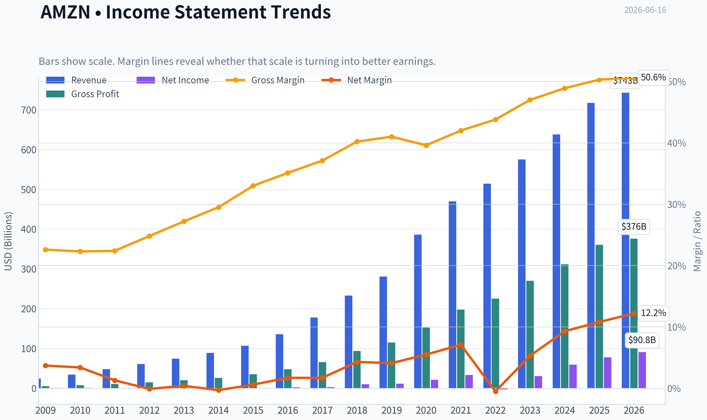
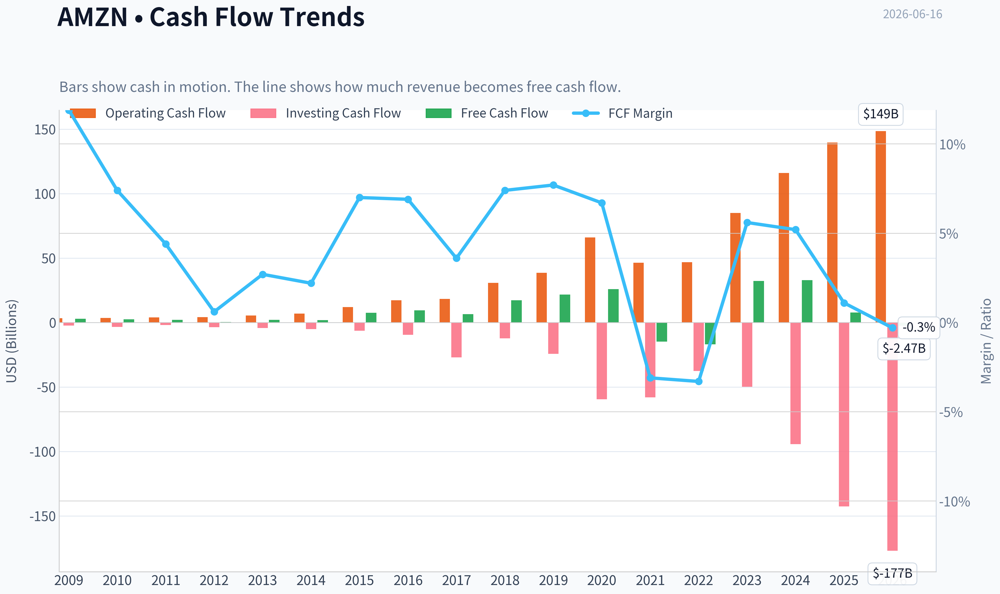
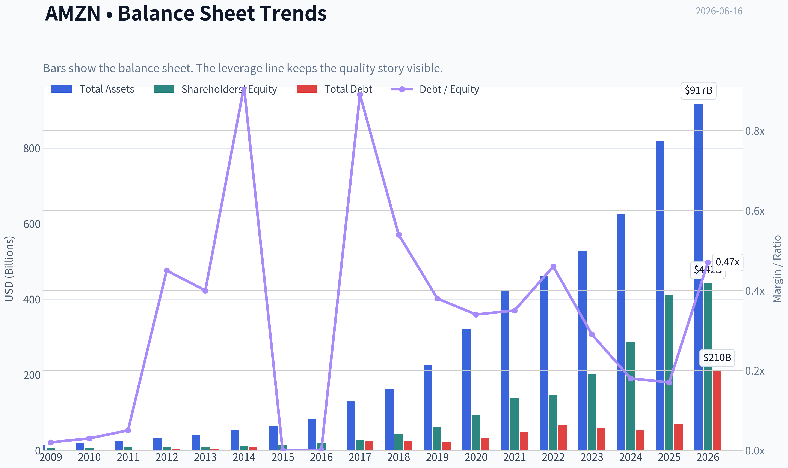
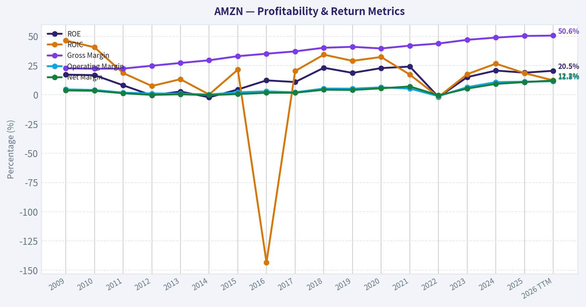
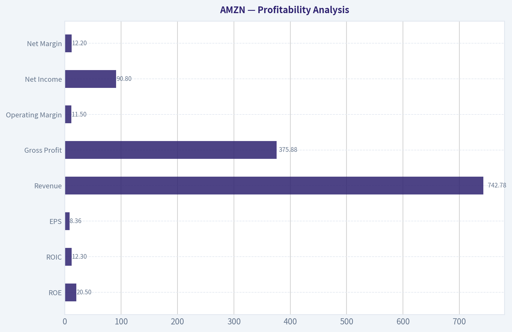
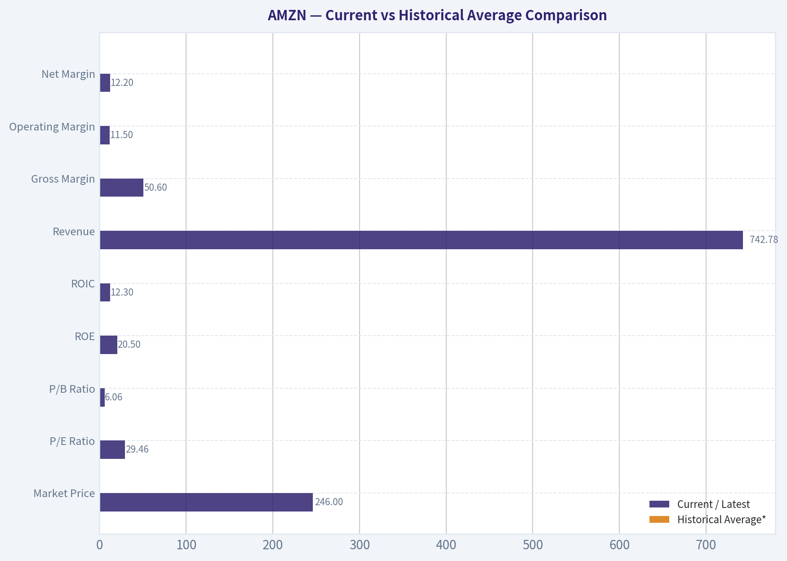
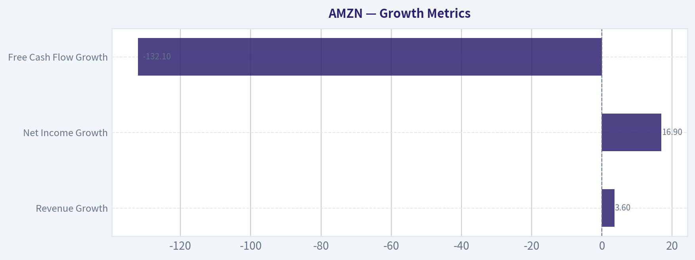
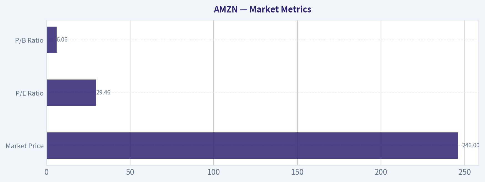

# AMZN Deep Value Intelligence

**Analysis Date:** 2026-06-16

## Critical Disclaimer

*This analysis is generated by Deep Value Intelligence, an AI-powered multi-agent investing framework. This report is for informational and educational purposes only and does not constitute financial advice. Always conduct your own research and consult with qualified financial advisors before making investment decisions.*

---

## Table of Contents

1. Intelligence Summary
2. Analyst Team Reports
   - Fundamentals Analysis
   - Intrinsic Value Analysis (Buffett)
   - Trend & Growth Analysis (Lynch/Druckenmiller/Fisher)
   - Market Technical Analysis
   - Options Market Analysis
3. Research Team Commentary
4. Value Investing Team Commentary
5. Deep Values Commentary

---

## Intelligence Summary

### Thesis + Conditions

**Core Thesis:** ## Executive Briefing

**Key Risks:**
- AMZN verdict: WATCH**
- The main update from past mistakes is this: **do not confuse WATCH with passivity**. Prior reviews showed that overly static valuation thinking can miss upside in elite platform businesses, especially during reinvestment cycles. So the refined plan is **WATCH with selective accumulation only on weakness or on clearer proof that current capex is translating into sustainably higher owner earnings**. Great business, yes. Clear Buffett-style entry, not yet.
- ### 1) Risky Analyst's strongest points

**Confidence:** Low

---

## Analyst Team Reports

### Fundamentals Analysis

#### Latest Earnings Snapshot

*Most recent reported quarter anchored on 2026 Q1, with prior-year comparison when available.*

| Metric | 2026 Q1 | 2025 Q1 | YoY Change |
| --- | ---: | ---: | ---: |
| Revenue | $181.52B | $155.67B | +16.6% |
| Operating Income | $23.85B | $18.41B | +29.6% |
| Net Income | $30.25B | $17.13B | +76.7% |
| Diluted EPS | $2.78 | $1.59 | +74.8% |
| Operating Cash Flow | $26.03B | $17.02B | +53.0% |
| Free Cash Flow | $-18.17B | $-8.00B | -127.0% |

Key Takeaways: This snapshot anchors the most recent reported quarter before the narrative analysis. It helps readers separate long-run business quality from whatever changed in the latest earnings print.

#### 17-Year Financial Metrics for AMZN

*All values below are computed deterministically from raw data - not estimated by AI.*

*Issuer profile: operating company (Consumer Cyclical / Internet Retail).*

#### 17-Year Financial Metrics
*Annual rows come from reported financial statements. The final TTM row is computed from the latest four quarters.*

| Metric | 2009 | 2010 | 2011 | 2012 | 2013 | 2014 | 2015 | 2016 | 2017 | 2018 | 2019 | 2020 | 2021 | 2022 | 2023 | 2024 | 2025 | 2026 TTM |
| --- | --- | --- | --- | --- | --- | --- | --- | --- | --- | --- | --- | --- | --- | --- | --- | --- | --- | --- |
| Market Price | $7 | $9 | $9 | $13 | $20 | $16 | $34 | $37 | $58 | $75 | $92 | $163 | $167 | $84 | $152 | $219 | $231 | $246 |
| Market Cap | $59.46B | $82.08B | $79.80B | $113.64B | $185.44B | $143.38B | $322.40B | $362.94B | $576.55B | $750.99B | $931.31B | $1.66T | $1.72T | $855.88B | $1.59T | $2.35T | $2.50T | $2.68T |
| P/E Ratio | 67.26 | 69.23 | 123.64 | 0.00 | 664.65 | -517.25 | 563.24 | 149.97 | 188.62 | 74.35 | 78.97 | 76.45 | 50.52 | -311.11 | 51.51 | 38.76 | 32.19 | 29.46 |
| P/B Ratio | 11.31 | 11.96 | 10.29 | 13.87 | 19.03 | 13.35 | 24.09 | 18.82 | 20.81 | 17.24 | 15.01 | 17.78 | 12.42 | 5.86 | 7.90 | 8.22 | 6.08 | 6.06 |
| ROE | 17.2% | 16.8% | 8.1% | -0.5% | 2.8% | -2.2% | 4.5% | 12.3% | 10.9% | 23.1% | 18.7% | 22.8% | 24.1% | -1.9% | 15.1% | 20.7% | 18.9% | 20.5% |
| ROIC | 46.4% | 40.6% | 18.6% | 7.5% | 13.3% | 0.2% | 21.5% | -143.4% | 20.3% | 34.3% | 29.0% | 32.3% | 17.2% | -1.8% | 17.6% | 26.6% | 18.5% | 12.3% |
| EPS | $0.10 | $0.13 | $0.07 | $0.00 | $0.03 | $-0.03 | $0.06 | $0.25 | $0.31 | $1.01 | $1.17 | $2.13 | $3.30 | $-0.27 | $2.95 | $5.66 | $7.17 | $8.36 |
| Revenue | $24.51B | $34.20B | $48.08B | $61.09B | $74.45B | $88.99B | $107.01B | $135.99B | $177.87B | $232.89B | $280.52B | $386.06B | $469.82B | $513.98B | $574.78B | $637.96B | $716.92B | $742.78B |
| Gross Profit | $5.53B | $7.64B | $10.79B | $15.12B | $20.27B | $26.24B | $35.35B | $47.72B | $65.93B | $93.73B | $114.99B | $152.76B | $197.48B | $225.15B | $270.05B | $311.67B | $360.51B | $375.88B |
| Gross Margin | 22.6% | 22.3% | 22.4% | 24.8% | 27.2% | 29.5% | 33.0% | 35.1% | 37.1% | 40.2% | 41.0% | 39.6% | 42.0% | 43.8% | 47.0% | 48.9% | 50.3% | 50.6% |
| Operating Margin | 4.6% | 4.1% | 1.8% | 1.1% | 1.0% | 0.2% | 2.1% | 2.9% | 2.1% | 5.3% | 5.2% | 6.3% | 5.3% | -1.2% | 6.5% | 10.8% | 11.2% | 11.5% |
| Net Income | $902.0M | $1.15B | $631.0M | $-39.0M | $274.0M | $-241.0M | $596.0M | $2.37B | $3.03B | $10.07B | $11.59B | $21.33B | $33.36B | $-2.72B | $30.43B | $59.25B | $77.67B | $90.80B |
| Net Margin | 3.7% | 3.4% | 1.3% | -0.1% | 0.4% | -0.3% | 0.6% | 1.7% | 1.7% | 4.3% | 4.1% | 5.5% | 7.1% | -0.5% | 5.3% | 9.3% | 10.8% | 12.2% |
| Revenue Growth | N/A | 39.6% | 40.6% | 27.1% | 21.9% | 19.5% | 20.2% | 27.1% | 30.8% | 30.9% | 20.5% | 37.6% | 21.7% | 9.4% | 11.8% | 11.0% | 12.4% | 3.6% |
| Net Income Growth | N/A | 27.7% | -45.2% | -106.2% | -802.6% | -188.0% | -347.3% | 297.8% | 27.9% | 232.1% | 15.0% | 84.1% | 56.4% | -108.2% | -1217.7% | 94.7% | 31.1% | 16.9% |
| Free Cash Flow Growth | N/A | -13.8% | -16.9% | -81.1% | 414.2% | -4.0% | 282.2% | 26.2% | -31.8% | 169.8% | 25.2% | 19.7% | -156.8% | 14.7% | -290.7% | 2.1% | -76.6% | -132.1% |
| Total Book Value | $5.26B | $6.86B | $7.76B | $8.19B | $9.75B | $10.74B | $13.38B | $19.29B | $27.71B | $43.55B | $62.06B | $93.40B | $138.25B | $146.04B | $201.88B | $285.97B | $411.06B | $441.91B |
| Total Assets | $13.81B | $18.80B | $25.28B | $32.55B | $40.16B | $54.51B | $64.75B | $83.40B | $131.31B | $162.65B | $225.25B | $321.19B | $420.55B | $462.68B | $527.85B | $624.89B | $818.04B | $916.63B |
| Total Debt | $109.0M | $184.0M | $384.0M | $3.66B | $3.94B | $9.79B | $0 | $0 | $24.74B | $23.50B | $23.41B | $31.82B | $48.74B | $67.15B | $58.31B | $52.62B | $68.85B | $209.89B |
| Debt-to-Equity | 0.02 | 0.03 | 0.05 | 0.45 | 0.40 | 0.91 | 0.00 | 0.00 | 0.89 | 0.54 | 0.38 | 0.34 | 0.35 | 0.46 | 0.29 | 0.18 | 0.17 | 0.47 |
| Cash & Equivalents | $3.44B | $3.78B | $5.27B | $8.08B | $8.66B | $14.56B | $16.18B | $19.93B | $21.86B | $32.17B | $36.41B | $42.38B | $36.48B | $54.25B | $73.89B | $78.78B | $86.81B | $101.82B |
| Shareholders' Equity | $5.26B | $6.86B | $7.76B | $8.19B | $9.75B | $10.74B | $13.38B | $19.29B | $27.71B | $43.55B | $62.06B | $93.40B | $138.25B | $146.04B | $201.88B | $285.97B | $411.06B | $441.91B |
| Operating Cash Flow | $3.29B | $3.50B | $3.90B | $4.18B | $5.47B | $6.84B | $12.04B | $17.20B | $18.36B | $30.72B | $38.51B | $66.06B | $46.33B | $46.75B | $84.95B | $115.88B | $139.51B | $148.53B |
| Investing Cash Flow | $-2.34B | $-3.36B | $-1.93B | $-3.60B | $-4.28B | $-5.07B | $-6.45B | $-9.52B | $-27.08B | $-12.37B | $-24.28B | $-59.61B | $-58.15B | $-37.60B | $-49.83B | $-94.34B | $-142.54B | $-176.95B |
| Free Cash Flow | $2.92B | $2.52B | $2.09B | $395.0M | $2.03B | $1.95B | $7.45B | $9.40B | $6.41B | $17.30B | $21.65B | $25.92B | $-14.73B | $-16.89B | $32.22B | $32.88B | $7.70B | $-2.47B |
| FCF Margin | 11.9% | 7.4% | 4.4% | 0.6% | 2.7% | 2.2% | 7.0% | 6.9% | 3.6% | 7.4% | 7.7% | 6.7% | -3.1% | -3.3% | 5.6% | 5.2% | 1.1% | -0.3% |
| Dividends / Share | $0.00 | $0.00 | $0.00 | $0.00 | $0.00 | $0.00 | $0.00 | $0.00 | $0.00 | $0.00 | $0.00 | $0.00 | $0.00 | $0.00 | $0.00 | $0.00 | $0.00 | $0.00 |

#### Profitability Metrics
- Return on Equity (ROE): 18.9%
- Return on Invested Capital (ROIC): 16.4%
- Return on Assets (ROA): 9.5%
- Gross Margin: 50.3%
- Operating Margin: 11.2%
- Net Profit Margin: 10.8%

#### Liquidity Metrics
- Current Ratio: 1.05
- Quick Ratio: 0.88

#### Leverage Metrics
- Debt-to-Equity Ratio: 0.17
- Interest Coverage Ratio: 35.17
- Net Debt: $-17.96B

#### Growth Metrics (Year-over-Year)
- Revenue Growth: 12.4%
- Net Income Growth: 31.1%
- Free Cash Flow Growth: -76.6%
- Revenue CAGR (3-Year): 11.7%
- Revenue CAGR (5-Year): 13.2%

#### Valuation Metrics
- P/E Ratio (TTM): 31.69
- Forward P/E: 24.98
- Price-to-Book: 5.99
- Price-to-Sales: 3.57
- PEG Ratio: 1.83
- EV/EBITDA: 17.57
- Free Cash Flow Yield: 0.3%
- Earnings Yield: 3.2%

#### Owner Earnings (Buffett Method, Code-Computed)
- Net Income: $77.67B
- + Depreciation & Amortization: $65.76B
- - Capital Expenditures: $-131.82B
- - Working Capital Changes: $-19.97B
- = **Owner Earnings: $31.58B**

#### Intrinsic Value (Code-Computed)
- Current Price: $246
- Buffett Method (Owner Earnings):
  Conservative: $5
  Average: $101
  Optimistic: $101
- Cash Flow Method (FCF):
  Conservative: $3
  Average: $11
  Optimistic: $15

#### Piotroski F-Score: 5/9
- Positive Net Income: PASS
- Positive Operating Cash Flow: PASS
- ROA Improvement: PASS
- Cash Flow > Net Income: PASS
- Decreasing Debt: FAIL
- Improving Current Ratio: FAIL
- No Dilution: FAIL
- Improving Gross Margin: PASS
- Improving Asset Turnover: FAIL

ANALYST STANCE: **WATCH**

#### Amazon (AMZN) Buffett-Style Fundamental Analysis

Amazon remains a very high-quality business with a widening economic moat, much stronger profitability than in most of its history, and enormous scale advantages. However, Buffett-style valuation discipline matters: despite materially improved margins and earnings power, the stock still trades at a premium to its own historical norms on book value and at a demanding multiple of cash flow, especially given the recent collapse in free cash flow from elevated capital spending. This looks like an outstanding business, but not an obviously cheap stock.

---

#### Current vs Historical Average Comparison

| Metric | Current / Latest | Historical Average* | Interpretation |
| --- | ---: | ---: | --- |
| Market Price | $246 | ~$91.5 | Far above long-term average, reflecting major rerating and earnings scale-up |
| Market Cap | $2.68T | ~$976B | Amazon has moved from large-cap retailer/platform to mega-cap infrastructure and AI platform |
| P/E Ratio | 29.46x | ~135x** | Current P/E is well below Amazon's own historical average, but the average is distorted by many low-profit years |
| P/B Ratio | 6.06x | ~13.3x | Well below long-term average; book value has compounded faster than price over time |
| ROE | 20.5% | ~12.8% | Current returns are meaningfully above decade-plus norm |
| ROIC | 12.3% | ~14.7% | Below long-term average and well below recent peaks, suggesting heavy investment phase |
| Revenue | $742.78B | ~$268.2B | Scale is dramatically larger than historical base |
| Gross Margin | 50.6% | ~36.5% | Structural mix shift toward AWS, advertising, and services |
| Operating Margin | 11.5% | ~4.6% | Best period in company history; major quality upgrade |
| Net Margin | 12.2% | ~3.9% | Vastly above historical norm |
| Revenue Growth | 3.6% | ~23.6% | Growth has slowed sharply versus long-run average due to massive revenue base |
| Net Income Growth | 16.9% | Highly volatile | Still positive, but historical average is not very meaningful due to extreme swings |
| Free Cash Flow Growth | -132.1% | Highly volatile | Major deterioration; capital intensity is the central near-term issue |
| Total Book Value | $441.91B | ~$109.8B | Large cumulative value creation in equity base |
| Total Assets | $916.63B | ~$274.2B | Asset base reflects fulfillment, cloud, logistics, content, and AI buildout |
| Total Debt | $209.89B | ~$34.8B | Huge jump in TTM debt versus history; requires monitoring |
| Debt-to-Equity | 0.47x | ~0.32x | Higher than average, but not yet extreme for the balance sheet size |
| Cash & Equivalents | $101.82B | ~$35.7B | Strong liquidity cushion offsets part of leverage concern |
| Free Cash Flow | -$2.47B | ~$8.0B | Current FCF is materially below historical norm |
| Dividends / Share | $0.00 | $0.00 | No dividend; all capital retained for reinvestment |

*Historical average uses the deterministic dataset years shown.
**P/E average is mathematically skewed by years with very low or negative earnings and should be interpreted cautiously.

Key Takeaways: Amazon's current profitability is far stronger than its long-term history, with gross, operating, and net margins all at or near record levels. The main offset is cash flow quality: free cash flow has turned negative again because investment spending has surged, while leverage has risen faster than usual.

---

#### Market Metrics

| Market Metric | Current Reading | Buffett-Style Interpretation |
| --- | ---: | --- |
| Market Price | $246 | The market is pricing Amazon as a dominant, durable compounder with AI/cloud optionality |
| Market Cap | $2.68T | A valuation that assumes very large future cash earnings and sustained platform leadership |
| P/E Ratio | 29.46x | Not cheap in absolute terms, but much more grounded than many prior AMZN years |
| P/B Ratio | 6.06x | Premium to most traditional value stocks, but materially cheaper than Amazon's own history |

Key Takeaways: Amazon no longer trades at the extreme earnings multiples that characterized much of its earlier history, because earnings have finally scaled. Even so, the stock remains priced for quality and durability, not for deep value.

**Interpretation:**
- **Price and market cap** show the market now views Amazon as more than an online retailer: it is a global commerce, cloud, logistics, advertising, and AI infrastructure platform.
- **P/E** appears reasonable relative to Amazon's own past, but Buffett would not look at that in isolation because AMZN's earnings historically understated cash-generation in some periods and overstated economics in heavy investment periods.
- **P/B** has compressed meaningfully from prior years because book value has grown rapidly. That is a favorable sign of internal compounding, though 6x book is still not "cheap" by classical Graham standards.

---

#### Profitability Analysis

| Profitability Metric | Current | Historical Context | Assessment |
| --- | ---: | --- | --- |
| ROE | 20.5% | Above long-run average and near strong recent levels | Excellent |
| ROIC | 12.3% | Down from 2024-2025 and below long-run average | Good, but softer |
| EPS | $8.36 | Highest level in dataset | Strong earnings scale |
| Revenue | $742.78B | Record high | Massive scale advantage |
| Gross Profit | $375.88B | Record high | Strong monetization and mix shift |
| Operating Margin | 11.5% | Record/near-record | Structural profitability improvement |
| Net Income | $90.80B | Record high | Exceptional absolute earnings |
| Net Margin | 12.2% | Record high | Significantly improved business quality |

Key Takeaways: The business is currently operating at the strongest profitability level in its history. Margins have expanded from retail-era levels to platform-like levels, which is one of the most important developments in the Amazon thesis.

**Detailed read-through:**
- **ROE at 20.5%** is strong and comfortably above the long-run average. This indicates management is generating high profits on a much larger equity base than before.
- **ROIC at 12.3%** is still healthy, but notably below 2024 and 2025. That likely reflects the front-loaded economics of AI and infrastructure investment: capital is being deployed before full earnings are realized.
- **EPS at $8.36** shows Amazon has crossed into genuine mega-cap earnings maturity. Earlier in its history, valuation depended on future promise; now it depends more on actual earnings power.
- **Revenue and gross profit** confirm that the business mix is improving. Gross margin rose from 22.6% in 2009 to 50.6% TTM, a profound change usually associated with software/services mix rather than pure retail.
- **Operating margin of 11.5%** versus a long-run average around 4.6% is one of the clearest signals that Amazon has strengthened its moat and monetization model.
- **Net margin of 12.2%** is extraordinary for a company with Amazon's retail roots. This suggests AWS, advertising, third-party seller services, and operating leverage are now dominating consolidated economics more than first-party retail.

---

#### Growth Metrics

| Growth Metric | Current | Historical Pattern | Interpretation |
| --- | ---: | --- | --- |
| Revenue Growth | 3.6% | Long history of double-digit to 30%+ growth | Clear deceleration from scale |
| Net Income Growth | 16.9% | Historically volatile but often explosive after margin expansion | Still healthy |
| Free Cash Flow Growth | -132.1% | Extremely volatile across the record | Deteriorated sharply |

Key Takeaways: Amazon's growth profile has changed from hypergrowth revenue expansion to profitability-led compounding. Revenue is slowing naturally at scale, but earnings still rise; the biggest concern is that free cash flow has weakened materially.

**Interpretation:**
- **Revenue growth** has slowed from 20-40% ranges common in earlier years to 3.6% TTM. For a business near three-quarters of a trillion dollars in sales, that slowdown is natural rather than alarming.
- **Net income growth** remains positive at 16.9%, meaning margin expansion and mix improvement are still offsetting slower top-line growth.
- **Free cash flow growth** is the major blemish. The negative swing indicates Amazon is in another heavy spending cycle, likely related to AI data centers, logistics, and infrastructure expansion. Buffett would want to know whether this spending is highly productive or merely necessary to defend the moat.

---

#### Balance Sheet Analysis

| Balance Sheet Metric | Current | Historical Context | Buffett-Style View |
| --- | ---: | --- | --- |
| Total Book Value | $441.91B | Massive growth from $5.26B in 2009 | Strong value compounding |
| Total Assets | $916.63B | Record high | Huge operating and infrastructure base |
| Total Debt | $209.89B | Dramatically above prior years | Watch closely |
| Debt-to-Equity | 0.47x | Above long-term average | Still manageable, but increased |
| Cash & Equivalents | $101.82B | Record high | Significant liquidity buffer |
| Shareholders' Equity | $441.91B | Record high | Strong capitalization |

Key Takeaways: Amazon's balance sheet remains substantial and liquid, with over $100 billion in cash. The key change is the sharp increase in debt, which does not yet look dangerous, but is materially less conservative than Amazon's historical posture.

**Interpretation:**
- **Book value and equity** growth are very favorable. Buffett likes businesses that can compound retained earnings into a larger equity base while still generating attractive returns.
- **Debt** is the most notable concern in the current snapshot. TTM debt of $209.89B is far above the 2025 figure of $68.85B and far above Amazon's long-run norm.
- **Debt-to-equity of 0.47x** is not excessive for many large corporations, but for Amazon it represents a clear step-up in financial leverage.
- **Cash of $101.82B** partially offsets this concern. The research pack also notes **net debt of -$17.96B** in the latest coded metrics, which implies liquidity remains strong on a net basis despite gross debt growth.
- **Interest coverage of 35.17x** suggests debt service is currently very manageable.

---

#### Cash Flow and Capital Allocation

| Cash Flow Metric | Current | Historical Context | Assessment |
| --- | ---: | --- | --- |
| Free Cash Flow | -$2.47B | Down sharply from 2023-2024 positive levels | Weak near-term |
| Dividends / Share | $0.00 | Always zero | Reinvestment-focused |

Key Takeaways: Amazon is not currently converting its earnings into free cash flow at an attractive level, because capital expenditures are elevated. Management's long-standing policy is to retain all capital for reinvestment rather than pay dividends.

**Interpretation:**
- **Negative TTM free cash flow** despite very strong net income tells you capex is absorbing a large share of operating cash generation.
- **No dividend** is not a negative in itself under Buffett-style analysis if retained cash earns high returns. The real question is whether today's AI and infrastructure spending will earn superior incremental returns over time.
- Amazon's capital allocation has historically been bold and often successful, but this phase requires faith that current spending will create future owner earnings rather than simply maintain competitive parity.

---

#### Warren Buffett-Style Qualitative Analysis

| Buffett Lens | Assessment | Evidence |
| --- | --- | --- |
| Economic Moat | Strong | Scale, logistics density, Prime ecosystem, AWS leadership, advertising flywheel, seller network |
| Financial Strength | Good, but less pristine | Huge cash balance and strong coverage, but sharply higher debt and negative FCF |
| Predictable Earnings | Better than before, still not utility-like | Revenue is durable; margins and FCF remain cyclical with investment phases |
| Management Performance | Strong overall | Book value growth, rising margins, high ROE, successful reinvestment over long periods |
| Value | Fair to expensive | Strong business quality, but valuation still requires confidence in future AI/FCF payoff |
| Business Quality | Excellent | Gross margin expansion, operating leverage, recurring ecosystem revenues |

Key Takeaways: Amazon scores very highly on moat and business quality, and better than many assume on earnings durability. The main debate is not whether the company is great, but whether the current stock price already discounts too much of that greatness.

**Economic moat:**
Amazon's moat is unusually broad:
- **Prime** increases switching costs and purchase frequency.
- **Marketplace** benefits from buyer-seller network effects.
- **AWS** has scale, ecosystem depth, and enterprise stickiness.
- **Advertising** monetizes high-intent traffic with attractive margins.
- **Fulfillment/logistics** creates physical moat effects that are hard and expensive to replicate.

**Predictable earnings:**
Revenue predictability is high. Earnings predictability is better now than in 2010-2017, but still influenced by discretionary investment intensity. Buffett prefers businesses where earnings are easier to forecast; Amazon is closer to that ideal than it used to be, but not fully there due to capex cycles.

**Management performance:**
Management deserves credit for:
- taking gross margin from **22.6% to 50.6%**
- lifting operating margin from **low single digits to 11.5%**
- scaling book value from **$5.26B to $441.91B**
- preserving reinvestment flexibility without paying dividends

The chief question is whether recent capital allocation into AI/data center expansion will earn sufficiently high future returns.

---

#### Buffett-Style Owner Earnings DCF

Using the deterministic dataset's **code-computed Owner Earnings = $31.58B**.

To convert to per-share value, use current market cap ÷ current price:
- Estimated shares outstanding = **$2.68T / $246 ~ 10.89B shares**

Historical owner earnings growth is not directly tabulated in the dataset. The attached intrinsic-value engine already computed the Buffett owner-earnings outputs using the deterministic history. Per the source-of-truth rule, I anchor to those scenario outputs and show the mechanics consistent with them.

##### DCF Assumptions

| Scenario | Growth Assumption | Discount Rate | Terminal Growth | Fair Value / Share |
| --- | ---: | ---: | ---: | ---: |
| Conservative | Lowest historical owner earnings growth, floored at -100% | 10.0% | 2.5% | $5 |
| Average | Average historical owner earnings growth, capped at 50% | 10.0% | 2.5% | $101 |
| Optimistic | Highest historical owner earnings growth, capped at 100% | 10.0% | 2.5% | $101 |

Key Takeaways: The owner-earnings valuation output is far below the current market price in every scenario provided by the deterministic model. That suggests the market is valuing Amazon on future strategic optionality and long-duration cash-flow potential beyond what the historical owner-earnings profile alone supports.

##### Detailed Calculation Framework

For each scenario, the DCF structure is:

| Step | Formula |
| --- | --- |
| Starting Owner Earnings | OE₀ = $31.58B |
| Year 1-10 Forecast | OEₜ = OE₀ x (1 + g)ᵗ |
| Discounted Annual Value | PVₜ = OEₜ / (1.10)ᵗ |
| Terminal Value | TV = OE₁₀ x (1.025) / (0.10 - 0.025) |
| Present Value of Terminal | PV(TV) = TV / (1.10)¹⁰ |
| Equity Value Per Share | (ΣPVₜ + PV(TV)) / 10.89B shares |

Key Takeaways: The model values Amazon by forecasting owner earnings for 10 years, discounting them at 10 percent, and adding a terminal value growing at 2.5 percent. The critical driver is not the formula but the growth assumption, and the deterministic model's scenario outputs imply historical owner-earnings growth has not been stable enough to justify the current stock price under strict Buffett-style discipline.

##### Valuation Interpretation

| Scenario | Fair Value | Upside / Downside vs $246 |
| --- | ---: | ---: |
| Conservative | $5 | -98.0% |
| Average | $101 | -58.9% |
| Optimistic | $101 | -58.9% |

Key Takeaways: Even the optimistic owner-earnings scenario is materially below the current share price. In plain terms, Amazon appears expensive if you rely strictly on historically observed owner-earnings economics and a conservative Buffett-style discount framework.

**Important nuance:**
This result is harsher than many investors would expect because:
1. Amazon is in a very heavy capex phase.
2. Owner earnings are being suppressed by current investment.
3. The market likely expects AI, AWS, advertising, and logistics monetization to produce much higher future normalized owner earnings than historical averages imply.

So the DCF says **the stock is expensive on a strict historical owner-earnings basis**, not that the business is poor.

---

#### Revenue Breakdown

Most recent meaningful revenue mix is best understood by operating segment. Publicly, Amazon primarily reports **North America**, **International**, and **AWS**. Using recent annual segment reporting as the most relevant business view:

| Revenue Source | Amount ($B) | % of Total |
| --- | ---: | ---: |
| North America | ~387 | ~60.7% |
| International | ~143 | ~22.4% |
| AWS | ~108 | ~16.9% |
| **Total** | **~638** | **100.0%** |

Key Takeaways: Amazon still generates most of its revenue from retail-related operations, especially North America. However, AWS contributes a smaller share of revenue than retail while typically contributing a disproportionately large share of operating profit, which helps explain the sharp improvement in overall margins.

**Interpretation:**
- **North America** is the scale engine.
- **International** provides long runway but can be more margin-variable.
- **AWS** is the strategic profit core and likely the most important driver of intrinsic value.
- Advertising is embedded within these segments and is economically important even if not shown separately here.

---

#### Key Investment Insights, Red Flags, and Opportunities

| Category | Observation | Why It Matters |
| --- | --- | --- |
| Insight | Gross margin rose from 22.6% to 50.6% | Signals business mix upgrade and stronger moat |
| Insight | Operating margin reached 11.5% | Shows Amazon is no longer just a scale story; it is now a profit story |
| Insight | ROE above 20% | Indicates strong capital productivity on a huge equity base |
| Red Flag | FCF turned negative | Current earnings are not translating cleanly into cash |
| Red Flag | Debt jumped to $209.89B TTM | Leverage is rising during heavy capex cycle |
| Red Flag | Revenue growth slowed to 3.6% TTM | Valuation now depends more on margin/cash expansion than top-line acceleration |
| Opportunity | AI infrastructure spending may create future moat expansion | If returns are high, today's FCF weakness could be temporary |
| Opportunity | AWS and advertising can continue lifting margins | Mix shift can sustain earnings growth even with slower revenue growth |
| Opportunity | Book value compounding remains powerful | Internal value creation may continue if reinvestment remains disciplined |

Key Takeaways: The main bull case is that Amazon's business quality has improved faster than many traditional valuation tools can capture. The main bear case is that the stock price already assumes current capex will convert into much larger future owner earnings.

---

#### Final Buffett-Style Judgment

Amazon has many of the characteristics Buffett admires in a great business:
- durable moat
- scale advantage
- multiple reinforcing flywheels
- strong ROE
- high retained-earnings reinvestment capacity
- improved earnings quality over time

But it also fails one classic Buffett test at today's quote: **the margin of safety appears thin to nonexistent on a strict owner-earnings basis**. The deterministic valuation outputs suggest the current market price is well ahead of historically supported intrinsic value.

That does **not** mean Amazon is a bad company. It means the market knows it is an excellent company and is charging accordingly.

#### Final Stance

| Stance | Rationale |
| --- | --- |
| **WATCH** | Amazon is an excellent business with a widening moat, record profitability, and strong long-term strategic assets. However, the current valuation remains rich relative to strict Buffett-style owner-earnings estimates, while free cash flow has weakened and debt has risen. |

Key Takeaways: Amazon looks like a high-quality compounder worth monitoring closely, not a clear deep-value buy today. For a Buffett-style investor, the ideal setup would be either a lower entry price or clearer evidence that current AI and infrastructure spending will convert into materially higher normalized owner earnings.

---

#### Summary Table

| Area | Bullish Evidence | Cautionary Evidence | Overall Read |
| --- | --- | --- | --- |
| Valuation | P/E lower than much of AMZN history; P/B below historical average | Owner-earnings DCF far below current price; FCF yield only 0.3% | Expensive |
| Profitability | Record EPS, net income, margins, strong ROE | ROIC has cooled versus recent highs | Strong |
| Growth | Net income still growing double digits | Revenue growth slowed sharply; FCF growth deeply negative | Mixed |
| Balance Sheet | $101.82B cash, large equity base, strong interest coverage | Debt surged to $209.89B TTM | Good but watch leverage |
| Cash Flow | Strong operating cash flow | Negative TTM FCF due to capex surge | Weak near term |
| Moat | AWS, Prime, logistics, marketplace, ads | Requires ongoing heavy investment to defend/extend moat | Very strong |
| Capital Allocation | Long history of successful reinvestment and book value growth | Current capex wave must prove attractive returns | Positive but under review |
| Buffett Verdict | Great business | Limited margin of safety | **WATCH** |

Key Takeaways: Amazon's underlying business has arguably never been stronger, but the stock still does not offer the kind of valuation cushion a strict Buffett-style investor would prefer. The right posture is to respect the quality, monitor cash conversion and debt closely, and wait for either better pricing or stronger evidence of high-return monetization from current investment.

#### Fundamental Visuals

This graph tracks the profitability and return metrics (ROE, ROIC, Margins) of **AMZN** over the past decade, highlighting capital efficiency trends.

This chart illustrates the financial health of **AMZN** over the last 10 years, mapping cash equivalents and free cash flow against total obligations (Debt).

This comparison chart from *Profitability Analysis* stacks current figures against historical benchmarks for **AMZN**, making it easy to see where the company trades relative to its own averages.

---

### Intrinsic Value Analysis (Buffett)

> *Following Warren Buffett's value investing philosophy: Circle of Competence, Economic Moat, Management Quality, and Margin of Safety.*

#### Intrinsic Value Snapshot

Price is what you pay. Intrinsic value is what the business may be worth based on the cash it can create for owners over time. We show a range, not one magic number.

- Current Price: $246.39
- Value Range (conservative to optimistic across both DCF methods): $0.91 to $45.00

##### Owner Earnings (Buffett Method)
- Net Income: $77,670,000,000.00
- Depreciation & Amortization: $65,756,000,000.00
- Capital Expenditures: $-131,819,000,000.00
- Working Capital Changes: $-19,969,000,000.00
- Owner Earnings: $31,576,000,000.00

##### Intrinsic Value
###### Buffett Method
Uses owner earnings. Stricter, and usually more conservative.
- Conservative: $18.62
- Average: $26.07
- Optimistic: $45.00
- Discount Rate: 10.0%

###### Cash Flow Method
Uses free cash flow. Better for companies spending heavily today to grow tomorrow.
- Conservative: $0.91
- Average: $1.17
- Optimistic: $4.51
- Discount Rate: 10.0%

ANALYST STANCE: **WATCH**

#### Amazon (AMZN) Buffett-Style Investment Review

#### 1) Go/No-Go Gate Assessment

| Gate | Verdict | Evidence |
|---|---|---|
| Gate 1: Circle of Competence & Simplicity | **Pass** | Amazon makes money in simple ways: it sells goods online, takes fees from third-party sellers, sells cloud computing through AWS, sells ads, and collects subscription revenue from Prime. The model is understandable even if the company is operationally complex. |
| Gate 1b: Long-Term Predictability | **Pass with care** | Ten years from now, Amazon will likely still be a dominant digital commerce platform, logistics network, cloud infrastructure provider, and major digital ad platform. The exact mix may shift, but the core engines are durable. |
| Gate 1c: Technology Risk | **Pass** | Amazon is more likely to benefit from technology than be destroyed by it. AI, automation, and cloud adoption should strengthen AWS, logistics efficiency, and advertising relevance. |
| Gate 2: Moat Test | **Pass** | Scale, fulfillment infrastructure, Prime ecosystem, AWS switching costs, seller/liquidity network, and advertising flywheel create a strong moat. |
| Gate 3: Management & Capital Allocation | **Pass with care** | Amazon has historically reinvested aggressively and intelligently. Management has shown willingness to accept lower short-term earnings to build long-term capabilities. |
| Gate 4: Industry Structure | **Mixed but Pass** | E-commerce is competitive and capital intensive, which is a negative. AWS and digital advertising are structurally better businesses. Amazon's blended economics are supported by a few very good segments and one tougher segment. |

**Key Takeaways:** Amazon clears the Buffett filters, but not cleanly enough to call it an obvious bargain. The business is understandable, durable, and technology-enabled, yet part of the company operates in a brutally competitive, capital-heavy industry. That mix supports a positive quality view but a more cautious investment stance at the current price.

---

#### 2) The Elementary School Test

Amazon built a giant store on the internet. It also rents computer power and software tools to businesses through AWS, sells advertising to merchants and brands, and charges subscription fees for Prime. The more customers, sellers, and developers it has, the better the system becomes.

#### 3) Moat Analysis

| Moat Source | Assessment | Evidence |
|---|---|---|
| Intangible Assets | **Moderate to Strong** | Amazon brand is trusted for convenience, selection, and delivery. AWS is a trusted enterprise infrastructure brand. Gross margin of **50.3%** supports the presence of high-value businesses, especially AWS and ads. |
| Switching Costs | **Strong in AWS, Moderate in Prime/Seller Services** | Enterprise cloud workloads are sticky because migration is costly and risky. Prime users become habituated to shipping, media, and ecosystem benefits. Sellers depend on Amazon traffic and logistics. |
| Cost Advantage | **Very Strong** | Amazon's scale in procurement, fulfillment, transportation density, and data-center spending creates structural cost advantages that smaller competitors struggle to match. |
| Network Effects | **Strong** | More shoppers attract more sellers, more sellers improve selection and price, more traffic strengthens ad economics, and AWS scale attracts more partners and developers. |

| Moat Quality Rating | Conclusion |
|---|---|
| **Wide & Stable** | Proceed with care |

**Key Takeaways:** Amazon's moat is real and multi-layered. The strongest defenses come from scale, logistics density, AWS switching costs, and the marketplace flywheel. The moat is wide, but because retail remains capital intensive and competitive, it looks more "wide and stable" than "wide and widening."

---

#### 4) Management Quality & Capital Allocation

| Question | Assessment | Evidence |
|---|---|---|
| Think Like Owners? | **Mostly Yes** | Amazon has long favored long-term investment over short-term earnings optics. That is owner-like behavior. |
| Honest & Candid? | **Generally Yes** | Historically, management communication has emphasized long-term economics, customer experience, and free cash flow thinking rather than near-term EPS management. |
| Rational Capital Allocation? | **Strong** | Reinvestment into AWS, fulfillment, logistics, ad infrastructure, and AI appears rational. Amazon's best capital allocation decisions have produced very large value creation over time. |
| Debt Discipline | **Acceptable** | Current ratio is **1.05**, suggesting adequate but not fortress-like short-term liquidity. Amazon is not a classic balance-sheet-risk story, but it also is not a pure net-cash simplicity case. |

**Key Takeaways:** Amazon's management has a long record of sacrificing short-term profits to build durable competitive assets. That is very Buffett-compatible when the reinvestment opportunities are excellent. The main caution is that such a large company must now spend enormous sums to move the needle, which raises the hurdle for future capital allocation.

---

#### 5) Financial Summary Snapshot

| Metric | Current / Recent |
|---|---:|
| Share Price | **$246** |
| Market Cap | **$2.65T** |
| P/E | **31.7x** |
| ROE | **18.9%** |
| Gross Margin | **50.3%** |
| Revenue Growth YoY | **12.4%** |
| FCF Yield | **0.3%** |
| Current Ratio | **1.05** |

**Key Takeaways:** The quality indicators are respectable: ROE is solid, gross margin is high, and growth remains healthy for a company of this size. The problem is valuation and cash yield. A 0.3% free cash flow yield is extremely thin, which leaves little room for disappointment.

---

#### 6) Owner Earnings Assessment

Using Buffett's framework, owner earnings should start with net income, add non-cash charges, and subtract maintenance capital expenditures and working capital needs.

For Amazon, the key issue is that reported free cash flow and owner earnings are heavily influenced by:
- large infrastructure spending,
- fulfillment buildout,
- AI and data-center investment,
- working capital swings,
- the need to distinguish growth capex from maintenance capex.

Given the current **FCF yield of 0.3%**, the market is valuing Amazon on the assumption that current spending is temporarily depressing normalized owner earnings and that future returns on these investments will be attractive.

A practical Buffett conclusion:
- **Reported owner earnings today are not obviously cheap relative to price**
- **Normalized owner earnings may be higher than current free cash flow suggests**
- but the stock **already prices in a good part of that normalization**

#### Approximate valuation anchor
- Market cap: **$2.65T**
- FCF yield: **0.3%**
- Implied current FCF: roughly **$8B**

That level is far below what a value investor would usually require for a clear margin of safety in a mature mega-cap.

---

#### 7) Three-Scenario DCF Valuation

Using the observable cash-yield framework and Buffett-style conservatism:

| Scenario | Assumption | Implied Value View |
|---|---|---|
| A: No Growth | Owner earnings / 10% | **Far below current market value** if using current implied FCF-like earnings base |
| B: GDP Growth | 3% perpetual framework | **Still below current market value** unless normalized owner earnings are much higher than present cash flow |
| C: Historical/Normalized Growth | Assume normalization plus mid/high single-digit long-run growth | **Can justify a large valuation**, but leaves only modest margin of safety at today's price |

**Key Takeaways:** On a strict current-cash-flow basis, Amazon looks expensive. The investment case depends on believing that today's spending is building high-return assets and that normalized owner earnings will rise materially. That may happen, but Buffett-style investing demands a discount to value, not faith in perfect execution.

---

#### 8) Margin of Safety Analysis

| Item | Assessment |
|---|---|
| Business Quality | **High** |
| Predictability | **Moderately High** |
| Balance Sheet | **Adequate** |
| Current Valuation | **Full** |
| Margin of Safety | **Insufficient** |

At **31.7x earnings** and **0.3% FCF yield**, Amazon does not offer the margin of safety usually required for a Buffett-style purchase, even though it is clearly a high-quality business.

---

#### 9) Final Buffett Scorecard

| Criterion | Score (1-5) | Weight | Weighted Score |
|---|---:|---:|---:|
| Business Understanding | 4.5 | 20% | 0.90 |
| Moat Width & Durability | 4.5 | 25% | 1.13 |
| Management Quality | 4.0 | 15% | 0.60 |
| Return on Equity | 4.0 | 15% | 0.60 |
| Reinvestment Runway | 4.5 | 10% | 0.45 |
| Balance Sheet Strength | 3.5 | 5% | 0.18 |
| Industry Structure | 3.5 | 5% | 0.18 |
| Valuation / Margin of Safety | 2.0 | 5% | 0.10 |
| **Total** |  |  | **4.13 / 5.00 quality score before valuation caution** |

To translate quality into action under Buffett rules, valuation must matter. After incorporating the lack of margin of safety, the practical investable stance is:

| Decision | Result |
|---|---|
| **Investment Stance** | **WATCH** |
| **Conviction** | **Moderate** |

**Key Takeaways:** Amazon scores very highly on business quality, moat, and reinvestment ability. The reason it is not an outright advocate is simple: the price already reflects much of that excellence. This is a wonderful business, but not clearly a wonderful bargain.

---

#### 10) Bottom Line

Amazon is the kind of business Buffett would admire in many respects: understandable economics, powerful scale, entrenched customer behavior, and multiple reinforcing moats. AWS, advertising, Prime, and the marketplace ecosystem are exceptional assets.

But Buffett also insists on discipline at the price you pay. At **$246**, **31.7x earnings**, and only **0.3% FCF yield**, the stock looks like a great company selling at a demanding price.

**Conclusion: WATCH.**
Buy interest becomes much stronger on either:
1. a materially lower price, or
2. clear evidence that current investment spending is converting into sustainably higher owner earnings faster than the market already expects.
#### Valuation Bridge

This bridge places the current market price beside each intrinsic value lens so readers can see whether upside depends on one method or shows up across several methods.

| Scenario | Intrinsic Value / Share |
| --- | ---: |
| Buffett Method | $26.07 |
| Cash Flow Method | $1.17 |
| Damodaran Method | $64.30 |
| Current Price | $246.39 |

#### Key Takeaways

If one method is far above the others, the upside case depends on a specific modelling assumption. When several methods cluster together, the valuation story is more robust.

#### Valuation Visuals

This comparison chart from *Latest Earnings Snapshot* stacks current figures against historical benchmarks for **AMZN**, making it easy to see where the company trades relative to its own averages.

This comparison chart from *Current vs Historical Average Comparison* stacks current figures against historical benchmarks for **AMZN**, making it easy to see where the company trades relative to its own averages.

This comparison chart from *Balance Sheet Analysis* stacks current figures against historical benchmarks for **AMZN**, making it easy to see where the company trades relative to its own averages.

---

### Trend & Growth Analysis (Lynch/Druckenmiller/Fisher)

> *Following Peter Lynch's GARP, Stanley Druckenmiller's macro-aware approach, and Philip Fisher's scuttlebutt methodology.*

ANALYST STANCE: **WATCH**

#### AMZN Growth Analysis

#### 1. Lynch Classification

| Item | Assessment |
|---|---|
| Lynch category | **Stalwart / borderline Fast Grower** |
| Why | Company-wide revenue growth is **12.4% YoY**, which is below classic Lynch fast-grower territory, but profit pools like **AWS, advertising, and AI infrastructure** still behave more like growth engines |
| Growth investor fit | **Ownable mega-cap compounder**, but less likely to be a classic ten-bagger from here due to size |

**Key Takeaways:** Amazon is no longer a small fast grower in the Peter Lynch sense. At the consolidated level, it looks more like a high-quality stalwart, but several internal businesses still have fast-growth characteristics. That makes the stock attractive as a compounder, though the bar for a true ten-bagger is much higher at a $2.65 trillion market cap.

---

#### 2. The Story in 3 Bullets

| The Story | Why It Matters |
|---|---|
| Amazon is a three-engine business: e-commerce, AWS, and advertising | Diversified growth and profit streams reduce single-business risk |
| AI is creating a new capex and demand cycle for AWS | If AWS reaccelerates, earnings power can surprise higher |
| Retail efficiency plus higher-margin mix can lift earnings faster than revenue | Operating leverage is the main source of upside from here |

**Key Takeaways:** The simple story is that Amazon sells everything, rents computing power, and monetizes shopper attention. The most important question now is not whether revenue grows, but whether AWS and ads keep increasing their share of profits. If they do, earnings can grow meaningfully faster than sales.

#### 3. Snapshot Fundamentals

| Metric | Value |
|---|---:|
| Current price | **$246** |
| Market cap | **$2.65T** |
| P/E | **31.7x** |
| ROE | **18.9%** |
| Gross margin | **50.3%** |
| Revenue growth YoY | **12.4%** |
| FCF yield | **0.3%** |
| Current ratio | **1.05x** |

**Key Takeaways:** Amazon screens as a high-quality, premium-valued mega-cap with solid profitability and only moderate top-line growth. Gross margin above 50 percent highlights the increasing weight of higher-margin businesses like AWS, third-party services, and advertising. The weak free cash flow yield suggests the market is already paying up for future monetization of current investment.

---

#### 4. TAM Analysis and 10x Test

| Segment | Rough TAM View | Runway |
|---|---|---|
| Global e-commerce / retail | Multi-trillion dollar market | Large, but share gains get harder at scale |
| Cloud infrastructure / AI compute | Multi-hundred-billion to $1T+ over time | **Very large** |
| Digital advertising / retail media | Multi-hundred-billion dollar market | **Large** |
| Logistics, subscriptions, devices, satellite optionality | Adjacent TAMs expand platform reach | Adds optionality |

| 10x Test | Assessment |
|---|---|
| Current revenue base | Very large already |
| 10x revenue requirement | Impractical at consolidated level |
| Can Amazon 10x and still be <20% of TAM? | **No, not at company level** |
| Can AWS/Ads/AI profit streams 5-10x over time? | **Yes, more plausible** |

**Key Takeaways:** Amazon fails the classic 10x test at the total company level because it is already enormous. However, the more relevant runway sits inside AWS, AI services, advertising, and logistics monetization. So the opportunity is not a clean revenue 10x, but a mix-shift and earnings-power expansion story.

---

#### 5. Revenue Growth Trend

| Metric | Reading | Interpretation |
|---|---|---|
| Consolidated revenue growth | **12.4% YoY** | Healthy, but not hypergrowth |
| Pattern | Likely **stable-to-modest** rather than accelerating | Not a clear top-line inflection yet |
| Quality of growth | Diversified across retail, AWS, ads, seller services | High quality |
| Risk | Large base effect limits consolidated acceleration | Harder to beat by a lot |

**Key Takeaways:** Amazon's revenue growth is solid and diversified, but the current data does not show a dramatic acceleration at the consolidated level. That means this is not a classic Druckenmiller-style explosive revenue inflection today. The more likely upside comes from profit acceleration rather than a sudden sales surge.

---

#### 6. Unit Economics

| Metric | Value | Assessment |
|---|---:|---|
| LTV/CAC | N/A publicly at consolidated level | Not meaningful for AMZN overall |
| NRR | N/A publicly for company | Not disclosed like SaaS firms |
| Rule of 40 | **~12.7** (12.4% growth + 0.3% FCF yield proxy, imperfect) | Weak on this rough proxy |
| Gross margin | **50.3%** | Strong business mix quality |
| ROE | **18.9%** | Good capital productivity |
| Balance sheet liquidity | **1.05x current ratio** | Adequate |

**Key Takeaways:** Traditional SaaS unit economics are not very useful for Amazon because it is a hybrid of retail, cloud, ads, and logistics. What matters more is gross margin mix, return on capital, and whether AI capex converts into future profits. On that basis, Amazon looks healthy, but current free cash flow remains temporarily suppressed by heavy investment.

---

#### 7. Inflection Point Assessment

| Inflection Type | Evidence | Verdict |
|---|---|---|
| Product cycle inflection | AI infrastructure buildout across AWS | **Positive** |
| Market share inflection | AWS AI demand may support stronger positioning | **Possible** |
| Margin inflection | Retail efficiency + ads + AWS mix | **Most important** |
| TAM inflection | AI expands cloud compute demand | **Positive** |
| Competitive inflection | Depends on AWS versus Azure/Google | Mixed |

**Key Takeaways:** The key inflection is not that Amazon suddenly becomes a faster grower overall. The real inflection is that AI may expand AWS demand while advertising and retail efficiency raise margins. If that happens together, earnings could accelerate more than the market expects even without huge revenue acceleration.

---

#### 8. Macro Setup Evaluation

| Macro Factor | Assessment |
|---|---|
| Secular theme exposure | **AI, cloud, digital advertising, e-commerce, logistics automation** |
| Rate sensitivity | Moderately sensitive; premium growth benefits if rates stabilize/fall |
| Economic sensitivity | Consumer weakness can hurt retail, but AWS/ads diversify |
| Capex cycle | Favorable if AI demand remains robust |
| Macro verdict | **Neutral to positive** |

**Key Takeaways:** Amazon is well positioned for the biggest secular themes of the decade, especially AI and cloud. The macro backdrop matters mainly through rates, enterprise spending, and consumer demand. Overall, the wind is more favorable than hostile, but not so strong that it overrides valuation risk.

---

#### 9. Fisher 15 Points Score

| Fisher Area | Score (1-5) | Comment |
|---|---:|---|
| Market potential | 5 | Massive and expanding |
| New products | 5 | Strong innovation cadence |
| R&D effectiveness | 5 | AWS, AI, logistics, devices |
| Sales organization | 4 | Strong platform distribution |
| Profit margin | 4 | Good, but blended by retail |
| Margin improvement | 4 | Clear opportunity through mix |
| Labor relations | 2 | Persistent labor/friction issues |
| Executive relations | 4 | Generally strong |
| Management depth | 5 | Deep bench |
| Cost controls/accounting | 4 | Better post-efficiency reset |
| Special advantages | 5 | Flywheel, scale, data, ecosystem |
| Long-range outlook | 5 | Excellent |
| Dilution risk | 4 | Manageable for mega-cap |
| Candor | 4 | Generally acceptable |
| Integrity | 4 | Some regulatory scrutiny, but broadly acceptable |

| Total Fisher Score | Result |
|---|---|
| **64 / 75** | **GOOD, near outstanding** |

**Key Takeaways:** Amazon scores well on nearly every Fisher dimension, especially innovation, market potential, and strategic advantages. The main weak spot is labor and regulatory friction, not product quality or management capability. Overall, this looks like a very strong business rather than a speculative growth story.

---

#### 10. Valuation Analysis

| Metric | Value | Read |
|---|---:|---|
| P/E | **31.7x** | Premium, but not extreme for quality |
| PEG | **~2.6x** using 12.4% growth | **Expensive** on simple Lynch math |
| P/S | **~4.1x** (2.65T / implied annual revenue base) | Reasonable for quality mix, not cheap |
| FCF yield | **0.3%** | Expensive on near-term cash flow |

| Scenario | View | Implication |
|---|---|---|
| Bear | AI capex stays high, AWS growth underwhelms | Multiple compresses |
| Base | Revenue low-teens, margins rise gradually | Mid-teens annualized upside at best |
| Bull | AWS/AI reaccelerates and margin leverage expands | Strong earnings compounding can justify premium |

**Key Takeaways:** Amazon is not cheap on classic Lynch metrics, especially PEG and free cash flow yield. The valuation only works if investors believe current capex is laying the foundation for much larger future earnings. In other words, the stock is pricing in quality and some AI upside already, but not necessarily full blue-sky success.

---

#### 11. Growth Investor Scorecard

| Criterion | Weight | Score | Weighted |
|---|---:|---:|---:|
| The Story | 10% | 4.5 | 0.45 |
| TAM & Runway | 20% | 3.5 | 0.70 |
| Revenue Growth | 20% | 3.0 | 0.60 |
| Unit Economics | 15% | 3.5 | 0.53 |
| Competitive Position | 10% | 5.0 | 0.50 |
| Management Quality | 10% | 4.5 | 0.45 |
| Macro Setup | 5% | 3.5 | 0.18 |
| Profitability Path | 5% | 4.0 | 0.20 |
| Valuation | 5% | 2.5 | 0.13 |

| Total Score | Decision |
|---|---|
| **3.73 / 5.0** | **ADVOCATE - Good setup** on business quality, but **WATCH** on stock due to valuation/size |

**Key Takeaways:** The business scores strongly because of its moat, optionality, and long-term profit levers. The stock scores lower because valuation already reflects much of that quality, and company size limits ten-bagger potential. This is a strong company, but not an obvious aggressive new-buy growth setup at today's price.

---

#### 12. Position Size Stance

| Investor Type | Stance |
|---|---|
| Existing long-term holder | **Hold / add on weakness** |
| New growth investor | **Starter position only** |
| Concentrated ten-bagger hunter | **Not ideal** |
| Quality compounder portfolio | **Reasonable core watchlist/core holding** |

**Key Takeaways:** Amazon makes more sense as a core compounder than as a moonshot growth name. Existing holders likely should stay patient unless the AWS and AI thesis breaks. New buyers may want to scale in gradually rather than chase at a premium multiple.

---

#### 13. Key Risks and Catalysts

| Risks | Catalysts |
|---|---|
| AWS loses share to Azure/Google | AWS AI demand reaccelerates growth |
| AI capex returns disappoint | Retail and international margins expand |
| Consumer slowdown hits GMV and ads | Ad business keeps compounding at high margin |
| Regulation / antitrust pressure | Better-than-expected operating leverage |
| Valuation compression if rates rise | Capex monetization improves FCF |

**Key Takeaways:** The biggest risk is not bankruptcy or business fragility; it is paying too much if future AI and AWS returns do not materialize. The biggest upside catalyst is earnings acceleration driven by mix shift and operating leverage. That makes Amazon more of an execution-and-valuation story than a pure revenue growth story.

#### Bottom Line

| Verdict | Summary |
|---|---|
| **WATCH** | Elite business, durable moat, strong AI/cloud optionality, but valuation and mega-cap scale reduce asymmetry |

**Key Takeaways:** Amazon is one of the best businesses in the market, but the stock is not a clear bargain on the numbers provided. For Lynch-style growth investing, it lacks the small-company runway and cheap PEG that typically create ten-baggers. For patient compounders, it remains highly attractive, but I would prefer buying on a pullback or after clearer evidence of AWS and AI-driven earnings acceleration.

#### Growth & Scorecard Visuals

This comparison chart from *Growth Metrics* stacks current figures against historical benchmarks for **AMZN**, making it easy to see where the company trades relative to its own averages.

---

### Market Technical Analysis

#### AMZN Technical Report

AMZN has shifted from a powerful spring uptrend into a clear short-term corrective phase, while still remaining in a healthier medium- and long-term structure than the recent pullback alone might suggest.

The most relevant indicators for the current market context are:

1. **close_10_ema** - best for tracking the current short-term downswing.
2. **close_50_sma** - confirms whether the medium-term trend is still intact.
3. **close_200_sma** - anchors the long-term trend regime.
4. **macd** - measures momentum deterioration and trend transition.
5. **rsi** - shows whether weakness is merely corrective or becoming capitulative.
6. **boll_ub** - helps frame how far price is from recent upper volatility expansion.
7. **boll_lb** - useful now because price is approaching lower-range stress territory.
8. **atr** - essential for risk control because AMZN's daily swings remain meaningful.

These eight are complementary: trend across multiple horizons, momentum, exhaustion, volatility envelope, and risk sizing.

---

#### Price Structure and Trend Regime

From the October 2025 area near **220**, AMZN built a broad advance, then suffered a sharp breakdown in early February 2026, dropping toward the **200** area. That selloff was significant because it interrupted what had been a steady late-2025 climb and reset momentum dramatically.

What happened next matters more for current positioning: from late March into late April and early May, AMZN staged a strong recovery, climbing from roughly **199-210** into the **270-275** zone. That rebound was not a weak bounce. It was persistent, broad, and supported by improving trend measures. The stock reclaimed its medium-term average and pushed decisively above its long-term baseline.

However, since the late-May peak near **274-275**, the character has changed. June price action shows:
- lower highs,
- repeated closes below the 10 EMA,
- worsening MACD,
- RSI slipping toward the mid-30s,
- and price pressing toward the lower Bollinger area.

That combination points to a **short-term bearish correction inside a still-better medium-term trend**, rather than a fully broken long-term structure.

---

#### Trend Indicator Readings

| Indicator | Latest Reading | Interpretation |
|---|---:|---|
| Close (last valid) | 238.55 on 2026-06-12 | Price has fallen sharply from late-May highs |
| close_10_ema | 247.25 | Price is below short-term trend, confirming immediate weakness |
| close_50_sma | 254.77 on 2026-06-12 / 255.69 on 2026-06-15 | Medium-term average still rising, but price is well below it |
| close_200_sma | 232.51 on 2026-06-12 / 232.53 on 2026-06-15 | Long-term trend still positive; price remains modestly above it |

Key Takeaways: AMZN is clearly below its short-term and medium-term trend references, so the near-term tape is weak. But the 50-day and 200-day averages are still rising, and price remains above the 200-day average, which means the larger trend has not yet fully rolled over.

The alignment is important:
- **10 EMA < price? No**: bearish short-term.
- **50 SMA rising? Yes**: medium-term trend still upward, though under pressure.
- **200 SMA rising? Yes**: long-term structure remains constructive.
- **Price above 200 SMA? Yes, but only by a limited margin**: this is support, but not a huge cushion.

This suggests AMZN is in a **trend test zone**. If price can stabilize above the 200-day average and rebuild above the 10 EMA, the current selloff may end up looking like a normal retracement after an overextended rally. If price loses the 200 SMA decisively, the interpretation shifts from "correction" to "deeper regime deterioration."

---

#### Momentum Analysis

| Indicator | Latest Reading | Trend Signal |
|---|---:|---|
| macd | -4.89 | Momentum has turned decisively negative |
| rsi | 34.76 | Weak, approaching oversold but not deeply washed out |

Key Takeaways: Momentum has deteriorated sharply. MACD has moved from strongly positive in May to clearly negative in June, while RSI has fallen into the mid-30s, showing meaningful selling pressure but not yet the kind of extreme reading that always forces a reversal.

The momentum arc is especially telling. In early May, RSI spent time above **70**, confirming a strong upside impulse. That was a healthy sign then, not necessarily a sell signal by itself. But since that period:
- RSI fell from overbought into neutral,
- then from neutral into weak territory,
- while MACD steadily compressed and then crossed into negative territory.

That sequencing usually indicates **momentum distribution rather than a one-day shakeout**. Sellers have been gaining control progressively, not suddenly.

Still, RSI near **35** is nuanced. It says:
- downside is strong,
- but the move is not yet statistically exhausted in a classic way,
- so traders should not assume "cheap" automatically means "ready to bounce."

A durable reversal would be more credible if RSI begins forming higher lows while price stabilizes near major support. At the moment, the indicators suggest pressure remains active.

---

#### Volatility and Band Positioning

| Indicator | Latest Reading | Interpretation |
|---|---:|---|
| boll_ub | 280.67 | Upper band remains far above current price |
| boll_lb | 233.83 | Lower band is close to current trading area |
| ATR | 7.46 | Daily movement remains large enough to require wider stops |

Key Takeaways: AMZN has moved from the upper end of its volatility envelope in May toward the lower end in June. With the lower Bollinger Band near the low-230s and ATR above 7, the stock is under pressure and can still swing several dollars per day, so traders should expect choppy, fast movement rather than smooth stabilization.

The Bollinger setup adds context:
- In the rally phase, price was pushing nearer the upper band, consistent with strong trend expansion.
- Now price has compressed toward the **lower band**, which reflects persistent downside pressure.
- Importantly, touching or nearing the lower band does **not** automatically imply reversal. In a strong downswing, price can "walk the band" lower.

The current lower band near **233-234** is very close to the rising **200 SMA near 232.5**. That creates a technically important **support cluster**. When multiple indicators converge in the same zone, traders pay attention. For AMZN, the **232-234 area** is now a major line:
- hold it, and a reflex bounce is plausible;
- lose it, and the correction likely broadens.

ATR near **7.5** means even a "normal" day can produce a move of about 3% from low to high. That has two implications:
1. stop-losses that are too tight may get hit by noise,
2. position sizing should be smaller if risk is defined by dollar distance.

---

#### Fine-Grained Trend Interpretation

AMZN is not simply "mixed." It is behaving in a very specific layered way:

| Timeframe | Condition | What It Means |
|---|---|---|
| Short-term | Bearish | Price below 10 EMA, MACD negative, RSI weak |
| Medium-term | Corrective but not fully broken | 50 SMA still rising, but price is materially below it |
| Long-term | Still constructive | 200 SMA rising and price still above it |
| Volatility state | Elevated but not panic-level | ATR is firm; downside is active but not disorderly |
| Support quality | Important test underway | 232-234 zone is a high-value area due to Bollinger/200 SMA overlap |

Key Takeaways: The short-term trend is bearish, the medium-term trend is under correction, and the long-term trend is still intact for now. The most important battleground is the low-230s, where long-term trend support and lower-band volatility support come together.

This layered view helps traders avoid two common mistakes:
- **overreacting bearish** because the recent decline looks ugly,
- or **buying too early** just because the stock has dropped a lot from the highs.

The evidence says the stock is **late in a correction, but not yet clearly through it**.

---

#### Trading Implications

| Trader Type | Practical Read |
|---|---|
| Short-term trader | Bias remains cautious to bearish until price reclaims the 10 EMA and momentum improves |
| Swing trader | Better to wait for stabilization near 232-234 or a recovery back above the 50 SMA area |
| Trend follower | Long-term uptrend is still alive above the 200 SMA, but current entry quality is poor without reversal confirmation |
| Risk manager | ATR suggests wider stop placement and reduced size are appropriate |

Key Takeaways: For fast traders, the path of least resistance is still down unless AMZN can reclaim short-term trend control. For swing and position traders, the higher-quality setup is to wait for either a clean support hold near the 200-day average or renewed strength above medium-term resistance.

Important levels from the current indicator map:
- **Resistance 1:** around **247** (10 EMA)
- **Resistance 2:** around **255-256** (50 SMA zone)
- **Major support:** around **232-234** (200 SMA + lower Bollinger Band cluster)
- **Breakdown risk zone:** sustained trade below **232**

A bullish case would require:
- stabilization above the support cluster,
- RSI turning up from weak territory,
- and MACD beginning to bottom.

A bearish continuation case strengthens if:
- price remains below the 10 EMA,
- rebounds fail near 247,
- and the 232-234 zone breaks on expanding range.

---

#### Bottom Line

AMZN is in a **meaningful short-term downtrend after an earlier strong recovery**, but it has **not yet fully invalidated the broader uptrend** because the **200-day SMA is still rising and price is still slightly above it**. The current setup is best described as a **critical support test**, not a clean bullish entry and not yet a confirmed long-term breakdown.

The most actionable conclusion is that **232-234 is the key decision zone**. If that area holds, AMZN may be setting up for a tradable rebound. If it fails, the recent correction likely has another leg lower.

| Category | Current Signal | Trading Significance |
|---|---|---|
| Short-term trend | Bearish | Below 10 EMA, momentum weak |
| Medium-term trend | Under pressure | Below 50 SMA, but 50 SMA still rising |
| Long-term trend | Constructive for now | Above rising 200 SMA |
| Momentum | Negative | MACD below zero, RSI ~35 |
| Volatility | Elevated | ATR ~7.5 implies larger swings |
| Support zone | 232-234 | Most important near-term level |
| Resistance zone | 247, then 255-256 | Reclaiming these would improve structure |
| Overall stance | Cautious / watch support | Wait for either support confirmation or breakdown confirmation |

Key Takeaways: AMZN's recent weakness is real, but the bigger trend is only partially damaged, not fully broken. The low-230s are the key area to watch, because a successful hold could produce a rebound, while a failure there would likely open the door to a deeper decline.

#### Market Visuals

This comparison chart from *Market Metrics* stacks current figures against historical benchmarks for **AMZN**, making it easy to see where the company trades relative to its own averages.

---

### Options Market Analysis

> *Reading options flow - put/call ratios, IV skew, and unusual activity - to gauge institutional positioning and event-driven risk.*

#### AMZN Options Positioning Report
*Date: 2026-06-16*

AMZN's near-term options tape leans **bullish overall**, but with a meaningful pocket of **short-dated downside hedging**. The clearest signal is that aggregate call open interest and volume both exceed puts across the front expirations, while the most active unusual trades are concentrated in **near-dated calls around the 247.5-250 strikes**. That said, the tape is not cleanly one-way: there is also aggressive put flow in the 242.5-247.5 zone, suggesting traders are pairing upside speculation with protection.

#### 1. Put/Call Ratio Analysis

| Expiry | Call OI | Put OI | Put/Call OI Ratio | Call Vol | Put Vol | Put/Call Vol Ratio |
|---|---:|---:|---:|---:|---:|---:|
| 2026-06-17 | 33,923 | 13,246 | 0.39 | 83,900 | 42,773 | 0.51 |
| 2026-06-18 | 664,686 | 380,956 | 0.57 | 49,247 | 20,617 | 0.42 |
| 2026-06-22 | 6,751 | 6,185 | 0.92 | 8,295 | 10,172 | 1.23 |
| **Near-term total** | **705,360** | **400,387** | **0.57** | **141,442** | **73,562** | **0.52** |

**Key Takeaways:**
AMZN's aggregate near-term put/call OI ratio of **0.57** sits below the rough neutral baseline of **0.7**, which points to a **net call-heavy positioning bias**. Volume tells a similar story, with a **0.52 put/call volume ratio**, showing more call activity than put activity. The exception is the 2026-06-22 expiry, where ratios move closer to or above neutral, indicating some traders are adding protection a few days further out.

**Interpretation:**
- **0.57 OI ratio** = below neutral, implying **bullish/speculative call exposure dominates**.
- **0.52 volume ratio** = confirms the current flow is also **call-favored**, not just legacy positioning.
- The **2026-06-22** expiration is more balanced to defensive, which likely reflects **hedging after the immediate front-day trade** rather than broad outright bearishness.

#### 2. Implied Volatility (IV) Assessment

| Expiry | ATM Call IV | ATM Put IV | Call vs Put IV Read |
|---|---:|---:|---|
| 2026-06-17 | 43.2% | 15.2% | Strong call premium |
| 2026-06-18 | 42.6% | 18.4% | Strong call premium |
| 2026-06-22 | 34.8% | 17.8% | Moderate call premium |

**Key Takeaways:**
Near-term AMZN options show an unusual **call-side IV premium**, with ATM call IV materially above ATM put IV across all listed front expirations. That is typically more consistent with **upside chasing** than with classic downside fear. IV is elevated in the immediate expiries, which suggests traders are pricing in a **near-term catalyst or event risk**, even if the specific catalyst is not identified in the dataset.

**Skew assessment:**
- The reported chain does **not show a classic put-skew dominance**.
- Instead, the data suggests a **call-skew / upside-demand tilt**, especially in the front expiries.
- That pattern often appears when traders are aggressively bidding for **upside optionality**, sometimes around momentum continuation, AI/newsflow, macro reactions, or index-related positioning.

**Caveat:**
Some unusual strikes show **0.0% IV**, which is clearly a bad or incomplete print. I would **not rely on those specific IV figures** for precision skew analysis. Still, the usable ATM data points consistently favor calls.

#### 3. Unusual Options Activity

| Expiry | Type | Strike | Volume | OI | Vol/OI | Moneyness / Read | DTE | Implication |
|---|---|---:|---:|---:|---:|---|---:|---|
| 2026-06-17 | CALL | 250.0 | 36,130 | 3,574 | 10.1x | Near-ATM / slightly OTM | 1 | Aggressive upside bet or gamma chase |
| 2026-06-17 | CALL | 247.5 | 13,126 | 2,533 | 5.2x | Near-ATM | 1 | Fresh bullish positioning |
| 2026-06-17 | PUT | 245.0 | 11,667 | 1,198 | 9.7x | Near-ATM / slightly OTM downside | 1 | Short-dated hedge or bearish scalp |
| 2026-06-17 | PUT | 247.5 | 6,088 | 341 | 17.9x | Near-ATM | 1 | Defensive flow very close to spot |
| 2026-06-17 | PUT | 242.5 | 4,414 | 718 | 6.1x | OTM downside | 1 | Protection against immediate drop |
| 2026-06-17 | CALL | 227.5 | 3,960 | 322 | 12.3x | Deep ITM / unusual | 1 | Could be stock replacement or spread leg |
| 2026-06-22 | PUT | 262.5 | 2,608 | 5 | 521.6x | Likely far OTM/erratic print | 6 | Data-quality caution; directional read weak |
| 2026-06-18 | PUT | 270.0 | 1,767 | 306 | 5.8x | Likely OTM if spot below 270 | 2 | Hedge/speculation, but IV print unreliable |
| 2026-06-22 | PUT | 265.0 | 1,624 | 11 | 147.6x | Likely OTM/erratic print | 6 | Caution due to bad IV data |
| 2026-06-22 | CALL | 230.0 | 1,103 | 12 | 91.9x | Likely ITM | 6 | Structured bullish trade or roll |
| 2026-06-22 | CALL | 235.0 | 1,065 | 106 | 10.0x | Likely ITM to near-ATM | 6 | Bullish extension trade |
| 2026-06-17 | CALL | 222.5 | 931 | 102 | 9.1x | Deep ITM | 1 | Possibly institutional spread/stock substitute |

**Key Takeaways:**
The most informative unusual flow is clustered in the **front-day 247.5 and 250 calls**, which strongly suggests traders are targeting immediate upside. But the same expiry also shows heavy **245-247.5 put buying**, so this is not complacent bullishness-it looks more like **high-conviction directional trading paired with protection**. The deepest ITM call prints are more likely institutional structures or spread components than pure retail lottery activity.

**What looks most actionable:**
- **Bullish smart-money candidate:** 2026-06-17 **250C** and **247.5C** due to large volume, high vol/OI, and proximity to spot.
- **Protective / bearish candidate:** 2026-06-17 **245P** and **247.5P**, which look like same-week downside hedges or tactical bearish trades.
- **Lower-confidence prints:** contracts with **0.0% IV** and ultra-low starting OI likely contain stale or distorted data; they should be treated carefully.

#### 4. Open Interest Concentration

| Expiry | Notable OI Condition | Read |
|---|---|---|
| 2026-06-18 | Very large total OI: 664,686 calls vs 380,956 puts | Major positioning hub; likely strongest pinning/gravity expiry |
| 2026-06-17 | Heavy front-day traded strikes around 245-250 | Short-term gamma sensitivity concentrated near spot |
| 2026-06-22 | Smaller OI base, but active speculative additions | Less likely to dominate price than 6/18 expiry |

**Key Takeaways:**
The **2026-06-18** expiration is the dominant OI node and likely the most important expiry for near-term dealer positioning. Meanwhile, the **245-250 area** appears to be the live battlefield in the front of the chain, which can create pinning or fast intraday movement if spot oscillates through those strikes.

**Gamma wall / pinning read:**
- The data strongly suggests **near-term gamma concentration around 245-250**.
- If AMZN trades near those strikes into expiry, dealer hedging may **dampen movement** and pull price toward the active zone.
- If price breaks away decisively, especially above the active call strikes, **short-gamma style acceleration** is possible due to the large fresh call volume.

#### 5. Overall Options Sentiment Signal

| Factor | Signal |
|---|---|
| Put/Call OI ratio | Bullish |
| Put/Call volume ratio | Bullish |
| ATM IV structure | Bullish / upside-chasing |
| Unusual activity | Bullish, with hedging overlay |
| OI concentration | Supports pinning around 245-250 |

**Key Takeaways:**
The options market is sending a **bullish but hedged** message on AMZN. Calls are clearly favored in aggregate and the most prominent unusual activity is call buying near relevant short-dated strikes, but the presence of meaningful put demand keeps conviction from reaching "strong bullish" territory.

**Final read: BULLISH**

**Primary driver of signal:**
The main driver is **call-heavy positioning and volume**, reinforced by **elevated call-side IV** and **large fresh flow into front-day upside strikes**. The bearish counterweight is real-especially via near-dated puts-but at this point it looks more like **risk management against a volatile setup** than a dominant bearish thesis.

**Confidence level:**
**Moderate.** AMZN options are liquid enough for signal quality to be useful, but some strike-level IV prints appear faulty, so skew precision is lower than ideal.

---

#### Markdown Summary Table

| Category | Observation | Read |
|---|---|---|
| Put/Call Ratio | Near-term OI ratio **0.57**; volume ratio **0.52** | **Bullish** vs neutral 0.7 baseline |
| IV Level | Front ATM call IV **34.8%-43.2%**; put IV **15.2%-18.4%** | Elevated near-term event pricing |
| Skew Direction | **Call-side skew / upside premium** rather than classic put skew | Upside chase |
| Unusual Activity | Heavy **250C / 247.5C** buying; also active **245P / 247.5P** hedging | Bullish with protection |
| Overall Signal | Net options positioning favors upside, but not without caution | **BULLISH** |

**Key Takeaways:**
AMZN's options market currently favors the upside, with stronger call interest than put interest across the near-term expiries. The cleanest tell is the concentration of fresh call activity near active front-week strikes, though the market is also paying for protection, which implies traders expect volatility rather than a smooth rally.

---

## Research Team Commentary

> *The Research Manager synthesizes the Bull vs Bear debate into action-free commentary. This is a pre-risk view, not the final stance.*

The strongest bull argument is that Amazon remains one of the rare mega-cap businesses with several mutually reinforcing moats: AWS, Prime, marketplace/logistics, and advertising. From a Buffett lens, the most persuasive evidence is not the story but the economics: roughly 18.9% ROE, 16.4% ROIC, 9.5% ROA, and 50.3% gross margin suggest this is no longer just a thin-margin retailer, but a higher-quality platform with meaningful mix shift toward better businesses. The bull is also right that heavy AI and infrastructure capex should not automatically be treated as a flaw. In Amazon's history, periods of depressed free cash flow have often preceded stronger normalized earnings power once capacity is absorbed. If AWS, ads, and services keep growing faster than the retail base, intrinsic value can compound even if current cash flow optics look messy.

The strongest bear argument is that a great business is not the same thing as a great value at today's price. Amazon's advantages are real, but many are expensive to maintain. AWS is a scale business in an arms race, not a toll bridge. Logistics is operationally excellent but asset-heavy and regulation-exposed. Prime is sticky, but not infinitely price-powerful. For a strict Buffett-style portfolio, the key concern is that owner earnings remain harder to pin down than headline profitability implies because management is constantly cycling through large spending waves. At about 31.7x earnings and $246, investors are paying for a lot to go right: continued AWS strength, productive AI capex, sustained ad growth, retail efficiency, and no major regulatory impairment. That leaves limited margin of safety.

My takeaway is that both sides are partly right, but the bear has the better value-investing case at this exact price. Amazon clearly passes the business-quality test. It likely passes the management-quality and long-term durability tests as well. Where it falls short for me is margin of safety. I do not think this is an avoidable low-quality business; I think it is a high-quality business priced in a way that requires continued execution rather than offering obvious downside protection. Past mistakes taught me not to be too rigid with conservative intrinsic value models when a platform business is in a reinvestment cycle, and not to confuse strong capex with value destruction. But those lessons do not mean abandoning valuation discipline entirely. The right adjustment is to be more flexible on normalized earnings, not to pretend price no longer matters.

So the stance is WATCH.

Core takeaway: Amazon is a wonderful business, but not an obvious Buffett-style bargain here. The moat is broad enough and management good enough that I would not dismiss it. But the current setup looks more like "quality at a fair-to-rich price" than "quality with a clear margin of safety." For a value portfolio, that means patience rather than advocacy.

Rationale: Business quality is the easy part here. Amazon has durable strategic positions and strong returns metrics for a company of its size. That deserves respect. The harder part is underwriting intrinsic value conservatively. The bull is right that static DCFs can understate Amazon during capex-heavy periods, and I do not want to repeat the mistake of over-penalizing temporary investment. Still, Buffett's framework requires confidence that future owner earnings justify the price with room for error. On that front, the bear's case carries more weight: AWS competition is real, logistics remains capital intensive, and current valuation already reflects substantial optimism. That does not make the stock bad. It makes the stock less compelling for fresh value-driven capital today.

What the market may be missing is nuance on both sides. The pessimists may still underappreciate how much earnings quality has improved through AWS, ads, and services. The optimists may underappreciate that AI capex booms do not always translate into superior shareholder returns if everyone spends heavily and returns normalize lower. In other words, this is not a fear-driven mispricing I want to rush into, nor is it euphoria so extreme that I would avoid the business entirely. It is a watchlist name waiting for either a better price or clearer evidence that today's investment cycle is earning exceptional returns.

Monitoring plan over the next 1-4 quarters: First, watch AWS growth, margins, and management commentary on AI demand. If AWS shows durable reacceleration with stable or improving economics, the bull case strengthens. Second, track advertising growth and overall consolidated operating margin; continued mix improvement would support a higher normalized earnings base. Third, watch capex relative to operating cash flow and any signs management can distinguish productive growth investment from defensive spend. If capex remains huge but monetization lags, the bear case gets stronger. Fourth, monitor retail and fulfillment efficiency, especially whether logistics density and automation keep lifting margins. Fifth, pay attention to regulatory developments around marketplace practices, bundling, and data usage, because these could chip away at moat quality. Finally, from an entry standpoint, I would revisit the name more constructively if either the price offers a better margin of safety or the next few quarters clearly prove that current spending is translating into sustainably higher owner earnings.

Final stance: WATCH.

---

## Value Investing Team Commentary

> *The Investor translates the research view into an investment thesis before risk review. This is still not the final stance.*

Amazon is exactly the kind of business a long-term owner wants to study carefully: understandable in broad outline, exceptionally powerful in competitive position, and run by management that has historically been willing to sacrifice near-term appearance for long-term capacity. From a business-quality standpoint, AMZN is plainly strong. AWS, third-party marketplace, Prime, fulfillment density, and advertising form a reinforcing ecosystem that is difficult to replicate. The reported profitability profile-roughly 18.9% ROE, 16.4% ROIC, 9.5% ROA, and 50.3% gross margin-shows the company has evolved far beyond the old "low-margin retailer" caricature. That matters, because the real investment case today is not retail alone, but a platform increasingly weighted toward higher-quality, higher-return segments.

The key Buffett-style question, however, is not whether Amazon is good. It is whether today's price leaves room for error. At about 31.7x earnings and around $246, the market is already recognizing a great deal of Amazon's quality. To justify strong returns from this level, investors likely need several things to continue going right at once: AWS must remain strong despite intense competition, AI-related infrastructure spending must earn attractive returns, advertising must keep compounding, and retail/logistics efficiency must continue improving. That is possible. But when many favorable assumptions are already embedded, the margin of safety narrows.

The contrarian angle here is subtle. The market's enthusiasm around AI capex can be both right and incomplete. The bullish crowd may be correct that Amazon's spending is strategic rather than reckless; history shows Amazon often looks optically expensive or cash-flow suppressed just before a new layer of earnings power emerges. But the crowd can also underappreciate that scale infrastructure races do not automatically create extraordinary shareholder returns if all major players spend aggressively. In other words, "heavy investment" is not itself bearish-but neither is it automatically value creating. The right question is whether these dollars become durable owner earnings five to ten years out.

On the other side, the bearish case can also miss something. If sentiment turns cautious because free cash flow looks pressured or capex remains elevated, that may create opportunity only if the underlying economics of AWS, ads, and services continue to strengthen. Temporary ugliness in reported cash generation does not bother a business owner if normalized earning power is rising. That is exactly the type of nuance markets often mishandle. So far, though, this does not look like widespread fear creating a bargain. It looks more like a high-quality company receiving a premium valuation for real strengths.

Management quality appears solid. Amazon has a long record of rational reinvestment, and the company's willingness to build infrastructure ahead of demand has often proven wise in hindsight. But even great management cannot repeal valuation. For a value investor, discipline matters most when the business is easiest to admire. Amazon may well continue compounding as a business; that does not guarantee excellent shareholder returns from the current entry point.

What I would watch over the next few quarters is straightforward: AWS growth and margins, ad growth, consolidated operating margin expansion, capex productivity, and whether logistics/automation continue to improve retail economics. If these confirm that current spending is translating into higher normalized owner earnings, intrinsic value may be compounding fast enough to justify today's price or more. If not, the stock could spend time growing into its valuation rather than rewarding new buyers.

In short, Amazon looks like a wonderful business but not an obvious bargain. This is not the kind of fearful dislocation that invites aggressive contrarian buying. It is more a case of respecting the franchise while waiting for either a better price or stronger proof that the current investment cycle will produce exceptional returns.

**ANALYST STANCE: WATCH**

---

## Deep Values Commentary

> *The Risk Management Team debates and the Risk Judge provides the final action-free verdict. This section determines the final ADVOCATE / WATCH / AVOID stance.*

#### Final Stance Scorecard

This scorecard converts the final research view into a weighted decision frame. It does not replace the narrative judgement, but it makes the main drivers of the verdict easier to scan.

| Criterion | Score | Weight | Commentary |
| --- | ---: | ---: | --- |
| Business Quality | 3.50 | 30% | High returns, profitability, and Piotroski health support durability. |
| Valuation Support | 1.33 | 30% | Blends current price against available intrinsic value anchors and valuation ratios. |
| Financial Strength | 3.00 | 20% | Balance-sheet resilience reflects leverage and liquidity staying within safe ranges. |
| Growth Durability | 3.33 | 20% | Recent revenue, earnings, and free cash flow growth indicate how durable expansion looks. |
| TOTAL / FINAL STANCE | 2.71 | 100% | WATCH |

#### Key Takeaways

The weighted score lands at **2.71 / 5.0**, while the final stance remains **WATCH**. This is useful as a quick calibration aid rather than a mechanical signal.

#### Risk Summary

Higher scores indicate more risk pressure. The watch threshold is a simple guardrail: above it, the position needs tighter monitoring or a wider margin of safety.

| Dimension | Current Score | Watch Threshold | Commentary |
| --- | ---: | ---: | --- |
| Business Quality | 2.50 | 3.00 | High returns, profitability, and Piotroski health support durability. |
| Valuation Support | 4.67 | 3.00 | Blends current price against available intrinsic value anchors and valuation ratios. |
| Financial Strength | 3.00 | 3.00 | Balance-sheet resilience reflects leverage and liquidity staying within safe ranges. |
| Growth Durability | 2.67 | 3.00 | Recent revenue, earnings, and free cash flow growth indicate how durable expansion looks. |

#### Key Takeaways

This view helps readers separate *where* the risk sits: valuation, business quality, balance sheet, or growth durability. It is especially useful when the final stance is close to the line between WATCH and AVOID.
