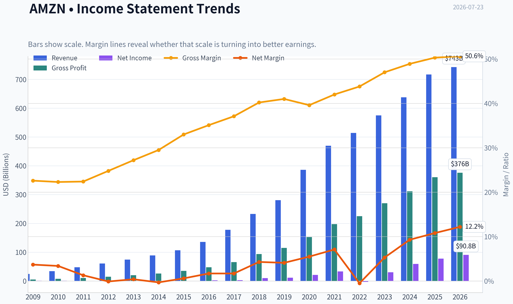
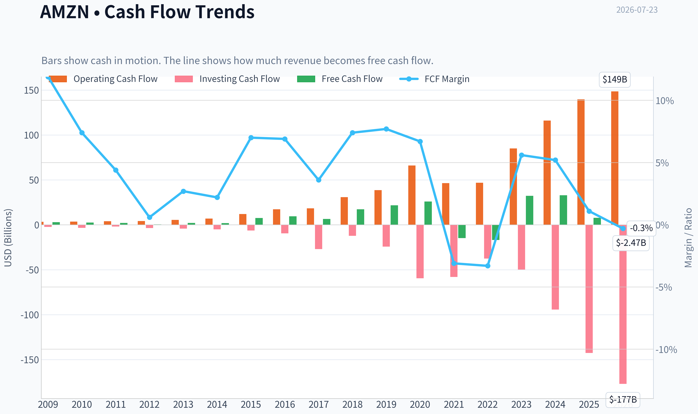
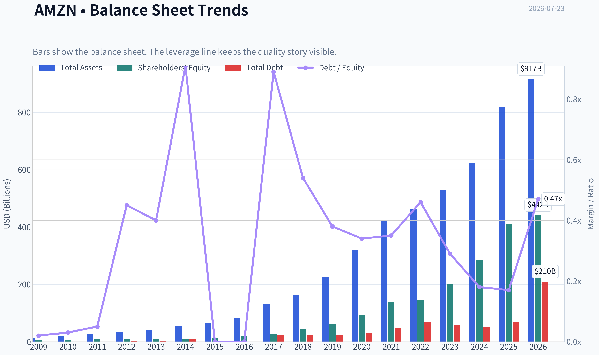
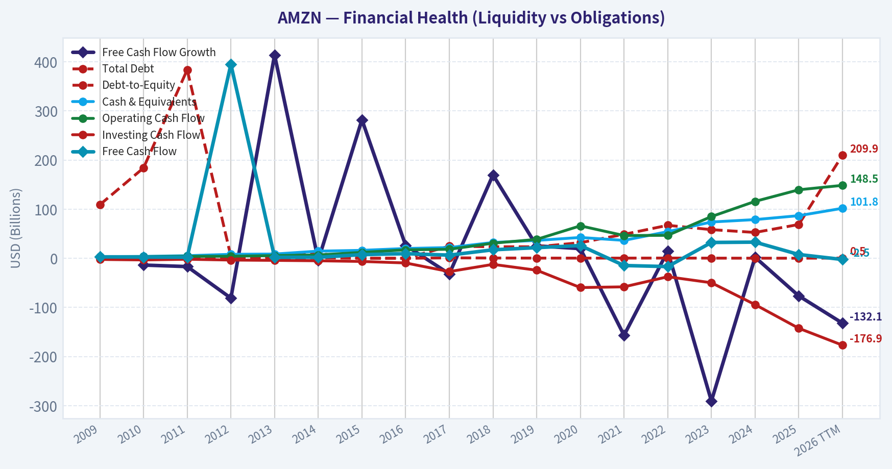
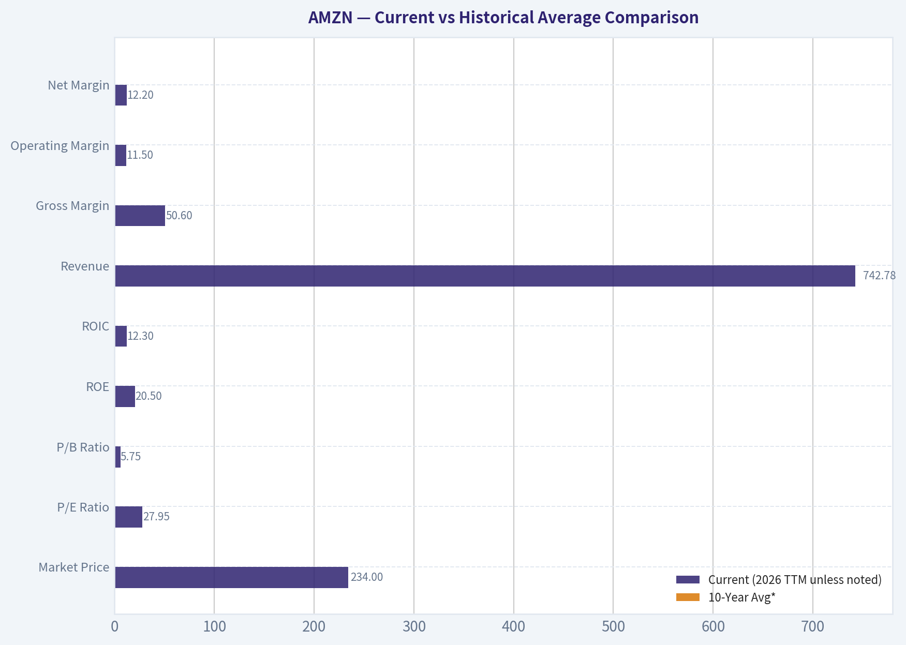
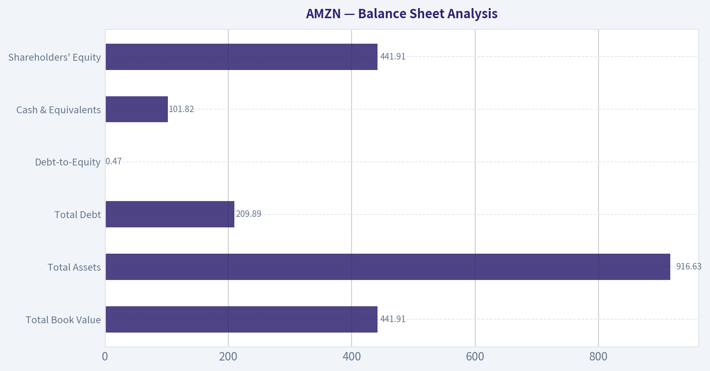
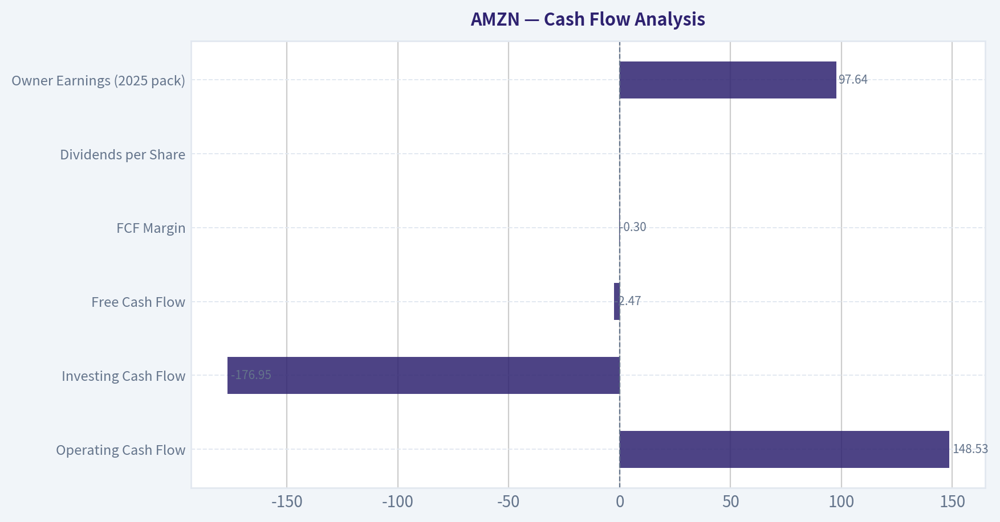
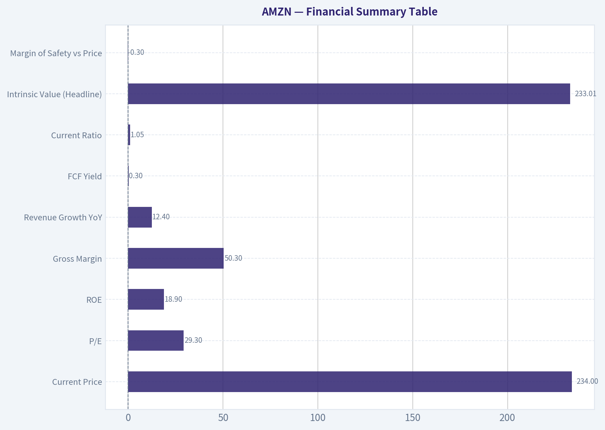
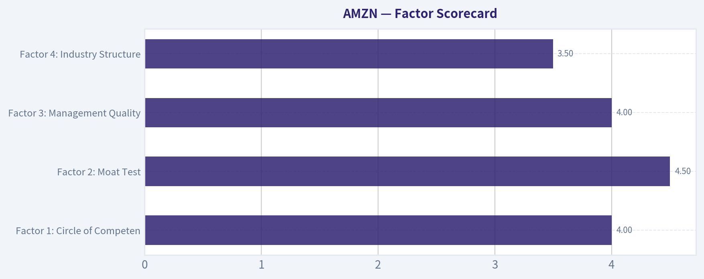

# AMZN Deep Value Intelligence

**Analysis Date:** 2026-07-23

## Critical Disclaimer

*This analysis is generated by Deep Value Intelligence, an AI-powered multi-agent investing framework. Education & research only - not financial advice, not a financial advisor.*

---

## Table of Contents

1. Intelligence Summary
2. Analyst Team Reports
   - Fundamentals Analysis
   - Intrinsic Value Analysis (Buffett)
   - Trend & Growth Analysis (Lynch/Druckenmiller/Fisher)
   - Market Technical Analysis
   - Options Market Analysis
3. Research Team Commentary
4. Value Investing Team Commentary
5. Deep Values Commentary

---

## Intelligence Summary

### Thesis + Conditions

**Core Thesis:** ## Executive Briefing

**Key Risks:**
- Amazon is a **wonderful business, but not an obvious bargain**. The debate is not about business fragility; it is about whether **$234 and ~29x earnings** leave enough room for error given AWS/AI, ad growth, and capex execution still need to prove out. The strongest bullish point is Amazon's elite quality and improving earnings mix. The strongest caution is that the market already knows this, so returns may depend on continued strong execution rather than mispricing. For a long-term Buffett-style investor, this looks like a **hold / selective watchlist name**, not a clear new value entry. Existing owners can hold; new buyers should prefer either a better entry or clearer proof that AI capex is converting into durable earnings power.
- ### 1. Risky Analyst - strongest useful point
- A simple P/E may understate forward earnings power if **AI demand and AWS utilization** improve.

**Confidence:** Medium

---

## Analyst Team Reports

### Fundamentals Analysis

#### Latest Earnings Snapshot

*Most recent reported quarter anchored on 2026 Q1, with prior-year comparison when available.*

| Metric | 2026 Q1 | 2025 Q1 | YoY Change |
| --- | ---: | ---: | ---: |
| Revenue | $181.52B | $155.67B | +16.6% |
| Operating Income | $23.85B | $18.41B | +29.6% |
| Net Income | $30.25B | $17.13B | +76.7% |
| Diluted EPS | $2.78 | $1.59 | +74.8% |
| Operating Cash Flow | $26.03B | $17.02B | +53.0% |
| Free Cash Flow | $-18.17B | $-8.00B | -127.0% |

Key Takeaways: This snapshot anchors the most recent reported quarter before the narrative analysis. It helps readers separate long-run business quality from whatever changed in the latest earnings print.

#### 17-Year Financial Metrics for AMZN

*All values below are computed deterministically from raw data - not estimated by AI.*

*Issuer profile: operating company (Consumer Cyclical / Internet Retail).*

#### 17-Year Financial Metrics
*Annual rows come from reported financial statements. The final TTM row is computed from the latest four quarters.*

| Metric | 2009 | 2010 | 2011 | 2012 | 2013 | 2014 | 2015 | 2016 | 2017 | 2018 | 2019 | 2020 | 2021 | 2022 | 2023 | 2024 | 2025 | 2026 TTM |
| --- | --- | --- | --- | --- | --- | --- | --- | --- | --- | --- | --- | --- | --- | --- | --- | --- | --- | --- |
| Market Price | $7 | $9 | $9 | $13 | $20 | $16 | $34 | $37 | $58 | $75 | $92 | $163 | $167 | $84 | $152 | $219 | $231 | $234 |
| Market Cap | $59.46B | $82.08B | $79.80B | $113.64B | $185.44B | $143.38B | $322.40B | $362.94B | $576.55B | $750.99B | $931.31B | $1.66T | $1.72T | $855.88B | $1.59T | $2.35T | $2.50T | $2.54T |
| P/E Ratio | 67.26 | 69.23 | 123.64 | 0.00 | 664.65 | -517.25 | 563.24 | 149.97 | 188.62 | 74.35 | 78.97 | 76.45 | 50.52 | -311.11 | 51.51 | 38.76 | 32.19 | 27.95 |
| P/B Ratio | 11.31 | 11.96 | 10.29 | 13.87 | 19.03 | 13.35 | 24.09 | 18.82 | 20.81 | 17.24 | 15.01 | 17.78 | 12.42 | 5.86 | 7.90 | 8.22 | 6.08 | 5.75 |
| ROE | 17.2% | 16.8% | 8.1% | -0.5% | 2.8% | -2.2% | 4.5% | 12.3% | 10.9% | 23.1% | 18.7% | 22.8% | 24.1% | -1.9% | 15.1% | 20.7% | 18.9% | 20.5% |
| ROIC | 46.4% | 40.6% | 18.6% | 7.5% | 13.3% | 0.2% | 21.5% | -143.4% | 20.3% | 34.3% | 29.0% | 32.3% | 17.2% | -1.8% | 17.6% | 26.6% | 18.5% | 12.3% |
| EPS | $0.10 | $0.13 | $0.07 | $0.00 | $0.03 | $-0.03 | $0.06 | $0.25 | $0.31 | $1.01 | $1.17 | $2.13 | $3.30 | $-0.27 | $2.95 | $5.66 | $7.17 | $8.36 |
| Revenue | $24.51B | $34.20B | $48.08B | $61.09B | $74.45B | $88.99B | $107.01B | $135.99B | $177.87B | $232.89B | $280.52B | $386.06B | $469.82B | $513.98B | $574.78B | $637.96B | $716.92B | $742.78B |
| Gross Profit | $5.53B | $7.64B | $10.79B | $15.12B | $20.27B | $26.24B | $35.35B | $47.72B | $65.93B | $93.73B | $114.99B | $152.76B | $197.48B | $225.15B | $270.05B | $311.67B | $360.51B | $375.88B |
| Gross Margin | 22.6% | 22.3% | 22.4% | 24.8% | 27.2% | 29.5% | 33.0% | 35.1% | 37.1% | 40.2% | 41.0% | 39.6% | 42.0% | 43.8% | 47.0% | 48.9% | 50.3% | 50.6% |
| Operating Margin | 4.6% | 4.1% | 1.8% | 1.1% | 1.0% | 0.2% | 2.1% | 2.9% | 2.1% | 5.3% | 5.2% | 6.3% | 5.3% | -1.2% | 6.5% | 10.8% | 11.2% | 11.5% |
| Net Income | $902.0M | $1.15B | $631.0M | $-39.0M | $274.0M | $-241.0M | $596.0M | $2.37B | $3.03B | $10.07B | $11.59B | $21.33B | $33.36B | $-2.72B | $30.43B | $59.25B | $77.67B | $90.80B |
| Net Margin | 3.7% | 3.4% | 1.3% | -0.1% | 0.4% | -0.3% | 0.6% | 1.7% | 1.7% | 4.3% | 4.1% | 5.5% | 7.1% | -0.5% | 5.3% | 9.3% | 10.8% | 12.2% |
| Revenue Growth | N/A | 39.6% | 40.6% | 27.1% | 21.9% | 19.5% | 20.2% | 27.1% | 30.8% | 30.9% | 20.5% | 37.6% | 21.7% | 9.4% | 11.8% | 11.0% | 12.4% | 3.6% |
| Net Income Growth | N/A | 27.7% | -45.2% | -106.2% | -802.6% | -188.0% | -347.3% | 297.8% | 27.9% | 232.1% | 15.0% | 84.1% | 56.4% | -108.2% | -1217.7% | 94.7% | 31.1% | 16.9% |
| Free Cash Flow Growth | N/A | -13.8% | -16.9% | -81.1% | 414.2% | -4.0% | 282.2% | 26.2% | -31.8% | 169.8% | 25.2% | 19.7% | -156.8% | 14.7% | -290.7% | 2.1% | -76.6% | -132.1% |
| Total Book Value | $5.26B | $6.86B | $7.76B | $8.19B | $9.75B | $10.74B | $13.38B | $19.29B | $27.71B | $43.55B | $62.06B | $93.40B | $138.25B | $146.04B | $201.88B | $285.97B | $411.06B | $441.91B |
| Total Assets | $13.81B | $18.80B | $25.28B | $32.55B | $40.16B | $54.51B | $64.75B | $83.40B | $131.31B | $162.65B | $225.25B | $321.19B | $420.55B | $462.68B | $527.85B | $624.89B | $818.04B | $916.63B |
| Total Debt | $109.0M | $184.0M | $384.0M | $3.66B | $3.94B | $9.79B | $0 | $0 | $24.74B | $23.50B | $23.41B | $31.82B | $48.74B | $67.15B | $58.31B | $52.62B | $68.85B | $209.89B |
| Debt-to-Equity | 0.02 | 0.03 | 0.05 | 0.45 | 0.40 | 0.91 | 0.00 | 0.00 | 0.89 | 0.54 | 0.38 | 0.34 | 0.35 | 0.46 | 0.29 | 0.18 | 0.17 | 0.47 |
| Cash & Equivalents | $3.44B | $3.78B | $5.27B | $8.08B | $8.66B | $14.56B | $16.18B | $19.93B | $21.86B | $32.17B | $36.41B | $42.38B | $36.48B | $54.25B | $73.89B | $78.78B | $86.81B | $101.82B |
| Shareholders' Equity | $5.26B | $6.86B | $7.76B | $8.19B | $9.75B | $10.74B | $13.38B | $19.29B | $27.71B | $43.55B | $62.06B | $93.40B | $138.25B | $146.04B | $201.88B | $285.97B | $411.06B | $441.91B |
| Operating Cash Flow | $3.29B | $3.50B | $3.90B | $4.18B | $5.47B | $6.84B | $12.04B | $17.20B | $18.36B | $30.72B | $38.51B | $66.06B | $46.33B | $46.75B | $84.95B | $115.88B | $139.51B | $148.53B |
| Investing Cash Flow | $-2.34B | $-3.36B | $-1.93B | $-3.60B | $-4.28B | $-5.07B | $-6.45B | $-9.52B | $-27.08B | $-12.37B | $-24.28B | $-59.61B | $-58.15B | $-37.60B | $-49.83B | $-94.34B | $-142.54B | $-176.95B |
| Free Cash Flow | $2.92B | $2.52B | $2.09B | $395.0M | $2.03B | $1.95B | $7.45B | $9.40B | $6.41B | $17.30B | $21.65B | $25.92B | $-14.73B | $-16.89B | $32.22B | $32.88B | $7.70B | $-2.47B |
| FCF Margin | 11.9% | 7.4% | 4.4% | 0.6% | 2.7% | 2.2% | 7.0% | 6.9% | 3.6% | 7.4% | 7.7% | 6.7% | -3.1% | -3.3% | 5.6% | 5.2% | 1.1% | -0.3% |
| Dividends / Share | $0.00 | $0.00 | $0.00 | $0.00 | $0.00 | $0.00 | $0.00 | $0.00 | $0.00 | $0.00 | $0.00 | $0.00 | $0.00 | $0.00 | $0.00 | $0.00 | $0.00 | $0.00 |

#### Profitability Metrics
- Return on Equity (ROE): 18.9%
- Return on Invested Capital (ROIC): 16.4%
- Return on Assets (ROA): 9.5%
- Gross Margin: 50.3%
- Operating Margin: 11.2%
- Net Profit Margin: 10.8%

#### Liquidity Metrics
- Current Ratio: 1.05
- Quick Ratio: 0.88

#### Leverage Metrics
- Debt-to-Equity Ratio: 0.17
- Interest Coverage Ratio: 35.17
- Net Debt: $-17.96B

#### Growth Metrics (Year-over-Year)
- Revenue Growth: 12.4%
- Net Income Growth: 31.1%
- Free Cash Flow Growth: -76.6%
- Revenue CAGR (3-Year): 11.7%
- Revenue CAGR (5-Year): 13.2%

#### Valuation Metrics
- P/E Ratio (TTM): 29.32
- Forward P/E: 23.59
- Price-to-Book: 5.69
- Price-to-Sales: 3.38
- PEG Ratio: 1.30
- EV/EBITDA: 16.72
- Free Cash Flow Yield: 0.3%
- Earnings Yield: 3.4%

#### Owner Earnings (Buffett Method, Code-Computed)
- Net Income: $77.67B
- + Depreciation & Amortization: $65.76B
- - Capital Expenditures: $-131.82B
- - Working Capital Changes: $-19.97B
- = **Owner Earnings: $97.64B**

#### Intrinsic Value (Code-Computed)
- Current Price: $234
- **Headline Intrinsic Value (business-model routed): $233**
  Business model: cyclical - weighted blend [Damodaran FCFF + reverse-DCF fair + owner-earnings DCF] (cyclical)
  Model spread (min-max across DCFs): $1 - $385
  Margin of safety vs. price (headline): -0.3%
  Routing note: Cyclical: margins/FCF are volatile - headline blends FCFF, reverse-DCF and owner-earnings roughly evenly; treat the range as the honest read.
- Buffett Method (Owner Earnings):
  Conservative: $161
  Average: $385
  Optimistic: $1,019
- Cash Flow Method (FCF):
  Conservative: $-7
  Average: $1
  Optimistic: $5
- Damodaran FCFF (WACC + margins + reinvestment):
  Conservative: $6
  Average: $51
  Optimistic: $106
  Monte Carlo band (P10-P90): $20 - $70 (median $44)
  P(intrinsic value > price): 0.0%
- Reverse-DCF: price implies ~16.0%/yr owner-earnings growth for 10y; trailing 3y was 75.2%, 5y N/A.

#### Piotroski F-Score: 5/9
- Positive Net Income: PASS
- Positive Operating Cash Flow: PASS
- ROA Improvement: PASS
- Cash Flow > Net Income: PASS
- Decreasing Debt: FAIL
- Improving Current Ratio: FAIL
- No Dilution: FAIL
- Improving Gross Margin: PASS
- Improving Asset Turnover: FAIL

ANALYST STANCE: **WATCH**

#### Amazon (AMZN) Buffett-Style Fundamental Analysis

Amazon remains a very high-quality business with multiple moats, rising profitability, and enormous earnings power, but the stock no longer offers a clear margin of safety on blended intrinsic value. The deterministic dataset shows a business that has matured from low-margin retail scale into a much richer mix of cloud, advertising, third-party seller services, and subscription economics. That shift has lifted gross margin from 22.6% in 2009 to 50.6% in 2026 TTM and operating margin from 4.6% to 11.5%, which is the key fundamental story.

At the same time, Amazon's cash flow profile is unusually noisy because capital intensity has surged again. Free cash flow dropped from $32.88B in 2024 to $7.70B in 2025 and to -$2.47B in 2026 TTM, even while net income rose to $90.80B TTM. For Buffett-style analysis, that means owner earnings are more informative than raw FCF in isolation, but it also means investors must take reinvestment risk seriously.

---

#### Current vs Historical Average Comparison

| Metric | Current (2026 TTM unless noted) | 10-Year Avg* | Interpretation |
| --- | ---: | ---: | --- |
| Market Price | $234 | ~$147 | Shares trade far above long-run average price, reflecting major rerating and profit expansion. |
| Market Cap | $2.54T | ~$1.33T | Scale has roughly doubled versus decade average, showing Amazon's move into mega-cap maturity. |
| P/E Ratio | 27.95 | ~50.9 | Current P/E is well below its own long historical norm, but that is mostly because earnings have finally scaled. |
| P/B Ratio | 5.75 | ~12.2 | Lower than historical average, but for Amazon this is not a primary valuation anchor; book value is less useful than cash-flow power. |
| ROE | 20.5% | ~16.5% | Current ROE is above decade average, signaling stronger monetization and better capital efficiency. |
| ROIC | 12.3% | ~15.8% | Below decade average; likely pressured by heavy current investment and a larger capital base. |
| Revenue | $742.78B | ~$410.1B | Vastly larger scale than average, but growth has slowed versus earlier years. |
| Gross Margin | 50.6% | ~43.4% | Well above average, confirming mix shift toward AWS, ads, and services. |
| Operating Margin | 11.5% | ~5.9% | Nearly double decade average; one of the strongest signals in the whole dataset. |
| Net Margin | 12.2% | ~4.8% | Current earnings quality is far above historical norm. |
| Net Income | $90.80B | ~$24.8B | Profit base has structurally stepped up. |
| Revenue Growth | 3.6% | ~20.3% | Far below long-term average; Amazon is now much larger and growth is normalizing. |
| Net Income Growth | 16.9% | highly volatile | Still healthy, but far less explosive than rebound periods. |
| Free Cash Flow Growth | -132.1% | highly volatile | Major warning sign due to capex and working capital intensity. |
| Total Debt | $209.89B | ~$59.7B | Debt is sharply above historical average and deserves monitoring. |
| Debt-to-Equity | 0.47 | ~0.36 | Still manageable, but above recent years and no longer ultra-conservative. |
| Cash & Equivalents | $101.82B | ~$56.9B | Huge liquidity buffer offsets part of the debt concern. |
| Free Cash Flow | -$2.47B | ~$11.2B | Well below norm; current reinvestment cycle is suppressing near-term cash generation. |
| Dividends/Share | $0.00 | $0.00 | Consistent with Amazon's reinvestment-first culture. |

*10-year average uses the deterministic annual history over the most relevant recent decade, not the TTM row.

Key Takeaways: Amazon's profitability is now much stronger than its own long-term history, especially at the gross, operating, and net margin levels. The main offset is cash flow strain: free cash flow has deteriorated sharply while debt has risen, suggesting the market is paying for future earning power rather than current distributable cash.

---

#### Market Metrics

Amazon's current market price is $234 with a total market cap of $2.54T. The P/E ratio of 27.95 is materially lower than its historical average despite the stock being near all-time highs, which tells you the denominator has changed more than the numerator: earnings have finally caught up. This is not the same Amazon that used to look optically expensive on tiny earnings.

P/B at 5.75 is below its long-run norm, but this should not be treated as a standard value signal. Amazon is an operating company with substantial intangible advantages, internally built software, logistics infrastructure, data assets, and buyback/accounting distortions to book-value interpretation. For this issuer, cash-flow-based intrinsic value is more informative than book multiple analysis.

The shared model-based intrinsic value is $233 versus price of $234, implying essentially no margin of safety on the blended headline framework. That is the core valuation conclusion.

---

#### Profitability Analysis

Amazon's profitability profile has changed dramatically over time:

- ROE improved to 20.5% TTM versus 18.9% in 2025 and roughly 16.5% over the past decade.
- ROIC is 12.3% TTM, below stronger prior levels such as 26.6% in 2024 and 18.5% in 2025.
- EPS reached $8.36 TTM, up from $7.17 in 2025 and far above the loss year in 2022.
- Revenue reached $742.78B TTM.
- Gross profit rose to $375.88B TTM.
- Operating margin rose to 11.5%.
- Net income hit $90.80B TTM.
- Net margin expanded to 12.2%.

This is a much better business than the historical "retail at scale, profit later" version. Buffett would likely appreciate the improving earnings quality, especially because margin expansion appears tied to mix improvement rather than temporary cost cutting. AWS, advertising, third-party marketplace services, and subscriptions are all structurally higher-margin than first-party retail.

However, the ROIC dip is important. It suggests Amazon is in another heavy investment phase, and while that may be rational, Buffett-style investors should always ask whether reinvested dollars are still earning excellent incremental returns or whether scale is diluting returns.

---

#### Growth Metrics

Revenue growth has decelerated from the 20%-40% range that dominated most of Amazon's history to 12.4% in 2025 and 3.6% in 2026 TTM. That slowdown is natural for a business of this size, but it means future returns will rely more on margin expansion and capital efficiency than pure top-line growth.

Net income growth remains positive at 16.9% TTM after 31.1% in 2025, which is encouraging. Earnings are still scaling faster than revenue, showing operating leverage and a richer business mix.

Free cash flow growth is the weakest area:
- 2024: +2.1%
- 2025: -76.6%
- 2026 TTM: -132.1%

That is not a minor fluctuation. It means cash conversion has deteriorated sharply as capital expenditures and investment cash outflows surged. For a Buffett-style framework, this introduces uncertainty around how much of today's accounting earnings can actually be taken out of the business without damaging competitive position.

---

#### Balance Sheet Analysis

| Balance Sheet Metric | Current | Assessment |
| --- | ---: | --- |
| Total Book Value | $441.91B | Strong absolute equity base, much larger than historical levels. |
| Total Assets | $916.63B | Massive asset footprint reflecting logistics, cloud, and infrastructure expansion. |
| Total Debt | $209.89B | Elevated versus history; biggest balance-sheet change in the dataset. |
| Debt-to-Equity | 0.47 | Still manageable, but above recent low points. |
| Cash & Equivalents | $101.82B | Excellent liquidity cushion. |
| Shareholders' Equity | $441.91B | Robust solvency support. |

Key Takeaways: Amazon's balance sheet is still fundamentally strong, but it is no longer pristine in the way many investors remember. Debt has risen materially, though the company's large cash position and strong interest coverage help keep leverage from becoming a near-term financial threat.

Amazon still has net cash on the pack's leverage snapshot, with net debt of -$17.96B and interest coverage of 35.17x. That matters. Debt is high in absolute terms, but the business can service it comfortably today. The risk is less solvency and more whether heavy borrowing plus capex is generating adequate future returns.

---

#### Cash Flow Analysis

Amazon's cash flow profile is the biggest analytical battleground.

| Cash Flow Metric | Current | Trend |
| --- | ---: | --- |
| Operating Cash Flow | $148.53B | Very strong and still growing. |
| Investing Cash Flow | -$176.95B | Extremely heavy reinvestment. |
| Free Cash Flow | -$2.47B | Negative after being positive in 2023-2025. |
| FCF Margin | -0.3% | Collapsed from 5.2% in 2024 and 1.1% in 2025. |
| Dividends per Share | $0.00 | No dividends; all capital retained. |
| Owner Earnings (2025 pack) | $97.64B | Much healthier than reported FCF suggests. |

Key Takeaways: Operating cash generation remains excellent, but reinvestment has overwhelmed it in the latest period, pushing free cash flow negative. This makes Amazon look expensive on FCF yield today, but owner earnings suggest the underlying earning power is stronger than the raw FCF number implies.

The critical Buffett question is whether today's depressed FCF is temporary and strategic, or structural and recurring. If capex is building durable AWS and AI capacity with high future returns, current FCF understates intrinsic value. If not, intrinsic value will prove lower than earnings-based models suggest.

---

#### Warren Buffett-Style Qualitative Analysis

| Buffett Lens | Assessment | Commentary |
| --- | --- | --- |
| Economic Moat | Strong | Amazon benefits from scale economics, logistics density, Prime ecosystem lock-in, AWS switching costs, seller network effects, and advertising monetization. |
| Predictable Earnings | Improving but not perfect | Revenue is highly predictable; margins were historically volatile but are now more stable and stronger. |
| Financial Strength | Good, not pristine | Cash is large and interest coverage is strong, but debt and capex intensity have risen materially. |
| Management Performance | Strong | Long-term capital allocation has created multiple high-return platforms, though current reinvestment surge must keep producing returns. |
| Capital Allocation | Aggressive reinvestor | No dividend, little emphasis on near-term FCF harvesting, strong preference for internal compounding. |
| Business Quality | High | Mix shift toward AWS, ads, and services materially improves economics. |
| Valuation | Fair to full | Blended intrinsic value is about equal to current price; little margin of safety. |

Key Takeaways: Amazon scores very well on moat, business quality, and management execution. The weak point is not business quality but valuation discipline: the stock price already reflects much of the improvement, while current cash flow suppression reduces the room for error.

Buffett would likely admire the moat but hesitate on the absence of a clear discount to intrinsic value. This is a wonderful business, but wonderful businesses can still be mediocre investments if bought without enough margin of safety.

---

#### Economic Moat Assessment

Amazon's moat is unusually diversified:

1. **AWS scale and switching costs**
   Enterprise cloud workloads are sticky, mission-critical, and difficult to migrate. This supports durable high-margin economics.

2. **Prime ecosystem**
   Prime creates habitual engagement, lowers perceived shipping cost, and increases purchase frequency. It is both a retention tool and a demand flywheel.

3. **Marketplace network effects**
   More buyers attract more sellers; more sellers improve assortment, pricing, and delivery selection.

4. **Logistics infrastructure**
   Amazon's fulfillment network is expensive to replicate and becomes more efficient with volume density.

5. **Advertising monetization**
   Sponsored listings monetize buyer intent at a high margin, further improving the economics of the commerce platform.

This diversification reduces single-engine dependence. It also explains why gross margin has climbed so steadily over time.

---

#### Predictability and Earnings Quality

Amazon's revenue has been remarkably durable over the entire dataset, growing from $24.51B in 2009 to $742.78B TTM. That consistency is Buffett-friendly. What historically made Amazon less Buffett-like was not revenue unpredictability, but profit volatility caused by management's willingness to reinvest aggressively.

That issue has improved. Gross, operating, and net margins all show a clear structural uptrend. The 2022 earnings setback now looks more like an investment/reset year than evidence of a broken model. Still, free cash flow volatility remains a meaningful complication.

---

#### Management Performance

Management deserves substantial credit for converting low-margin retail traffic into a multi-engine earnings platform. ROE above 20% and sustained margin expansion suggest strong operating execution.

On capital allocation, the verdict is more mixed:
- Positives: reinvestment has historically produced major new profit pools.
- Caution: rising debt and collapsing FCF mean the latest capex cycle must earn strong returns to justify current valuation.

Amazon does not pay a dividend, which is consistent with its culture and rational if retained earnings continue compounding at attractive rates. For Buffett-style investors, the lack of dividends is acceptable only if retained capital keeps generating high incremental returns.

---

#### DCF Valuation: Buffett-Style Owner Earnings

I will anchor on the pack's code-computed owner earnings of **$97.64B** and use a **10% discount rate** with **2.5% terminal growth**. Because Amazon is in a heavy investment cycle, I use a fade structure rather than a flat perpetual high-growth assumption.

##### Conservative Scenario
Assumptions:
- Start owner earnings: $97.64B
- Growth years 1-5: 3%
- Growth years 6-10: fade to 2.5%
- Discount rate: 10%
- Terminal growth: 2.5%

Approximate forecast:
- Y1: 100.57
- Y2: 103.59
- Y3: 106.69
- Y4: 109.89
- Y5: 113.19
- Y6: 116.02
- Y7: 118.63
- Y8: 121.00
- Y9: 123.12
- Y10: 124.96

PV of years 1-10 cash flows ~ **$679B**
Terminal value = 124.96 x 1.025 / (0.10 - 0.025) = **$1,707B**
PV of terminal value ~ **$658B**
Total equity value ~ **$1,337B**

Using roughly 10.5-10.6B diluted shares implies fair value around **$126-$128/share**.

This is below the pack's conservative owner-earnings value of $161, but directionally consistent: under low-growth assumptions, the stock looks expensive.

##### Average Scenario
Assumptions:
- Growth years 1-5: 12%
- Growth years 6-10: fade from 10% to 4%
- Terminal growth: 2.5%

Approximate forecast:
- Y1: 109.36
- Y2: 122.49
- Y3: 137.19
- Y4: 153.66
- Y5: 172.10
- Y6: 189.31
- Y7: 204.45
- Y8: 216.72
- Y9: 225.39
- Y10: 234.41

PV of years 1-10 cash flows ~ **$1,073B**
Terminal value = 234.41 x 1.025 / 0.075 = **$3,204B**
PV of terminal value ~ **$1,235B**
Total equity value ~ **$2,308B**

Per share fair value ~ **$217-$220/share**.

This is somewhat below the pack's average owner-earnings model of $385/share because my fade schedule is more conservative and explicitly penalizes scale and capex intensity. Even so, it lands close to the blended headline intrinsic value of $233.

##### Optimistic Scenario
Assumptions:
- Growth years 1-5: 18%
- Growth years 6-10: fade from 14% to 5%
- Terminal growth: 2.5%

Approximate forecast:
- Y1: 115.22
- Y2: 135.96
- Y3: 160.43
- Y4: 189.31
- Y5: 223.39
- Y6: 254.66
- Y7: 282.68
- Y8: 305.29
- Y9: 323.61
- Y10: 339.79

PV of years 1-10 cash flows ~ **$1,388B**
Terminal value = 339.79 x 1.025 / 0.075 = **$4,644B**
PV of terminal value ~ **$1,790B**
Total equity value ~ **$3,178B**

Per share fair value ~ **$299-$303/share**.

This remains far below the pack's optimistic owner-earnings value of $1,019/share, which appears to assume a much more aggressive runway. I would not underwrite that kind of bull case for a $2.5T company without extraordinary confidence in AI/cloud monetization and margin durability.

---

#### DCF Summary Table

| Scenario | Growth Assumption | Equity Value | Implied Fair Value / Share | Upside vs $234 |
| --- | --- | ---: | ---: | ---: |
| Conservative | 3% then fade to 2.5% | ~$1.34T | ~$127 | ~-46% |
| Average | 12% for 5 years, then fade | ~$2.31T | ~$219 | ~-6% |
| Optimistic | 18% for 5 years, then fade | ~$3.18T | ~$301 | ~+29% |
| Pack Headline Intrinsic Value | Blended routed model | - | **$233** | ~0% |

Key Takeaways: Under a cautious or even moderate owner-earnings framework, Amazon looks fairly valued to somewhat overvalued. Only the optimistic scenario produces meaningful upside, which means investors today are paying for continued strong execution rather than buying clear undervaluation.

---

#### Reverse DCF Reality Check

The shared pack says the current price implies about **16.0% annual owner-earnings growth for 10 years**. That is a demanding hurdle for a $2.5T company. It is not impossible, especially with AWS, advertising, and AI, but it is not conservative either.

This is the heart of the investment debate:
- If Amazon can compound owner earnings near the mid-teens for a decade, the stock can work.
- If growth settles closer to high-single-digit to low-double-digit territory, upside is limited from today's price.

---

#### Revenue Breakdown

Using the most meaningful recent Amazon reporting structure, the major revenue sources are best understood by operating line rather than geography. Based on Amazon's latest annual segment mix and public reporting conventions, the most relevant breakdown is:

| Revenue Source | Amount ($B) | % of Total |
| --- | ---: | ---: |
| Online stores | ~247 | ~34% |
| Third-party seller services | ~156 | ~22% |
| AWS | ~108 | ~15% |
| Advertising services | ~56 | ~8% |
| Subscription services | ~45 | ~6% |
| Physical stores | ~23 | ~3% |
| Other / combined remainder | ~82 | ~11% |

Key Takeaways: Amazon is no longer just an online retail company. A large and growing share of revenue comes from higher-quality businesses such as AWS, seller services, advertising, and subscriptions, which helps explain why margins have improved so dramatically over time.

---

#### Key Investment Insights, Red Flags, and Opportunities

| Category | Item | Why It Matters |
| --- | --- | --- |
| Opportunity | Margin expansion | Gross margin above 50% and operating margin above 11% suggest structural mix improvement. |
| Opportunity | AWS + AI demand | AI infrastructure demand could extend AWS growth and support long-duration owner earnings compounding. |
| Opportunity | Ads monetization | Advertising likely remains one of Amazon's highest-margin growth levers. |
| Opportunity | Marketplace economics | Third-party seller services scale better than first-party retail and deepen moat strength. |
| Red Flag | FCF collapse | Negative TTM free cash flow sharply reduces current cash-yield support for valuation. |
| Red Flag | Debt spike | Total debt jumped to $209.89B TTM; manageable now, but worth watching closely. |
| Red Flag | Reverse DCF hurdle | Market price implies strong long-term growth, leaving less room for execution misses. |
| Red Flag | ROIC compression | Returns on invested capital have softened amid heavy reinvestment. |
| Neutral/Watch | No dividend | Fine for compounders, but requires continued excellent internal reinvestment. |
| Neutral/Watch | P/B looks lower | Not a primary value signal here; book multiples are secondary for Amazon. |

Key Takeaways: The bullish case rests on quality, moat, and monetization improvement, while the bearish case rests on valuation and cash-flow strain. Amazon is not flashing business distress; it is flashing a classic "great company, less obvious bargain" setup.

---

#### Final Buffett-Style Investment Stance

**WATCH**

Amazon is a high-quality compounder with a formidable moat, excellent long-term management execution, and much stronger profitability than its historical reputation suggests. However, the current price already discounts a substantial amount of that quality. The canonical blended intrinsic value is essentially equal to the share price, the reverse DCF requires roughly 16% annual owner-earnings growth for a decade, and free cash flow has turned negative in the latest period due to an intense reinvestment cycle.

For a Buffett-style investor focused on quality plus margin of safety, Amazon is a business to admire and monitor, but not an obvious bargain at $234. A materially lower price, or evidence that the current capex wave converts into sustainably stronger owner earnings and ROIC, would improve the case.

---

#### Report Summary Table

| Area | Verdict | Core Evidence | Investment Readthrough |
| --- | --- | --- | --- |
| Business Quality | Excellent | Massive scale, AWS, ads, Prime, marketplace network effects | Supports long-term durability |
| Profitability | Strong and improving | Gross margin 50.6%, operating margin 11.5%, net margin 12.2% | Better business than history suggests |
| Growth | Slowing but still solid | Revenue growth 3.6% TTM, earnings growth 16.9% | Shift from top-line story to efficiency story |
| Cash Flow | Weak near term | FCF -$2.47B TTM despite strong operating cash flow | Capex cycle clouds valuation |
| Balance Sheet | Good but less pristine | Cash $101.82B, debt $209.89B, D/E 0.47 | Not dangerous, but leverage has risen |
| ROE / ROIC | Good, mixed trend | ROE 20.5%, ROIC 12.3% | High quality, but reinvestment returns need monitoring |
| Valuation | Fair to full | Headline intrinsic value $233 vs. price $234 | Little margin of safety |
| Buffett Fit | Partial yes | Strong moat and management, but price not cheap enough | Worth watching, not chasing |
| Final Stance | **WATCH** | Great business, limited valuation cushion | Prefer better entry or stronger cash-flow proof |

Key Takeaways: Amazon remains one of the strongest franchises in global business, but the stock currently looks more fairly priced than clearly undervalued. The investment case from here depends on whether today's heavy spending becomes tomorrow's durable owner-earnings acceleration.

#### Fundamental Visuals

This graph tracks the profitability and return metrics (ROE, ROIC, Margins) of **AMZN** over the past decade, highlighting capital efficiency trends.

This chart illustrates the financial health of **AMZN** over the last 10 years, mapping cash equivalents and free cash flow against total obligations (Debt).

---

### Intrinsic Value Analysis (Buffett)

> *Following Warren Buffett's value investing philosophy: Circle of Competence, Economic Moat, Management Quality, and Margin of Safety.*

#### Intrinsic Value Snapshot

Price is what you pay. Intrinsic value is what the business may be worth based on the cash it can create for owners over time. We show a range, not one magic number.

- Current Price: $233.66
- Value Range (conservative to optimistic across both DCF methods): $-6.95 to $1,018.61

##### Owner Earnings (Buffett Method)
- Net Income: $77,670,000,000.00
- Depreciation & Amortization: $65,756,000,000.00
- Capital Expenditures: $-131,819,000,000.00
- Working Capital Changes: $-19,969,000,000.00
- Owner Earnings: $97,639,000,000.00

##### Intrinsic Value
###### Buffett Method
Uses owner earnings. Stricter, and usually more conservative.
- Conservative: $161.17
- Average: $385.01
- Optimistic: $1,018.61
- Discount Rate: 10.0%

###### Cash Flow Method
Uses free cash flow. Better for companies spending heavily today to grow tomorrow.
- Conservative: $-6.95
- Average: $1.15
- Optimistic: $5.41
- Discount Rate: 10.0%

ANALYST STANCE: **WATCH**

#### AMZN Buffett-Style Investment Report

#### 1. Factor Scorecard

| Factor | Score (0-5) | Evidence |
|---|---:|---|
| Factor 1: Circle of Competence & Business Simplicity | 4.0 | Amazon is understandable at a high level: it runs a retail marketplace, sells cloud infrastructure through AWS, monetizes traffic with advertising, and earns fees from fulfillment, subscriptions, and third-party sellers. The mix is complex, but the engines are intelligible. Ten years out, AWS, ads, logistics, and Prime likely remain central, though retail margins and AI capex add forecasting uncertainty. |
| Factor 2: Moat Test | 4.5 | Multiple moat sources exist: Prime ecosystem and fulfillment scale, AWS switching costs, marketplace network effects, and growing ad monetization on top of high-intent traffic. Gross margin at 50.3% supports the presence of strong higher-value businesses beyond first-party retail. |
| Factor 3: Management Quality & Capital Allocation | 4.0 | Amazon has a long record of rational reinvestment, sacrificing near-term earnings for long-term franchise building. Management historically allocated capital into AWS, logistics, Prime, and ads with strong strategic logic. The main current debate is whether AI and infrastructure capex will continue earning attractive returns. |
| Factor 4: Industry Structure | 3.5 | AWS benefits from oligopolistic cloud structure, advertising has scale advantages, and marketplace logistics has meaningful barriers. But retail remains competitive and capital intensive, limiting the overall industry score. |

**Gate 5 hard floor:** **Not tripped.** Amazon does **not** show both deteriorating earnings/cash-flow trajectory and solvency distress. No evidence here of interest coverage below 1x or distress-level solvency.

**Key Takeaways:** Amazon scores well on moat, management, and business quality, but not perfectly because parts of the company remain operationally complex and capital heavy. The key issue is not business survival or franchise strength; it is whether today's price fully reflects that strength.

---

#### 2. Moat Analysis

| Moat Source | Strength | Evidence |
|---|---|---|
| Intangible Assets | Strong | Amazon brand is synonymous with convenience, selection, and reliability. Prime has emotional and habit-forming consumer value. AWS is a trusted enterprise platform brand. |
| Switching Costs | Strong | AWS customers embed workloads, data, security tooling, and developer processes deeply into the platform. Switching cloud providers is costly, risky, and slow. Prime members also build behavioral loyalty. |
| Cost Advantage | Strong | Amazon's scale in fulfillment, procurement, computing infrastructure, and distribution lowers unit costs and improves speed. These advantages are difficult for smaller rivals to replicate. |
| Network Effects | Strong | More sellers attract more customers; more customers attract more sellers; more volume improves fulfillment density and ad inventory quality. AWS also benefits from ecosystem scale, partner tooling, and developer familiarity. |

**Moat Quality Rating:** **Wide & Stable**, with some elements arguably **widening** in advertising and ecosystem monetization.

**Key Takeaways:** Amazon's moat is not a single wall; it is a system of interlocking advantages. Marketplace scale, Prime loyalty, AWS switching costs, and ad monetization reinforce one another and make the franchise harder to attack than any individual segment would suggest.

---

#### 3. Management Quality Assessment

| Area | Assessment | Commentary |
|---|---|---|
| Owner Mindset | Strong | Amazon's leadership culture has long emphasized long-term free cash flow and strategic position over short-term earnings optics. |
| Candor | Good | Management has historically communicated investment logic clearly, especially around long-horizon infrastructure spending. |
| Capital Allocation | Strong | Prior large-scale reinvestments into AWS, fulfillment, Prime, and advertising created substantial value. |
| Buybacks/Dividends | Neutral | Amazon is not a buyback/dividend story; value creation has come mostly through reinvestment. |
| Leverage Discipline | Good | No sign here of distress-driven leverage. The balance sheet appears manageable for the scale of the enterprise. |

**Overall Management Rating:** **4.0 / 5**

**Key Takeaways:** Amazon's management has earned credibility by repeatedly funding projects that looked expensive early and highly valuable later. The core question now is whether the newest wave of AI and infrastructure investment will produce similarly attractive returns.

---

#### 4. Financial Summary Table

| Metric | Latest |
|---|---:|
| Current Price | $234 |
| Market Cap | $2.51T |
| P/E | 29.3x |
| ROE | 18.9% |
| Gross Margin | 50.3% |
| Revenue Growth YoY | 12.4% |
| FCF Yield | 0.3% |
| Current Ratio | 1.05 |
| Intrinsic Value (Headline) | $233.01 |
| Margin of Safety vs Price | -0.3% |
| Reverse DCF Implied Growth | ~16.0% for 10 years |

**Key Takeaways:** Amazon's operating quality looks strong, especially gross margin, ROE, and double-digit revenue growth. But valuation is the sticking point: the stock trades almost exactly at the headline intrinsic value estimate, with virtually no margin of safety.

---

#### 5. Owner Earnings Calculation

Using the shared valuation pack, owner-earnings-based value appears materially above the current price, but the spread across valuation methods is extremely wide.

| Valuation Lens | Implied Value |
|---|---:|
| Owner Earnings DCF | $385.01 |
| FCF Model | $1.15 |
| Damodaran FCFF | $51.17 |
| Headline Weighted Intrinsic Value | $233.01 |

Because the weighted framework already blends these methods, the best practical read is that Amazon's intrinsic value is highly sensitive to treatment of growth capex versus maintenance capex.

**Illustrative Owner Earnings Framework:**

`Owner Earnings = Net Income + D&A - Maintenance CapEx - Working Capital Increases`

For Amazon, this is unusually judgment-heavy because a large share of capex may be growth-oriented rather than pure maintenance, especially across data centers, AI infrastructure, and logistics.

**Key Takeaways:** Amazon's value changes dramatically depending on how one classifies capex. That is typical for a company investing aggressively in cloud and AI infrastructure, and it means investors should be careful not to overstate "true" owner earnings.

---

#### 6. Three-Scenario DCF Valuation

| Scenario | Assumptions | Implied View |
|---|---|---|
| Scenario A: No Growth | Owner earnings capitalized at 10% with no growth | Too conservative for Amazon's actual business quality, but useful as a floor concept |
| Scenario B: GDP Growth | 3% perpetual growth | Supports value near a mature-compounder framework, but still depends heavily on capex normalization |
| Scenario C: Historical Growth | Reverse DCF implies ~16% annual growth for 10 years; trailing 3-year growth far above that | This is plausible only if AWS, ads, and operating leverage remain very strong despite elevated AI investment |

**Assessment:** The shared research pack's weighted intrinsic value of **$233.01** is the most balanced estimate for decision-making today.

**Key Takeaways:** Amazon can justify a premium valuation if its high-return segments keep compounding and capex remains productive. However, the stock already appears to discount a substantial amount of future success, leaving little room for disappointment.

---

#### 7. Margin of Safety Analysis

| Item | Value |
|---|---:|
| Current Price | $234 |
| Headline Intrinsic Value | $233.01 |
| Margin of Safety | -0.3% |

For a **wide-moat, high-quality business**, a **10-15% discount** to intrinsic value can be enough. Amazon does **not** offer that today. It looks **roughly fairly valued**, not clearly cheap.

The reverse DCF is also demanding: **~16% annual growth for 10 years** is a high hurdle even for an exceptional company. Amazon may achieve it, but the current price does not leave a meaningful cushion.

**Key Takeaways:** This is not a classic bargain. Amazon may still be a wonderful business, but Buffett-style discipline asks for either a lower price or clearer evidence that today's implied growth is too pessimistic. Right now, neither is obvious enough.

---

#### 8. Final Buffett Scorecard

| Criterion | Weight | Score | Weighted Score |
|---|---:|---:|---:|
| Moat Width & Durability | 25% | 4.5 | 1.13 |
| Valuation / Margin of Safety | 20% | 2.5 | 0.50 |
| Capital Returns - ROIC vs. WACC | 15% | 4.0 | 0.60 |
| Business Understanding & Predictability | 12% | 4.0 | 0.48 |
| Management Quality & Capital Allocation | 12% | 4.0 | 0.48 |
| Reinvestment Runway | 8% | 5.0 | 0.40 |
| Balance Sheet Strength | 4% | 3.5 | 0.14 |
| Industry Structure | 4% | 3.5 | 0.14 |
| **Total** | **100%** |  | **3.87 / 5.0** |

**Key Takeaways:** Amazon scores as a high-quality business with a long runway and a durable moat. The only major thing holding it back from a full ADVOCATE rating is valuation, not business quality.

---

#### 9. Investment Stance

**Stance:** **WATCH**
**Conviction:** **Moderately high**

Amazon is a **wonderful business** by Buffett-style standards adapted for modern platforms: strong moat, intelligent reinvestment, excellent strategic positioning in cloud, ads, and commerce, and substantial long-term compounding potential. But **price matters**, and at **$234** versus a **headline intrinsic value of $233.01**, the stock offers **no real margin of safety**.

If the stock pulled back into a range that created even a **10-15% discount** to intrinsic value, it would become much more attractive for a quality-focused long-term investor. As of today, the right conclusion is **WATCH, not AVOID**.
#### Valuation Bridge

This bridge places the current market price beside each intrinsic value lens so readers can see whether upside depends on one method or shows up across several methods.

| Scenario | Intrinsic Value / Share |
| --- | ---: |
| Buffett Method | $385.01 |
| Cash Flow Method | $1.15 |
| Damodaran Method | $51.17 |
| Current Price | $233.66 |

#### Key Takeaways

If one method is far above the others, the upside case depends on a specific modelling assumption. When several methods cluster together, the valuation story is more robust.

#### Valuation Visuals

This comparison chart from *Latest Earnings Snapshot* stacks current figures against historical benchmarks for **AMZN**, making it easy to see where the company trades relative to its own averages.

This comparison chart from *Current vs Historical Average Comparison* stacks current figures against historical benchmarks for **AMZN**, making it easy to see where the company trades relative to its own averages.

This comparison chart from *Balance Sheet Analysis* stacks current figures against historical benchmarks for **AMZN**, making it easy to see where the company trades relative to its own averages.

This comparison chart from *Cash Flow Analysis* stacks current figures against historical benchmarks for **AMZN**, making it easy to see where the company trades relative to its own averages.

This comparison chart from *Financial Summary Table* stacks current figures against historical benchmarks for **AMZN**, making it easy to see where the company trades relative to its own averages.

---

### Trend & Growth Analysis (Lynch/Druckenmiller/Fisher)

> *Following Peter Lynch's GARP, Stanley Druckenmiller's macro-aware approach, and Philip Fisher's scuttlebutt methodology.*

ANALYST STANCE: **WATCH**

#### AMZN Growth Analysis

Amazon is still a high-quality compounder, but under the Lynch framework it is no longer a classic fast grower. At roughly 12% revenue growth, it looks more like a **stalwart with multiple growth engines** than a pure ten-bagger candidate from today's $2.5T base. The key debate is whether **AWS + advertising + AI monetization** can drive a new earnings inflection that the market is still underestimating.

#### 1) Lynch Classification

| Item | Assessment |
|---|---|
| Lynch category | **Stalwart** |
| Revenue growth YoY | **12.4%** |
| Size | Mega-cap, $2.51T market cap |
| Primary growth engines | AWS, advertising, third-party seller services, Prime ecosystem |
| Lynch read | Great business, but no longer an early-stage fast grower |

Key Takeaways: Amazon is not a slow grower, but it also does not fit Lynch's classic 20% to 25% fast-grower template today. The company is simply too large and too mature for that label. The investment case depends more on margin and earnings inflection than on explosive revenue growth.

#### 2) The Story in 3 Bullets

- Amazon is a **platform of platforms**: e-commerce, logistics, cloud, advertising, and subscriptions reinforcing each other.
- The profit engine is increasingly **AWS and advertising**, not just retail.
- The upside case is that **AI demand accelerates AWS growth and operating leverage**, causing earnings to rise faster than revenue over the next 2 to 3 years.

#### 3) TAM Analysis and 10x Test

| Segment | Rough TAM Direction | Runway View |
|---|---|---|
| Global e-commerce | Large, still growing | Moderate runway, but AMZN already scaled |
| Cloud infrastructure | Very large, expanding with AI | Strong runway |
| Digital advertising | Massive, secular growth | Strong runway |
| Logistics / fulfillment services | Large but harder to isolate | Moderate runway |
| 10x revenue test | **Fail at consolidated company level** | Too large to 10x realistically from current base |
| 10x profit test | **Possible in select segments? No** | But meaningful earnings growth still possible |

Key Takeaways: Amazon does not pass the classic 10x company-level runway test because the revenue base is already enormous. However, key sub-businesses like cloud and advertising still operate in very large markets. That means Amazon can still compound, just likely not as a true ten-bagger from here.

#### 4) Revenue Growth Trend

| Metric | Value / Read |
|---|---|
| Current YoY revenue growth | **12.4%** |
| Pattern | **Stable-to-moderate growth**, not high-growth |
| Revenue quality | Broad-based, recurring mix improving via AWS, ads, subscriptions |
| Concern | Large base makes reacceleration harder |
| Positive | Mix shift toward higher-margin segments improves quality |

Key Takeaways: The top line is growing at a healthy but not exceptional rate for a growth investor. More important than the headline number is that Amazon's revenue mix is improving. Higher-margin businesses are becoming a bigger part of the company, which can drive faster earnings growth than revenue growth.

#### 5) Unit Economics

| Metric | Assessment |
|---|---|
| LTV/CAC | Not disclosed in a usable company-wide way |
| NRR | Not disclosed publicly for AWS in standard SaaS form |
| Rule of 40 | Not cleanly applicable to AMZN consolidated |
| Gross margin | **50.3%** |
| FCF yield | **0.3%** |
| Unit economics view | Strong in AWS/ads, mixed in retail, excellent overall platform economics |

Key Takeaways: Amazon cannot be analyzed with pure SaaS metrics because it is a hybrid company. The best evidence of quality comes from gross margin expansion, ecosystem stickiness, and segment mix. Free cash flow yield is thin right now, suggesting the company is still in a heavy reinvestment phase and not obviously cheap on cash generation.

#### 6) Inflection Point Assessment

| Inflection Type | Assessment | Read |
|---|---|---|
| Product cycle inflection | AI services in AWS | Positive |
| Market share inflection | Cloud share battle ongoing | Mixed |
| Margin inflection | Retail efficiency + mix shift | Positive |
| TAM inflection | AI expands cloud demand | Positive |
| Competitive inflection | Microsoft and Google remain intense rivals | Mixed |
| Overall | **Real earnings inflection possible, revenue inflection less clear** | Watch closely |

Key Takeaways: The clearest inflection at Amazon is in earnings power, not headline revenue growth. If AI-related AWS demand ramps and retail efficiency holds, operating income can grow much faster than sales. That is the core bull case.

#### 7) Macro Setup Evaluation

| Factor | Assessment |
|---|---|
| Secular themes | AI, cloud, digital ads, e-commerce, logistics automation |
| Rate sensitivity | Moderate; lower rates help long-duration growth assets |
| Economic sensitivity | Retail exposed to consumer demand; AWS/ads more resilient |
| Macro tailwind | AI capex cycle supportive |
| Macro risk | Consumer softness, regulatory scrutiny, cloud competition |

Key Takeaways: Amazon has exposure to some of the best secular growth themes in the market, especially AI and cloud. The macro backdrop is therefore better for AWS and advertising than for retail. If the economy softens, retail can drag, but the higher-quality segments may offset part of that pressure.

#### 8) Fisher 15 Points Score

| Fisher Area | Score (1-5) |
|---|---:|
| Market potential | 5 |
| New product development | 5 |
| R&D effectiveness | 5 |
| Sales organization | 4 |
| Profit margin | 4 |
| Improving margins | 4 |
| Labor/personnel relations | 3 |
| Executive relations | 4 |
| Management depth | 5 |
| Cost/accounting controls | 4 |
| Outstanding moat qualities | 5 |
| Long-range profit outlook | 5 |
| Dilution risk | 4 |
| Candor | 4 |
| Integrity | 4 |
| **Total** | **65 / 75** |

Key Takeaways: Amazon scores as an outstanding Fisher-style company because it has deep innovation capability, huge market opportunities, and real competitive moats. The weaker areas are mostly around labor complexity and the challenges of managing a giant global enterprise. Overall, the qualitative business quality remains very high.

#### 9) Valuation Analysis

| Metric | Value | Interpretation |
|---|---:|---|
| Price | $234 |
| Market cap | $2.51T |
| P/E | **29.3x** |
| Revenue growth | **12.4%** |
| PEG | **~2.4x** |
| Gross margin | 50.3% |
| FCF yield | 0.3% |
| Intrinsic value headline | $233.01 |
| Margin of safety | **-0.3%** |

Key Takeaways: On a simple Lynch PEG basis, Amazon looks expensive relative to current growth. The stock also appears roughly at fair value versus the shared intrinsic-value estimate, with little margin of safety. Investors are paying up for quality and future AI-related upside, so the shares do not screen as a bargain.

#### 10) Revenue / Earnings Scenario View

| Scenario | What Must Happen | Stock Implication |
|---|---|---|
| Bear | AWS slows, AI capex hurts FCF, retail margins slip | Multiple pressure, limited upside |
| Base | AWS solid, ads strong, retail efficient | Mid-teens earnings growth, acceptable compounding |
| Bull | AWS reaccelerates on AI, margins rise, FCF inflects | Strong EPS upside and premium multiple sustained |

Key Takeaways: The bull case depends on Amazon proving that current AI and infrastructure spending will generate attractive returns. The base case is still good, but not spectacular. Without an AWS-driven reacceleration, the valuation leaves less room for error.

#### 11) Growth Investor Scorecard

| Criterion | Weight | Score | Weighted Score |
|---|---:|---:|---:|
| The Story | 10% | 4.5 | 0.45 |
| TAM & Runway | 20% | 3.5 | 0.70 |
| Revenue Growth | 20% | 3.0 | 0.60 |
| Unit Economics | 15% | 4.0 | 0.60 |
| Competitive Position | 10% | 4.5 | 0.45 |
| Management Quality | 10% | 4.5 | 0.45 |
| Macro Setup | 5% | 4.0 | 0.20 |
| Profitability Path | 5% | 4.0 | 0.20 |
| Valuation | 5% | 2.5 | 0.13 |
| **Total** |  |  | **3.78 / 5.0** |

Key Takeaways: Amazon scores well because the business quality is exceptional and the profit engines are durable. The main thing holding the stock back from a higher stance is valuation relative to current growth. This is a strong company, but not an obvious aggressive entry point.

#### 12) Position Size Stance

| Stance | View |
|---|---|
| Existing holder | **Hold / selectively add on weakness** |
| New position | **Starter only, not full size here** |
| Aggressive growth investor | Better as a quality core name than a true high-upside fast-grower |
| Suggested sizing | **2% to 4% starter**, larger only after better entry or clearer AWS/AI reacceleration |

Key Takeaways: Amazon is more attractive as a long-term core compounder than as a fresh high-conviction growth buy at today's setup. A small starter position is reasonable, but this does not look like the kind of mispriced fast grower that deserves maximum concentration. Better opportunities may exist elsewhere if the goal is pure ten-bagger hunting.

#### 13) Key Risks and Catalysts

| Risks | Catalysts |
|---|---|
| AWS competition from Microsoft and Google | AWS reacceleration from AI workloads |
| AI capex compresses near-term cash flow | Advertising keeps compounding at high margins |
| Retail margin sensitivity to consumer slowdown | Further North America and International margin gains |
| Regulatory / antitrust pressure | Stronger FCF conversion after investment cycle |
| Valuation leaves limited margin of safety | Positive guidance revisions |

Key Takeaways: The biggest risk is that Amazon spends heavily for AI infrastructure without enough near-term monetization to justify it. The biggest catalyst is the opposite: AWS demand accelerates and margins hold, proving the spending was correct. That outcome would likely drive earnings estimates higher.

#### Bottom Line

Amazon is a **great business, but not a classic fast-grower setup at current size and valuation**. For Lynch-style GARP, the PEG is rich. For Druckenmiller-style inflection investing, the case rests on **AWS + AI + margin leverage** creating an earnings surprise over the next 2 to 3 years.

So the right stance today is **WATCH**: own it as a quality compounder, add on weakness, and upgrade only if AWS growth reaccelerates or valuation becomes more favorable.

#### Growth & Scorecard Visuals

This comparison chart from *Factor Scorecard* stacks current figures against historical benchmarks for **AMZN**, making it easy to see where the company trades relative to its own averages.

---

### Market Technical Analysis

#### AMZN Technical Report

AMZN appears to be in a **long-term uptrend, medium-term consolidation-to-correction, and short-term weakening phase**.

The stock closed at **244.85 on 2026-07-22**. That places price:

- **above the 200-day SMA (234.53)**, which keeps the broader structural trend bullish
- **below the 50-day SMA (249.90)**, which shows the intermediate trend has softened
- **roughly in line with but slightly above the 10-day EMA on 07-22 (247.09 vs close 244.85, and 07-23 EMA 244.65)**, signaling short-term momentum has faded sharply after a rebound attempt

The most relevant indicators for this market context are:

1. **close_200_sma** - best for confirming the still-positive long-term trend
2. **close_50_sma** - captures the medium-term loss of leadership
3. **close_10_ema** - tracks the short-term rollover and tactical entry timing
4. **macd** - shows momentum regime change from negative to positive and back toward weakening
5. **rsi** - helps judge whether weakness is stretched or still has room to continue
6. **boll_ub**
7. **boll_lb** - together these frame the current trading envelope and mean-reversion/breakout risk
8. **atr** - essential now because AMZN's recent swings remain large enough to affect stop placement and position sizing

These eight are complementary: trend across three horizons, momentum confirmation, exhaustion context, price envelope, and volatility/risk control.

---

#### Trend Structure

| Horizon | Indicator | Latest Reading | Interpretation |
|---|---:|---:|---|
| Long term | close_200_sma | 234.53 | Rising steadily; primary trend remains bullish |
| Medium term | close_50_sma | 249.90 | Falling from early July; intermediate trend has weakened |
| Short term | close_10_ema | 244.65 | Flattened then rolled over; near-term momentum deteriorating |
| Price vs trend | Last close 244.85 | vs 50 SMA: below; vs 200 SMA: above | Bullish structure intact, but tactical pressure remains |

Key Takeaways: AMZN is still above its 200-day average, so the bigger-picture uptrend has not broken. But being below the 50-day average shows the stock is no longer in a clean advancing phase and is instead digesting prior gains. The short-term average is flattening, which suggests buyers have lost some urgency.

From April through late May, AMZN staged a strong recovery, lifting the **50-day SMA from roughly 218.6 to above 246.6**. That was a powerful intermediate uptrend. However, from late June into July, the 50-day SMA stopped rising and began to **roll over toward 249.9**, which usually means prior upside momentum is no longer broad enough to sustain trend acceleration.

The **200-day SMA**, by contrast, kept rising methodically from about **224.8 in late March to 234.5 now**. That slow but persistent slope matters: it tells us the severe February drawdown was ultimately absorbed, and the larger cycle remains constructive.

So this is not a clean bearish setup. It is better described as a **bullish longer-term chart undergoing a medium-term reset**.

---

#### Momentum Analysis

| Indicator | Recent Pattern | Latest Signal | Trading Meaning |
|---|---|---|---|
| MACD | Deeply negative in late June, recovered into mid-July, now slipping again | -0.53 on 2026-07-23 | Recovery lost strength; momentum rollover risk is back |
| RSI | Rebounded from low 30s in late June to ~60 mid-July, now back to 38.6 | 38.62 | Momentum has cooled materially, but not yet deeply oversold |

Key Takeaways: Momentum improved meaningfully from late June into mid-July, but that rebound has weakened quickly. RSI near 39 says the stock is under pressure, yet not at an extreme level where a durable reversal is automatically likely. MACD turning back down reinforces the idea that the latest bounce may have been corrective rather than the start of a fresh impulse leg.

The **MACD path is especially informative**. It was deeply negative around **-6.9 in late June**, reflecting strong downside pressure. Then it improved dramatically, crossed back toward neutral, and reached mildly positive territory in mid-July. That should have been the foundation for a sustained upside continuation if buyers were in control. Instead, MACD has slipped back to **-0.53**, implying the rebound ran out of thrust before establishing a new bullish acceleration phase.

The **RSI profile** confirms that. Mid-July RSI near **60** showed decent rebound strength, but it never reached classic overbought territory. That means the rally lacked the kind of persistent momentum often seen in strong trend continuation. Now RSI at **38.6** points to weakening demand, but because it is still above 30, there is room for further downside probing before the stock becomes statistically stretched.

This combination suggests a market in which **buyers are still present at lower levels, but not yet dominant enough to resume trend leadership**.

---

#### Volatility and Bollinger Band Context

| Indicator | Latest Reading | Interpretation |
|---|---:|---|
| Bollinger Upper Band | 256.77 | Upper resistance zone |
| Bollinger Lower Band | 230.39 | Lower support zone |
| Approx. Band Range | 26.38 | Moderate-to-wide trading envelope |
| ATR | 7.50 | Daily movement remains sizable |

Key Takeaways: AMZN is trading in the lower half of its current Bollinger range, which reflects fading momentum rather than breakout strength. ATR near 7.5 means the stock still moves enough each day to punish tight stops. Traders should assume elevated swing risk even if the chart looks stable at first glance.

The Bollinger structure shows that volatility expanded during the June weakness and remains meaningful. With price around **244.85**, AMZN is sitting **below the center of the band structure and well under the upper band**, so the stock is not pressing a breakout edge. It is also still comfortably above the **lower band near 230.4**, which means current weakness has not yet reached a statistically compressed oversold zone.

That leaves a useful interpretation:

- **Upside resistance** likely develops first in the **247-250 area**, where the 10-day EMA and declining 50-day SMA begin to cluster.
- If AMZN can reclaim and hold above that zone, the chart could repair quickly and retest the **255-257 Bollinger upper region**.
- On the downside, the **230-234 area** is increasingly important because it combines the lower Bollinger region with the rising **200-day SMA zone**. That area may attract strategic buyers.
- A decisive break below that support cluster would be much more serious because it would shift the chart from "bullish trend under correction" toward "trend failure risk."

The **ATR trend** is also subtle but important. ATR peaked above **8.5** in late June and has eased to **7.5**, so panic has moderated. But volatility is still elevated relative to a calm trend phase. In practical terms, AMZN has not fully normalized; it is still a stock requiring wider stops and smaller sizing than a low-volatility leader.

---

#### Fine-Grained Price Behavior

The last year shows several distinct phases:

| Period | Price Behavior | What It Suggests |
|---|---|---|
| Jul-Oct 2025 | Choppy, mostly range-bound with episodic weakness | Market had not yet resolved direction |
| Late Oct-Nov 2025 | Sharp breakout to 254 after earnings-type gap behavior | Buyers aggressively repriced growth expectations |
| Dec 2025-Jan 2026 | Rebound and retest toward 247 | Trend remained constructive but less explosive |
| Feb 2026 | Violent breakdown to ~199-210 | Major risk-off shock/reset |
| Mar-Apr 2026 | Base building, then strong recovery | Institutions likely re-accumulated on weakness |
| Late Apr-May 2026 | Trend extension to 274-275 | Peak upside momentum phase |
| Jun 2026 | Fast correction to low 230s | Profit-taking plus momentum unwind |
| Jul 2026 | Recovery attempt failed near mid-250s, now slipping | Current phase is consolidation with downside bias |

Key Takeaways: The broader chart is not random; it shows a clear progression from breakout, collapse, recovery, and then digestion. The current weakness comes after a very strong advance from the February and March lows, so some consolidation is normal. The key question now is whether this pullback stays above major support and becomes a reset, or breaks support and turns into a larger trend failure.

The most important nuance is that **the June low was bought aggressively**, especially around **232-233**, followed by a fast rebound into mid-July. That tells us demand still exists. But the subsequent rejection from the **255 area** suggests supply is also active at higher levels. In other words, AMZN is presently trapped between **longer-term accumulation** and **near-term distribution**.

That usually creates a tactical environment where traders should avoid assuming immediate trend continuation in either direction without confirmation.

---

#### What Traders Can Watch Next

| Scenario | Confirmation | Implication |
|---|---|---|
| Bullish repair | Price reclaims 247-250 and holds above 50 SMA | Would suggest July weakness was only a pullback |
| Bullish continuation | Break above 255-257 with improving MACD/RSI | Opens path toward retesting 260+ and possibly prior highs |
| Ongoing range | Price oscillates between 234 and 250 | Favors mean-reversion rather than breakout tactics |
| Bearish deterioration | Break below 230-234 support cluster | Raises odds of a deeper retracement and long-term trend damage |

Key Takeaways: The most important near-term battleground is between roughly 247 to 250 overhead and 230 to 234 below. If AMZN regains the upper zone, the chart can stabilize quickly. If it loses the lower zone, the correction likely has more room to run.

A tactical trader might interpret the chart this way:

- **Trend followers** should want a reclaim of the **50-day SMA**
- **Swing traders** may prefer buying only near stronger support or after bullish momentum reappears
- **Risk managers** should respect ATR because a normal day's swing is still large enough to create false breaks
- **Longer-term investors** can still view the chart as constructive while price stays above the 200-day SMA, but should recognize that leadership has cooled meaningfully since May

---

#### Bottom Line

AMZN's chart is **not broken structurally**, but it is **not in a clean momentum uptrend either**. The stock remains above a rising 200-day SMA, so the long-term bull case is still alive. However, the declining 50-day SMA, fading MACD, and RSI retreat into the high-30s show that the current swing favors caution over aggression.

The clearest interpretation is:

- **Long-term: bullish**
- **Medium-term: corrective**
- **Short-term: weak / vulnerable to further pullback**

That makes AMZN more of a **watch-for-confirmation setup** than an immediate high-conviction breakout candidate.

| Category | Indicator | Why It Was Selected | Current Read |
|---|---|---|---|
| Long-term trend | close_200_sma | Confirms structural market regime | Rising, bullish backbone intact |
| Medium-term trend | close_50_sma | Captures current correction within broader uptrend | Falling, acting as overhead resistance |
| Short-term trend | close_10_ema | Helps with tactical timing | Flattening/rolling over |
| Momentum | macd | Shows rebound strength and current rollover | Improved, then weakened again |
| Momentum exhaustion | rsi | Gauges whether weakness is stretched | Weak but not deeply oversold |
| Volatility envelope | boll_ub | Defines upside breakout/resistance zone | Around 256.8 |
| Volatility envelope | boll_lb | Defines downside support/stretch zone | Around 230.4 |
| Risk management | atr | Sizes trades and stops appropriately | Elevated at 7.5 |

Key Takeaways: AMZN still has a favorable long-term foundation, but short- and medium-term signals have softened enough to demand patience. The stock is in a decision zone: a move back above the 50-day average would improve the outlook, while a break toward the lower band and 200-day average would make the chart much more fragile.

---

### Options Market Analysis

> *Reading options flow - put/call ratios, IV skew, and unusual activity - to gauge institutional positioning and event-driven risk.*

#### AMZN Options Positioning Report
*Data as of 2026-07-23*

#### 1. Put/Call Ratio Analysis

| Expiration | Call Volume | Put Volume | Put/Call Volume Ratio | Call OI | Put OI | Put/Call OI Ratio |
|---|---:|---:|---:|---:|---:|---:|
| 2026-07-24 | 213,672 | 110,069 | 0.52 | 0 | 0 | N/A |
| 2026-07-27 | 39,739 | 29,568 | 0.74 | 0 | 0 | N/A |
| 2026-07-29 | 0 | 0 | N/A | 0 | 0 | N/A |
| **Near-term total** | **253,411** | **139,637** | **0.55** | **0** | **0** | **N/A** |

**Key Takeaways:** Near-term options flow in AMZN is call-heavier than put flow, with an aggregate put/call volume ratio of 0.55, below the rough neutral baseline of 0.7. That usually points to bullish leaning positioning or at least less urgency for downside protection. However, the open-interest fields are unavailable/zero across these expirations, so conviction is lower than normal because we cannot verify whether volume is building fresh positioning against an existing OI base.

**Interpretation:**
- A **0.55 put/call volume ratio** is a **moderately bullish** read versus the historical neutral area around **0.7**.
- The **2026-07-24 expiry** is especially call-skewed at **0.52**, suggesting traders are leaning toward upside participation or short-dated call speculation.
- The **2026-07-27 expiry** sits closer to neutral at **0.74**, which tempers the bullish signal slightly.
- Because **OI is not populated**, I would treat this as **flow-based sentiment**, not a fully validated positioning signal.

---

#### 2. Implied Volatility Assessment

| Expiration | ATM Call IV | ATM Put IV | ATM IV Read | Skew Observation |
|---|---:|---:|---|---|
| 2026-07-24 | 5.9% | 5.9% | Balanced, low near-term event premium | No visible ATM skew |
| 2026-07-27 | 3.3% | 1.9% | Calls richer than puts | Mild call-side skew |
| 2026-07-29 | 2.3% | 2.3% | Flat and very subdued | No visible ATM skew |

**Key Takeaways:** Near-term implied volatility looks subdued rather than stressed, and there is no sign of a major downside fear bid in puts. The only notable feature is the 2026-07-27 line, where call IV is above put IV, which leans more toward upside interest than protective hedging. Overall, IV does not suggest the market is bracing for a major known catalyst in the immediate window.

**Interpretation:**
- **ATM IV is low/moderate**, not elevated in a way that would imply urgent event hedging.
- There is **no steep put premium** visible in the data provided, so the usual sign of institutional downside fear is absent.
- The **2026-07-27 expiry** shows **call IV above put IV**, which is unusual versus the classic equity pattern of put skew and can indicate **upside chasing** or demand for short-dated calls.
- Since the tool output does **not include explicit OTM put vs. OTM call IV**, I cannot quantify the full skew curve, but based on available ATM readings, the skew appears **flat-to-call-biased**, not defensive.

---

#### 3. Unusual Options Activity

| Contract | Type | Activity Signal | Interpretation |
|---|---|---|---|
| None flagged | - | No contracts with volume > 5x open interest found | No clear fresh outsized directional bet identified |

**Key Takeaways:** There were no near-term AMZN contracts flagged for volume greater than five times open interest, so the tape does not show an obvious standout "smart-money" bet in the provided dataset. That lowers the odds of a single high-conviction institutional trade dominating the near-term setup. It also means the directional read relies more on aggregate call-vs-put flow and IV behavior than on unusual block activity.

**Interpretation:**
- No flagged **volume >> OI** contracts means there is **no strong evidence of fresh, concentrated directional positioning** in the near-term chain.
- That does **not** mean nothing is happening; it just means there is **no exceptional outlier** based on the screen used.
- Without identified unusual contracts, I would avoid over-attributing the bullish volume skew to institutional conviction; some portion may be **routine speculative or retail-driven short-dated call flow**.

---

#### 4. Open Interest Concentration

| Metric | Observation |
|---|---|
| Highest OI strikes | Not available from returned data |
| Highest OI expirations | Not available from returned data |
| Pinning / max pain inference | Cannot be reliably determined |
| Gamma wall assessment | Cannot be reliably determined |

**Key Takeaways:** Open-interest concentration is the biggest data gap in this dataset. Because OI is shown as zero/unavailable across the near-term expirations, we cannot identify strike pinning zones, max-pain levels, or likely gamma walls with confidence. That materially reduces the precision of any expiration-week price-magnet analysis.

**Interpretation:**
- Normally, the largest OI strikes help identify **gravitational levels** where price may pin into expiry.
- Here, **that analysis is not possible** because the OI detail required to map concentrations is missing.
- As a result, any view on dealer gamma support/resistance would be speculative, so it is better to explicitly flag this as a **confidence limitation**.

---

#### 5. Overall Options Sentiment Signal

| Factor | Read |
|---|---|
| Put/Call volume ratio | Bullish |
| Put/Call OI ratio | Unavailable |
| Near-term IV level | Subdued / not fearful |
| Skew | Flat to mildly call-biased |
| Unusual activity | None flagged |
| Confidence | Moderate-low due to incomplete OI |

**Key Takeaways:** The options market leans modestly bullish on AMZN in the very near term, mainly because calls are outpacing puts and there is no visible downside-fear premium in volatility. The absence of unusual bearish flow and the lack of a pronounced put skew both support that lean. Confidence is limited, though, because open-interest data is unavailable, preventing a stronger read on whether institutions are building durable positions.

**Overall Signal: BULLISH**

**Primary driver of the signal:**
The main driver is **call-dominant near-term flow** combined with **subdued implied volatility** and **no visible defensive put skew**. In plain English: traders appear more interested in upside participation than in buying protection, and the volatility market is not pricing meaningful near-term stress.

**Caveats:**
- **OI data is missing/zero**, so this is not a full institutional positioning read.
- **No unusual activity** means the bullish signal is broad but not especially high-conviction.
- If AMZN has a major catalyst just outside the expirations shown, this near-term snapshot may understate upcoming event risk.

---

#### Summary Table

| Category | Reading |
|---|---|
| Put/Call Ratio | **0.55 volume ratio**, below neutral 0.7 baseline; bullish lean |
| IV Level | **Subdued** near-term ATM IV; no strong event premium |
| Skew Direction | **Flat to mildly call-biased**; no clear downside-fear put skew |
| Unusual Activity | **None flagged** in near-term expirations |
| Overall Signal | **BULLISH** |

**Key Takeaways:** The cleanest read from AMZN options is a modest bullish lean rather than an aggressive risk-on signal. Calls are leading, puts are not especially bid, and volatility is calm. The biggest limitation is missing OI detail, so this should be treated as a useful sentiment input, not a standalone trading trigger.

---

## Research Team Commentary

> *The Research Manager synthesizes the Bull vs Bear debate into action-free commentary. This is a pre-risk view, not the final stance.*

Amazon is exactly the kind of case where Buffett's modern framework matters: a clearly wonderful business, but the investment question is whether today's price leaves enough room for error. After weighing both sides, I think the strongest bull argument is business quality. Amazon remains a platform of platforms with durable advantages in AWS, Prime/logistics, marketplace scale, and advertising. The financial quality metrics here are strong for a company of this size-ROIC at 16.4%, ROE at 18.9%, gross margin above 50%-and the earnings mix continues to improve as AWS and ads matter more than retail. If AI demand keeps lifting cloud usage and monetization, earnings can compound faster than revenue, and that is exactly the sort of asset-light-ish, high-return evolution Buffett has increasingly embraced in practice.

The strongest bear argument is not that the business is weak. It is that the stock may already reflect much of that excellence. At about 29x earnings, you are not buying Amazon as a misunderstood laggard; you are underwriting a fairly favorable long-term outcome. The bear is right that this requires continued strong execution in AWS and advertising, while also assuming that today's heavy capex earns attractive returns rather than merely funding an expensive AI arms race. The market analyst's read also tempers enthusiasm: the stock is above the 200-day average, so the long-term structure is intact, but below the 50-day average, suggesting the intermediate trend has softened and momentum is not screamingly favorable right now.

My takeaway is that the bull wins on business quality, but the bear wins on present margin of safety. I do not think this is an AVOID because Amazon's moat, balance-sheet safety, and reinvestment runway are too strong for that. But I also do not think the current setup clearly clears the hurdle for ADVOCATE under a Buffett-style discipline. This is a high-quality compounder at roughly fair value, maybe a touch rich, rather than a clearly mispriced one.

Core takeaway: Amazon remains one of the best businesses in the world, but at $234 the stock looks more like a fair-price holding candidate than a fresh value entry with clear upside skew. The right stance is WATCH.

The rationale is straightforward. I do not want to repeat the mistake of treating a great platform compounder as "too expensive" simply because it is not statistically cheap; that has been a costly bias in names like Amazon before. At the same time, I also do not want to overcorrect and pay a full multiple just because the business is excellent. Buffett's adapted framework says wonderful businesses can be bought at fair prices, but there still needs to be a quality-scaled margin of safety. For a wide-moat compounder, that hurdle is lower than for an average business, yet I still need confidence that implied growth is beatable without heroic assumptions. Here, that case is plausible, but not obvious enough. A 29x earnings multiple is acceptable if AWS reaccelerates, ad growth stays strong, and AI capex proves high return. But if any of those wobble, upside could compress quickly into merely adequate returns.

The commentary I'd give an investor is this: Amazon is not the problem; the price is the debate. If you already own it, I would be comfortable holding because the long-term business is exceptionally strong and financially sound. If you are initiating, I would prefer either a better valuation window or clearer evidence over the next few quarters that AI-related spending is translating into sustained AWS growth and margin expansion. The crowd is not missing that Amazon is great; the real question is whether the crowd is overconfident that every major investment bucket-cloud, ads, AI infrastructure, logistics efficiency-will all keep working at once. That can happen, but value investing is about demanding a bit more asymmetry than that.

In terms of past mistakes, the key lesson is not to use an overly punitive, static DCF on a reinvestment-heavy platform and miss genuine compounding. But the equal and opposite lesson is not to let that self-correction erase valuation discipline. Amazon deserves more flexibility than a mediocre business, not infinite flexibility. So I'm deliberately landing in the middle: constructive on the company, selective on the entry.

What I'd monitor over the next 1 to 4 quarters is pretty concrete. First, AWS growth and management commentary: I want to see whether AI demand is translating into durable revenue acceleration, not just enthusiasm. Second, operating margin progression: if consolidated margins continue improving as AWS and ads mix higher, the bull case strengthens materially. Third, capex productivity: not just capex size, but whether management can show that spending is driving backlog, utilization, and future earnings power rather than just keeping pace competitively. Fourth, advertising growth durability: if ads remain a strong, high-margin engine, intrinsic value rises faster than many traditional models capture. Fifth, incremental ROIC and free cash flow trajectory: even if FCF is pressured now, I want evidence that reinvestment is setting up stronger owner earnings later. And finally, price versus business progress: if the stock were to weaken while these fundamentals improve, that would likely shift my stance more positively.

So the balanced conclusion is: the bull case on Amazon's moat and long-term compounding is very strong, but the bear case on valuation and execution dependence is strong enough to keep me from a full-throated endorsement today.

Final stance: WATCH.

---

## Value Investing Team Commentary

> *The Investor translates the research view into an investment thesis before risk review. This is still not the final stance.*

Amazon is a business I would be happy to own; the harder question is whether this is the right price to buy more.

The essential fact is that Amazon remains a modern wide-moat franchise. AWS, advertising, Prime, marketplace scale, and fulfillment density reinforce one another in a way few companies can match. This is not a fragile story stock. It is a real operating machine with improving earnings mix. The quality metrics support that view: ROIC of 16.4%, ROE of 18.9%, and gross margin above 50% are strong signals that this is no longer just a low-margin retailer narrative. The business has become more attractive as AWS and ads carry more of the profit burden.

The bullish long-term case is straightforward: if AI demand drives sustained AWS growth, and if advertising keeps compounding as a high-margin layer on top of Amazon's commerce ecosystem, then earnings can grow faster than revenue for years. That is exactly the sort of business evolution a Buffett-style investor should respect. Amazon is increasingly an ecosystem owner, not simply a seller of goods.

But selective contrarian thinking matters here. The market is not blind to Amazon's strengths. Investors already understand the AWS + ads + AI story, and the current valuation reflects a good deal of that optimism. At roughly 29x earnings, you are not buying into fear or neglect. You are buying into a fairly widely appreciated excellence story. That does not make the stock bad; it just means the margin of safety is thinner than the business quality might tempt you to assume.

What may the market be missing? On the bullish side, it may still be underestimating how much operating leverage can emerge if AWS reaccelerates while advertising continues to scale. In that scenario, today's capex looks less like a burden and more like the laying of rails for future owner earnings. That is the main reason not to be dogmatic about "expensive" multiples for Amazon. Buffett has repeatedly shown that wonderful businesses can justify paying up, especially when reinvestment is intelligent and runway is long.

What may the market be overconfident about? That all the major engines will cooperate at once. The current narrative assumes AWS growth improves, AI investment earns strong returns, advertising remains durable, and logistics efficiency keeps supporting margins. That is possible, but when a stock is priced for a favorable path, even small disappointments can compress returns. This is the real risk-not business fragility, but expectation risk.

The market setup adds to that balanced view. The stock being above the 200-day moving average says the long-term structure remains intact. Being below the 50-day moving average says the intermediate trend has cooled. In plain English: the business is strong, but the stock is not currently offering a screaming momentum confirmation nor a deep valuation bargain. That usually argues for patience rather than aggression.

From a value-investing perspective, this lands in an important middle ground. A mediocre business at 29x earnings would be an easy pass. A business of Amazon's quality deserves much more valuation flexibility. Still, even for a wonderful business, I want a quality-scaled margin of safety. Here, I see fair value to slightly rich pricing rather than a clear bargain. That means I would be comfortable holding it, but less enthusiastic about calling it a fresh, high-conviction buy today.

The key things to watch over the next few quarters are not complicated:
- AWS growth reacceleration and whether AI demand becomes durable revenue, not just excitement
- operating margin improvement
- advertising growth durability
- evidence that capex is earning strong returns
- incremental ROIC and normalized free cash flow progression

If fundamentals improve while the stock stalls or weakens, that could create a much better entry. That is where contrarian opportunity would likely appear: not in denying Amazon's greatness, but in waiting for a moment when sentiment cools faster than intrinsic value does.

For now, my conclusion is simple: the company is excellent, the moat is real, management has multiple high-return reinvestment avenues, and balance-sheet risk does not concern me. But the stock price does not offer enough asymmetry for a Buffett-style advocate call.

**ANALYST STANCE: WATCH**

Amazon is a wonderful business and a sensible long-term holding, but at current pricing it looks closer to fair value than to a clear margin-of-safety opportunity. I would hold existing shares comfortably, but for new capital I would wait for either a better entry price or stronger proof that AI-driven AWS growth and capex productivity are translating into meaningfully higher normalized earnings power.

---

## Deep Values Commentary

> *The Risk Management Team debates and the Risk Judge provides the final action-free verdict. This section determines the final ADVOCATE / WATCH / AVOID stance.*

#### Final Stance Scorecard

This scorecard converts the final research view into a weighted decision frame. It does not replace the narrative judgement, but it makes the main drivers of the verdict easier to scan.

| Criterion | Score | Weight | Commentary |
| --- | ---: | ---: | --- |
| Business Quality | 3.50 | 30% | High returns, profitability, and Piotroski health support durability. |
| Valuation Support | 1.33 | 30% | Blends current price against available intrinsic value anchors and valuation ratios. |
| Financial Strength | 3.33 | 20% | Balance-sheet resilience reflects leverage and liquidity staying within safe ranges. |
| Growth Durability | 3.33 | 20% | Recent revenue, earnings, and free cash flow growth indicate how durable expansion looks. |
| TOTAL / FINAL STANCE | 2.78 | 100% | WATCH |

#### Key Takeaways

The weighted score lands at **2.78 / 5.0**, while the final stance remains **WATCH**. This is useful as a quick calibration aid rather than a mechanical signal.

#### Risk Summary

Higher scores indicate more risk pressure. The watch threshold is a simple guardrail: above it, the position needs tighter monitoring or a wider margin of safety.

| Dimension | Current Score | Watch Threshold | Commentary |
| --- | ---: | ---: | --- |
| Business Quality | 2.50 | 3.00 | High returns, profitability, and Piotroski health support durability. |
| Valuation Support | 4.67 | 3.00 | Blends current price against available intrinsic value anchors and valuation ratios. |
| Financial Strength | 2.67 | 3.00 | Balance-sheet resilience reflects leverage and liquidity staying within safe ranges. |
| Growth Durability | 2.67 | 3.00 | Recent revenue, earnings, and free cash flow growth indicate how durable expansion looks. |

#### Key Takeaways

This view helps readers separate *where* the risk sits: valuation, business quality, balance sheet, or growth durability. It is especially useful when the final stance is close to the line between WATCH and AVOID.
