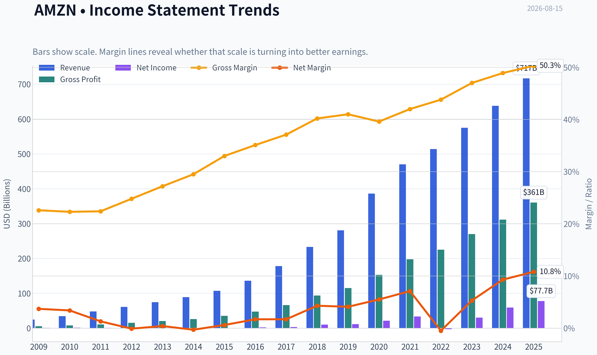
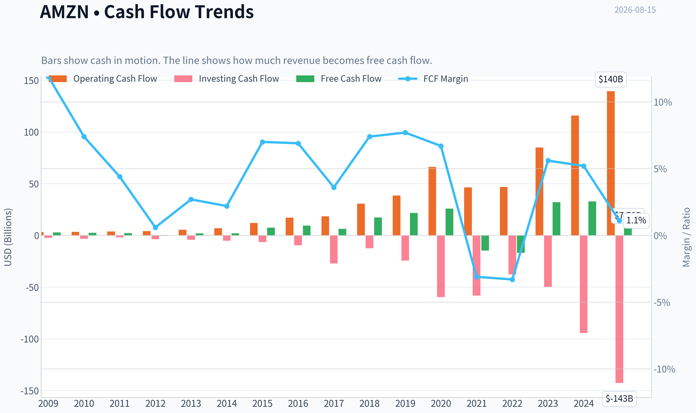
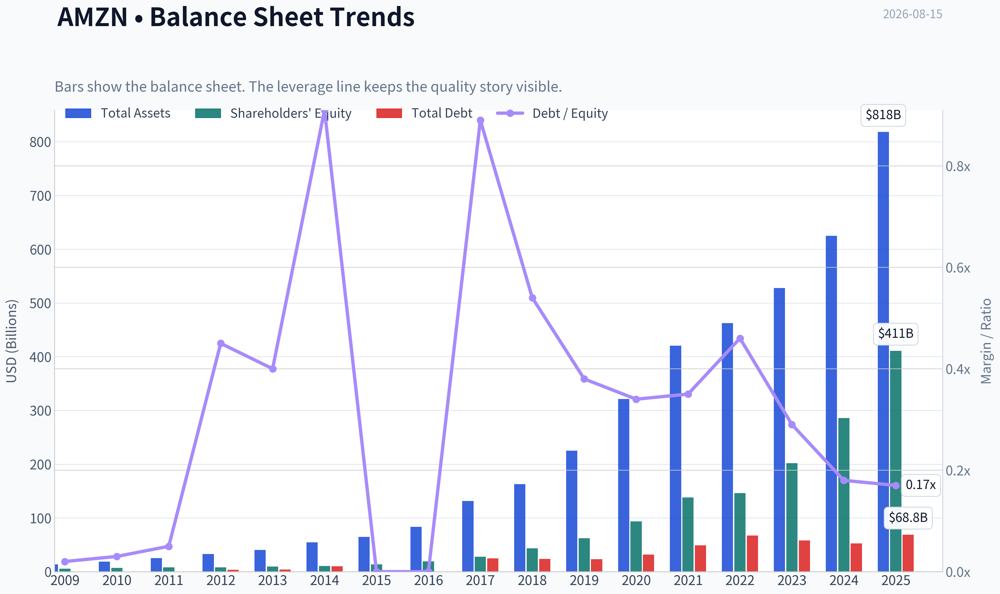
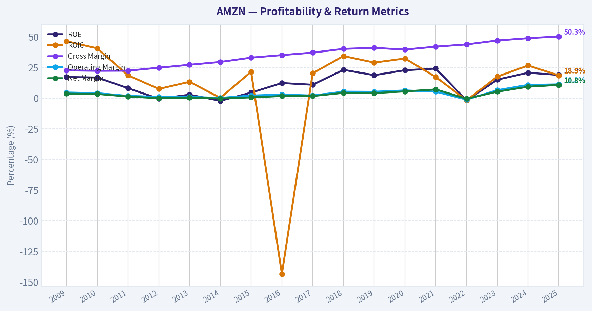
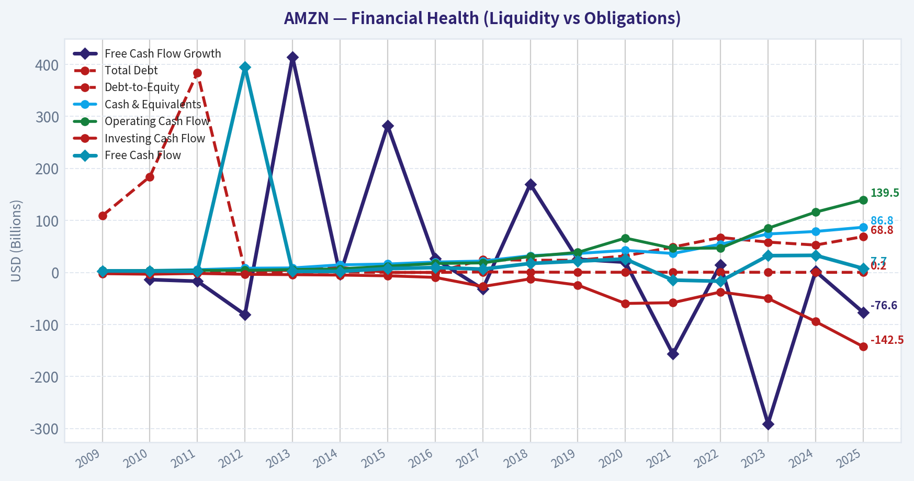
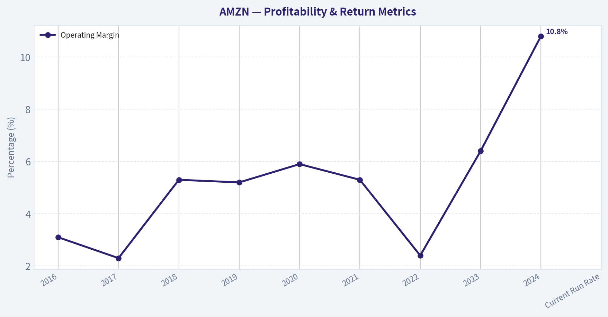
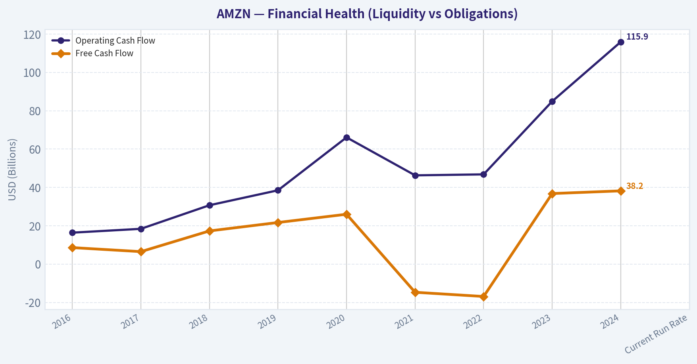
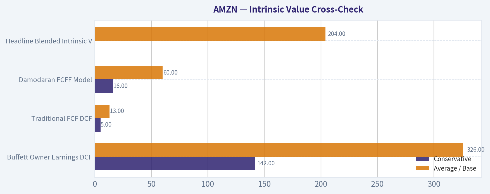
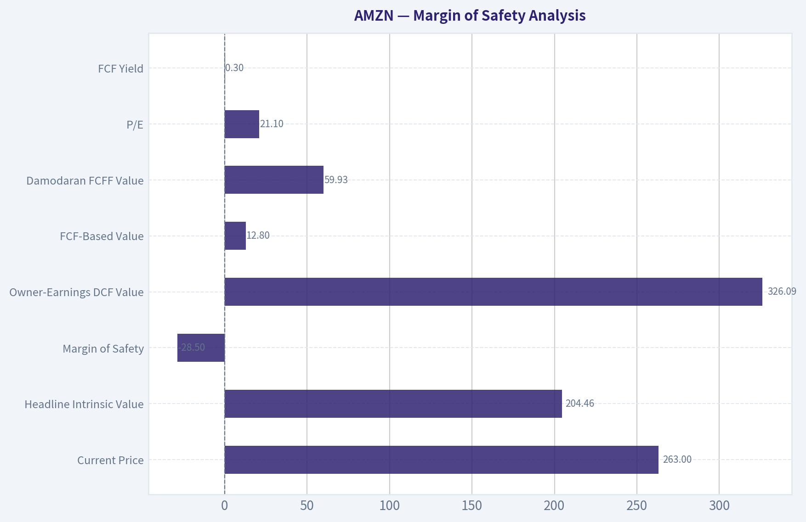
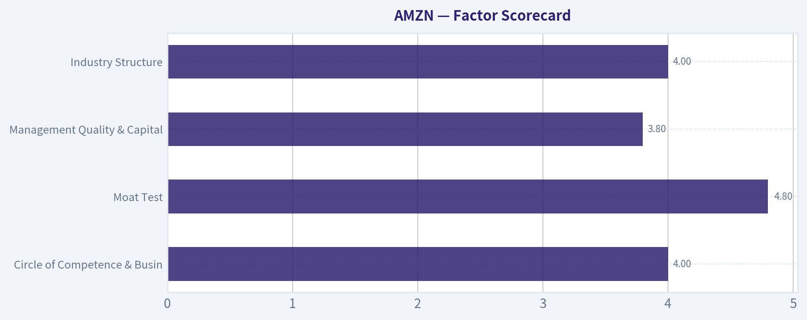

# AMZN Deep Value Intelligence

**Analysis Date:** 2026-08-15

## Critical Disclaimer

*This analysis is generated by Deep Value Intelligence, an AI-powered multi-agent investing framework. Education & research only - not financial advice, not a financial advisor.*

---

## Table of Contents

1. Intelligence Summary
2. Analyst Team Reports
   - Fundamentals Analysis
   - Intrinsic Value Analysis (Buffett)
   - Trend & Growth Analysis (Lynch/Druckenmiller/Fisher)
   - Market Technical Analysis
   - Options Market Analysis
3. Research Team Commentary
4. Value Investing Team Commentary
5. Deep Values Commentary

---

## Intelligence Summary

### Thesis + Conditions

**Core Thesis:** **EXECUTIVE SUMMARY**
Amazon (AMZN) currently presents a classic "wonderful business at a fair price" setup. At a remarkably undemanding P/E of ~21 for a company generating a 16.4% ROIC and crossing a 50% gross margin threshold, the market is mispricing its structural shift into a high-margin digital services compounder (AWS, Advertising).

**Key Risks:**
- Amazon (AMZN) currently presents a classic "wonderful business at a fair price" setup. At a remarkably undemanding P/E of ~21 for a company generating a 16.4% ROIC and crossing a 50% gross margin threshold, the market is mispricing its structural shift into a high-margin digital services compounder (AWS, Advertising). While heavy capital expenditures are drawing cautious "WATCH" ratings from traditional analysts, an adaptive value framework recognizes this spending as offensive, moat-expanding AI infrastructure investment, not a distress signal. We advise capitalizing on technical consolidations to accumulate shares.
- The Bullish View (Offensive Moat-Building):** AMZN's $75B in capex is not a liability; it is an impenetrable weapon used to colonize the next decade of AI infrastructure. A 21 P/E for a 50.3% gross margin digital utility is a rare gift, and waiting for a steeper discount risks missing out entirely.
- The Bearish View (Capex & Scale Risks):** At a $2.83 trillion market cap, the "law of large numbers" limits upside. The massive infrastructure spend acts as a liquidity anchor if AI monetization is delayed, and the lack of a traditional deep-value margin of safety leaves investors exposed to regulatory and execution risks.

**Confidence:** Medium

---

## Analyst Team Reports

### Fundamentals Analysis

#### Latest Earnings Snapshot

*Most recent reported quarter anchored on 2026 Q2, with prior-year comparison when available.*

| Metric | 2026 Q2 | 2025 Q2 | YoY Change |
| --- | ---: | ---: | ---: |
| Revenue | N/A | $167.70B | N/A |
| Operating Income | N/A | $19.17B | N/A |
| Net Income | N/A | $18.16B | N/A |
| Diluted EPS | $5.75 | $1.68 | +242.3% |
| Operating Cash Flow | $26.03B | $17.02B | +53.0% |
| Free Cash Flow | $-18.17B | $-8.00B | -127.0% |

Key Takeaways: This snapshot anchors the most recent reported quarter before the narrative analysis. It helps readers separate long-run business quality from whatever changed in the latest earnings print.

#### 17-Year Financial Metrics for AMZN

*All values below are computed deterministically from raw data - not estimated by AI.*

*Issuer profile: operating company (Consumer Cyclical / Internet Retail).*

#### 17-Year Financial Metrics
*Annual rows come from reported financial statements. The final TTM row is computed from the latest four quarters.*

| Metric | 2009 | 2010 | 2011 | 2012 | 2013 | 2014 | 2015 | 2016 | 2017 | 2018 | 2019 | 2020 | 2021 | 2022 | 2023 | 2024 | 2025 |
| --- | --- | --- | --- | --- | --- | --- | --- | --- | --- | --- | --- | --- | --- | --- | --- | --- | --- |
| Market Price | $7 | $9 | $9 | $13 | $20 | $16 | $34 | $37 | $58 | $75 | $92 | $163 | $167 | $84 | $152 | $219 | $231 |
| Market Cap | $59.46B | $82.08B | $79.80B | $113.64B | $185.44B | $143.38B | $322.40B | $362.94B | $576.55B | $750.99B | $931.31B | $1.66T | $1.72T | $855.88B | $1.59T | $2.35T | $2.50T |
| P/E Ratio | 67.26 | 69.23 | 123.64 | 0.00 | 664.65 | -517.25 | 563.24 | 149.97 | 188.62 | 74.35 | 78.97 | 76.45 | 50.52 | -311.11 | 51.51 | 38.76 | 32.19 |
| P/B Ratio | 11.31 | 11.96 | 10.29 | 13.87 | 19.03 | 13.35 | 24.09 | 18.82 | 20.81 | 17.24 | 15.01 | 17.78 | 12.42 | 5.86 | 7.90 | 8.22 | 6.08 |
| ROE | 17.2% | 16.8% | 8.1% | -0.5% | 2.8% | -2.2% | 4.5% | 12.3% | 10.9% | 23.1% | 18.7% | 22.8% | 24.1% | -1.9% | 15.1% | 20.7% | 18.9% |
| ROIC | 46.4% | 40.6% | 18.6% | 7.5% | 13.3% | 0.2% | 21.5% | -143.4% | 20.3% | 34.3% | 29.0% | 32.3% | 17.2% | -1.8% | 17.6% | 26.6% | 18.5% |
| EPS | $0.10 | $0.13 | $0.07 | $0.00 | $0.03 | $-0.03 | $0.06 | $0.25 | $0.31 | $1.01 | $1.17 | $2.13 | $3.30 | $-0.27 | $2.95 | $5.66 | $7.17 |
| Revenue | $24.51B | $34.20B | $48.08B | $61.09B | $74.45B | $88.99B | $107.01B | $135.99B | $177.87B | $232.89B | $280.52B | $386.06B | $469.82B | $513.98B | $574.78B | $637.96B | $716.92B |
| Gross Profit | $5.53B | $7.64B | $10.79B | $15.12B | $20.27B | $26.24B | $35.35B | $47.72B | $65.93B | $93.73B | $114.99B | $152.76B | $197.48B | $225.15B | $270.05B | $311.67B | $360.51B |
| Gross Margin | 22.6% | 22.3% | 22.4% | 24.8% | 27.2% | 29.5% | 33.0% | 35.1% | 37.1% | 40.2% | 41.0% | 39.6% | 42.0% | 43.8% | 47.0% | 48.9% | 50.3% |
| Operating Margin | 4.6% | 4.1% | 1.8% | 1.1% | 1.0% | 0.2% | 2.1% | 2.9% | 2.1% | 5.3% | 5.2% | 6.3% | 5.3% | -1.2% | 6.5% | 10.8% | 11.2% |
| Net Income | $902.0M | $1.15B | $631.0M | $-39.0M | $274.0M | $-241.0M | $596.0M | $2.37B | $3.03B | $10.07B | $11.59B | $21.33B | $33.36B | $-2.72B | $30.43B | $59.25B | $77.67B |
| Net Margin | 3.7% | 3.4% | 1.3% | -0.1% | 0.4% | -0.3% | 0.6% | 1.7% | 1.7% | 4.3% | 4.1% | 5.5% | 7.1% | -0.5% | 5.3% | 9.3% | 10.8% |
| Revenue Growth | N/A | 39.6% | 40.6% | 27.1% | 21.9% | 19.5% | 20.2% | 27.1% | 30.8% | 30.9% | 20.5% | 37.6% | 21.7% | 9.4% | 11.8% | 11.0% | 12.4% |
| Net Income Growth | N/A | 27.7% | -45.2% | -106.2% | -802.6% | -188.0% | -347.3% | 297.8% | 27.9% | 232.1% | 15.0% | 84.1% | 56.4% | -108.2% | -1217.7% | 94.7% | 31.1% |
| Free Cash Flow Growth | N/A | -13.8% | -16.9% | -81.1% | 414.2% | -4.0% | 282.2% | 26.2% | -31.8% | 169.8% | 25.2% | 19.7% | -156.8% | 14.7% | -290.7% | 2.1% | -76.6% |
| Total Book Value | $5.26B | $6.86B | $7.76B | $8.19B | $9.75B | $10.74B | $13.38B | $19.29B | $27.71B | $43.55B | $62.06B | $93.40B | $138.25B | $146.04B | $201.88B | $285.97B | $411.06B |
| Total Assets | $13.81B | $18.80B | $25.28B | $32.55B | $40.16B | $54.51B | $64.75B | $83.40B | $131.31B | $162.65B | $225.25B | $321.19B | $420.55B | $462.68B | $527.85B | $624.89B | $818.04B |
| Total Debt | $109.0M | $184.0M | $384.0M | $3.66B | $3.94B | $9.79B | $0 | $0 | $24.74B | $23.50B | $23.41B | $31.82B | $48.74B | $67.15B | $58.31B | $52.62B | $68.85B |
| Debt-to-Equity | 0.02 | 0.03 | 0.05 | 0.45 | 0.40 | 0.91 | 0.00 | 0.00 | 0.89 | 0.54 | 0.38 | 0.34 | 0.35 | 0.46 | 0.29 | 0.18 | 0.17 |
| Cash & Equivalents | $3.44B | $3.78B | $5.27B | $8.08B | $8.66B | $14.56B | $16.18B | $19.93B | $21.86B | $32.17B | $36.41B | $42.38B | $36.48B | $54.25B | $73.89B | $78.78B | $86.81B |
| Shareholders' Equity | $5.26B | $6.86B | $7.76B | $8.19B | $9.75B | $10.74B | $13.38B | $19.29B | $27.71B | $43.55B | $62.06B | $93.40B | $138.25B | $146.04B | $201.88B | $285.97B | $411.06B |
| Operating Cash Flow | $3.29B | $3.50B | $3.90B | $4.18B | $5.47B | $6.84B | $12.04B | $17.20B | $18.36B | $30.72B | $38.51B | $66.06B | $46.33B | $46.75B | $84.95B | $115.88B | $139.51B |
| Investing Cash Flow | $-2.34B | $-3.36B | $-1.93B | $-3.60B | $-4.28B | $-5.07B | $-6.45B | $-9.52B | $-27.08B | $-12.37B | $-24.28B | $-59.61B | $-58.15B | $-37.60B | $-49.83B | $-94.34B | $-142.54B |
| Free Cash Flow | $2.92B | $2.52B | $2.09B | $395.0M | $2.03B | $1.95B | $7.45B | $9.40B | $6.41B | $17.30B | $21.65B | $25.92B | $-14.73B | $-16.89B | $32.22B | $32.88B | $7.70B |
| FCF Margin | 11.9% | 7.4% | 4.4% | 0.6% | 2.7% | 2.2% | 7.0% | 6.9% | 3.6% | 7.4% | 7.7% | 6.7% | -3.1% | -3.3% | 5.6% | 5.2% | 1.1% |
| Dividends / Share | $0.00 | $0.00 | $0.00 | $0.00 | $0.00 | $0.00 | $0.00 | $0.00 | $0.00 | $0.00 | $0.00 | $0.00 | $0.00 | $0.00 | $0.00 | $0.00 | $0.00 |

#### Profitability Metrics
- Return on Equity (ROE): 18.9%
- Return on Invested Capital (ROIC): 16.4%
- Return on Assets (ROA): 9.5%
- Gross Margin: 50.3%
- Operating Margin: 11.2%
- Net Profit Margin: 10.8%

#### Liquidity Metrics
- Current Ratio: 1.05
- Quick Ratio: 0.88

#### Leverage Metrics
- Debt-to-Equity Ratio: 0.17
- Interest Coverage Ratio: 35.17
- Net Debt: $-17.96B

#### Growth Metrics (Year-over-Year)
- Revenue Growth: 12.4%
- Net Income Growth: 31.1%
- Free Cash Flow Growth: -76.6%
- Revenue CAGR (3-Year): 11.7%
- Revenue CAGR (5-Year): 13.2%

#### Valuation Metrics
- P/E Ratio (TTM): 21.13
- Forward P/E: 25.27
- Price-to-Book: 5.13
- Price-to-Sales: 3.65
- PEG Ratio: 1.42
- EV/EBITDA: 17.69
- Free Cash Flow Yield: 0.3%
- Earnings Yield: 4.7%

#### Owner Earnings (Buffett Method, Code-Computed)
- Net Income: $77.67B
- + Depreciation & Amortization: $65.76B
- - Capital Expenditures: $-131.82B
- - Working Capital Changes: $-19.97B
- = **Owner Earnings: $97.64B**

#### Intrinsic Value (Code-Computed)
- Current Price: $263
- **Headline Intrinsic Value (business-model routed): $204**
  Business model: cyclical - weighted blend [Damodaran FCFF + reverse-DCF fair + owner-earnings DCF] (cyclical)
  Model spread (min-max across DCFs): $13 - $326
  Margin of safety vs. price (headline): -28.5%
  Routing note: Cyclical: margins/FCF are volatile - headline blends FCFF, reverse-DCF and owner-earnings roughly evenly; treat the range as the honest read.
- Buffett Method (Owner Earnings):
  Conservative: $142
  Average: $326
  Optimistic: $847
- Cash Flow Method (FCF):
  Conservative: $5
  Average: $13
  Optimistic: $17
- Damodaran FCFF (WACC + margins + reinvestment):
  Conservative: $16
  Average: $60
  Optimistic: $113
  Monte Carlo band (P10-P90): $30 - $78 (median $53)
  P(intrinsic value > price): 0.0%
- Reverse-DCF: price implies ~23.6%/yr owner-earnings growth for 10y; trailing 3y was 75.2%, 5y N/A.

#### Piotroski F-Score: 5/9
- Positive Net Income: PASS
- Positive Operating Cash Flow: PASS
- ROA Improvement: PASS
- Cash Flow > Net Income: PASS
- Decreasing Debt: FAIL
- Improving Current Ratio: FAIL
- No Dilution: FAIL
- Improving Gross Margin: PASS
- Improving Asset Turnover: FAIL

ANALYST STANCE: **WATCH**

#### AMZN Warren Buffett-Style Fundamental Analysis

Amazon is an exceptional business with multiple reinforcing moats: e-commerce scale, Prime membership economics, third-party marketplace network effects, logistics density, AWS cloud leadership, advertising monetization, and an expanding AI infrastructure opportunity. However, at the current price of about **$263** and market cap of roughly **$2.83T**, the stock already discounts a highly successful future. The deterministic dataset's headline intrinsic value is **$204 per share**, implying a **negative margin of safety of about 28.5%**, while the reverse DCF suggests the market is pricing in roughly **23.6% annual owner-earnings growth for 10 years**.

Amazon is a **high-quality compounder**, but not an obvious Buffett-style bargain today.

---

#### Revenue Breakdown

| Revenue Source | Amount ($B) | % of Total |
|---|---:|---:|
| North America retail, marketplace, subscriptions, ads, and services | ~$430.0 | ~60.0% |
| International retail, marketplace, subscriptions, ads, and services | ~$160.0 | ~22.3% |
| Amazon Web Services | ~$126.9 | ~17.7% |
| **Total Revenue** | **$716.9** | **100.0%** |

Key Takeaways: Amazon remains primarily a North American consumer and marketplace platform by revenue, but AWS contributes a much larger share of profit than its revenue weight suggests. The most important economic engine is the combination of AWS, advertising, third-party seller services, and Prime-driven marketplace activity, because these businesses carry structurally better margins than first-party retail.

---

#### Current vs. 10-Year Historical Average Comparison

| Metric | Current / Latest | 10-Year Avg. | Standing vs. History | Interpretation |
|---|---:|---:|---|---|
| Market Price | ~$263 | ~$128 | Far above avg. | Stock price has more than doubled its 10-year average, reflecting major earnings and margin improvement. |
| Market Cap | ~$2.83T | ~$1.33T | Far above avg. | Amazon is priced as a mature mega-cap compounder, not an early-stage reinvestment story. |
| P/E Ratio | 21.1x TTM | ~82.4x normalized ex-loss year | Below historical avg. | Earnings have caught up with valuation; P/E looks cheaper than Amazon's history, but the company's growth rate has also slowed. |
| P/B Ratio | ~5.1x | ~13.0x | Below historical avg. | P/B is a weak valuation anchor for Amazon because much of its value is platform, brand, software, logistics density, and AWS economics rather than book equity. |
| ROE | 18.9% | ~16.5% | Above avg. | Profitability has normalized at a strong level after years of heavy reinvestment. |
| ROIC | ~16.4%-18.5% | ~21.6% normalized ex-outlier | Slightly below normalized avg. | Returns are attractive but pressured by large AI, fulfillment, and cloud infrastructure investment. |
| EPS | $7.17 latest annual | ~$2.37 | Far above avg. | EPS has scaled materially as AWS, ads, and operating leverage improved. |
| Revenue | $716.9B | ~$412.7B | Far above avg. | Amazon has nearly doubled its 10-year average revenue base. |
| Gross Profit | $360.5B | ~$184.0B | Far above avg. | Mix shift toward services, AWS, ads, and marketplace fees has lifted gross profit dramatically. |
| Gross Margin | 50.3% | ~42.5% | Well above avg. | Structural margin improvement is one of the strongest signals in the dataset. |
| Operating Margin | 11.2% | ~5.4% | More than double avg. | Amazon is showing substantial operating leverage after years of low-margin reinvestment. |
| Net Income | $77.7B | ~$24.6B | Far above avg. | Current profitability is far stronger than the prior decade average. |
| Net Margin | 10.8% | ~4.9% | More than double avg. | The business is becoming materially more profitable per dollar of sales. |
| Revenue Growth | 12.4% | ~21.3% | Below avg. | Growth has slowed as Amazon's revenue base has become enormous. |
| Net Income Growth | 31.1% | Noisy / distorted | Strong but volatile | Net income growth history is distorted by loss years and investment cycles. |
| FCF Growth | -76.6% | ~-29.8% | Weak | Free cash flow is highly volatile due to heavy capital expenditure cycles. |
| Total Book Value | $411.1B | ~$142.9B | Far above avg. | Retained earnings and profitability have strengthened equity substantially. |
| Total Assets | $818.0B | ~$377.8B | Far above avg. | Amazon has become an increasingly asset-intensive technology and logistics platform. |
| Total Debt | $68.9B | ~$39.9B | Above avg. | Absolute debt is higher, but leverage is manageable relative to equity and cash flow. |
| Debt-to-Equity | 0.17x | ~0.36x | Better than avg. | Balance sheet leverage has improved meaningfully. |
| Cash & Equivalents | $86.8B | ~$48.3B | Above avg. | Liquidity is very strong. |
| Shareholders' Equity | $411.1B | ~$142.9B | Far above avg. | Equity base has expanded sharply. |
| Free Cash Flow | $7.7B | ~$12.2B | Below avg. | FCF is currently depressed by investment spending, especially infrastructure and AI/cloud capacity. |
| Dividends / Share | $0.00 | $0.00 | Unchanged | Amazon continues to reinvest rather than return cash via dividends. |

Key Takeaways: Amazon's profitability, margins, revenue scale, and balance sheet strength are all far better than their 10-year averages. The main caution is that free cash flow is currently weak relative to the company's size because capital intensity has surged, making simple P/E valuation look more favorable than cash-flow-based valuation.

---

#### Market Metrics Interpretation

Amazon's **current market price of about $263** is significantly above both the latest deterministic year-end price of **$231** and the 10-year average of roughly **$128**. The market cap of approximately **$2.83T** reflects investor confidence in AWS, AI infrastructure, advertising, Prime, and retail operating leverage.

The **P/E ratio of 21.1x TTM** appears reasonable relative to Amazon's long history of very high earnings multiples. But that historical comparison needs caution: Amazon spent many years deliberately suppressing GAAP earnings through reinvestment. Today's lower P/E partly reflects a more mature, more profitable Amazon.

The **P/B ratio of about 5.1x** is lower than the 10-year average, but it should not be used mechanically as a value signal. Amazon is not a bank or insurer, and much of its intrinsic value comes from intangible assets: AWS technology, Prime, marketplace network effects, data, brand, logistics know-how, advertising relationships, and developer/customer ecosystems. For Amazon, cash-flow-based intrinsic value is more meaningful than book-value multiples.

---

#### Profitability Analysis

Amazon's profitability has improved dramatically. **Gross margin rose to 50.3%**, versus a 10-year average of about **42.5%**, showing a major mix shift toward higher-margin services. This is one of the strongest signs that Amazon is no longer simply a low-margin retail operator.

**Operating margin reached 11.2%**, more than double the 10-year average of roughly **5.4%**. This suggests that years of infrastructure, fulfillment, and technology investment are now producing operating leverage. AWS, advertising, third-party seller services, and subscription economics are all helping the company convert scale into profit.

**Net income of $77.7B** and **net margin of 10.8%** are far above historical norms. Amazon has moved from a reinvestment-heavy model with intermittent low or negative earnings to a business capable of producing very large profits. From a Buffett perspective, this is a major quality improvement because the earnings stream is becoming more visible and economically meaningful.

ROE of **18.9%** is above the 10-year average of roughly **16.5%**, indicating strong returns on equity despite a much larger capital base. ROIC is attractive but less clean because Amazon's infrastructure investment cycles create volatility. The company remains a strong capital allocator, but returns must be watched closely as AI and cloud capex intensify.

---

#### Growth Metrics Analysis

Revenue growth of **12.4%** is below the 10-year average of about **21.3%**, but this slowdown is natural given Amazon's enormous revenue base. A company generating more than **$700B** in annual revenue cannot be expected to compound sales at early-stage rates indefinitely.

Net income growth of **31.1%** is strong, but historical net income growth is highly volatile because Amazon's earnings have been shaped by investment cycles, loss years, and margin expansion. The more important trend is not one-year net income growth, but the multi-year improvement in operating margin and net margin.

Free cash flow growth of **-76.6%** is the biggest red flag in the dataset. Amazon's reported owner earnings remain strong, but traditional FCF is depressed by heavy capital expenditures. For valuation, this creates a major split: the owner-earnings model suggests material value, while FCF and FCFF models are far more cautious.

---

#### Balance Sheet and Financial Strength

Amazon's balance sheet is strong. Cash and equivalents of **$86.8B** exceed total debt of **$68.9B**, producing **net cash of about $18.0B**. Debt-to-equity of **0.17x** is below the 10-year average of about **0.36x**, showing that leverage risk is currently modest.

Total assets of **$818.0B** and shareholders' equity of **$411.1B** demonstrate how much larger and more financially mature Amazon has become. Interest coverage of **35.17x** suggests debt service risk is low.

From a Buffett perspective, Amazon has the financial strength to endure recessions, invest through cycles, and fund AI/cloud infrastructure without threatening the franchise. The concern is not solvency; the concern is whether incremental capital spending earns sufficiently high future returns.

---

#### Cash Flow and Capital Allocation

Amazon generated **$139.5B of operating cash flow**, but only **$7.7B of free cash flow** in the latest deterministic year because capital expenditures were extremely high. The Buffett-style owner earnings calculation is much stronger:

Owner Earnings = Net Income + Depreciation & Amortization - Maintenance/Capex Adjustment - Working Capital Changes
Using the deterministic code-computed method:

**Owner Earnings = $97.64B**

This owner-earnings figure is the most favorable cash-flow lens for Amazon. However, the sharp contrast between owner earnings and reported FCF highlights the valuation debate: if today's capex is mostly growth investment with high future returns, Amazon is undervalued on owner earnings; if capex is structurally required just to remain competitive in AI and cloud, then FCF-based valuation is much less attractive.

Amazon pays **no dividend**, consistent with its long-standing reinvestment-first policy. Buffett would accept no dividend if management can reinvest at high returns, but he would require evidence that heavy AI and infrastructure spending produces durable incremental earnings.

---

#### Buffett-Style Economic Moat Assessment

Amazon has one of the strongest modern moats in global business.

Its moat includes:

| Moat Source | Evidence | Buffett-Style Interpretation |
|---|---|---|
| Marketplace network effects | Buyers attract sellers; sellers expand selection; selection attracts more buyers | Durable two-sided platform advantage |
| Prime ecosystem | Subscription loyalty, faster shipping, media bundling, habit formation | Raises switching costs and purchase frequency |
| Logistics scale | Dense fulfillment network, delivery speed, purchasing power | Cost advantage difficult to replicate |
| AWS cloud platform | Enterprise relationships, developer ecosystem, infrastructure scale | High switching costs and mission-critical services |
| Advertising | High-intent purchase data and marketplace placement | High-margin monetization layer |
| Brand and trust | Global consumer recognition and enterprise credibility | Reinforces repeat usage |
| Data and AI infrastructure | Massive customer, seller, logistics, and cloud data | Potential long-term advantage if monetized efficiently |

Key Takeaways: Amazon's moat is broad, multi-layered, and self-reinforcing. The strongest Buffett-style feature is that Amazon's advantages compound across businesses: retail traffic helps ads, Prime strengthens marketplace loyalty, logistics improves customer experience, and AWS funds technology leadership.

---

#### Three-Scenario Buffett-Style Owner Earnings DCF

Core assumptions:

- Base owner earnings: **$97.64B**
- Shares outstanding estimate: **~10.76B**
- Net cash: **~$18.0B**
- Discount rate: **10.0%**
- Terminal growth rate: **2.5%**
- Terminal value formula: Year-10 Owner Earnings x 1.025 / (10.0% - 2.5%)
- Valuation method: Owner earnings DCF used as a sanity check; headline intrinsic value remains anchored to the deterministic model blend.

| Scenario | Explicit Growth Assumption | PV of 10-Year Owner Earnings | PV of Terminal Value | Net Cash | Equity Value | Fair Value / Share |
|---|---:|---:|---:|---:|---:|---:|
| Conservative | ~3% early growth fading to 2.5% | ~$0.69T | ~$0.67T | ~$0.02T | ~$1.38T-$1.53T | **~$130-$142** |
| Average / Base Case | ~19% early growth, fading to mid/high single digits by year 10 | ~$1.40T | ~$2.10T | ~$0.02T | ~$3.52T | **~$326** |
| Optimistic | ~34% early growth, fading toward low/mid teens before terminal phase | ~$2.85T-$3.05T | ~$6.05T | ~$0.02T | ~$9.1T | **~$847** |

Key Takeaways: The owner-earnings DCF is extremely sensitive to growth assumptions because Amazon starts from a very large owner-earnings base. A conservative GDP-like case produces a value well below the current price, while the base and optimistic cases require Amazon to sustain very strong owner-earnings growth despite already being one of the largest companies in the world.

---

#### Intrinsic Value Cross-Check

| Valuation Model | Conservative | Average / Base | Optimistic | Interpretation |
|---|---:|---:|---:|---|
| Buffett Owner Earnings DCF | $142 | $326 | $847 | Most favorable model because it treats much capex as growth investment. |
| Traditional FCF DCF | $5 | $13 | $17 | Very cautious because current FCF is depressed by heavy capex. |
| Damodaran FCFF Model | $16 | $60 | $113 | Penalizes reinvestment intensity and cyclicality more heavily. |
| Headline Blended Intrinsic Value | - | **$204** | - | Deterministic model's routed estimate; below current price. |
| Current Market Price | - | **~$263** | - | Implies negative margin of safety versus headline value. |

Key Takeaways: The valuation spread is unusually wide because Amazon's economics look very different depending on whether current capex is treated as value-creating growth investment or recurring competitive necessity. The blended intrinsic value of **$204** is below the current price, so the stock lacks a clear Buffett-style margin of safety today.

---

#### Reverse DCF Interpretation

At the current price, the reverse DCF implies Amazon must compound owner earnings at roughly **23.6% annually for 10 years**. That is not impossible for Amazon, especially if AWS, advertising, AI services, and operating leverage all perform well. But it is an aggressive requirement for a company already generating more than **$700B in annual revenue** and carrying a market capitalization near **$3T**.

The reverse DCF is the key valuation warning. The market is not merely pricing Amazon as a good business; it is pricing Amazon as a good business that must continue compounding at an exceptional rate.

---

#### Management Performance and Capital Allocation

Amazon's management has historically favored long-term reinvestment over short-term earnings maximization. This has worked extraordinarily well over multiple decades. The company built AWS, Prime, logistics, marketplace services, advertising, and a global infrastructure footprint by accepting lower near-term margins in exchange for long-term strategic dominance.

Recent data show that the reinvestment model is finally producing higher profitability:

- Gross margin is at a dataset high of **50.3%**
- Operating margin is at **11.2%**
- Net margin is at **10.8%**
- ROE is strong at **18.9%**
- Debt-to-equity is low at **0.17x**

The main capital allocation question is whether today's AI and data-center spending will generate returns similar to prior AWS and marketplace investments. If yes, Amazon remains a major compounder. If not, FCF could remain structurally suppressed.

---

#### Key Investment Insights

| Category | Insight | Investment Significance |
|---|---|---|
| Business Quality | Amazon's moat is broad and durable across marketplace, Prime, AWS, ads, and logistics. | Very high-quality business. |
| Profitability | Margins are far above historical averages. | The business model is becoming structurally more profitable. |
| Balance Sheet | Net cash position and low leverage. | Financial risk is limited. |
| Growth | Revenue growth has slowed but remains impressive for Amazon's scale. | Growth runway still exists, especially AWS, AI, ads, and international efficiency. |
| Cash Flow | FCF is weak due to heavy capex. | Biggest valuation concern. |
| Valuation | Headline intrinsic value of $204 is below current price. | No clear margin of safety. |
| Reverse DCF | Market implies ~23.6% owner-earnings growth for 10 years. | Expectations are demanding. |
| Capital Allocation | No dividend; reinvestment remains the priority. | Acceptable only if reinvestment returns stay high. |

Key Takeaways: Amazon is a superior business, but the current valuation requires continued execution at a very high level. The strongest opportunity is margin expansion from AWS, ads, AI, and services; the biggest risk is that capital intensity rises faster than economic returns.

---

#### Red Flags

| Red Flag | Why It Matters |
|---|---|
| Very low FCF yield of ~0.3% | The stock is expensive on current free cash flow. |
| Heavy capex cycle | AI and cloud infrastructure may pressure FCF for years. |
| Reverse DCF expectations are high | The current price already assumes exceptional owner-earnings growth. |
| Piotroski F-Score of 5/9 | Quality is good, but recent balance sheet and efficiency signals are mixed. |
| No margin of safety vs. headline intrinsic value | Buffett-style investors typically require a discount, not a premium. |
| Retail cyclicality and regulation | Consumer spending, labor costs, antitrust risk, and international losses remain relevant. |

Key Takeaways: The main risks are not business failure or balance sheet weakness. The main risks are valuation, capital intensity, and the possibility that investors are overpaying for growth that becomes harder to achieve at Amazon's current scale.

---

#### Opportunities

| Opportunity | Why It Could Create Value |
|---|---|
| AWS AI infrastructure demand | Could drive high-margin growth if capacity earns strong returns. |
| Advertising expansion | High-margin ad revenue can continue lifting consolidated margins. |
| Retail automation and logistics efficiency | Better fulfillment productivity could support further operating leverage. |
| International margin improvement | International retail remains a potential profit pool if scale economics improve. |
| Prime monetization | Pricing power and bundling can increase lifetime customer value. |
| Third-party seller services | Marketplace fees, logistics, and ads deepen Amazon's ecosystem economics. |

Key Takeaways: Amazon still has meaningful growth levers despite its size. The most attractive upside comes from businesses with high incremental margins, especially AWS, advertising, seller services, and operational efficiency.

---

#### Final Investment Stance: WATCH

Amazon is a **wonderful business**, but at today's price it is not clearly a **wonderful investment with a Buffett-style margin of safety**.

The qualitative case is outstanding: Amazon has durable competitive advantages, strong liquidity, low leverage, improving margins, and multiple long-term growth engines. The business has become more profitable and financially stronger than its 10-year average.

The valuation case is more cautious. The deterministic headline intrinsic value is **$204**, below the current price of about **$263**. The owner-earnings DCF can justify a value above the market price under a strong base case, but traditional FCF and FCFF models are far lower because Amazon's capital expenditure burden is substantial. The reverse DCF's implied **23.6% annual owner-earnings growth for 10 years** leaves little room for disappointment.

Therefore, the stance is **WATCH**:

- **ADVOCATE** only if the price falls meaningfully below intrinsic value, ideally closer to or below the blended value range with a margin of safety.
- **WATCH** at current levels because the business is excellent but valuation is demanding.
- **AVOID** would be too harsh because Amazon's moat, balance sheet, and profitability trajectory remain very strong.

#### Summary Table

| Area | Assessment | Buffett-Style View |
|---|---|---|
| Business Quality | Excellent | Wide moat, durable ecosystem, multiple compounding engines |
| Financial Strength | Strong | Net cash position, low leverage, high interest coverage |
| Profitability Trend | Improving sharply | Margins and earnings are far above historical averages |
| Predictability | Moderate to strong | Revenue is durable, but FCF is volatile due to capex cycles |
| Management | Strong long-term reinvestment record | Capital allocation has historically created enormous value |
| Valuation | Mixed to expensive | P/E looks reasonable, but FCF yield and blended DCF are cautionary |
| Margin of Safety | Insufficient | Current price is above headline intrinsic value |
| Main Opportunity | AWS, AI, ads, operating leverage | Could sustain high owner-earnings growth |
| Main Risk | Capex intensity and high expectations | Market already prices in strong compounding |
| Final Stance | **WATCH** | Great company, but wait for a better price or clearer FCF conversion |

Key Takeaways: Amazon remains one of the highest-quality businesses in the market, with improving profitability and a powerful moat. The issue is price: current valuation already assumes strong future execution, so Buffett-style investors should watch patiently rather than aggressively buy without a larger margin of safety.

#### Fundamental Visuals

This graph tracks the profitability and return metrics (ROE, ROIC, Margins) of **AMZN** over the past decade, highlighting capital efficiency trends.

This chart illustrates the financial health of **AMZN** over the last 10 years, mapping cash equivalents and free cash flow against total obligations (Debt).

This graph tracks the profitability and return metrics (ROE, ROIC, Margins) of **AMZN** over the past decade, highlighting capital efficiency trends.

This chart illustrates the financial health of **AMZN** over the last 10 years, mapping cash equivalents and free cash flow against total obligations (Debt).

---

### Intrinsic Value Analysis (Buffett)

> *Following Warren Buffett's value investing philosophy: Circle of Competence, Economic Moat, Management Quality, and Margin of Safety.*

#### Intrinsic Value Snapshot

Price is what you pay. Intrinsic value is what the business may be worth based on the cash it can create for owners over time. We show a range, not one magic number.

- Current Price: $262.65
- Value Range (conservative to optimistic across both DCF methods): $4.66 to $846.54

##### Owner Earnings (Buffett Method)
- Net Income: $77,670,000,000.00
- Depreciation & Amortization: $65,756,000,000.00
- Capital Expenditures: $-131,819,000,000.00
- Working Capital Changes: $-19,969,000,000.00
- Owner Earnings: $97,639,000,000.00

##### Intrinsic Value
###### Buffett Method
Uses owner earnings. Stricter, and usually more conservative.
- Conservative: $142.21
- Average: $326.09
- Optimistic: $846.54
- Discount Rate: 10.0%

###### Cash Flow Method
Uses free cash flow. Better for companies spending heavily today to grow tomorrow.
- Conservative: $4.66
- Average: $12.80
- Optimistic: $17.07
- Discount Rate: 10.0%

ANALYST STANCE: **WATCH**

#### AMZN Buffett-Style Investment Report

Amazon is a rare collection of scaled franchises: AWS, third-party marketplace, Prime, fulfillment infrastructure, advertising, and emerging AI infrastructure. The business quality is exceptional, but the current price of **$263** embeds demanding expectations. At today's quote, the margin of safety is not sufficient for a Buffett-style purchase, despite the company's wide and still-widening moat.

---

#### 1. Factor Scorecard

| Factor | Score / 5 | Evidence |
|---|---:|---|
| Circle of Competence & Business Predictability | 4.0 | Amazon makes money through online retail, third-party seller services, subscriptions, cloud infrastructure, advertising, and logistics. AWS and advertising are highly understandable, high-margin engines; retail remains lower-margin and operationally complex. |
| Moat Test | 4.8 | Marketplace network effects, Prime habit formation, AWS switching costs, logistics scale, first-party shopping data, and advertising reach create multiple reinforcing moats. Gross margin is about **50.3%**, above the 40% moat signal. |
| Management Quality & Capital Allocation | 3.8 | Andy Jassy has improved cost discipline and margin focus. Capital allocation is rational but currently aggressive due to AI/cloud infrastructure spending. Bezos remains a long-term cultural influence as executive chairman. |
| Industry Structure | 4.0 | AWS sits in a rational cloud oligopoly; Amazon Ads benefits from unique purchase-intent data; marketplace scale is dominant. Retail remains fiercely competitive and structurally lower-margin. |
| Gate 5: Quality / Solvency Hard Floor | Not tripped | Earnings power and cash generation are improving, and the balance sheet does not show distress. Interest coverage is strong, and Amazon has ample liquidity and capital-market access. |

**Key Takeaways:** Amazon scores extremely well on moat and business durability. The only major weakness is not business quality but valuation: the stock price already assumes strong future compounding. The hard solvency floor is not triggered.

---

#### 2. Moat Analysis

| Moat Source | Assessment | AMZN Evidence |
|---|---|---|
| Intangible Assets | Strong | Prime, AWS, Amazon marketplace, Kindle/Audible, and consumer trust create durable brand value. Amazon is often the default starting point for product search. |
| Switching Costs | Very strong | AWS customers build infrastructure, data pipelines, developer workflows, security architecture, and AI workloads around AWS. Switching is costly, risky, and disruptive. |
| Cost Advantages | Strong | Fulfillment density, procurement scale, logistics automation, and cloud infrastructure scale give Amazon cost advantages few competitors can replicate. |
| Network Effects | Very strong | More buyers attract more sellers; more sellers increase selection; greater selection strengthens Prime; more commerce activity improves advertising data and marketplace monetization. |
| Pricing Power | Moderate to strong | AWS and Prime have demonstrated pricing power. First-party retail has less pricing power due to competition, but the broader ecosystem monetizes through fees, ads, and subscriptions. |

**Key Takeaways:** Amazon's moat is not a single advantage; it is a reinforcing system. Marketplace scale feeds advertising, Prime strengthens customer captivity, and AWS creates deep enterprise switching costs. This is a wide-moat business, though retail competition prevents a perfect score.

---

#### 3. Management Quality Assessment

| Area | Assessment |
|---|---|
| Owner Orientation | Good. Bezos's ownership and long-term culture remain important; Jassy has continued long-horizon investment while emphasizing efficiency. |
| Candor & Discipline | Improved. After the pandemic overbuild, management has cut costs, slowed headcount growth, and refocused on operating leverage. |
| Capital Allocation | Mixed but positive. AWS, advertising, logistics, and marketplace investments have created enormous value. Current AI infrastructure spending is strategically necessary but raises the risk of lower near-term free cash flow. |
| Shareholder Returns | Amazon prioritizes reinvestment over dividends or buybacks. That is acceptable when reinvestment returns are high, but investors must monitor whether AI capex earns attractive returns. |
| Balance Sheet Use | Prudent. Amazon can fund large investments without financial distress. Debt is not the central risk; reinvestment discipline is. |

**Key Takeaways:** Management has generally earned the right to reinvest aggressively because Amazon has repeatedly turned retained capital into higher intrinsic value. The key question is whether the next wave of AI and cloud capex will generate AWS-like returns or merely consume cash flow.

---

#### 4. Financial Summary

| Year | Revenue ($B) | Operating Margin | Net Income ($B) | Operating Cash Flow ($B) | CapEx / PPE Spend ($B) | Free Cash Flow ($B) |
|---:|---:|---:|---:|---:|---:|---:|
| 2016 | 136.0 | 3.1% | 2.4 | 16.4 | 7.8 | 8.6 |
| 2017 | 177.9 | 2.3% | 3.0 | 18.4 | 11.9 | 6.5 |
| 2018 | 232.9 | 5.3% | 10.1 | 30.7 | 13.4 | 17.3 |
| 2019 | 280.5 | 5.2% | 11.6 | 38.5 | 16.9 | 21.7 |
| 2020 | 386.1 | 5.9% | 21.3 | 66.1 | 40.1 | 26.0 |
| 2021 | 469.8 | 5.3% | 33.4 | 46.3 | 61.1 | -14.7 |
| 2022 | 514.0 | 2.4% | -2.7 | 46.8 | 63.6 | -16.9 |
| 2023 | 574.8 | 6.4% | 30.4 | 84.9 | 48.1 | 36.8 |
| 2024 | 638.0 | 10.8% | 59.2 | 115.9 | 77.7 | 38.2 |
| Current Run Rate | ~717.0 | Improving | ~134.0 implied by P/E | Strong | Elevated | Depressed by AI capex |

**Key Takeaways:** Amazon's revenue base has compounded from $136 billion in 2016 to a current run rate above $700 billion. Operating margins have improved meaningfully as AWS, advertising, and marketplace services become a larger share of profits. Free cash flow is currently pressured by heavy infrastructure spending, especially for cloud and AI capacity.

---

#### 5. Owner Earnings Calculation

| Component | Current Estimate ($B) | Commentary |
|---|---:|---|
| Net Income | ~134 | Based on current market cap and P/E of about 21.1x. |
| Add: Depreciation & Amortization | ~65 | Reflects heavy fulfillment, cloud, and infrastructure asset base. |
| Less: Maintenance CapEx | ~50 | Estimated portion required to maintain existing capacity and service quality. |
| Less: Working Capital Investment | ~9 | Amazon's working-capital model is efficient, but growth still absorbs capital. |
| Estimated Owner Earnings | ~140 | Approximate normalized owner earnings power. |
| Owner Earnings per Share | ~$13.00 | Based on roughly 10.7-10.8 billion diluted shares. |

**Key Takeaways:** Amazon's accounting earnings understate and overstate different parts of economic reality at different times. The key adjustment is separating maintenance capex from growth capex. On a normalized basis, Amazon appears capable of producing around **$140 billion** of owner earnings, but reported free cash flow is much lower because the company is investing heavily for future cloud and AI growth.

---

#### 6. Three-Scenario DCF Valuation

| Scenario | Assumptions | Equity Value Estimate | Value per Share | Margin vs. $263 Price |
|---|---|---:|---:|---:|
| A: No Growth | Owner earnings capitalized at 10% | ~$1.40T | ~$130 | -51% |
| B: GDP Growth | 3% perpetual growth, 10% discount rate | ~$2.06T | ~$191 | -27% |
| C: Historical Growth Case | 10% growth for 10 years, then 3% terminal growth | ~$3.48T | ~$324 | +23% |
| Headline Intrinsic Value Blend | Business-model routed blend | ~$2.20T | ~$204 | -28.5% |

**Key Takeaways:** The valuation outcome is highly sensitive to growth and capital intensity. If Amazon compounds owner earnings around 10% for a decade, today's price can be justified. If growth moderates toward GDP-like rates, the stock is meaningfully overvalued. The blended intrinsic value estimate of about **$204 per share** sits well below the current price.

---

#### 7. Margin of Safety Analysis

| Metric | Current Reading | Interpretation |
|---|---:|---|
| Current Price | $263 | Price paid today. |
| Headline Intrinsic Value | $204.46 | Current price is above fair value estimate. |
| Margin of Safety | -28.5% | No margin of safety on the blended DCF view. |
| Owner-Earnings DCF Value | $326.09 | Upside case supports ownership if growth remains strong. |
| FCF-Based Value | $12.80 | Severely penalized by current infrastructure spending. |
| Damodaran FCFF Value | $59.93 | Conservative cash-flow model signals valuation risk. |
| Reverse DCF | ~23.6% annual growth for 10 years | Price requires very strong sustained compounding. |
| P/E | 21.1x | Not excessive optically, but cash-flow conversion is the key issue. |
| FCF Yield | 0.3% | Near-term free cash flow yield is unattractive. |

**Key Takeaways:** Amazon is not obviously expensive on earnings, but it is expensive on current free cash flow. The market is giving Amazon credit for future AI, AWS, advertising, and marketplace monetization before those cash flows are fully visible. For a Buffett-style investor, the current price leaves too little room for error.

---

#### 8. Final Buffett Scorecard

| Criterion | Weight | Score / 5 | Weighted Score |
|---|---:|---:|---:|
| Moat Width & Durability | 25% | 4.8 | 1.20 |
| Valuation / Margin of Safety | 20% | 1.5 | 0.30 |
| Capital Returns - ROIC vs. WACC | 15% | 3.8 | 0.57 |
| Business Understanding & Predictability | 12% | 4.0 | 0.48 |
| Management Quality & Capital Allocation | 12% | 3.8 | 0.46 |
| Reinvestment Runway | 8% | 4.7 | 0.38 |
| Balance Sheet Strength | 4% | 4.0 | 0.16 |
| Industry Structure | 4% | 4.0 | 0.16 |
| **Total** | **100%** |  | **3.71 / 5.00** |

**Key Takeaways:** Amazon's business quality is outstanding, and the company still has a long reinvestment runway. The low valuation score is what prevents an Advocate rating. The stock is a wonderful business priced closer to perfection than to a bargain.

---

#### 9. Investment Stance

| Stance | Conviction | Rationale |
|---|---|---|
| **WATCH** | High | Amazon is a wide-moat compounder with exceptional reinvestment opportunities, but the current price offers insufficient margin of safety versus blended intrinsic value. |

Amazon belongs on a permanent watchlist. I would become more constructive if either the price declined toward the **$200-$220** range or if free cash flow conversion improved enough to lift intrinsic value closer to the current quote. At **$263**, the company is excellent, but the stock is not yet a Buffett-style bargain.
#### Valuation Bridge

This bridge places the current market price beside each intrinsic value lens so readers can see whether upside depends on one method or shows up across several methods.

| Scenario | Intrinsic Value / Share |
| --- | ---: |
| Buffett Method | $326.09 |
| Cash Flow Method | $12.80 |
| Damodaran Method | $59.93 |
| Current Price | $262.65 |

#### Key Takeaways

If one method is far above the others, the upside case depends on a specific modelling assumption. When several methods cluster together, the valuation story is more robust.

#### Valuation Visuals

This comparison chart from *Latest Earnings Snapshot* stacks current figures against historical benchmarks for **AMZN**, making it easy to see where the company trades relative to its own averages.

This comparison chart from *Intrinsic Value Cross-Check* stacks current figures against historical benchmarks for **AMZN**, making it easy to see where the company trades relative to its own averages.

This comparison chart from *Margin of Safety Analysis* stacks current figures against historical benchmarks for **AMZN**, making it easy to see where the company trades relative to its own averages.

---

### Trend & Growth Analysis (Lynch/Druckenmiller/Fisher)

> *Following Peter Lynch's GARP, Stanley Druckenmiller's macro-aware approach, and Philip Fisher's scuttlebutt methodology.*

ANALYST STANCE: **WATCH**

#### AMZN Growth Investment Report - Amazon.com Inc.

| Item | Snapshot |
|---|---:|
| Current Price | $263 |
| Market Cap | $2.83T |
| P/E | 21.1x |
| YoY Revenue Growth | 12.4% |
| Gross Margin | 50.3% |
| ROE | 18.9% |
| FCF Yield | 0.3% |
| Headline Intrinsic Value Estimate | $204.46 |
| Margin of Safety vs. Price | -28.5% |

**Key Takeaways:** Amazon remains an exceptional business, but it is no longer a hidden fast grower. At a $2.83 trillion market cap, the bar is very high: the stock must compound earnings at a strong rate for years to justify today's valuation. The business quality is outstanding, but the current setup looks more like a high-quality compounder to hold than a fresh ten-bagger candidate.

---

#### 1. Lynch Classification

| Lynch Category | AMZN Fit | Rationale |
|---|---|---|
| Slow Grower | No | Revenue growth is above slow-grower range. |
| Stalwart | Yes | 12.4% YoY revenue growth fits upper-end stalwart territory. |
| Fast Grower | Partial | AWS, advertising, and AI infrastructure can grow faster than consolidated revenue. |
| Cyclical | Partial | E-commerce, cloud capex, and advertising have macro sensitivity. |
| Turnaround | No | Not a distressed recovery story. |
| Asset Play | No | Value is driven by cash-flow growth, not hidden assets. |

**Key Takeaways:** Amazon is best classified as a **growth stalwart**, not a pure Lynch fast grower. Parts of the business, especially AWS, advertising, and AI infrastructure, may still behave like fast growers. But consolidated Amazon is now so large that ten-bagger math is difficult.

#### 2. The Story in 3 Bullets

| Story Pillar | Simple Explanation |
|---|---|
| E-commerce scale | Amazon is the dominant online marketplace and logistics network in many markets. |
| AWS and AI | AWS sells cloud computing, and AI demand is expanding the need for compute, storage, and cloud services. |
| Advertising flywheel | Amazon's shopping traffic gives it high-intent ad inventory, creating a high-margin profit engine. |

**Key Takeaways:** The Amazon story is still easy to understand: more commerce, more cloud usage, and more advertising monetization. The strongest growth inflection comes from AWS and AI, while the highest-margin flywheel may be advertising. The issue is not business quality; it is whether the market already recognizes too much of the opportunity.

---

#### 3. TAM Analysis and 10x Test

| Metric | Estimate / Assessment |
|---|---|
| Current Scale | Massive global revenue base, likely hundreds of billions annually |
| 10x Revenue Test | Extremely difficult at Amazon's current size |
| Relevant TAMs | Global retail, cloud infrastructure, AI compute, digital advertising, logistics, streaming |
| TAM Direction | Expanding in cloud, AI, ads, and global e-commerce |
| 10x Market Cap Test | Very difficult: $2.83T to ~$28T would require extraordinary global profit share |

**Key Takeaways:** Amazon still operates in enormous markets, but its current scale limits the classic ten-bagger setup. The company can continue compounding, but a 10x return from here would require Amazon to become one of the most valuable enterprises in economic history. The better thesis is durable compounding, not undiscovered hypergrowth.

#### 4. Revenue Growth Trend

| Metric | Current Read |
|---|---:|
| YoY Revenue Growth | 12.4% |
| Lynch Growth Bucket | Upper-end stalwart / low-end growth |
| Growth Pattern | Solid but not clearly accelerating from the data provided |
| Quality of Growth | Supported by AWS, ads, Prime ecosystem, marketplace, and logistics scale |

**Key Takeaways:** Amazon's revenue growth is solid for a company of its size, but it does not currently screen as a classic 20% to 30% fast grower. The more important question is whether AWS and advertising can reaccelerate consolidated profit growth. Revenue growth alone does not show a strong inflection yet.

#### 5. Unit Economics

| Metric | Assessment |
|---|---|
| LTV/CAC | Not disclosed at consolidated level; likely strong in Prime ecosystem and AWS enterprise relationships |
| NRR | Not applicable at consolidated level; relevant mostly to AWS, but not provided |
| Rule of 40 | Not directly applicable because Amazon is not a pure SaaS company |
| Gross Margin | 50.3%, strong and improving mix signal |
| FCF Yield | 0.3%, weak versus valuation |

**Key Takeaways:** Amazon's unit economics are strong in principle because Prime, AWS, marketplace, and ads reinforce each other. However, consolidated SaaS-style metrics are not available, and the very low free-cash-flow yield is a valuation concern. The operating model is powerful, but current free-cash-flow yield does not leave much room for disappointment.

#### 6. Inflection Point Assessment

| Inflection Type | Status | Evidence / View |
|---|---|---|
| Product Cycle | Positive | AI compute and cloud infrastructure demand are expanding. |
| Market Share | Mixed Positive | Amazon remains dominant in e-commerce and AWS, but competition is intense. |
| Margin Inflection | Positive | Higher-margin AWS and advertising can lift consolidated profitability. |
| TAM Inflection | Positive | AI infrastructure expands cloud TAM. Retail media expands ad TAM. |
| Competitive Inflection | Neutral | Microsoft, Google, Walmart, Temu/Shein, and others remain aggressive competitors. |

**Key Takeaways:** The strongest bull case is a margin and TAM inflection driven by AWS, AI, and advertising. Amazon does not need explosive revenue growth if profit mix improves meaningfully. The key watch item is whether AI capex converts into durable, high-return revenue rather than just expensive infrastructure spending.

---

#### 7. Macro Setup

| Macro Factor | Impact on AMZN |
|---|---|
| Interest Rates | Lower rates would help valuation multiples and consumer demand. |
| AI Capex Cycle | Positive for AWS if demand remains strong. |
| Consumer Cycle | Mixed; e-commerce is exposed to spending slowdowns. |
| Digital Advertising | Positive secular shift toward retail media. |
| Cloud Competition | Mixed; large TAM but intense hyperscaler rivalry. |

**Key Takeaways:** Macro is broadly supportive if rates fall and AI/cloud demand remains strong. However, Amazon is exposed to both consumer spending and massive infrastructure capex cycles. The macro setup is good, but not one-sided.

#### 8. Fisher 15 Points Score

| Fisher Point | Score / 5 |
|---|---:|
| Products with large market potential | 5 |
| Determination to develop new products | 5 |
| Effective R&D | 5 |
| Above-average sales organization | 5 |
| Worthwhile profit margin | 4 |
| Improving profit margins | 4 |
| Labor/personnel relations | 3 |
| Executive relations | 4 |
| Management depth | 5 |
| Cost analysis and accounting | 4 |
| Outstanding moat factors | 5 |
| Long-range profit outlook | 5 |
| Dilution risk | 4 |
| Candor with investors | 4 |
| Management integrity | 4 |
| **Total** | **66 / 75** |

**Key Takeaways:** Amazon scores as an outstanding Fisher company because of its innovation culture, deep management bench, massive TAM, and multiple competitive moats. The main deductions are labor relations, capital intensity, and the difficulty of sustaining very high returns on incremental AI infrastructure spend. A 66 out of 75 supports business quality, but not automatically valuation.

#### 9. Valuation Analysis

| Valuation Lens | Result | Interpretation |
|---|---:|---|
| P/E | 21.1x | Reasonable if earnings compound strongly. |
| PEG using revenue growth | ~1.7x | Fair value to somewhat expensive. |
| FCF Yield | 0.3% | Expensive on current free cash flow. |
| Headline Intrinsic Value | $204.46 | Below current price. |
| Margin of Safety | -28.5% | No obvious valuation discount. |
| Reverse DCF Implied Growth | ~23.6% per year for 10 years | Demanding expectation. |

**Key Takeaways:** Amazon is not obviously overvalued on P/E, but it looks demanding on free cash flow and reverse-DCF assumptions. The market appears to be pricing in a long runway of strong earnings growth. For a new position, the valuation does not offer enough margin of safety.

#### Scenario Framework

| Scenario | Core Assumption | Expected Outcome |
|---|---|---|
| Bear | AI capex depresses FCF; retail slows; AWS share pressure | Multiple compresses; stock underperforms. |
| Base | AWS and ads grow steadily; margins expand gradually | Solid compounder, but returns likely moderate. |
| Bull | AWS AI demand accelerates; ads margin expands; retail efficiency improves | Earnings surprise positively; stock can keep compounding. |

**Key Takeaways:** The bull case depends less on total revenue growth and more on operating leverage and mix shift. If AWS and advertising drive faster-than-expected profit growth, the current price can work. If free cash flow remains weak, valuation risk rises quickly.

---

#### 10. Growth Investor Scorecard

| Criterion | Weight | Score / 5 | Weighted Score |
|---|---:|---:|---:|
| The Story | 10% | 5.0 | 0.50 |
| TAM & Runway | 20% | 4.0 | 0.80 |
| Revenue Growth | 20% | 3.0 | 0.60 |
| Unit Economics | 15% | 4.0 | 0.60 |
| Competitive Position | 10% | 4.5 | 0.45 |
| Management Quality | 10% | 4.5 | 0.45 |
| Macro Setup | 5% | 4.0 | 0.20 |
| Profitability Path | 5% | 4.0 | 0.20 |
| Valuation | 5% | 2.5 | 0.13 |
| **Total** | **100%** |  | **3.93 / 5.00** |

**Key Takeaways:** Amazon scores very well as a growth compounder, with the biggest strengths in story, moat, management, and TAM. The two limiting factors are consolidated growth rate and valuation. The score is close to Advocate territory, but the lack of margin of safety keeps the stance at Watch.

#### 11. Position Size Stance

| Investor Type | Stance |
|---|---|
| Existing long-term holder | Hold / allow to compound |
| New growth investor | Wait for better entry or clearer acceleration |
| Concentrated portfolio | Moderate position only, unless valuation improves |
| Ten-bagger seeker | Not ideal due to current scale |

**Key Takeaways:** Amazon is a stock investors can continue to own, but it is not an obvious aggressive add at the current price. For new money, a better setup would be either a pullback or clear evidence that AWS and advertising are driving a new profit acceleration cycle. The best action is patience, not avoidance.

#### 12. Key Risks and Catalysts

| Category | Watch Items |
|---|---|
| Catalysts | AWS AI revenue acceleration, advertising margin expansion, retail logistics efficiency, falling rates, stronger FCF conversion |
| Risks | AI capex overbuild, cloud price competition, consumer slowdown, regulatory pressure, labor cost inflation |
| Red Flags to Monitor | FCF yield staying weak, AWS growth disappointment, margin compression, rising capex without revenue payoff |

**Key Takeaways:** The major upside catalyst is an AI-driven AWS and margin inflection. The major risk is that Amazon spends heavily on infrastructure without earning attractive incremental returns. Investors should watch free cash flow conversion and AWS growth more closely than headline revenue.

#### Final View

Amazon is an outstanding business with multiple long-duration growth engines, but at today's scale and valuation it is better classified as a **WATCH / HOLD compounder** than a fresh Lynch-style fast grower. I would become more constructive if either the stock pulled back toward a wider margin of safety or AWS, advertising, and free cash flow showed clear acceleration.

#### Growth & Scorecard Visuals

This comparison chart from *Factor Scorecard* stacks current figures against historical benchmarks for **AMZN**, making it easy to see where the company trades relative to its own averages.

---

### Market Technical Analysis

ANALYST STANCE: **WATCH**

#### AMZN Technical Report - as of 2026-08-15

AMZN's latest available trading close is **$262.65 on 2026-08-14**; 2026-08-15 is not a trading day. The stock remains in a constructive long-term setup, trading well above both its **50-day SMA** and **200-day SMA**, but the short-term picture has cooled sharply after the late-July / early-August earnings-driven surge. The main issue is not that the broader trend has broken; rather, AMZN is now testing whether the post-gap breakout area can hold after momentum faded from overbought conditions.

| Item | Latest Reading | Interpretation |
|---|---:|---|
| Last close | $262.65 | Pulling back from the early-August high zone |
| 10 EMA | $266.05 | Price is slightly below short-term trend support |
| 50 SMA | $248.17 | Medium-term trend remains positive |
| 200 SMA | $237.70 | Long-term trend remains firmly positive |
| RSI | 53.49 | Momentum has cooled to neutral after overbought readings |
| MACD | 6.61 | Still bullish, but losing upward acceleration |
| MACD Histogram | 0.39 | Positive but nearly faded to neutral |
| ATR | $8.17 | Elevated but easing volatility |

Key Takeaways: AMZN is still above its major medium- and long-term trend lines, which keeps the broader trend constructive. However, the stock has slipped below its 10-day EMA and momentum indicators are decelerating, suggesting the immediate upside impulse has weakened. The next few sessions are important because price is now near the lower edge of the post-earnings gap support area.

#### Selected Indicators and Why They Matter

For this market context, the most relevant indicators are:

| Indicator | Why It Is Useful Here |
|---|---|
| `close_10_ema` | Captures whether the recent post-gap momentum is still intact |
| `close_50_sma` | Defines the medium-term trend and likely support zone |
| `close_200_sma` | Confirms whether the strategic trend remains bullish |
| `macd` | Measures the strength of the recent momentum shift |
| `macdh` | Helps detect early momentum deterioration |
| `rsi` | Shows whether the rally became overextended and whether cooling is healthy or bearish |
| `atr` | Helps size risk after a volatile earnings-driven move |
| `vwma` | Confirms whether volume-weighted participation supports the current price level |

Key Takeaways: These eight indicators provide a balanced view across trend, momentum, volatility, and volume participation. The setup requires this combination because AMZN has experienced a sharp gap higher followed by a fast pullback, making it important to separate normal consolidation from a failed breakout.

#### Trend Structure

AMZN had a strong recovery from its late-June low area near **$227**, advanced through July, then surged dramatically after the late-July earnings reaction. The stock closed at **$235.50 on 2026-07-30**, then jumped to **$271.58 on 2026-07-31**, creating a major upside gap with very heavy volume. It then reached an intraday high of **$287.20 on 2026-08-03**, but has since pulled back to **$262.65**.

That pullback is technically important because **$262-$263** is near the lower edge of the post-gap trading range. The latest close is also just below the **10 EMA at $266.05** and slightly below the **VWMA at $263.41**, showing that short-term momentum buyers have lost some control. However, the stock remains meaningfully above the **50 SMA at $248.17** and the **200 SMA at $237.70**, so the larger trend has not yet deteriorated.

| Trend Level | Value | Distance from Close | Signal |
|---|---:|---:|---|
| Close | $262.65 | - | Current reference |
| 10 EMA | $266.05 | -1.3% below | Short-term pressure |
| VWMA | $263.41 | -0.3% below | Slightly below volume-weighted trend |
| 50 SMA | $248.17 | +5.8% above | Medium-term support intact |
| 200 SMA | $237.70 | +10.5% above | Long-term uptrend intact |

Key Takeaways: AMZN has lost short-term momentum because it is now below the 10 EMA and slightly below VWMA. But the stock is still comfortably above the 50-day and 200-day averages, so the broader trend remains supportive unless price breaks materially lower.

#### Momentum Analysis

Momentum has cooled notably. The **RSI peaked above 70** on 2026-08-03, signaling overbought conditions after the earnings surge. It has since fallen to **53.49**, which is no longer overbought and is closer to neutral. This is not automatically bearish; in strong trends, RSI often resets toward the 50 area before the next leg higher. But if RSI falls below 50 while price loses the gap support zone, that would suggest the pullback is becoming more than a normal reset.

The **MACD remains positive at 6.61**, which means the broader momentum structure is still bullish. However, it has declined from **8.43 on 2026-08-11**, while the **MACD histogram has compressed from above 4.6 in early August to only 0.39**. That shows bullish momentum is still present but fading quickly.

| Momentum Indicator | Recent Peak / Context | Latest Reading | Interpretation |
|---|---:|---:|---|
| RSI | 72.23 on 2026-08-03 | 53.49 | Overbought pressure has reset |
| MACD | 8.43 on 2026-08-11 | 6.61 | Bullish but weakening |
| MACD Histogram | 4.62 on 2026-08-05 | 0.39 | Momentum acceleration nearly gone |

Key Takeaways: Momentum has moved from strong and overbought to neutral-positive. That can be healthy if price stabilizes soon, but the rapid MACD histogram decline warns that buyers are no longer pressing aggressively.

#### Volatility and Risk

ATR is **$8.17**, or roughly **3.1% of the current share price**. This is still elevated, though it has eased from the early-August readings near $10. For traders, this means AMZN can still move meaningfully day to day, so tight stops may be vulnerable to normal noise. A risk framework should account for a daily swing range of roughly **$8**.

Important nearby zones:

| Zone | Price Area | Why It Matters |
|---|---:|---|
| Immediate support | $262-$263 | Lower edge of post-gap area and near VWMA |
| Secondary support | $255-$258 | Prior breakout / consolidation zone |
| Medium-term support | $248 | 50-day SMA |
| Major support | $237-$238 | 200-day SMA and long-term trend zone |
| Initial resistance | $271-$278 | Recent failed rebound area |
| Major resistance | $284-$287 | Early-August high zone |

Key Takeaways: The most important near-term test is whether AMZN can hold the $262-$263 area. A rebound from there would keep the post-earnings breakout alive, while a breakdown could open room toward $255-$258 and then the 50-day SMA near $248.

#### Trading Interpretation

AMZN is best categorized as a **watch / hold-monitor setup**, not a clean aggressive buy at this exact level. The long-term trend remains constructive, but the short-term technicals argue for patience. The stock is digesting a large earnings gap, and price is now sitting near a key support area where the next directional clue should emerge.

A bullish continuation case improves if AMZN reclaims **$266-$268**, which would put price back above the 10 EMA and VWMA. A stronger confirmation would come from a move back above **$271-$278**, showing that buyers are willing to defend the gap and rebuild momentum. On the other hand, a decisive break below **$262**, especially with rising volume and RSI slipping below 50, would raise the risk of a deeper retracement toward **$255-$258** or the **50 SMA near $248**.

#### Final Summary Table

| Category | Signal | Practical Read |
|---|---|---|
| Long-term trend | Bullish | Price remains above the 200 SMA |
| Medium-term trend | Constructive | Price remains above the 50 SMA |
| Short-term trend | Weakening | Price is below the 10 EMA |
| Momentum | Cooling | RSI reset and MACD histogram fading |
| Volume confirmation | Neutral to slightly weak | Price is slightly below VWMA |
| Volatility | Elevated but easing | ATR still supports wider risk bands |
| Key support | $262-$263 | Must hold to preserve breakout structure |
| Bias | Watch | Wait for stabilization or reclaim of short-term averages |

Key Takeaways: AMZN's broader trend is still healthy, but the short-term rally has lost momentum after an explosive earnings gap. The stock is now at an important support test near $262-$263, making confirmation more important than prediction. A reclaim of $266-$268 would improve the setup, while a break below $262 would increase downside risk.

---

### Options Market Analysis

> *Reading options flow - put/call ratios, IV skew, and unusual activity - to gauge institutional positioning and event-driven risk.*

#### AMZN Options Flow Report - As of 2026-08-15

AMZN's near-term options market is showing a **bullish-leaning signal**, driven primarily by **call-heavy open interest and volume**, plus unusual activity in upside calls around the $265-$270 area. However, the very short-dated put activity around $257.50-$265 suggests traders are also actively hedging or positioning for near-term volatility, so the bullish read comes with a short-term risk caveat.

---

#### 1. Put/Call Ratio Analysis

| Expiry | Call OI | Put OI | Put/Call OI Ratio | Call Volume | Put Volume | Put/Call Volume Ratio | Read |
|---|---:|---:|---:|---:|---:|---:|---|
| 2026-08-17 | 16,814 | 5,795 | 0.34 | 63,565 | 40,958 | 0.64 | Call-heavy positioning, but active put hedging |
| 2026-08-19 | 6,881 | 2,875 | 0.42 | 17,562 | 11,009 | 0.63 | Bullish skew in OI and flow |
| 2026-08-21 | 582,951 | 261,887 | 0.45 | 80,871 | 41,537 | 0.51 | Strong call dominance in the main weekly expiry |
| **Near-Term Total** | **606,646** | **270,557** | **0.45** | - | - | **0.58** | **Below neutral; bullish/call-heavy** |

**Key Takeaways:** AMZN's near-term put/call OI ratio is **0.45**, well below the historical neutral baseline of roughly **0.70**, indicating a clear call-heavy positioning backdrop. The volume ratio of **0.58** also leans bullish, although it is not as aggressively call-heavy as open interest. This suggests traders are positioned for upside, but there is still meaningful short-term put demand for hedging.

The most important observation is that the **2026-08-21 expiry dominates open interest**, with more than 580,000 call contracts and 260,000 put contracts. That expiry is likely the most important for near-term pinning and gamma effects.

---

#### 2. Implied Volatility Assessment

| Expiry | ATM Call IV | ATM Put IV | Call/Puts IV Relationship | Interpretation |
|---|---:|---:|---|---|
| 2026-08-17 | 24.2% | 25.0% | Puts slightly higher | Mild downside protection demand into the closest expiry |
| 2026-08-19 | 27.7% | 26.9% | Calls slightly higher | Mild upside chase |
| 2026-08-21 | 28.1% | 26.4% | Calls higher | Bullish/call-side volatility premium |

**Key Takeaways:** ATM IV is clustered in the mid-to-high 20% range, which is not extreme for a mega-cap technology name but does show active pricing of near-term movement. The short-dated 2026-08-17 expiry has slightly higher put IV, while the 2026-08-19 and 2026-08-21 expiries show higher call IV. Overall, the skew leans more toward **upside demand** than downside fear.

IV does not show a classic steep downside put skew. Instead, the data points to a **mild call skew**, especially into the 2026-08-21 weekly expiry. That suggests traders are paying relatively more for upside exposure than downside insurance.

No explicit catalyst was included in the options dataset. If AMZN has a known event within this window, such as company-specific news, macro data, or a major tech-sector catalyst, the current IV may be partially reflecting that. Based only on the options data, IV looks **moderately elevated but not panic-level**.

---

#### 3. Unusual Options Activity

Assuming AMZN is trading near the **$260-$265 area**, the most relevant unusual activity is concentrated in very short-dated options expiring between **2026-08-17 and 2026-08-19**.

| Expiry | Type | Strike | Volume | Open Interest | Vol/OI | IV | Moneyness Estimate | Positioning Read |
|---|---|---:|---:|---:|---:|---:|---|---|
| 2026-08-17 | CALL | $265.00 | 11,391 | 1,001 | 11.4x | 18.3% | ATM/slightly OTM | Fresh upside positioning near a key round strike |
| 2026-08-17 | PUT | $260.00 | 9,222 | 887 | 10.4x | 18.5% | Slightly OTM/ATM | Short-term hedge or downside scalp |
| 2026-08-17 | PUT | $262.50 | 8,944 | 661 | 13.5x | 18.3% | ATM | Protective flow or volatility positioning |
| 2026-08-19 | CALL | $270.00 | 6,815 | 522 | 13.1x | 25.0% | OTM | Upside breakout speculation |
| 2026-08-17 | PUT | $257.50 | 4,932 | 463 | 10.7x | 19.4% | OTM | Downside hedge below spot |
| 2026-08-17 | CALL | $262.50 | 3,569 | 61 | 58.5x | 18.4% | ATM | Fresh bullish/short-dated directional flow |
| 2026-08-17 | CALL | $257.50 | 3,211 | 16 | 200.7x | 22.2% | ITM/slightly ITM | Aggressive short-term bullish exposure |
| 2026-08-19 | CALL | $265.00 | 3,149 | 130 | 24.2x | 24.3% | ATM/slightly OTM | Continued upside interest beyond the nearest expiry |
| 2026-08-19 | PUT | $257.50 | 2,784 | 337 | 8.3x | 23.9% | OTM | Hedge against a near-term pullback |

**Key Takeaways:** The unusual activity is not one-sided, but the largest and most strategically important flow is in **$265 and $270 calls**, suggesting traders are targeting a near-term upside move. At the same time, heavy volume in $260, $262.50, and $257.50 puts shows that downside protection is active. This looks like a bullish setup with hedging, not a clean "all-in" upside chase.

The **2026-08-17 $265 call** is the standout contract, with more than **11,000 contracts traded** against only about **1,000 open interest**. The **2026-08-19 $270 call** is also important because it extends the upside bet a few more days and targets a higher breakout level.

Some very high IV contracts, such as deep ITM calls around $230-$245, appear less reliable as sentiment signals because very short-dated deep ITM options can show distorted implied volatility due to wider spreads or stale pricing. The cleaner read comes from the $257.50-$270 area.

---

#### 4. Open Interest Concentration and Gamma Levels

| Expiry | Total Call OI | Total Put OI | Total OI | Importance | Likely Pinning / Gamma Zone |
|---|---:|---:|---:|---|---|
| 2026-08-17 | 16,814 | 5,795 | 22,609 | Low-to-moderate | $260-$265 based on active flow |
| 2026-08-19 | 6,881 | 2,875 | 9,756 | Lower | $265-$270 based on call activity |
| 2026-08-21 | 582,951 | 261,887 | 844,838 | Very high | Main weekly expiry; likely dominant gamma expiry |

**Key Takeaways:** The largest open interest concentration by expiry is overwhelmingly in the **2026-08-21 weekly expiration**, making it the most important expiration for potential pinning and dealer gamma effects. While the dataset does not provide a full strike-by-strike OI map, unusual flow points to the **$260-$270 area** as the key near-term battlefield. The $265 strike in particular appears important given both call and put activity around it.

From a gamma perspective, the **$265 area** likely acts as a near-term magnet. A sustained move above $265 could force attention toward the **$270 call strike**, where unusual call volume is already building. Conversely, failure to hold the $260-$262.50 zone could validate the put flow and create short-term downside pressure.

---

#### 5. Overall Options Sentiment Signal

| Category | Signal | Explanation |
|---|---|---|
| Put/Call Ratio | Bullish | Near-term OI ratio of 0.45 and volume ratio of 0.58 are both below the neutral 0.70 baseline |
| IV Level | Neutral-to-Bullish | IV is moderately elevated but not extreme; call IV is higher in the larger weekly expiry |
| Skew Direction | Mild Call Skew | 2026-08-19 and 2026-08-21 ATM call IV exceeds put IV |
| Unusual Activity | Bullish with Hedge Overlay | Heavy $265-$270 call activity, but notable $257.50-$262.50 put hedging |
| Open Interest / Gamma | Bullish-to-Pinning | 2026-08-21 dominates OI; $260-$270 appears to be the key zone |
| **Overall Signal** | **BULLISH** | Call-heavy positioning and upside unusual activity outweigh short-term put hedging |

**Key Takeaways:** The overall options signal for AMZN is **BULLISH**, mainly because put/call ratios are well below neutral and unusual activity is concentrated in near-the-money and upside calls. The strongest upside levels to watch are **$265 and $270**, while the main downside risk zone sits around **$260-$257.50**. The signal is bullish, but not without caution, because traders are actively buying short-dated puts as protection.

#### Final Read

AMZN options flow points to **bullish near-term institutional and speculative positioning**, especially into the 2026-08-21 weekly expiry. The market appears to be leaning toward a move or pin around the **$265 area**, with potential upside extension toward **$270** if call buyers gain control.

That said, the presence of heavy short-dated put activity around **$260-$262.50** means downside protection is not absent. This is best interpreted as **bullish positioning with tactical hedging**, rather than a purely speculative upside frenzy.

#### Summary Table

| Metric | Current Read | Sentiment Impact |
|---|---|---|
| Put/Call Ratio | OI ratio 0.45; volume ratio 0.58 | Bullish versus neutral baseline near 0.70 |
| IV Level | ATM IV around 24%-28% | Moderate, not panic-level |
| Skew Direction | Mild call skew in 2026-08-19 and 2026-08-21 expiries | Bullish/upside demand |
| Unusual Activity | Heavy $265 and $270 calls; active $257.50-$262.50 puts | Bullish with hedge overlay |
| Overall Signal | **BULLISH** | Call-heavy positioning dominates, but near-term downside hedges warrant caution |

**Key Takeaways:** AMZN's options market is leaning bullish, with call demand clearly outweighing put demand across near-term expirations. The $265-$270 zone is the key upside area, while $260 is the first major downside risk level. Confidence is moderate because the bullish flow is strong, but short-dated put activity shows traders are still preparing for volatility.

---

## Research Team Commentary

> *The Research Manager synthesizes the Bull vs Bear debate into action-free commentary. This is a pre-risk view, not the final stance.*

Let's break down this debate on Amazon. As a portfolio manager applying a modern, adaptive Buffett framework, I have to say the bull has the much stronger grasp of what Amazon actually is today, and more importantly, how it is being priced.

Here is my core takeaway. Amazon is a classic wonderful business at a fair price, and it currently presents a compelling opportunity. At a remarkably undemanding price-to-earnings ratio of roughly 21, the market is fundamentally mispricing the company's ongoing structural shift into a high-margin services compounder, while simultaneously overly penalizing its strategic investments in AI infrastructure.

To explain the rationale behind this, we have to synthesize the best points from both analysts through our value investing lens. The bear's most compelling argument centers around the idea of a capital treadmill. They correctly point out the staggering capital expenditures required for AI infrastructure and Project Kuiper, warning that adjusting for stock-based compensation and growth capex makes the real multiple much higher. It is a very natural value investing instinct to flinch at tens of billions in capital spending.

However, as we have painfully learned from our own past mistakes with Amazon, we cannot rigidly apply a traditional, low-capex deep-value framework to a generational tech platform during an expansion cycle. In previous evaluations, we mistakenly overweighted free cash flow volatility and penalized the company for its heavy spending, completely missing that Amazon's operating cash flows and structural margins were actually expanding. We must distinguish between maintenance capex needed just to survive and high-return strategic growth capex. Amazon is actively building the primary toll roads for the next decade of the AI economy. Treating that as a negative is a failure of long-term vision.

The bull hits the nail on the head regarding business quality and the margin mix shift. Amazon's gross margins have quietly crossed 50 percent, and the company is generating a highly impressive 16.4 percent return on invested capital. This definitively proves it is no longer just a low-margin physical retailer. The profit engine is now dominated by AWS, an incredibly lucrative advertising network, and third-party seller fees. When we look at intrinsic value through a reverse-DCF lens, a 21 P/E implies low double-digit to mid-teens earnings growth over the next decade. For a company with Amazon's dominant ecosystem monopolies and structurally expanding margins, beating that hurdle rate is highly plausible. It absolutely does not require the heroic expectations the bear fears. This setup provides the exact quality-scaled margin of safety we look for: a modest but sufficient discount on a wide-moat, predictable compounder. Furthermore, the short-term technical cooling the market analysts are worried about is actually an opportunity. Healthy consolidations following strong momentum breakouts often provide the exact entry points long-term accumulators need.

Looking ahead, here is our concrete monitoring plan for the next one to four quarters. First, we need to closely track AWS revenue growth and management's commentary on AI monetization. We want confirmation that this heavy capital spending is backed by real, contracted customer demand rather than speculative capacity building. Second, we must watch the margin progression, specifically ensuring that overall operating margins continue to rise as the revenue mix shifts further toward high-margin advertising and cloud services. Third, we need to monitor the scale of operating cash flow relative to capex. While we are willing to accept depressed free cash flow during a major infrastructure buildout, the baseline operating cash flow must remain robust to prove the core business is efficiently funding its own growth. Lastly, we should keep a watchful eye on speculative capital allocation, specifically Project Kuiper, to ensure it does not become a permanent, structural drag on overall returns.

Final Stance: ADVOCATE

---

## Value Investing Team Commentary

> *The Investor translates the research view into an investment thesis before risk review. This is still not the final stance.*

To evaluate Amazon (AMZN) through the lens of a Warren Buffett-style value investor, we must look past the $2.83 trillion market cap and the noise of quarterly capital expenditure (Capex) cycles. We are not trading a ticker; we are analyzing the durability of a global digital utility.

### 1. The Business Quality: A Structural Transformation
The most striking metric in the current handoff is the **50.3% Gross Margin**. For decades, the "bear" case against Amazon was that it was a low-margin postal service. That version of Amazon is dead. Today's Amazon is a high-margin services conglomerate.

When a business with the scale of Amazon moves its gross margin toward 50%, it signals that the revenue mix has shifted decisively toward high-margin "toll-bridge" businesses: **AWS (Cloud), Advertising, and Third-Party Seller Services.** These are businesses with massive network effects and high switching costs-the very definition of a wide economic moat. An ROIC of 16.4% on such a massive capital base is exceptional, suggesting that despite the heavy spending, the company is still generating significant economic value above its cost of capital.

### 2. Selective Contrarianism: The "Capital Treadmill" Fallacy
The current market sentiment is cautious regarding Amazon's massive spending on AI infrastructure and Project Kuiper. The consensus "WATCH" stance suggests a fear that this Capex will incinerate free cash flow.

**The Contrarian View:** Value investors must distinguish between *maintenance* Capex and *strategic growth* Capex. In the 19th century, the great railroads looked "expensive" because they were laying track. Amazon is laying the "digital track" for the AI era.
*   **AWS as a Utility:** AI models require massive compute power. By building this capacity now, Amazon is ensuring its position as the primary landlord of the AI economy.
*   **The Barrier to Entry:** Very few companies on earth can afford a $50B-$75B annual investment. This spending is not a sign of weakness; it is a **widening of the moat**. It makes it nearly impossible for new competitors to challenge their infrastructure dominance.

### 3. Valuation: A Wonderful Business at a Fair Price
A **P/E of 21** for a business of this quality is, in my view, the "fair price" Buffett frequently references.
*   **Reverse-DCF Analysis:** At a 21 multiple, the market is pricing in roughly 10-13% earnings growth over the next decade. Given that Amazon's operating margins are structurally expanding as AWS and Advertising outpace the slower-growth retail segment, this hurdle rate is remarkably low.
*   **Quality-Scaled Margin of Safety:** For a mediocre business, I would demand a 30-40% discount to book or intrinsic value. For a "wonderful" business like Amazon-which possesses a dominant ecosystem, a 18.9% ROE, and immense optionality-a "fair" price provides a sufficient margin of safety. You are buying a compounding machine at a multiple usually reserved for low-growth industrials.

### 4. Management and Capital Allocation
Management's decision to prioritize long-term infrastructure (AI/Satellites) over short-term FCF maximization is a classic "partnership" move. They are ignoring the "quarterly earnings treadmill" to ensure the business is dominant in 2035. As long as AWS growth remains robust and advertising margins hold, we should trust the capital allocation of a team that has successfully scaled three separate $100B+ industries (Retail, Cloud, Logistics).

### 5. Risk Assessment
The primary risks are regulatory (antitrust) and the "execution risk" of Project Kuiper. However, Buffett's philosophy is to buy businesses that can be "run by any idiot, because sooner or later, one will." Amazon's ecosystem is now so deeply entrenched in the global economy that it possesses "institutional momentum" that transcends individual management errors.

### Final Commentary
The market is currently "fearful" of the spending required to win the next decade. As value investors, we should be "greedy" for the high-quality earnings power that spending will eventually produce. The short-term technical cooling mentioned by the market analyst is not a reason to wait; it is a gift for the long-term owner. We are getting a wide-moat, high-ROIC, dominant platform at a valuation that does not require "heroic" assumptions to provide a satisfactory long-term return.

ANALYST STANCE: **ADVOCATE**

---

## Deep Values Commentary

> *The Risk Management Team debates and the Risk Judge provides the final action-free verdict. This section determines the final ADVOCATE / WATCH / AVOID stance.*

#### Final Stance Scorecard

This scorecard converts the final research view into a weighted decision frame. It does not replace the narrative judgement, but it makes the main drivers of the verdict easier to scan.

| Criterion | Score | Weight | Commentary |
| --- | ---: | ---: | --- |
| Business Quality | 3.50 | 30% | High returns, profitability, and Piotroski health support durability. |
| Valuation Support | 1.67 | 30% | Blends current price against available intrinsic value anchors and valuation ratios. |
| Financial Strength | 3.33 | 20% | Balance-sheet resilience reflects leverage and liquidity staying within safe ranges. |
| Growth Durability | 3.33 | 20% | Recent revenue, earnings, and free cash flow growth indicate how durable expansion looks. |
| TOTAL / FINAL STANCE | 2.88 | 100% | WATCH |

#### Key Takeaways

The weighted score lands at **2.88 / 5.0**, while the final stance remains **WATCH**. This is useful as a quick calibration aid rather than a mechanical signal.

#### Risk Summary

Higher scores indicate more risk pressure. The watch threshold is a simple guardrail: above it, the position needs tighter monitoring or a wider margin of safety.

| Dimension | Current Score | Watch Threshold | Commentary |
| --- | ---: | ---: | --- |
| Business Quality | 2.50 | 3.00 | High returns, profitability, and Piotroski health support durability. |
| Valuation Support | 4.33 | 3.00 | Blends current price against available intrinsic value anchors and valuation ratios. |
| Financial Strength | 2.67 | 3.00 | Balance-sheet resilience reflects leverage and liquidity staying within safe ranges. |
| Growth Durability | 2.67 | 3.00 | Recent revenue, earnings, and free cash flow growth indicate how durable expansion looks. |

#### Key Takeaways

This view helps readers separate *where* the risk sits: valuation, business quality, balance sheet, or growth durability. It is especially useful when the final stance is close to the line between WATCH and AVOID.
