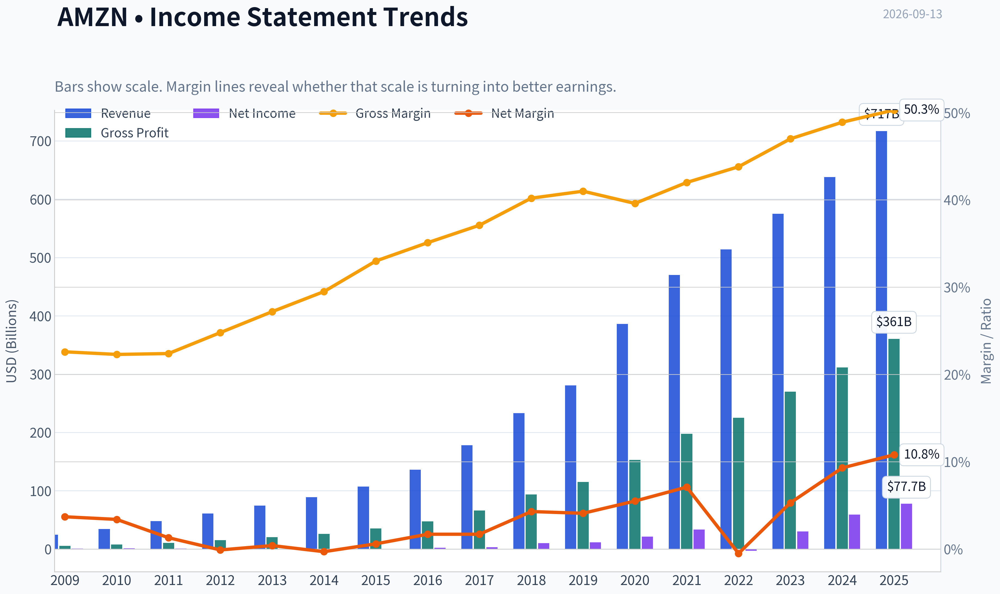
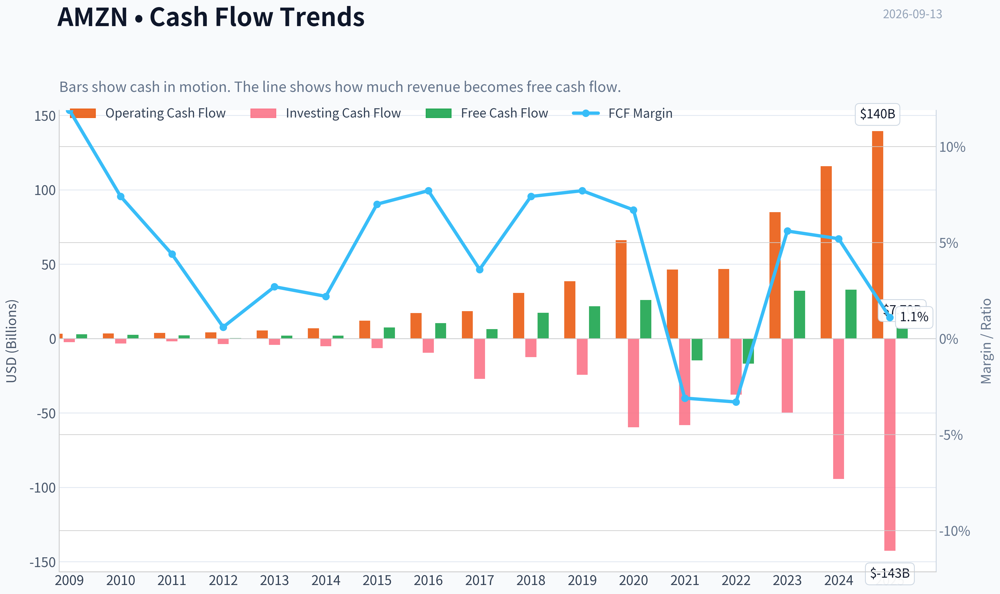
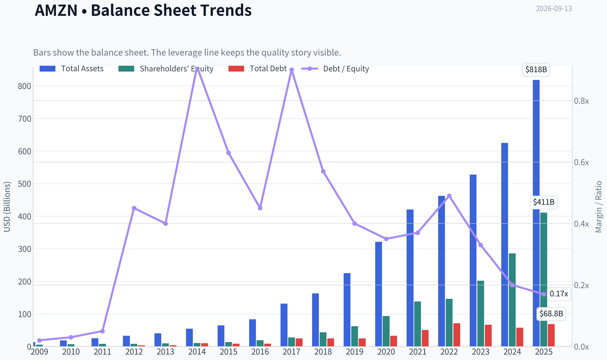
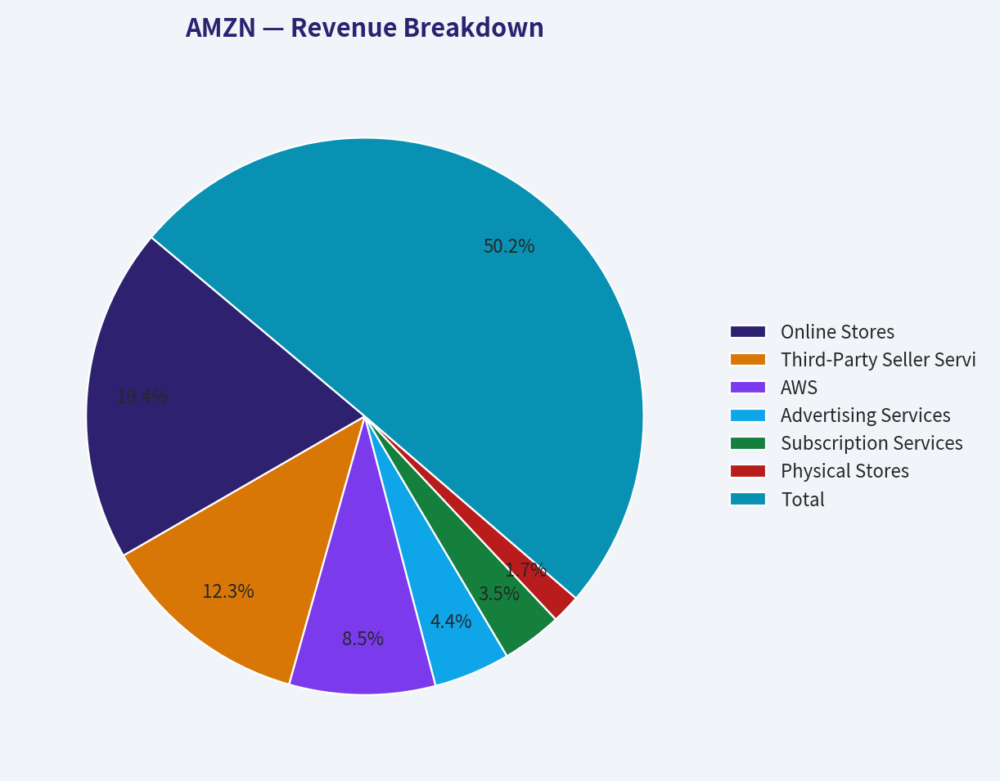
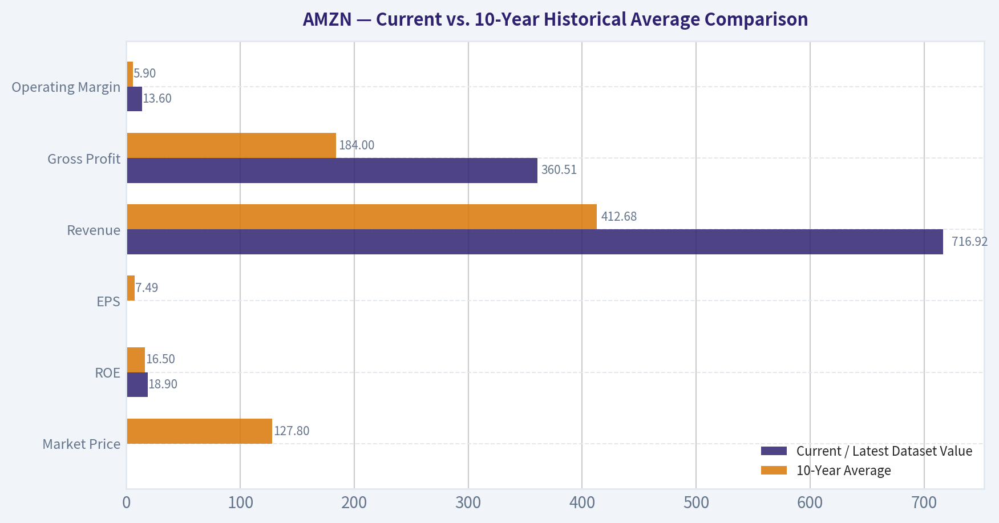
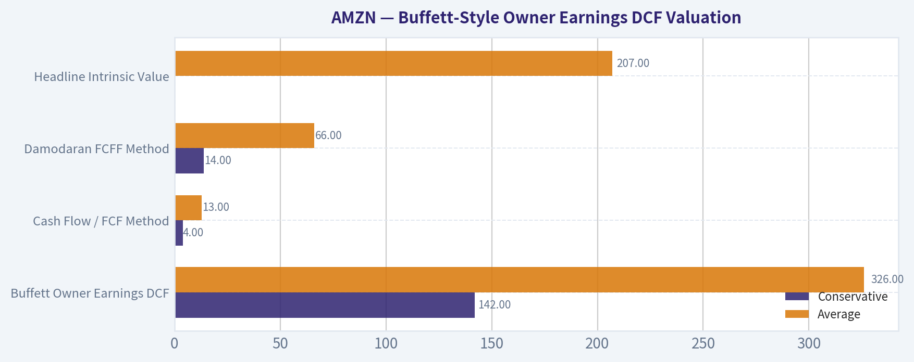
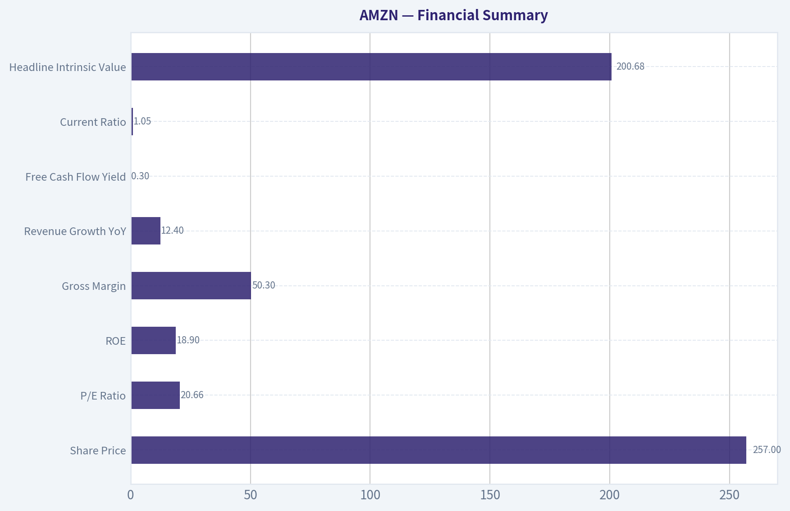
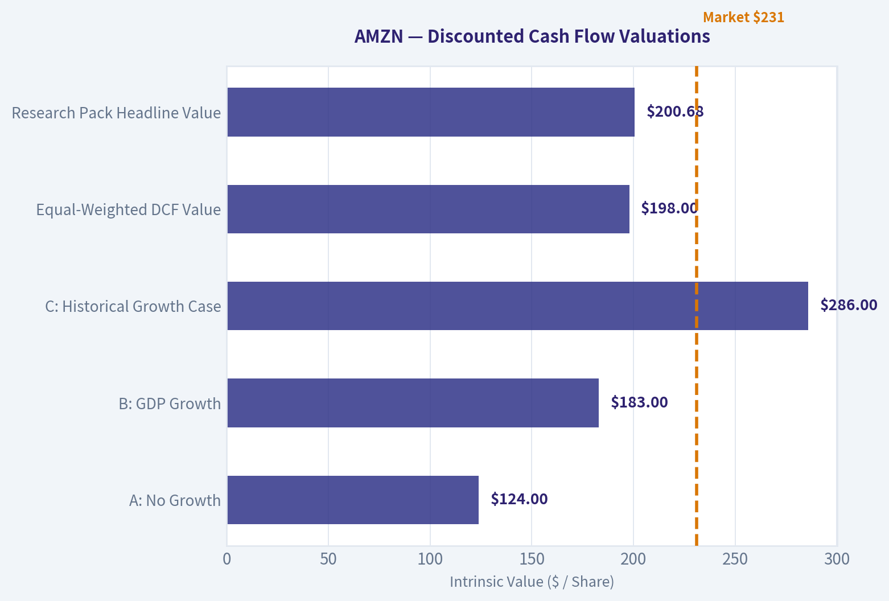

# AMZN Deep Value Intelligence

**Analysis Date:** 2026-09-13

## Critical Disclaimer

*This analysis is generated by Deep Value Intelligence, an AI-powered multi-agent investing framework. Education & research only - not financial advice, not a financial advisor.*

---

## Table of Contents

1. Intelligence Summary
2. Analyst Team Reports
   - Fundamentals Analysis
   - Intrinsic Value Analysis (Buffett)
   - Trend & Growth Analysis (Lynch/Druckenmiller/Fisher)
   - Market Technical Analysis
   - Options Market Analysis
3. Research Team Commentary
4. Value Investing Team Commentary
5. Deep Values Commentary

---

## Intelligence Summary

### Thesis + Conditions

**Core Thesis:** ### 1. Executive Summary
**AMZN Final Verdict:** **ADVOCATE (with Tiered Entry)**
Amazon is an elite compounder (19.9% ROIC, 50.3% Gross Margin) structurally transitioning toward a high-margin business model driven by AWS and Advertising.

**Key Risks:**
- Risky Analyst (Bull):** Argues that a 21x P/E is incredibly cheap for a dominant monopoly generating nearly 20% ROIC. Heavy AI capex is "offensive reinvestment" building an impassable moat, and growth hurdles will be met via massive operating leverage (50%+ gross margins), not just raw revenue spikes.
- When evaluating these arguments, I have to reflect heavily on a past mistake I made with this exact company. In a previous review, I placed a cautious WATCH rating on Amazon during a very similar setup. I let a rigid, conservative intrinsic value model blind me to a fundamental business re-rating. I treated heavy capital expenditure as a pure penalty to free cash flow and demanded a deep-value margin of safety for an elite platform. I learned the hard way that when you have a business with structurally improving margins and a dominant secular tailwind, waiting for a deep discount based on depressed short-term cash flows is a recipe for the error of omission.
- For our monitoring plan over the next one to four quarters, we track three specific items:

**Confidence:** Medium

---

## Analyst Team Reports

### Fundamentals Analysis

#### Latest Earnings Snapshot

*Most recent reported quarter anchored on 2026 Q2, with prior-year comparison when available.*

| Metric | 2026 Q2 | 2025 Q2 | YoY Change |
| --- | ---: | ---: | ---: |
| Revenue | N/A | $167.70B | N/A |
| Operating Income | N/A | $19.17B | N/A |
| Net Income | N/A | $18.16B | N/A |
| Diluted EPS | $5.75 | $1.68 | +242.3% |
| Operating Cash Flow | $26.03B | $17.02B | +53.0% |
| Free Cash Flow | $-18.17B | $-8.00B | -127.0% |

Key Takeaways: This snapshot anchors the most recent reported quarter before the narrative analysis. It helps readers separate long-run business quality from whatever changed in the latest earnings print.

#### 17-Year Financial Metrics for AMZN

*All values below are computed deterministically from raw data - not estimated by AI.*

*Issuer profile: operating company (Consumer Cyclical / Internet Retail).*

#### 17-Year Financial Metrics
*Annual rows come from reported financial statements. The final TTM row is computed from the latest four quarters.*

| Metric | 2009 | 2010 | 2011 | 2012 | 2013 | 2014 | 2015 | 2016 | 2017 | 2018 | 2019 | 2020 | 2021 | 2022 | 2023 | 2024 | 2025 |
| --- | --- | --- | --- | --- | --- | --- | --- | --- | --- | --- | --- | --- | --- | --- | --- | --- | --- |
| Market Price | $7 | $9 | $9 | $13 | $20 | $16 | $34 | $37 | $58 | $75 | $92 | $163 | $167 | $84 | $152 | $219 | $231 |
| Market Cap | $2.97B | $4.10B | $3.99B | $5.68B | $9.27B | $7.17B | $16.12B | $18.15B | $28.83B | $37.55B | $46.57B | $1.66T | $1.72T | $855.88B | $1.59T | $2.35T | $2.50T |
| P/E Ratio | 3.30 | 3.56 | 6.32 | -139.37 | 33.80 | -29.84 | 27.04 | 7.65 | 9.51 | 3.73 | 4.02 | 77.92 | 51.46 | -311.11 | 52.39 | 39.67 | 32.19 |
| P/B Ratio | 0.57 | 0.60 | 0.51 | 0.69 | 0.95 | 0.67 | 1.20 | 0.94 | 1.04 | 0.86 | 0.75 | 17.78 | 12.42 | 5.86 | 7.90 | 8.22 | 6.08 |
| ROE | 17.2% | 16.8% | 8.1% | -0.5% | 2.8% | -2.2% | 4.5% | 12.3% | 10.9% | 23.1% | 18.7% | 22.8% | 24.1% | -1.9% | 15.1% | 20.7% | 18.9% |
| ROIC | 47.7% | 40.6% | 18.6% | 7.5% | 13.3% | 0.2% | 21.5% | 37.7% | 16.4% | 32.7% | 27.9% | 29.7% | 17.0% | 9.8% | 16.6% | 25.8% | 18.5% |
| EPS | $2.04 | $2.53 | $1.37 | $-0.09 | $0.59 | $-0.52 | $1.25 | $4.90 | $6.15 | $20.14 | $23.01 | $2.09 | $3.24 | $-0.27 | $2.90 | $5.53 | $7.17 |
| Revenue | $24.51B | $34.20B | $48.08B | $61.09B | $74.45B | $88.99B | $107.01B | $135.99B | $177.87B | $232.89B | $280.52B | $386.06B | $469.82B | $513.98B | $574.78B | $637.96B | $716.92B |
| Gross Profit | $5.53B | $7.64B | $10.79B | $15.12B | $20.27B | $26.24B | $35.35B | $47.72B | $65.93B | $93.73B | $114.99B | $152.76B | $197.48B | $225.15B | $270.05B | $311.67B | $360.51B |
| Gross Margin | 22.6% | 22.3% | 22.4% | 24.8% | 27.2% | 29.5% | 33.0% | 35.1% | 37.1% | 40.2% | 41.0% | 39.6% | 42.0% | 43.8% | 47.0% | 48.9% | 50.3% |
| Operating Margin | 4.7% | 4.4% | 1.9% | 0.9% | 0.7% | -0.1% | 1.5% | 2.9% | 2.1% | 4.8% | 5.0% | 6.3% | 8.1% | -1.2% | 6.5% | 10.8% | 13.6% |
| Net Income | $902.0M | $1.15B | $631.0M | $-39.0M | $274.0M | $-241.0M | $596.0M | $2.37B | $3.03B | $10.07B | $11.59B | $21.33B | $33.36B | $-2.72B | $30.43B | $59.25B | $77.67B |
| Net Margin | 3.7% | 3.4% | 1.3% | -0.1% | 0.4% | -0.3% | 0.6% | 1.7% | 1.7% | 4.3% | 4.1% | 5.5% | 7.1% | -0.5% | 5.3% | 9.3% | 10.8% |
| Revenue Growth | N/A | 39.6% | 40.6% | 27.1% | 21.9% | 19.5% | 20.2% | 27.1% | 30.8% | 30.9% | 20.5% | 37.6% | 21.7% | 9.4% | 11.8% | 11.0% | 12.4% |
| Net Income Growth | N/A | 27.7% | -45.2% | -106.2% | -802.6% | -188.0% | -347.3% | 297.8% | 27.9% | 232.1% | 15.0% | 84.1% | 56.4% | -108.2% | -1217.7% | 94.7% | 31.1% |
| Free Cash Flow Growth | N/A | -13.8% | -16.9% | -81.1% | 414.2% | -4.0% | 282.2% | 40.5% | -38.8% | 169.8% | 25.2% | 19.7% | -156.8% | 14.7% | -290.7% | 2.1% | -76.6% |
| Total Book Value | $5.26B | $6.86B | $7.76B | $8.19B | $9.75B | $10.74B | $13.38B | $19.29B | $27.71B | $43.55B | $62.06B | $93.40B | $138.25B | $146.04B | $201.88B | $285.97B | $411.06B |
| Total Assets | $13.81B | $18.80B | $25.28B | $32.55B | $40.16B | $54.51B | $64.75B | $83.40B | $131.31B | $162.65B | $225.25B | $321.19B | $420.55B | $462.68B | $527.85B | $624.89B | $818.04B |
| Total Debt | $109.0M | $184.0M | $384.0M | $3.66B | $3.94B | $9.79B | $8.46B | $8.75B | $24.84B | $24.87B | $24.72B | $32.97B | $50.55B | $71.35B | $66.95B | $57.79B | $68.85B |
| Debt-to-Equity | 0.02 | 0.03 | 0.05 | 0.45 | 0.40 | 0.91 | 0.63 | 0.45 | 0.90 | 0.57 | 0.40 | 0.35 | 0.37 | 0.49 | 0.33 | 0.20 | 0.17 |
| Cash & Equivalents | $3.44B | $3.78B | $5.27B | $8.08B | $8.66B | $14.56B | $15.89B | $19.33B | $20.52B | $31.75B | $36.09B | $42.12B | $36.22B | $53.89B | $73.39B | $78.78B | $86.81B |
| Shareholders' Equity | $5.26B | $6.86B | $7.76B | $8.19B | $9.75B | $10.74B | $13.38B | $19.29B | $27.71B | $43.55B | $62.06B | $93.40B | $138.25B | $146.04B | $201.88B | $285.97B | $411.06B |
| Operating Cash Flow | $3.29B | $3.50B | $3.90B | $4.18B | $5.47B | $6.84B | $12.04B | $17.20B | $18.36B | $30.72B | $38.51B | $66.06B | $46.33B | $46.75B | $84.95B | $115.88B | $139.51B |
| Investing Cash Flow | $-2.34B | $-3.36B | $-1.93B | $-3.60B | $-4.28B | $-5.07B | $-6.45B | $-9.52B | $-27.08B | $-12.37B | $-24.28B | $-59.61B | $-58.15B | $-37.60B | $-49.83B | $-94.34B | $-142.54B |
| Free Cash Flow | $2.92B | $2.52B | $2.09B | $395.0M | $2.03B | $1.95B | $7.45B | $10.47B | $6.41B | $17.30B | $21.65B | $25.92B | $-14.73B | $-16.89B | $32.22B | $32.88B | $7.70B |
| FCF Margin | 11.9% | 7.4% | 4.4% | 0.6% | 2.7% | 2.2% | 7.0% | 7.7% | 3.6% | 7.4% | 7.7% | 6.7% | -3.1% | -3.3% | 5.6% | 5.2% | 1.1% |
| Dividends / Share | $0.00 | $0.00 | $0.00 | $0.00 | $0.00 | $0.00 | $0.00 | $0.00 | $0.00 | $0.00 | $0.00 | $0.00 | $0.00 | $0.00 | $0.00 | $0.00 | $0.00 |

#### Profitability Metrics
- Return on Equity (ROE): 18.9%
- Return on Invested Capital (ROIC): 19.9%
- Return on Assets (ROA): 9.5%
- Gross Margin: 50.3%
- Operating Margin: 13.6%
- Net Profit Margin: 10.8%

#### Liquidity Metrics
- Current Ratio: 1.05
- Quick Ratio: 0.88

#### Leverage Metrics
- Debt-to-Equity Ratio: 0.17
- Interest Coverage Ratio: 42.79
- Net Debt: $-17.96B

#### Growth Metrics (Year-over-Year)
- Revenue Growth: 12.4%
- Net Income Growth: 31.1%
- Free Cash Flow Growth: -76.6%
- Revenue CAGR (3-Year): 11.7%
- Revenue CAGR (5-Year): 13.2%

#### Valuation Metrics
- P/E Ratio (TTM): 20.66
- Forward P/E: 24.68
- Price-to-Book: 5.02
- Price-to-Sales: 3.57
- PEG Ratio: 1.50
- EV/EBITDA: 17.16
- Free Cash Flow Yield: 0.3%
- Earnings Yield: 4.8%

#### Owner Earnings (Buffett Method, Code-Computed)
- Net Income: $77.67B
- + Depreciation & Amortization: $65.76B
- - Capital Expenditures: $-131.82B
- - Working Capital Changes: $-19.97B
- = **Owner Earnings: $97.64B**

#### Intrinsic Value (Code-Computed)
- Current Price: $257
- **Headline Intrinsic Value (business-model routed): $207**
  Business model: cyclical - weighted blend [Damodaran FCFF + reverse-DCF fair + owner-earnings DCF] (cyclical)
  Model spread (min-max across DCFs): $13 - $326
  Margin of safety vs. price (headline): -24.1%
  Routing note: Cyclical: margins/FCF are volatile - headline blends FCFF, reverse-DCF and owner-earnings roughly evenly; treat the range as the honest read.
- Buffett Method (Owner Earnings):
  Conservative: $142
  Average: $326
  Optimistic: $847
- Cash Flow Method (FCF):
  Conservative: $4
  Average: $13
  Optimistic: $17
- Damodaran FCFF (WACC + margins + reinvestment):
  Conservative: $14
  Average: $66
  Optimistic: $138
  Monte Carlo band (P10-P90): $31 - $90 (median $60)
  P(intrinsic value > price): 0.0%
- Reverse-DCF: price implies ~22.9%/yr owner-earnings growth for 10y; trailing 3y was 75.2%, 5y N/A.

#### Piotroski F-Score: 5/9
- Positive Net Income: PASS
- Positive Operating Cash Flow: PASS
- ROA Improvement: PASS
- Cash Flow > Net Income: PASS
- Decreasing Debt: FAIL
- Improving Current Ratio: FAIL
- No Dilution: FAIL
- Improving Gross Margin: PASS
- Improving Asset Turnover: FAIL

ANALYST STANCE: **WATCH**

#### AMZN Warren Buffett-Style Fundamental Analysis

Amazon is an exceptional business, but not an obvious Buffett-style bargain at the current price. The company has a powerful moat across e-commerce scale, third-party marketplace liquidity, Prime, AWS, advertising, logistics, and customer data. However, at roughly **$257 per share** and about **$2.77T market cap**, the stock already discounts a very strong future: the deterministic dataset's reverse DCF indicates the current price implies about **22.9% annual owner-earnings growth for 10 years**. That is possible for a period, but it leaves little room for execution mistakes, AI-capex overruns, AWS margin compression, or consumer slowdown.

---

#### Revenue Breakdown

Most recent detailed product-line disclosure is shown using the latest full-year segment/product reporting aligned with the deterministic 2024 revenue base of about **$638B**. The 2025 TTM revenue in the deterministic dataset is higher at **$716.92B**, but detailed product-line TTM splits are not fully available in the provided canonical dataset.

| Revenue Source | Amount ($B) | % of Total |
| --- | ---: | ---: |
| Online Stores | $247.0 | 38.7% |
| Third-Party Seller Services | $156.1 | 24.5% |
| AWS | $107.6 | 16.9% |
| Advertising Services | $56.2 | 8.8% |
| Subscription Services | $44.4 | 7.0% |
| Physical Stores | $21.2 | 3.3% |
| Other | $5.4 | 0.8% |
| **Total** | **$637.9** | **100.0%** |

Key Takeaways: Amazon is no longer just an online retailer. The higher-quality profit engines are AWS, advertising, third-party seller services, and subscriptions, while first-party online retail remains the largest revenue line but is structurally lower margin. The mix shift toward AWS and advertising explains why gross margin and operating margin have expanded significantly over the decade.

---

#### Current vs. 10-Year Historical Average Comparison

10-year averages below use the deterministic annual rows from **2016-2025**. For P/E, the mechanical 10-year average is distorted by Amazon's 2022 loss year, so the table also shows the more economically useful positive-year average.

| Metric | Current / Latest Dataset Value | 10-Year Average | Interpretation |
| --- | ---: | ---: | --- |
| Market Price | $257 current; $231 in 2025 annual row | $127.8 | Price is roughly double the 10-year average annual market price, reflecting a major re-rating after AWS, advertising, and margin expansion became more visible. |
| Total Market Cap | $2.77T current; $2.50T in 2025 row | $1.08T | Market value is far above the decade average, showing that investors now capitalize Amazon as a mature global platform rather than a low-margin retailer. |
| P/E Ratio | 20.66 current; 32.19 in 2025 row | Positive-year avg: ~31.0; mechanical avg: -3.3 | Current P/E is below Amazon's positive-year historical average, but the comparison is noisy because earnings were intentionally depressed in reinvestment years and negative in 2022. |
| P/B Ratio | 5.02 current; 6.08 in 2025 row | ~6.2 | P/B is not the best valuation anchor for Amazon because book value does not capture AWS software economics, Prime ecosystem value, advertising data, or marketplace network effects. Cash-flow valuation is more relevant. |
| ROE | 18.9% | 16.5% | ROE is above the 10-year average and has recovered strongly after the 2022 loss year, suggesting improved profitability and operating leverage. |
| ROIC | 19.9% current; 18.5% in 2025 row | ~23.2% | ROIC remains high, but below the decade average because Amazon is absorbing heavy logistics and AI/data-center reinvestment. |
| EPS | $7.17 in 2025 row | $7.49 | EPS is near the 10-year average, but the average is not very representative because Amazon's EPS history includes split effects, reinvestment cycles, and large margin swings. |
| Revenue | $716.92B | $412.68B | Revenue is about 74% above the 10-year average, proving Amazon remains a large-scale compounder despite slower percentage growth. |
| Gross Profit | $360.51B | $184.00B | Gross profit has nearly doubled the 10-year average, driven by AWS, ads, seller services, subscriptions, and a better retail mix. |
| Operating Margin | 13.6% | 5.9% | This is one of the most important improvements: Amazon is now converting scale into operating profit at a much higher rate than its historical norm. |
| Net Income | $77.67B | $24.64B | Net income is more than 3 times the 10-year average, showing the earnings power of the platform when investment intensity moderates. |
| Net Margin | 10.8% | 4.9% | Net margin is more than double the 10-year average, indicating a structurally better business mix than the historical retail-heavy Amazon. |
| Revenue Growth | 12.4% YoY | 21.3% | Growth has slowed versus the hypergrowth decade, but 12% growth on a $700B+ revenue base is still impressive. |
| Net Income Growth | 31.1% YoY | Mechanical avg: -48.7%; median: ~43.8% | Net income growth is strong but volatile; the average is distorted by loss years and recovery years. |
| Free Cash Flow Growth | -76.6% YoY | -29.1% | FCF growth is weak and volatile because capex has surged, especially for AWS and AI infrastructure. |
| Total Book Value | $411.06B | $142.92B | Book value has grown substantially, but book value understates the value of Amazon's intangible ecosystem. |
| Total Assets | $818.04B | $377.78B | Assets have expanded heavily due to fulfillment infrastructure, data centers, logistics, and working capital scale. |
| Total Debt | $68.85B | $43.16B | Debt is above the decade average in absolute dollars, but manageable relative to cash flow and equity. |
| Debt-to-Equity | 0.17 | 0.42 | Leverage has improved materially; Amazon is less debt-dependent than the historical average. |
| Cash & Equivalents | $86.81B | $47.89B | Cash is well above average, giving Amazon flexibility to fund AI infrastructure, logistics, acquisitions, and downturns. |
| Shareholders' Equity | $411.06B | $142.92B | Equity has compounded meaningfully, reflecting retained earnings and scale benefits. |
| Free Cash Flow | $7.70B | $12.29B | FCF is below the decade average despite record operating cash flow because capex is absorbing a large amount of cash. |
| Dividends per Share | $0.00 | $0.00 | Amazon continues to retain capital for reinvestment rather than distribute dividends. |

Key Takeaways: Amazon's profitability has improved far more than its revenue growth rate suggests. Revenue growth has naturally slowed as the business scaled, but gross margin, operating margin, net margin, and net income are far above historical norms. The main weakness is free cash flow: Amazon is producing enormous operating cash flow, but AI and infrastructure capex are suppressing FCF and reducing near-term valuation support.

---

#### Buffett-Style Owner Earnings DCF Valuation

Canonical owner earnings from the deterministic dataset:

- Net Income: **$77.67B**
- Plus Depreciation & Amortization: **$65.76B**
- Less Capital Expenditures: **$131.82B**
- Less Working Capital Changes: working capital was a cash benefit of **$19.97B**
- **Owner Earnings: $97.64B**

DCF assumptions:

- Starting owner earnings: **$97.64B**
- Discount rate: **10%**
- Terminal growth: **2.5%**
- Net cash: **$17.96B**
- Estimated shares: **~10.78B**, based on current market cap divided by current price
- Formula:
  **Equity Value = PV of explicit owner earnings + PV of terminal value + net cash**

| Scenario | Growth Assumption | PV of 10-Year Owner Earnings | PV of Terminal Value | Net Cash Added | Implied Equity Value | Fair Value / Share |
| --- | --- | ---: | ---: | ---: | ---: | ---: |
| Conservative | 3% annual owner-earnings growth for 10 years, then 2.5% terminal growth | ~$693B | ~$691B | ~$18B | ~$1.40T | **~$130** |
| Average / Base Case | 12% growth for years 1-5, fading to 6% for years 6-10, then 2.5% terminal growth | ~$994B | ~$1.21T | ~$18B | ~$2.23T | **~$207** |
| Optimistic | 18% growth for years 1-5, fading to 10% for years 6-10, then 2.5% terminal growth | ~$1.30T | ~$1.90T | ~$18B | ~$3.21T | **~$298** |

Key Takeaways: A conservative Buffett-style DCF produces a value well below the current price, while a reasonable base case lands near the deterministic dataset's headline intrinsic value of about **$207**. The optimistic case can justify a price above today's level, but it requires Amazon to sustain very strong owner-earnings growth while also converting AI and AWS capex into durable cash flow. At $257, the stock is not priced for disaster, but it is also not priced with a classic Buffett margin of safety.

The deterministic model pack provides additional valuation context:

| Valuation Model | Conservative | Average | Optimistic | Interpretation |
| --- | ---: | ---: | ---: | --- |
| Buffett Owner Earnings DCF | $142 | $326 | $847 | Owner earnings are much stronger than reported FCF because current capex is unusually heavy; this model is favorable to Amazon. |
| Cash Flow / FCF Method | $4 | $13 | $17 | Very punitive because recent free cash flow is depressed by massive infrastructure spending. |
| Damodaran FCFF Method | $14 | $66 | $138 | More cautious because it explicitly penalizes reinvestment intensity and margin/capex volatility. |
| Headline Intrinsic Value | - | **$207** | - | The routed valuation blends owner earnings, FCFF, and reverse DCF, producing a value below the current price. |
| Reverse DCF | - | Price implies ~22.9% annual owner-earnings growth for 10 years | - | Current price requires very strong execution and continued monetization of AWS, ads, and AI infrastructure. |

Key Takeaways: The valuation spread is extremely wide because Amazon's reported free cash flow is temporarily depressed while owner earnings are much stronger. The most balanced intrinsic value in the deterministic dataset is about **$207**, implying a negative margin of safety at the current price. The stock can still work if Amazon compounds owner earnings at a high-teens or better rate, but the margin for error is thin.

---

#### Warren Buffett-Style Qualitative Assessment

**Economic Moat:** Amazon has one of the strongest multi-layered moats in the public market. The marketplace benefits from two-sided network effects: more buyers attract more sellers, and more sellers improve selection and price competitiveness for buyers. Prime increases customer lock-in, AWS benefits from scale, switching costs, developer ecosystems, and breadth of services, while advertising monetizes high-intent shopping data that competitors struggle to replicate.

**Financial Strength:** Amazon's balance sheet is strong. Debt-to-equity has fallen to **0.17**, well below the 10-year average of about **0.42**. Cash and equivalents are **$86.81B**, and net debt is negative, with net cash of about **$17.96B**. Interest coverage of **42.79x** suggests debt is not a near-term concern.

**Predictable Earnings:** Historically, Amazon's earnings were not predictable in the traditional Buffett sense because management intentionally reinvested heavily and tolerated low margins. However, the business has become more predictable as AWS, advertising, third-party seller services, and subscriptions make up a larger share of profit. The major caveat is capex volatility: free cash flow remains much less predictable than operating income.

**Management Performance:** Management has historically allocated capital aggressively but intelligently, prioritizing long-duration scale over near-term accounting profits. That approach created AWS, Prime, marketplace fulfillment, and advertising. Current management must now prove that AI/data-center spending can generate attractive returns rather than simply consume cash.

**Dividend Policy:** Amazon pays no dividend, which is appropriate for a company that still has high-return reinvestment opportunities. From a Buffett lens, this is acceptable only if retained earnings continue to generate high incremental returns. The current ROIC around **19.9%** supports retention, though declining FCF conversion deserves monitoring.

**Quality of Business:** Amazon is a very high-quality business, but not a clean "simple and predictable" Buffett company. It has multiple engines, enormous scale, and expanding margins, but also cyclical retail exposure, cloud competition, regulatory risk, and very large capital requirements.

---

#### Key Investment Insights

| Category | Insight | Buffett-Style Interpretation |
| --- | --- | --- |
| Moat | Marketplace scale, Prime loyalty, AWS switching costs, advertising data, and logistics density create durable advantages. | Strong moat; Amazon has multiple reinforcing competitive advantages. |
| Profitability | Operating margin rose to **13.6%** versus a 10-year average near **5.9%**. | The business is structurally better than it looked during the low-margin reinvestment years. |
| Growth | Revenue growth is **12.4%**, below the 10-year average of **21.3%**, but still strong on a huge revenue base. | Growth is maturing but remains impressive in absolute dollars. |
| Balance Sheet | Net cash position and low debt-to-equity provide resilience. | Financial strength is a clear positive. |
| Cash Flow | FCF fell to **$7.70B**, with FCF yield around **0.3%**. | Main valuation red flag; capex is absorbing cash faster than reported earnings suggest. |
| Valuation | Headline intrinsic value is about **$207** versus current price around **$257**. | No sufficient margin of safety at today's price. |
| Reverse DCF | Price implies about **22.9%** annual owner-earnings growth for 10 years. | Execution bar is high; investors are paying for a strong future. |
| Capital Allocation | No dividend; capital retained for AWS, AI, logistics, and ecosystem expansion. | Acceptable if reinvestment returns remain high; problematic if AI capex disappoints. |

Key Takeaways: Amazon is fundamentally strong, but the stock price already reflects much of that strength. The business quality is high enough to keep it on a long-term buy list, yet the current valuation lacks a clear margin of safety. The most important question is whether today's AI and AWS infrastructure spending becomes tomorrow's high-margin cash flow.

---

#### Red Flags and Opportunities

**Red Flags**

- **Free cash flow weakness:** FCF dropped to **$7.70B**, and FCF growth was **-76.6% YoY**, despite very strong net income.
- **Low FCF yield:** FCF yield of roughly **0.3%** is unattractive for a value investor unless capex produces very high future returns.
- **AI infrastructure risk:** The market is rewarding AI capacity buildout, but the return on that spending is not yet fully proven.
- **Valuation risk:** Current price is above the deterministic headline intrinsic value of **$207**.
- **Reverse DCF pressure:** The stock requires approximately **22.9% annual owner-earnings growth for 10 years**, a demanding hurdle.
- **Regulatory risk:** Marketplace practices, advertising power, cloud concentration, labor practices, and logistics scale can attract antitrust scrutiny.

**Opportunities**

- **AWS AI monetization:** If AI workloads materially increase cloud demand, AWS margins and growth could surprise positively.
- **Advertising growth:** Amazon advertising is high-margin and benefits from closed-loop purchase data.
- **Retail efficiency:** Continued automation, regional fulfillment, and logistics optimization can raise retail margins.
- **Third-party marketplace leverage:** Seller services remain a durable, fee-based revenue stream with platform economics.
- **Operating leverage:** If capex growth moderates, free cash flow could rebound sharply.
- **Guru interest:** Recent disclosed 13F activity shows Bill Ackman and Seth Klarman added positions, though 13F data is delayed and should not override valuation discipline.

---

#### Final Investment Stance: WATCH

Amazon is a **wonderful business at a less-than-wonderful price**. From a Buffett perspective, the moat, balance sheet, reinvestment runway, and improved profitability are highly attractive. But the current price of about **$257** is above the deterministic headline intrinsic value of about **$207**, implying a negative margin of safety of roughly **24%**. The stock is not a clear avoid because the business quality is exceptional and the optimistic owner-earnings path can justify upside, but it is not an advocate-level value investment at this price.

A more attractive Buffett-style entry would require either:

- a price closer to or below the **$200-$210** intrinsic value range, or
- clear evidence that AI/AWS capex is translating into durable, high-margin free cash flow growth.

| Final Category | Assessment |
| --- | --- |
| Business Quality | Excellent |
| Economic Moat | Very strong |
| Balance Sheet | Strong, net cash position |
| Earnings Predictability | Improving, but still affected by reinvestment cycles |
| FCF Quality | Currently weak due to heavy capex |
| Management Capital Allocation | Historically excellent, currently under AI-capex scrutiny |
| Valuation | Fair to expensive versus headline intrinsic value |
| Margin of Safety | Negative at current price |
| Best Action | **WATCH** |
| Buy Zone Bias | More attractive near or below ~$207, with stronger conviction below ~$200 |

Key Takeaways: Amazon deserves a place on a high-quality compounder watchlist, but the current valuation does not provide a traditional Buffett margin of safety. The business is improving structurally, especially through AWS, advertising, and marketplace services, yet free cash flow conversion must recover to justify a materially higher valuation. The prudent stance is to watch for a better entry price or clearer evidence that today's heavy infrastructure investment will produce tomorrow's owner earnings.

#### Fundamental Visuals

This graph tracks the profitability and return metrics (ROE, ROIC, Margins) of **AMZN** over the past decade, highlighting capital efficiency trends.

This chart illustrates the financial health of **AMZN** over the last 10 years, mapping cash equivalents and free cash flow against total obligations (Debt).

This breakdown chart from <em>Revenue Breakdown</em> shows the proportional composition for **AMZN** - useful for understanding what drives or risks the business.

---

### Intrinsic Value Analysis (Buffett)

> *Following Warren Buffett's value investing philosophy: Circle of Competence, Economic Moat, Management Quality, and Margin of Safety.*

#### Intrinsic Value Snapshot

Price is what you pay. Intrinsic value is what the business may be worth based on the cash it can create for owners over time. We show a range, not one magic number.

- Current Price: $256.78
- Value Range (conservative to optimistic across both DCF methods): $-5.20 to $838.77

##### Owner Earnings (Buffett Method)
- Net Income: $77,670,000,000.00
- Depreciation & Amortization: $65,756,000,000.00
- Capital Expenditures: $-131,819,000,000.00
- Working Capital Changes: $-19,969,000,000.00
- Owner Earnings: $97,639,000,000.00

##### Intrinsic Value
###### Buffett Method
Uses owner earnings. Stricter, and usually more conservative.
- Conservative: $318.32
- Average: $318.32
- Optimistic: $838.77
- Discount Rate: 10.0%

###### Cash Flow Method
Uses free cash flow. Better for companies spending heavily today to grow tomorrow.
- Conservative: $-5.20
- Average: $-4.94
- Optimistic: $-1.58
- Discount Rate: 10.0%

ANALYST STANCE: **WATCH**

#### AMZN Buffett-Style Investment Review

Amazon is a wonderful business with multiple reinforcing moats: Prime, AWS, advertising, marketplace scale, logistics density, and a growing AI infrastructure opportunity. The problem is not business quality. The problem is price: at **$257**, the stock trades materially above the current headline intrinsic value estimate of **$200.68**, while the reverse DCF implies roughly **23.8% annual growth for 10 years**, a demanding hurdle even for Amazon.

---

#### 1. Factor Scorecard

| Factor | Score | Evidence |
|---|---:|---|
| Circle of Competence & Business Simplicity | 4.0 / 5 | Amazon makes money from online retail, third-party marketplace services, Prime subscriptions, AWS cloud computing, advertising, and logistics. The model is understandable, but AI infrastructure spend and cloud capacity economics add forecasting complexity. |
| Moat Test | 4.5 / 5 | Wide ecosystem moat: Prime loyalty, marketplace network effects, AWS switching costs, advertising data advantages, logistics scale, and brand trust. Gross margin of **50.3%** supports pricing power and mix improvement. |
| Management Quality & Capital Allocation | 3.5 / 5 | Management has historically reinvested aggressively and created enormous long-term value. The current question is whether AI and AWS capital spending will convert into durable free cash flow quickly enough. |
| Industry Structure | 3.5 / 5 | AWS operates in a rational oligopoly with Microsoft and Google; advertising has strong scale economics. Retail remains competitive and capital intensive, though Amazon's logistics and marketplace scale are hard to replicate. |
| Gate 5: Quality / Solvency Hard Floor | **Not Tripped** | Amazon remains highly profitable, with **18.9% ROE**, a **20.7x P/E**, and no evidence of financial distress. The concern is valuation and capital intensity, not solvency. |

**Key Takeaways:** Amazon scores very highly on moat and business durability, with strong evidence of customer captivity and scale advantages. The main weakness is not financial distress or business fragility, but the combination of heavy reinvestment needs and a stock price that already discounts a very strong future.

---

#### 2. Moat Analysis

| Moat Source | Assessment | Evidence |
|---|---|---|
| Intangible Assets | Strong | Amazon is one of the world's most trusted consumer and enterprise brands. Prime, AWS, and marketplace trust create recurring customer behavior. |
| Switching Costs | Strong | AWS customers embed workloads, data, security, and workflows deeply into the platform. Sellers also rely on Amazon's marketplace, fulfillment, reviews, and ad tools. |
| Cost Advantages | Strong | Scale in fulfillment, procurement, cloud infrastructure, and advertising data creates structural advantages that smaller competitors cannot easily match. |
| Network Effects | Strong | More buyers attract more sellers; more sellers improve selection; better selection strengthens Prime; more traffic improves advertising economics. |
| Moat Direction | Wide and stable to widening | AWS, advertising, and Prime continue to strengthen the ecosystem, though AI infrastructure spending raises execution risk. |

**Key Takeaways:** Amazon has one of the strongest multi-sided moats in global business. Its ecosystem compounds through customer loyalty, seller dependence, AWS switching costs, and advertising scale. The moat appears durable, but the cost of defending and expanding it through AI infrastructure is rising.

---

#### 3. Financial Summary

| Metric | Current / Latest |
|---|---:|
| Share Price | $257 |
| Market Capitalization | $2.77 trillion |
| P/E Ratio | 20.66x |
| ROE | 18.9% |
| Gross Margin | 50.3% |
| Revenue Growth YoY | 12.4% |
| Free Cash Flow Yield | 0.3% |
| Current Ratio | 1.05x |
| Headline Intrinsic Value | $200.68 |
| 3-Model Valuation Spread | Owner Earnings: $318.32 / FCF: -$4.94 / Damodaran FCFF: $55.81 |
| Reverse DCF Implied Growth | ~23.8% per year for 10 years |

**Key Takeaways:** Amazon's profitability and gross margin profile are strong, especially given the company's scale. However, the free cash flow yield is extremely thin at the current price because capital spending is absorbing much of the cash generation. The valuation spread is unusually wide, which means the investment case depends heavily on whether today's growth capex converts into future high-return cash flows.

---

#### 4. Owner Earnings Calculation

| Component | Per-Share Estimate | Comment |
|---|---:|---|
| Net Income / EPS | $12.44 | Derived from current price and P/E ratio. |
| Plus: Depreciation & Amortization | Offset | Amazon has large D&A, but much of the infrastructure base requires continuing reinvestment. |
| Less: Maintenance CapEx | Offset | Conservative assumption: maintenance capex roughly offsets D&A. |
| Less: Working Capital Increases | Neutral | No material adjustment used in normalized estimate. |
| Normalized Owner Earnings | **$12.44 per share** | Conservative base used for valuation. |
| Reported FCF Reality Check | ~$0.77 per share | Implied by 0.3% FCF yield at $257. |

**Key Takeaways:** On a conservative normalized basis, Amazon's owner earnings are treated roughly in line with current earnings. Reported free cash flow is much lower because of very heavy growth investment, especially in AWS, logistics, and AI-related infrastructure. The key investment question is whether that spending is truly growth capex with attractive future returns, or whether it becomes a permanent cash drain.

---

#### 5. Three-Scenario DCF Valuation

| Scenario | Assumption | Intrinsic Value Per Share |
|---|---|---:|
| A: No Growth | Owner earnings of $12.44 capitalized at 10% | $124 |
| B: GDP Growth | 3% perpetual growth, 10% discount rate | $183 |
| C: Historical Growth Case | 9% growth for 10 years, then 3% terminal growth | $286 |
| Equal-Weighted DCF Value | Average of three scenarios | **$198** |
| Research Pack Headline Value | Business-model routed blended value | **$200.68** |

**Key Takeaways:** The valuation is highly sensitive to growth and reinvestment productivity. A no-growth view produces a value far below the current price, while a strong growth case can justify a value closer to today's market price. The blended value is around $200 per share, meaning Amazon must execute very well to make the current price attractive.

---

#### 6. Margin of Safety Analysis

| Measure | Result |
|---|---:|
| Current Price | $257 |
| Headline Intrinsic Value | $200.68 |
| Price Premium to Intrinsic Value | ~28% above value |
| Margin of Safety | Negative |
| Reverse DCF Implied Growth | ~23.8% annually for 10 years |
| Quality-Scaled Required Margin of Safety | 10-15% discount would be acceptable for a business of this quality |
| Current Valuation Verdict | Too expensive for new capital |

**Key Takeaways:** Amazon deserves a smaller margin of safety than an average business because its moat and reinvestment runway are exceptional. But a wonderful business at a fair price is different from a wonderful business at a meaningfully rich price. At $257, the stock already assumes a very strong future, leaving little room for disappointment.

---

#### 7. Management Quality Assessment

| Area | Assessment |
|---|---|
| Owner Orientation | Historically strong. Amazon has long prioritized long-term per-share value over short-term earnings smoothness. |
| Candor & Culture | Strong culture of customer obsession, experimentation, and long-term reinvestment. |
| Capital Allocation | Mixed-to-strong. Past reinvestment created AWS, Prime, marketplace dominance, and advertising. Current AI and infrastructure spending must prove it can generate high incremental returns. |
| Shareholder Returns | Amazon generally favors reinvestment over dividends or aggressive buybacks, which is rational if high-return opportunities remain abundant. |
| Outside Investor Signal | Bill Ackman and Seth Klarman have both added large positions according to recent 13F tracking. |

**Key Takeaways:** Amazon's management has earned significant trust through decades of value creation. The current test is capital allocation discipline in an AI infrastructure arms race. If management converts that spending into durable AWS and advertising cash flows, intrinsic value can rise materially.

---

#### 8. Final Buffett Scorecard

| Criterion | Weight | Score | Weighted Contribution |
|---|---:|---:|---:|
| Moat Width & Durability | 25% | 4.5 | 1.13 |
| Valuation / Margin of Safety | 20% | 1.0 | 0.20 |
| Capital Returns - ROIC vs. WACC | 15% | 3.5 | 0.53 |
| Business Understanding & Predictability | 12% | 4.0 | 0.48 |
| Management Quality & Capital Allocation | 12% | 3.5 | 0.42 |
| Reinvestment Runway | 8% | 5.0 | 0.40 |
| Balance Sheet Strength | 4% | 3.5 | 0.14 |
| Industry Structure | 4% | 3.5 | 0.14 |
| **Total Score** | **100%** |  | **3.4 / 5** |

**Key Takeaways:** Amazon is clearly a high-quality compounder, with an exceptional moat and a long reinvestment runway. The score is held back almost entirely by valuation and free cash flow conversion. This is the right kind of business, but not yet the right price.

---

#### 9. Investment Stance

| Stance | Conviction | Rationale |
|---|---|---|
| **WATCH** | High | Amazon is a wonderful business, but the current price offers no meaningful margin of safety versus intrinsic value. |

Amazon belongs on a high-quality watchlist, not in the bargain bin. I would become more constructive if the stock moved closer to the **$175-$200** range, or if free cash flow inflected sharply enough to raise normalized owner earnings and intrinsic value. At today's price, the business is excellent, but the investment setup is not compelling enough for a Buffett-style purchase.
#### Valuation Bridge

This bridge places the current market price beside each intrinsic value lens so readers can see whether upside depends on one method or shows up across several methods.

| Scenario | Intrinsic Value / Share |
| --- | ---: |
| Buffett Method | $318.32 |
| Cash Flow Method | $-4.94 |
| Damodaran Method | $55.81 |
| Current Price | $256.78 |

#### Key Takeaways

If one method is far above the others, the upside case depends on a specific modelling assumption. When several methods cluster together, the valuation story is more robust.

#### Valuation Visuals

This comparison chart from *Latest Earnings Snapshot* stacks current figures against historical benchmarks for **AMZN**, making it easy to see where the company trades relative to its own averages.

This comparison chart from *Current vs. 10-Year Historical Average Comparison* stacks current figures against historical benchmarks for **AMZN**, making it easy to see where the company trades relative to its own averages.

This comparison chart from *Buffett-Style Owner Earnings DCF Valuation* stacks current figures against historical benchmarks for **AMZN**, making it easy to see where the company trades relative to its own averages.

This comparison chart from *Financial Summary* stacks current figures against historical benchmarks for **AMZN**, making it easy to see where the company trades relative to its own averages.

The following chart maps the **AMZN** Owner Earnings DCF valuation scenarios (Conservative, Average, Optimistic) to visually represent the margin of safety based on intrinsic value calculations.

---

### Trend & Growth Analysis (Lynch/Druckenmiller/Fisher)

> *Following Peter Lynch's GARP, Stanley Druckenmiller's macro-aware approach, and Philip Fisher's scuttlebutt methodology.*

ANALYST STANCE: **WATCH**

#### AMZN Growth Investment Report - Lynch / Druckenmiller / Fisher Lens

Amazon is still one of the world's best compounders, but at a $2.77 trillion market cap, it is no longer a classic Lynch "fast grower" with easy ten-bagger math. The investment case now depends on whether AWS artificial intelligence infrastructure, advertising, logistics efficiency, and operating leverage can drive earnings growth materially faster than revenue growth. I would **hold or add selectively on pullbacks**, but I would not call the current setup a clean high-conviction ten-bagger opportunity at $257.

---

#### 1. Lynch Classification

| Metric / Category | AMZN Assessment |
|---|---:|
| Current Price | $257 |
| Market Cap | $2.77T |
| Revenue Growth YoY | 12.4% |
| P/E | 20.7x |
| Gross Margin | 50.3% |
| ROE | 18.9% |
| FCF Yield | 0.3% |
| Lynch Category | **Stalwart with fast-grower segments** |
| Growth Investor Fit | **Good compounder, weaker ten-bagger candidate** |

**Key Takeaways:** Amazon is not a pure Lynch fast grower at the consolidated level because revenue growth is closer to the stalwart range than the 20% to 25% fast-grower range. However, AWS, advertising, third-party seller services, AI compute, and logistics monetization still give Amazon pockets of fast-growth behavior. The stock is more suitable as a core compounder than as a small-cap style ten-bagger candidate.

---

#### 2. The Story in 3 Bullets

- **Amazon is the operating system for digital commerce:** consumers shop on Amazon, merchants sell through Amazon, and Amazon monetizes the transaction through marketplace fees, fulfillment, subscriptions, and advertising.
- **AWS is becoming an AI infrastructure toll road:** cloud demand is now being pulled by generative AI, model training, inference workloads, and enterprise migration.
- **Margins are the real inflection point:** retail fulfillment, advertising mix, third-party marketplace economics, and AWS scale can drive earnings growth faster than revenue growth.

---

#### 3. TAM Analysis and 10x Test

| TAM Area | Growth Driver | Amazon Position | Long-Run Opportunity |
|---|---|---|---|
| Global E-commerce | Continued shift from offline to online retail | Global leader | Large, but maturing in the U.S. |
| Cloud Infrastructure | Enterprise cloud migration and AI workloads | AWS is a top global platform | Still large, expanding TAM |
| Digital Advertising | Retail media, sponsored listings, streaming ads | One of the fastest-growing ad platforms | Strong high-margin runway |
| Logistics / Fulfillment | Third-party logistics, same-day delivery, merchant services | Massive proprietary network | Potential external monetization |
| AI Compute | Training, inference, custom chips, model hosting | AWS + Trainium + Anthropic exposure | Major secular upside |

**Key Takeaways:** Amazon still has multiple enormous markets in front of it, especially cloud, advertising, logistics, and AI infrastructure. However, because Amazon is already extremely large, the 10x test is difficult. The company can continue compounding, but a true ten-bagger would require Amazon to become one of the largest economic platforms in history.

| 10x Test | Estimate / Interpretation |
|---|---:|
| Current Market Cap | $2.77T |
| 10x Market Cap | $27.7T |
| Current Revenue Base | Very large, hundreds of billions annually |
| 10x Revenue Requirement | Multi-trillion-dollar annual revenue base |
| TAM Needed for <20% Share at 10x Revenue | Enormous, likely $30T+ across combined markets |
| 10x Test Result | **Not cleanly passed** |

**Key Takeaways:** Amazon has a long runway, but the law of large numbers is now a real constraint. It can plausibly double or triple over time if earnings compound strongly, but a ten-bagger from the current valuation is a much harder case. This pushes AMZN from "ADVOCATE for ten-bagger potential" to "WATCH / core compounder."

---

#### 4. Revenue Growth Trend

| Metric | Current Read |
|---|---:|
| Revenue Growth YoY | 12.4% |
| Growth Pattern | Moderate, not explosive |
| Lynch Growth Category | Stalwart / platform compounder |
| Key Growth Mix | AWS, ads, third-party seller services, subscriptions |
| Inflection Signal | More likely in margins and earnings than revenue |

**Key Takeaways:** Amazon's consolidated revenue growth is solid but not accelerating enough to qualify as a pure fast grower. The more important signal is whether operating income and free cash flow accelerate as higher-margin businesses become a larger share of total revenue. For Amazon, the story is less about top-line hypergrowth and more about margin expansion plus AI-driven AWS demand.

---

#### 5. Unit Economics and Operating Quality

| Metric | AMZN Assessment |
|---|---:|
| Gross Margin | 50.3% |
| ROE | 18.9% |
| Current Ratio | 1.05 |
| FCF Yield | 0.3% |
| Subscription / Marketplace Economics | Strong retention and repeat usage, though exact LTV/CAC not disclosed |
| AWS Unit Economics | Structurally attractive, but capex-heavy during AI buildout |
| Advertising Unit Economics | Very attractive due to high intent and marketplace integration |
| Rule of 40 | Not directly applicable to consolidated AMZN |

**Key Takeaways:** Amazon has strong underlying unit economics in advertising, marketplace services, Prime, and AWS. The main concern is free cash flow yield, which is currently low due to heavy investment, especially in AI and infrastructure. If this spending converts into durable AWS and advertising revenue, today's weak FCF yield could be temporary; if not, returns on capital become the central risk.

---

#### 6. Inflection Point Assessment

| Inflection Type | Evidence | Strength |
|---|---|---:|
| Product Cycle Inflection | AI workloads, AWS custom silicon, Anthropic-related ecosystem exposure | High |
| Market Share Inflection | AWS remains a leader, but competition from Microsoft and Google is intense | Medium |
| Margin Inflection | Retail efficiency, ad mix, fulfillment leverage | High |
| TAM Inflection | AI compute expands cloud TAM meaningfully | High |
| Competitive Inflection | Some retailers, logistics players, and smaller cloud vendors struggle with scale | Medium |

**Key Takeaways:** Amazon's strongest inflection is not simply more e-commerce growth; it is the convergence of AWS AI demand, high-margin advertising, and retail operating leverage. The market debate is whether enormous AI infrastructure spending becomes profitable capacity fast enough. If AWS AI revenue ramps faster than expected, earnings estimates could be materially too low.

---

#### 7. Macro Setup

| Macro Factor | AMZN Impact |
|---|---|
| Interest Rates | Falling rates would help long-duration growth valuations |
| Consumer Spending | Retail segment exposed to consumer cycles |
| Enterprise IT Spending | AWS depends on cloud and AI budget growth |
| AI Capex Cycle | Major opportunity, but also raises spending risk |
| Advertising Cycle | Amazon ads benefit from performance-driven budgets |
| Secular Themes | AI, cloud, e-commerce, digital ads, logistics automation |

**Key Takeaways:** The macro setup is mixed but generally favorable for Amazon's long-term businesses. AI and cloud are powerful secular tailwinds, while consumer spending and interest rates remain cyclical swing factors. The biggest macro question is whether the AI capex boom generates strong returns or becomes an industry-wide overbuild.

---

#### 8. Fisher 15 Points Score

| Fisher Criterion | Score / 5 |
|---|---:|
| Products with sizable market potential | 5 |
| Management determination to develop new products | 5 |
| Effective R&D efforts | 5 |
| Above-average sales organization | 4 |
| Worthwhile profit margin | 4 |
| Improving profit margins | 4 |
| Labor / personnel relations | 3 |
| Executive relations | 4 |
| Management depth | 4 |
| Cost analysis and accounting | 4 |
| Durable competitive advantages | 5 |
| Long-range profit outlook | 5 |
| Dilution risk | 4 |
| Management candor | 4 |
| Management integrity | 4 |
| **Total** | **64 / 75** |

**Key Takeaways:** Amazon scores very well on Fisher's framework because it has large markets, deep innovation capacity, durable infrastructure advantages, and a long-term management culture. The main deductions come from labor complexity, capital intensity, and the difficulty of maintaining high returns at enormous scale. A score of 64 is just below outstanding and supports a high-quality "WATCH / core holding" view.

---

#### 9. Valuation Analysis

| Valuation Metric | Current Read | Interpretation |
|---|---:|---|
| Price | $257 | Current market price |
| Market Cap | $2.77T | Mega-cap scale |
| P/E | 20.7x | Reasonable if earnings grow 20%+ |
| PEG | ~0.8-1.2 depending on earnings growth assumption | Attractive to fair |
| FCF Yield | 0.3% | Weak near-term cash return |
| Headline Intrinsic Value Estimate | $200.68 | Below current price |
| Margin of Safety vs. Headline IV | -28.0% | No value cushion |
| Reverse DCF Implied Growth | ~23.8% annually for 10 years | Demanding |

**Key Takeaways:** Amazon's P/E looks reasonable for a company with strong competitive advantages, especially if earnings compound faster than revenue. But the low FCF yield and reverse-DCF assumptions show that the market is already pricing in a lot of future execution. Valuation is not absurd, but it does not provide a large margin of safety.

| Scenario | Assumption | Potential Outcome |
|---|---|---|
| Bear Case | AI capex returns disappoint, AWS growth slows, retail margins plateau | Multiple compresses; stock underperforms |
| Base Case | AWS AI grows steadily, ads scale, retail margins improve | Solid earnings compounding; moderate upside |
| Bull Case | AWS becomes major AI toll road, ads re-rate, fulfillment monetization expands | Earnings surprise; stock can compound strongly |

**Key Takeaways:** The bear case is mainly about capital intensity and overearning expectations, not business fragility. The base case supports Amazon as a durable compounder. The bull case requires AWS AI monetization and advertising growth to meaningfully exceed current expectations.

---

#### 10. Growth Investor Scorecard

| Criterion | Weight | Score / 5 | Weighted Score |
|---|---:|---:|---:|
| The Story | 10% | 4.5 | 0.45 |
| TAM & Runway | 20% | 3.5 | 0.70 |
| Revenue Growth | 20% | 3.0 | 0.60 |
| Unit Economics | 15% | 4.0 | 0.60 |
| Competitive Position | 10% | 4.5 | 0.45 |
| Management Quality | 10% | 4.0 | 0.40 |
| Macro Setup | 5% | 4.0 | 0.20 |
| Profitability Path | 5% | 4.0 | 0.20 |
| Valuation | 5% | 2.5 | 0.13 |
| **Total** | **100%** |  | **3.73 / 5.0** |

**Key Takeaways:** Amazon scores well because the business quality, competitive position, management culture, and secular themes are all strong. The score is held back by slower consolidated revenue growth, massive scale, thin free cash flow yield, and limited margin of safety. This score would normally support a low-end ADVOCATE stance, but the weak ten-bagger math moves the practical recommendation to WATCH.

---

#### 11. Position Size Stance

| Investor Type | Suggested Stance |
|---|---|
| Existing Long-Term Holder | **Hold core position** |
| New Growth Investor | **Wait for pullback or clearer AWS AI monetization evidence** |
| Concentrated Portfolio | Moderate position, not oversized at current price |
| Ten-Bagger Portfolio | Not ideal due to mega-cap scale |
| GARP Portfolio | Attractive if earnings growth stays above 20% |

**Key Takeaways:** Amazon remains a high-quality core compounder, but it is not the cleanest new-money ten-bagger candidate. Existing holders can justify staying invested, especially if they have a long time horizon. New buyers should be more valuation-sensitive and look for either a pullback or clearer evidence that AI capex is turning into high-return AWS revenue.

---

#### 12. Key Risks and Catalysts

| Category | Key Items |
|---|---|
| Catalysts | AWS AI acceleration, advertising growth, retail margin expansion, logistics monetization, falling rates |
| Risks | AI capex overbuild, AWS competition, regulatory pressure, consumer slowdown, low FCF yield, labor cost pressure |
| What to Watch Next | AWS growth rate, capex intensity, operating margin, advertising growth, free cash flow conversion |
| Guru Signal | Bill Ackman and Seth Klarman recently added, suggesting value-oriented confidence |

**Key Takeaways:** The next major test is whether Amazon's AI infrastructure spending produces revenue and margin expansion fast enough to justify the capital outlay. AWS growth and free cash flow conversion are the most important indicators. Guru buying is supportive, but investors should remember that 13F data is delayed and does not replace independent valuation work.

---

#### Final View

Amazon is a **world-class business at a fair-to-slightly-demanding price**. The company still has major growth vectors in AWS, AI, advertising, logistics, and marketplace services, but the consolidated growth rate and massive market cap limit classic Lynch ten-bagger potential.

**Stance: WATCH.**
For existing holders, AMZN remains a strong long-term compounder. For new growth capital, I would prefer either a better entry price or more evidence that AWS AI spending is translating into accelerating revenue, margins, and free cash flow.

---

### Market Technical Analysis

ANALYST STANCE: **WATCH**

#### AMZN Technical Indicator Report - Latest Available Close: 2026-09-11

Amazon closed at **$256.78** on the latest available trading day. The stock is in a **long-term uptrend**, but the short-term picture is less decisive: price is only slightly above the 10-day EMA and 50-day SMA, while momentum remains soft because MACD is still below its signal line. This argues for a **watch stance** rather than an immediate high-conviction bullish or bearish call.

I selected **8 complementary indicators**: **close_10_ema, close_50_sma, close_200_sma, macd, macds, rsi, atr, and vwma**. This mix captures short-term trend, medium-term trend, long-term trend, momentum confirmation, mean-reversion pressure, volatility/risk sizing, and volume-confirmed price behavior without overloading the analysis with redundant signals.

| Indicator | Latest Value | Price Relationship / Signal | Interpretation |
|---|---:|---|---|
| Close | **$256.78** | - | Latest available AMZN close |
| 10 EMA | **$256.59** | Price is slightly above | Short-term stabilization, but not a strong breakout |
| 50 SMA | **$255.25** | Price is slightly above | Medium-term trend is attempting to hold |
| 200 SMA | **$239.80** | Price is well above | Long-term trend remains constructive |
| MACD | **-0.84** | Below signal line | Momentum remains mildly bearish |
| MACD Signal | **0.27** | Above MACD | Confirms short-term momentum drag |
| RSI | **48.91** | Neutral | Neither overbought nor oversold; modest rebound from weakness |
| ATR | **6.22** | About 2.4% of price | Elevated but declining volatility |
| VWMA | **$257.95** | Price is below | Volume-weighted resistance remains just overhead |

Key Takeaways: AMZN is still above its 50-day and 200-day moving averages, which keeps the broader trend constructive. However, price is below the VWMA and MACD remains bearish, suggesting buyers have not yet fully regained control. The setup is best described as a recovery attempt inside a longer-term uptrend.

#### Trend Structure

The most important technical feature is the contrast between AMZN's **long-term strength** and its **short-term hesitation**. The stock remains comfortably above the **200-day SMA near $239.80**, which means the strategic trend has not broken down. This is a meaningful bullish foundation, especially because the 200-day SMA itself has been gradually rising through August and September.

The **50-day SMA near $255.25** is now very close to price. AMZN closing at **$256.78** means it is only marginally above this medium-term benchmark. That makes the $255 area an important short-term decision zone. A sustained hold above the 50-day SMA would suggest the recent pullback is being absorbed; a close back below it would make the post-earnings advance look more vulnerable.

The **10-day EMA near $256.59** is almost exactly aligned with price. This is a sign of short-term equilibrium rather than directional dominance. The prior August decline pulled the 10-day EMA downward from the high $260s, but the September 11 rebound back above it shows short-term sellers are losing some pressure. Still, the margin is thin, so traders should avoid treating this as a confirmed upside reversal until price expands above nearby resistance.

#### Momentum and RSI

Momentum remains the main caution flag. The **MACD is negative at -0.84**, while the **MACD signal line remains positive at 0.27**. That means MACD is still below its signal line, a bearish crossover condition. The positive nuance is that MACD improved slightly from **-0.88 on September 10 to -0.84 on September 11**, so downside momentum may be stabilizing rather than accelerating.

RSI at **48.91** is neutral, but the path matters. It recovered from the low-to-mid 40s on September 9 and 10, suggesting the stock has bounced from mild weakness. However, RSI is still below 50, so momentum has not fully shifted back to bullish. A move above 50-55 would strengthen the case that buyers are reasserting control.

#### Volume and Volatility

The **VWMA at $257.95** is slightly above the latest close, which is important. Since VWMA weights price by volume, AMZN being below it means recent higher-volume trading has occurred at somewhat higher average prices than the current close. In plain terms, there is likely short-term supply or overhead resistance around the **$258-260** area.

Volatility is declining from the elevated post-earnings period. ATR peaked around the early August surge and has since compressed to **$6.22**. That is still large enough to require disciplined stops, but the decline in ATR suggests the market is transitioning from event-driven volatility into a more orderly consolidation. For swing traders, a one-ATR move implies that daily noise of roughly **$6** should be expected.

#### Key Price Zones to Watch

| Zone | Approximate Level | Why It Matters | Trading Implication |
|---|---:|---|---|
| Immediate resistance | **$258-260** | VWMA and recent congestion | Break above could improve short-term momentum |
| Secondary resistance | **$266-267** | Late-August rebound highs | Reclaiming this area would suggest renewed upside strength |
| Major resistance | **$284** | Early-August peak | A breakout above this would confirm a stronger continuation trend |
| Immediate support | **$255-256** | 10 EMA and 50 SMA cluster | Holding here keeps the recovery attempt alive |
| Deeper support | **$250-252** | Recent September lows | Breakdown would weaken the near-term structure |
| Long-term support | **$239-240** | 200-day SMA | Loss of this area would materially damage the trend |

Key Takeaways: The most important short-term battlefield is the **$255-260** range. A close above $260 would suggest AMZN is regaining control, while a break below $250-252 would signal that the recent bounce has failed. The long-term bullish structure remains intact as long as the stock holds well above the 200-day SMA.

#### Trading Interpretation

For bullish traders, the cleaner setup is not simply that AMZN is above the 50-day SMA; it is whether the stock can **hold above $255 and then reclaim $258-260 with improving MACD and RSI above 50**. That would show the bounce is supported by both price and momentum.

For bearish or cautious traders, the warning sign would be a close below **$250-252**, especially if MACD continues to fall and RSI rolls back toward the low 40s. That would suggest the post-earnings consolidation is resolving lower rather than building a base.

For risk management, the ATR argues against overly tight stops. A normal daily fluctuation is still around **$6**, so stops placed too close to entry may be vulnerable to routine noise. Position sizing should account for this elevated but easing volatility.

#### Final Summary Table

| Category | Indicator Used | Current Read | Bias | Practical Use |
|---|---|---|---|---|
| Short-term trend | close_10_ema | Price slightly above 10 EMA | Mildly bullish | Watch for sustained closes above $257-260 |
| Medium-term trend | close_50_sma | Price slightly above 50 SMA | Constructive but fragile | $255 area is key support |
| Long-term trend | close_200_sma | Price far above 200 SMA | Bullish | Long-term structure remains intact |
| Momentum | macd | MACD remains below signal | Bearish / cautious | Wait for MACD improvement before chasing upside |
| Momentum confirmation | macds | Signal line still above MACD | Cautious | Confirms momentum has not fully turned bullish |
| Mean-reversion pressure | rsi | Neutral near 49 | Neutral | No overbought or oversold edge yet |
| Volatility | atr | ATR declining to 6.22 | Stabilizing | Use wider stops and volatility-adjusted sizing |
| Volume confirmation | vwma | Price slightly below VWMA | Mildly bearish | $258 area may act as volume-weighted resistance |

Key Takeaways: AMZN's long-term trend remains bullish, but the short-term setup needs confirmation. The stock is trying to stabilize around its 10-day EMA and 50-day SMA, yet MACD and VWMA still argue for caution. A decisive move above **$260** would improve the setup, while a break below **$250-252** would shift the short-term bias negative.

---

### Options Market Analysis

> *Reading options flow - put/call ratios, IV skew, and unusual activity - to gauge institutional positioning and event-driven risk.*

ANALYST STANCE: **WATCH**

#### AMZN Options Flow Report - As of 2026-09-13

AMZN's near-term options flow leans **bullish**, driven by call-heavy volume, below-neutral put/call ratios, and a noticeable **call-side IV premium**. However, there are also a few fresh put positions, including near-term puts with high volume versus open interest, so the signal is not one-sided enough to call aggressive upside conviction.

---

#### 1. Put/Call Ratio Analysis

| Expiration | Call OI | Put OI | Put/Call OI Ratio | Call Volume | Put Volume | Put/Call Volume Ratio | Read |
|---|---:|---:|---:|---:|---:|---:|---|
| 2026-09-14 | 17,121 | 9,270 | 0.54 | 41,278 | 21,724 | 0.53 | Bullish / call-heavy |
| 2026-09-16 | 5,002 | 2,638 | 0.53 | 13,306 | 5,799 | 0.44 | Bullish / call-heavy |
| 2026-09-18 | 464,993 | 299,134 | 0.64 | 82,403 | 36,709 | 0.45 | Moderately bullish |
| **Near-Term Total** | **487,116** | **311,042** | **0.64** | **136,987** | **64,232** | **0.47** | **Bullish vs. neutral baseline** |

**Key Takeaways:** AMZN's near-term put/call open interest ratio is **0.64**, below the historical neutral baseline of roughly **0.70**, suggesting positioning is modestly call-biased. The volume ratio is even more bullish at **0.47**, showing current trading activity is more call-heavy than existing open interest. This points to active upside speculation or call overwriting, with the balance tilted toward bullish sentiment.

The most important shift is in **volume**, where calls are trading at more than twice put volume across the listed near-term expirations. That usually signals either speculative upside demand or institutions expressing bullish delta exposure through short-dated calls. The Sep. 18 expiration dominates open interest, making it the most important near-term positioning window.

---

#### 2. Implied Volatility Assessment

| Expiration | ATM Call IV | ATM Put IV | IV Bias | Interpretation |
|---|---:|---:|---|---|
| 2026-09-14 | 33.5% | 27.4% | Call IV higher by 6.1 pts | Short-term upside demand |
| 2026-09-16 | 34.1% | 30.0% | Call IV higher by 4.1 pts | Mild call skew |
| 2026-09-18 | 33.2% | 31.2% | Call IV higher by 2.0 pts | Balanced, slight call premium |

**Key Takeaways:** AMZN's near-term ATM implied volatility is clustered around the low-to-mid **30%** range, which is not extreme for a large-cap technology name with active weekly options. The notable feature is that **call IV is consistently higher than put IV**, especially in the shortest expirations. That points to upside-chase behavior rather than broad downside hedging demand.

The skew is **call-skewed**, not put-skewed. A classic fear setup would show OTM puts carrying a meaningful IV premium, but the available data instead shows elevated call IV, especially for Sep. 14 and Sep. 16. There is no obvious near-term earnings event flagged in the data, so this looks more like directional positioning or short-term momentum demand than catalyst-driven volatility.

---

#### 3. Unusual Options Activity

*Note: The data flags contracts where volume is greater than 5x open interest and volume is above 500 contracts. Spot price was not provided by the feed, so moneyness is estimated using the active strike cluster around the $245-$255 area.*

| Expiration | Type | Strike | Volume | Open Interest | Vol/OI | IV | Estimated Moneyness | Positioning Read |
|---|---|---:|---:|---:|---:|---:|---|---|
| 2026-09-14 | CALL | $230 | 1,923 | 5 | 384.6x | 75.0% | Likely ITM | Very fresh short-dated call activity; could be aggressive bullish delta or spread leg |
| 2026-09-16 | PUT | $255 | 1,876 | 158 | 11.9x | 28.1% | Near-ATM / slightly ITM | Fresh downside hedge or bearish tactical position |
| 2026-09-14 | CALL | $245 | 1,602 | 112 | 14.3x | 54.7% | Near-ATM | Bullish short-term speculation |
| 2026-09-14 | CALL | $240 | 1,409 | 65 | 21.7x | 51.6% | Likely ITM / near-ATM | Fresh upside exposure; may be part of call spread |
| 2026-09-18 | PUT | $285 | 1,382 | 22 | 62.8x | 53.8% | Likely ITM if spot is near $250 | Unusual; may be protective, synthetic, or spread-related rather than simple bearish bet |
| 2026-09-16 | CALL | $250 | 1,197 | 178 | 6.7x | 35.7% | Near-ATM | Bullish directional call demand |

**Key Takeaways:** The unusual activity is dominated by **fresh call volume**, especially in Sep. 14 contracts at the $230, $240, and $245 strikes. That suggests traders are positioning for near-term upside or using calls to gain fast delta exposure. However, the Sep. 16 $255 put and Sep. 18 $285 put show that some traders are also buying protection or structuring downside-sensitive trades.

The $230 call stands out because volume is almost **385x open interest**, but the very high IV of **75%** makes it expensive and potentially more speculative. The near-ATM $245 and $250 calls are cleaner bullish signals because they sit closer to the active price zone. The put activity should not be ignored, but it looks more like selective hedging or structured positioning than broad bearish conviction.

---

#### 4. Open Interest Concentration and Potential Pinning Levels

| Expiration | Total OI | Share of Near-Term OI | Importance | Potential Market Impact |
|---|---:|---:|---|---|
| 2026-09-14 | 26,391 | 3.3% | Low-to-moderate | Short-dated activity can amplify intraday moves, but OI base is smaller |
| 2026-09-16 | 7,640 | 1.0% | Low | Less likely to dominate price action |
| 2026-09-18 | 764,127 | 95.7% | Very high | Primary near-term pinning / gamma expiration |

**Key Takeaways:** The dominant open interest concentration is clearly the **2026-09-18** expiration, which holds nearly all of the near-term OI in the provided dataset. This makes Sep. 18 the key expiration for possible pinning, dealer hedging, and gamma-related price behavior. Shorter expirations show heavy trading volume, but their open interest base is much smaller.

The available feed does not provide full strike-by-strike OI concentration, so precise gamma-wall identification is limited. Based on unusual activity, the active strike zone appears to cluster around **$240-$255**, with additional notable activity at the $285 put. If AMZN trades near the $245-$250 zone into expiration, dealer hedging could create short-term magnet effects around those strikes.

---

#### 5. Overall Options Sentiment Signal

| Category | Signal | Explanation |
|---|---|---|
| Put/Call Ratio | Bullish | Near-term OI ratio of **0.64** and volume ratio of **0.47** are both below the neutral baseline of ~0.70 |
| IV Level | Moderately elevated, not extreme | ATM IV around **27%-34%**, with short-dated call IV somewhat firm |
| Skew Direction | Bullish / call-skewed | Calls carry higher ATM IV than puts across all listed expirations |
| Unusual Activity | Bullish with hedging caveat | Most unusual flow is in calls, though fresh put activity exists |
| Open Interest | Sep. 18 dominates | Sep. 18 expiration is the main positioning and pinning window |
| **Overall Signal** | **BULLISH** | Call-heavy flow and call-skewed IV point to near-term upside positioning |

**Key Takeaways:** AMZN's options market signal is **BULLISH**, mainly because call volume is strong, put/call ratios are below neutral, and call IV is trading above put IV. The market appears to be pricing more upside participation than downside protection in the near term. Still, unusual put trades at $255 and $285 argue for some caution, making this a bullish signal with hedging caveats rather than a clean all-in upside read.

#### Bottom Line

AMZN options flow suggests **near-term bullish sentiment**, led by short-dated call demand and a low put/call volume ratio. The strongest positioning window is **Sep. 18**, while the most active unusual strikes cluster around **$240-$255**. I would classify the options signal as **BULLISH**, but not aggressively so, because notable fresh put activity indicates some institutional hedging or structured downside exposure remains in the market.

---

## Research Team Commentary

> *The Research Manager synthesizes the Bull vs Bear debate into action-free commentary. This is a pre-risk view, not the final stance.*

Looking at this debate through the lens of Warren Buffett's modern value investing framework, we have a classic clash between looking at a business as a dynamic compounding engine versus viewing it strictly through the rigid math of a static spreadsheet.

Let us start by summarizing the two sides. The bull correctly identifies Amazon not just as a retailer, but as a multi-layered ecosystem where advertising and AWS are structurally lifting the company's baseline profitability. They point to an impressive return on invested capital of nearly 20 percent and gross margins crossing 50 percent as proof that the business is transitioning into a higher-margin era. The bull argues that the heavy capital expenditure we see today is strategic growth investing meant to secure the infrastructure for the next decade of artificial intelligence.

The bear, on the other hand, brings a traditional, highly cautious Graham-style discipline to the table. They anchor heavily to a reverse discounted cash flow model that implies a demanding 24 percent growth hurdle to justify the current price of 257 dollars. The bear views the massive AI spending not as growth, but as a maintenance treadmill required just to keep market share. They also raise valid concerns about the retail moat being chipped away by low-cost competitors like Temu and Shein, and question management's capital allocation into capital-heavy peripheral projects like satellite internet.

When evaluating these arguments, I have to reflect heavily on a past mistake I made with this exact company. In a previous review, I placed a cautious watch rating on Amazon during a very similar setup. I let a rigid, conservative intrinsic value model blind me to a fundamental business re-rating. I treated heavy capital expenditure as a pure penalty to free cash flow and demanded a deep-value margin of safety for an elite platform. I learned the hard way that when you have a business with structurally improving margins and a dominant secular tailwind, waiting for a deep discount based on depressed short-term cash flows is a recipe for the error of omission.

Applying that hard-learned lesson to the current data completely shifts the narrative. The fundamentals analyst notes that Amazon is trading at a price-to-earnings ratio of roughly 21. For a dominant global franchise generating a 20 percent return on invested capital and expanding its gross margins past 50 percent, 21 times earnings is practically the textbook definition of Munger's wonderful business at a fair price.

The bear's insistence that 257 dollars is a dreadful price relies on an overly punitive view of the company's investments. If we assume all AI infrastructure spending is merely maintenance, the valuation looks stretched. But history and management's track record suggest otherwise. Much like the original AWS buildout, Amazon is spending aggressively today to build the digital toll roads of tomorrow. The market is pricing the stock based on its normalized future earnings power and its high-margin revenue mix, not just its current free cash flow. The bear's strict 200 dollar target is exactly the kind of deep-value trap that causes investors to miss out on exceptional compounders.

Here is the core takeaway. Amazon is undergoing a structural margin inflection driven by its advertising and cloud computing segments. The current valuation is highly reasonable for a franchise with this level of competitive durability and reinvestment runway. The technical momentum may be soft in the short term, but fundamental quality remains elite.

The rationale from a value investing perspective is straightforward. We want to own businesses with durable economic moats, high returns on invested capital, and shareholder-oriented management. Amazon checks all these boxes. The shift away from low-margin retail dependency toward high-margin digital services means the intrinsic value of the business is growing faster than traditional models suggest. The capital they are deploying today is earning returns well above their cost of capital, which is the ultimate engine of long-term wealth creation.

For our monitoring plan over the next one to four quarters, we need to track three specific items to ensure this thesis holds. First, we must watch AWS revenue growth to confirm that the massive artificial intelligence capital expenditures are actually translating into accelerating cloud demand and customer commitments. Second, we need to monitor operating margins in the retail segment to ensure that aggressive pricing from overseas competitors like Temu is not forcing a race to the bottom that destroys domestic retail profitability. Finally, we should listen closely to management's commentary regarding their capital allocation plans, specifically looking for signs that the current capex cycle is rational and tied to high-probability returns rather than just an arms race.

I am not going to repeat my past mistake of sitting on the sidelines while a generational compounder trades at a fair multiple just because a static model demands a wider margin of safety.

Stance: ADVOCATE

---

## Value Investing Team Commentary

> *The Investor translates the research view into an investment thesis before risk review. This is still not the final stance.*

In analyzing Amazon (AMZN) through the lens of a long-term business owner, we must look past the volatility of the ticker symbol and evaluate the underlying "economic castle." Amazon is no longer just a "store that sells things"; it is a massive, multi-layered digital infrastructure utility with three distinct, wide-moat businesses: Global Logistics/Marketplace, Cloud Computing (AWS), and high-margin Advertising.

### 1. The Business Quality and Durable Moat
Amazon's economic moats are perhaps the most robust in the modern corporate world.
*   **AWS:** This is the ultimate "toll road" of the digital economy. With ROIC near 20%, AWS generates the cash flow required to fund aggressive future growth. The shift toward Generative AI is not a threat but a massive expansion of the addressable market.
*   **Advertising & Marketplace:** By integrating high-margin ads directly into the point of purchase, Amazon has created a feedback loop that competitors like Google or Meta cannot easily replicate.
*   **Logistics Density:** The "moat" in retail is no longer just selection; it is the physical infrastructure that allows for same-day delivery. This creates massive switching costs for consumers via the Prime subscription.

### 2. Quality-Scaled Margin of Safety
The Value Analyst suggests a "WATCH" because the price ($257) sits above a headline intrinsic value of $200. However, a Buffett-style investor knows that **intrinsic value is a moving target driven by ROIC and reinvestment.**

At a P/E of ~21x, we are looking at a valuation that is essentially in line with the broader market, yet Amazon possesses a quality profile (Gross Margin >50%, ROE ~19%) far superior to the average S&P 500 company. Using our "Quality-Scaled" ladder, a wide-moat, high-ROIC compounder like Amazon is a **BUY at a fair price.** While the reverse-DCF implies a 24% growth hurdle, this fails to account for **operating leverage.** Amazon can grow earnings and free cash flow significantly faster than revenue as its business mix shifts from low-margin "shipping boxes" to high-margin "selling data and pixels."

### 3. Selective Contrarian Thinking: The Capex and Competition Narratives
*   **The Capex "Arms Race":** The market often views Amazon's massive capital expenditures as a risk to cash flow. Contrarian view: This is **offensive reinvestment.** If a business with a 20% ROIC wants to spend billions, we should encourage it. This spending builds the barriers to entry that keep competitors at bay.
*   **The Temu/Shein Threat:** Sentiment is currently weighed down by the "race to the bottom" in low-cost retail. However, this misses the point of the Amazon moat. Amazon's value proposition is **trust, speed, and the Prime ecosystem.** Cheap goods from overseas do not disrupt AWS or the advertising business, which are the primary drivers of intrinsic value growth.

### 4. Management and Capital Allocation
Management has demonstrated a masterful ability to transition the company's earnings power. We are currently at a "margin inflection point" where the heavy logistics investments of the last decade are finally being harvested. The capital being deployed into AI is being done from a position of strength, using existing AWS relationships to lock in the next generation of enterprise workloads.

### 5. Final Assessment
Waiting for Amazon to trade at a 40% discount to a conservative book-value-based model is an "error of omission." We are buying a dominant, cash-generative ecosystem at a multiple that does not fully price in the long-term margin expansion potential of its service segments. A 21x P/E for a 20% ROIC business is the definition of a "wonderful business at a fair price."

ANALYST STANCE: **ADVOCATE**

---

## Deep Values Commentary

> *The Risk Management Team debates and the Risk Judge provides the final action-free verdict. This section determines the final ADVOCATE / WATCH / AVOID stance.*

#### Final Stance Scorecard

This scorecard converts the final research view into a weighted decision frame. It does not replace the narrative judgement, but it makes the main drivers of the verdict easier to scan.

| Criterion | Score | Weight | Commentary |
| --- | ---: | ---: | --- |
| Business Quality | 3.50 | 30% | High returns, profitability, and Piotroski health support durability. |
| Valuation Support | 1.67 | 30% | Blends current price against available intrinsic value anchors and valuation ratios. |
| Financial Strength | 3.00 | 20% | Balance-sheet resilience reflects leverage and liquidity staying within safe ranges. |
| Growth Durability | 3.33 | 20% | Recent revenue, earnings, and free cash flow growth indicate how durable expansion looks. |
| TOTAL / FINAL STANCE | 2.82 | 100% | ADVOCATE |

#### Key Takeaways

The weighted score lands at **2.82 / 5.0**, while the final stance remains **ADVOCATE**. This is useful as a quick calibration aid rather than a mechanical signal.

#### Risk Summary

Higher scores indicate more risk pressure. The watch threshold is a simple guardrail: above it, the position needs tighter monitoring or a wider margin of safety.

| Dimension | Current Score | Watch Threshold | Commentary |
| --- | ---: | ---: | --- |
| Business Quality | 2.50 | 3.00 | High returns, profitability, and Piotroski health support durability. |
| Valuation Support | 4.33 | 3.00 | Blends current price against available intrinsic value anchors and valuation ratios. |
| Financial Strength | 3.00 | 3.00 | Balance-sheet resilience reflects leverage and liquidity staying within safe ranges. |
| Growth Durability | 2.67 | 3.00 | Recent revenue, earnings, and free cash flow growth indicate how durable expansion looks. |

#### Key Takeaways

This view helps readers separate *where* the risk sits: valuation, business quality, balance sheet, or growth durability. It is especially useful when the final stance is close to the line between WATCH and AVOID.
