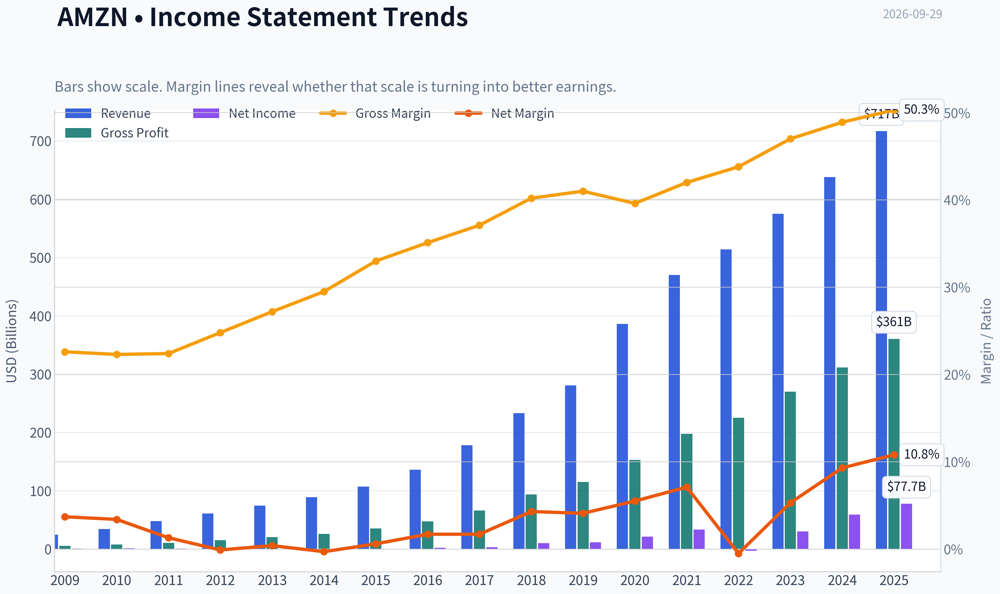
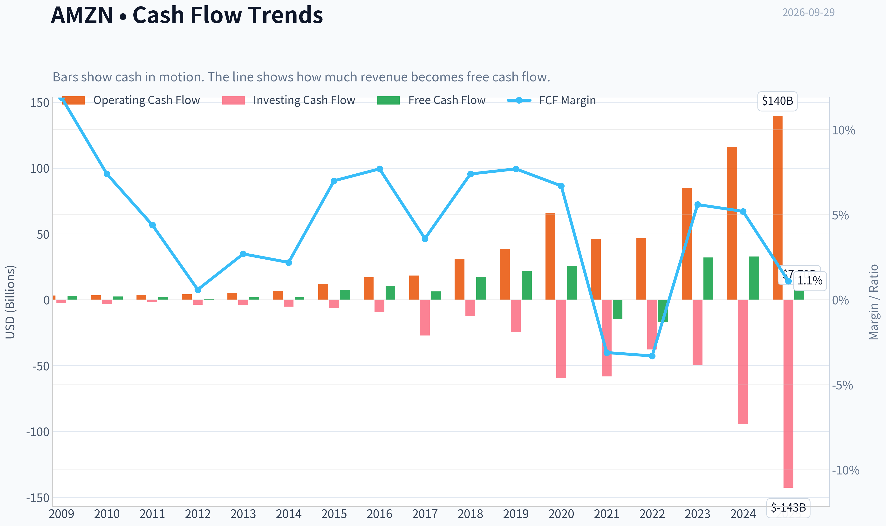
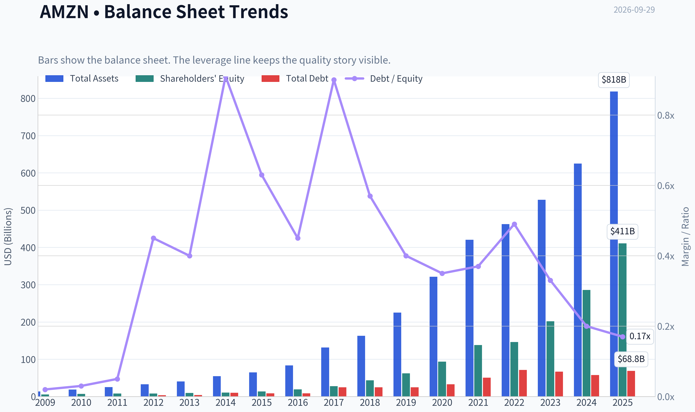
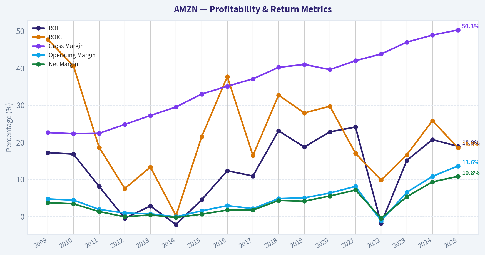
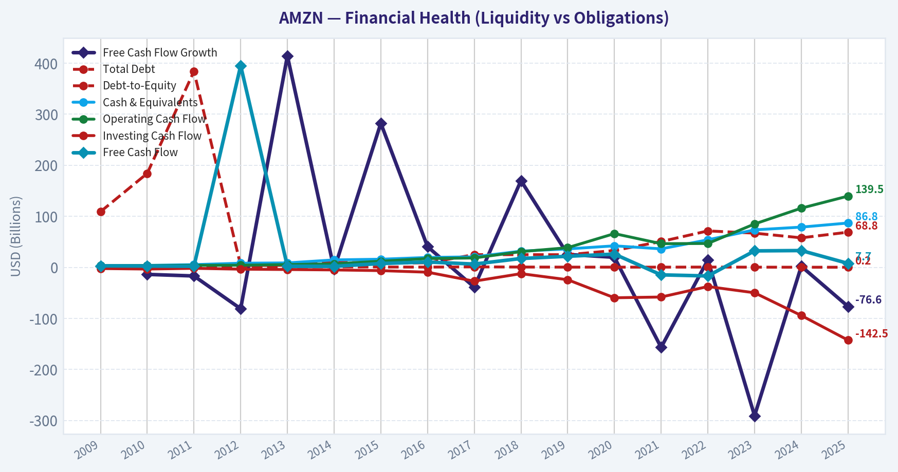
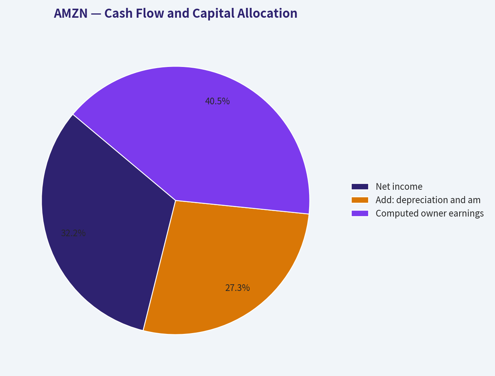
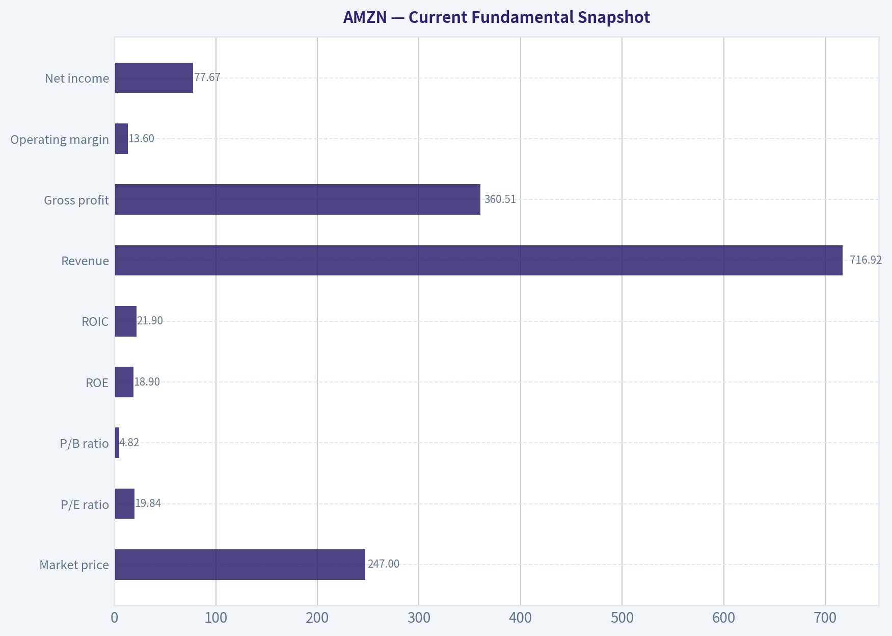
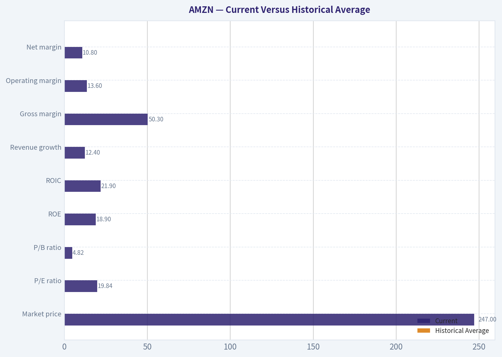
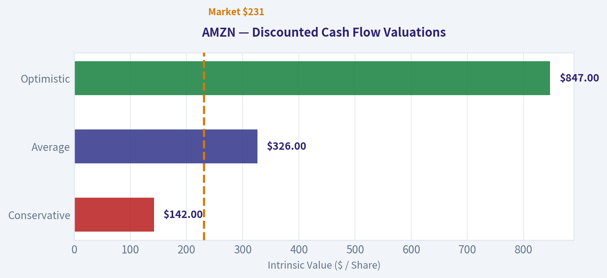
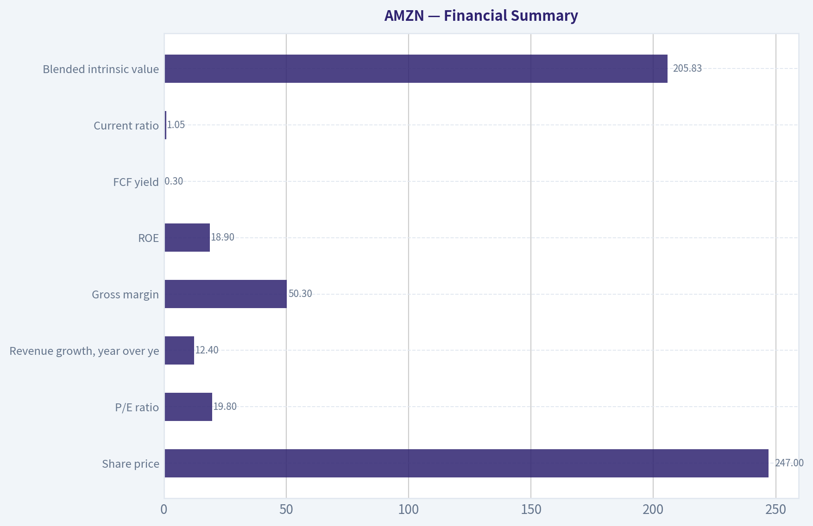

# AMZN Deep Value Intelligence

**Analysis Date:** 2026-09-29

## Critical Disclaimer

*This analysis is generated by Deep Value Intelligence, an AI-powered multi-agent investing framework. Education & research only - not financial advice, not a financial advisor.*

---

## Table of Contents

1. Intelligence Summary
2. Analyst Team Reports
   - Fundamentals Analysis
   - Intrinsic Value Analysis (Buffett)
   - Trend & Growth Analysis (Lynch/Druckenmiller/Fisher)
   - Market Technical Analysis
   - Options Market Analysis
3. Research Team Commentary
4. Value Investing Team Commentary
5. Deep Values Commentary

---

## Intelligence Summary

### Thesis + Conditions

**Core Thesis:** ## Executive Briefing

**Key Risks:**
- Amazon remains an exceptional compounder, but the evidence does not establish that $247 offers the required 10-15% quality-scaled discount to intrinsic value.** Its multiple profit engines, 21.9% reported ROIC, and record of productive reinvestment reduce business risk. The principal risk is overpayment while AI infrastructure spending obscures sustainable owner earnings.
- The prior mistake was allowing valuation caution to overwhelm momentum and catalysts. Here, however, actual moving-average and MACD readings are absent, while the options data are incomplete and cannot establish a breakout. The appropriate conclusion is therefore **WATCH with a bullish bias**, permitting a small staged entry only after verifying the earnings denominator-not a full allocation and not outright avoidance.
- ### Risky Analyst: strongest arguments

**Confidence:** Low

---

## Analyst Team Reports

### Fundamentals Analysis

#### Latest Earnings Snapshot

*Most recent reported quarter anchored on 2026 Q2, with prior-year comparison when available.*

| Metric | 2026 Q2 | 2025 Q2 | YoY Change |
| --- | ---: | ---: | ---: |
| Revenue | N/A | $167.70B | N/A |
| Operating Income | N/A | $19.17B | N/A |
| Net Income | N/A | $18.16B | N/A |
| Diluted EPS | $5.75 | $1.68 | +242.3% |
| Operating Cash Flow | $26.03B | $17.02B | +53.0% |
| Free Cash Flow | $-18.17B | $-8.00B | -127.0% |

Key Takeaways: This snapshot anchors the most recent reported quarter before the narrative analysis. It helps readers separate long-run business quality from whatever changed in the latest earnings print.

#### 17-Year Financial Metrics for AMZN

*All values below are computed deterministically from raw data - not estimated by AI.*

*Issuer profile: operating company (Consumer Cyclical / Internet Retail).*

#### 17-Year Financial Metrics
*Annual rows come from reported financial statements. The final TTM row is computed from the latest four quarters.*

| Metric | 2009 | 2010 | 2011 | 2012 | 2013 | 2014 | 2015 | 2016 | 2017 | 2018 | 2019 | 2020 | 2021 | 2022 | 2023 | 2024 | 2025 |
| --- | --- | --- | --- | --- | --- | --- | --- | --- | --- | --- | --- | --- | --- | --- | --- | --- | --- |
| Market Price | $7 | $9 | $9 | $13 | $20 | $16 | $34 | $37 | $58 | $75 | $92 | $163 | $167 | $84 | $152 | $219 | $231 |
| Market Cap | $2.97B | $4.10B | $3.99B | $5.68B | $9.27B | $7.17B | $16.12B | $18.15B | $28.83B | $37.55B | $46.57B | $1.66T | $1.72T | $855.88B | $1.59T | $2.35T | $2.50T |
| P/E Ratio | 3.30 | 3.56 | 6.32 | -139.37 | 33.80 | -29.84 | 27.04 | 7.65 | 9.51 | 3.73 | 4.02 | 77.92 | 51.46 | -311.11 | 52.39 | 39.67 | 32.19 |
| P/B Ratio | 0.57 | 0.60 | 0.51 | 0.69 | 0.95 | 0.67 | 1.20 | 0.94 | 1.04 | 0.86 | 0.75 | 17.78 | 12.42 | 5.86 | 7.90 | 8.22 | 6.08 |
| ROE | 17.2% | 16.8% | 8.1% | -0.5% | 2.8% | -2.2% | 4.5% | 12.3% | 10.9% | 23.1% | 18.7% | 22.8% | 24.1% | -1.9% | 15.1% | 20.7% | 18.9% |
| ROIC | 47.7% | 40.6% | 18.6% | 7.5% | 13.3% | 0.2% | 21.5% | 37.7% | 16.4% | 32.7% | 27.9% | 29.7% | 17.0% | 9.8% | 16.6% | 25.8% | 18.5% |
| EPS | $2.04 | $2.53 | $1.37 | $-0.09 | $0.59 | $-0.52 | $1.25 | $4.90 | $6.15 | $20.14 | $23.01 | $2.09 | $3.24 | $-0.27 | $2.90 | $5.53 | $7.17 |
| Revenue | $24.51B | $34.20B | $48.08B | $61.09B | $74.45B | $88.99B | $107.01B | $135.99B | $177.87B | $232.89B | $280.52B | $386.06B | $469.82B | $513.98B | $574.78B | $637.96B | $716.92B |
| Gross Profit | $5.53B | $7.64B | $10.79B | $15.12B | $20.27B | $26.24B | $35.35B | $47.72B | $65.93B | $93.73B | $114.99B | $152.76B | $197.48B | $225.15B | $270.05B | $311.67B | $360.51B |
| Gross Margin | 22.6% | 22.3% | 22.4% | 24.8% | 27.2% | 29.5% | 33.0% | 35.1% | 37.1% | 40.2% | 41.0% | 39.6% | 42.0% | 43.8% | 47.0% | 48.9% | 50.3% |
| Operating Margin | 4.7% | 4.4% | 1.9% | 0.9% | 0.7% | -0.1% | 1.5% | 2.9% | 2.1% | 4.8% | 5.0% | 6.3% | 8.1% | -1.2% | 6.5% | 10.8% | 13.6% |
| Net Income | $902.0M | $1.15B | $631.0M | $-39.0M | $274.0M | $-241.0M | $596.0M | $2.37B | $3.03B | $10.07B | $11.59B | $21.33B | $33.36B | $-2.72B | $30.43B | $59.25B | $77.67B |
| Net Margin | 3.7% | 3.4% | 1.3% | -0.1% | 0.4% | -0.3% | 0.6% | 1.7% | 1.7% | 4.3% | 4.1% | 5.5% | 7.1% | -0.5% | 5.3% | 9.3% | 10.8% |
| Revenue Growth | N/A | 39.6% | 40.6% | 27.1% | 21.9% | 19.5% | 20.2% | 27.1% | 30.8% | 30.9% | 20.5% | 37.6% | 21.7% | 9.4% | 11.8% | 11.0% | 12.4% |
| Net Income Growth | N/A | 27.7% | -45.2% | -106.2% | -802.6% | -188.0% | -347.3% | 297.8% | 27.9% | 232.1% | 15.0% | 84.1% | 56.4% | -108.2% | -1217.7% | 94.7% | 31.1% |
| Free Cash Flow Growth | N/A | -13.8% | -16.9% | -81.1% | 414.2% | -4.0% | 282.2% | 40.5% | -38.8% | 169.8% | 25.2% | 19.7% | -156.8% | 14.7% | -290.7% | 2.1% | -76.6% |
| Total Book Value | $5.26B | $6.86B | $7.76B | $8.19B | $9.75B | $10.74B | $13.38B | $19.29B | $27.71B | $43.55B | $62.06B | $93.40B | $138.25B | $146.04B | $201.88B | $285.97B | $411.06B |
| Total Assets | $13.81B | $18.80B | $25.28B | $32.55B | $40.16B | $54.51B | $64.75B | $83.40B | $131.31B | $162.65B | $225.25B | $321.19B | $420.55B | $462.68B | $527.85B | $624.89B | $818.04B |
| Total Debt | $109.0M | $184.0M | $384.0M | $3.66B | $3.94B | $9.79B | $8.46B | $8.75B | $24.84B | $24.87B | $24.72B | $32.97B | $50.55B | $71.35B | $66.95B | $57.79B | $68.85B |
| Debt-to-Equity | 0.02 | 0.03 | 0.05 | 0.45 | 0.40 | 0.91 | 0.63 | 0.45 | 0.90 | 0.57 | 0.40 | 0.35 | 0.37 | 0.49 | 0.33 | 0.20 | 0.17 |
| Cash & Equivalents | $3.44B | $3.78B | $5.27B | $8.08B | $8.66B | $14.56B | $15.89B | $19.33B | $20.52B | $31.75B | $36.09B | $42.12B | $36.22B | $53.89B | $73.39B | $78.78B | $86.81B |
| Shareholders' Equity | $5.26B | $6.86B | $7.76B | $8.19B | $9.75B | $10.74B | $13.38B | $19.29B | $27.71B | $43.55B | $62.06B | $93.40B | $138.25B | $146.04B | $201.88B | $285.97B | $411.06B |
| Operating Cash Flow | $3.29B | $3.50B | $3.90B | $4.18B | $5.47B | $6.84B | $12.04B | $17.20B | $18.36B | $30.72B | $38.51B | $66.06B | $46.33B | $46.75B | $84.95B | $115.88B | $139.51B |
| Investing Cash Flow | $-2.34B | $-3.36B | $-1.93B | $-3.60B | $-4.28B | $-5.07B | $-6.45B | $-9.52B | $-27.08B | $-12.37B | $-24.28B | $-59.61B | $-58.15B | $-37.60B | $-49.83B | $-94.34B | $-142.54B |
| Free Cash Flow | $2.92B | $2.52B | $2.09B | $395.0M | $2.03B | $1.95B | $7.45B | $10.47B | $6.41B | $17.30B | $21.65B | $25.92B | $-14.73B | $-16.89B | $32.22B | $32.88B | $7.70B |
| FCF Margin | 11.9% | 7.4% | 4.4% | 0.6% | 2.7% | 2.2% | 7.0% | 7.7% | 3.6% | 7.4% | 7.7% | 6.7% | -3.1% | -3.3% | 5.6% | 5.2% | 1.1% |
| Dividends / Share | $0.00 | $0.00 | $0.00 | $0.00 | $0.00 | $0.00 | $0.00 | $0.00 | $0.00 | $0.00 | $0.00 | $0.00 | $0.00 | $0.00 | $0.00 | $0.00 | $0.00 |

#### Profitability Metrics
- Return on Equity (ROE): 18.9%
- Return on Invested Capital (ROIC): 21.9%
- Return on Assets (ROA): 9.5%
- Gross Margin: 50.3%
- Operating Margin: 13.6%
- Net Profit Margin: 10.8%

#### Liquidity Metrics
- Current Ratio: 1.05
- Quick Ratio: 0.88

#### Leverage Metrics
- Debt-to-Equity Ratio: 0.17
- Interest Coverage Ratio: 42.79
- Net Debt: $-54.18B

#### Growth Metrics (Year-over-Year)
- Revenue Growth: 12.4%
- Net Income Growth: 31.1%
- Free Cash Flow Growth: -76.6%
- Revenue CAGR (3-Year): 11.7%
- Revenue CAGR (5-Year): 13.2%

#### Valuation Metrics
- P/E Ratio (TTM): 19.84
- Forward P/E: 23.55
- Price-to-Book: 4.82
- Price-to-Sales: 3.43
- PEG Ratio: 1.46
- EV/EBITDA: 16.48
- Free Cash Flow Yield: 0.3%
- Earnings Yield: 5.0%

#### Owner Earnings (Buffett Method, Code-Computed)
- Net Income: $77.67B
- + Depreciation & Amortization: $65.76B
- - Capital Expenditures: $-131.82B
- - Working Capital Changes: $-19.97B
- = **Owner Earnings: $97.64B**

#### Intrinsic Value (Code-Computed)
- Current Price: $247
- **Headline Intrinsic Value (business-model routed): $206**
  Business model: cyclical - weighted blend [Damodaran FCFF + reverse-DCF fair + owner-earnings DCF] (cyclical)
  Model spread (min-max across DCFs): $13 - $326
  Margin of safety vs. price (headline): -19.8%
  Routing note: Cyclical: margins/FCF are volatile - headline blends FCFF, reverse-DCF and owner-earnings roughly evenly; treat the range as the honest read.
- Buffett Method (Owner Earnings):
  Conservative: $142
  Average: $326
  Optimistic: $847
- Cash Flow Method (FCF):
  Conservative: $4
  Average: $13
  Optimistic: $17
- Damodaran FCFF (WACC + margins + reinvestment):
  Conservative: $14
  Average: $63
  Optimistic: $132
  Monte Carlo band (P10-P90): $30 - $86 (median $58)
  P(intrinsic value > price): 0.0%
- Reverse-DCF: price implies ~21.8%/yr owner-earnings growth for 10y; trailing 3y was 75.2%, 5y N/A.

#### Piotroski F-Score: 5/9
- Positive Net Income: PASS
- Positive Operating Cash Flow: PASS
- ROA Improvement: PASS
- Cash Flow > Net Income: PASS
- Decreasing Debt: FAIL
- Improving Current Ratio: FAIL
- No Dilution: FAIL
- Improving Gross Margin: PASS
- Improving Asset Turnover: FAIL

ANALYST STANCE: **WATCH**

#### Executive Summary

Amazon remains an exceptionally durable, wide-moat operating company, but the current share price requires substantial future cash-flow growth. At approximately **$247 per share** and a **$2.66 trillion market capitalization**, AMZN trades below its normalized historical P/E but above the deterministic headline intrinsic value of approximately **$206 per share**.

The central issue is not revenue growth or accounting profitability. Revenue is growing at **12.4%**, operating margin has expanded to **13.6%**, and net income reached **$77.67 billion**. The concern is cash conversion: free cash flow fell to **$7.70 billion**, a **76.6% year-over-year decline**, primarily reflecting very heavy capital investment. Amazon is therefore a high-quality business with an unusually wide valuation and cash-flow range.

#### Current Fundamental Snapshot

| Metric | Current Value | Interpretation |
|---|---:|---|
| Market price | $247 | Strong share-price appreciation, but above blended intrinsic value |
| Market capitalization | $2.66T | Mega-cap scale and high expectations |
| P/E ratio | 19.84 | Below the positive-earnings historical average, though earnings may be near a cyclical high |
| P/B ratio | 4.82 | Lower than recent elevated levels; not a decisive valuation measure for Amazon |
| ROE | 18.9% | Strong, well above the decade average |
| ROIC | 21.9% | Attractive, although below several earlier high-return years |
| Revenue | $716.92B | Record scale with 12.4% year-over-year growth |
| Gross profit | $360.51B | Gross margin reached a record 50.3% |
| Operating margin | 13.6% | Record level in the supplied historical dataset |
| Net income | $77.67B | Record level and up 31.1% year over year |
| Net margin | 10.8% | Record level |
| Free cash flow | $7.70B | Very weak relative to earnings and recent history |
| Dividends per share | $0.00 | Amazon retains capital for reinvestment |
| Total assets | $818.04B | Large asset base supporting logistics, cloud, and AI investment |
| Total debt | $68.85B | Manageable relative to assets, earnings, and cash |
| Debt-to-equity | 0.17 | Conservative leverage |
| Cash and equivalents | $86.81B | $54.18B net cash according to the supplied data |

**Key Takeaways:** Amazon's income statement is currently excellent: margins, earnings, ROE, and ROIC are strong. The balance sheet is also financially resilient, with low leverage and substantial net cash. However, free cash flow is the major weakness, making cash-flow valuation much less certain than an earnings-based P/E analysis suggests.

#### Current Versus Historical Average

The averages below use the **2016-2025 period** for balance-sheet, cash-flow, and market metrics where that is most economically relevant. Profitability and growth averages use all available historical observations where practical. P/E excludes negative or distorted values, and growth averages involving losses are treated cautiously.

| Metric | Current | Historical Average | Current Versus Average |
|---|---:|---:|---|
| Market price | $247 | ~$128 | 93% higher |
| Market capitalization | $2.66T | ~$1.07T | 149% higher |
| P/E ratio | 19.84 | ~25.18* | Lower |
| P/B ratio | 4.82 | ~6.19 | Lower, but not decisive |
| ROE | 18.9% | ~12.4% | Higher |
| ROIC | 21.9% | ~22.4% | Approximately normal |
| Revenue growth | 12.4% | ~23.9% | Materially lower |
| Gross margin | 50.3% | ~36.2% | Much higher |
| Operating margin | 13.6% | ~4.3% | Much higher |
| Net margin | 10.8% | ~3.4% | Much higher |
| Total book value | $411.06B | ~$142.9B | Much larger absolute base |
| Total assets | $818.04B | ~$377.8B | Much larger investment base |
| Total debt | $68.85B | ~$43.1B | Higher in dollars, but modest relative to scale |
| Debt-to-equity | 0.17 | ~0.42 | Lower leverage |
| Cash and equivalents | $86.81B | ~$47.9B | Stronger cash position |
| Free cash flow | $7.70B | ~$11.3B | Below average |
| FCF margin | 1.1% | ~3.0%-4.0% | Substantially weaker |
| Net income | $77.67B | Strongly above prior-period norm | Record result |
| Dividends per share | $0.00 | $0.00 | Consistent reinvestment policy |

\*Positive, non-distorted historical observations only.

**Key Takeaways:** Amazon is operating at historically superior margins and profitability, while its revenue growth has naturally slowed as the company has become enormous. Leverage is better than the recent historical average, but free cash flow and FCF margin are below normal. The lower current P/E is therefore attractive only if present earnings can be converted into substantially higher sustainable cash flow.

#### Market Metrics and Valuation

The current P/E of **19.84** is below the approximate positive-earnings historical average of **25.18**. That suggests the market is not assigning Amazon an unusually high earnings multiple. However, Amazon's earnings are not a perfect proxy for distributable cash flow during an investment-heavy period.

The current price-to-book ratio is listed as **4.82** in the latest valuation data, while the 2025 historical row shows **6.08**. P/B has fallen from the exceptionally high 2020-2021 levels. Nevertheless, P/B should not be treated as a conventional "cheap versus expensive" signal for Amazon. Amazon is an asset-light and intellectual-property-driven platform layered onto a large logistics infrastructure. Its economic value derives from customer relationships, Prime, AWS, advertising, data, network effects, and future cash generation-not merely recorded book equity.

The more relevant valuation measures are:

- **Earnings yield:** approximately 5.0%.
- **Free-cash-flow yield:** only approximately 0.3%.
- **EV/EBITDA:** 16.48.
- **PEG ratio:** 1.46.
- **Headline intrinsic value:** approximately $206.
- **Headline margin of safety:** approximately negative 19.8%.

The model spread is unusually wide:

- Owner Earnings DCF: **$326** base case.
- FCF method: **$13** base case.
- Damodaran FCFF: **$63** base case.
- Blended headline value: **$206**.

This dispersion is not a technical nuisance. It reflects a real investment question: whether current capital spending is temporary growth investment that will generate substantial future cash flow, or a structurally high reinvestment requirement.

#### Profitability and Earnings Quality

Amazon's profitability has improved dramatically over the historical period.

- Gross margin increased from **22.6% in 2009** to **50.3% currently**.
- Operating margin increased from **4.7%** to **13.6%**.
- Net margin increased from **3.7%** to **10.8%**.
- ROE of **18.9%** is well above the long-term average of approximately 12.4%.
- ROIC of **21.9%** is close to the long-term average but remains attractive for a company of Amazon's scale.

The margin expansion reflects a more profitable business mix, particularly AWS and advertising, operating leverage in the retail business, and improved fulfillment efficiency. This is a significant positive for economic moat durability.

However, earnings predictability is imperfect. Amazon experienced negative net income in 2012, 2014, and 2022. Net income growth is highly distorted by low or negative comparison periods. The latest 31.1% growth rate is impressive, but it should not be extrapolated mechanically.

#### Growth Metrics

Revenue grew from **$24.51 billion in 2009** to **$716.92 billion currently**, representing extraordinary long-term expansion. Current revenue growth of **12.4%** is slower than the approximately 23.9% historical average, but this is normal for a company of Amazon's size.

The current growth profile is more attractive when viewed by business quality rather than headline rate:

- Retail remains a large, recurring-volume platform.
- AWS provides higher-margin infrastructure and software economics.
- Advertising adds a rapidly growing, high-margin monetization layer.
- AI infrastructure spending may expand AWS demand but will initially pressure capital intensity.

Net income growth of **31.1%** is stronger than revenue growth because of operating leverage and margin expansion. Free cash flow growth of **negative 76.6%** is the opposite pattern and is the most important warning signal.

#### Balance Sheet and Financial Strength

Amazon's financial strength is a major Buffett-style positive.

Cash and equivalents of **$86.81 billion** exceed total debt of **$68.85 billion**, producing approximately **$54.18 billion of net cash** under the supplied calculation. Debt-to-equity is only **0.17**, compared with a recent-period average near 0.42. Interest coverage is very strong at **42.79**.

The current ratio of approximately **1.05** and quick ratio of **0.88** are not especially high, but this is not necessarily alarming for Amazon. Retail businesses often operate with rapid inventory turnover, supplier financing, and substantial deferred revenue. Liquidity should be assessed alongside operating cash flow, cash reserves, and access to capital markets.

The supplied issuer profile identifies Amazon as an operating company rather than a bank or insurer. P/B is therefore not meaningless in the same way it would be for some software companies, but it remains a secondary measure because Amazon's intangible economic assets and platform value are not fully represented on the balance sheet.

#### Cash Flow and Capital Allocation

Operating cash flow reached **$139.51 billion**, while free cash flow was only **$7.70 billion**. The gap is explained by capital expenditures of approximately **$131.82 billion** in the Owner Earnings calculation and substantial working-capital investment.

The supplied Buffett-style Owner Earnings calculation is:

| Owner Earnings Component | Amount |
|---|---:|
| Net income | $77.67B |
| Add: depreciation and amortization | $65.76B |
| Less: capital expenditures | ($131.82B) |
| Less: working-capital changes | ($19.97B) |
| Computed owner earnings | $97.64B |

**Key Takeaways:** The Owner Earnings calculation is much stronger than reported free cash flow because depreciation is substantially larger than the portion of capital spending treated as maintenance in the model. That creates a legitimate bullish argument, but it also introduces judgment risk: if AI, data-center, and logistics spending is predominantly required to maintain competitiveness rather than optional growth, owner earnings could be overstated.

Amazon pays no dividend and has historically prioritized reinvestment. That is sensible if incremental returns remain high, but it places greater responsibility on management to convert capital expenditures into future cash flow. Share dilution is flagged as a Piotroski weakness, so investors should monitor whether equity compensation offsets buybacks or reduces per-share value creation.

#### Revenue Breakdown

The following is a rounded estimate based on Amazon's major publicly reported business categories and the latest revenue scale. Segment presentation can differ from consolidated revenue reporting, and AWS and advertising figures are rounded.

| Revenue Source | Amount ($B) | % of Total |
|---|---:|---:|
| North America stores and related retail | ~$426.3B | ~59.5% |
| International stores and related retail | ~$161.9B | ~22.6% |
| AWS cloud services | ~$128.7B | ~18.0% |
| **Total** | **~$716.9B** | **100.0%** |

Advertising is economically important but is generally reported within broader categories rather than as a fully separate consolidated segment in this simplified breakdown. Its high margins make it disproportionately important to operating income despite being smaller than retail revenue.

**Key Takeaways:** Amazon remains primarily a retail-revenue company, but AWS and advertising have an outsized influence on profitability. The investment thesis depends less on retail revenue alone and more on whether high-margin AWS, advertising, and newer AI-related services continue lifting consolidated margins.

#### Economic Moat and Business Quality

Amazon has several mutually reinforcing competitive advantages:

1. **Scale and logistics density:** Its fulfillment network, delivery infrastructure, and purchasing scale are difficult and expensive to replicate.
2. **Customer ecosystem:** Prime increases purchase frequency, retention, shipping convenience, entertainment engagement, and willingness to transact.
3. **Marketplace network effects:** More sellers increase selection; more selection attracts customers; customer traffic attracts additional sellers.
4. **AWS ecosystem:** Cloud infrastructure, developer tools, enterprise relationships, and switching costs create meaningful competitive friction.
5. **Advertising data advantage:** Amazon can use purchase-intent data to offer highly targeted advertising.
6. **Reinvestment culture:** Management has historically accepted low near-term margins to build long-term strategic assets.

The moat is broad, but not invulnerable. Walmart, Microsoft, Google, Alibaba, Shopify, logistics providers, and specialized cloud competitors all pressure parts of the model. Regulation and antitrust scrutiny could also constrain marketplace practices or acquisitions.

#### Three-Scenario Owner Earnings DCF

The deterministic dataset provides the following Owner Earnings base:

- Current Owner Earnings: **$97.64 billion**.
- Approximate diluted share count implied by market capitalization and price:
  **$2.66 trillion ÷ $247 ~ 10.77 billion shares**.
- Discount rate: approximately **10%**.
- Terminal growth rate: **2.5%**.
- Forecast horizon: **10 years**.
- Growth assumptions should fade toward the terminal rate rather than continue indefinitely.

The general calculation is:

\[
PV = \sum_{t=1}^{10}\frac{OE_t}{(1+r)^t}
+
\frac{OE_{10}(1+g_T)}{(r-g_T)(1+r)^{10}}
\]

where \(OE_t\) is Owner Earnings, \(r\) is the discount rate, and \(g_T\) is the 2.5% terminal growth rate.

| Scenario | Economic Assumption | Model-Implied Value Per Share | Interpretation |
|---|---|---:|---|
| Conservative | Low sustainable growth; high reinvestment burden; margin normalization | $142 | Downside case if capital spending remains structurally heavy |
| Average | Strong AWS, advertising, and retail operating leverage; growth fades over time | $326 | Base case if owner earnings convert substantially above reported FCF |
| Optimistic | Durable high-margin expansion and successful AI/cloud reinvestment | $847 | Bull case requiring exceptional long-term execution |

**Key Takeaways:** The Owner Earnings DCF supports meaningful upside only if Amazon's current investment cycle generates much more distributable cash flow. The conservative value of $142 is below the current price, while the average value of $326 provides upside. The range is exceptionally wide, so the valuation should not be presented as a precise target.

A hand-built sanity check illustrates the sensitivity. Starting with $97.64 billion of Owner Earnings and a 10% discount rate:

- At roughly 3% near-term growth, followed by 2.5% terminal growth, value is approximately in the low-$100s per share.
- At roughly 10% sustained near-term growth with fading, value moves into the low-to-mid-$200s.
- At substantially higher growth, value can move into the several-hundred-dollar range.

The supplied code-computed Owner Earnings model produces **$142, $326, and $847** for the three cases. The optimistic case should not be interpreted as a normal expected value; it represents a high-execution scenario. The headline blended intrinsic value of approximately **$206** is more cautious because it incorporates FCFF and reverse-DCF evidence.

The reverse DCF is particularly demanding: the current price implies approximately **21.8% annual Owner Earnings growth for ten years**. That is ambitious, although Amazon's trailing three-year Owner Earnings growth was reported at approximately 75.2% from a depressed base. The market therefore assumes that recent earnings improvement will continue and eventually translate into much stronger cash generation.

#### Buffett-Style Qualitative Assessment

| Buffett Criterion | Assessment | Evidence |
|---|---|---|
| Economic moat | Strong | Prime, logistics, marketplace, AWS, advertising, scale |
| Financial strength | Strong | Net cash, 0.17 debt-to-equity, high interest coverage |
| Predictable earnings | Moderate to strong | Long-term growth is impressive, but earnings and FCF are volatile |
| Management | Strong but capital-intensive | Reinvestment has built major platforms; current spending must earn adequate returns |
| Capital allocation | Reinvestment-focused | No dividend; substantial capital expenditure and possible dilution |
| Margin durability | Improving | Gross, operating, and net margins are at historical highs |
| Valuation | Mixed to demanding | P/E is reasonable; FCF yield and blended intrinsic value are less attractive |
| Overall business quality | High | One of the strongest global platforms, but not a low-risk cash compounder at any price |

**Key Takeaways:** Amazon passes the qualitative business-quality test more convincingly than the valuation test. Its moat, scale, financial strength, and margin trajectory are excellent. The principal risk is that investors are paying today for years of successful capital deployment that have not yet appeared in free cash flow.

#### Key Investment Insights, Red Flags, and Opportunities

**Opportunities**

- AWS and advertising can continue shifting the mix toward higher-margin revenue.
- Retail operating margin may improve through automation, fulfillment density, and better inventory economics.
- AI infrastructure could create a new long-duration demand cycle for AWS.
- The current P/E is below Amazon's positive-earnings historical average.
- Strong net cash and low leverage provide resilience during economic downturns.
- Higher margins could eventually produce much stronger Owner Earnings than current reported FCF.

**Red Flags**

- FCF declined 76.6% year over year to only $7.70 billion.
- FCF yield is approximately 0.3%, leaving little valuation support from current cash distributions.
- Capital expenditure intensity may remain elevated because AI and cloud infrastructure require continuous investment.
- The reverse DCF requires approximately 21.8% annual Owner Earnings growth for ten years.
- Net income has historically been volatile, including multiple loss years.
- Piotroski F-score is only 5 out of 9.
- Share dilution is flagged as a weakness.
- Competitive and regulatory pressure could affect marketplace economics, cloud pricing, or advertising practices.
- The headline intrinsic value of approximately $206 is below the current price.

#### Final Investment Stance

**WATCH**

Amazon is a superior business with a strong economic moat, excellent balance sheet, improving margins, and credible long-term growth opportunities. It is not an obvious avoid: the current P/E is reasonable, and the Owner Earnings scenario supports substantial upside if investment spending produces durable future cash flows.

However, a Buffett-style investor should demand a margin of safety around cash generation, not merely around accounting earnings. At $247, Amazon is above the blended intrinsic value of approximately $206, has a very low FCF yield, and requires aggressive long-term Owner Earnings growth to justify the current price. The preferred approach is to watch for either a lower entry price or clearer evidence that capital expenditures are translating into sustained free cash flow.

| Key Point | Assessment |
|---|---|
| Business quality | Excellent |
| Moat | Wide and durable, though contested |
| Balance sheet | Strong net-cash position |
| Profitability | Historically superior and improving |
| Revenue growth | Healthy but slower than the historical average |
| Cash-flow quality | Main area of uncertainty |
| Current valuation | Reasonable on P/E, demanding on FCF |
| Intrinsic-value range | Approximately $142 to $847 per share |
| Blended intrinsic value | Approximately $206 |
| Principal catalyst | AWS, advertising, AI, and retail margin expansion |
| Principal risk | Capital intensity fails to convert into distributable cash flow |
| Recommended action | Watch for better valuation or stronger FCF conversion |
| Final stance | **WATCH** |

**Key Takeaways:** Amazon is a high-quality compounder, but the current price leaves limited protection if the investment cycle remains capital intensive. A disciplined investor should monitor free-cash-flow recovery, return on incremental invested capital, dilution, and AWS monetization before upgrading the stance to Advocate.

#### Fundamental Visuals

This graph tracks the profitability and return metrics (ROE, ROIC, Margins) of **AMZN** over the past decade, highlighting capital efficiency trends.

This chart illustrates the financial health of **AMZN** over the last 10 years, mapping cash equivalents and free cash flow against total obligations (Debt).

This breakdown chart from <em>Cash Flow and Capital Allocation</em> shows the proportional composition for **AMZN** - useful for understanding what drives or risks the business.

---

### Intrinsic Value Analysis (Buffett)

> *Following Warren Buffett's value investing philosophy: Circle of Competence, Economic Moat, Management Quality, and Margin of Safety.*

#### Intrinsic Value Snapshot

Price is what you pay. Intrinsic value is what the business may be worth based on the cash it can create for owners over time. We show a range, not one magic number.

- Current Price: $246.67
- Value Range (conservative to optimistic across both DCF methods): $4.09 to $846.54

##### Owner Earnings (Buffett Method)
- Net Income: $77,670,000,000.00
- Depreciation & Amortization: $65,756,000,000.00
- Capital Expenditures: $-131,819,000,000.00
- Working Capital Changes: $-19,969,000,000.00
- Owner Earnings: $97,639,000,000.00

##### Intrinsic Value
###### Buffett Method
Uses owner earnings. Stricter, and usually more conservative.
- Conservative: $142.21
- Average: $326.09
- Optimistic: $846.54
- Discount Rate: 10.0%

###### Cash Flow Method
Uses free cash flow. Better for companies spending heavily today to grow tomorrow.
- Conservative: $4.09
- Average: $12.80
- Optimistic: $17.07
- Discount Rate: 10.0%

ANALYST STANCE: **WATCH**

#### Executive View

Amazon is an exceptional business with multiple durable advantages: the dominant U.S. e-commerce marketplace, Prime's customer ecosystem, AWS, advertising, and a rapidly expanding logistics infrastructure. Its reinvestment runway remains unusually long.

At $247 per share, however, valuation leaves little room for execution mistakes. The reverse DCF implies approximately 21.8% annual growth for ten years, while the blended intrinsic-value estimate is $205.83. Amazon merits ownership at a more rational price, but the current risk-reward profile is not sufficiently attractive for a new purchase.

#### 1. Factor Scorecard

| Factor | Score | Assessment |
|---|---:|---|
| Circle of competence and simplicity | 3.5/5 | The basic model is understandable, but Amazon combines retail, cloud computing, advertising, logistics, media, and AI infrastructure. |
| Durable competitive advantage | 4.5/5 | Prime, marketplace scale, AWS switching costs, logistics density, brand trust, and advertising data create a wide moat. |
| Management and capital allocation | 3.5/5 | Long-term orientation and substantial reinvestment are strengths; capital intensity and aggressive spending require continued discipline. |
| Industry structure | 3.5/5 | AWS and advertising are attractive oligopolistic markets; retail remains highly competitive and logistics-intensive. |

**Gate 5 - Quality and solvency:** **Not tripped.** Available evidence does not indicate simultaneous deteriorating earnings or cash flow and a solvency red line. Amazon's principal concern is valuation and capital intensity, not financial distress.

**Key Takeaways:** Amazon scores highly on moat and reinvestment potential, but its complexity and retail capital requirements reduce predictability. The business is financially viable; the central question is whether future returns justify today's price.

#### 2. Moat Analysis

| Moat source | Evidence | Rating |
|---|---|---:|
| Network effects | More sellers attract more customers, which attracts more sellers. AWS benefits from a broad developer and enterprise ecosystem. | Strong |
| Switching costs | AWS workloads, data, applications, and enterprise processes are costly to migrate. Prime also embeds Amazon into household purchasing behavior. | Strong |
| Cost advantages | Fulfillment density, purchasing scale, logistics infrastructure, and delivery volume reduce per-unit costs over time. | Strong |
| Intangible assets | Amazon's brand, Prime membership, customer trust, and AWS reputation support pricing and retention. | Moderate to strong |
| Reinvestment advantage | Amazon can reinvest in fulfillment, cloud infrastructure, AI, content, and advertising while leveraging an existing global customer base. | Exceptional |

Amazon's moat is wide and likely still widening, although it is not uniform across segments. AWS and advertising have stronger economics than traditional retail. Retail's advantage comes primarily from scale, convenience, selection, and logistics rather than unusually high margins.

The reported gross margin is 50.3%, and revenue grew 12.4% year over year. These figures support the presence of valuable higher-margin businesses within the consolidated company, though consolidated free cash flow remains pressured by heavy capital expenditure.

#### 3. Management Quality and Capital Allocation

| Area | Assessment | Score |
|---|---|---:|
| Owner orientation | Amazon has historically prioritized long-term market position and customer value over near-term accounting profits. | 4/5 |
| Candor and transparency | Management generally communicates strategic priorities clearly, though the conglomerate structure makes segment economics difficult to evaluate. | 3.5/5 |
| Reinvestment | Significant spending on AWS, AI, logistics, and fulfillment can create substantial long-term value if returns remain high. | 4/5 |
| Acquisition discipline | The company has made valuable acquisitions, but its history also includes investments with uncertain returns. | 3/5 |
| Balance-sheet discipline | Debt is manageable, but the capital-spending program is large and reduces current cash conversion. | 3.5/5 |

Andy Jassy's central capital-allocation challenge is balancing enormous AI and infrastructure investment against the need to preserve attractive incremental returns. Amazon should be judged less by current free cash flow alone and more by whether its reinvestment produces durable per-share earnings and cash-flow growth.

#### 4. Financial Summary

| Metric | Latest reported value |
|---|---:|
| Share price | $247 |
| Market capitalization | $2.66 trillion |
| P/E ratio | 19.8x |
| Revenue growth, year over year | 12.4% |
| Gross margin | 50.3% |
| ROE | 18.9% |
| FCF yield | 0.3% |
| Current ratio | 1.05 |
| Blended intrinsic value | $205.83 |
| Reverse-DCF implied growth | Approximately 21.8% annually for 10 years |

**Key Takeaways:** Amazon combines strong growth and an 18.9% ROE with an extremely low 0.3% free-cash-flow yield. The gap reflects unusually heavy investment in AI, data centers, and logistics, but it also means the stock price depends heavily on future cash-flow conversion.

#### 5. Owner Earnings Calculation

The Buffett-style framework is:

> Owner earnings = Net income + depreciation and amortization - maintenance capital expenditure - working-capital increases.

The owner-earnings valuation model supplied for Amazon produces an implied value of $326.09 per share. Back-solving from the no-growth DCF at a 10% discount rate implies owner earnings of approximately:

| Calculation | Per-share amount |
|---|---:|
| Owner earnings implied by model | ~$32.61 |
| No-growth value at 10% discount rate | ~$326.09 |
| Current share price | $247 |
| Price as a percentage of no-growth value | 75.8% |

**Key Takeaways:** The owner-earnings framework is materially more favorable than the free-cash-flow model because it treats some current capital spending as growth investment rather than maintenance spending. The critical judgment is how much of Amazon's enormous capex is genuinely discretionary growth investment.

#### 6. Three-Scenario DCF Valuation

| Scenario | Key assumptions | Estimated value |
|---|---|---:|
| A. No growth | Owner earnings of approximately $32.61 per share capitalized at 10% | $326 |
| B. GDP growth | 3% annual growth, 10% discount rate, perpetual terminal growth of 3% | ~$480 |
| C. Historical-growth sensitivity | 10% annual growth for 10 years, followed by 3% terminal growth | ~$806 |
| Blended research estimate | Owner earnings, FCF, Damodaran FCFF, and reverse-DCF methods | $205.83 |

Scenario C is deliberately optimistic. It reflects the permitted 10% growth cap rather than assuming Amazon's recent exceptional growth persists indefinitely. The large spread between these approaches demonstrates that Amazon's valuation depends heavily on how analysts classify current capex and forecast long-term cash-flow margins.

**Key Takeaways:** The DCF range is unusually wide, from approximately $206 to $806 per share, because Amazon is in a major investment cycle. The blended estimate of $205.83 is below the current price, while the owner-earnings model is substantially above it; this is a valuation uncertainty, not a clear margin of safety.

#### 7. Margin of Safety Analysis

| Measure | Result |
|---|---:|
| Current price | $247 |
| Blended intrinsic value | $205.83 |
| Margin of safety versus blended value | -19.8% |
| Owner-earnings DCF value | $326.09 |
| FCF-based value | $12.80 |
| Damodaran FCFF value | $63.37 |
| Reverse-DCF growth implied by price | ~21.8% annually for 10 years |

For a wide-moat compounder, a 10% to 15% discount can be adequate. Amazon does not meet that standard against the blended valuation: the stock trades approximately 20% above the headline intrinsic-value estimate.

The reverse DCF is the more important warning. A 21.8% annual growth requirement is demanding even for Amazon. The company may plausibly grow earnings rapidly for several years, but the investment case requires strong execution in AWS, advertising, AI monetization, and retail-margin expansion simultaneously.

#### 8. Final Buffett Scorecard

| Criterion | Weight | Score | Weighted contribution |
|---|---:|---:|---:|
| Moat width and durability | 25% | 4.5 | 1.13 |
| Valuation and margin of safety | 20% | 1.5 | 0.30 |
| Capital returns versus WACC | 15% | 3.0 | 0.45 |
| Business understanding and predictability | 12% | 3.0 | 0.36 |
| Management and capital allocation | 12% | 3.5 | 0.42 |
| Reinvestment runway | 8% | 4.5 | 0.36 |
| Balance-sheet strength | 4% | 3.0 | 0.12 |
| Industry structure | 4% | 3.0 | 0.12 |
| **Total** | **100%** |  | **3.26/5.00** |

**Key Takeaways:** Amazon's quality score is held back almost entirely by valuation, cash-flow conversion, and business complexity. Its moat and reinvestment runway are excellent, but the current price already assumes a substantial portion of the upside.

#### 9. Investment Stance

**WATCH - Moderate conviction.**

Amazon is a wonderful company, but not currently a compelling value purchase. The appropriate strategy is to wait for either:

- a materially lower share price;
- clear evidence that AI and infrastructure spending are translating into sustainably higher free cash flow; or
- a price that implies a more achievable long-term growth rate.

A price near or below the blended intrinsic-value estimate would provide a better margin of safety. Existing shareholders can reasonably continue holding if they believe Amazon's reinvestment returns will remain exceptional, but new capital should be deployed selectively rather than aggressively at $247.
#### Valuation Bridge

This bridge places the current market price beside each intrinsic value lens so readers can see whether upside depends on one method or shows up across several methods.

| Scenario | Intrinsic Value / Share |
| --- | ---: |
| Buffett Method | $326.09 |
| Cash Flow Method | $12.80 |
| Damodaran Method | $63.37 |
| Current Price | $246.67 |

#### Key Takeaways

If one method is far above the others, the upside case depends on a specific modelling assumption. When several methods cluster together, the valuation story is more robust.

#### Valuation Visuals

This comparison chart from *Latest Earnings Snapshot* stacks current figures against historical benchmarks for **AMZN**, making it easy to see where the company trades relative to its own averages.

This comparison chart from *Current Fundamental Snapshot* stacks current figures against historical benchmarks for **AMZN**, making it easy to see where the company trades relative to its own averages.

This comparison chart from *Current Versus Historical Average* stacks current figures against historical benchmarks for **AMZN**, making it easy to see where the company trades relative to its own averages.

The following chart maps the **AMZN** Owner Earnings DCF valuation scenarios (Conservative, Average, Optimistic) to visually represent the margin of safety based on intrinsic value calculations.

This comparison chart from *Financial Summary* stacks current figures against historical benchmarks for **AMZN**, making it easy to see where the company trades relative to its own averages.

---

### Trend & Growth Analysis (Lynch/Druckenmiller/Fisher)

> *Following Peter Lynch's GARP, Stanley Druckenmiller's macro-aware approach, and Philip Fisher's scuttlebutt methodology.*

ANALYST STANCE: **WATCH**

#### 1. Lynch Classification

**Stalwart, with selective fast-growth assets.** Amazon's consolidated revenue growth is 12.4%-just above the stalwart range-but below the 15-25% threshold for a classic fast grower. AWS, advertising, logistics, and AI infrastructure may grow faster than the consolidated company, while the retail base is much larger and more mature.

#### 2. The Story in Three Bullets

- Amazon is building a diversified digital infrastructure platform: e-commerce, AWS cloud, advertising, logistics, subscriptions, and AI.
- AWS and advertising provide higher-margin growth that can improve the economics of the lower-margin retail business.
- The long-term opportunity is substantial, but current valuation requires strong execution and heavy AI-related investment to produce attractive free cash flow.

#### 3. TAM and Runway

| Segment | Strategic role | Growth potential | Key constraint |
|---|---|---:|---|
| E-commerce and marketplace | Scale, customer engagement, fulfillment network | Moderate | Mature penetration and competition |
| AWS cloud | High-margin infrastructure and AI workloads | High | Microsoft, Google, pricing and capex |
| Digital advertising | Monetizes purchase intent | High | Regulation and advertiser budgets |
| Logistics and fulfillment | Cost advantage and potential third-party service | Moderate to high | Capital intensity |
| Generative AI and infrastructure | Expands AWS TAM and customer spending | Very high, but uncertain | Massive investment and competitive pace |

**Key Takeaways:** Amazon's runway is not dependent solely on retail; AWS, advertising, and AI materially expand the addressable market. The 10x test is difficult at the consolidated level: 10x current revenue would exceed $7 trillion, requiring an enormous global market and multiple successful businesses. Amazon therefore has a long runway, but a literal 10-bagger from today's $2.66 trillion market capitalization is unlikely without major new profit pools.

#### 4. Revenue Growth Trend

| Period | Revenue | Growth |
|---|---:|---:|
| 2020 | $386.1B | 37.6% |
| 2021 | $469.8B | 21.7% |
| 2022 | $514.0B | 9.4% |
| 2023 | $574.8B | 11.8% |
| 2024 | $638.0B | 11.0% |
| 2025 | $716.9B | 12.4% |
| Three-year revenue CAGR | - | 11.7% |
| Five-year revenue CAGR | - | 13.2% |

**Key Takeaways:** Revenue growth sharply decelerated from the pandemic period and has stabilized around 11-12%. This is a durable growth profile, but not currently an accelerating inflection. The more encouraging development is profit growth: net income rose 31.1%, supported by operating-margin expansion to 13.6%.

#### 5. Unit Economics and Operating Quality

| Metric | Current reading | Assessment |
|---|---:|---|
| Gross margin | 50.3% | Strong, and structurally improved over time |
| Operating margin | 13.6% | Major improvement from 6.5% in 2023 |
| Net margin | 10.8% | Stronger than Amazon's historical retail profile |
| Revenue growth | 12.4% | Solid, but not fast-grower level |
| FCF margin | 1.1% | Weak because of elevated capital expenditure |
| Rule of 40 | 13.5% | Below SaaS-style benchmark |
| Net revenue retention | Not disclosed | Cannot verify |
| LTV/CAC | Not disclosed | Cannot verify |

**Key Takeaways:** Amazon's margin inflection is more compelling than its revenue growth. Gross margin has expanded from 39.6% in 2020 to 50.3% currently, while operating margin has reached 13.6%. However, AI and infrastructure spending has compressed free cash flow, leaving the Rule of 40 well below a healthy subscription-business benchmark.

#### 6. Inflection Point Assessment

| Inflection area | Evidence | Verdict |
|---|---|---|
| Product cycle | AI services and infrastructure demand through AWS | Positive, not yet fully quantified |
| Market share | AWS remains a leading cloud platform; advertising continues gaining relevance | Positive |
| Margin | Operating margin rose to 13.6% from 10.8% in 2024 | Strong positive |
| TAM | Cloud AI, advertising, logistics, and enterprise services expand TAM | Positive |
| Cash flow | FCF declined 76.6% due to capital expenditure and investment | Negative near term |
| Competitive position | Strong ecosystem, but intense AI/cloud competition | Mixed |

**Key Takeaways:** The clearest confirmed inflection is operating leverage. The potential next inflection is AWS AI monetization, but it remains partly ahead of the reported cash-flow evidence. Investors should watch whether AI revenue growth eventually exceeds the associated capital intensity.

#### 7. Macro Setup

| Macro factor | Impact on AMZN | Assessment |
|---|---|---|
| Consumer cycle | Supports or pressures retail demand | Mixed |
| Interest rates | High rates pressure long-duration growth valuations | Headwind if rates remain elevated |
| Cloud and AI secular trend | Drives AWS demand and infrastructure spending | Strong tailwind |
| Advertising cycle | Supports high-margin revenue | Positive but cyclical |
| Capital spending | Enables long-term growth but depresses current FCF | Near-term headwind |

**Key Takeaways:** Amazon has strong secular exposure to cloud, AI, digital advertising, and e-commerce. The macro setup is favorable for demand but less favorable for valuation if rates stay high and investors continue prioritizing near-term free cash flow.

#### 8. Fisher's 15-Point Assessment

| Fisher factor | Score / 5 | Brief rationale |
|---|---:|---|
| Market potential | 5 | Multiple very large markets |
| New-product determination | 5 | Consistent expansion into cloud, ads, AI, logistics |
| R&D effectiveness | 4 | Strong innovation record; AI outcome still developing |
| Sales organization | 4 | Broad enterprise and consumer distribution |
| Profit margins | 4 | Improving, though retail remains capital intensive |
| Margin trend | 5 | Significant recent operating leverage |
| Labor relations | 3 | No clear durable advantage |
| Executive relations | 4 | Strong institutional depth and succession history |
| Management depth | 5 | Broad operating bench |
| Cost analysis/accounting | 4 | Scale and operating discipline improving |
| Outstanding competitive aspects | 5 | Ecosystem, data, logistics, cloud switching costs |
| Long-range profit outlook | 5 | Strong if AWS and advertising compound |
| Dilution | 3 | Some dilution concerns; not a major current thesis driver |
| Candor | 4 | Generally credible, though AI returns are uncertain |
| Integrity | 4 | Strong long-term execution record |

| Total Fisher score | Classification |
|---:|---|
| **60 / 75** | **Good** |

**Key Takeaways:** Amazon scores well because of market potential, management depth, innovation, and competitive advantages. The main deductions reflect capital intensity, incomplete visibility into AI returns, labor complexity, and the fact that consolidated growth is no longer exceptional.

#### 9. Valuation Analysis

| Valuation measure | Result | Interpretation |
|---|---:|---|
| Current price | $247 | Above headline intrinsic value |
| Market capitalization | $2.66T | Mega-cap scale limits 10x potential |
| P/E | 19.8x | Reasonable versus historical growth, if earnings compound |
| Forward P/E | 23.6x | Requires continued earnings execution |
| PEG | 1.46 | Fair, not bargain-priced |
| Price-to-sales | 3.43x | Reasonable for a diversified platform, but not cheap |
| EV/EBITDA | 16.5x | Moderate for a high-quality platform |
| FCF yield | 0.3% | Very demanding on current cash generation |
| Headline intrinsic value | $206 | Approximately 20% below current price |
| Reverse-DCF implied growth | 21.8% annually for 10 years | Aggressive expectation |

**Key Takeaways:** Amazon is not priced as a distressed or obvious bargain. The P/E and price-to-sales ratios appear defensible, but the extremely low FCF yield and reverse-DCF requirement indicate that the market expects strong long-term earnings and owner-earnings growth. Valuation is acceptable only if AWS, advertising, and AI generate substantial future operating leverage.

| Scenario | Core assumption | Indicative outcome |
|---|---|---|
| Bear | Retail growth slows, AI capex remains high, margins stagnate | Material downside risk toward intrinsic-value estimates below current price |
| Base | Revenue compounds around 10-13%, margins expand gradually, AWS remains strong | Moderate long-term return potential |
| Bull | AWS AI accelerates, advertising scales, capex produces high returns, margins expand materially | Strong upside, but requires multiple successful execution milestones |

**Key Takeaways:** The bear case is credible because current free cash flow is weak and investment requirements are high. The bull case depends less on retail and more on Amazon becoming a dominant AI-cloud and advertising platform. At $247, the risk-reward is balanced rather than asymmetric.

#### 10. Growth Investor Scorecard

| Criterion | Weight | Score / 5 | Weighted contribution |
|---|---:|---:|---:|
| Lynch story | 10% | 4.0 | 0.40 |
| TAM and runway | 20% | 4.5 | 0.90 |
| Revenue growth | 20% | 3.0 | 0.60 |
| Unit economics | 15% | 3.0 | 0.45 |
| Competitive position | 10% | 4.5 | 0.45 |
| Management quality | 10% | 4.0 | 0.40 |
| Macro setup | 5% | 3.5 | 0.18 |
| Profitability path | 5% | 4.0 | 0.20 |
| Valuation | 5% | 2.5 | 0.13 |
| **Total** | **100%** | - | **3.71 / 5.00** |

**Key Takeaways:** Amazon's score of 3.71 supports a positive long-term view but not an aggressive new position at the current price. Its strongest attributes are TAM, competitive position, management, and margin expansion. Revenue growth, free cash flow, and valuation prevent an Advocate rating.

#### 11. Position Size Stance

**WATCH / modest starter position only.**

- Existing holders: **Hold**, provided the investment thesis is based on long-term AWS, advertising, and AI monetization.
- New investors: Prefer staged buying on meaningful weakness or after evidence that AI capex is producing accelerating revenue and free cash flow.
- Suggested growth-portfolio exposure: **1-3% starter position**, increasing only after cash-flow conversion improves.
- Avoid treating Amazon as a classic 10-bagger candidate at its current market capitalization.

#### 12. Key Risks and Catalysts

| Catalysts | Risks |
|---|---|
| AWS AI revenue accelerates | AI capex fails to earn attractive returns |
| Operating margin continues expanding | Free cash flow remains depressed for several years |
| Advertising becomes a larger profit engine | Microsoft and Google intensify cloud competition |
| Logistics becomes a third-party business | Consumer slowdown or regulatory pressure |
| Revenue growth reaccelerates above 15% | Valuation contracts if rates remain high |
| More efficient AI infrastructure | Retail labor, antitrust, and compliance costs |

**Key Takeaways:** The most important catalyst is a combination of AWS growth acceleration and improving free cash flow, not simply higher revenue. The principal risk is that Amazon invests heavily in AI but captures insufficient economic returns. Until that uncertainty narrows, Amazon is a high-quality compounder to monitor rather than a high-conviction growth purchase.

---

### Market Technical Analysis

ANALYST STANCE: **WATCH**

#### AMZN technical overview

The latest available AMZN session is **September 28, 2026**, because September 29 is not shown as a trading day in the data. AMZN closed at **$246.15**, down from the recent September 21 high near $258.45 and below its short- and medium-term moving averages. The technical picture is therefore best characterized as a **short-term corrective phase within a still-positive long-term structure**.

The selected indicators are:

- **close_10_ema** and **close_50_sma**: short- and medium-term trend direction.
- **close_200_sma**: long-term trend confirmation.
- **macd**: momentum and trend-change assessment.
- **rsi**: momentum strength and potential exhaustion.
- **boll_ub** and **boll_lb**: volatility-adjusted support and resistance.
- **atr**: position sizing and stop-distance guidance.

#### Trend structure

AMZN closed below the **10-day EMA at $250.94** and the **50-day SMA at $256.15**. The 10-day EMA has declined from approximately $261.54 on August 31 to $250.94, showing that near-term momentum has deteriorated meaningfully. The 50-day SMA, however, remains upward sloping, rising from roughly $251.97 to $256.15 over the same period. This indicates that the recent weakness has not yet fully overturned the broader intermediate trend, but price action is currently weaker than the trend benchmark.

The most important structural positive is that AMZN remains above its **200-day SMA at $240.94**. The 200-day average has continued to rise, from about $238.73 at the end of August, confirming a constructive long-term trend. The current price is approximately **2.2% above the 200-day SMA**, leaving a relatively narrow margin before a more serious long-term trend test. A decisive close below that level would materially weaken the bullish interpretation.

#### Momentum and MACD

The MACD reading was **-2.35** on September 28, declining from **-0.42 on September 9** and from positive territory at the beginning of September. This is a clear deterioration in momentum. The negative MACD suggests that the recent decline is not merely a one-day pullback; selling pressure has persisted long enough to push short-term trend momentum below its neutral baseline.

There is no strong evidence of an oversold momentum extreme yet. The **RSI was 41.24**, down from 52.69 on September 21. RSI is therefore in a weak-neutral zone: sellers have control, but the indicator is not yet below the conventional 30 oversold threshold. This leaves room for further downside before a technically oversold condition develops. Conversely, if RSI begins turning higher from the low-40s while price holds above $240-$245, that could provide an early indication that the correction is stabilizing.

#### Bollinger Bands and volatility

The September 28 close of **$246.15** was only modestly above the **lower Bollinger Band at $244.81**, while the upper band stood at **$261.77**. Price is consequently trading in the lower portion of its recent volatility envelope. This supports a cautious view, but it does not by itself establish a reversal signal. AMZN could rebound from the lower band, or it could break below it if negative momentum accelerates.

The Bollinger range has narrowed compared with late August, while the ATR has also declined. **ATR fell to $5.75**, from more than $7.20 at the beginning of September. Daily volatility is easing, but a $5.75 average true range still represents roughly **2.3% of the share price**, which is substantial for risk-management purposes. Stops placed too tightly around a position could be vulnerable to normal daily fluctuations.

#### Key price levels and trading implications

The first support zone is approximately **$244.80-$246.15**, combining the latest close with the lower Bollinger Band. A sustained break below this area would expose the rising **200-day SMA near $240.94**, which is the key long-term trend test. A close below $240.94, particularly if accompanied by a worsening MACD and expanding ATR, would shift the setup from an ordinary pullback toward a more material trend deterioration.

On the upside, AMZN must first reclaim the **10-day EMA near $250.94**. A move above that level would improve short-term momentum but would not yet fully repair the chart. The more significant medium-term resistance is the **50-day SMA near $256.15**, followed by the upper Bollinger Band near **$261.77**. A recovery above $256-$262 would suggest that the correction is losing control and that the prior bullish trend may be resuming.

For traders, the current setup favors patience rather than aggressive directional exposure. Momentum signals are bearish, but the long-term trend remains intact and the price is approaching a technically important support cluster. A bullish entry would be more compelling after either a confirmed rebound from $244-$241 or a reclaim of $250.94 followed by improving RSI and MACD. A bearish continuation setup would require a decisive break below the 200-day SMA, ideally confirmed by increasing volume or expanding volatility.

| Indicator | Latest reading | Interpretation | Key level or implication |
|---|---:|---|---|
| Latest close | $246.15 | Price has weakened from the September high and is below short- and medium-term averages | Immediate support near $244.80-$246.15 |
| 10-day EMA | $250.94 | Short-term trend is declining; price is below the EMA | Reclaim above $250.94 would improve near-term tone |
| 50-day SMA | $256.15 | Medium-term average remains upward sloping, but price is below it | Resistance near $256.15 |
| 200-day SMA | $240.94 | Long-term trend remains positive, but the margin above it is limited | Major trend support; breakdown would be bearish |
| MACD | -2.35 | Momentum has deteriorated sharply and is negative | Recovery requires stabilization and an upward turn |
| RSI | 41.24 | Weak-neutral momentum; not yet oversold | Further downside remains possible before a classic oversold reading |
| Bollinger Bands | $244.81 lower; $261.77 upper | Price is near the lower volatility boundary | Lower-band hold could support a bounce; break could signal continuation |
| ATR | $5.75 | Volatility is moderating but remains material | Use volatility-aware position sizing and stop distances |

**Key Takeaways:** AMZN is in a short-term and intermediate correction, with negative MACD and RSI in the low-40s confirming weakening momentum. The long-term trend remains constructive because price is still above the rising 200-day SMA near $240.94, but that support is close and should be monitored carefully. The most informative signals would be a rebound above $250.94, or alternatively a decisive breakdown below $240.94.

---

### Options Market Analysis

> *Reading options flow - put/call ratios, IV skew, and unusual activity - to gauge institutional positioning and event-driven risk.*

ANALYST STANCE: **BULLISH**

#### AMZN Options Market Overview

As of September 29, 2026, AMZN's near-term options market shows stronger call positioning than put positioning. The data covers expirations from September 30 through October 5, with the nearest contracts expiring tomorrow.

| Expiration | Call OI | Put OI | Call Volume | Put Volume | Put/Call OI Ratio | ATM Call IV | ATM Put IV |
|---|---:|---:|---:|---:|---:|---:|---:|
| Sep. 30 | 46,299 | 25,239 | 149,251 | 78,631 | 0.55 | 35.2% | 32.9% |
| Oct. 2 | 117,419 | 70,754 | 89,874 | 34,171 | 0.60 | 31.7% | 31.9% |
| Oct. 5 | 6,938 | 2,566 | 11,073 | 2,892 | 0.37 | 32.7% | 28.7% |
| **Total** | **170,656** | **98,559** | **250,198** | **115,694** | **0.58** | - | - |

**Key Takeaways:** The aggregate put/call open-interest ratio is 0.58, below the approximately 0.70 neutral baseline. The volume ratio is even more call-heavy at 0.46, indicating active near-term demand for calls or possible covered-call activity. Given the unusually high call volume and substantial liquidity, the balance of evidence is directionally bullish, although the data does not reveal whether every call was bought or sold.

#### Put/Call Ratio Analysis

AMZN's aggregate put/call OI ratio of 0.58 represents a meaningful shift toward calls versus the historical neutral level near 0.70. The 0.46 volume ratio indicates that today's trading is more call-dominant than the existing open-interest structure.

| Measure | AMZN | Neutral Reference | Interpretation |
|---|---:|---:|---|
| Put/call OI ratio | 0.58 | ~0.70 | Moderately call-heavy |
| Put/call volume ratio | 0.46 | ~0.70 | Strongly call-heavy |
| Sep. 30 OI ratio | 0.55 | ~0.70 | Bullish or reduced hedging |
| Oct. 2 OI ratio | 0.60 | ~0.70 | Mildly bullish |
| Oct. 5 OI ratio | 0.37 | ~0.70 | Most call-dominant, but smaller sample |

**Key Takeaways:** Both open interest and volume point to bullish positioning rather than aggressive downside protection. The strongest signal comes from volume, where calls traded at more than twice put volume. Some of that activity could represent covered-call writing, so the ratio should not be treated as proof of outright call buying.

#### Implied Volatility and Skew

Near-term ATM implied volatility is approximately 29% to 35%, with the highest levels concentrated in the September 30 expiration. This is elevated relative to a calm large-cap options market, but it is not extreme for contracts expiring within one to six days.

| Expiration | ATM Call IV | ATM Put IV | Put Minus Call IV | Assessment |
|---|---:|---:|---:|---|
| Sep. 30 | 35.2% | 32.9% | -2.3 pts | Slight call-side premium |
| Oct. 2 | 31.7% | 31.9% | +0.2 pts | Essentially balanced |
| Oct. 5 | 32.7% | 28.7% | -4.0 pts | Call-side premium |
| **Range** | **31.7%-35.2%** | **28.7%-32.9%** | - | No steep downside skew |

**Key Takeaways:** The ATM volatility structure does not show a meaningful downside fear premium; put IV is generally equal to or below call IV. That represents a mild call skew rather than the steep put skew typically associated with defensive institutional hedging. Near-term IV is elevated because the expirations are extremely short-dated, but no specific catalyst was provided in the data, so an earnings or event-driven conclusion cannot be confirmed.

#### Unusual Options Activity

The following contracts had volume greater than five times open interest, suggesting potentially fresh activity. However, volume and open interest alone cannot distinguish buying from selling, so directional interpretations are indicative rather than definitive. AMZN appears to be trading near the $247.50 area based on the concentration of near-the-money strikes.

| Expiry | Type | Strike | Approx. Moneyness | Days to Expiry | Volume/OI | IV | Indicative Meaning |
|---|---|---:|---|---:|---:|---:|---|
| Sep. 30 | Call | $247.50 | ATM | 1 | 10.0x | 22.2% | Near-term upside positioning |
| Sep. 30 | Call | $250.00 | Slightly OTM | 1 | 11.4x | 23.0% | Bullish breakout speculation |
| Sep. 30 | Put | $245.00 | Slightly OTM | 1 | 13.8x | 20.8% | Downside hedge or bearish bet |
| Sep. 30 | Put | $247.50 | ATM | 1 | 5.9x | 21.7% | Short-term protection or volatility trade |
| Oct. 2 | Call | $235.00 | ITM | 3 | 11.9x | 40.2% | Could be directional or a stock-replacement trade |
| Oct. 2 | Call | $230.00 | ITM | 3 | 10.2x | 57.7% | Bullish exposure, though high IV raises execution risk |
| Oct. 2 | Call | $225.00 | ITM | 3 | 6.9x | 56.3% | Deep ITM bullish exposure |
| Oct. 5 | Call | $270.00 | OTM | 6 | 6.0x | 34.1% | Upside-tail speculation |
| Oct. 2 | Put | $270.00 | Far OTM | 3 | 234.6x | 77.1% | Likely spread, error, or isolated hedge; low standalone reliability |
| Oct. 2 | Put | $275.00 | Far OTM | 3 | 1,281.0x | 50.1% | Very small OI; likely not a robust institutional signal |
| Sep. 30 | Call | $227.50 | ITM | 1 | 26.4x | 100.2% | Fresh-looking activity, but elevated IV reduces conviction |

**Key Takeaways:** The most important unusual activity is concentrated in the September 30 $247.50 and $250 calls, both near the apparent current price and both showing roughly 10-times volume-to-open-interest ratios. There is also meaningful activity in the $245 and $247.50 puts, suggesting some short-term hedging or two-sided volatility trading. The far-OTM October 2 puts have spectacular volume-to-OI ratios but negligible existing open interest, making them poor standalone evidence of sophisticated bearish positioning.

#### Open Interest Concentration and Gamma Levels

The supplied data provides total open interest by expiration and identifies several high-volume strikes, but it does not include a complete strike-by-strike open-interest table or dealer gamma estimates. Therefore, precise max-pain and gamma-wall calculations are not available.

| Area | Observed Positioning | Likely Market Effect |
|---|---|---|
| Oct. 2 expiration | 117,419 call OI and 70,754 put OI | Most important near-term expiration |
| Sep. 30 expiration | 46,299 call OI and 25,239 put OI | Potentially strong pinning around expiration |
| $247.50 strike | Heavy call and put activity | Potential near-term magnet or volatility pivot |
| $250 call strike | 41,812 contracts traded, 3,659 OI | Possible upside gamma concentration |
| $245 put strike | 36,434 contracts traded, 2,639 OI | Possible downside hedge/support reference |
| $270-$275 puts | High volume but tiny OI | Unreliable gamma or directional signal |

**Key Takeaways:** The October 2 expiration is the dominant open-interest center of gravity, while September 30 may produce significant short-dated pinning because of its very high volume. The $247.50 to $250 area is the most important near-term upside zone, with $245 serving as a nearby downside reference. Exact gamma-wall strength cannot be confirmed without full strike-level OI and dealer-position data.

#### Overall Options Sentiment

**Signal: BULLISH**

The primary drivers are:

- Aggregate put/call OI of 0.58, below the 0.70 neutral baseline.
- Put/call volume ratio of 0.46, showing particularly strong call-side activity.
- Unusual volume in the near-the-money September 30 $247.50 and $250 calls.
- Mild call-side IV skew rather than a defensive put skew.
- Large overall option volume, meaning this is not an obviously illiquid or statistically fragile options chain.

The main caveat is that options flow does not identify trade direction. Call volume can reflect call buying, covered-call writing, or multi-leg spreads. In addition, the presence of active $245 and $247.50 puts indicates that some participants are hedging downside risk. The bullish signal therefore has moderate rather than maximum confidence.

#### Summary

| Category | Assessment |
|---|---|
| Put/Call Ratio | Bullish: OI ratio 0.58 and volume ratio 0.46, both below neutral |
| IV Level | Moderately elevated at roughly 29%-35% for ATM near-term options |
| Skew Direction | Mild call skew; no significant downside put skew |
| Unusual Activity | Heavy near-term $247.50 and $250 call activity, with some offsetting put hedging |
| Overall Signal | **BULLISH**, with moderate confidence |

**Key Takeaways:** AMZN's near-term options market favors upside exposure, led by heavy call volume near the apparent current price and a below-neutral put/call structure. Volatility is elevated because the contracts expire within days, but the lack of strong put skew argues against major downside fear. The principal risk to the bullish interpretation is that some call activity may be covered-call selling or spread construction rather than outright bullish buying.

---

## Research Team Commentary

> *The Research Manager synthesizes the Bull vs Bear debate into action-free commentary. This is a pre-risk view, not the final stance.*

Core takeaway: Amazon remains an exceptional business, but the evidence provided does not establish a sufficient discount to intrinsic value at $247. The strongest conclusion is WATCH with a bullish bias, not AVOID. The moat, management record, 21.9% reported ROIC, and improving mix toward AWS, advertising, marketplace services, and subscriptions justify a premium valuation. However, the case for buying now rests too heavily on an unverified 19.84x P/E and on treating accounting earnings as a close proxy for owner earnings during an unusually capital-intensive investment cycle.

The bull's best argument is business quality. Amazon has several mutually reinforcing advantages rather than one fragile moat: Prime loyalty, marketplace liquidity, fulfillment density, high-intent advertising inventory, AWS switching costs, proprietary infrastructure, and enormous purchasing and data scale. AWS and advertising can raise consolidated margins while retail provides traffic, transactions, and ecosystem reach. Reported ROIC of 21.9% is particularly encouraging because high returns combined with a long reinvestment runway are the foundation of compounding. Management also deserves meaningful credit for having converted prior periods of apparently excessive investment into Prime, AWS, Marketplace, and a formidable logistics network.

The bull is also right that free-cash-flow weakness should not automatically be treated as deterioration. Some current spending is likely growth capital intended to expand AI and cloud capacity, improve logistics productivity, and deepen the moat. Requiring Amazon to complete the investment cycle before considering the shares would eliminate uncertainty but could also eliminate the opportunity. Buffett-style investing does not require certainty, especially for a proven, wide-moat compounder.

The bear's strongest point is valuation discipline rather than business skepticism. The 19.84x P/E needs verification: whether it is trailing or forward, GAAP or adjusted, and whether unusual items affect it. The bull's inferred $12.45 EPS should not automatically be treated as sustainable owner earnings. Data centers, networking, accelerators, fulfillment assets, and software infrastructure require substantial recurring investment, and separating maintenance capex from growth capex is difficult from the supplied information.

The bear's valuation sensitivity captures the central uncertainty. If the $12.45 earnings proxy approximates owner earnings, a price of $247 can be supported by roughly high-single-digit long-term growth. That is plausible for Amazon. If sustainable owner earnings are only 80% of reported EPS, the valuation may require approximately 10% annual owner-earnings growth for a decade. Amazon could achieve that, but it is an execution-dependent assumption rather than an obvious margin of safety. The bull's five-year base case also relies partly on a 22x exit multiple, so it is not purely an intrinsic-value argument.

From a reverse-DCF perspective, the market appears to require continued high-single-digit to low-double-digit growth, depending on the owner-earnings adjustment. Those expectations are credible given AWS, advertising, AI, marketplace services, and improving international economics, but Amazon must still show that today's heavy investment produces incremental returns comfortably above its cost of capital. Historical consolidated ROIC does not guarantee equivalent returns on the next wave of AI infrastructure.

The competitive risks are real but not thesis-breaking today. Microsoft and Google can bundle cloud, AI, security, and software, while rapid hardware obsolescence and aggressive capacity expansion could reduce industry returns even if demand remains strong. Retail also retains substantial labor, transportation, and last-mile costs. Regulation of marketplace practices, advertising placement, and seller data could affect some of Amazon's most profitable monetization channels. These risks warrant a valuation discount, but they do not negate Amazon's moat or suggest financial distress.

The bullish options positioning-put/call open interest of 0.58, volume ratio of 0.46, and unusual near-the-money call activity-supports a constructive tactical view. It may indicate expectations for further upside, but it is not evidence of undervaluation and may also mean optimism is already embedded in the price. Unlike the prior Amazon review, this bundle does not provide actual moving-average levels, MACD readings, or breakout confirmation; it only identifies which indicators should be examined. We should therefore avoid inventing a technical signal that is not in the evidence.

The key lesson from the earlier calls is to separate horizons. Tactically, Amazon may continue rising because sentiment and options activity are favorable, and it would be a mistake to treat valuation uncertainty as a near-term bearish catalyst. Over one to four quarters, AWS growth, earnings revisions, and evidence of productive AI spending will matter more than a static valuation objection. Over five to ten years, however, the return will depend on owner-earnings growth and incremental returns on capital. Past underweighting of momentum argues for a bullish-bias WATCH, but it does not justify abandoning margin-of-safety discipline when the cash-flow evidence remains incomplete.

My rationale is that Amazon clearly passes the business-quality, moat, management, and financial-strength tests. It does not yet clearly pass the price-versus-intrinsic-value test. For a company of this quality, a 10-15% discount could be enough, but the supplied data do not demonstrate even that modest discount. At the same time, the valuation is not obviously heroic if the reported P/E is accurate and earnings convert reasonably well into cash. That combination makes WATCH more appropriate than either ADVOCATE or AVOID.

Over the next one to four quarters, I would monitor AWS revenue growth, backlog or remaining performance obligations, and AWS operating margins. Accelerating growth without margin sacrifice would strengthen the thesis. I would compare cumulative capex with incremental AWS and consolidated operating profit, rather than reacting to capex in isolation. Operating cash flow, free cash flow after leases, and free-cash-flow conversion should improve as new capacity becomes productive; continued deterioration without corresponding growth would weaken the case.

I would also watch advertising growth, third-party seller services, Prime engagement, North American and international retail margins, and fulfillment productivity. Trainium and Inferentia adoption matters only if it improves customer economics, AWS differentiation, or Amazon's own returns. Share dilution, debt and lease obligations, regulatory developments, and management's disclosure around depreciation and useful lives also deserve attention.

An upgrade to ADVOCATE would require either a meaningful pullback that creates a clearer quality-scaled discount or evidence that AWS and AI investment is producing sustained operating-profit and owner-earnings growth without an offsetting increase in maintenance capital needs. A downgrade toward AVOID would require both deteriorating fundamentals and a still-demanding valuation-for example, slowing AWS growth, falling cloud margins, persistently weak cash conversion, and declining incremental returns on capital. None of that distress is established today.

Final stance: WATCH.

---

## Value Investing Team Commentary

> *The Investor translates the research view into an investment thesis before risk review. This is still not the final stance.*

### Amazon: A Wonderful Business at a Plausibly Fair Price

The handoff's **WATCH** conclusion is defensible, but it is slightly too cautious for Amazon's combination of business quality, reinvestment opportunities, and apparently achievable market expectations. At **$247**, I would favor a measured long-term purchase rather than waiting for perfect free-cash-flow visibility. Perfect visibility will probably arrive only after the market has repriced the shares.

### Business quality and durable earnings power

Amazon owns several mutually reinforcing franchises:

- **AWS** benefits from scale, technical expertise, switching costs, and expanding demand for cloud and AI infrastructure.
- **Advertising** monetizes high-intent commercial traffic and carries substantially better economics than first-party retail.
- **Prime** strengthens customer loyalty and purchasing frequency.
- **Marketplace services** deepen selection while shifting inventory risk toward third-party sellers.
- **Fulfillment and logistics density** improve convenience and create a cost advantage that would be extremely difficult to reproduce.
- **Subscriptions, proprietary chips, and AI services** add further opportunities without requiring Amazon to build an entirely new customer ecosystem.

These operations reinforce one another. Retail creates traffic and transactions; those transactions support advertising, marketplace services, subscriptions, and logistics utilization. AWS is operationally separate but adds a high-margin technology franchise and strengthens Amazon's broader engineering capabilities.

Reported **ROIC of 21.9%** is encouraging, although it should not be accepted without checking how leases, acquired intangibles, and capitalized infrastructure are treated. Even after allowing for measurement imperfections, Amazon appears to possess the essential characteristics of a superior compounder: high returns on capital, multiple reinvestment avenues, and a durable competitive position.

### Management and capital allocation

Management's record supports giving the company some benefit of the doubt during the present investment cycle. Spending that once appeared excessive produced Prime, AWS, Marketplace, and a logistics network with enormous strategic value.

That does not mean every AI investment will earn attractive returns. Data centers and accelerators can become obsolete quickly, while Microsoft and Google are formidable competitors. Nevertheless, Amazon has repeatedly demonstrated an ability to convert long-duration investment into valuable infrastructure and new profit pools.

The right question is not whether capital expenditures are high. It is whether incremental operating profit and cash flow eventually justify them. Present spending appears predominantly offensive rather than an attempt to conceal deterioration in the existing business.

### Valuation and reverse-DCF implications

The reported **19.84x P/E must be verified**. At $247, it implies approximately $12.45 of earnings per share, but investors should establish whether that figure is trailing, forward, GAAP, adjusted, or affected by nonrecurring items. Accounting earnings also cannot automatically be equated with owner earnings during a major infrastructure cycle.

Still, the valuation does not appear plainly excessive under the scenarios supplied:

- If $12.45 approximates sustainable owner earnings, the earnings yield is about **5%**, and high-single-digit long-term growth could support an attractive return.
- If normalized owner earnings are only 80% of that figure, the owner-earnings yield falls to roughly **4%**, and the valuation may require approximately 10% annual growth for a decade.
- That second scenario offers less margin of safety, but it is not implausible for a company with AWS, advertising, marketplace services, and potential retail margin expansion.

The market therefore appears to be pricing continued high-single-digit to low-double-digit owner-earnings growth. That is demanding enough to make execution important, but it is not obviously heroic. For a mediocre company, such uncertainty would justify waiting for a 25-35% discount. For a wide-moat business with Amazon's reinvestment runway, a much smaller discount is appropriate.

A precise intrinsic value cannot be established from the supplied data, but the reverse-DCF test suggests that the price embeds a credible rather than fantastical operating outcome. That distinction argues against remaining entirely on the sidelines.

### Selective contrarian interpretation

The most important contrarian issue is Amazon's capital spending. The cautious consensus may focus on depressed near-term free cash flow and the risk that AI infrastructure earns inadequate returns. That risk is real, but treating every dollar of capital expenditure as maintenance spending likely understates normalized owner earnings.

Amazon may be sacrificing current cash flow to expand future capacity at a time when cloud and AI demand are growing. If that capacity becomes productive, investors waiting for reported free cash flow to look pristine could miss both earnings growth and valuation rerating. The appropriate response is to monitor investment productivity, not automatically penalize the company for investing.

Conversely, bullish options positioning is not a contrarian reason to buy. Put/call open interest of **0.58**, a volume ratio of **0.46**, and unusual near-the-money call activity indicate optimism and could support near-term momentum. But options flows are temporary, can reflect hedging or spreads, and tell us little about intrinsic value. They also suggest that there is no obvious sentiment bargain at present.

No conclusion should be drawn from moving averages or MACD because actual readings were not provided. The proper long-term decision can stand independently of short-term technical confirmation.

### Principal risks

The thesis would weaken if:

1. AWS growth slowed while capital intensity remained elevated.
2. AWS margins contracted because of price competition or underutilized AI capacity.
3. Free-cash-flow conversion remained structurally weak after new infrastructure entered service.
4. Incremental returns on invested capital fell materially below Amazon's historical returns.
5. Microsoft or Google used software bundling to erode AWS's competitive position.
6. Regulation materially impaired marketplace, seller-data, or advertising economics.
7. Management extended asset lives or relied on adjustments that made economic profitability appear stronger than it was.

These are meaningful risks, but none currently indicates financial distress or moat deterioration.

### Investment approach

At $247, the prudent approach is not an all-or-nothing decision. A long-term investor could:

- Establish an **initial position** rather than wait for perfect confirmation.
- Add materially after a 10-15% pullback if the operating thesis remains intact.
- Add following evidence that AWS and AI investments are generating incremental operating profit and normalized cash flow.
- Avoid increasing exposure merely because call activity or short-term momentum remains bullish.

The most useful quarterly indicators are AWS revenue growth, backlog, operating margin, capacity utilization, consolidated operating cash flow, free cash flow after leases, advertising growth, retail margins, and incremental profit relative to cumulative capital expenditure.

Amazon does not offer an obvious deep-value discount. It offers something more consistent with Buffett's later philosophy: an exceptional business at a price that appears fair if its durable competitive advantages continue producing plausible growth. Given the quality of the franchise, waiting exclusively for a materially lower price risks allowing uncertainty to become an excuse for permanent inaction.

**ANALYST STANCE: ADVOCATE** - Amazon merits a measured long-term purchase at $247, assuming the reported earnings figure is substantially verifiable. The valuation does not provide a large margin of safety, so this is an initial-position recommendation rather than an aggressive allocation. Business quality, moat breadth, management's reinvestment record, and achievable reverse-DCF expectations outweigh the unresolved near-term cash-conversion risk.

---

## Deep Values Commentary

> *The Risk Management Team debates and the Risk Judge provides the final action-free verdict. This section determines the final ADVOCATE / WATCH / AVOID stance.*

#### Final Stance Scorecard

This scorecard converts the final research view into a weighted decision frame. It does not replace the narrative judgement, but it makes the main drivers of the verdict easier to scan.

| Criterion | Score | Weight | Commentary |
| --- | ---: | ---: | --- |
| Business Quality | 3.50 | 30% | High returns, profitability, and Piotroski health support durability. |
| Valuation Support | 1.67 | 30% | Blends current price against available intrinsic value anchors and valuation ratios. |
| Financial Strength | 3.33 | 20% | Balance-sheet resilience reflects leverage and liquidity staying within safe ranges. |
| Growth Durability | 3.33 | 20% | Recent revenue, earnings, and free cash flow growth indicate how durable expansion looks. |
| TOTAL / FINAL STANCE | 2.88 | 100% | WATCH |

#### Key Takeaways

The weighted score lands at **2.88 / 5.0**, while the final stance remains **WATCH**. This is useful as a quick calibration aid rather than a mechanical signal.

#### Risk Summary

Higher scores indicate more risk pressure. The watch threshold is a simple guardrail: above it, the position needs tighter monitoring or a wider margin of safety.

| Dimension | Current Score | Watch Threshold | Commentary |
| --- | ---: | ---: | --- |
| Business Quality | 2.50 | 3.00 | High returns, profitability, and Piotroski health support durability. |
| Valuation Support | 4.33 | 3.00 | Blends current price against available intrinsic value anchors and valuation ratios. |
| Financial Strength | 2.67 | 3.00 | Balance-sheet resilience reflects leverage and liquidity staying within safe ranges. |
| Growth Durability | 2.67 | 3.00 | Recent revenue, earnings, and free cash flow growth indicate how durable expansion looks. |

#### Key Takeaways

This view helps readers separate *where* the risk sits: valuation, business quality, balance sheet, or growth durability. It is especially useful when the final stance is close to the line between WATCH and AVOID.
