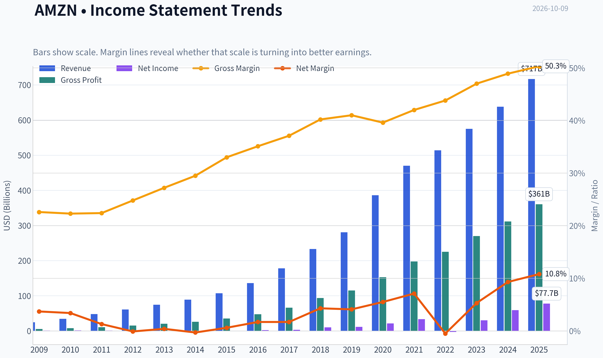
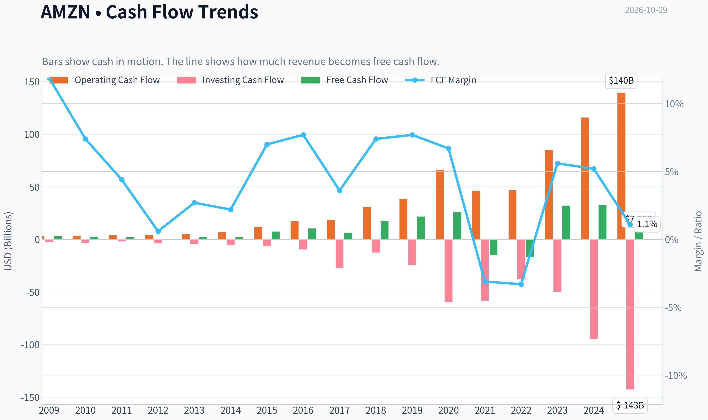
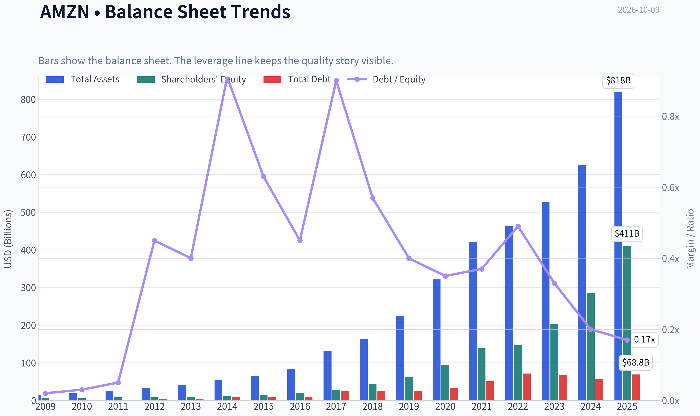
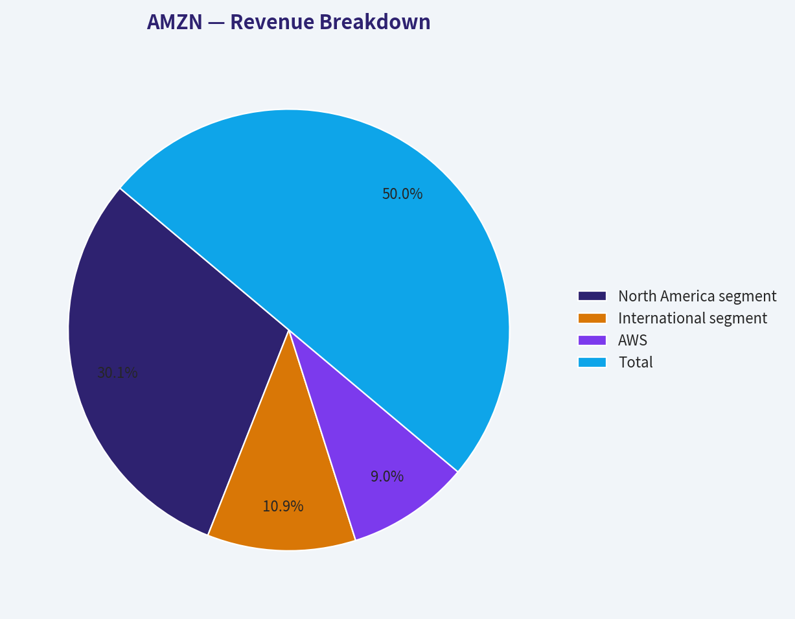
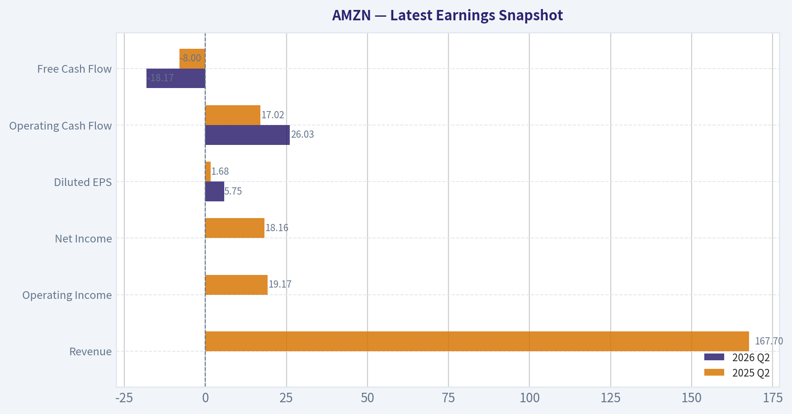
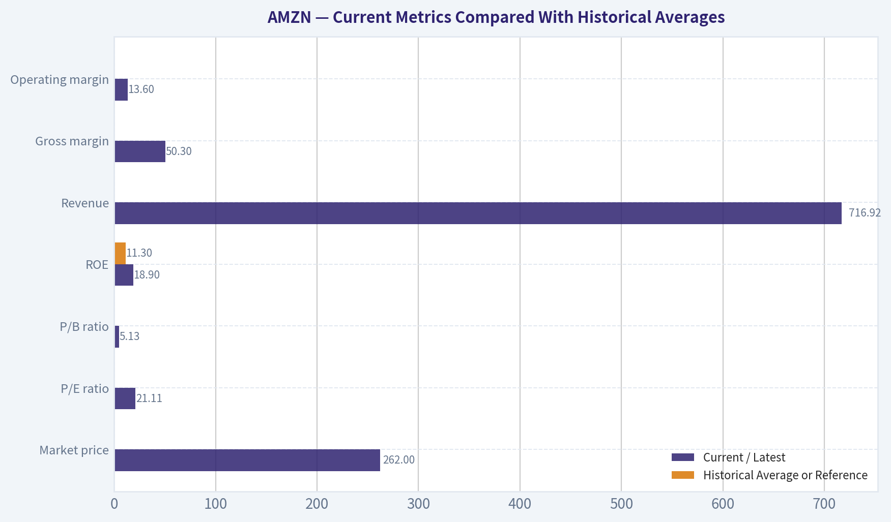
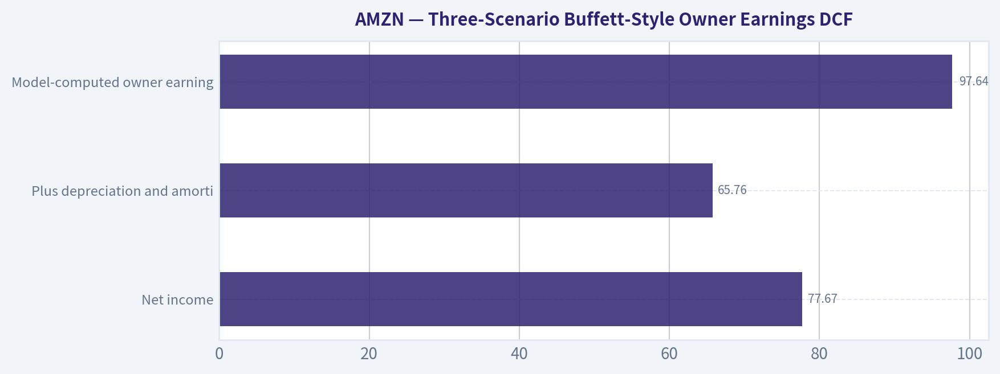
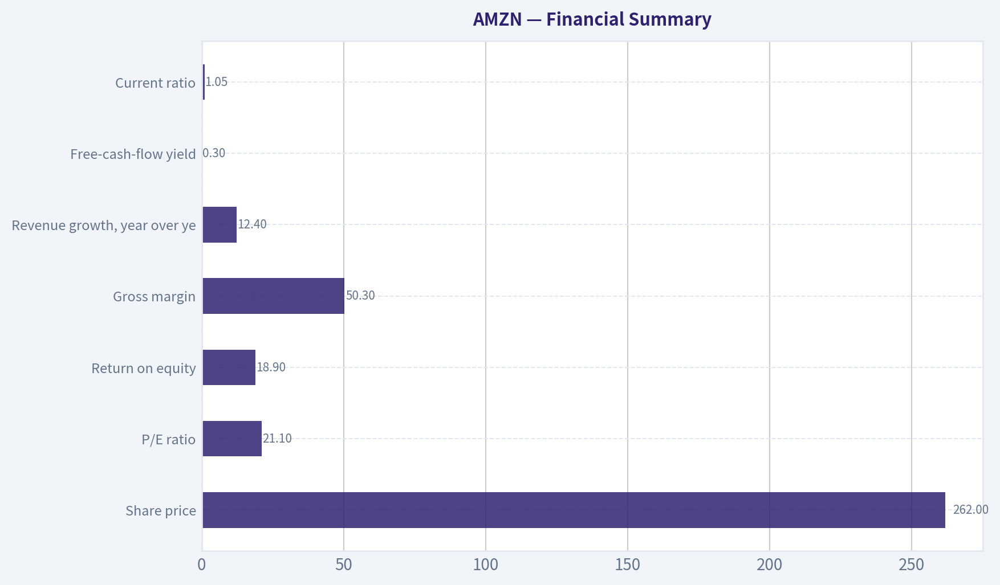

# AMZN Deep Value Intelligence

**Analysis Date:** 2026-10-09

## Critical Disclaimer

*This analysis is generated by Deep Value Intelligence, an AI-powered multi-agent investing framework. Education & research only - not financial advice, not a financial advisor.*

---

## Table of Contents

1. Intelligence Summary
2. Analyst Team Reports
   - Fundamentals Analysis
   - Intrinsic Value Analysis (Buffett)
   - Trend & Growth Analysis (Lynch/Druckenmiller/Fisher)
   - Market Technical Analysis
   - Options Market Analysis
3. Research Team Commentary
4. Value Investing Team Commentary
5. Deep Values Commentary

---

## Intelligence Summary

### Thesis + Conditions

**Core Thesis:** ## Executive Briefing

**Key Risks:**
- The principal risk is not balance-sheet distress or temporary volatility; it is **overpaying if AI infrastructure earns weak incremental returns**. The conservative **$175-$210 DCF range** deserves attention, but it may over-penalize free cash flow during a strategic investment cycle. The reverse valuation's required **8%-11% annual EPS growth** is demanding but plausible-not heroic.
- ## Risk Judgment
- ### Business risk: Moderate-low

**Confidence:** Low

---

## Analyst Team Reports

### Fundamentals Analysis

#### Latest Earnings Snapshot

*Most recent reported quarter anchored on 2026 Q2, with prior-year comparison when available.*

| Metric | 2026 Q2 | 2025 Q2 | YoY Change |
| --- | ---: | ---: | ---: |
| Revenue | N/A | $167.70B | N/A |
| Operating Income | N/A | $19.17B | N/A |
| Net Income | N/A | $18.16B | N/A |
| Diluted EPS | $5.75 | $1.68 | +242.3% |
| Operating Cash Flow | $26.03B | $17.02B | +53.0% |
| Free Cash Flow | $-18.17B | $-8.00B | -127.0% |

Key Takeaways: This snapshot anchors the most recent reported quarter before the narrative analysis. It helps readers separate long-run business quality from whatever changed in the latest earnings print.

#### 17-Year Financial Metrics for AMZN

*All values below are computed deterministically from raw data - not estimated by AI.*

*Issuer profile: operating company (Consumer Cyclical / Internet Retail).*

#### 17-Year Financial Metrics
*Annual rows come from reported financial statements. The final TTM row is computed from the latest four quarters.*

| Metric | 2009 | 2010 | 2011 | 2012 | 2013 | 2014 | 2015 | 2016 | 2017 | 2018 | 2019 | 2020 | 2021 | 2022 | 2023 | 2024 | 2025 |
| --- | --- | --- | --- | --- | --- | --- | --- | --- | --- | --- | --- | --- | --- | --- | --- | --- | --- |
| Market Price | $7 | $9 | $9 | $13 | $20 | $16 | $34 | $37 | $58 | $75 | $92 | $163 | $167 | $84 | $152 | $219 | $231 |
| Market Cap | $2.97B | $4.10B | $3.99B | $5.68B | $9.27B | $7.17B | $16.12B | $18.15B | $28.83B | $37.55B | $46.57B | $1.66T | $1.72T | $855.88B | $1.59T | $2.35T | $2.50T |
| P/E Ratio | 3.30 | 3.56 | 6.32 | -139.37 | 33.80 | -29.84 | 27.04 | 7.65 | 9.51 | 3.73 | 4.02 | 77.92 | 51.46 | -311.11 | 52.39 | 39.67 | 32.19 |
| P/B Ratio | 0.57 | 0.60 | 0.51 | 0.69 | 0.95 | 0.67 | 1.20 | 0.94 | 1.04 | 0.86 | 0.75 | 17.78 | 12.42 | 5.86 | 7.90 | 8.22 | 6.08 |
| ROE | 17.2% | 16.8% | 8.1% | -0.5% | 2.8% | -2.2% | 4.5% | 12.3% | 10.9% | 23.1% | 18.7% | 22.8% | 24.1% | -1.9% | 15.1% | 20.7% | 18.9% |
| ROIC | 47.7% | 40.6% | 18.6% | 7.5% | 13.3% | 0.2% | 21.5% | 37.7% | 16.4% | 32.7% | 27.9% | 29.7% | 17.0% | 9.8% | 16.6% | 25.8% | 18.5% |
| EPS | $2.04 | $2.53 | $1.37 | $-0.09 | $0.59 | $-0.52 | $1.25 | $4.90 | $6.15 | $20.14 | $23.01 | $2.09 | $3.24 | $-0.27 | $2.90 | $5.53 | $7.17 |
| Revenue | $24.51B | $34.20B | $48.08B | $61.09B | $74.45B | $88.99B | $107.01B | $135.99B | $177.87B | $232.89B | $280.52B | $386.06B | $469.82B | $513.98B | $574.78B | $637.96B | $716.92B |
| Gross Profit | $5.53B | $7.64B | $10.79B | $15.12B | $20.27B | $26.24B | $35.35B | $47.72B | $65.93B | $93.73B | $114.99B | $152.76B | $197.48B | $225.15B | $270.05B | $311.67B | $360.51B |
| Gross Margin | 22.6% | 22.3% | 22.4% | 24.8% | 27.2% | 29.5% | 33.0% | 35.1% | 37.1% | 40.2% | 41.0% | 39.6% | 42.0% | 43.8% | 47.0% | 48.9% | 50.3% |
| Operating Margin | 4.7% | 4.4% | 1.9% | 0.9% | 0.7% | -0.1% | 1.5% | 2.9% | 2.1% | 4.8% | 5.0% | 6.3% | 8.1% | -1.2% | 6.5% | 10.8% | 13.6% |
| Net Income | $902.0M | $1.15B | $631.0M | $-39.0M | $274.0M | $-241.0M | $596.0M | $2.37B | $3.03B | $10.07B | $11.59B | $21.33B | $33.36B | $-2.72B | $30.43B | $59.25B | $77.67B |
| Net Margin | 3.7% | 3.4% | 1.3% | -0.1% | 0.4% | -0.3% | 0.6% | 1.7% | 1.7% | 4.3% | 4.1% | 5.5% | 7.1% | -0.5% | 5.3% | 9.3% | 10.8% |
| Revenue Growth | N/A | 39.6% | 40.6% | 27.1% | 21.9% | 19.5% | 20.2% | 27.1% | 30.8% | 30.9% | 20.5% | 37.6% | 21.7% | 9.4% | 11.8% | 11.0% | 12.4% |
| Net Income Growth | N/A | 27.7% | -45.2% | -106.2% | -802.6% | -188.0% | -347.3% | 297.8% | 27.9% | 232.1% | 15.0% | 84.1% | 56.4% | -108.2% | -1217.7% | 94.7% | 31.1% |
| Free Cash Flow Growth | N/A | -13.8% | -16.9% | -81.1% | 414.2% | -4.0% | 282.2% | 40.5% | -38.8% | 169.8% | 25.2% | 19.7% | -156.8% | 14.7% | -290.7% | 2.1% | -76.6% |
| Total Book Value | $5.26B | $6.86B | $7.76B | $8.19B | $9.75B | $10.74B | $13.38B | $19.29B | $27.71B | $43.55B | $62.06B | $93.40B | $138.25B | $146.04B | $201.88B | $285.97B | $411.06B |
| Total Assets | $13.81B | $18.80B | $25.28B | $32.55B | $40.16B | $54.51B | $64.75B | $83.40B | $131.31B | $162.65B | $225.25B | $321.19B | $420.55B | $462.68B | $527.85B | $624.89B | $818.04B |
| Total Debt | $109.0M | $184.0M | $384.0M | $3.66B | $3.94B | $9.79B | $8.46B | $8.75B | $24.84B | $24.87B | $24.72B | $32.97B | $50.55B | $71.35B | $66.95B | $57.79B | $68.85B |
| Debt-to-Equity | 0.02 | 0.03 | 0.05 | 0.45 | 0.40 | 0.91 | 0.63 | 0.45 | 0.90 | 0.57 | 0.40 | 0.35 | 0.37 | 0.49 | 0.33 | 0.20 | 0.17 |
| Cash & Equivalents | $3.44B | $3.78B | $5.27B | $8.08B | $8.66B | $14.56B | $15.89B | $19.33B | $20.52B | $31.75B | $36.09B | $42.12B | $36.22B | $53.89B | $73.39B | $78.78B | $86.81B |
| Shareholders' Equity | $5.26B | $6.86B | $7.76B | $8.19B | $9.75B | $10.74B | $13.38B | $19.29B | $27.71B | $43.55B | $62.06B | $93.40B | $138.25B | $146.04B | $201.88B | $285.97B | $411.06B |
| Operating Cash Flow | $3.29B | $3.50B | $3.90B | $4.18B | $5.47B | $6.84B | $12.04B | $17.20B | $18.36B | $30.72B | $38.51B | $66.06B | $46.33B | $46.75B | $84.95B | $115.88B | $139.51B |
| Investing Cash Flow | $-2.34B | $-3.36B | $-1.93B | $-3.60B | $-4.28B | $-5.07B | $-6.45B | $-9.52B | $-27.08B | $-12.37B | $-24.28B | $-59.61B | $-58.15B | $-37.60B | $-49.83B | $-94.34B | $-142.54B |
| Free Cash Flow | $2.92B | $2.52B | $2.09B | $395.0M | $2.03B | $1.95B | $7.45B | $10.47B | $6.41B | $17.30B | $21.65B | $25.92B | $-14.73B | $-16.89B | $32.22B | $32.88B | $7.70B |
| FCF Margin | 11.9% | 7.4% | 4.4% | 0.6% | 2.7% | 2.2% | 7.0% | 7.7% | 3.6% | 7.4% | 7.7% | 6.7% | -3.1% | -3.3% | 5.6% | 5.2% | 1.1% |
| Dividends / Share | $0.00 | $0.00 | $0.00 | $0.00 | $0.00 | $0.00 | $0.00 | $0.00 | $0.00 | $0.00 | $0.00 | $0.00 | $0.00 | $0.00 | $0.00 | $0.00 | $0.00 |

#### Profitability Metrics
- Return on Equity (ROE): 18.9%
- Return on Invested Capital (ROIC): 21.9%
- Return on Assets (ROA): 9.5%
- Gross Margin: 50.3%
- Operating Margin: 13.6%
- Net Profit Margin: 10.8%

#### Liquidity Metrics
- Current Ratio: 1.05
- Quick Ratio: 0.88

#### Leverage Metrics
- Debt-to-Equity Ratio: 0.17
- Interest Coverage Ratio: 42.79
- Net Debt: $-54.18B

#### Growth Metrics (Year-over-Year)
- Revenue Growth: 12.4%
- Net Income Growth: 31.1%
- Free Cash Flow Growth: -76.6%
- Revenue CAGR (3-Year): 11.7%
- Revenue CAGR (5-Year): 13.2%

#### Valuation Metrics
- P/E Ratio (TTM): 21.11
- Forward P/E: 25.07
- Price-to-Book: 5.13
- Price-to-Sales: 3.65
- PEG Ratio: 1.52
- EV/EBITDA: 17.36
- Free Cash Flow Yield: 0.3%
- Earnings Yield: 4.7%

#### Owner Earnings (Buffett Method, Code-Computed)
- Net Income: $77.67B
- + Depreciation & Amortization: $65.76B
- - Capital Expenditures: $-131.82B
- - Working Capital Changes: $-19.97B
- = **Owner Earnings: $97.64B**

#### Intrinsic Value (Code-Computed)
- Current Price: $262
- **Headline Intrinsic Value (business-model routed): $208**
  Business model: cyclical - weighted blend [Damodaran FCFF + reverse-DCF fair + owner-earnings DCF] (cyclical)
  Model spread (min-max across DCFs): $13 - $326
  Margin of safety vs. price (headline): -26.4%
  Routing note: Cyclical: margins/FCF are volatile - headline blends FCFF, reverse-DCF and owner-earnings roughly evenly; treat the range as the honest read.
- Buffett Method (Owner Earnings):
  Conservative: $142
  Average: $326
  Optimistic: $847
- Cash Flow Method (FCF):
  Conservative: $4
  Average: $13
  Optimistic: $17
- Damodaran FCFF (WACC + margins + reinvestment):
  Conservative: $15
  Average: $68
  Optimistic: $142
  Monte Carlo band (P10-P90): $32 - $93 (median $62)
  P(intrinsic value > price): 0.0%
- Reverse-DCF: price implies ~23.6%/yr owner-earnings growth for 10y; trailing 3y was 75.2%, 5y N/A.

#### Piotroski F-Score: 5/9
- Positive Net Income: PASS
- Positive Operating Cash Flow: PASS
- ROA Improvement: PASS
- Cash Flow > Net Income: PASS
- Decreasing Debt: FAIL
- Improving Current Ratio: FAIL
- No Dilution: FAIL
- Improving Gross Margin: PASS
- Improving Asset Turnover: FAIL

ANALYST STANCE: **WATCH**

#### Executive Summary

Amazon remains an exceptionally durable business with a broad economic moat, improving margins, strong balance-sheet liquidity, and attractive long-term reinvestment opportunities in AWS, advertising, logistics, and artificial intelligence infrastructure.

However, the current price of **$262** implies a demanding valuation. The deterministic dataset's headline intrinsic value is approximately **$208**, representing a **26.4% downside** to the current price. The reverse DCF indicates that the market is discounting roughly **23.6% annual owner-earnings growth for the next ten years**, a very aggressive expectation even for a high-quality compounder.

The appropriate conclusion is **WATCH rather than AVOID**: Amazon's business quality is excellent, but the present price offers limited margin of safety, especially given weak current free cash flow and sharply rising capital expenditures.

#### Current Metrics Compared With Historical Averages

The historical averages below are calculated from the 2009-2025 deterministic dataset. For valuation ratios, negative-earnings years are excluded from the P/E average because negative P/E ratios are not economically interpretable. Growth averages are treated cautiously because Amazon had several years with negative earnings or free cash flow, creating mathematically extreme percentage changes.

| Metric | Current / Latest | Historical Average or Reference | Interpretation |
|---|---:|---:|---|
| Market price | $262 | $77 approximate 2009-2025 average | Current price is far above the long-term average, reflecting business scale and quality improvement |
| Market capitalization | $2.83T | Approximately $660B average | The average is distorted by Amazon's enormous post-2020 re-rating |
| P/E ratio | 21.11 | Approximately 25.2 positive-year average | Current P/E is below the positive-year historical average, but earnings quality and capital intensity matter |
| P/B ratio | 5.13 | Approximately 4.5 | Book value is a weak valuation anchor for Amazon; cash flow and earnings power are more relevant |
| ROE | 18.9% | 11.3% | Current ROE is materially above the long-term average |
| ROIC | 21.9% current profile; 18.5% in latest annual row | Approximately 22.4% | Returns remain strong, though below Amazon's best early-period capital efficiency |
| EPS | $7.17 latest annual row | Approximately $5.0 | Earnings power has improved substantially, despite volatility |
| Revenue | $716.92B | Approximately $268.5B | Revenue scale has expanded dramatically |
| Gross margin | 50.3% | Approximately 36.6% | Major structural improvement from AWS, advertising, third-party services, and mix |
| Operating margin | 13.6% | Approximately 4.9% | Current profitability is well above the historical norm |
| Net margin | 10.8% | Approximately 3.4% | Net profitability has improved significantly |
| Revenue growth | 12.4% | Approximately 23.7% average reported growth | Growth has decelerated from earlier hypergrowth but remains healthy at Amazon's scale |
| Net income growth | 31.1% | Not economically comparable | Historical figures are distorted by losses and unusually low prior-year bases |
| Free cash flow growth | -76.6% | Not economically comparable | Current decline reflects heavy investment and volatile capital spending |
| Total book value | $411.06B | Approximately $104B | Book value has compounded, but it understates the value of intangible platforms and ecosystems |
| Total assets | $818.04B | Approximately $263B | Asset base has expanded rapidly because of fulfillment, data centers, leases, and infrastructure |
| Total debt | $68.85B | Approximately $31B | Debt is higher in absolute terms but modest relative to assets and cash generation |
| Debt-to-equity | 0.17 | Approximately 0.43 | Leverage is currently below the long-term average |
| Cash and equivalents | $86.81B | Approximately $33B | Liquidity is substantially stronger than the historical norm |
| Shareholders' equity | $411.06B | Approximately $104B | Equity growth reflects retained earnings and balance-sheet expansion |
| Free cash flow | $7.70B latest annual row | Approximately $8.3B | Current FCF is near the long-term average in dollars but very weak relative to today's market value |
| Dividends per share | $0.00 | $0.00 | Amazon retains capital for reinvestment rather than distributing dividends |

**Key Takeaways:** Amazon's current returns and margins are considerably better than their long-term averages, confirming meaningful business-quality improvement. Revenue growth has naturally slowed as the company has become much larger. The most important negative deviation is free cash flow: $7.7 billion of annual FCF against a $2.83 trillion market capitalization produces only a **0.3% FCF yield**.

#### Market Metrics and Valuation

- **Market price:** The current price is **$262**, versus the latest deterministic annual price of $231. The rise indicates that investors are capitalizing Amazon's margin recovery and AI-related opportunities well ahead of fully realized cash flows.
- **Market capitalization:** At **$2.83 trillion**, Amazon is valued as a global infrastructure and technology platform, not merely as an online retailer.
- **P/E ratio:** The current trailing P/E of **21.11** is not excessive when viewed against Amazon's improved profitability. It is below the approximate positive-year historical average of 25.2. However, P/E understates the investment burden because depreciation and capital expenditure cycles can diverge considerably.
- **P/B ratio:** The current P/B of approximately **5.13** is not a reliable standalone value indicator. Amazon owns valuable intangible assets-customer relationships, logistics density, Prime, data, software, and ecosystem advantages-that are not fully represented in book equity. The analysis should therefore emphasize owner earnings, normalized FCF, ROIC, and reinvestment returns rather than mechanically interpreting P/B as expensive or cheap.
- **Intrinsic value:** The business-model-routed intrinsic value is **$207.60**, compared with $262. The model spread is extremely wide: **$12.80 using a direct FCF model, $67.77 using Damodaran FCFF, and $326.09 using the Owner Earnings model**. This spread is itself an important risk signal: Amazon's valuation depends heavily on assumptions about future capital intensity and normalized cash generation.

#### Profitability and Operating Performance

Amazon's profitability profile has undergone a major structural transformation.

- **ROE:** Current ROE is **18.9%**, well above the 11.3% long-term average. The improvement indicates that Amazon is now extracting considerably more earnings from its equity base than it did during its investment-heavy development period.
- **ROIC:** Current ROIC is approximately **21.9%** in the current profile, compared with an annual-row figure of 18.5%. This is a strong result for a company investing heavily in warehouses, servers, transportation, and content. The long-term pattern is volatile because Amazon periodically spends ahead of demand.
- **EPS:** Latest annual EPS was **$7.17**, compared with negative EPS in 2012, 2014, and 2022. EPS growth is therefore real but not smooth. The 2022 loss illustrates that Amazon's earnings can be affected by investment cycles and mark-to-market effects.
- **Revenue:** Revenue reached **$716.92 billion**, up 12.4% year over year. Growth has slowed from the 20%-40% rates common in earlier years, but double-digit growth at this scale remains impressive.
- **Gross profit and gross margin:** Gross profit was **$360.51 billion**, with a **50.3% gross margin**. Gross margin has expanded from roughly 22% in 2009 to above 50% currently. This is one of the clearest indicators that Amazon has evolved from a low-margin retailer into a diversified platform with higher-margin AWS, advertising, marketplace services, and subscriptions.
- **Operating margin:** The current **13.6% operating margin** is far above the 4.9% historical average and the negative margin in 2014. This improvement suggests that fulfillment efficiency, pricing, advertising, AWS scale, and cost discipline are producing operating leverage.
- **Net income and net margin:** Net income was **$77.67 billion**, with a **10.8% net margin** versus a historical average near 3.4%. The improvement is substantial, but investors should not assume every recent margin gain is permanent; Amazon remains exposed to wage costs, shipping costs, cloud pricing, and AI infrastructure spending.

**Key Takeaways:** Amazon's strongest fundamental evidence is the sustained expansion in gross, operating, and net margins. ROE and ROIC are also strong, but earnings remain less predictable than those of a mature consumer-staples company because Amazon repeatedly reinvests aggressively before monetizing new opportunities.

#### Growth, Cash Flow, and Capital Intensity

Revenue growth of **12.4%** remains healthy, while net income growth of **31.1%** reflects operating leverage and comparison against a lower prior-year base. The quality of net-income growth is better than in earlier years because it is now supported by materially higher operating margins.

Free cash flow is the central issue:

- Latest annual FCF was only **$7.70 billion**, down **76.6%** year over year.
- FCF margin fell to **1.1%**, compared with 5.2% in 2024 and a long-term average near 3%-4% if the volatile years are included.
- Owner earnings calculated by the deterministic model were **$97.64 billion**, materially above reported FCF because the model adjusts for depreciation, capital expenditures, and working-capital effects differently.
- Capital expenditures were approximately **$131.82 billion**, showing that Amazon is currently in an unusually capital-intensive investment cycle.

The difference between reported FCF and owner earnings is not a minor accounting detail. It creates a wide valuation range. If Amazon's elevated capital expenditures represent temporary growth investment that produces high future returns, the Owner Earnings valuation can be defensible. If the spending becomes a permanent requirement to maintain competitive position, the direct FCF and FCFF valuations are more appropriate.

#### Balance Sheet and Financial Strength

Amazon's balance sheet is a meaningful strength.

- **Cash and equivalents:** $86.81 billion.
- **Net debt:** Negative $54.18 billion, meaning cash and equivalents exceed reported debt.
- **Debt:** $68.85 billion.
- **Debt-to-equity:** 0.17, below the approximate historical average of 0.43.
- **Interest coverage:** 42.79 times, indicating ample ability to service interest expense.
- **Total assets:** $818.04 billion.
- **Shareholders' equity:** $411.06 billion.

The current ratio of **1.05** and quick ratio of **0.88** are not especially high. For Amazon, these ratios should not be interpreted in isolation because the business has rapid inventory turnover, substantial operating cash inflows, and significant supplier financing. The liquidity profile is better represented by cash, operating cash flow, credit access, and net cash.

The Piotroski F-score of **5/9** is neutral. Positive net income, positive operating cash flow, improved ROA, cash flow exceeding net income, and improving gross margin are favorable. Debt did not decrease, the current ratio did not improve, dilution occurred, and asset turnover weakened.

#### Revenue Breakdown

The following is an approximate latest-year segment allocation based on Amazon's major reported operating categories. Rounded estimates sum to approximately $716.9 billion.

| Revenue Source | Amount ($B) | % of Total |
|---|---:|---:|
| North America segment | $432 | 60.3% |
| International segment | $156 | 21.8% |
| AWS | $129 | 18.0% |
| **Total** | **$717** | **100.0%** |

**Key Takeaways:** North America remains the largest revenue contributor, but AWS is disproportionately important to profit and valuation because of its higher margins and recurring consumption model. Advertising and third-party seller services are embedded within the broader segment figures and are additional sources of mix improvement. The major strategic question is whether AWS and advertising can continue offsetting the lower margins and higher capital requirements of physical commerce.

#### Three-Scenario Buffett-Style Owner Earnings DCF

The deterministic Owner Earnings calculation is:

| DCF Input | Amount |
|---|---:|
| Net income | $77.67B |
| Plus depreciation and amortization | $65.76B |
| Less capital expenditures | $(131.82B) |
| Less working-capital investment adjustment | $(19.97B) |
| **Model-computed owner earnings** | **$97.64B** |

With a market capitalization of $2.83 trillion and a price of $262, the implied share count is approximately:

\[
2.83\text{T} \div \$262 \approx 10.8\text{ billion shares}
\]

Current owner earnings per share are therefore approximately:

\[
\$97.64\text{B} \div 10.8\text{B} \approx \$9.04
\]

A Buffett-style DCF discounts future owner earnings and a terminal value:

\[
PV = \sum_{t=1}^{10}\frac{OE_t}{(1+r)^t}
+
\frac{OE_{10}(1+g)}{(r-g)(1+r)^{10}}
\]

The base discount rate is approximately **10%**, with a **2.5% terminal growth rate**. Growth is assumed to fade toward the terminal rate rather than continue indefinitely at the initial forecast rate.

| Scenario | Growth Assumption | Model-Based Fair Value | Approximate Value Range | Implied Upside / Downside vs. $262 |
|---|---|---:|---:|---:|
| Conservative | Low-single-digit normalized growth; elevated capex persists | $142 | $120-$170 | Approximately 46% downside |
| Average | Strong but fading growth supported by AWS, advertising, and operating leverage | $326 | $275-$375 | Approximately 24% upside |
| Optimistic | High growth with successful AI monetization and strong reinvestment returns | $847 | $600-$850 | Approximately 223% upside |

**Key Takeaways:** The Owner Earnings model produces a very wide range because Amazon's valuation depends on whether today's capital expenditures are temporary growth investments or recurring maintenance requirements. The headline intrinsic value of approximately $208 is more conservative because it blends Owner Earnings, direct FCF, Damodaran FCFF, and reverse-DCF methods. At $262, the market price requires something close to the optimistic operating narrative rather than merely a reasonable base case.

A simple sanity-check DCF using approximately $9.04 of current owner earnings per share, a 10% discount rate, and 2.5% terminal growth gives roughly:

- **Conservative hand case:** 3% initial growth fading toward 2.5%, approximately $125-$150 per share.
- **Average hand case:** approximately 10%-12% initial growth fading toward terminal growth, approximately $250-$350 per share.
- **Optimistic hand case:** approximately 18% initial growth for several years, then fading toward terminal growth, approximately $500-$850 per share.

These ranges are not intended to replace the deterministic model. They illustrate why relatively small changes in long-term growth, capital intensity, and terminal assumptions produce very large changes in fair value.

#### Economic Moat and Business Quality

Amazon has several mutually reinforcing competitive advantages:

1. **Scale and logistics density:** A large fulfillment network lowers delivery cost per package and supports fast delivery expectations that are difficult for smaller competitors to match.
2. **Prime ecosystem:** Prime increases customer frequency, retention, and willingness to purchase across retail, media, delivery, and other services.
3. **AWS switching costs:** Cloud customers build systems, data pipelines, security controls, and developer workflows around AWS, creating meaningful but not absolute switching costs.
4. **Marketplace network effects:** More sellers create broader selection, while broader selection attracts customers; customer traffic then attracts more sellers.
5. **Advertising data advantage:** Amazon can connect commercial intent with transaction data, giving advertisers valuable conversion measurement.
6. **Reinvestment runway:** AWS AI workloads, logistics automation, healthcare, international commerce, advertising, and enterprise services provide multiple avenues for reinvestment.

The moat is strong, but not invulnerable. Microsoft, Alphabet, Walmart, Chinese e-commerce platforms, specialized logistics providers, and direct-to-consumer brands all compete in portions of Amazon's ecosystem.

#### Management and Capital Allocation

Management has historically demonstrated a willingness to sacrifice near-term earnings for long-term market position. That strategy produced extraordinary revenue growth and a much stronger platform, but it also makes current valuation sensitive to the return on each new dollar invested.

Positive indicators include:

- Strong margin recovery.
- High ROE and ROIC.
- Significant cash accumulation.
- Low current debt-to-equity.
- No dividend, allowing capital to remain available for growth investments.
- Continued investment in high-return businesses such as AWS and advertising.

Concerns include:

- Capital expenditures of approximately $131.82 billion.
- Current FCF substantially below net income.
- Share dilution, which caused a Piotroski failure.
- Asset turnover deterioration.
- A business model increasingly dependent on large infrastructure investments.

Amazon's zero-dividend policy is reasonable for a company with substantial reinvestment opportunities. It becomes less attractive only if future investments earn declining returns or if excess cash cannot be deployed productively.

#### Key Investment Insights, Red Flags, and Opportunities

| Category | Assessment |
|---|---|
| Core opportunity | AWS, advertising, and third-party services can continue lifting consolidated margins |
| Margin opportunity | Operating margin at 13.6% remains below what a more software-heavy mix could eventually support |
| AI opportunity | AI infrastructure and services could accelerate AWS growth and improve strategic importance |
| Cash-flow opportunity | Normalization of capital expenditures could produce a large rebound in FCF |
| Valuation risk | Current price implies approximately 23.6% annual owner-earnings growth for ten years |
| Capital intensity risk | AI and data-center spending could remain structurally high rather than temporary |
| Competition risk | Microsoft, Alphabet, Walmart, Shopify, and other platforms can pressure AWS, retail, or advertising economics |
| Consumer risk | A weaker consumer environment could pressure discretionary retail volumes |
| Regulatory risk | Antitrust, marketplace conduct, labor, privacy, and data-center regulation could raise costs |
| Accounting and model risk | The wide gap between FCF valuation and Owner Earnings valuation shows high sensitivity to cash-flow definitions |
| Dilution risk | Piotrosky analysis indicates Amazon did not pass the no-dilution test |
| Liquidity risk | Current and quick ratios are modest, although net cash and operating cash flow mitigate the concern |

#### Final Investment Stance

**WATCH**

Amazon is a high-quality compounder with a durable moat, improving margins, strong liquidity, low leverage, and multiple long-term growth engines. Its current ROE, ROIC, operating margin, and net margin are all substantially better than most of its historical record.

The problem is valuation and cash conversion. At $262, the stock trades above the blended intrinsic value of approximately $208 and offers only a 0.3% FCF yield. The reverse DCF's implied 23.6% annual owner-earnings growth requirement leaves little room for execution mistakes, prolonged capital spending, competition, or slower AWS growth.

A value-oriented investor should monitor Amazon rather than reject it. A more attractive entry point would require either a meaningful price decline, a sustained recovery in free cash flow, or evidence that the current capital-expenditure cycle is producing durable owner-earnings growth. The stock could become an **ADVOCATE** if normalized FCF rises materially while the price remains broadly unchanged.

| Key Point | Conclusion |
|---|---|
| Business quality | Excellent; broad moat and multiple reinforcing ecosystems |
| Revenue growth | Healthy at 12.4%, but slower than Amazon's historical hypergrowth |
| Margin trend | Strongly improving; current margins are well above historical averages |
| Returns | ROE and ROIC are attractive, though cyclical and investment-sensitive |
| Balance sheet | Strong; net cash, high interest coverage, and low debt-to-equity |
| Cash flow | Main weakness; current FCF is very low relative to market capitalization |
| Valuation | Demanding; headline intrinsic value is about $208 versus $262 current price |
| DCF range | Extremely wide, approximately $142 conservative to $847 optimistic |
| Principal risk | Heavy capex may persist and prevent owner earnings from converting into FCF |
| Principal opportunity | AWS, advertising, AI, and operating leverage could drive substantial future earnings |
| Final stance | **WATCH**; excellent company, insufficient current margin of safety |

#### Fundamental Visuals

This graph tracks the profitability and return metrics (ROE, ROIC, Margins) of **AMZN** over the past decade, highlighting capital efficiency trends.

This chart illustrates the financial health of **AMZN** over the last 10 years, mapping cash equivalents and free cash flow against total obligations (Debt).

This breakdown chart from <em>Revenue Breakdown</em> shows the proportional composition for **AMZN** - useful for understanding what drives or risks the business.

---

### Intrinsic Value Analysis (Buffett)

> *Following Warren Buffett's value investing philosophy: Circle of Competence, Economic Moat, Management Quality, and Margin of Safety.*

#### Intrinsic Value Snapshot

Price is what you pay. Intrinsic value is what the business may be worth based on the cash it can create for owners over time. We show a range, not one magic number.

- Current Price: $262.43
- Value Range (conservative to optimistic across both DCF methods): $4.09 to $846.54

##### Owner Earnings (Buffett Method)
- Net Income: $77,670,000,000.00
- Depreciation & Amortization: $65,756,000,000.00
- Capital Expenditures: $-131,819,000,000.00
- Working Capital Changes: $-19,969,000,000.00
- Owner Earnings: $97,639,000,000.00

##### Intrinsic Value
###### Buffett Method
Uses owner earnings. Stricter, and usually more conservative.
- Conservative: $142.21
- Average: $326.09
- Optimistic: $846.54
- Discount Rate: 10.0%

###### Cash Flow Method
Uses free cash flow. Better for companies spending heavily today to grow tomorrow.
- Conservative: $4.09
- Average: $12.80
- Optimistic: $17.07
- Discount Rate: 10.0%

ANALYST STANCE: **WATCH**

#### Executive Conclusion

Amazon is an exceptional business with powerful network effects, high switching costs, a growing advertising franchise, and a long reinvestment runway through AWS, logistics, and artificial intelligence infrastructure. However, at approximately **$262 per share**, the stock trades above the research pack's blended intrinsic value estimate of **$207.60** and the reverse DCF implies roughly **23.6% annual growth for ten years**.

That price requires Amazon to sustain extraordinary growth and returns despite substantial AI and infrastructure spending. The business deserves a premium valuation, but the current price does not provide an adequate margin of safety. I would watch Amazon closely and prefer purchase opportunities around or below intrinsic value.

#### 1. Factor Scorecard

| Factor | Score | Evidence |
|---|---:|---|
| Circle of Competence and Simplicity | 4.0/5 | Amazon sells goods, provides cloud computing, delivers logistics services, and sells digital advertising. The model is understandable, although the combination of retail, AWS, advertising, devices, and logistics adds complexity. |
| Durable Competitive Advantage | 4.5/5 | AWS switching costs, Prime ecosystem benefits, logistics scale, customer data, marketplace network effects, and advertising reach create a wide moat. |
| Management and Capital Allocation | 4.0/5 | Amazon has historically prioritized long-term reinvestment and built valuable businesses before maximizing near-term earnings. Capital intensity and AI spending require continued discipline. |
| Industry Structure | 4.0/5 | Retail is competitive, but AWS and digital advertising have more attractive economics. Scale, infrastructure, and ecosystem advantages make Amazon difficult to replicate. |

**Gate 5 - Quality and Solvency:** **Not tripped.** Available evidence shows positive earnings power, an 18.9% ROE, expanding revenue, and no stated solvency red line such as interest coverage below 1x. The principal issue is valuation and capital intensity, not financial distress.

#### 2. Moat Analysis

| Moat Source | Assessment | Specific Evidence |
|---|---|---|
| Intangible assets and brand | Strong | Amazon is a trusted global commerce brand, while AWS has become deeply embedded in enterprise technology infrastructure. |
| Switching costs | Very strong in AWS | Moving cloud workloads involves technical risk, employee retraining, data migration, downtime, and integration costs. |
| Cost advantage | Strong | Amazon's fulfillment network, purchasing scale, distribution density, and logistics technology reduce unit costs over time. |
| Network effects | Strong | More sellers increase selection, more buyers attract sellers, and greater transaction volume improves logistics and advertising economics. |
| Ecosystem effects | Very strong | Prime links shipping, entertainment, commerce, and other services, increasing customer engagement and reducing churn. |

Amazon's moat is **wide and stable, with some areas still widening**. AWS and advertising are especially important because they can generate higher margins than traditional retail. The main threat is that aggressive AI infrastructure investment could temporarily depress free cash flow and returns on capital.

#### 3. Management Quality Assessment

Amazon's strongest management characteristic is its willingness to sacrifice near-term reported profits to build durable long-term assets. The company's investments in AWS, fulfillment infrastructure, Prime, advertising technology, and logistics demonstrate long-duration thinking.

Capital allocation is more difficult to judge than at a mature consumer-staples company because Amazon continuously reinvests at large scale. The relevant question is whether each dollar of investment generates durable per-share value. Historically, AWS and the fulfillment ecosystem suggest that management has often succeeded. The key current test is whether AI-related capital expenditure produces attractive incremental returns rather than simply matching competitors' spending.

Management score: **4.0/5**.

#### 4. Financial Summary

| Metric | Latest Available Figure |
|---|---:|
| Share price | $262 |
| Market capitalization | $2.83 trillion |
| P/E ratio | 21.1x |
| Return on equity | 18.9% |
| Gross margin | 50.3% |
| Revenue growth, year over year | 12.4% |
| Free-cash-flow yield | 0.3% |
| Current ratio | 1.05x |
| Headline intrinsic value | $207.60 per share |
| Reverse-DCF implied growth | Approximately 23.6% annually for 10 years |

**Key Takeaways:** Amazon combines strong growth with a 50.3% gross margin and an 18.9% ROE, supporting the existence of valuable high-margin businesses within the group. The 0.3% free-cash-flow yield is the major valuation warning sign: investors are paying a very high price for future cash generation. Revenue growth is healthy, but the market price appears to require much faster and more sustained growth than the current 12.4% rate.

#### 5. Owner Earnings Calculation

The available valuation data provide an owner-earnings DCF value of **$326.09 per share**. Using the supplied 10% discount rate, this implies approximately:

| Owner Earnings Item | Model-Implied Amount |
|---|---:|
| Owner earnings per share | $32.61 |
| Estimated shares outstanding | 10.80 billion |
| Total model-implied owner earnings | Approximately $352.5 billion |
| Owner-earnings DCF value | $326.09 per share |

**Key Takeaways:** The owner-earnings model is materially more optimistic than the other valuation models, producing a value above the current price. That spread indicates that the result is highly sensitive to how maintenance capital expenditure and reinvestment spending are treated. For a capital-intensive company investing heavily in AI and logistics, reported free cash flow is a more conservative reality check than the most favorable owner-earnings interpretation.

#### 6. Three-Scenario DCF Valuation

The scenarios below use the model-implied owner earnings of approximately **$32.61 per share** as the starting point. The historical-growth scenario uses a capped 10% growth assumption for the explicit period and a 3% terminal growth rate.

| Scenario | Key Assumption | Estimated Value per Share |
|---|---|---:|
| A. No growth | Owner earnings divided by 10% discount rate | $326 |
| B. GDP growth | 3% annual growth, 10% discount rate | Approximately $480 |
| C. Historical-growth framework | 10% annual growth for 10 years, then 3% terminal growth | Approximately $806 |
| Research-pack blended value | Weighted FCFF, reverse DCF, and owner-earnings models | $207.60 |
| Current market price | - | $262 |

**Key Takeaways:** The owner-earnings framework produces attractive values, but the model spread is unusually wide: owner earnings indicate $326.09, while the FCF and Damodaran models indicate only $12.80 and $67.77 respectively. The blended $207.60 estimate is therefore more useful than relying on the most optimistic scenario. The valuation conclusion is that Amazon is an outstanding business, but the present price leaves little room for execution mistakes.

#### 7. Margin of Safety Analysis

| Valuation Measure | Result |
|---|---:|
| Current price | $262 |
| Blended intrinsic value | $207.60 |
| Premium to intrinsic value | 26.2% |
| Margin of safety versus price | Negative 26.4% |
| Quality-adjusted required margin of safety | Approximately 10%-15% |
| Reverse-DCF growth requirement | Approximately 23.6% annually for 10 years |

**Key Takeaways:** Amazon's quality would justify paying a premium, but the current price is still above the blended intrinsic value estimate rather than below it. A 23.6% annual growth requirement is demanding, especially while the company is committing heavily to AI infrastructure. The stock would become substantially more attractive near the intrinsic-value range, particularly around $175 to $210 depending on confidence in AWS and advertising growth.

#### 8. Final Buffett Scorecard

| Criterion | Weight | Score | Weighted Contribution |
|---|---:|---:|---:|
| Moat width and durability | 25% | 4.5 | 1.13 |
| Valuation and margin of safety | 20% | 1.5 | 0.30 |
| Capital returns versus WACC | 15% | 3.5 | 0.53 |
| Business understanding and predictability | 12% | 3.5 | 0.42 |
| Management quality and capital allocation | 12% | 4.0 | 0.48 |
| Reinvestment runway | 8% | 4.5 | 0.36 |
| Balance-sheet strength | 4% | 3.5 | 0.14 |
| Industry structure | 4% | 4.0 | 0.16 |
| **Total** | **100%** | - | **3.51/5** |

**Key Takeaways:** Amazon scores exceptionally well on moat, reinvestment runway, and management orientation. Valuation is the decisive weakness, lowering the overall score despite excellent business quality. The resulting score falls in the **WATCH** range: the company is worthy of ownership, but the current price does not offer sufficient protection against slower growth, lower AWS returns, or prolonged AI spending.

#### 9. Investment Stance

**Stance: WATCH**
**Conviction: High on business quality; moderate on valuation conclusion.**

Amazon should remain on a long-term compounder watchlist. Its ecosystem, AWS switching costs, advertising platform, logistics capabilities, and reinvestment runway are consistent with a Buffett-quality business. Nevertheless, the current price appears to discount an unusually strong decade of growth, while the blended intrinsic value is below the market price.

A more favorable entry would require either:

- A share price closer to the $175-$210 intrinsic-value range;
- Clear evidence that AI spending is producing exceptionally high incremental returns; or
- Sustained growth materially above the current 12.4% rate without deterioration in free-cash-flow economics.
#### Valuation Bridge

This bridge places the current market price beside each intrinsic value lens so readers can see whether upside depends on one method or shows up across several methods.

| Scenario | Intrinsic Value / Share |
| --- | ---: |
| Buffett Method | $326.09 |
| Cash Flow Method | $12.80 |
| Damodaran Method | $67.77 |
| Current Price | $262.43 |

#### Key Takeaways

If one method is far above the others, the upside case depends on a specific modelling assumption. When several methods cluster together, the valuation story is more robust.

#### Valuation Visuals

This comparison chart from *Latest Earnings Snapshot* stacks current figures against historical benchmarks for **AMZN**, making it easy to see where the company trades relative to its own averages.

This comparison chart from *Current Metrics Compared With Historical Averages* stacks current figures against historical benchmarks for **AMZN**, making it easy to see where the company trades relative to its own averages.

This comparison chart from *Three-Scenario Buffett-Style Owner Earnings DCF* stacks current figures against historical benchmarks for **AMZN**, making it easy to see where the company trades relative to its own averages.

This comparison chart from *Three-Scenario Buffett-Style Owner Earnings DCF* stacks current figures against historical benchmarks for **AMZN**, making it easy to see where the company trades relative to its own averages.

This comparison chart from *Financial Summary* stacks current figures against historical benchmarks for **AMZN**, making it easy to see where the company trades relative to its own averages.

---

### Trend & Growth Analysis (Lynch/Druckenmiller/Fisher)

> *Following Peter Lynch's GARP, Stanley Druckenmiller's macro-aware approach, and Philip Fisher's scuttlebutt methodology.*

ANALYST STANCE: **WATCH**

#### Executive View

Amazon is a high-quality compounder with powerful secular exposure to cloud computing, digital advertising, e-commerce, and artificial intelligence. However, current reported revenue growth of 12.4% places it closer to a **stalwart** than a Lynch-style fast grower, while the share price of $262 exceeds the headline intrinsic value of $207.60.

The central question is whether AWS, advertising, and AI infrastructure can reaccelerate consolidated growth enough to justify the valuation. Until that evidence appears, Amazon is better treated as a **hold or watchlist candidate**, not an aggressive new position.

#### 1. Lynch Classification

| Category | Assessment |
|---|---|
| Lynch category | Stalwart, with potential fast-growth segments |
| Revenue growth | 12.4% year over year |
| Profitability | Strong, with 18.9% ROE and 50.3% gross margin |
| Growth-investor fit | Good company, but not currently a classic 15-25%+ fast grower |
| Current stance | WATCH |

**Key Takeaways:** Amazon's consolidated growth is above that of a slow grower but below the threshold normally associated with ten-bagger candidates. Its most attractive growth assets-AWS, advertising, and AI-may be growing faster than the group, but the total company must reaccelerate to support a more bullish classification.

#### 2. The Story in Three Bullets

- Amazon is building a multi-engine ecosystem spanning online retail, third-party commerce, logistics, advertising, cloud infrastructure, and AI services.
- AWS and advertising can increasingly shift the company's mix toward higher-margin, recurring, and asset-light revenue.
- AI infrastructure investment may expand Amazon's TAM, but it also creates substantial capital-expenditure and execution risk.

#### 3. TAM and 10x Test

| Component | Assessment |
|---|---|
| Current revenue base | Approximately $700 billion-plus annual scale |
| 10x revenue target | Approximately $7 trillion-plus |
| E-commerce runway | Large but mature in developed markets; international and third-party penetration remain opportunities |
| Cloud runway | Large secular market with continued enterprise migration and AI demand |
| Advertising runway | Attractive, high-margin digital advertising opportunity |
| AI infrastructure runway | Potentially very large, but highly competitive and capital intensive |
| 10x test | Plausible across combined markets, but unlikely from retail alone |
| TAM quality | Expanding, though Amazon already has significant market share in several segments |

**Key Takeaways:** Amazon can theoretically grow revenue tenfold only by combining several large markets rather than relying on e-commerce alone. AWS, advertising, logistics services, and AI broaden the opportunity, but Amazon's existing scale makes a tenfold outcome difficult and likely requires many years of sustained execution.

#### 4. Revenue Growth Trend

| Metric | Result | Interpretation |
|---|---:|---|
| Latest revenue growth | 12.4% YoY | Stalwart-level growth |
| Three-year trailing revenue growth | 75.2% cumulative | Strong historical expansion |
| Current trend | Not clearly accelerating | No confirmed inflection from the supplied data |
| Growth quality | Diversified across retail, cloud, advertising, and services | Better than a single-product story |
| Required confirmation | Several quarters of growth above 15-20% | Needed for fast-grower classification |

**Key Takeaways:** Amazon's long-term growth record is strong, but the latest 12.4% rate does not yet demonstrate acceleration. The key monitoring item is whether AWS and advertising growth can lift the consolidated company back toward the high teens or better.

#### 5. Unit Economics and Operating Efficiency

| Metric | Data / Assessment |
|---|---|
| LTV/CAC | Not disclosed in the supplied data; not meaningful as one consolidated figure because Amazon spans retail, cloud, and advertising |
| NRR | Not disclosed; AWS customer retention and expansion are the relevant proxies |
| Gross margin | 50.3% |
| ROE | 18.9% |
| FCF yield | 0.3% |
| Rule of 40 | Not directly applicable to the diversified company; using revenue growth plus FCF yield gives approximately 12.7% |
| Capital intensity | High, particularly due to data centers, logistics, and AI infrastructure |

**Key Takeaways:** Amazon has attractive gross economics and reasonable returns on equity, but its free-cash-flow yield is currently very low relative to its market capitalization. The company's economics should be analyzed by segment, because AWS and advertising are structurally different from retail and logistics.

#### 6. Inflection Point Assessment

| Inflection indicator | Current view | Evidence required |
|---|---|---|
| Product cycle | Potentially positive | AI services, custom chips, and cloud workloads |
| Market share | Positive but mixed | AWS must defend or regain share versus Microsoft and Google |
| Margin inflection | Positive potential | Higher-margin AWS and advertising mix |
| TAM expansion | Positive | Generative AI expands cloud infrastructure demand |
| Competitive inflection | Unclear | Microsoft and Google remain formidable AI/cloud competitors |
| Overall inflection status | Emerging, not confirmed | Sustained growth and margin acceleration needed |

**Key Takeaways:** Amazon has a credible inflection thesis centered on AI and higher-margin businesses. The inflection is still prospective rather than proven; investors need to see accelerating AWS demand, improving operating margins, and stronger free-cash-flow conversion.

#### 7. Macro Setup

| Macro factor | Assessment |
|---|---|
| Secular themes | Strong exposure to cloud, AI, e-commerce, digital advertising, and logistics |
| Interest rates | Valuation remains sensitive to rates because future growth is important to the investment case |
| Economic cycle | Mixed; retail is economically sensitive, while cloud and advertising are more diversified |
| AI capital spending | Tailwind for AWS, but raises near-term capex and depreciation |
| Consumer environment | A risk to retail volumes and discretionary spending |
| Macro conclusion | Favorable secular setup, mixed cyclical setup |

**Key Takeaways:** Amazon benefits from several durable secular trends, especially cloud and AI. The main macro tension is that AI investment may accelerate long-term TAM while depressing near-term free cash flow and increasing the cost of execution.

#### 8. Fisher 15-Point Assessment

| Fisher criterion | Score / 5 | Comment |
|---|---:|---|
| Market potential | 5 | Multiple large and expanding markets |
| New-product determination | 5 | Strong history of entering adjacent markets |
| R&D effectiveness | 4 | AWS, chips, AI, and logistics innovation |
| Sales organization | 4 | Broad enterprise and consumer distribution |
| Profit margins | 4 | Strong gross margin, but mixed segment margins |
| Margin improvement | 4 | Potential from AWS and advertising mix |
| Labor relations | 3 | Ongoing workforce and regulatory complexity |
| Executive relations | 4 | Deep operating bench, though leadership succession matters |
| Management depth | 5 | Broad organizational capabilities |
| Cost analysis | 4 | Scale advantages, but high capex complexity |
| Outstanding aspects | 5 | Ecosystem, data, logistics, cloud, and customer relationships |
| Long-term profit outlook | 5 | Strong |
| Dilution | 4 | No major dilution concern indicated |
| Candor | 4 | Generally credible, though AI spending forecasts require scrutiny |
| Integrity | 4 | Strong long-term record, with regulatory caveats |
| **Total** | **60 / 75** | **Good** |

**Key Takeaways:** Amazon scores well on market potential, innovation, management depth, and competitive advantages. The deductions reflect labor and regulatory complexity, capital intensity, and uncertainty around the returns from AI investment rather than a fundamental governance concern.

#### 9. Valuation Analysis

| Valuation measure | Result | Interpretation |
|---|---:|---|
| Current price | $262 | Reference price |
| Market capitalization | $2.83 trillion | Very large-scale company |
| P/E | 21.1x | Reasonable for a high-quality compounder if earnings reaccelerate |
| PEG proxy | Approximately 1.7x using 12.4% revenue growth as a proxy | Fair, but not clearly cheap |
| Approximate price-to-sales | Roughly 4x, using an estimated $700 billion-plus revenue base | Reasonable for a diversified platform, not a bargain |
| FCF yield | 0.3% | Expensive on current free cash flow |
| Headline intrinsic value | $207.60 | Approximately 26% below current price |
| Reverse DCF implication | Approximately 23.6% annual growth for 10 years | Demanding expectation |
| Model range | $12.80 to $326.09 | Extremely wide, showing high sensitivity to cash-flow assumptions |

**Key Takeaways:** Amazon does not look severely overvalued on earnings or sales, but it looks expensive on current free cash flow. The reverse DCF requires approximately 23.6% annual growth for a decade, which is materially above the latest 12.4% revenue growth and leaves limited room for execution disappointment.

#### 10. Growth Investor Scorecard

| Criterion | Weight | Score / 5 | Weighted contribution |
|---|---:|---:|---:|
| The Story | 10% | 4.5 | 0.45 |
| TAM and runway | 20% | 4.5 | 0.90 |
| Revenue growth | 20% | 3.0 | 0.60 |
| Unit economics | 15% | 3.5 | 0.53 |
| Competitive position | 10% | 4.5 | 0.45 |
| Management quality | 10% | 4.0 | 0.40 |
| Macro setup | 5% | 4.0 | 0.20 |
| Profitability path | 5% | 4.0 | 0.20 |
| Valuation | 5% | 2.5 | 0.13 |
| **Total** | **100%** |  | **3.86 / 5.00** |

**Key Takeaways:** Amazon earns a good overall score because of its exceptional assets, broad TAM, and competitive position. The score is held below high-conviction advocate territory by moderate current growth, low free-cash-flow yield, and a valuation that already assumes strong future execution.

#### 11. Position Size Stance

| Investor situation | Suggested stance |
|---|---|
| New investor | Wait for a better entry point or clearer growth acceleration |
| Existing long-term holder | Hold and monitor; avoid unnecessary trading |
| High-conviction growth portfolio | Small starter position only, approximately 0-2% |
| Confirmed reacceleration scenario | Could justify increasing toward 3-5% |
| Ten-bagger portfolio | Not an ideal standalone ten-bagger candidate at current scale and valuation |

**Key Takeaways:** Amazon is more suitable as a quality compounder than as a concentrated ten-bagger bet. A larger position would require evidence that consolidated growth is moving back above 15-20%, margins are expanding, and AI spending is producing attractive returns.

#### 12. Key Risks and Catalysts

| Catalysts | Risks |
|---|---|
| AWS growth reaccelerates through AI workloads | Microsoft and Google gain cloud or AI share |
| Advertising becomes a larger, higher-margin profit engine | AI infrastructure spending produces weak returns |
| Operating margins expand through mix and scale | Free cash flow remains suppressed by capex |
| International e-commerce improves | Consumer slowdown affects retail demand |
| Custom chips and AI services differentiate AWS | Antitrust, labor, privacy, and regulatory pressure |
| Stronger-than-expected earnings growth lowers the effective valuation | Current price already discounts substantial future growth |

**Key Takeaways:** The most important catalyst is a measurable acceleration in AWS and consolidated earnings growth. The most important risk is not that Amazon lacks opportunity, but that the market has already priced in a substantial portion of the AI and cloud opportunity while near-term cash generation remains weak.

#### Bottom Line

Amazon is a **high-quality stalwart with fast-growing businesses inside it**, rather than a current Lynch fast grower. The long-term story is compelling, and the Fisher score is strong, but the investment requires evidence that AI, AWS, advertising, and operating leverage can drive growth materially above the latest 12.4% rate.

At $262, the risk-reward is **watch rather than advocate**. I would favor holding existing shares, initiating only a small position, or waiting for either a meaningful valuation reset or confirmed multi-quarter reacceleration.

---

### Market Technical Analysis

ANALYST STANCE: **WATCH**

#### AMZN technical overview

AMZN's latest available closing price in the retrieved data is **$254.06 on October 8, 2026**. The chart presents a constructive long-term structure but an unresolved medium-term recovery: price remains well above the 200-day average, while it is still below the 50-day average. Short-term momentum has improved sharply, but the stock needs to reclaim the $258-$260 area convincingly before the recent rebound can be treated as a confirmed trend continuation.

The eight selected indicators are **10 EMA, 50 SMA, 200 SMA, MACD, MACD Histogram, RSI, ATR, and VWMA**. Together, they cover short-, medium-, and long-term trend, momentum, volume-adjusted price behavior, and volatility without adding redundant oscillators.

#### Trend structure

| Indicator | Latest reading | Interpretation |
|---|---:|---|
| Close | $254.06 | Latest available close; down from the October 7 close of $259.92 |
| 10 EMA | $254.81 | Price is approximately $0.75 below the short-term average, indicating a minor loss of immediate momentum |
| 50 SMA | $259.10 | Price is about 1.9% below the medium-term trend line; this is the key overhead resistance zone |
| 200 SMA | $242.15 | Price is approximately 4.9% above the long-term average, preserving a positive primary trend |
| VWMA | $252.05 | Price remains above the recent volume-weighted average, suggesting buyers still have a modest cost-basis advantage |
| 50 SMA slope | Rising from about $254.68 to $259.10 over the review period | Medium-term trend remains structurally positive, although price has not kept pace with the moving average |

**Key Takeaways:** AMZN's long-term trend remains bullish because price is comfortably above the 200-day SMA. However, the stock is below both the 10-day EMA and 50-day SMA, so the immediate setup is not yet fully bullish. The $258-$260 region is the main confirmation threshold, while the $252 VWMA provides nearby support.

The moving-average configuration is therefore best described as **long-term bullish, medium-term corrective, and short-term undecided**. The rising 50-day SMA is encouraging because it shows that the broader recovery has not yet broken down. However, the recent failure near $260 and the October 8 decline back to $254.06 indicate that sellers remain active around the medium-term trend line.

A sustained close above approximately **$259-$260**, especially if accompanied by stronger volume, would improve the technical picture and potentially expose the late-July and early-August congestion area near **$265-$272**. Conversely, a break below the VWMA near **$252** would weaken the short-term structure and shift attention toward the $248-$250 area, followed by the much more important 200-day support near **$242**.

#### Momentum assessment

| Momentum indicator | Recent behavior | Trading interpretation |
|---|---|---|
| MACD | Improved from -2.56 on September 29 to +0.38 on October 9 | Bullish momentum reversal; MACD has crossed into positive territory |
| MACD Histogram | Rose from -0.66 on September 29 to +1.43 on October 9 | Momentum acceleration has strengthened materially |
| RSI | 59.05 on October 9, after reaching the low 40s in late September | Positive but not overbought; room remains before the traditional 70 threshold |
| Recent price action | Stronger closes on October 6 and October 7, followed by a sharp retreat on October 8 | Buyers regained control briefly, but the rejection near $260 requires confirmation |

**Key Takeaways:** Momentum has improved substantially, with both the MACD and histogram turning positive. RSI near 59 supports a moderately constructive reading without signaling excessive overbought conditions. The main concern is that momentum improved while price was rejected near the 50-day SMA, so a false breakout remains possible.

The MACD reversal is one of the more encouraging features of the setup. The MACD line moved from clearly negative readings in late September to approximately **+0.38**, while the histogram expanded to roughly **+1.43**. This indicates that upside momentum is not merely stabilizing; it accelerated during the early-October advance.

However, MACD is a lagging momentum tool, and the October 8 pullback demonstrates why it should not be used alone. The stock rose from $248.23 on October 1 to $259.92 on October 7, then fell to $254.06 the next day. That is a meaningful rejection from resistance, even though the broader momentum readings remain positive.

RSI at approximately **59** is constructive but neutral-to-moderately bullish. It is well above the weak readings near 41-45 seen during late September, yet it remains below 70. This leaves potential upside before an overbought condition develops. A move above 60-65 accompanied by a close above $260 would provide stronger confirmation; a decline back below 50 would indicate that the recent momentum recovery is losing force.

#### Volatility and risk management

| Risk measure | Latest reading | Implication |
|---|---:|---|
| ATR | $5.90 | AMZN's typical recent daily trading range is approximately $5.90 |
| ATR as a percentage of price | About 2.3% | Position sizing and stop placement should account for meaningful daily volatility |
| Approximate one-ATR downside from $254.06 | $248.16 | A normal volatile session could reach the upper-$248 area without necessarily invalidating the long-term trend |
| Approximate one-ATR upside from $254.06 | $259.96 | A move toward $260 is within one recent average daily range and is also the key resistance test |

**Key Takeaways:** Volatility is still significant, with ATR near $5.90, or roughly 2.3% of the share price. A stop placed too close to the entry could be triggered by normal price noise. The $248-$250 zone is a practical short-term risk area, while a decisive break below $242 would be more damaging to the primary trend.

ATR has declined from approximately **$6.47** in early September to **$5.90**, suggesting that volatility has moderated somewhat. Nevertheless, the range remains large enough that traders should avoid interpreting a one-day move as a definitive trend signal.

For a tactical long position, a close below the **$248-$250** region would indicate that the recent breakout attempt has failed and that the stock may retest lower support. A more strategic trend invalidation level would be near or below the **$200-day SMA around $242**, although the appropriate level depends on time horizon and risk tolerance. Stops should be volatility-adjusted rather than placed immediately below the entry price.

#### Volume-adjusted price behavior

The VWMA is approximately **$252.05**, placing the latest close about **$2.01 above** the volume-weighted average. This is a modestly positive signal: recent trading activity has occurred at an average price below the current market, meaning holders who accumulated during the recent period are still slightly profitable on average.

At the same time, the VWMA has declined from about **$258.73 on September 9** to $252.05, reflecting the weakness that developed through late September. Its recent stabilization and slight recovery are encouraging, but they do not yet show a decisive volume-backed trend reversal. A sustained move above $260 with the VWMA turning higher would be materially stronger than a price-only breakout.

The October 8 decline also deserves attention because it followed a sharp two-day rally and occurred near the 50-day SMA. The data does not establish a definitive distribution event by itself, but traders should monitor whether future declines occur on expanding volume and whether the price remains above the $252 VWMA.

#### Trading scenarios

| Scenario | Confirmation condition | Potential levels | Interpretation |
|---|---|---|---|
| Bullish continuation | Daily close above $259-$260, preferably with expanding volume | $265, then $270-$272 | Reclaims the 50-day SMA and confirms that the early-October momentum reversal is gaining traction |
| Range-bound recovery | Price holds $250-$252 but cannot clear $259-$260 | Approximately $250-$260 | Favors patient traders and tactical range strategies rather than aggressive trend entries |
| Short-term deterioration | Close below $250, followed by failure to reclaim $252 | $248, then $242-$245 | Suggests the recent rally was rejected and the stock is returning to lower support |
| Primary-trend breakdown | Sustained move below the 200-day SMA near $242 | Below $242 | Would materially damage the long-term bullish structure |

**Key Takeaways:** The most attractive bullish signal would be a confirmed close above $259-$260, because that would recover the 50-day SMA and resolve the current resistance. Until then, AMZN is better treated as a developing setup rather than a confirmed breakout. A break below $250 would weaken the near-term picture, while a move below $242 would challenge the primary uptrend.

#### Overall assessment

AMZN is showing **improving momentum within a still-positive long-term trend**, but the technical evidence is not sufficiently decisive for an outright aggressive bullish stance. MACD and its histogram have turned positive, RSI has recovered to a healthy 59, and price remains above both the VWMA and 200-day SMA. These are meaningful positives.

The counterevidence is equally important: the latest close is below the 10-day EMA and 50-day SMA, and the October 8 decline rejected the stock from the $260 area. The 50-day SMA is rising, but price must reclaim it before the medium-term trend can be considered fully repaired.

For traders, the preferred approach is to **watch for confirmation rather than chase the recent rebound**. A close above $260 could justify a more constructive stance, with $265 and then $270-$272 as potential objectives. If AMZN instead loses $250, risk increases toward $242-$245. The long-term trend remains intact above the 200-day SMA, but the short-term risk-reward is currently more balanced than decisively bullish.

| Key point | Current reading | Practical significance |
|---|---:|---|
| Long-term trend | Bullish above $242.15 200 SMA | Primary trend remains constructive |
| Medium-term trend | Price below $259.10 50 SMA | Recovery is not yet confirmed |
| Short-term trend | Close slightly below $254.81 10 EMA | Immediate momentum softened after the October 7 high |
| Momentum | MACD +0.38; histogram +1.43 | Strong improvement and bullish momentum reversal |
| RSI | 59.05 | Positive, but not overbought |
| Volume-weighted position | Price above $252.05 VWMA | Modest underlying support from recent volume activity |
| Volatility | ATR $5.90, about 2.3% | Use wider, volatility-adjusted risk parameters |
| Main resistance | $259-$260 | Breakout confirmation zone |
| Main supports | $252, $248-$250, then $242 | Levels to monitor for failed recovery or trend damage |
| Stance | **WATCH** | Await confirmation above $260 or weakness toward support |

**Key Takeaways:** AMZN has a favorable long-term backdrop and a meaningful momentum recovery, but the failed test near $260 keeps the setup in confirmation mode. Traders should focus on whether price can reclaim and hold the 50-day SMA, while monitoring $252 and $250 as near-term downside levels.

---

### Options Market Analysis

> *Reading options flow - put/call ratios, IV skew, and unusual activity - to gauge institutional positioning and event-driven risk.*

ANALYST STANCE: **BULLISH**

#### AMZN Options Overview

Options data as of October 9, 2026, covers expirations from October 12 through October 16. The underlying appears to be trading near the $260 area, based on the concentration of near-the-money strikes and quoted ATM volatility.

| Expiration | Days to Expiry | Call OI | Put OI | Put/Call OI Ratio | Call Volume | Put Volume |
|---|---:|---:|---:|---:|---:|---:|
| Oct. 12 | 3 | 18,941 | 10,799 | 0.57 | 116,026 | 43,014 |
| Oct. 14 | 5 | 14,348 | 5,492 | 0.38 | 36,203 | 8,677 |
| Oct. 16 | 7 | 383,724 | 237,156 | 0.62 | 133,287 | 53,399 |
| **Total / Overall** | - | **417,013** | **253,447** | **0.61** | **285,516** | **105,090** |

**Key Takeaways:** AMZN's aggregate put/call open-interest ratio is 0.61, below the approximately 0.70 neutral baseline. The volume ratio is even more call-heavy at 0.37, indicating substantially greater near-term call activity than put activity. This is a bullish positioning signal, although some call volume could represent covered-call selling rather than outright speculation.

#### Put/Call Ratio Analysis

The overall put/call OI ratio of 0.61 indicates more call open interest than put open interest. The October 14 expiration is particularly call-dominant, with a 0.38 ratio, while the October 12 and October 16 expirations show moderately bullish ratios of 0.57 and 0.62.

The 0.37 put/call volume ratio is a significant deviation from the 0.70 neutral reference. This suggests that current trading flow is more aggressively call-oriented than the existing positioning. The data does not identify whether transactions were executed at the bid or ask, so it cannot definitively distinguish call buying from call selling.

#### Implied Volatility Assessment

| Expiration | Call ATM IV | Put ATM IV | Call-Put IV Difference | Assessment |
|---|---:|---:|---:|---|
| Oct. 12 | 25.3% | 20.0% | +5.3 percentage points | Call premium |
| Oct. 14 | 27.8% | 17.3% | +10.5 percentage points | Strong call skew |
| Oct. 16 | 28.8% | 29.6% | -0.8 percentage points | Nearly balanced, slight put skew |

**Key Takeaways:** Near-term ATM volatility is generally moderate, ranging from roughly 17% to 30%, with calls carrying a notable premium over puts in the October 12 and October 14 expirations. The October 16 expiration is more balanced and shows a slight put premium. This pattern suggests upside demand in the very short-dated expirations, while the one-week horizon includes more balanced event or downside protection demand.

There is no confirmed catalyst supplied with the options data. IV is elevated relative to the nearest expirations in the October 16 contracts, but that may reflect the standard increase in uncertainty for the later expiry rather than a specifically identifiable earnings or product event. The October 12 and October 14 options have only three and five days remaining, so their IV can change rapidly.

#### Unusual Options Activity

The unusual-activity filter identifies contracts with volume greater than five times open interest and at least 500 contracts traded. Because trade direction is unavailable, these should be treated as fresh or recently repositioned activity rather than confirmed buying.

| Expiration | Type | Strike | Approx. Moneyness* | Volume | OI | Volume/OI | IV | Interpretation |
|---|---|---:|---|---:|---:|---:|---:|---|
| Oct. 12 | Call | $260 | ATM | 24,485 | 3,525 | 6.9x | 19.4% | Fresh near-term upside positioning |
| Oct. 12 | Call | $262.50 | OTM | 23,635 | 1,895 | 12.5x | 18.2% | Upside speculation or call spread leg |
| Oct. 12 | Call | $265 | OTM | 18,383 | 1,576 | 11.7x | 18.1% | Bullish short-dated upside exposure |
| Oct. 12 | Put | $260 | ATM | 13,752 | 230 | 59.8x | 18.1% | Fresh hedge or downside speculation |
| Oct. 12 | Call | $255 | ITM | 12,593 | 2,437 | 5.2x | 27.9% | Directional bullish exposure, if bought |
| Oct. 12 | Put | $257.50 | OTM | 9,565 | 455 | 21.0x | 18.7% | Short-dated downside hedge |
| Oct. 14 | Call | $265 | OTM | 7,614 | 1,045 | 7.3x | 25.8% | Upside positioning extending beyond Monday |
| Oct. 12 | Call | $270 | OTM | 6,305 | 1,117 | 5.6x | 19.6% | Higher-risk upside speculation |
| Oct. 12 | Put | $262.50 | ITM | 5,189 | 95 | 54.6x | 18.0% | Possible hedge or bearish directional trade |
| Oct. 12 | Put | $265 | ITM | 4,214 | 157 | 26.8x | 19.2% | Strong fresh downside-protection activity |
| Oct. 14 | Call | $257.50 | ITM | 3,827 | 487 | 7.9x | 26.9% | Bullish positioning with slightly more time |
| Oct. 14 | Call | $250 | ITM | 3,139 | 106 | 29.6x | 34.4% | Could reflect a deep-ITM directional trade |
| Oct. 12 | Call | $250 | ITM | 2,770 | 286 | 9.7x | 56.7% | High-IV speculative or complex spread activity |
| Oct. 14 | Put | $260 | ATM | 2,548 | 41 | 62.1x | 25.1% | Very fresh hedge or bearish bet |
| Oct. 12 | Call | $275 | OTM | 2,071 | 300 | 6.9x | 23.6% | Low-probability upside speculation |

\*Moneyness is approximate because the exact underlying price was not provided; classification assumes AMZN is near $260.

**Key Takeaways:** The largest unusual flow is concentrated in October 12 calls at the $260, $262.50, and $265 strikes, producing a clear upside-oriented cluster. There is also meaningful fresh put activity, especially at $260, $262.50, and $265, which may represent hedging around a sharp short-term move rather than outright bearish conviction. The simultaneous call and put activity suggests possible spreads, collars, or event hedges, but the call-volume dominance gives the overall flow a bullish tilt.

The $250 October 14 call and $250 October 12 call have unusually high volume relative to open interest and could reflect institutional spread construction rather than retail speculation. Conversely, the $270 calls and some same-week OTM calls are more consistent with speculative upside chasing. Without bid/ask execution data, institutional intent cannot be confirmed.

#### Open Interest Concentration and Gamma Levels

| Expiration | Highest-Activity Area | Positioning Implication |
|---|---|---|
| Oct. 12 | $260 calls and puts; call activity also at $262.50-$265 | $260 is the key short-term battleground and possible pinning level |
| Oct. 14 | $265 calls; additional interest at $257.50-$260 | Upside resistance or acceleration zone near $265 |
| Oct. 16 | 383,724 call OI and 237,156 put OI overall | Main weekly liquidity and potential expiration-gravity center |
| Aggregate | Calls substantially exceed puts across the listed expirations | Call-side positioning may dampen declines or amplify upside if dealers are short calls |

**Key Takeaways:** The October 16 expiration contains the overwhelming majority of listed open interest, making it the most important expiration for potential pinning and gamma effects. The $260 area is the central short-term reference level, while the $265 region may act as an upside trigger or resistance zone because of concentrated call activity. A move through heavily traded call strikes could amplify upside if market makers are short gamma, but the actual effect depends on whether the calls were bought or sold.

#### Overall Options Sentiment

**Signal: BULLISH, with moderate confidence.**

Primary bullish drivers:

- Aggregate put/call OI ratio of 0.61, below the 0.70 neutral baseline.
- Put/call volume ratio of 0.37, showing strong current call-volume dominance.
- Large fresh call activity at $260, $262.50, and $265 for the October 12 expiry.
- Positive short-dated call skew, particularly for October 14, where call ATM IV exceeds put ATM IV by approximately 10.5 percentage points.

Important caveats:

- Fresh put activity is also substantial and may indicate short-term hedging around the $260-$265 zone.
- Volume-to-OI ratios alone do not prove that contracts were bought; some could be opening sales or spread legs.
- The data is concentrated in very short-dated options, making the signal tactical rather than a long-term outlook.
- No specific upcoming catalyst was confirmed in the supplied data. The October 16 volatility increase should not automatically be interpreted as earnings-related.

#### Summary

| Category | Assessment |
|---|---|
| Put/Call Ratio | Bullish: 0.61 OI ratio and 0.37 volume ratio, both below the 0.70 neutral baseline |
| IV Level | Moderate near-term IV, approximately 17%-30%; October 16 is the most elevated |
| Skew Direction | Bullish short-dated call skew; October 16 is nearly balanced with slight put skew |
| Unusual Activity | Heavy fresh call activity at $260-$265, offset by meaningful same-week put hedging |
| Overall Signal | **BULLISH**, moderate confidence; strongest for the next several trading sessions |

**Key Takeaways:** AMZN options positioning leans bullish, driven by unusually strong call volume and a call-heavy open-interest structure. The main risk to that view is the simultaneous concentration of short-dated puts, which suggests traders are positioning for volatility rather than a one-way move. The most important levels are approximately $260 and $265, with the October 16 expiration likely to exert the greatest pinning or gamma influence.

---

## Research Team Commentary

> *The Research Manager synthesizes the Bull vs Bear debate into action-free commentary. This is a pre-risk view, not the final stance.*

Core takeaway: Amazon remains a wonderful business, and the current price of roughly $254-$262 is defensible enough for staged accumulation, though not for an aggressive full position. The strongest evidence is the combination of durable moats, a 21.9% ROIC, improving exposure to AWS and advertising, and a roughly 21 times earnings multiple. The conservative $175-$210 DCF range cannot be ignored, but it appears unusually sensitive to depressed free cash flow during a major AI infrastructure cycle. A reverse valuation indicates that Amazon needs approximately 8%-11% annual EPS growth over the next decade, depending on the terminal multiple. That is not a trivial hurdle, but it is plausible for this franchise and does not qualify as heroic growth.

The bull makes the stronger business-quality argument. Amazon is an interconnected platform rather than merely a retailer. Its marketplace liquidity, fulfillment density, Prime engagement, high-intent advertising inventory, and AWS switching costs reinforce one another. Competitors can pressure individual businesses, but reproducing the entire ecosystem would require enormous capital, customer relationships, technical capability, and years of tolerated losses. The growing contribution from AWS and advertising should also improve consolidated margins and earnings quality over time. A 21.9% ROIC supports the view that management has historically converted substantial reinvestment into economic value.

The bull is also right that headline free cash flow can be misleading during a strategic investment cycle. AI-related infrastructure spending is a real use of cash, but it should not automatically be treated as maintenance expenditure or value destruction. Amazon has previously looked cash-flow-poor while building Prime, fulfillment capacity, AWS, and advertising capabilities that later generated substantial earning power. The market may reasonably capitalize some of today's spending when demand, utilization, and customer commitments support it.

The bear's strongest argument is that historical ROIC does not guarantee equally attractive returns on the current AI investment cohort. AI infrastructure is more capital-intensive than advertising or marketplace services, hardware can become obsolete rapidly, and Microsoft and Google are spending aggressively. Strategically necessary expenditure can preserve competitive parity without creating excess economic returns. A 21 times P/E also does not fully capture replacement capex, economic depreciation, or the cash required to sustain AWS growth.

The valuation debate is therefore more nuanced than either a simple P/E comparison or a single DCF output suggests. The bull's reverse-valuation exercise depends partly on Amazon retaining an 18-22 times terminal multiple after ten years. At a 15 times terminal multiple, the required earnings growth becomes materially more demanding. Conversely, the $175-$210 DCF range likely gives too much weight to current capital intensity if a substantial portion of spending creates durable, high-return capacity. Neither valuation method should be treated as precise.

My central estimate is closer to the bull's base case than the conservative DCF, but not sufficiently above the market price to call Amazon plainly cheap. The implied growth hurdle appears achievable, and Amazon could beat it through AWS growth, advertising mix, retail efficiency, and operating leverage. Still, at approximately $262, the investor has limited protection if earnings compound at only high-single-digit rates or if the terminal multiple compresses. This is a fair-to-slightly-rich price for an exceptional franchise, not a deep bargain.

From a Buffett perspective, that distinction affects position size rather than imposing an automatic veto. Amazon deserves a substantially smaller required discount than an average company because its moat, reinvestment runway, management record, and returns on capital are unusually strong. I would begin or maintain a partial position, add more around $230-$245, and become substantially more aggressive near or below $210 unless the operating thesis has weakened. I would not wait mechanically for $175, because doing so risks repeating the prior mistake of allowing a highly conservative cash-flow model to obscure improving earnings power.

The market evidence is constructive but not decisive. The stock remains above its 200-day average, short-term momentum has improved, and options activity shows strong call demand around $260-$265. A sustained move above $258-$260 would strengthen the near-term trend. However, the stock remains below its 50-day average, and short-dated options positioning can reflect speculation rather than informed long-term conviction. These indicators support staged participation, not valuation indifference.

The key lesson from the previous Amazon calls is not to abandon valuation discipline after missing a rally. It is to avoid treating all capex as economically identical and to distinguish the long-term underwriting decision from the tactical setup. Amazon's current capex should be judged by subsequent utilization, revenue, margins, and incremental returns. Waiting for perfectly normalized free cash flow would likely mean waiting until the market has already recognized the improvement. At the same time, extrapolating Amazon's historical capital-allocation success without verification would be equally undisciplined.

Over the next one to four quarters, I would monitor AWS revenue growth and operating margin together. Accelerating AWS revenue accompanied by stable or expanding margins would indicate that AI demand is translating into economic profit rather than merely consuming capital. Revenue growth without margin support would weaken the thesis.

I would also track capital expenditure against operating cash flow, incremental AWS operating income, and management's disclosures regarding utilization and contracted demand. Free cash flow does not need to improve immediately, but operating income and cash generation should begin scaling relative to the expanding asset base. Continued capex acceleration without corresponding revenue, utilization, or profit growth would suggest defensive spending and justify downgrading the stock.

Advertising growth and margins are another important confirmation point. Sustained double-digit advertising growth would strengthen the mix-shift thesis because this business monetizes traffic Amazon already owns and requires less incremental capital than AI infrastructure. Material deceleration would increase the valuation burden placed on AWS.

Consolidated ROIC should remain well above the cost of capital. A temporary decline during construction is acceptable, but a persistent move toward low-double-digit or single-digit returns would indicate that the new investment cohort is diluting Amazon's economics. Retail fulfillment costs, international margins, and evidence of wage or delivery-cost pressure should also be watched for signs that gains in AWS and advertising are being absorbed elsewhere.

Finally, I would watch the price around $258-$260 and the 50-day moving average. A convincing reclaim would support near-term continuation, while a failed breakout would not invalidate the ten-year thesis but could provide a better entry. The thesis would strengthen materially if earnings estimates rise while the multiple remains around its current level. It would weaken if the share price rises substantially without corresponding improvements in AWS profit, cash conversion, or incremental ROIC.

Overall, Amazon's quality and plausible ability to exceed the growth embedded in its price outweigh the lack of a conventional DCF discount. The appropriate posture is measured ownership rather than either aggressive buying or indefinite hesitation.

ADVOCATE

---

## Value Investing Team Commentary

> *The Investor translates the research view into an investment thesis before risk review. This is still not the final stance.*

### Investment Commentary

Amazon should be evaluated as an interconnected collection of reinforcing businesses rather than as a low-margin retailer. Its marketplace scale attracts merchants and consumers; Prime increases engagement; fulfillment density improves convenience; advertising monetizes high-intent traffic; and AWS embeds customers through technical integration, data gravity, and switching costs. Few competitors can reproduce this ecosystem without enormous capital, technical expertise, customer relationships, and years of uncertain returns.

That combination gives Amazon a wide economic moat and multiple paths to compound earnings. AWS and advertising are particularly important because their growing contribution can raise consolidated margins faster than revenue. Retail does not need to become exceptionally profitable for the investment to work; modest retail efficiency combined with sustained growth in AWS and advertising could produce meaningful operating leverage.

### Business quality and management

The reported 21.9% ROIC is encouraging and comfortably above a reasonable estimate of Amazon's cost of capital. It suggests that historical reinvestment has created substantial economic value. Nevertheless, investors should verify the calculation methodology because leases, acquisitions, construction in progress, and capitalized infrastructure can materially affect Amazon's measured invested capital. The direction and persistence of ROIC matter more than a single reported figure.

Management's record supports measured confidence. Amazon has repeatedly accepted weak near-term cash flow to build capabilities that later became valuable franchises, including Prime, fulfillment infrastructure, AWS, and advertising. That history justifies giving management some latitude during the current AI buildout-but not unlimited latitude. Past capital-allocation success does not guarantee that every new data center or accelerator investment will earn excess returns.

The central question is therefore not whether capital expenditures are high. It is whether the incremental capacity produces attractive utilization, revenue, operating profit, and cash returns.

### Interpreting the AI spending cycle

The market may be making two opposing mistakes.

The bearish mistake is to treat nearly all current capital expenditure as recurring maintenance spending. That can materially understate normalized owner earnings if part of the expenditure is creating capacity that will support years of AWS and AI-service growth. Waiting for capital expenditures to fall and reported free cash flow to become pristine could mean waiting until the economic payoff is already reflected in the share price.

The bullish mistake is to assume that spending labeled "AI" must create extraordinary returns. AI infrastructure is capital-intensive, hardware can depreciate economically faster than its accounting schedule, and Microsoft and Google are funding comparable expansions. Some expenditure may be necessary merely to preserve AWS's competitive position. Strategic necessity and shareholder value creation are not synonymous.

A favorable outcome requires more than rapid AWS revenue growth. AWS operating income must rise relative to the expanding asset base. Stable or improving AWS margins alongside strong growth would indicate pricing power, utilization, and operating leverage. Growth accompanied by sustained margin compression would imply that customers-not Amazon shareholders-are capturing much of the investment's value.

### Valuation

At approximately $254-$262, Amazon appears fairly valued rather than conventionally cheap. The quoted P/E of roughly 21 is not excessive for a business with Amazon's moat, growth runway, and earnings mix, although investors should confirm whether it is based on trailing, forward, GAAP, or adjusted earnings. A seemingly modest P/E can obscure substantial capital requirements, so it cannot replace cash-flow and return-on-capital analysis.

The reverse-valuation result is more useful than treating the $175-$210 DCF range as precise. If the current price requires approximately 8%-11% annual EPS growth over ten years, the hurdle is meaningful but plausible. AWS, advertising, retail efficiency, and operating leverage could collectively support that result. The assumptions become less comfortable if Amazon must retain an 18-22 times terminal multiple to justify today's price. Underwriting should remain viable with some multiple compression rather than depending on perpetual premium valuation.

The conservative DCF deserves attention, but its treatment of capital expenditure is likely decisive. If it effectively classifies most AI investment as an ongoing economic burden, it may undervalue Amazon. If AI infrastructure requires rapid replacement and merely maintains competitive parity, the DCF may be closer to reality. The correct answer will emerge through incremental returns, not through greater spreadsheet precision.

Under a quality-scaled margin-of-safety framework, Amazon does not require the 30%-50% discount appropriate for an average or fragile business. A wide-moat company with strong historical reinvestment economics can merit ownership at a fair price. The present valuation supports a partial position, but the uncertain returns on the current investment cycle argue against immediately committing a full allocation.

### Selective contrarian interpretation

The most attractive contrarian insight is that depressed free cash flow may represent investment rather than deterioration. The headline concern-"Amazon is spending too much on AI"-could create an opportunity if contracted demand, utilization, and AWS profitability validate the expenditure. Amazon has previously appeared least attractive on near-term cash flow shortly before major investments matured.

However, contrarianism should not become reflexive optimism. The market already recognizes Amazon as a leading AI, cloud, and advertising platform. A roughly 21 times earnings multiple and call-heavy options positioning do not suggest widespread capitulation. Investors are not being paid to assume that every AI dollar earns historical AWS-like returns.

The put/call ratios and concentrated calls at $260-$265 show bullish short-term positioning, but they provide little evidence about ten-year intrinsic value. They could support a breakout, yet they also create short-term disappointment risk if price fails to clear resistance. Options enthusiasm should neither justify buying nor invalidate the business thesis.

Likewise, the $258-$260 area and 50-day moving average are useful for staging purchases, not for determining whether Amazon is a good business. A confirmed breakout could indicate that the market is recognizing improving fundamentals, but paying more solely because a line on the chart was crossed would not be value investing. Conversely, a failed breakout could create a better entry without changing intrinsic value.

### Ownership plan

A disciplined approach would be:

- Establish or maintain a partial position around the current $254-$262 range.
- Add incrementally around $230-$245 if the operating thesis remains intact.
- Become substantially more aggressive near $210 or below, assuming AWS economics, competitive positioning, and consolidated ROIC have not deteriorated.
- Do not wait mechanically for $175 if evidence shows that current infrastructure spending is generating durable earnings power.
- Avoid turning a staged purchase plan into automatic averaging down if deteriorating economics-not sentiment-cause the decline.

The position should be sized so that temporary free-cash-flow weakness and substantial price volatility are tolerable. Amazon merits ownership based on business quality, but the current valuation does not provide enough protection for an oversized initial commitment.

### Evidence that would strengthen or weaken the thesis

The strongest confirming evidence would be:

1. AWS revenue growth accelerating while operating margins remain stable or improve.
2. Incremental AWS operating income rising meaningfully relative to incremental capital expenditure.
3. Advertising maintaining double-digit growth and strengthening the higher-margin business mix.
4. Consolidated ROIC remaining comfortably above the cost of capital after the AI assets enter service.
5. Earnings estimates rising while the valuation multiple remains near its present level.
6. Improving operating cash flow and eventual free-cash-flow conversion without underinvestment.

The thesis would weaken if:

- Capital spending continues accelerating without corresponding utilization, revenue, or operating-profit growth.
- AWS gains revenue but suffers persistent margin deterioration.
- Consolidated ROIC trends toward low double digits or below after allowing for a reasonable construction period.
- Advertising growth decelerates materially.
- Retail cost inflation absorbs the gains from AWS and advertising.
- The share price rises substantially while underlying earnings power does not, causing the reverse-DCF assumptions to become heroic.

Amazon is not a deep-value security, but Buffett-style investing does not require purchasing every exceptional business at a distressed price. Quality, reinvestment runway, and durability can justify buying a wonderful business near fair value. Here, the sensible response to valuation uncertainty is staged ownership and disciplined monitoring-not indefinite hesitation.

ANALYST STANCE: **ADVOCATE** - Amazon's ecosystem moat, strong historical returns on capital, and credible AWS and advertising growth make measured long-term ownership attractive around $254-$262. Begin or maintain a partial position, preserve capital for better prices, and require evidence that AI investment is producing rising incremental profits and durable returns before moving to a full allocation.

---

## Deep Values Commentary

> *The Risk Management Team debates and the Risk Judge provides the final action-free verdict. This section determines the final ADVOCATE / WATCH / AVOID stance.*

#### Final Stance Scorecard

This scorecard converts the final research view into a weighted decision frame. It does not replace the narrative judgement, but it makes the main drivers of the verdict easier to scan.

| Criterion | Score | Weight | Commentary |
| --- | ---: | ---: | --- |
| Business Quality | 3.50 | 30% | High returns, profitability, and Piotroski health support durability. |
| Valuation Support | 1.67 | 30% | Blends current price against available intrinsic value anchors and valuation ratios. |
| Financial Strength | 3.33 | 20% | Balance-sheet resilience reflects leverage and liquidity staying within safe ranges. |
| Growth Durability | 3.33 | 20% | Recent revenue, earnings, and free cash flow growth indicate how durable expansion looks. |
| TOTAL / FINAL STANCE | 2.88 | 100% | AVOID |

#### Key Takeaways

The weighted score lands at **2.88 / 5.0**, while the final stance remains **AVOID**. This is useful as a quick calibration aid rather than a mechanical signal.

#### Risk Summary

Higher scores indicate more risk pressure. The watch threshold is a simple guardrail: above it, the position needs tighter monitoring or a wider margin of safety.

| Dimension | Current Score | Watch Threshold | Commentary |
| --- | ---: | ---: | --- |
| Business Quality | 2.50 | 3.00 | High returns, profitability, and Piotroski health support durability. |
| Valuation Support | 4.33 | 3.00 | Blends current price against available intrinsic value anchors and valuation ratios. |
| Financial Strength | 2.67 | 3.00 | Balance-sheet resilience reflects leverage and liquidity staying within safe ranges. |
| Growth Durability | 2.67 | 3.00 | Recent revenue, earnings, and free cash flow growth indicate how durable expansion looks. |

#### Key Takeaways

This view helps readers separate *where* the risk sits: valuation, business quality, balance sheet, or growth durability. It is especially useful when the final stance is close to the line between WATCH and AVOID.
