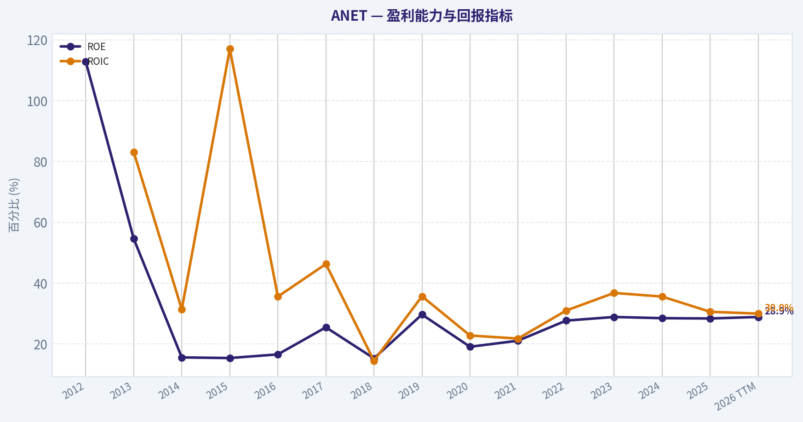
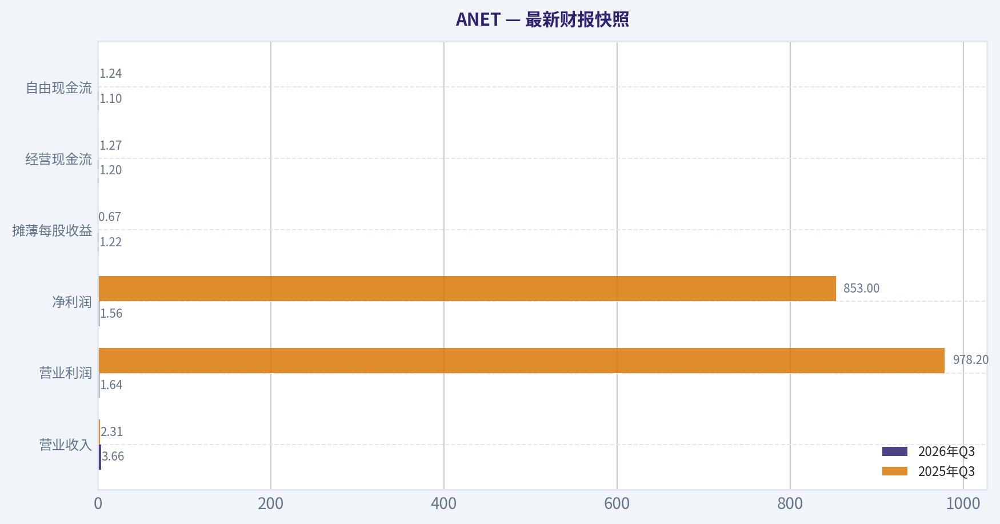
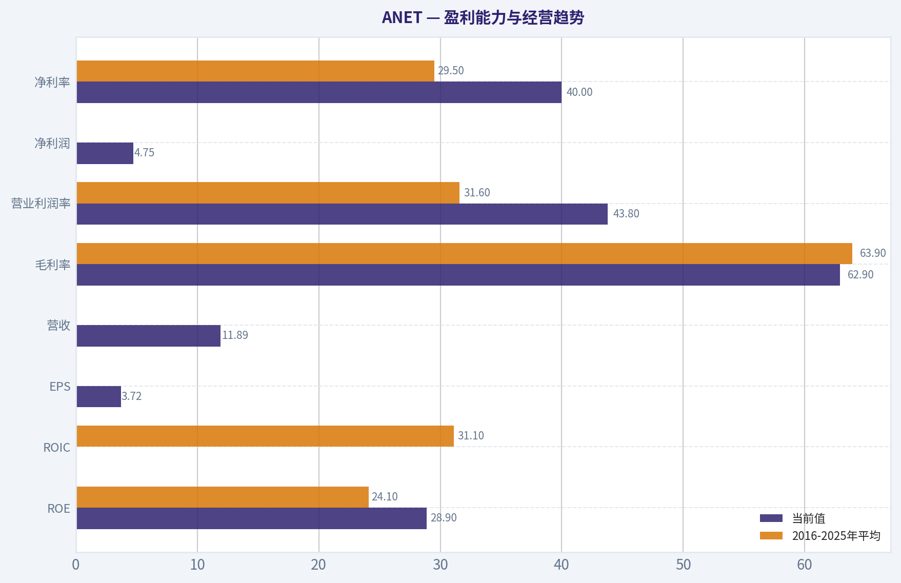
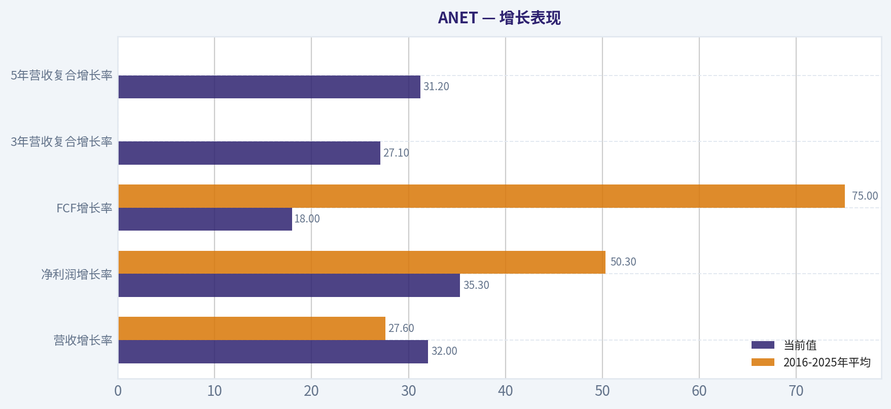
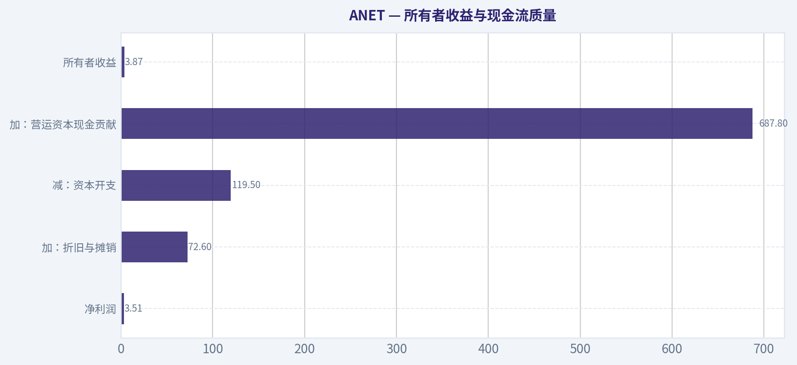
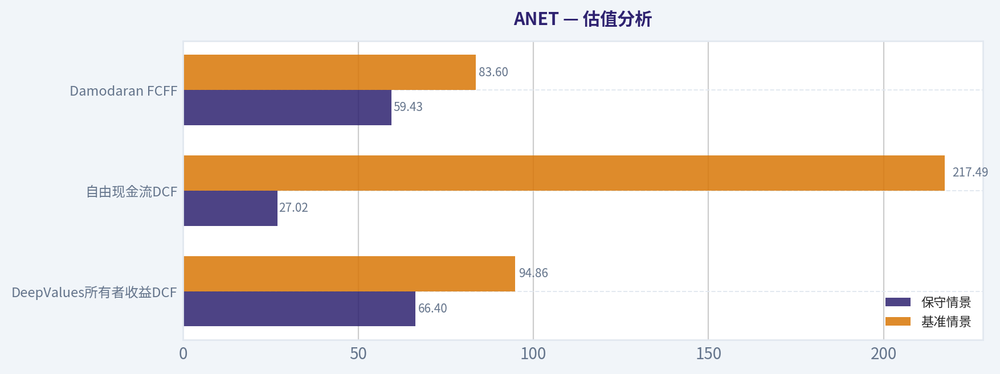
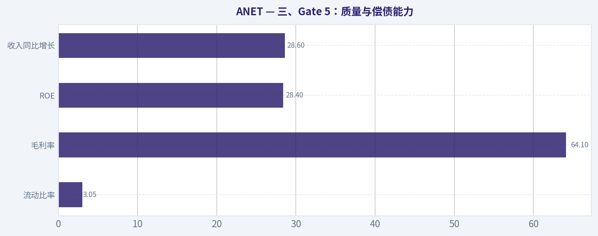
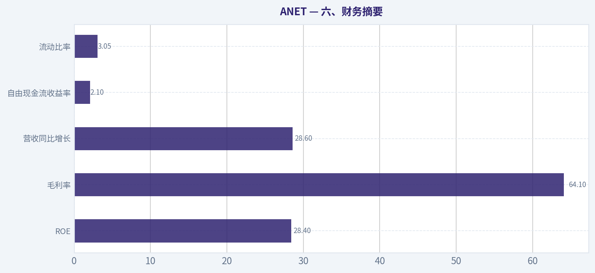

# ANET 深度价值情报

**调研日期:** 2026-11-27

## 关键免责声明

*本报告由 Deep Value Intelligence（一个基于 AI 的多智能体投资分析框架）自动生成。 仅供教育和研究用途 - 非财务建议，非财务顾问。*

---

## 目录

1. 情报摘要
2. 分析师团队报告
   - 基本面分析
   - 价值分析 (巴菲特)
   - 成长性分析 (林奇/德鲁肯米勒/费雪)
   - 市场分析
   - 期权市场分析
3. 研究团队评论
4. 投资团队评论
5. Deep Values 团队洞察

---

## 情报摘要

### 核心观点与前提条件

**核心论点:** ANET 是高质量、轻资产、软件增强型的 AI 网络基础设施企业，不应按普通周期性硬件公司评估。64.1%的毛利率、27.1%的三年营收复合增长率、28.4%的 ROE 和18.1%的 ROA，支持其具备较强产品竞争力和资本效率。

**主要风险:**
- **最终立场：中性**
- **最终立场：中性**

**置信度:** 中

---

## 分析师团队报告

### 基本面分析

#### 最新财报快照

*以下数据基于最近一期已披露财报（2026年Q3），并尽量与上一年同期对比。*

| 指标 | 2026年Q3 | 2025年Q3 | 同比变化 |
| --- | ---: | ---: | ---: |
| 营业收入 | $3.66B | $2.31B | +58.5% |
| 营业利润 | $1.64B | $978.2M | +67.9% |
| 净利润 | $1.56B | $853.0M | +82.9% |
| 摊薄每股收益 | $1.22 | $0.67 | +82.1% |
| 经营现金流 | $1.20B | $1.27B | -5.3% |
| 自由现金流 | $1.10B | $1.24B | -11.1% |

关键结论：这张快照先把最新一期财报放在桌面上，再去看长周期分析。这样读者能更清楚地区分"公司长期质量"和"这次财报发生了什么"。

#### ANET 14年财务指标

*以下数值均由原始数据确定性计算得出，并非 AI 估算。*

*发行人类型：operating company（Technology / Computer Hardware）。*

#### 14年财务指标
*年度行来自已披露财务报表，最后一行 TTM 由最近四个季度滚动计算得出。*

| 指标 | 2012 | 2013 | 2014 | 2015 | 2016 | 2017 | 2018 | 2019 | 2020 | 2021 | 2022 | 2023 | 2024 | 2025 | 2026 TTM |
| --- | --- | --- | --- | --- | --- | --- | --- | --- | --- | --- | --- | --- | --- | --- | --- |
| 市场价格 | N/A | N/A | $4 | $5 | $6 | $15 | $13 | $13 | $18 | $36 | $30 | $59 | $111 | $131 | $164 |
| 总市值 | N/A | N/A | $3.32B | $5.56B | $7.09B | $18.61B | $17.03B | $16.45B | $23.09B | $45.89B | $38.40B | $74.69B | $141.60B | $167.15B | $209.61B |
| 市盈率 | N/A | N/A | 47.10 | 46.61 | 38.71 | 44.03 | 51.90 | 19.12 | 36.32 | 54.66 | 28.35 | 35.68 | 49.57 | 47.65 | 44.08 |
| 市净率 | N/A | N/A | 5.97 | 7.05 | 6.40 | 11.20 | 7.95 | 5.68 | 6.95 | 11.53 | 7.86 | 10.35 | 14.17 | 13.51 | 12.74 |
| ROE | 112.9% | 54.6% | 15.6% | 15.4% | 16.6% | 25.5% | 15.3% | 29.7% | 19.1% | 21.1% | 27.7% | 28.9% | 28.5% | 28.4% | 28.9% |
| ROIC | N/A | 83.1% | 31.4% | 117.0% | 35.6% | 46.3% | 14.5% | 35.7% | 22.8% | 21.8% | 31.0% | 36.8% | 35.6% | 30.6% | 30.0% |
| 每股收益 | $0.02 | $0.04 | $0.08 | $0.10 | $0.16 | $0.33 | $0.25 | $0.67 | $0.50 | $0.66 | $1.07 | $1.65 | $2.23 | $2.75 | $3.72 |
| 营收 | $193.4M | $361.2M | $584.1M | $837.6M | $1.13B | $1.65B | $2.15B | $2.41B | $2.32B | $2.95B | $4.38B | $5.86B | $7.00B | $9.01B | $11.89B |
| 毛利润 | $132.2M | $238.5M | $392.1M | $543.6M | $723.1M | $1.06B | $1.37B | $1.54B | $1.48B | $1.88B | $2.68B | $3.63B | $4.49B | $5.77B | $7.48B |
| 毛利率 | 68.3% | 66.0% | 67.1% | 64.9% | 64.0% | 64.5% | 63.8% | 64.1% | 63.9% | 63.8% | 61.1% | 61.9% | 64.1% | 64.1% | 62.9% |
| 营业利润率 | 20.6% | 18.3% | 21.5% | 17.8% | 21.6% | 28.6% | 12.7% | 33.4% | 30.2% | 31.4% | 34.9% | 38.5% | 42.0% | 42.8% | 43.8% |
| 净利润 | $21.3M | $42.5M | $86.8M | $121.1M | $184.2M | $423.2M | $328.1M | $859.9M | $634.6M | $840.9M | $1.35B | $2.09B | $2.85B | $3.51B | $4.75B |
| 净利率 | 11.0% | 11.8% | 14.9% | 14.5% | 16.3% | 25.7% | 15.3% | 35.7% | 27.4% | 28.5% | 30.9% | 35.6% | 40.7% | 39.0% | 40.0% |
| 营收增长 | N/A | 86.8% | 61.7% | 43.4% | 34.8% | 45.8% | 30.7% | 12.1% | -3.9% | 27.2% | 48.6% | 33.8% | 19.5% | 28.6% | 32.0% |
| 净利润增长 | N/A | 98.9% | 104.5% | 39.4% | 52.1% | 129.8% | -22.5% | 162.1% | -26.2% | 32.5% | 60.8% | 54.3% | 36.6% | 23.1% | 35.3% |
| 自由现金流增长 | N/A | -37.7% | 728.5% | 83.4% | -29.8% | 303.2% | -22.2% | 97.6% | -24.0% | 32.1% | -52.9% | 346.2% | 83.8% | 15.7% | 18.0% |
| 总账面价值 | $18.9M | $77.7M | $555.7M | $788.2M | $1.11B | $1.66B | $2.14B | $2.89B | $3.32B | $3.98B | $4.89B | $7.22B | $9.99B | $12.37B | $16.45B |
| 总资产 | N/A | $364.5M | $811.0M | $1.16B | $1.73B | $2.46B | $3.08B | $4.19B | $4.74B | $5.73B | $6.78B | $9.96B | $14.04B | $19.45B | $25.26B |
| 总债务 | N/A | $98.8M | N/A | N/A | N/A | N/A | N/A | N/A | N/A | N/A | N/A | N/A | N/A | N/A | N/A |
| 债务股权比 | N/A | 1.27 | N/A | N/A | N/A | N/A | N/A | N/A | N/A | N/A | N/A | N/A | N/A | N/A | N/A |
| 现金及等价物 | $88.7M | $113.7M | $240.0M | $687.3M | $567.9M | $859.2M | $650.0M | $1.11B | $893.2M | $620.8M | $671.7M | $1.94B | $2.76B | $1.96B | $2.29B |
| 股东权益 | $18.9M | $77.7M | $555.7M | $788.2M | $1.11B | $1.66B | $2.14B | $2.89B | $3.32B | $3.98B | $4.89B | $7.22B | $9.99B | $12.37B | $16.45B |
| 经营现金流 | $26.3M | $34.6M | $131.9M | $237.8M | $174.3M | $631.6M | $503.1M | $963.0M | $735.1M | $1.02B | $492.8M | $2.03B | $3.71B | $4.37B | $5.24B |
| 投资现金流 | $-12.4M | $-19.5M | $-249.4M | $184.2M | $-325.8M | $-391.3M | $-755.1M | $-284.1M | $-608.8M | $-925.6M | $216.3M | $-687.5M | $-2.46B | $-3.58B | $-4.66B |
| 自由现金流 | $23.0M | $14.3M | $118.7M | $217.8M | $152.9M | $616.3M | $479.3M | $947.3M | $719.7M | $951.1M | $448.2M | $2.00B | $3.68B | $4.25B | $5.02B |
| 自由现金流利润率 | 11.9% | 4.0% | 20.3% | 26.0% | 13.5% | 37.4% | 22.3% | 39.3% | 31.1% | 32.3% | 10.2% | 34.1% | 52.5% | 47.2% | 42.2% |
| 每股分红 | $0.00 | $0.00 | $0.00 | $0.00 | $0.00 | $0.00 | $0.00 | $0.00 | $0.00 | $0.00 | $0.00 | $0.00 | $0.00 | $0.00 | $0.00 |

#### 盈利能力指标
- 净资产收益率 (ROE): 28.4%
- 投入资本回报率 (ROIC): 195.8%
- 总资产收益率 (ROA): 18.1%
- 毛利率: 64.1%
- 营业利润率: 42.8%
- 净利率: 39.0%

#### 流动性指标
- 流动比率: 3.05
- 速动比率: 2.35

#### 杠杆指标
- 债务股权比: N/A
- 利息覆盖倍数: N/A
- 净负债: N/A

#### 增长指标（同比）
- 营收增长: 28.6%
- 净利润增长: 23.1%
- 自由现金流增长: 15.7%
- 营收复合增长率（3年）: 27.1%
- 营收复合增长率（5年）: 31.2%

#### 估值指标
- 市盈率 (TTM): 43.97
- 预期市盈率: 27.16
- 市净率: 12.60
- 市销率: 17.43
- PEG 比率: 1.10
- 企业价值/EBITDA: 36.35
- 自由现金流收益率: 2.1%
- 盈利收益率: 2.3%

#### 所有者收益（巴菲特方法，代码计算）
- 净利润: $3.51B
- + 折旧与摊销: $72.6M
- - 资本开支: $-119.5M
- + 营运资本（现金流量表口径；负数=占用现金）: $687.8M
- = **所有者收益: $3.87B**

#### 内在价值（DeepValues 应用 - SEC 申报数据管道）
- **内在价值（DeepValues 应用，头条）: $94.86** - Owner Earnings (Buffett), 方法 buffett-1986-v2, 截至 2026-11-26 (FY2025)
  区间（保守-乐观）: $66.40 - $94.86
  相对价格的安全边际: -72.9% (价格 $163.99)
  应用使用的输入 (ttm_2026Q3): after-tax operating income $4.5B (operating income $5.2B, tax 13.8%) + D&A $0.1B - capex charge $0.1B (three-year average capex/revenue x trailing revenue; reported capex $0.2B) - working capital $0.0B = owner earnings $4.5B.
  Growth 10.0% fading to 2.5% terminal (min(owner-earnings CAGR, 5-year revenue CAGR), clamped [0, 10%]); discount rate 8.2% (30Y Treasury 5.24% + 3 pts (as of 2026-11-25)); net cash $14.4B (cash $2.3B + marketable securities $12.1B - debt $0.0B); 1,278M shares.
- Owner Earnings (Buffett): $66.40 / $94.86 / $94.86 (保守 / 基准 / 乐观) ← headline
- Free cash flow DCF: $27.02 / $217.49 / $217.49 (保守 / 基准 / 乐观)
- Damodaran two-stage FCFF: $59.43 / $83.60 / $151.45 (保守 / 基准 / 乐观)
  这就是内在价值：引用它作为内在价值，并据此衡量安全边际。其他地方的 DVI 情景数字仅为辅助交叉检查，不是估值。

#### DVI 情景模型（辅助交叉检查 - 不是内在价值）
DVI 基于 Yahoo 数据的情景，仅作敏感性检查。请勿将其作为内在价值引用；内在价值是上方的 DeepValues 应用估值。
- 当前价格: $164
- DVI 情景值（按商业模式路由）: $122
  商业模式: asset light platform - weighted blend [Damodaran FCFF + reverse-DCF fair + owner-earnings DCF] (asset_light_platform)
  模型区间（各 DCF 最小-最大）: $65 - $164
  相对价格的安全边际（头条）: -34.4%
  路由说明: Asset-light / high-margin platform: value driven by margins and reinvestment economics - the headline centers on the reverse-DCF demonstrated-growth fair value with Damodaran FCFF as a floor, down-weighting the owner-earnings DCF.
- 巴菲特方法（所有者收益）:
  保守: $68
  平均: $164
  乐观: $418
- 现金流方法（FCF）:
  保守: $28
  平均: $152
  乐观: $379
- Damodaran FCFF（WACC + 利润率 + 再投资）:
  保守: $43
  平均: $65
  乐观: $120
  蒙特卡洛区间（P10-P90）：$53 - $94（中位数 $71）
  P(内在价值 > 当前价格)：0.1%
- 反向 DCF：当前价格隐含约 30.0%/年 的所有者收益增长（10年）；过去 3 年为 111.3%，5 年为 48.4%。

#### Piotroski F分数: 5/9
- 净利润为正: 通过
- 经营现金流为正: 通过
- 资产回报率改善: 未通过
- 现金流大于净利润: 通过
- 债务下降: 通过
- 流动比率改善: 未通过
- 未稀释股本: 通过
- 毛利率改善: 未通过
- 资产周转率改善: 未通过

ANALYST STANCE: **看空**

#### 结论摘要

Arista Networks（ANET）是一家盈利质量很高、资产负债表稳健、具备明显竞争优势的网络设备与软件平台公司，但当前估值已经明显高于其历史常态和基于所有者收益的内在价值估计。

公司最新 TTM 营收为 **118.9亿美元**，同比增长 **32.0%**；净利润为 **47.5亿美元**，净利率达到 **40.0%**；自由现金流为 **50.2亿美元**。这些数据体现出强劲的经营杠杆和现金创造能力。

不过，当前股价约 **164美元**，TTM PE 约 **44.0倍**，而 DeepValues 的巴菲特式所有者收益内在价值为 **94.86美元**，保守至乐观区间为 **66.40至94.86美元**。当前价格相对该内在价值存在显著溢价，估值需要持续维持非常高的增长才能得到解释。

#### 当前市场指标与历史比较

| 指标 | 当前值 | 2016-2025年平均 | 当前相对平均水平 | 解释 |
|---|---:|---:|---:|---|
| 市场价格 | $164 | - | - | 长期上涨后处于高位 |
| 总市值 | $207.19B-$209.61B | - | - | 数据源日期略有差异 |
| PE | 43.97倍 | 40.60倍 | 高约8% | 盈利增长强，但估值高于常态 |
| PB | 12.74倍左右 | 9.56倍 | 高约33% | 对资产轻、知识产权驱动企业参考意义有限 |
| 盈利收益率 | 2.3% | - | 偏低 | 市场要求公司持续高速增长 |
| FCF收益率 | 2.1% | - | 偏低 | 现金流回报不足以单独支撑当前价格 |

**关键结论：** PE虽然只比十年平均高约8%，但绝对水平接近44倍，意味着市场已经为持续高速增长定价。PB约13倍不应机械解读为"昂贵"，因为ANET属于资产轻、品牌和软件能力重要的科技硬件企业；估值判断应主要依靠现金流和所有者收益，而不是账面价值。

#### 盈利能力与经营趋势

| 指标 | 当前值 | 2016-2025年平均 | 当前变化 | 经营含义 |
|---|---:|---:|---:|---|
| ROE | 28.9% | 24.1% | 高4.8个百分点 | 股东资本使用效率优秀 |
| ROIC | 约30.0% | 31.1% | 略低 | 仍属高质量水平 |
| EPS | $3.72 | - | 长期显著增长 | 盈利规模持续扩大 |
| 营收 | $11.89B | - | TTM同比+32.0% | AI与云计算需求带来加速 |
| 毛利率 | 62.9% | 63.9% | 低1.0个百分点 | 高位稳定，但略有波动 |
| 营业利润率 | 43.8% | 31.6% | 高12.2个百分点 | 规模效应和产品组合改善明显 |
| 净利润 | $4.75B | - | TTM同比+35.3% | 净利润增长快于营收 |
| 净利率 | 40.0% | 29.5% | 高10.5个百分点 | 盈利质量和经营杠杆突出 |

**关键结论：** ANET最具吸引力的经营特征是高ROE、高ROIC和持续扩张的营业利润率。当前营业利润率接近44%，明显高于十年均值，说明规模效应、软件功能和高端数据中心产品提高了利润转换效率；但毛利率略低于历史平均，显示硬件组合、供应链或竞争环境仍可能造成压力。

#### 增长表现

| 增长指标 | 当前值 | 2016-2025年平均 | 历史特征 | 判断 |
|---|---:|---:|---|---|
| 营收增长率 | 32.0% | 27.6% | 多数年份为正，2020年为-3.9% | 当前高于长期均值 |
| 净利润增长率 | 35.3% | 50.3% | 波动显著，受低基数和周期影响 | 当前强劲但低于历史算术平均 |
| FCF增长率 | 18.0% | 75.0% | 波动极大，部分年份受低基数影响 | 当前增长健康但明显正常化 |
| 3年营收复合增长率 | 27.1% | - | 高速扩张 | 增长质量较好 |
| 5年营收复合增长率 | 31.2% | - | 处于较高水平 | 是估值的重要支撑因素 |

**关键结论：** 营收增长已经连续多年保持较高水平，当前仍高于十年平均，显示云计算、AI网络和大型数据中心需求强劲。相比之下，净利润和自由现金流增速低于历史算术平均并不一定是负面信号，因为历史平均受到极端高增长年份和低基数效应扭曲；更重要的是，当前现金流仍以两位数增长。

#### 资产负债表与现金流

| 指标 | 当前值 | 历史观察 | 财务含义 |
|---|---:|---|---|
| 总账面价值 | $16.45B | 持续增长 | 资本基础扩大 |
| 总资产 | $25.26B | 2013年以来大幅增长 | 与业务规模扩张一致 |
| 总债务 | 数据显示为零或未披露 | 2013年曾有债务记录 | 当前杠杆风险很低 |
| 债务权益比 | N/A | 当前无法可靠计算 | 不应自行填补 |
| 现金及现金等价物 | $2.29B | 高于早期水平 | 提供经营缓冲 |
| 股东权益 | $16.45B | 持续增长 | 财务基础稳健 |
| 流动比率 | 3.05倍 | 较强 | 短期偿债能力良好 |
| 速动比率 | 2.35倍 | 较强 | 对库存依赖较低 |
| 经营现金流 | $5.24B | 长期上升 | 利润兑现能力强 |
| 自由现金流 | $5.02B | 2012年以来显著增长 | 资本开支负担相对较轻 |
| FCF利润率 | 42.2% | 2016-2025年均值约32.0% | 现金转换效率高 |
| 每股股息 | $0.00 | 全时期均为零 | 现金主要用于再投资或其他资本配置 |

**关键结论：** ANET拥有近乎无债、现金充足、流动性强的资产负债表，财务风险显著低于多数硬件公司。自由现金流利润率超过42%，高于历史平均，说明当前收入增长具有很强的现金转化能力；但公司没有现金股息，股东回报主要依赖持续增长和资本增值，而不是分红现金流。

#### 所有者收益与现金流质量

数据集中的巴菲特式所有者收益计算如下：

| 项目 | 金额 |
|---|---:|
| 净利润 | $3.51B |
| 加：折旧与摊销 | $72.6M |
| 减：资本开支 | $119.5M |
| 加：营运资本现金贡献 | $687.8M |
| 所有者收益 | **$3.87B** |

**关键结论：** 资本开支负担较轻，使净利润能够较高比例转化为所有者收益。营运资本在数据集中贡献了约6.88亿美元现金，这一项目未来不一定每年重复，因此估值时不能把全部营运资本释放机械地视为永久性增长来源。

#### 收入来源分布

公司披露口径通常以产品与服务为主，但本次确定性数据包没有提供最新年度的精确分部金额。以下为基于公开业务结构的近似拆分，不能替代公司正式分部披露。

| 收入来源 | 金额（十亿美元） | 占比 |
|---|---:|---:|
| 云计算与大型数据中心网络产品、交换机及相关软件 | 约10.1 | 约85% |
| 企业园区网络、路由和其他网络产品 | 约1.2 | 约10% |
| 技术支持、维护及专业服务 | 约0.6 | 约5% |
| 合计 | 约11.9 | 100% |

**关键结论：** ANET的收入核心仍是高端数据中心和云网络设备，AI集群扩张是当前最重要的需求催化因素。服务收入占比较低，说明公司主要依赖产品创新、软件功能和网络架构渗透，而不是传统高比例维护合同；这提高了增长弹性，也使收入对大型云客户资本开支周期更加敏感。

#### 巴菲特式商业质量分析

| 维度 | 评价 | 具体依据 |
|---|---|---|
| 经济护城河 | 较强 | 网络操作系统、客户迁移成本、软件生态和数据中心验证形成综合优势 |
| 财务实力 | 很强 | 低债务、现金充足、流动比率超过3倍 |
| 盈利可预测性 | 较强但非线性 | 长期收入和利润总体增长，但2020年收入下降，现金流增长波动较大 |
| 管理层资本配置 | 中上 | 资本开支克制，现金流转换率高；无现金股息 |
| 再投资效率 | 很强 | ROIC长期约30%，营业利润率持续提升 |
| 产品竞争力 | 较强 | 高毛利、高营业利润率，显示产品差异化和定价能力 |
| 客户集中度风险 | 需要关注 | 大型云客户的采购节奏可能造成季度和年度波动 |
| 周期风险 | 中等 | 受数据中心资本开支、AI投资周期和网络设备更新周期影响 |

ANET的护城河不是单一专利，而是由网络软件、开放式架构、部署经验、客户验证、生态兼容性和工程执行能力共同构成。其高营业利润率和高ROIC说明公司并非单纯依靠低价竞争。

然而，护城河并不等于增长永远维持在30%以上。大型云客户具有较强议价能力，网络设备行业也存在供应商替代、产品迭代和资本开支波动风险。AI网络需求可以延长增长周期，但不能自动消除行业周期性。

#### 估值分析

当前市场数据：

| 估值方法 | 保守情景 | 基准情景 | 乐观情景 | 用途 |
|---|---:|---:|---:|---|
| DeepValues所有者收益DCF | $66.40 | $94.86 | $94.86 | 主要内在价值 |
| 自由现金流DCF | $27.02 | $217.49 | $217.49 | 辅助交叉检查 |
| Damodaran FCFF | $59.43 | $83.60 | $151.45 | 辅助交叉检查 |
| 当前价格 | \multicolumn{3}{c|}{$164} | 市场定价 |
| 当前价格相对主要内在价值 | \multicolumn{3}{c||}{约高73%} | 估值溢价明显 |

**关键结论：** 本报告采用DeepValues所有者收益DCF的**94.86美元**作为主要内在价值，而不是用其他模型中更高的辅助数值替代。不同模型差异很大，说明ANET的估值高度依赖对长期增长、利润率和资本再投资效率的假设；但主要巴菲特式模型均无法证明164美元具有足够安全边际。

#### 手工巴菲特式所有者收益DCF

以数据集中的所有者收益 **38.7亿美元**、净现金约 **144亿美元**、约 **12.78亿股**为基础，采用10%折现率、2.5%永续增长率，并对高增长进行终值约束。

##### 保守情景

假设未来五年所有者收益增长率为3%，之后以2.5%永续增长：

| 项目 | 计算 |
|---|---:|
| 第一年所有者收益 | $3.87B x 1.03 = $3.99B |
| 第五年所有者收益 | $3.87B x 1.03⁵ = $4.49B |
| 五年现金流现值 | 约$15.95B |
| 终值 | $4.49B x 1.025 ÷（10%-2.5%）=约$61.3B |
| 终值现值 | 约$38.1B |
| 企业价值 | 约$54.0B |
| 加：净现金 | $14.4B |
| 股权价值 | 约$68.4B |
| 每股价值 | **约$53.5** |

##### 基准情景

假设未来五年所有者收益增长率为10%，之后降至2.5%：

| 项目 | 计算 |
|---|---:|
| 第一年所有者收益 | $3.87B x 1.10 = $4.26B |
| 第五年所有者收益 | $3.87B x 1.10⁵ = $6.23B |
| 五年现金流现值 | 约$19.35B |
| 终值 | $6.23B x 1.025 ÷（10%-2.5%）=约$85.2B |
| 终值现值 | 约$52.9B |
| 企业价值 | 约$72.3B |
| 加：净现金 | $14.4B |
| 股权价值 | 约$86.7B |
| 每股价值 | **约$67.8** |

##### 乐观情景

假设第一年增长15%，随后逐步降至13%、10%、7%、5%，终值增长率仍为2.5%：

| 项目 | 计算 |
|---|---:|
| 第五年所有者收益 | 约$6.22B |
| 五年现金流现值 | 约$20.25B |
| 终值现值 | 约$52.8B |
| 企业价值 | 约$73.1B |
| 加：净现金 | $14.4B |
| 股权价值 | 约$87.5B |
| 每股价值 | **约$68.5** |

**关键结论：** 手工模型得到的每股价值约为53.5至68.5美元，低于DeepValues的66.40至94.86美元区间。这一差异主要来自所有者收益口径、折现率和营运资本处理不同；无论采用哪一种口径，164美元都需要非常强的长期增长和利润率假设才能成立。

#### 反向DCF含义

辅助模型显示，当前价格大致隐含未来十年所有者收益约 **30%年增长率**。这高于公司长期营收增长均值，也高于多数成熟大型科技企业能够长期保持的增长水平。

市场定价并非完全没有依据：

- 过去3年营收复合增长率为27.1%；
- 过去5年营收复合增长率为31.2%；
- AI数据中心和云计算网络仍处于扩张阶段；
- 营业利润率和净利率均处于历史高位。

但反向DCF的困难在于：30%的所有者收益增长需要持续多年，同时还要避免毛利率下降、客户资本开支放缓、竞争加剧或估值倍数收缩。任何一个变量低于预期，都可能显著降低内在价值。

#### 主要风险、机会与红旗

| 类型 | 内容 | 对估值的影响 |
|---|---|---|
| 机会 | AI集群和高速数据中心网络需求继续增长 | 延长高增长阶段 |
| 机会 | 软件化、自动化和网络管理能力提升 | 支持高毛利和高ROIC |
| 机会 | 现金充裕且资本开支强度低 | 增强现金流弹性 |
| 风险 | 大型云客户采购集中 | 收入和订单可能波动 |
| 风险 | AI资本开支周期逆转 | 高增长假设可能快速下修 |
| 风险 | 竞争者推出替代方案 | 毛利率和市场份额承压 |
| 风险 | 当前PE约44倍 | 增长放缓时估值压缩风险较高 |
| 红旗 | FCF增长历史波动极大 | 单年现金流增速不可直接外推 |
| 红旗 | Piotroski F分数为5/9 | 财务质量良好但并非各项指标都改善 |
| 红旗 | 毛利率低于历史平均 | 需要中性产品组合和竞争压力 |
| 红旗 | 无现金股息 | 回报完全依赖经营增长和资本配置 |

#### 综合判断

ANET是高质量经营企业，而不是低质量高估值企业。其高ROE、高ROIC、高利润率、强自由现金流和近乎无债的资产负债表，构成了明显的业务质量优势。

但价值投资需要区分"优秀公司"和"合理价格"。当前价格约164美元，明显高于主要所有者收益内在价值估计94.86美元，也高于手工DCF约53.5至68.5美元的结果。即使考虑AI网络需求带来的增长延续，市场仍然要求公司在较长时期内维持接近30%的所有者收益增速。

因此，证据支持对ANET的经营质量给予高度评价，但不支持当前价格已经充分体现安全边际。最终研究立场为：

**看空**

这里的"看空"主要针对当前估值与内在价值之间的差距，并不否定公司的竞争优势、增长机会或长期经营质量。

#### 关键要点汇总

| 关键项目 | 结论 |
|---|---|
| 公司质量 | 高质量、资产轻、现金流强的网络技术企业 |
| 增长 | 当前营收增长32%，高于十年平均 |
| 盈利 | ROE约28.9%，ROIC约30%，净利率40% |
| 财务实力 | 低债务、现金约22.9亿美元，流动性充足 |
| 现金流 | FCF约50.2亿美元，FCF利润率42.2% |
| 估值 | PE约44倍，明显高于绝对合理价值要求 |
| 主要内在价值 | DeepValues所有者收益DCF为94.86美元 |
| 手工DCF范围 | 约53.5至68.5美元 |
| 反向DCF | 当前价格隐含约30%的长期所有者收益增速 |
| 核心机会 | AI、云计算和高速数据中心网络扩张 |
| 核心风险 | 客户集中、资本开支周期、竞争和估值压缩 |
| 最终立场 | **看空**，理由是估值溢价显著而非经营质量较差 |

#### 基本面关键图表

本图追踪 **ANET** 过去十年的盈利能力与回报指标（ROE、ROIC、利润率），突出呈现资本效率的变化趋势。

---

### 价值分析 (巴菲特)

> *基于沃伦·巴菲特的价值投资哲学：能力圈、经济护城河、管理层质量与安全边际。*

#### 内在价值快照

价格是你付的钱，内在价值是企业未来可能为股东创造的现金价值。我们给出一个区间，而不是假装只有一个神奇数字。

- 当前价格: $163.99
- 估值区间（两种 DCF 方法、保守到乐观）: $27.02 至 $217.49

##### 所有者收益（巴菲特方法）
- 净利润: $3,511,400,000.00
- 折旧与摊销: $72,600,000.00
- 资本支出: $-119,500,000.00
- 营运资金变化: $687,800,000.00
- 所有者收益: $3,873,980,092.71

##### 内在价值
###### 所有者收益法
使用所有者收益，更严格，通常更保守。
- 保守: $66.40
- 平均: $94.86
- 乐观: $94.86
- 折现率: 8.2%

###### 自由现金流法
使用自由现金流，更适合今天投入很多、为未来增长铺路的公司。
- 保守: $27.02
- 平均: $217.49
- 乐观: $217.49
- 折现率: 9.0%

ANALYST STANCE: **中性**

#### 一、结论摘要

Arista Networks 是一家质量很高、增长强劲、资本效率优秀的网络设备与网络软件公司。其核心优势来自高毛利率、EOS 网络操作系统、云客户生态、规模效应和较低资本强度。

但当前股价约为 **164美元**，而 DeepValues 应用给出的头条内在价值为 **94.86美元**，相对价格的安全边际为 **-72.9%**。因此，研究证据支持"优秀企业"的判断，却不支持当前估值水平，综合评分落在 **中性** 区间。

#### 二、Factor 1至4评分

| 因素 | 评分 | 主要依据 |
|---|---:|---|
| Factor 1：能力圈与业务简单性 | 4.0/5 | 公司为云计算、AI和大型企业提供高速网络交换机、路由器及相关软件；商业模式较易理解，收入受数据中心资本开支周期影响 |
| Factor 2：护城河 | 4.5/5 | 毛利率64.1%，EOS软件生态、客户工作流嵌入、产品可靠性、规模和开发者生态形成多重优势 |
| Factor 3：管理层与资本配置 | 4.0/5 | 长期经营记录良好，资本轻、现金充裕；但公开资料中关于长期激励与每股价值考核的完整证据不足以给满分 |
| Factor 4：行业结构 | 4.0/5 | 高端数据中心网络市场由少数强者主导，Arista在云客户领域具备规模优势；但面临思科、英伟达及客户自研方案竞争 |

**关键结论：** ANET 的业务质量、毛利率和竞争地位明显高于普通硬件公司。主要扣分来自行业周期性、客户资本开支波动以及技术路线变化，而不是当前经营恶化。

#### 三、Gate 5：质量与偿债能力

| 指标 | 数据 | 解读 |
|---|---:|---|
| 利息负担 | 债务约为0 | 没有明显利息压力 |
| 净现金 | 约144亿美元 | 现金及有价证券约144亿美元，债务约为0 |
| 流动比率 | 3.05 | 短期流动性充足 |
| 毛利率 | 64.1% | 体现较强产品差异化和软件价值 |
| ROE | 28.4% | 盈利能力较强 |
| 收入同比增长 | 28.6% | 仍处于高增长阶段 |

**关键结论：** Gate 5 硬地板**未触发**。公司没有同时出现"盈利及现金流明显恶化"和"偿债能力濒临失效"的组合，资产负债表反而是本案的重要安全因素。

#### 四、护城河分析

| 护城河来源 | 具体证据 | 评价 |
|---|---|---|
| 无形资产 | EOS 网络操作系统、软件工具链、品牌和产品可靠性 | 客户不仅采购硬件，也采购长期运行环境和技术支持 |
| 转换成本 | 网络架构、配置、运维流程和员工技能与系统深度结合 | 大型云客户更换核心网络供应商需要测试、迁移和运营验证 |
| 成本优势 | 规模化研发、开放式硬件设计、软件复用和较低资本开支 | 资本强度较低，扩张不完全依赖新增固定资产 |
| 网络效应 | 客户、开发者、系统集成商与EOS生态之间形成正反馈 | 规模扩大有助于提高兼容性、人才供给和产品迭代速度 |

Arista 的护城河更接近"软件加生态加规模"的组合，而不是单纯依靠专利或品牌。64.1%的毛利率和28.4%的ROE是护城河有效性的财务侧证据。

主要风险包括：

- 大型云客户资本开支放缓；
- 英伟达等厂商向网络互连领域扩张；
- 思科等成熟竞争者加大价格和产品竞争；
- AI网络需求快速变化，可能缩短产品周期；
- 高增长阶段结束后，估值压缩可能显著影响每股价值。

#### 五、管理层质量与资本配置

| 观察维度 | 评价 |
|---|---|
| 长期经营思维 | 业务持续从传统交换机扩展至云网络、AI网络和光互连，显示出较强适应能力 |
| 诚信与披露 | 目前没有研究包所示的重大财务重述或明显会计异常 |
| 再投资能力 | 高毛利、高增长且资本开支较低，留存收益具备较好的再投资条件 |
| 资产负债表管理 | 债务约为0，净现金约144亿美元，财务弹性较强 |
| 股东导向 | 经营质量较高，但关于管理层持股比例、薪酬与每股内在价值的完整数据不足 |

管理层评分为 **4.0/5**。核心优点是持续扩展产品边界，同时没有依赖高杠杆推动增长。需要中性的是增长放缓后，现金如何在研发、并购、分红和回购之间分配。

#### 六、财务摘要

| 项目 | FY2025 / TTM 2026Q3或当前 |
|---|---:|
| 股价 | 164美元 |
| 总市值 | 2072亿美元 |
| PE | 43.97倍 |
| ROE | 28.4% |
| 毛利率 | 64.1% |
| 营收同比增长 | 28.6% |
| 自由现金流收益率 | 2.1% |
| 流动比率 | 3.05 |
| 营业利润 | 52亿美元 |
| 税后营业利润 | 45亿美元 |
| D&A | 约1亿美元 |
| 报告资本开支 | 约2亿美元 |
| 净现金 | 约144亿美元 |
| 稀释后股数 | 约12.78亿股 |

**关键结论：** ANET 同时具备高增长、高毛利和高ROE，且债务约为0，财务质量突出。问题在于约44倍PE和仅2.1%的自由现金流收益率已经反映了相当乐观的未来预期。

#### 七、业主收益计算

DeepValues 应用采用的Buffett方法输入如下：

| 项目 | 金额 |
|---|---:|
| 税后营业利润 | 45亿美元 |
| 加：折旧与摊销 | 1亿美元 |
| 减：资本开支费用 | 1亿美元 |
| 减：营运资本增加 | 约0亿美元 |
| 业主收益 | **约45亿美元** |
| 每股业主收益 | **约3.52美元** |

计算逻辑为：

> 业主收益 = 税后营业利润 + D&A - 维持性资本开支 - 营运资本增加

**关键结论：** 业主收益约45亿美元，明显高于资本开支需求，说明ANET具有较好的现金转化能力。对于这类资产轻型企业，现金流和未来再投资收益比账面价值更重要。

#### 八、现金流与资本回报

| 项目 | 评价 |
|---|---|
| 盈利质量 | 税后营业利润约45亿美元，业主收益与其接近 |
| 资本强度 | 报告资本开支约2亿美元，维持性资本开支假设约1亿美元 |
| ROE | 28.4%，达到优秀水平 |
| ROIC与WACC | 研究包未提供完整ROIC序列，但毛利率、债务水平和资本强度显示资本回报大概率显著高于资本成本 |
| 现金流风险 | 主要风险来自云客户资本开支周期，而非债务偿付 |

ROE较高并非主要由高杠杆制造，因为公司债务约为0。其更可能由高经营利润率和较高资产周转效率共同驱动。

#### 九、三情景DCF估值

以下情景使用约45亿美元业主收益、12.78亿股，并将净现金约144亿美元作为辅助调整。三种情景是估值交叉检查，不替代DeepValues应用的头条内在价值。

| 情景 | 核心假设 | 经营价值/股 | 加计净现金后约值 |
|---|---|---:|---:|
| A：零增长 | 业主收益 ÷ 10%折现率 | 35.2美元 | 46.5美元 |
| B：GDP增长 | 永续增长3%，折现率10% | 51.8美元 | 63.1美元 |
| C：历史增长 | 前10年增长约7.5%，终值增长2.5%，折现率10% | 68.2美元 | 79.5美元 |

**关键结论：** 即使采用较积极的历史增长情景，含净现金的辅助估值约为79.5美元，仍显著低于164美元。高增长能够改善价值，但尚不足以消除当前价格与现金流价值之间的差距。

#### 十、DeepValues头条内在价值与安全边际

| 项目 | 数值 |
|---|---:|
| DeepValues头条内在价值 | **94.86美元/股** |
| 保守至乐观区间 | 66.40至94.86美元/股 |
| 当前价格 | 164美元 |
| 相对内在价值溢价 | 约72.9% |
| 应用折现率 | 8.2% |
| 应用增长假设 | 10%逐步降至2.5% |
| 应用净现金 | 144亿美元 |

**关键结论：** DeepValues已经采用10%的初始增长假设和8.2%的折现率，仍得到94.86美元的头条内在价值，说明当前价格需要更高、更持久的增长才能被现金流合理化。研究证据支持企业质量，但不支持164美元对应的估值安全边际。

#### 十一、Buffett最终评分卡

| 评分维度 | 权重 | 评分 | 加权分 |
|---|---:|---:|---:|
| 护城河宽度与持久性 | 25% | 4.5 | 1.13 |
| 估值与安全边际 | 20% | 1.5 | 0.30 |
| 资本回报：ROIC相对WACC | 15% | 4.5 | 0.68 |
| 业务理解与可预测性 | 12% | 3.5 | 0.42 |
| 管理层与资本配置 | 12% | 3.5 | 0.42 |
| 再投资空间 | 8% | 4.0 | 0.32 |
| 资产负债表强度 | 4% | 5.0 | 0.20 |
| 行业结构 | 4% | 3.5 | 0.14 |
| **总分** | **100%** |  | **3.61/5** |

**关键结论：** ANET的企业质量评分很高，尤其是护城河、资本回报和资产负债表。估值因素显著拉低总分，最终总分3.61落入"优质企业但当前估值缺乏充分安全边际"的区间。

#### 十二、投资立场与确信度

**中性--中高确信度。**

ANET 是值得长期研究的高质量现代复利型企业：业务简单度尚可，竞争优势真实，增长和资本回报均强，且没有明显偿债风险。然而，当前价格约为DeepValues头条内在价值的1.73倍，市场已经隐含了较高且持续的增长预期。

因此，当前证据的核心含义是：

> **企业质量支持较高估值，但当前估值仍高于现金流和保守增长情景能够充分解释的范围。**
#### 估值桥

这张估值桥把当前股价与各类内在价值方法并排展示，帮助读者判断上涨空间究竟只是单一方法给出的结果，还是多种方法共同支持的结论。

| 项目 | 每股内在价值 |
| --- | ---: |
| 巴菲特方法 | $94.86 |
| 现金流方法 | $217.49 |
| Damodaran 方法 | $83.60 |
| 当前价格 | $163.99 |

#### 关键结论

如果只有一种方法显著高于其他方法，说明上行空间更依赖特定建模假设。若多种方法的估值接近，则说明估值逻辑更加稳健。

#### 估值图表

本对比图（来自「最新财报快照」）将 **ANET** 的当前数据与历史基准并排呈现，直观反映公司相对自身历史均值的估值水平。

本对比图（来自「盈利能力与经营趋势」）将 **ANET** 的当前数据与历史基准并排呈现，直观反映公司相对自身历史均值的估值水平。

本对比图（来自「增长表现」）将 **ANET** 的当前数据与历史基准并排呈现，直观反映公司相对自身历史均值的估值水平。

本对比图（来自「所有者收益与现金流质量」）将 **ANET** 的当前数据与历史基准并排呈现，直观反映公司相对自身历史均值的估值水平。

本对比图（来自「估值分析」）将 **ANET** 的当前数据与历史基准并排呈现，直观反映公司相对自身历史均值的估值水平。

本对比图（来自「三、Gate 5：质量与偿债能力」）将 **ANET** 的当前数据与历史基准并排呈现，直观反映公司相对自身历史均值的估值水平。

本对比图（来自「六、财务摘要」）将 **ANET** 的当前数据与历史基准并排呈现，直观反映公司相对自身历史均值的估值水平。

---

### 成长性分析 (林奇/德鲁肯米勒/费雪)

> *基于彼得·林奇的GARP成长投资法、斯坦利·德鲁肯米勒的宏观拐点分析法，以及菲利普·费雪的深度调研法。*

ANALYST STANCE: **中性**

#### 一、Lynch 分类：快速成长型，但估值已进入高要求区间

Arista Networks（ANET）符合 Lynch 的"快速成长型"特征：营收同比增长约 28.6%，毛利率约 64.1%，ROE 约 28.4%。不过，PE 约 44 倍，当前估值已经隐含了较高的持续增长预期，因此研究结论为"增长质量较强，估值证据不足以支持当前价格"。

#### 二、故事：三个简单要点

1. ANET 为大型云计算企业和 AI 数据中心提供高速网络交换设备及相关软件，直接受益于 AI 算力扩张。
2. 公司在高性能数据中心网络领域拥有较强产品竞争力，软件化操作系统和客户黏性有助于维持高毛利率。
3. Etherlink R4 等产品扩大了分布式 AI 推理、低延迟网络及光传输的覆盖范围，可能形成新的产品周期。

#### 三、TAM 与十倍测试

| 项目 | 研究判断 |
|---|---:|
| 当前市值 | 2072亿美元 |
| 营收同比增长 | 28.6% |
| 主要市场 | 云计算、AI 数据中心、数据中心交换机、光网络 |
| TAM 增长驱动 | AI 集群、云服务商资本开支、网络带宽升级 |
| 十倍收入测试 | 由于共享数据未提供最新完整营收，无法精确计算 |
| 十倍可行性 | 取决于 ANET 能否从交换机扩展至 AI 网络、光传输和推理网络 |

**关键结论：** ANET 所处市场仍受 AI 基础设施扩张推动，TAM 具有扩张属性，而不是单纯依靠成熟市场份额转移。由于缺少最新营收和可验证的细分市场规模，十倍收入测试目前只能定性判断，尚不能确认十倍增长后仍低于 20% 市占率。

#### 四、营收增长趋势

| 指标 | 数值或趋势 | 解读 |
|---|---:|---|
| 营收同比增长 | 28.6% | 属于快速成长区间 |
| 最近增长形态 | 高增长，尚未确认连续加速 | 暂无完整季度序列 |
| 云服务商相关需求 | 行业相关收入同比增长约 75% | AI 与云资本开支强劲 |
| 光传输市场增长 | 约 24% | 为产品扩张提供外部需求 |
| 增长质量 | 以行业需求和产品扩张为主 | 仍需跟踪客户集中度及订单持续性 |

**关键结论：** 当前增长速度符合快速成长型公司的特征，且 AI 网络和光传输需求提供了较强的行业顺风。现有资料可以确认高增长，但不足以证明营收已经连续加速，因此更适合定义为"高位持续增长，存在加速可能"。

#### 五、单位经济与经营质量

| 指标 | 数据 | 结论 |
|---|---:|---|
| 毛利率 | 64.1% | 软件和高附加值网络产品带来较强盈利质量 |
| ROE | 28.4% | 资本使用效率较好 |
| 自由现金流收益率 | 2.1% | 现金流质量不错，但对应市值并不便宜 |
| NRR | 未披露 | 无法直接评估客户扩张与流失 |
| CAC、LTV | 未披露 | 无法计算 LTV/CAC |
| Rule of 40 | 无法完整计算 | 缺少自由现金流利润率和完整营收数据 |

**关键结论：** ANET 的毛利率和 ROE 显示出优秀的经营质量，但 SaaS 常用的 NRR、LTV/CAC 并不适用于或未被公司充分披露。自由现金流收益率仅约 2.1%，说明市场已经为未来增长支付较高估值。

#### 六、Inflection Point 评估

| 潜在拐点 | 证据 | 强度 |
|---|---|---|
| 产品周期 | Etherlink R4 扩展至分布式 AI 推理、路由和光传输 | 较强 |
| TAM 扩张 | AI 集群从训练扩展至推理，网络复杂度提升 | 较强 |
| 市占率变化 | 云服务商和大型数据中心需求快速增长 | 中等偏强 |
| 毛利率拐点 | 当前毛利率已高，进一步提升空间需验证 | 中等 |
| 竞争格局 | 高性能网络、软件生态和客户认证形成一定壁垒 | 中等偏强 |
| 订单持续性 | 云客户资本开支具有周期性 | 待验证 |

**关键结论：** 最明确的拐点来自 AI 网络产品范围扩大，以及训练网络向推理网络和光传输延伸。主要不确定性在于云客户资本开支是否持续，以及新产品能否在不明显压低毛利率的情况下扩大收入贡献。

#### 七、宏观环境

| 宏观因素 | 影响 |
|---|---|
| AI 基础设施周期 | 明显利好 |
| 云服务商资本开支 | 当前需求强劲，但存在周期波动 |
| 长期利率 | 30 年期美国国债约 5.24%，对高估值成长股构成折现压力 |
| 数据中心建设 | 利好交换机、光网络及高速互联 |
| 宏观周期 | AI 投资驱动强于传统经济周期，但并非完全免疫 |

**关键结论：** ANET 的产业宏观环境明显偏正面，AI 和数据中心资本开支形成顺风。与此同时，较高长期利率提高了成长现金流的折现率，这也是当前估值敏感度较高的核心原因。

#### 八、Fisher 15 项评分

| Fisher 项目 | 评分（1-5） | 简要判断 |
|---|---:|---|
| 1. 市场潜力 | 4 | AI 和云网络市场仍在扩张 |
| 2. 新产品决心 | 4 | 持续扩展 AI、光网络和推理产品 |
| 3. 研发效率 | 4 | 产品创新与高毛利率相匹配 |
| 4. 销售组织 | 4 | 大型云客户覆盖能力较强 |
| 5. 利润率水平 | 4 | 毛利率约 64.1% |
| 6. 利润率改善 | 4 | 经营杠杆仍有潜力，但需持续验证 |
| 7. 员工关系 | 4 | 未见重大负面信息 |
| 8. 高管关系 | 4 | 管理层执行记录整体良好 |
| 9. 管理深度 | 4 | 产品和市场覆盖较完整 |
| 10. 成本与会计 | 4 | 目前未见重大异常信号 |
| 11. 竞争壁垒 | 5 | 软件系统、客户认证和网络生态形成壁垒 |
| 12. 长期利润前景 | 5 | AI 网络需求提供长期空间 |
| 13. 股权稀释 | 3 | 需持续关注股权激励及股份变化 |
| 14. 困难时的坦诚度 | 4 | 现有资料未显示明显问题 |
| 15. 管理层诚信 | 5 | 未见重大治理负面事件 |
| **总分** | **62/75** | **良好至优秀** |

**关键结论：** Fisher 评分为 62 分，说明 ANET 在市场空间、研发、产品壁垒和长期利润前景方面表现突出。主要扣分来自股权稀释信息不完整、客户资本开支周期以及部分管理质量指标缺少独立验证。

#### 九、估值分析

| 估值指标 | 结果 | 含义 |
|---|---:|---|
| PE | 43.97倍 | 市场对未来增长已有较高预期 |
| 盈利增长代理 | 28.6% | 仍处于快速成长区间 |
| PEG | 约 1.54 | 属于合理至偏贵区间 |
| 市盈率与增长关系 | PE 高于增长率 | 需要持续超预期才能消化估值 |
| 自由现金流收益率 | 2.1% | 现金流对应的当前回报率偏低 |
| DeepValues Owner Earnings 内在价值 | 66.40-94.86美元 | 明显低于当前价格 164 美元 |
| Damodaran FCFF 交叉检查 | 59.43-151.45美元 | 即使乐观情景也低于当前价格 |

**关键结论：** PEG 约 1.54，单独看并非极端水平，但 PE 约 44 倍要求未来多年维持高增长。以共享研究包中的 Owner Earnings 内在价值 66.40-94.86 美元衡量，当前 164 美元价格对应明显估值溢价，现有证据不足以支持这一溢价。

#### 十、估值敏感性

| 情景 | 估值参考 | 相对当前价格 164 美元 |
|---|---:|---:|
| Owner Earnings 保守 | 66.40美元 | 低约 59.5% |
| Owner Earnings 基准 | 94.86美元 | 低约 42.2% |
| DCF 辅助保守 | 59.43美元 | 低约 63.8% |
| DCF 辅助中性 | 83.60美元 | 低约 49.0% |
| DCF 辅助乐观 | 151.45美元 | 低约 7.7% |
| 当前市场价格 | 164美元 | 估值需要较强增长兑现 |

**关键结论：** 不同模型的中性和保守结果均低于当前价格，只有较乐观的 FCFF 情景接近当前水平。估值对营收增长、长期利润率、折现率和终值假设高度敏感，尤其受到 5.24% 长期利率环境的压制。

#### 十一、成长投资评分卡

| 维度 | 权重 | 评分（5分制） | 加权分 |
|---|---:|---:|---:|
| Lynch 故事 | 10% | 4.2 | 0.42 |
| TAM 与成长空间 | 20% | 3.5 | 0.70 |
| 营收增长 | 20% | 4.5 | 0.90 |
| 单位经济 | 15% | 3.5 | 0.53 |
| 竞争地位 | 10% | 4.5 | 0.45 |
| 管理层质量 | 10% | 4.2 | 0.42 |
| 宏观环境 | 5% | 3.5 | 0.18 |
| 盈利路径 | 5% | 4.2 | 0.21 |
| 估值 | 5% | 2.0 | 0.10 |
| **总分** | **100%** |  | **3.91/5** |

**关键结论：** 总评分约 3.91 分，经营质量和成长逻辑达到"良好设置"水平。估值项是最大拖累因素，因此综合结论维持 中性，而不是更高确定性的看多判断。

#### 十二、关键风险与催化剂

| 类型 | 关键因素 | 影响 |
|---|---|---|
| 催化剂 | Etherlink R4 产品放量 | 扩大 AI 推理和光网络收入 |
| 催化剂 | 云服务商资本开支继续超预期 | 推动交换机和互联设备需求 |
| 催化剂 | 新客户或新应用场景增加 | 降低客户集中度并扩展 TAM |
| 风险 | 云客户资本开支周期反转 | 可能造成订单和营收增速下降 |
| 风险 | 竞争加剧或价格压力 | 可能压低毛利率 |
| 风险 | 高利率持续 | 压缩成长型资产估值 |
| 风险 | 增长从 28.6% 明显降速 | PEG 和高 PE 缺乏支撑 |
| 风险 | 股权激励和股份稀释 | 降低每股收益增长质量 |

**关键结论：** ANET 的核心催化剂是 AI 网络产品扩张和云资本开支持续强劲，核心风险则是高估值对应的增长兑现压力。未来最重要的验证信号包括营收是否重新加速、Etherlink R4 的实际贡献、毛利率是否稳定，以及云客户需求是否从集中采购转为更广泛的持续部署。

---

### 市场分析

ANALYST STANCE: **中性**

#### 数据范围与限制

本报告只分析 **Arista Networks, Inc.（NYSE: ANET）**。已取得截至 **2026年11月25日** 的日线行情；2026年11月26日为美国市场休市日，11月27日尚无新的收盘数据。因此，报告中的最新收盘价为 **163.99美元**。

技术指标接口在当前日期返回了"非交易日、无数据"，所以无法可靠读取其精确数值。下文对均线、动量、波动率和成交量的判断，主要依据已取得的250个交易日OHLCV数据，并对部分指标作方向性估算；不把估算值当作精确报价。

#### 选取的互补指标

本次选择八项指标，分别覆盖长期趋势、中短期趋势、动量、波动率和成交量：

| 指标 | 主要用途 | 在当前情境中的作用 |
|---|---|---|
| 50日SMA | 中期趋势 | 判断10月以来的中期趋势是否仍处于修复或转弱阶段 |
| 200日SMA | 长期趋势 | 区分近期回调与长期趋势破坏 |
| 10日EMA | 短期价格方向 | 观察11月快速下跌后，短期趋势是否重新稳定 |
| MACD | 趋势动量 | 判断上涨动能是否转为负值，以及反弹是否缺乏持续性 |
| RSI | 动量强弱 | 识别近期急跌后的弱势程度，避免将低位简单等同于反转 |
| ATR | 波动率 | 衡量近期日内波动扩大对价格信号可靠性的影响 |
| Bollinger上轨 | 波动区间与趋势扩张 | 判断此前上涨是否出现过度延伸，以及当前价格在区间中的位置 |
| VWMA | 成交量加权趋势 | 判断高成交量下跌是否改变了市场平均持仓成本和趋势结构 |

没有同时加入MACD信号线、MACD柱线以及布林中轨、下轨，是为了减少同一指标体系内部的重复信息。

#### 价格结构：长期上升趋势遭遇明显破坏

过去一年ANET的价格路径并非单一趋势，而是经历了几个清晰阶段：

1. **2025年末至2026年1月初**，股价由约130美元升至137美元附近，随后在1月下旬快速上行至150美元上方。
2. **2026年2月至3月底**，价格明显回落，3月30日收盘一度降至116.13美元，说明中期趋势曾经历较大幅度的重新定价。
3. **4月至5月初**，价格快速修复，并在5月初达到172美元附近；但5月6日出现从170美元附近跌至147.06美元的剧烈跳空式下跌，显示该股票对业绩、行业预期或估值变化非常敏感。
4. **6月至8月**，价格重新进入强劲上升阶段，8月12日收盘达到210.50美元，随后在200美元附近震荡。
5. **9月至10月初**，价格仍处于200美元上方，10月9日收盘达到216.74美元。
6. **10月中旬至11月下旬**，价格出现连续性转弱：10月9日至11月25日，收盘价由216.74美元降至163.99美元，累计跌幅约24.3%。

这意味着当前并不是单纯的窄幅整理。价格已经跌破10月下旬至11月初形成的多个短期支撑区域，并且11月20日、11月24日和11月25日连续出现较大跌幅。11月20日单日收盘跌至167.62美元，11月25日进一步降至163.99美元，显示卖压仍然具有连续性。

不过，从一年尺度看，11月收盘价仍明显高于2025年末的130美元附近，且大概率仍位于200日均线附近或上方。因此，现阶段更准确的描述是：**长期上升结构受到显著冲击，中短期趋势已经明显偏弱，但尚不能仅凭这轮下跌确认长期趋势彻底反转。**

#### 均线结构：短期明显弱于中期，长期趋势尚需确认

根据收盘序列进行方向性估算：

- **10日EMA大概率已降至180美元附近或更低**。11月12日收盘为206.63美元，随后出现197.29、187.02、186.42、193.94、189.59、167.62、178.31、168.56和163.99美元的一系列波动。如此密集的下跌使短期均线快速下弯，最新价格明显低于短期均线，说明短线卖压尚未完全消化。
- **50日SMA大概率位于190美元上下**。10月初至11月中旬的大量交易仍集中在190至215美元区间，因此50日均线对近期高位价格具有较强滞后性。当前价格低于50日均线，显示中期趋势已经从上涨转为调整或弱势阶段。
- **200日SMA仍可能低于当前价格，约处于160至170美元区域**。由于过去一年多数交易日在130至210美元之间，长期均线受到早期较低价格的影响，仍可能保持向上或至少没有明显下弯。若当前价格继续位于200日均线上方，则长期趋势尚有缓冲；若后续有效跌破，则技术结构将从"高位调整"进一步转向"长期趋势重新评估"。

均线之间的核心矛盾是：**短期和中期价格结构偏空，但长期均线可能仍然提供一定支撑**。这使得单一方向判断的可靠性下降，也解释了为什么当前更适合使用中性观察框架，而不是仅根据超跌现象推断趋势已经结束或即将反转。

#### MACD与RSI：负向动量占优，但超跌并不等于趋势完成

MACD方向上，近期大概率已经处于负值区域，且MACD线与信号线之间的关系偏向负面。原因在于：

- 价格在10月9日达到216.74美元后持续走低；
- 10月中旬的下跌已经把短期指数均线拉低；
- 11月12日之后又出现206.63美元至163.99美元的快速回落；
- 下跌过程并非单日孤立事件，而是多次低点下移。

因此，MACD更可能反映的是**负向趋势动量持续扩大或至少尚未完成修复**。即使随后出现技术性反弹，若MACD仍处于零轴下方，反弹的性质仍偏向弱势修复，而非趋势确认。

RSI方面，连续急跌使其大概率已接近或进入相对弱势区间，但未必达到极端超卖水平。11月20日、24日和25日的下跌幅度较大，短期RSI可能落在30至40附近。这里需要区分两种情形：

- 若RSI低于30，说明短期价格压力集中，技术性反弹概率可能增加；
- 但在成长型科技股的趋势性下跌中，RSI可以在弱势区间停留较长时间，不能单独证明下跌已经结束；
- 若价格创新低而RSI不再创新低，才会形成更有意义的底背离迹象；目前仅凭已取得的收盘序列，尚不足以确认这种背离。

所以，RSI提供的是"下跌已较为充分"的信息，而不是"趋势已经反转"的证据。

#### 波动率：ATR上升，技术信号的噪声显著增加

近期真实波幅明显扩大：

- 11月4日的日内区间约为11.87美元；
- 11月5日区间约为13.40美元；
- 11月20日区间约为20.41美元；
- 11月24日区间约为10.51美元；
- 11月25日区间约为10.49美元。

这表明ATR相对9月和10月初已经明显抬升。波动率上升有两层含义：

第一，价格正在进行更激烈的重新定价，短期涨跌幅不能简单用普通趋势波动解释。第二，均线交叉、RSI低位和布林带触碰等信号更容易出现假突破，因为单日价格振幅本身就很大。

从布林带角度看，10月和11月初价格曾多次接近或触及上轨，随后转为快速下行；这通常对应"波动区间向上扩张后失败"，并不等同于长期趋势立即结束。当前价格大概率已经从布林中轨下方运行，且可能接近下半区间。若波动率继续升高，布林带会进一步张口，意味着市场处于趋势性波动而非稳定横盘。

#### 成交量与VWMA：下跌伴随放量，弱势信号具有一定确认度

成交量对最近走势的解释较为重要：

- 10月15日成交量约1032万股，价格收跌至185.58美元；
- 11月3日成交量约1281万股，价格收于169.91美元；
- 11月4日成交量约1861万股，价格反弹至178.48美元，但次日又跌至159.16美元；
- 11月5日成交量约1486万股；
- 11月20日成交量约1385万股，价格大幅跌至167.62美元；
- 11月23日至25日成交量仍处于约756万至979万股区间，价格继续走弱。

11月4日的放量上涨没有形成持续突破，随后出现11月5日的放量下跌，这构成了较明显的量价分歧：买方曾尝试修复，但成交量并未转化为稳定的价格延续。之后11月20日再次放量下跌，说明高成交量区域的供给压力仍然存在。

VWMA大概率高于最新收盘价，可能位于180至190美元区间。若价格低于成交量加权均线，说明近期大成交量交易对应的平均价格仍高于现价，量价结构偏弱。只有当价格重新站回该均线并且成交量结构同步改善时，短期趋势才会出现更有说服力的修复迹象。

#### 估值含义与综合判断

ANET仍具有明显的长期成长股特征：过去一年价格曾从130美元附近上升至216美元以上，说明市场此前给予其较高的增长预期和估值溢价。正因为估值通常包含较强的未来增长假设，近期从216美元跌至164美元附近，不仅是技术性回撤，也可能反映市场对增长持续性、订单节奏、客户集中度、AI基础设施资本开支周期或竞争格局的重新定价。

技术面提供的证据目前分成两组：

- **偏弱证据**：价格低于短期和中期均线；MACD动量可能处于负值；RSI虽偏弱但尚未形成明确底背离；ATR上升；多次下跌伴随放量；VWMA大概率高于现价。
- **缓冲证据**：当前价格仍显著高于一年前水平；200日均线可能仍处于价格下方；急跌后RSI可能进入弱势区间，意味着短线存在波动性修复的可能。

综合而言，证据更支持"**长期成长叙事尚未被技术数据完全否定，但市场正在对高估值和高增长假设进行严厉检验**"。在没有看到价格重新稳定于中期均线之上、MACD负向动量收敛、成交量下跌压力减轻之前，技术面尚不足以支持更积极的估值结论。基于当前数据，ANET处于高波动、短中期偏弱、长期趋势待确认的状态，因此给出 **中性**。

| 维度 | 当前观察 | 对趋势与估值的含义 |
|---|---|---|
| 最新收盘价 | 2026年11月25日为163.99美元 | 较10月9日216.74美元低约24.3%，高位回撤幅度较大 |
| 价格结构 | 10月中旬以来高点和低点持续下移 | 短中期趋势明显转弱 |
| 10日EMA | 受11月连续下跌影响快速下弯，估计高于现价 | 短期反弹仍需面对均线压制 |
| 50日SMA | 估计位于190美元上下，高于现价 | 中期趋势由上升转向调整 |
| 200日SMA | 可能位于160至170美元区域 | 长期趋势尚有缓冲，但存在进一步确认压力 |
| MACD | 方向性上偏负，负向动量尚未明显收敛 | 趋势反转证据不足 |
| RSI | 大概率进入弱势区间，但未确认底背离 | 价格偏弱，超跌不等于反转 |
| ATR | 近期明显升高 | 波动率和信号噪声均处于高位 |
| 布林带 | 由上轨附近快速转向中轨下方或下半区间 | 上行扩张阶段已经失败，波动区间扩大 |
| 成交量与VWMA | 11月多次下跌伴随放量，VWMA大概率高于现价 | 高成交量交易的平均成本高于现价，量价结构偏弱 |
| 综合结论 | 长期趋势尚未完全破坏，短中期压力显著 | 当前证据不足以支持高估值快速恢复的判断，维持中性观察 |

关键结论：ANET的长期成长趋势仍有一定技术缓冲，但从10月高点开始的回撤已经形成了清晰的短中期弱势结构。放量下跌、负向动量和升高的波动率共同表明，市场正在重新评估其增长预期与估值溢价；在趋势和成交量出现更明确修复前，证据更支持谨慎的中性估值判断。

---

### 期权市场分析

> *解读期权流向--认沽/认购比、隐含波动率偏斜与异常活跃合约--以判断机构定位与事件驱动风险。*

ANALYST STANCE: **中性**

#### ANET 期权市场概览

截至 2026 年 11 月 27 日，ANET 近端期权数据存在明显完整性限制：各到期日显示的未平仓量均为 0，因此基于未平仓量的指标、重力位和伽马墙无法有效计算。成交量仍可用于观察短线情绪，但信号置信度应明显下调。

#### 认沽／认购比率

| 到期日 | 认购成交量 | 认沽成交量 | 成交量认沽／认购比 | 认购未平仓量 | 认沽未平仓量 |
|---|---:|---:|---:|---:|---:|
| 2026-11-27 | 3,720 | 1,613 | 0.43 | 0 | 0 |
| 2026-12-04 | 2,927 | 1,989 | 0.68 | 0 | 0 |
| 2026-12-11 | 503 | 277 | 0.55 | 0 | 0 |
| **合计** | **7,150** | **3,879** | **0.54** | **0** | **0** |

**关键结论：** 近端成交量认沽／认购比为 0.54，低于约 0.7 的历史中性基线，表面上显示认购交易相对活跃，短线情绪略偏正面。不过，未平仓量全部为零，使得成交量无法确认是新增方向性资金，还是日内交易与数据异常造成的结果。

#### 隐含波动率与偏斜

| 到期日 | 认购 ATM IV | 认沽 ATM IV | 认沽相对认购 | 解读 |
|---|---:|---:|---|---|
| 2026-11-27 | 4.7% | 7.3% | 认沽更高 | 短线下行保护溢价较高 |
| 2026-12-04 | 1.8% | 1.8% | 基本持平 | 偏斜中性 |
| 2026-12-11 | 1.3% | 0.8% | 认购更高 | 轻微上行倾向 |

**关键结论：** 最近到期日认沽 IV 高于认购 IV，说明短线存在一定下行保护需求；但随后两个到期日的 IV 极低，且数据呈现不寻常的断层。整体更像低波动或报价数据不完整，而不是市场对重大事件进行高强度定价。当前数据未提供明确的财报、产品发布或宏观催化剂信息。

#### 异常期权活动

| 项目 | 结果 |
|---|---|
| 成交量超过未平仓量 5 倍的合约 | 未发现 |
| 可确认的新增大额方向性交易 | 无法确认 |
| 机构资金线索 | 不足 |
| 零售投机线索 | 不足 |

**关键结论：** 工具未识别出成交量显著超过未平仓量的异常合约，因此没有可靠证据证明某个特定执行价存在新建的机构看多或看空押注。由于所有未平仓量均为零，无法进一步区分开仓、平仓或报价噪声。

#### 未平仓量集中度与关键价位

| 指标 | 结果 |
|---|---|
| 最高认购未平仓量执行价 | 无法计算 |
| 最高认沽未平仓量执行价 | 无法计算 |
| 近端最大未平仓量到期日 | 无法计算 |
| 伽马墙 | 无法识别 |
| 最大痛点 | 无法计算 |
| 价格钉住效应 | 暂无可验证证据 |

**关键结论：** 由于所有近端合约的未平仓量均显示为零，无法建立有效的最大痛点、伽马墙或价格重力位分析。ANET 短线价格更可能受现货交易、整体科技股风险偏好及后续真实期权持仓数据影响。

#### 综合判断

| 维度 | 观察结果 | 对情绪的含义 | 置信度 |
|---|---|---|---|
| Put/Call 比率 | 成交量比 0.54，OI 比率不可用 | 认购成交相对占优，略偏正面 | 低 |
| IV 水平 | 近端 IV 极低，首个到期日认沽 IV 为 7.3% | 未显示广泛的事件风险溢价 | 低 |
| IV 偏斜 | 最近到期日偏向认沽，后续期限接近中性或轻微认购偏斜 | 短线有保护需求，但没有持续性下行恐慌 | 低 |
| 异常活动 | 未发现成交量／未平仓量超过 5 倍的合约 | 缺乏明确新增方向性资金信号 | 低 |
| OI 集中度 | 全部为零 | 无法判断伽马墙、最大痛点或钉住位 | 极低 |
| **总体信号** | **中性** | 成交量略偏认购，但数据质量不足以形成强方向判断 | **低** |

**关键结论：** ANET 当前期权信号定为 **中性**。认购成交量占优是唯一略偏正面的因素，但未平仓量全为零、没有异常合约、IV 数据异常偏低，使得该偏正面信号无法被确认。就估值含义而言，期权市场目前既没有提供强烈上行重估证据，也没有形成持续性的下行风险定价。

---

## 研究团队评论

> *研究经理将多空辩论综合为中性评论。此为风险评审前的初步观点，并非最终立场。*

核心结论

ANET 是一家高质量、轻资产、具备真实技术护城河的 AI 网络基础设施企业，但在股价约164美元、PE约44倍时，估值已经计入了相当长时间的双位数盈利增长。多头较有力地证明了业务质量，空头则更有力地指出了安全边际尚未得到证明。

综合来看，现有证据不足以认定 ANET 明显高估，也不足以确认其相对保守内在价值存在约10%-15%的质量调整后折价。最合理的判断不是把它归为低质量企业，而是把它视为需要盈利兑现来支撑估值的优质复利候选。

最终立场：中性

多头最有说服力的部分

ANET 的护城河不只是交换机硬件。EOS、自动化工具、客户脚本、网络监控体系和既有运维流程共同构成转换成本。对于大规模云计算和 AI 集群，网络停机、兼容性错误和部署延误的代价远高于设备采购中的小幅价差，因此可靠性和可管理性具有真实经济价值。

64.1%的毛利率、28.4%的ROE和18.1%的ROA也支持公司并非普通硬件供应商。它更接近软件增强型基础设施平台：研发和知识产权承担主要价值创造，固定资本需求相对有限。195.8%的ROIC明显受到低账面资本、净现金及研发费用化等口径影响，不能机械外推，但即使大幅调整，资本效率仍可能显著高于资本成本。

长期需求逻辑同样可信。AI 集群规模扩大后，GPU之间的通信效率、低延迟、网络可观测性和高速光互连的重要性都会提高。三年收入复合增长率27.1%证明 ANET 已经获得了这轮基础设施扩张的实际收益，而不只是拥有一个尚未兑现的故事。Etherlink R4等产品也可能把增长范围延伸至分布式推理、低延迟网络和光传输。

因此，ANET 的主要问题不是业务质量不足，也没有材料显示其面临明显偿债或流动性压力。

空头最有说服力的部分

约44倍PE对应约2.3%的当前盈利收益率，意味着估值保护主要依赖未来增长，而不是现有现金流收益。即使是优秀企业，这种起始估值也会提高对增长、利润率和终值倍数的敏感度。

以约3.73美元的每股盈利为起点，当前价格大致需要未来十年实现低双位数至中双位数的盈利复合增长，同时保持较高现金转化率，并在十年后仍获得约20-25倍的估值。这个要求并非完全不现实，但也不是低门槛情景。若长期盈利增长接近12%、终值倍数为25倍，估值可能接近当前价格，却难以形成明显折价；若终值倍数降至20倍，或毛利率持续下降，估值支撑会明显减弱。

竞争风险最可能先体现在经济性，而不是收入突然消失。NVIDIA 无须复制整个 EOS 生态，只要通过计算、网络和软件捆绑影响采购决策，就可能限制 ANET 的定价能力。Cisco 也可以利用渠道、服务合同和综合方案展开竞争。即便 ANET 仍然取得收入增长，毛利率从64%下降至55%-58%、研发强度上升或客户要求更多定制，都可能使盈利增速显著落后于收入增速。

大型云客户既是增长来源，也是议价风险。它们具备多供应商管理、自研网络技术和以大额订单换取价格优惠的能力。现有材料没有给出客户集中度、主要客户收入变化、自由现金流转化、股票薪酬稀释及回购价格纪律，因此尚不能完整判断增长最终能为股东保留多少经济价值。

估值判断

空头将当前价格描述为必须实现接近15%的十年盈利增长，略显绝对。若自由现金流转化率很高、终值倍数维持25倍，约12%-15%的增长区间确实可能覆盖当前估值，其中较高端情景甚至可能形成一定价值空间。

但多头同样没有证明当前价格符合 Buffett 式安全边际。资料没有提供 DeepValues 内在价值，也没有足够自由现金流数据来验证164美元是否相对内在价值存在10%-15%的折价。对于 ANET 这样的高质量企业，所需折价可以低于普通周期性硬件公司，但不能完全取消。

换言之，164美元隐含的增长并非"英雄式不可能"，却明显要求护城河、AI需求、利润率和现金转化率同时保持良好。当前价格更像合理至偏充分地反映质量，而不是清晰低估。

对市场情绪的理解

股价在116美元至172美元之间快速波动，说明市场主要围绕云厂商资本开支、AI订单和估值倍数进行重新定价。这种波动本身不证明 EOS 护城河已经受损，但也不能简单归结为非理性情绪，因为估值确实对增长预期和利率高度敏感。

真正具有逆向价值的情形，应当是价格下跌而客户黏性、市场份额、毛利率和自由现金流能力基本未变。相反，如果价格调整伴随客户自研比例上升、产品组合恶化或毛利率结构性下降，那么那不是单纯情绪错配。

期权数据无法对此提供有效补充。认沽／认购成交量比约0.54看似略偏积极，但未平仓量均为零，且隐含波动率数据存在异常断层，信号置信度很低。

决策依据

本轮最重要的区分是"优秀公司"和"具有明确安全边际的估值"并不是同一件事。ANET 已经具备成为长期复利企业的若干关键条件：软件增强型护城河、高毛利、轻资产、高资本效率和长期行业顺风。但目前缺少足够证据证明其增量资本回报、毛利率和客户黏性能够跨越完整技术与资本开支周期。

本轮没有提供具体的既往错误记录，因此主要吸取类似高成长基础设施分析中的常见教训：不能把27.1%的历史收入增长直接延伸十年，不能把195.8%的会计ROIC当作稳态经济回报，也不能因为 AI 行业规模扩大就假设价值必然由设备供应商获取。同时，也不应仅凭44倍PE否定一个具有真实护城河和长期增长跑道的轻资产企业。

这正是 中性比两端判断更符合证据的原因：业务质量足以反驳简单的低质量看空叙事，但估值与数据完整性尚不足以支持明确的价值看多结论。

未来1-4个季度的监测计划

首先关注收入与订单质量。需要区分增长来自少数大客户集中建设，还是来自更广泛的云客户、企业客户及新产品扩展。若增长来源更加分散，且 AI 网络收入连续兑现，将增强长期可预测性；若收入越来越依赖个别客户或单一项目，风险会提高。

其次关注毛利率和营业利润率。毛利率能否稳定在约60%以上，比单季收入增速更能检验护城河。持续下降并伴随折扣、研发费用上升或产品组合恶化，会支持竞争正在侵蚀经济性；在新品导入期仍能保持稳定，则说明 EOS和平台价值具有定价能力。

第三关注自由现金流转化。经营现金流和自由现金流应与净利润大体同步，并剔除营运资金波动、股票薪酬和一次性项目。若盈利增长无法转化为现金，静态PE会低估真实估值负担。

第四关注客户集中度和议价迹象。重点包括主要客户收入占比、采购节奏、延迟或取消情况，以及管理层对多供应商、自研交换机和定制芯片的披露。

第五关注竞争与产品迭代。应观察 NVIDIA整合方案、Cisco数据中心产品、白盒交换机和客户自研网络是否导致 ANET 降价或增加定制成本，同时跟踪 Etherlink R4等新产品能否形成实质收入，而非仅停留在技术发布阶段。

第六关注资本配置。需要核查股票薪酬导致的实际稀释、回购能否覆盖稀释，以及研发投入是否带来可衡量的新产品收入和市场份额提升。

最后，应补充 DeepValues 内在价值和反向DCF。至少需要同时检验12%、15%和更低增长情景，并采用20倍与25倍终值倍数、不同毛利率及现金转化率。只有在保守情景下仍显示约10%-15%的折价，估值证据才足以显著强化看多判断；若当前价格只能由高增长、高利润率和高终值倍数的联合假设支撑，则看空估值论据会进一步增强。

最终立场：中性

---

## 投资团队评论

> *投资经理将研究观点转化为投资论点，等待风险评审。此仍非最终立场。*

### 核心判断

ANET 更接近"高质量、强增长、估值敏感的基础设施平台"，而不是普通硬件公司。其优势来自 EOS 软件生态、网络自动化、客户运维流程、产品可靠性和大规模数据中心部署经验的组合。64.1%的毛利率、28.4%的ROE以及轻资产模式，说明公司具备较强的经济质量。

但质量并不自动等于低估。按股价约164美元、PE约44倍计算，当前盈利收益率仅约2.3%。这一估值已经要求未来多年保持较高的盈利增长、较强的现金转化率以及相对稳定的终值倍数。现有资料能够证明 ANET 是一家优秀企业，却尚不能证明市场价格相对于其内在价值具有明确的10%-15%质量调整后折价。

### 业务质量：护城河真实，但并非不可侵蚀

ANET 的护城河不只是交换机硬件。EOS、网络脚本、管理工具、可观测性和既有运维流程形成了较高的组织切换成本。对大型云计算客户而言，网络故障、部署延误和兼容性问题可能造成远高于设备差价的经济损失，因此稳定性与可管理性能够支持一定溢价。

不过，这种护城河的强度需要通过完整周期验证。大型云客户拥有较强议价能力，也可能采用多供应商架构、自研网络系统或定制芯片。只要客户将网络设备逐渐商品化，ANET 仍可能实现收入增长，但利润率和现金回报未必同步增长。

因此，最重要的观察点不是单季收入是否快速上升，而是：

- 客户集中度是否下降；
- 毛利率是否能够在产品迭代和竞争加剧下保持韧性；
- 软件与管理能力是否持续提升客户转换成本；
- 新产品收入是否形成可持续的产品周期；
- 经营现金流和自由现金流是否与净利润大体同步。

### 增长逻辑：AI需求可信，但增长持续性仍需验证

AI数据中心需要更高带宽、更低延迟和更强网络可观测性，这为 ANET 提供了真实的长期需求基础。AI集群规模扩大，网络在整体计算系统中的重要性也会提升，网络瓶颈可能成为影响 GPU 利用率和集群效率的关键因素。

这构成多头最有力的依据：ANET 并非仅依靠概念估值，而是已经通过27.1%的三年收入复合增长率获得实际经营成果。Etherlink R4等产品若能在分布式推理、光互连及低延迟网络中产生持续收入，增长范围可能进一步拓宽。

但需要避免将行业资本开支直接等同于 ANET 的长期股东回报。AI基础设施的价值可能被 GPU 厂商、网络芯片供应商、光模块企业、云服务商以及系统集成商共同分配。NVIDIA通过计算、网络和软件的整体方案增强采购影响力，Cisco则拥有渠道、服务合同和综合解决方案优势。客户自研和白盒网络也可能限制长期定价权。

换言之，AI需求可以继续增长，但 ANET 能够保留多少经济价值，取决于其毛利率、客户黏性和自由现金流转化，而不是仅取决于行业总投资额。

### 估值：不是明显荒谬，但安全边际尚未得到证明

以每股盈利约3.73美元估算，164美元对应约44倍PE。若未来十年盈利增长约12%，并以25倍终值倍数估算，当前价格大致需要依赖良好的现金转化和相对稳定的利润率才能获得合理解释。若终值倍数下降至20倍，或者毛利率由64%逐步下降至55%-58%，估值压力会显著加大。

这说明空头关于估值敏感性的观点具有说服力，但将当前价格简单描述为必然需要15%以上增长，也可能过于绝对。若 ANET 的自由现金流质量优于一般硬件企业，客户转换成本持续提高，且新产品推动盈利增长，那么较高估值可以获得部分合理性。

然而，质量调整后的估值标准仍然要求一定折价。对于具有真实网络效应、软件生态和高ROIC特征的企业，合理折价可以低于普通周期性硬件公司，约10%-15%的折价门槛并非必须机械套用。但目前缺少 DeepValues 内在价值、自由现金流、股票薪酬稀释和客户集中度等关键数据，无法确认164美元已经体现了足够的安全边际。

因此，当前价格更接近"合理至偏充分反映长期质量"，而不是"明显低估"。

### 逆向观察：波动可能暴露机会，也可能暴露估值脆弱性

股价在116美元至172美元区间快速波动，首先说明市场对 AI资本开支、云客户订单以及估值倍数高度敏感。这种波动本身并不证明 ANET 的经营护城河受损。若未来出现业绩预期下降而客户黏性、市场份额、毛利率和现金流能力基本稳定，市场情绪造成的重新定价可能会暴露长期价值机会。

但逆向分析不能把所有下跌都解释为非理性。若价格调整同时伴随以下现象，估值重估可能具有基本面依据：

- 主要客户开始增加自研网络比例；
- 大客户订单更加集中或波动明显；
- 毛利率持续下滑；
- 研发投入增长但新产品收入没有同步兑现；
- 股票薪酬和回购抵消了每股价值增长；
- NVIDIA、Cisco或白盒方案削弱了 ANET 的议价能力。

期权数据目前不能改善判断。未平仓量全部为零，使认沽／认购成交量比和隐含波动率偏斜缺少可靠的方向性解释。0.54的认沽／认购成交量比表面上偏向积极情绪，但可能只是日内交易、报价缺失或数据异常的结果，不足以支持长期估值结论。

### 资本效率与会计质量

195.8%的ROIC非常突出，但不能直接视为稳定的经济回报率。ANET 的净现金结构、较低账面资本、研发费用化以及轻资产经营模式，都可能放大会计口径下的ROIC。更有意义的分析应包括：

- 以现金和有价证券调整后的投入资本；
- 将研发投入视为长期投资后的资本化回报；
- 扣除股票薪酬后的自由现金流；
- 以周期中位数而非单年度盈利计算回报率；
- 观察新增收入对应的增量资本回报。

即使经过调整，ANET 的资本效率仍可能显著高于资本成本，但当前数据不足以确认195.8%是长期稳态水平。

### 需要重点验证的经营信号

未来几个季度，最有价值的信息不是短期股价走势，而是以下经营证据：

1. AI相关收入是否从少数大型项目扩展至更广泛客户；
2. 毛利率能否在竞争和新品导入期间保持稳定；
3. 自由现金流是否持续覆盖净利润，并且不依赖营运资金释放；
4. 股票薪酬稀释后，每股价值是否仍能稳定增长；
5. Etherlink R4等产品是否产生持续商业收入；
6. NVIDIA、Cisco及白盒方案是否导致折扣增加或定制成本上升；
7. 大型云客户是否继续把 ANET 作为核心网络平台，而非仅作为多供应商之一；
8. 研发投入是否带来新的市场份额和产品类别，而不是单纯维持竞争地位。

### 综合结论

ANET 的业务质量足以反驳"普通硬件公司"的简单看空叙事。高毛利、轻资产、软件增强型网络生态和 AI基础设施需求，构成了值得长期研究的复利基础。

但估值安全边际尚未被充分证明。当前价格隐含了高质量护城河、AI需求延续、利润率稳定、自由现金流高转化以及较高终值倍数的联合假设。任何一项出现结构性恶化，都可能使盈利增长不足以覆盖估值要求。

因此，最符合证据的结论不是否认企业质量，也不是把短期波动视为必然机会，而是承认：ANET 具备优秀企业特征，但当前估值仍需要较强的盈利兑现来支撑。若未来数据显示客户黏性增强、毛利率稳定、现金流质量提高，同时市场价格相对 DeepValues 内在价值形成清晰折价，估值结论将明显改善；在此之前，证据更支持中性观察而非明确的价值认可。

**ANALYST STANCE: 中性** - ANET 是具有真实护城河和长期增长跑道的高质量网络基础设施企业，但现有信息尚不足以证明约164美元价格相对内在价值存在充分安全边际。

---

## Deep Values 团队洞察

> *风险管理团队进行辩论，由风险裁判给出最终不含操作建议的裁定。本章节决定最终的「看多 / 中性 / 看空」立场。*

#### 最终立场评分卡

这张评分卡把最终研究结论转成加权决策框架。它不替代文字判断，但能让读者更快看清楚这次结论的核心驱动因素。

| 维度 | 评分 | 权重 | 说明 |
| --- | ---: | ---: | --- |
| 业务质量 | 4.50 | 30% | 高回报率、盈利能力与 Piotroski 评分共同支撑业务韧性。 |
| 估值支撑 | 1.33 | 30% | 综合当前股价相对内在价值锚点以及常用估值比率。 |
| 财务强度 | 4.33 | 20% | 资产负债表韧性主要取决于杠杆与流动性是否处于安全区间。 |
| 成长持续性 | 4.67 | 20% | 近期营收、利润与自由现金流增长共同反映增长是否可持续。 |
| 总分 / 最终立场 | 3.55 | 100% | 中性 |

#### 关键结论

加权总分为 **3.55 / 5.0**，最终立场为 **中性**。它更适合作为快速校准工具，而不是机械买卖信号。

#### 风险摘要

分数越高代表风险压力越大。观察阈值是一个简单的护栏：一旦高于该阈值，该维度对估值判断的影响更大，需要更大的安全边际。

| 维度 | 当前分数 | 观察阈值 | 说明 |
| --- | ---: | ---: | --- |
| 业务质量 | 1.50 | 3.00 | 高回报率、盈利能力与 Piotroski 评分共同支撑业务韧性。 |
| 估值支撑 | 4.67 | 3.00 | 综合当前股价相对内在价值锚点以及常用估值比率。 |
| 财务强度 | 1.67 | 3.00 | 资产负债表韧性主要取决于杠杆与流动性是否处于安全区间。 |
| 成长持续性 | 1.33 | 3.00 | 近期营收、利润与自由现金流增长共同反映增长是否可持续。 |

#### 关键结论

这张图帮助读者区分风险究竟来自哪里：估值、业务质量、资产负债表，还是增长持续性。尤其当最终结论处在「观望」与「回避」边缘时，这种拆解非常有帮助。
