# ANET Deep Value Intelligence

**Analysis Date:** 2026-11-27

## Critical Disclaimer

*This analysis is generated by Deep Value Intelligence, an AI-powered multi-agent investing framework. Education & research only - not financial advice, not a financial advisor.*

---

## Table of Contents

1. Intelligence Summary
2. Analyst Team Reports
   - Fundamentals Analysis
   - Intrinsic Value Analysis (Buffett)
   - Trend & Growth Analysis (Lynch/Druckenmiller/Fisher)
   - Market Technical Analysis
   - Options Market Analysis
3. Research Team Commentary
4. Value Investing Team Commentary
5. Deep Values Commentary

---

## Intelligence Summary

### Thesis + Conditions

**Core Thesis:** Arista Networks appears to be an exceptional business, but the evidence does not establish that **$164 and approximately 44 times trailing earnings** provide a quality-adjusted margin of safety.

**Key Risks:**
- The Risky Analyst correctly argues that Arista should not be valued as an ordinary networking-equipment vendor.
- EOS is embedded in automation, monitoring, training, and operating procedures, creating switching costs beyond the physical switch.
- A trailing P/E may understate value if AI Ethernet fabrics materially expand the addressable market and earnings duration.

**Confidence:** Low

---

## Analyst Team Reports

### Fundamentals Analysis

#### Latest Earnings Snapshot

*Most recent reported quarter anchored on 2026 Q3, with prior-year comparison when available.*

| Metric | 2026 Q3 | 2025 Q3 | YoY Change |
| --- | ---: | ---: | ---: |
| Revenue | $3.66B | $2.31B | +58.5% |
| Operating Income | $1.64B | $978.2M | +67.9% |
| Net Income | $1.56B | $853.0M | +82.9% |
| Diluted EPS | $1.22 | $0.67 | +82.1% |
| Operating Cash Flow | $1.20B | $1.27B | -5.3% |
| Free Cash Flow | $1.10B | $1.24B | -11.1% |

Key Takeaways: This snapshot anchors the most recent reported quarter before the narrative analysis. It helps readers separate long-run business quality from whatever changed in the latest earnings print.

#### 14-Year Financial Metrics for ANET

*All values below are computed deterministically from raw data - not estimated by AI.*

*Issuer profile: operating company (Technology / Computer Hardware).*

#### 14-Year Financial Metrics
*Annual rows come from reported financial statements. The final TTM row is computed from the latest four quarters.*

| Metric | 2012 | 2013 | 2014 | 2015 | 2016 | 2017 | 2018 | 2019 | 2020 | 2021 | 2022 | 2023 | 2024 | 2025 | 2026 TTM |
| --- | --- | --- | --- | --- | --- | --- | --- | --- | --- | --- | --- | --- | --- | --- | --- |
| Market Price | N/A | N/A | $4 | $5 | $6 | $15 | $13 | $13 | $18 | $36 | $30 | $59 | $111 | $131 | $164 |
| Market Cap | N/A | N/A | $3.32B | $5.56B | $7.09B | $18.61B | $17.03B | $16.45B | $23.09B | $45.89B | $38.40B | $74.69B | $141.60B | $167.15B | $209.61B |
| P/E Ratio | N/A | N/A | 47.10 | 46.61 | 38.71 | 44.03 | 51.90 | 19.12 | 36.32 | 54.66 | 28.35 | 35.68 | 49.57 | 47.65 | 44.08 |
| P/B Ratio | N/A | N/A | 5.97 | 7.05 | 6.40 | 11.20 | 7.95 | 5.68 | 6.95 | 11.53 | 7.86 | 10.35 | 14.17 | 13.51 | 12.74 |
| ROE | 112.9% | 54.6% | 15.6% | 15.4% | 16.6% | 25.5% | 15.3% | 29.7% | 19.1% | 21.1% | 27.7% | 28.9% | 28.5% | 28.4% | 28.9% |
| ROIC | N/A | 83.1% | 31.4% | 117.0% | 35.6% | 46.3% | 14.5% | 35.7% | 22.8% | 21.8% | 31.0% | 36.8% | 35.6% | 30.6% | 30.0% |
| EPS | $0.02 | $0.04 | $0.08 | $0.10 | $0.16 | $0.33 | $0.25 | $0.67 | $0.50 | $0.66 | $1.07 | $1.65 | $2.23 | $2.75 | $3.72 |
| Revenue | $193.4M | $361.2M | $584.1M | $837.6M | $1.13B | $1.65B | $2.15B | $2.41B | $2.32B | $2.95B | $4.38B | $5.86B | $7.00B | $9.01B | $11.89B |
| Gross Profit | $132.2M | $238.5M | $392.1M | $543.6M | $723.1M | $1.06B | $1.37B | $1.54B | $1.48B | $1.88B | $2.68B | $3.63B | $4.49B | $5.77B | $7.48B |
| Gross Margin | 68.3% | 66.0% | 67.1% | 64.9% | 64.0% | 64.5% | 63.8% | 64.1% | 63.9% | 63.8% | 61.1% | 61.9% | 64.1% | 64.1% | 62.9% |
| Operating Margin | 20.6% | 18.3% | 21.5% | 17.8% | 21.6% | 28.6% | 12.7% | 33.4% | 30.2% | 31.4% | 34.9% | 38.5% | 42.0% | 42.8% | 43.8% |
| Net Income | $21.3M | $42.5M | $86.8M | $121.1M | $184.2M | $423.2M | $328.1M | $859.9M | $634.6M | $840.9M | $1.35B | $2.09B | $2.85B | $3.51B | $4.75B |
| Net Margin | 11.0% | 11.8% | 14.9% | 14.5% | 16.3% | 25.7% | 15.3% | 35.7% | 27.4% | 28.5% | 30.9% | 35.6% | 40.7% | 39.0% | 40.0% |
| Revenue Growth | N/A | 86.8% | 61.7% | 43.4% | 34.8% | 45.8% | 30.7% | 12.1% | -3.9% | 27.2% | 48.6% | 33.8% | 19.5% | 28.6% | 32.0% |
| Net Income Growth | N/A | 98.9% | 104.5% | 39.4% | 52.1% | 129.8% | -22.5% | 162.1% | -26.2% | 32.5% | 60.8% | 54.3% | 36.6% | 23.1% | 35.3% |
| Free Cash Flow Growth | N/A | -37.7% | 728.5% | 83.4% | -29.8% | 303.2% | -22.2% | 97.6% | -24.0% | 32.1% | -52.9% | 346.2% | 83.8% | 15.7% | 18.0% |
| Total Book Value | $18.9M | $77.7M | $555.7M | $788.2M | $1.11B | $1.66B | $2.14B | $2.89B | $3.32B | $3.98B | $4.89B | $7.22B | $9.99B | $12.37B | $16.45B |
| Total Assets | N/A | $364.5M | $811.0M | $1.16B | $1.73B | $2.46B | $3.08B | $4.19B | $4.74B | $5.73B | $6.78B | $9.96B | $14.04B | $19.45B | $25.26B |
| Total Debt | N/A | $98.8M | N/A | N/A | N/A | N/A | N/A | N/A | N/A | N/A | N/A | N/A | N/A | N/A | N/A |
| Debt-to-Equity | N/A | 1.27 | N/A | N/A | N/A | N/A | N/A | N/A | N/A | N/A | N/A | N/A | N/A | N/A | N/A |
| Cash & Equivalents | $88.7M | $113.7M | $240.0M | $687.3M | $567.9M | $859.2M | $650.0M | $1.11B | $893.2M | $620.8M | $671.7M | $1.94B | $2.76B | $1.96B | $2.29B |
| Shareholders' Equity | $18.9M | $77.7M | $555.7M | $788.2M | $1.11B | $1.66B | $2.14B | $2.89B | $3.32B | $3.98B | $4.89B | $7.22B | $9.99B | $12.37B | $16.45B |
| Operating Cash Flow | $26.3M | $34.6M | $131.9M | $237.8M | $174.3M | $631.6M | $503.1M | $963.0M | $735.1M | $1.02B | $492.8M | $2.03B | $3.71B | $4.37B | $5.24B |
| Investing Cash Flow | $-12.4M | $-19.5M | $-249.4M | $184.2M | $-325.8M | $-391.3M | $-755.1M | $-284.1M | $-608.8M | $-925.6M | $216.3M | $-687.5M | $-2.46B | $-3.58B | $-4.66B |
| Free Cash Flow | $23.0M | $14.3M | $118.7M | $217.8M | $152.9M | $616.3M | $479.3M | $947.3M | $719.7M | $951.1M | $448.2M | $2.00B | $3.68B | $4.25B | $5.02B |
| FCF Margin | 11.9% | 4.0% | 20.3% | 26.0% | 13.5% | 37.4% | 22.3% | 39.3% | 31.1% | 32.3% | 10.2% | 34.1% | 52.5% | 47.2% | 42.2% |
| Dividends / Share | $0.00 | $0.00 | $0.00 | $0.00 | $0.00 | $0.00 | $0.00 | $0.00 | $0.00 | $0.00 | $0.00 | $0.00 | $0.00 | $0.00 | $0.00 |

#### Profitability Metrics
- Return on Equity (ROE): 28.4%
- Return on Invested Capital (ROIC): 195.8%
- Return on Assets (ROA): 18.1%
- Gross Margin: 64.1%
- Operating Margin: 42.8%
- Net Profit Margin: 39.0%

#### Liquidity Metrics
- Current Ratio: 3.05
- Quick Ratio: 2.35

#### Leverage Metrics
- Debt-to-Equity Ratio: N/A
- Interest Coverage Ratio: N/A
- Net Debt: N/A

#### Growth Metrics (Year-over-Year)
- Revenue Growth: 28.6%
- Net Income Growth: 23.1%
- Free Cash Flow Growth: 15.7%
- Revenue CAGR (3-Year): 27.1%
- Revenue CAGR (5-Year): 31.2%

#### Valuation Metrics
- P/E Ratio (TTM): 43.97
- Forward P/E: 27.16
- Price-to-Book: 12.60
- Price-to-Sales: 17.43
- PEG Ratio: 1.10
- EV/EBITDA: 36.35
- Free Cash Flow Yield: 2.1%
- Earnings Yield: 2.3%

#### Owner Earnings (Buffett Method, Code-Computed)
- Net Income: $3.51B
- + Depreciation & Amortization: $72.6M
- - Capital Expenditures: $-119.5M
- + Working Capital (cash-flow statement; negative = cash tied up): $687.8M
- = **Owner Earnings: $3.87B**

#### Intrinsic Value (DeepValues app - SEC filings pipeline)
- **Intrinsic value (DeepValues app, the headline): $94.86** - Owner Earnings (Buffett), method buffett-1986-v2, as of 2026-11-26 (FY2025)
  Range (conservative - optimistic): $66.40 - $94.86
  Margin of safety vs. price: -72.9% (price $163.99)
  Inputs the app used (ttm_2026Q3): after-tax operating income $4.5B (operating income $5.2B, tax 13.8%) + D&A $0.1B - capex charge $0.1B (three-year average capex/revenue x trailing revenue; reported capex $0.2B) - working capital $0.0B = owner earnings $4.5B.
  Growth 10.0% fading to 2.5% terminal (min(owner-earnings CAGR, 5-year revenue CAGR), clamped [0, 10%]); discount rate 8.2% (30Y Treasury 5.24% + 3 pts (as of 2026-11-25)); net cash $14.4B (cash $2.3B + marketable securities $12.1B - debt $0.0B); 1,278M shares.
- Owner Earnings (Buffett): $66.40 / $94.86 / $94.86 (conservative / base / optimistic) ← headline
- Free cash flow DCF: $27.02 / $217.49 / $217.49 (conservative / base / optimistic)
- Damodaran two-stage FCFF: $59.43 / $83.60 / $151.45 (conservative / base / optimistic)
  This is THE intrinsic value: quote it as the intrinsic value and measure margin of safety against it. Any DVI scenario figures elsewhere are a secondary cross-check, not the value.

#### DVI scenario model (secondary cross-check - NOT the intrinsic value)
DVI's own Yahoo-based scenarios, shown only as a sensitivity check. Do not quote these as the intrinsic value; the intrinsic value is the DeepValues app value above.
- Current Price: $164
- DVI scenario value (business-model routed): $122
  Business model: asset light platform - weighted blend [Damodaran FCFF + reverse-DCF fair + owner-earnings DCF] (asset_light_platform)
  Model spread (min-max across DCFs): $65 - $164
  Margin of safety vs. price (headline): -34.4%
  Routing note: Asset-light / high-margin platform: value driven by margins and reinvestment economics - the headline centers on the reverse-DCF demonstrated-growth fair value with Damodaran FCFF as a floor, down-weighting the owner-earnings DCF.
- Buffett Method (Owner Earnings):
  Conservative: $68
  Average: $164
  Optimistic: $418
- Cash Flow Method (FCF):
  Conservative: $28
  Average: $152
  Optimistic: $379
- Damodaran FCFF (WACC + margins + reinvestment):
  Conservative: $43
  Average: $65
  Optimistic: $120
  Monte Carlo band (P10-P90): $53 - $94 (median $71)
  P(intrinsic value > price): 0.1%
- Reverse-DCF: price implies ~30.0%/yr owner-earnings growth for 10y; trailing 3y was 111.3%, 5y 48.4%.

#### Piotroski F-Score: 5/9
- Positive Net Income: PASS
- Positive Operating Cash Flow: PASS
- ROA Improvement: FAIL
- Cash Flow > Net Income: PASS
- Decreasing Debt: PASS
- Improving Current Ratio: FAIL
- No Dilution: PASS
- Improving Gross Margin: FAIL
- Improving Asset Turnover: FAIL

ANALYST STANCE: **Neutral**

#### Executive Summary

Arista Networks is a high-quality, asset-light networking company with exceptional profitability, minimal debt, strong cash generation, and a durable position in cloud and artificial-intelligence networking. The deterministic dataset shows substantial long-term compounding: revenue increased from $193 million in 2012 to $11.89 billion in 2026 TTM, while operating margin expanded from 20.6% to 43.8%.

The central issue is valuation. At a canonical market price of $164 and TTM P/E of 44.08, the market is discounting unusually strong future growth. The DeepValues Buffett Owner Earnings model produces an intrinsic value of **$94.86**, with a conservative-to-optimistic range of **$66.40 to $94.86**. The $164 market price is therefore approximately **72.9% above the stated intrinsic value**. The evidence supports a strong business, but does not support the current valuation under the canonical Buffett model without sustained exceptional growth.

#### Market Metrics

| Metric | Current 2026 TTM | Ten-year average, 2016-2025 | Interpretation |
|---|---:|---:|---|
| Market Price | $164 | Approximately $49 | Price has compounded substantially, reflecting business growth and multiple expansion |
| Market Capitalization | $209.61B | Approximately $63.37B | Current capitalization is more than three times the 2016-2025 average |
| P/E Ratio | 44.08 | 40.60 | Current earnings multiple is above the decade average |
| P/B Ratio | 12.74 | 9.56 | Elevated, but not a useful primary valuation measure for this asset-light technology business |

**Key Takeaways:** ANET trades at a premium to its historical earnings multiple despite already having a much larger and more profitable business. Price-to-book is not a reliable cheapness indicator here because Arista is asset-light, has limited tangible capital requirements, and may have book value affected by shareholder distributions and capital structure decisions. Cash-flow-based intrinsic value is more informative.

#### Profitability and Operating Performance

| Metric | Current 2026 TTM | Ten-year average, 2016-2025 | Interpretation |
|---|---:|---:|---|
| ROE | 28.9% | 23.1% | Strongly above historical average |
| ROIC | 30.0% | 31.1% | Remains exceptionally high, broadly consistent with the decade |
| EPS | $3.72 | Approximately $1.44 | EPS has compounded rapidly |
| Revenue | $11.89B | $3.89B | Current scale is roughly three times the historical average |
| Gross Profit | $7.48B | Approximately $2.45B | Gross profit has grown faster than the business's earlier scale |
| Gross Margin | 62.9% | 63.9% | Slightly below average, but still very strong |
| Operating Margin | 43.8% | 31.6% | Major structural improvement in operating economics |
| Net Income | $4.75B | $1.31B | Current earnings are well above the historical mean |
| Net Margin | 40.0% | 29.5% | Significant improvement in conversion of revenue to earnings |

**Key Takeaways:** Arista's strongest fundamental feature is the combination of growth and margin expansion. Current ROE is above the decade average, while operating and net margins are far higher than earlier years. Gross margin has softened modestly from its historical average, which may reflect product mix, AI infrastructure investment, or competitive pricing, but the decline has not impaired operating profitability.

The dataset also contains separate summary fields showing ROE of 28.4%, operating margin of 42.8%, net margin of 39.0%, and ROIC of 195.8%. Those summary values do not fully match the canonical 2026 TTM row, particularly the ROIC figure. This analysis uses the explicit 2026 TTM row-28.9% ROE, 30.0% ROIC, 43.8% operating margin, and 40.0% net margin-as the primary current-period reference.

#### Growth Metrics

| Metric | Current 2026 TTM | Ten-year average, 2016-2025 | Interpretation |
|---|---:|---:|---|
| Revenue Growth | 32.0% | 27.6% | Current growth is above the decade average |
| Net Income Growth | 35.3% | 50.3% | Strong, but below the volatile decade average |
| Free Cash Flow Growth | 18.0% | 75.0% | Positive but substantially below the decade average because the historical series is highly volatile |
| Revenue CAGR, three-year | 27.1% | Not comparable | Indicates durable recent expansion |
| Revenue CAGR, five-year | 31.2% | Not comparable | Supports the case for a long reinvestment runway |

**Key Takeaways:** Revenue growth remains unusually strong and is currently above the decade average. Net income and free cash flow growth are positive but lower than their historical averages because earlier years included large percentage increases from a smaller base and substantial volatility. The quality of growth is better represented by the sustained five-year revenue CAGR than by any single-year FCF growth figure.

#### Balance Sheet and Financial Strength

| Metric | Current 2026 TTM | Ten-year average, 2016-2025 | Interpretation |
|---|---:|---:|---|
| Total Book Value | $16.45B | Approximately $4.96B | Equity base has expanded substantially |
| Total Assets | $25.26B | Approximately $7.22B | Balance sheet has scaled with the business |
| Total Debt | Not reported / effectively zero in recent years | Approximately $9.9M, distorted by 2013 debt | Very conservative leverage |
| Debt-to-Equity | Not meaningful / not reported | Not meaningful for most years | No evidence of material financial leverage |
| Cash and Equivalents | $2.29B | Approximately $1.20B | Cash balance is well above the historical average |
| Shareholders' Equity | $16.45B | Approximately $4.96B | Strongly increased through retained earnings and business expansion |
| Current Ratio | 3.05 | Not calculated from the attached historical table | Strong short-term liquidity |
| Quick Ratio | 2.35 | Not calculated from the attached historical table | Strong liquid-asset coverage |

**Key Takeaways:** Arista has a fortress-like balance sheet relative to its operating needs. Recent debt is effectively absent, while cash and marketable securities are substantial. The DeepValues model estimates net cash of approximately $14.4 billion after including $12.1 billion of marketable securities and deducting negligible debt. This financial strength reduces solvency risk, although it does not by itself eliminate valuation risk.

#### Cash Flow and Capital Allocation

| Metric | Current 2026 TTM | Ten-year average, 2016-2025 | Interpretation |
|---|---:|---:|---|
| Operating Cash Flow | $5.24B | Approximately $2.06B | Strong conversion and scale benefits |
| Free Cash Flow | $5.02B | Approximately $1.42B | Current FCF is more than three times the historical average |
| FCF Margin | 42.2% | Approximately 32.0% | Exceptional cash economics |
| FCF Yield | 2.1% | Not provided | Low yield reflects the high market valuation |
| Dividends per Share | $0.00 | $0.00 | Cash is retained for reinvestment, liquidity, and other capital allocation |
| Owner Earnings, code-computed | $3.87B | Not provided | Strong owner-earnings capacity, though methodology differs from the DeepValues model |

**Key Takeaways:** Arista converts a large proportion of revenue into free cash flow, with current FCF margin above 42%. The absence of dividends is consistent with a growth company that retains capital, but it places greater importance on reinvestment returns and other forms of capital allocation. The 2.1% FCF yield indicates that the market price embeds substantial future growth.

#### Revenue Breakdown

Arista does not provide a sufficiently detailed quantitative product or geographic revenue split in the supplied deterministic dataset. The most defensible presentation is therefore consolidated revenue, with the principal economic sources described qualitatively rather than assigning unsupported percentages.

| Revenue Source | Amount ($M or $B) | % of Total |
|---|---:|---:|
| Consolidated networking products and related services | $11.89B | 100% |
| Cloud and hyperscale data-center networking | Not separately disclosed | Not disclosed |
| AI and high-performance data-center networking | Not separately disclosed | Not disclosed |
| Enterprise and campus networking | Not separately disclosed | Not disclosed |
| Support and other services | Not separately disclosed | Not disclosed |

**Key Takeaways:** The dataset confirms $11.89 billion of total 2026 TTM revenue but does not provide a reliable segment-level allocation. Arista's economic exposure is principally tied to high-speed data-center, cloud, AI, enterprise, and campus networking, but assigning numerical shares among those categories would require estimates outside the canonical dataset.

#### Valuation and Buffett-Style Owner Earnings DCF

The DeepValues model is treated as the primary intrinsic-value source, as required by the research pack.

**Primary model inputs:**

- Owner earnings: approximately **$4.5 billion**
- After-tax operating income: approximately **$4.5 billion**
- Depreciation and amortization: approximately **$0.1 billion**
- Capital expenditure charge: approximately **$0.1 billion**
- Working-capital charge: approximately **$0.0 billion**
- Net cash: approximately **$14.4 billion**
- Shares outstanding: approximately **1.278 billion**
- Discount rate: **8.2%**
- Terminal growth rate: **2.5%**
- Base growth assumption: **10.0%, fading toward terminal growth**

A simplified per-share framework is:

\[
\text{Equity Value Per Share}
=
\frac{\text{PV of forecast owner earnings}+\text{net cash}}{\text{shares outstanding}}
\]

Net cash contributes approximately:

\[
\frac{\$14.4B}{1.278B} \approx \$11.27 \text{ per share}
\]

The current owner-earnings base is approximately:

\[
\frac{\$4.5B}{1.278B} \approx \$3.52 \text{ per share}
\]

| Scenario | Growth and discount framework | Owner Earnings Value | Interpretation |
|---|---|---:|---|
| Conservative | Low growth, fading to 2.5% terminal growth | $66.40 | Allows for normalization of growth and valuation |
| Average / Base | Approximately 10% initial growth, fading to 2.5%; 8.2% discount rate | $94.86 | Primary DeepValues intrinsic value |
| Optimistic | Strong growth runway, but still fading to terminal growth | $94.86 | The supplied model caps the optimistic result at the base value |

**Key Takeaways:** The primary Buffett Owner Earnings model values ANET at $94.86 per share, compared with the canonical $164 market price. The model's range is asymmetric because the optimistic scenario is capped at the same $94.86 value as the base case. This implies that the current market price requires substantially stronger growth, higher terminal economics, or a lower required return than the primary model assumes.

#### DCF Cross-Checks and Reverse DCF

The supplied secondary models produce the following cross-checks:

| Valuation Framework | Conservative | Base | Optimistic | Role in Analysis |
|---|---:|---:|---:|---|
| Buffett Owner Earnings | $66.40 | $94.86 | $94.86 | Primary intrinsic value |
| Free Cash Flow DCF | $27.02 | $217.49 | $217.49 | Highly sensitive to FCF normalization and reinvestment assumptions |
| Damodaran FCFF | $59.43 | $83.60 | $151.45 | Independent sensitivity check |
| DVI scenario model | Not applicable | $121.99 | Not applicable | Secondary model, not the headline intrinsic value |

At $164, the reverse DCF implies approximately **30% annual owner-earnings growth for ten years**. That is substantially above the company's long-term revenue growth requirement and leaves little room for execution shortfalls, competitive pressure, margin normalization, or a lower terminal multiple.

**Key Takeaways:** Alternative valuation methods produce a wide range because Arista's value is highly sensitive to long-term growth, reinvestment, and cash-flow normalization assumptions. The reverse DCF is the most useful valuation-risk indicator: the market price requires a very demanding growth outcome rather than merely continued strong execution.

#### Buffett Qualitative Analysis

| Buffett Principle | Assessment | Evidence |
|---|---|---|
| Economic moat | Strong | High-performance networking technology, software integration, customer relationships, operating scale, and reputation for reliability |
| Financial strength | Excellent | Minimal debt, substantial cash and marketable securities, strong liquidity |
| Predictable earnings | Good but cyclical | Ten-year growth is powerful, but revenue and FCF have experienced periodic declines |
| Management performance | Strong | ROE and ROIC remain high; operating margins have expanded materially |
| Capital allocation | Reinvestment-oriented | No dividend; substantial cash retention supports growth and flexibility |
| Business quality | Excellent | High gross margin, very high operating margin, strong FCF conversion |
| Valuation discipline | Weak at current price | P/E above historical average, low FCF yield, and large gap to primary intrinsic value |

**Economic Moat:** Arista benefits from a differentiated network operating system, strong engineering culture, high switching costs in mission-critical infrastructure, and customer trust among large cloud and data-center operators. Its operating model is comparatively asset-light, allowing high returns on capital and strong free-cash-flow conversion.

**Financial Strength:** The lack of meaningful debt and the large net-cash balance substantially reduce balance-sheet risk. This gives the company flexibility to fund research, product development, acquisitions, infrastructure, or shareholder distributions without depending heavily on external financing.

**Predictability of Earnings:** Earnings have compounded strongly, but the history is not perfectly smooth. Revenue declined in 2020, net income declined in 2018 and 2020, and FCF growth was negative in several years. The business is durable, but spending cycles among cloud and enterprise customers can produce periods of deceleration.

**Management and Capital Allocation:** ROE has remained near or above 28% in recent years, and ROIC has stayed around 30% in the canonical TTM data. Margin expansion suggests effective scaling. The zero-dividend policy is rational only if retained capital continues to earn high returns or is allocated efficiently.

**Quality of Business:** The company combines high recurring customer dependence with exposure to secular data-center and AI infrastructure growth. The principal quality concern is not current profitability but the possibility that exceptional growth and margins eventually normalize.

#### Key Investment Insights, Risks, and Opportunities

| Category | Observation | Valuation Significance |
|---|---|---|
| Opportunity | AI networking and cloud infrastructure demand | Could support strong multi-year revenue growth |
| Opportunity | Operating leverage and software-oriented economics | Could sustain high margins and returns on capital |
| Opportunity | Net cash and low debt | Reduces financial risk and supports strategic flexibility |
| Risk | Current P/E of 44.08 | Leaves limited tolerance for earnings disappointment |
| Risk | Reverse DCF implies roughly 30% annual owner-earnings growth | Market expectations are demanding |
| Risk | Gross margin below historical average | Could signal product mix or competitive pressure |
| Risk | Customer concentration and cloud spending cycles | Revenue can be affected by capital-expenditure timing |
| Risk | FCF growth below historical average | Cash generation remains strong, but incremental growth is moderating |
| Risk | Piotroski F-Score of 5/9 | Indicates solid but not uniformly improving fundamental momentum |

**Key Takeaways:** The main opportunity is continued secular growth in cloud, AI, and high-speed networking. The main risk is not business failure; it is valuation compression if growth, margins, or customer spending normalize. The Piotroski score of 5 out of 9 is consistent with a high-quality company whose latest operating trends are strong but not improving across every measured dimension.

#### Current Versus Historical Position

| Area | Current Standing | Historical Comparison | Significance |
|---|---|---|---|
| Scale | $11.89B revenue and $4.75B net income | Far above decade averages | Arista has moved into a much larger earnings base |
| Profitability | 43.8% operating margin and 40.0% net margin | Well above historical averages | Strong evidence of structural operating leverage |
| Returns | 28.9% ROE and 30.0% ROIC | ROE above average; ROIC near average | Capital efficiency remains excellent |
| Growth | 32.0% revenue growth | Above 27.6% average | Current demand remains robust |
| Cash generation | $5.02B FCF | Far above $1.42B average | Strong self-funding capacity |
| Leverage | Effectively no recent debt | Much lower than early history | Very strong financial resilience |
| Valuation | 44.08 P/E | Above 40.60 average | Premium valuation despite larger scale |
| Intrinsic value | $94.86 primary estimate | Market price $164 | Approximately 72.9% valuation premium |

**Key Takeaways:** Operationally, ANET is performing better than its historical average in nearly every important category, especially scale, margins, cash flow, and revenue growth. Valuation has also remained elevated, however, and the market price reflects expectations that extend beyond merely maintaining current performance.

#### Final Assessment

Arista Networks is a high-quality compounder with:

- Strong economic advantages in high-performance networking.
- Excellent margins and returns on capital.
- Minimal debt and significant net cash.
- Durable exposure to cloud, AI, and data-center infrastructure.
- Strong long-term revenue and earnings growth.

Against those strengths, the valuation presents a material concern:

- P/E is above the historical average.
- FCF yield is only 2.1%.
- The reverse DCF requires approximately 30% annual owner-earnings growth for ten years.
- The primary Buffett Owner Earnings intrinsic value is $94.86 versus a $164 market price.
- The stated margin of safety is negative 72.9%.

**Final investment stance: Neutral.** The evidence supports an outstanding business with strong financial durability, but the canonical valuation framework does not support the current market price. The valuation would require continued exceptional growth, sustained margins, and favorable long-term capital-allocation outcomes. The principal analytical question is therefore not whether Arista is a good business-it is whether future growth can justify the substantial expectations already embedded in the market capitalization.

| Key Point | Conclusion |
|---|---|
| Business quality | Excellent, with a credible technology and customer moat |
| Profitability | Exceptional and well above historical averages |
| Balance sheet | Very strong, with minimal debt and substantial net cash |
| Growth | Current revenue growth remains above the long-term average |
| Cash flow | Strong and highly cash-generative, though recent growth has moderated |
| Valuation | Expensive relative to both historical P/E and primary intrinsic value |
| Primary intrinsic value | $94.86 per share |
| Current canonical price | $164 per share |
| Reverse-DCF implication | Approximately 30% annual owner-earnings growth for ten years |
| Principal risk | Valuation compression if growth or margins normalize |
| Final stance | Neutral |

#### Fundamental Visuals

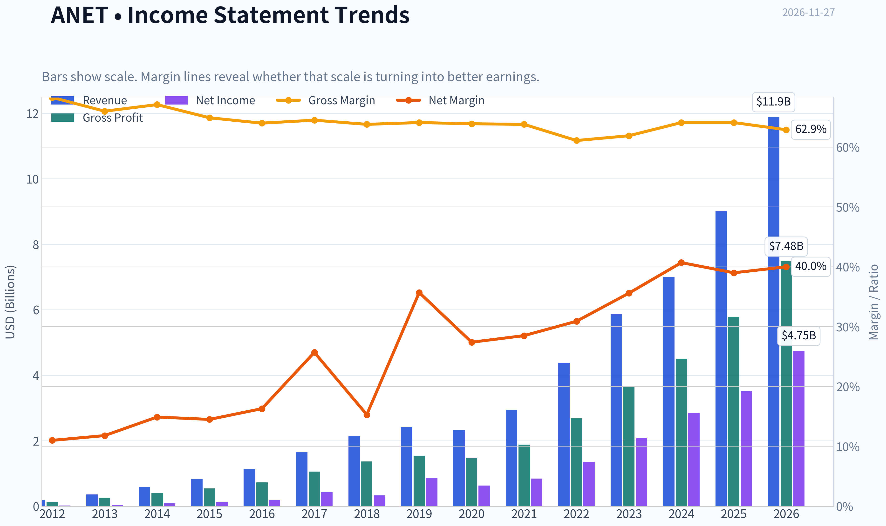

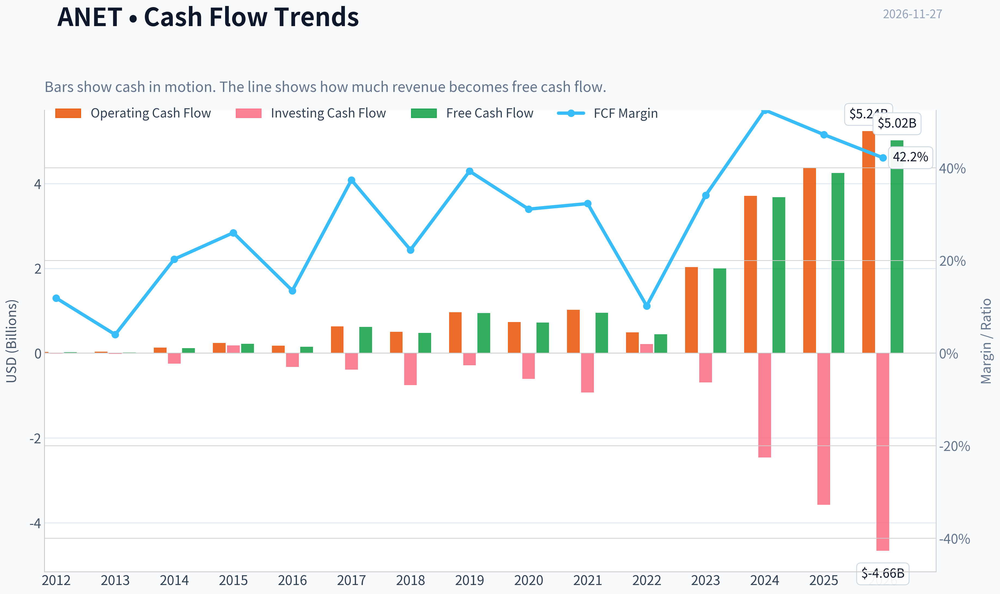

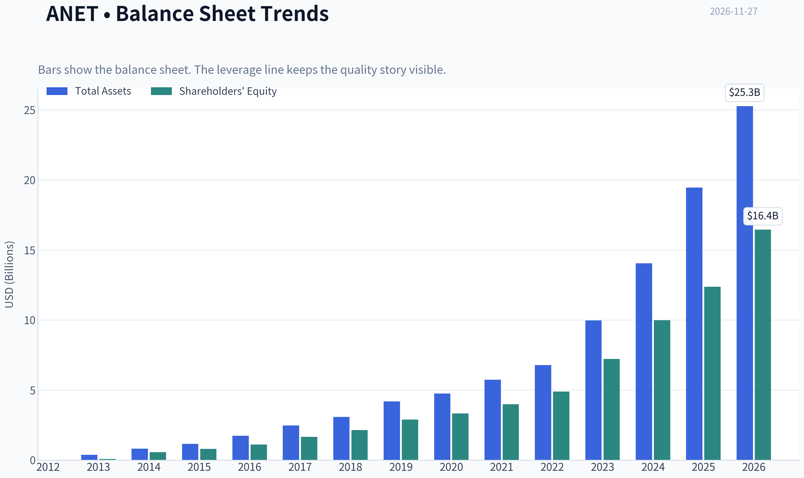

This graph tracks the profitability and return metrics (ROE, ROIC, Margins) of **ANET** over the past decade, highlighting capital efficiency trends.

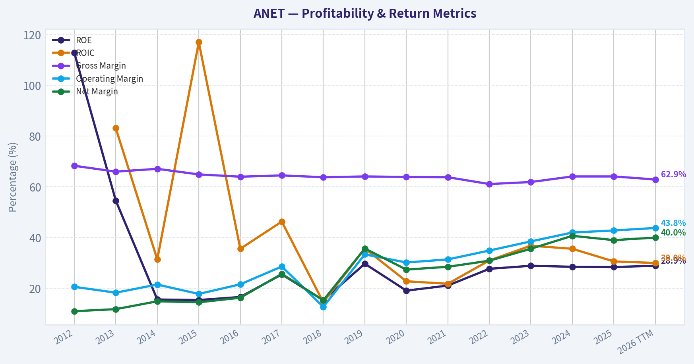

This chart illustrates the financial health of **ANET** over the last 10 years, mapping cash equivalents and free cash flow against total obligations (Debt).

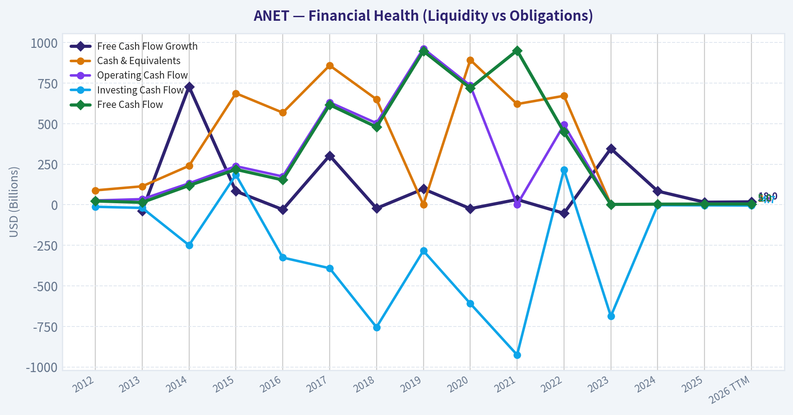

This comparison chart from *Profitability and Operating Performance* stacks current figures against historical benchmarks for **ANET**, making it easy to see where the company trades relative to its own averages.

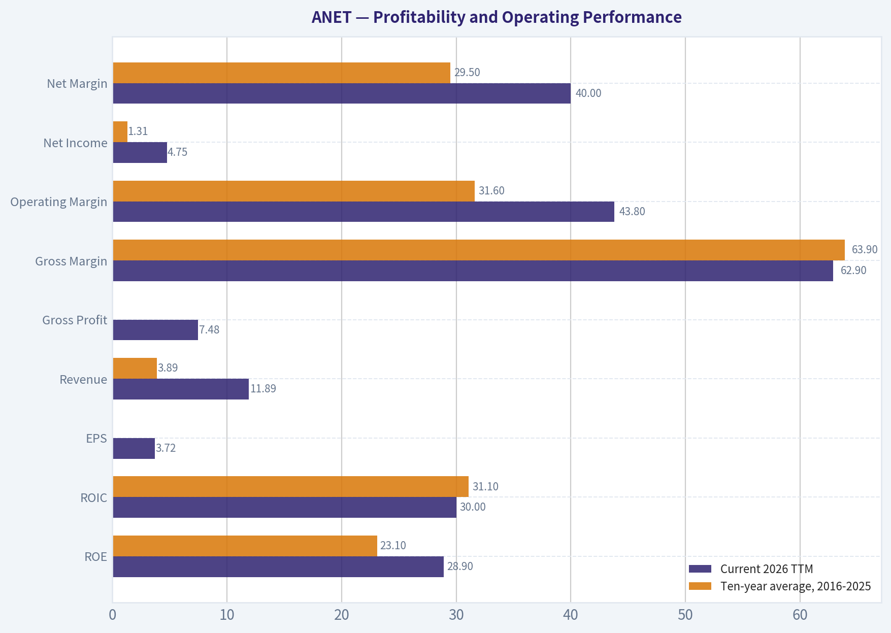

---

### Intrinsic Value Analysis (Buffett)

> *Following Warren Buffett's value investing philosophy: Circle of Competence, Economic Moat, Management Quality, and Margin of Safety.*

#### Intrinsic Value Snapshot

Price is what you pay. Intrinsic value is what the business may be worth based on the cash it can create for owners over time. We show a range, not one magic number.

- Current Price: $163.99
- Value Range (conservative to optimistic across both DCF methods): $27.02 to $217.49

##### Owner Earnings (Buffett Method)
- Net Income: $3,511,400,000.00
- Depreciation & Amortization: $72,600,000.00
- Capital Expenditures: $-119,500,000.00
- Working Capital Changes: $687,800,000.00
- Owner Earnings: $3,873,980,092.71

##### Intrinsic Value
###### Buffett Method
Uses owner earnings. Stricter, and usually more conservative.
- Conservative: $66.40
- Average: $94.86
- Optimistic: $94.86
- Discount Rate: 8.2%

###### Cash Flow Method
Uses free cash flow. Better for companies spending heavily today to grow tomorrow.
- Conservative: $27.02
- Average: $217.49
- Optimistic: $217.49
- Discount Rate: 9.0%

ANALYST STANCE: **Neutral**

#### Executive Assessment

Arista Networks is a high-quality, asset-light networking compounder with strong growth, exceptional margins, net cash, and attractive reinvestment economics. Its competitive position is supported by software-driven switching costs, a strong cloud and AI networking franchise, and an expanding role in data-center infrastructure.

The central issue is valuation. At approximately $164 per share, ANET trades substantially above the DeepValues Buffett owner-earnings intrinsic value of $94.86 per share. The business quality is strong enough to merit continued attention, but the current valuation does not provide an adequate margin of safety under a disciplined Buffett framework.

#### 1. Factor Scorecard

| Factor | Score | Assessment |
|---|---:|---|
| Circle of Competence and Simplicity | 4.0/5 | Arista sells high-performance networking hardware and software to data centers and enterprises. The model is understandable, although AI networking cycles and technology transitions reduce predictability. |
| Durable Competitive Advantage | 4.5/5 | Strong gross margins, software integration, customer switching costs, brand reputation, and scale advantages indicate a wide moat. |
| Management and Capital Allocation | 3.5/5 | Financial execution and balance-sheet discipline are strong. Public evidence in the research pack is insufficient to award the highest score for owner-oriented compensation and long-term capital-allocation judgment. |
| Industry Structure | 4.0/5 | Data-center networking is concentrated among capable vendors and benefits from scale, but competition from Cisco, hyperscaler-designed systems, and changing architectures remains material. |

**Key Takeaways:** ANET scores highly on business quality, moat, and industry economics. The main analytical weakness is not solvency or business deterioration; it is the price paid for an already excellent franchise.

#### 2. Moat Analysis

**Intangible assets and brand:** Arista has built a strong reputation for reliable, high-performance networking equipment and its EOS software platform. Gross margin of approximately 64.1% is substantial evidence of differentiated economics and pricing power.

**Switching costs:** Networking infrastructure is deeply embedded in customer operations. Replacing equipment involves testing, compatibility work, retraining, operational risk, and potential downtime. EOS consistency across products further increases the cost of switching.

**Cost and scale advantages:** Arista benefits from scale in software development, customer support, engineering, and large data-center deployments. Its asset-light model allows a greater proportion of revenue to convert into operating cash flow.

**Network effects and ecosystem effects:** Arista does not possess a classic consumer network effect, but its installed base, developer familiarity, operating-system ecosystem, and integration with large cloud customers reinforce adoption. Growth in AI clusters and cloud infrastructure expands the addressable market.

**Moat rating: Wide and stable to wide and widening, 4.5/5.**

The moat is real, but the durability of current growth rates depends partly on continued hyperscaler capital spending and the pace of AI-networking adoption.

#### 3. Management Quality Assessment

| Area | Evidence | Assessment |
|---|---|---|
| Operating execution | Revenue growth of 28.6% year over year and gross margin of 64.1% | Strong |
| Balance-sheet discipline | Approximately $14.4 billion of net cash and no reported debt in the valuation inputs | Excellent |
| Capital intensity | Reported capex of approximately $0.2 billion versus roughly $4.5 billion of owner earnings | Very favorable |
| Long-term owner alignment | Detailed ownership and compensation evidence not included in the supplied pack | Unconfirmed |
| Capital allocation | Cash has been retained while the company continues investing in growth; no evidence of balance-sheet stress | Positive, but not fully demonstrated |

Management appears operationally effective and financially conservative. The evidence supports a good, rather than perfect, management score because the available information does not establish whether compensation is tightly linked to long-term per-share intrinsic value or whether acquisitions have consistently created value.

#### 4. Financial Summary

| Metric | Latest reported value |
|---|---:|
| Current price | $164.00 |
| Market capitalization | $207.19B |
| P/E ratio | 43.97 |
| Revenue growth, year over year | 28.6% |
| Gross margin | 64.1% |
| ROE | 28.4% |
| Free-cash-flow yield | 2.1% |
| Owner earnings used by valuation model | $4.5B |
| Cash and marketable securities | $14.4B |
| Debt | $0.0B |
| Shares outstanding used in valuation | 1.278B |
| Current ratio | 3.05 |

**Key Takeaways:** ANET combines rapid growth with a 64.1% gross margin and 28.4% ROE, a rare combination for a hardware-related company. The balance sheet is exceptionally strong, but the 2.1% free-cash-flow yield and approximately 44 times earnings show that the market already capitalizes much of the expected future success.

#### 5. Owner Earnings Calculation

The DeepValues Buffett owner-earnings calculation uses the following inputs:

| Owner Earnings Component | Amount |
|---|---:|
| After-tax operating income | $4.5B |
| Add: depreciation and amortization | $0.1B |
| Less: maintenance-capex charge | $0.1B |
| Less: working-capital investment | Approximately $0.0B |
| Estimated owner earnings | **$4.5B** |
| Owner earnings per share | **Approximately $3.52** |

**Key Takeaways:** Owner earnings are close to after-tax operating income because Arista requires relatively little maintenance capital and working capital. This is a highly attractive cash-conversion profile, although the resulting owner-earnings yield at the current price is only about 2.2%.

#### 6. Three-Scenario DCF Valuation

The DeepValues app value is the primary intrinsic-value reference. The independent scenarios below are sensitivity checks using approximately $4.5 billion of owner earnings, 1.278 billion shares, and $14.4 billion of net cash.

| Scenario | Core assumptions | Estimated value per share |
|---|---|---:|
| A: No growth | Owner earnings capitalized at 10% | Approximately $35 |
| B: GDP growth | 3% perpetual growth and 10% discount rate | Approximately $63 |
| C: Historical-growth sensitivity | Approximately 7.5% growth for 10 years, then 2.5% terminal growth, 10% discount rate | Approximately $81 |
| DeepValues Buffett owner-earnings value | 10% growth fading to 2.5%, 8.2% discount rate, plus net cash | **$94.86** |

**Key Takeaways:** Even a favorable growth sensitivity produces a value below the current market price. The DeepValues app's more generous 8.2% discount rate and 10% initial growth assumption produce the headline intrinsic value of $94.86, which remains well below $164.

#### 7. Margin of Safety Analysis

| Measure | Result |
|---|---:|
| Current price | $164.00 |
| DeepValues intrinsic value | $94.86 |
| Price premium to intrinsic value | Approximately 72.9% |
| Conventional margin of safety versus price | Approximately -42.2% |
| App-reported margin of safety versus price | -72.9% |
| FCF DCF base case | $217.49 |
| Damodaran FCFF base case | $83.60 |
| Secondary DVI scenario model | $121.99 |

**Key Takeaways:** The primary Buffett owner-earnings valuation indicates a substantial valuation premium, not a margin of safety. Other valuation methods produce a wide range because they are highly sensitive to long-term growth and discount-rate assumptions; the more conservative owner-earnings and FCFF estimates remain below the market price.

#### 8. Final Buffett Scorecard

| Criterion | Weight | Score | Weighted contribution |
|---|---:|---:|---:|
| Moat width and durability | 25% | 4.5/5 | 1.13 |
| Valuation and margin of safety | 20% | 1.0/5 | 0.20 |
| Capital returns versus WACC | 15% | 4.5/5 | 0.68 |
| Business understanding and predictability | 12% | 3.5/5 | 0.42 |
| Management quality and capital allocation | 12% | 3.5/5 | 0.42 |
| Reinvestment runway | 8% | 4.5/5 | 0.36 |
| Balance-sheet strength | 4% | 5.0/5 | 0.20 |
| Industry structure | 4% | 4.0/5 | 0.16 |
| **Total** | **100%** |  | **3.57/5** |

**Gate 5 hard floor:** **Not tripped.** The evidence shows strong earnings, cash generation, net cash, and no indication of deteriorating fundamentals combined with solvency stress. Interest coverage and debt concerns are not relevant because the valuation inputs show no debt and substantial net cash.

#### 9. Investment Stance

**Neutral - Moderate conviction.**

ANET is a wonderful business by many operating measures: high margins, strong growth, excellent cash conversion, high ROE, net cash, and a credible technology and switching-cost moat. However, the valuation requires a substantial amount of future growth and continued execution. The current price is materially above the primary intrinsic-value estimate, so the evidence supports monitoring the company's economics while treating valuation as the decisive constraint.
#### Valuation Bridge

This bridge places the current market price beside each intrinsic value lens so readers can see whether upside depends on one method or shows up across several methods.

| Scenario | Intrinsic Value / Share |
| --- | ---: |
| Buffett Method | $94.86 |
| Cash Flow Method | $217.49 |
| Damodaran Method | $83.60 |
| Current Price | $163.99 |

#### Key Takeaways

If one method is far above the others, the upside case depends on a specific modelling assumption. When several methods cluster together, the valuation story is more robust.

#### Valuation Visuals

This comparison chart from *Latest Earnings Snapshot* stacks current figures against historical benchmarks for **ANET**, making it easy to see where the company trades relative to its own averages.

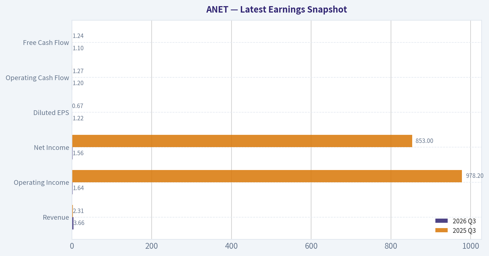

This comparison chart from *Balance Sheet and Financial Strength* stacks current figures against historical benchmarks for **ANET**, making it easy to see where the company trades relative to its own averages.

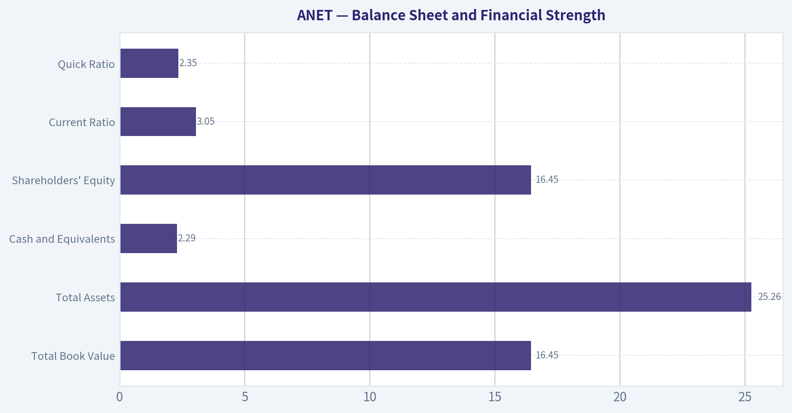

This comparison chart from *Cash Flow and Capital Allocation* stacks current figures against historical benchmarks for **ANET**, making it easy to see where the company trades relative to its own averages.

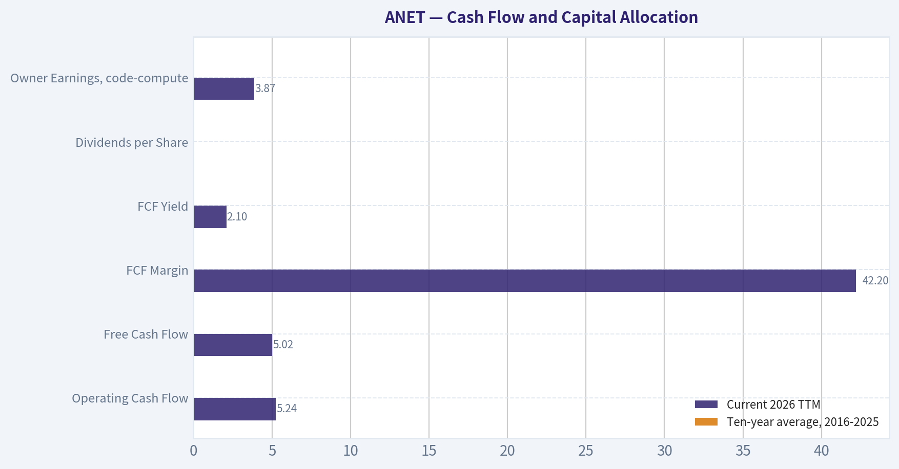

---

### Trend & Growth Analysis (Lynch/Druckenmiller/Fisher)

> *Following Peter Lynch's GARP, Stanley Druckenmiller's macro-aware approach, and Philip Fisher's scuttlebutt methodology.*

ANALYST STANCE: **Neutral**

#### 1. Lynch Classification

**Fast Grower**, based on 28.6% year-over-year revenue growth, strong gross margin, and exposure to AI networking and cloud infrastructure. However, the valuation is demanding and available data does not establish that growth is accelerating.

#### 2. The Story in Three Bullets

- Arista supplies high-speed Ethernet networking equipment and software to hyperscale cloud providers, enterprises, and AI infrastructure operators.
- AI clusters and cloud traffic are expanding the need for high-bandwidth, low-latency networking, creating a potentially durable demand runway.
- The company combines a strong competitive position with approximately 64% gross margins, but the market is already assigning a premium valuation.

#### 3. TAM and Runway Analysis

| Factor | Assessment |
|---|---|
| Secular market | Cloud computing, AI infrastructure, data-center networking |
| Current revenue growth | 28.6% year over year |
| Competitive position | Strong in high-performance Ethernet switching and cloud networking |
| TAM direction | Expanding, particularly through AI clusters and distributed inference |
| 10x revenue test | Inconclusive because the research pack does not provide current revenue and a sufficiently precise TAM estimate |
| Main runway risk | Hyperscaler concentration and eventual normalization of AI infrastructure spending |

**Key Takeaways:** Arista participates in expanding markets rather than a stagnant networking category. The AI networking opportunity could materially enlarge its addressable market, but the 10x test cannot be verified quantitatively from the available data. The principal uncertainty is whether AI-related demand represents durable structural growth or an unusually strong infrastructure cycle.

#### 4. Revenue Growth Trend

| Metric | Result | Interpretation |
|---|---:|---|
| Latest year-over-year revenue growth | 28.6% | Fast-grower territory |
| Multi-period growth trend | Not provided | Acceleration cannot be confirmed |
| Organic versus acquisition growth | Not provided | Revenue quality requires further verification |
| Recent industry signal | Cloud-provider optical equipment revenue reportedly grew 75% year over year in the cited market update | Positive demand backdrop, but not equivalent to Arista revenue growth |

**Key Takeaways:** The latest reported growth rate is strong and above the threshold for a fast grower. There is not enough company-specific historical data here to determine whether growth is accelerating, stable, or decelerating. The next important evidence would be several consecutive quarters of revenue growth, bookings, backlog, and cloud-customer demand.

#### 5. Unit Economics and Operating Quality

| Metric | Result | Interpretation |
|---|---:|---|
| Gross margin | 64.1% | Strong differentiation and software/content contribution |
| FCF yield | 2.1% | Indicates substantial valuation premium |
| FCF margin | Not provided | Rule of 40 cannot be calculated precisely |
| NRR | Not provided | More relevant to recurring software than hardware sales |
| LTV/CAC | Not provided | Not disclosed in the available research pack |
| Current ratio | 3.05 | Strong short-term liquidity |
| ROE | 28.4% | Strong capital efficiency |

**Key Takeaways:** Arista shows attractive gross profitability, liquidity, and return on equity. The absence of disclosed SaaS-style metrics such as NRR and LTV/CAC is normal for a networking equipment company, but it limits subscription-style analysis. The low FCF yield shows that much of the company's future growth is already reflected in the equity valuation.

#### 6. Inflection-Point Assessment

| Potential inflection | Evidence | Assessment |
|---|---|---|
| Product cycle | Etherlink R4 expansion for distributed AI inference | Positive |
| TAM expansion | AI clusters, cloud traffic, and data sovereignty requirements | Positive |
| Market share | Strong position in cloud networking, but current share gains not quantified | Unconfirmed |
| Margin inflection | 64.1% gross margin; operating leverage data unavailable | Positive but unproven |
| Competitive backdrop | Ethernet adoption may benefit from AI networking diversification | Positive, subject to competition |

**Key Takeaways:** The clearest potential inflection is product and TAM expansion through AI networking and Etherlink R4. The evidence supports a favorable strategic setup, but the report does not establish an earnings inflection with quantified bookings, operating margins, or market-share gains. Confirmation would require accelerating revenue and profit growth rather than only a favorable industry narrative.

#### 7. Macro Setup

| Macro factor | Effect on ANET |
|---|---|
| AI infrastructure spending | Strong tailwind |
| Cloud capital expenditures | Tailwind, particularly from hyperscalers |
| Interest rates | Headwind for premium-growth valuations |
| Current 30-year Treasury reference | 5.24% |
| Customer concentration | Potential volatility if hyperscaler spending normalizes |
| Economic cycle | Growth remains supported by secular investment, but valuation is rate-sensitive |

**Key Takeaways:** The operating macro environment is favorable because AI and cloud infrastructure remain powerful secular themes. The valuation macro is less supportive because higher long-term interest rates reduce the present value of distant growth. This creates a tension between excellent business momentum and a relatively demanding discount-rate environment.

#### 8. Fisher's 15-Point Score

| Fisher criterion | Score / 5 | Assessment |
|---|---:|---|
| Market potential | 5 | AI and cloud networking offer substantial expansion |
| New-product development | 4 | Etherlink R4 supports continued innovation |
| R&D effectiveness | 4 | Strong product reputation; detailed R&D data unavailable |
| Sales organization | 4 | Strong cloud and enterprise customer presence |
| Profit margins | 5 | 64.1% gross margin |
| Margin improvement | 3 | Direction not supplied |
| Labor relations | 3 | Insufficient evidence |
| Executive relations | 3 | Insufficient evidence |
| Management depth | 4 | Established specialist with meaningful scale |
| Cost analysis/accounting | 4 | Public-company reporting appears robust |
| Outstanding competitive aspects | 5 | Switching costs, scale, software integration, and ecosystem advantages |
| Long-range profit outlook | 5 | AI and cloud networking provide a strong runway |
| Dilution risk | 4 | No significant dilution issue supplied |
| Management candor | 3 | Insufficient evidence from the pack |
| Management integrity | 4 | No specific integrity concern supplied |
| **Total** | **60 / 75** | **Good** |

**Key Takeaways:** Arista scores well on market potential, margins, innovation, and competitive advantages. The score is held below the outstanding range mainly because several governance, employee, accounting-detail, and margin-trend factors cannot be independently assessed from the available information. The result is consistent with a high-quality growth company, but not with unquestioned valuation support.

#### 9. Valuation Analysis

| Measure | Calculation / Value | Interpretation |
|---|---:|---|
| Market capitalization | $207.19 billion | Large-cap premium growth valuation |
| P/E | 43.97 | Expensive in absolute terms |
| PEG | 43.97 ÷ 28.6 = **1.54** | Fair-to-expensive under Lynch's framework |
| Gross margin | 64.1% | Supports a premium business multiple |
| FCF yield | 2.1% | Limited current cash-flow yield |
| Owner-earnings intrinsic value | **$94.86** headline value | Substantially below current price |
| Owner-earnings range | $66.40-$94.86 | Conservative-to-optimistic range below current price |
| Damodaran FCFF range | $59.43-$151.45 | Wide sensitivity to assumptions |
| Current price | Approximately $164 | Above the cited intrinsic-value estimates |

**Key Takeaways:** The PEG ratio of approximately 1.54 suggests that valuation is not extreme relative to growth, but it is not inexpensive by Lynch's standards. The primary owner-earnings valuation of $94.86 is materially below the approximately $164 market price, implying that substantial future growth and/or higher normalized cash generation is already embedded. The wide FCFF range demonstrates that the conclusion is highly sensitive to assumptions, but most cited valuation frameworks do not support the current price without strong execution.

#### 10. Growth Investor Scorecard

| Criterion | Weight | Score / 5 | Weighted result |
|---|---:|---:|---:|
| Lynch story | 10% | 4.5 | 0.45 |
| TAM and runway | 20% | 4.5 | 0.90 |
| Revenue growth | 20% | 4.0 | 0.80 |
| Unit economics | 15% | 3.5 | 0.53 |
| Competitive position | 10% | 4.5 | 0.45 |
| Management quality | 10% | 3.8 | 0.38 |
| Macro setup | 5% | 3.5 | 0.18 |
| Profitability path | 5% | 4.5 | 0.23 |
| Valuation | 5% | 2.0 | 0.10 |
| **Total** | **100%** |  | **4.02 / 5.00** |

**Key Takeaways:** The operating score is strong at approximately 4.0 out of 5, reflecting a compelling business, high margins, and an expanding AI-related runway. Valuation is the principal weakness and prevents a higher-conviction interpretation. The evidence supports monitoring for earnings acceleration and valuation normalization rather than assuming that excellent business quality automatically translates into attractive returns.

#### 11. Valuation Sensitivity

| Scenario | Key assumption | Valuation implication |
|---|---|---|
| Bear | AI infrastructure growth normalizes, long-term rates remain elevated, and multiples compress | Owner-earnings range near $66.40 becomes relevant |
| Base | Growth remains strong but moderates, with normalizing margins and a conventional discount rate | Primary owner-earnings estimate of $94.86 remains the cited reference |
| Bull | AI networking demand remains unusually strong, Arista gains share, and cash flow compounds faster than expected | FCFF sensitivity can reach as high as $151.45, still below approximately $164 |
| Re-rating case | Sustained acceleration plus lower long-term rates | Could justify a higher valuation, but requires evidence not yet supplied |

**Key Takeaways:** The valuation is highly dependent on long-term growth, margins, and interest rates. Even the optimistic FCFF sensitivity supplied remains below the current price, while the primary owner-earnings estimate is substantially lower. The market therefore appears to require continued strong execution and favorable macro conditions.

#### 12. Key Risks and Catalysts

| Catalysts | Risks |
|---|---|
| Sustained hyperscaler capital-expenditure growth | Hyperscaler spending normalization |
| Strong adoption of Etherlink R4 | Competition from Cisco, Nvidia, Broadcom, and other networking vendors |
| Accelerating AI networking revenue | AI infrastructure spending proving cyclical |
| Market-share gains in Ethernet AI clusters | Customer concentration |
| Operating leverage and higher free-cash-flow margins | Elevated long-term interest rates |
| New software and data-center products | Valuation compression if growth merely remains stable rather than accelerates |

**Key Takeaways:** The principal catalysts are measurable acceleration in AI networking revenue, sustained hyperscaler demand, and operating leverage. The principal risks are a spending cycle peak, competitive pressure, and multiple compression. At approximately $164, the evidence indicates that valuation depends on continued high growth rather than merely maintaining current performance.

#### Growth & Scorecard Visuals

This comparison chart from *Growth Metrics* stacks current figures against historical benchmarks for **ANET**, making it easy to see where the company trades relative to its own averages.

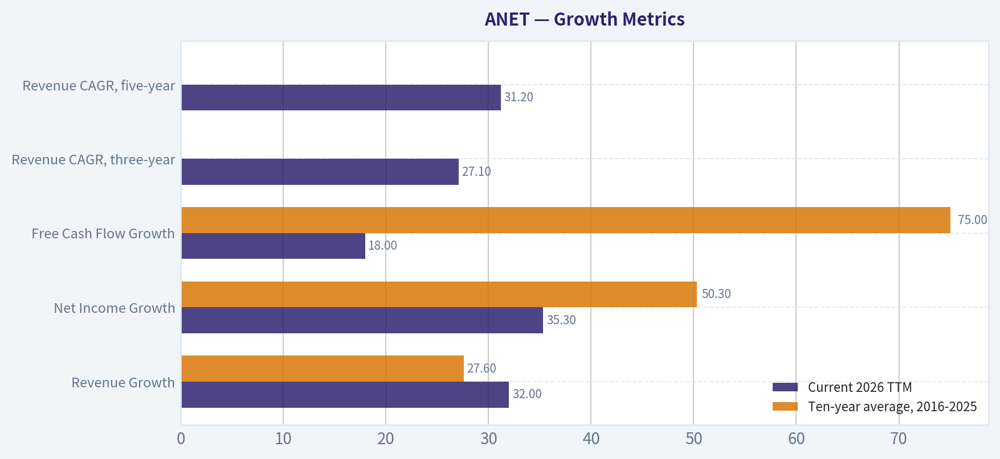

---

### Market Technical Analysis

ANALYST STANCE: **Neutral**

#### Scope and data status

This review covers **Arista Networks, Inc. (NYSE: ANET)** only. Yahoo Finance supplied 250 daily records from November 28, 2025 through November 25, 2026. The requested endpoint, November 27, 2026, is not represented by a trading record, so the latest available closing price is **$163.99 on November 25, 2026**. The indicator service returned unavailable or blank values for the requested lookback window; therefore, no numerical technical-indicator readings are presented as fact.

#### Price structure and trend

ANET's one-year price path was strongly positive overall but highly discontinuous. The shares rose from **$130.68 on November 28, 2025, to $163.99 on November 25, 2026**, an increase of approximately **25.5%**. That headline gain conceals several major reversals:

- The stock advanced from roughly **$120.77 on March 27** to **$177.73 on April 22**, a gain of about 47% in less than one month.
- It then experienced a sharp May reset, falling from **$172.70 on May 1 to $136.43 on May 11**.
- A second sustained advance carried the price from **$141.77 on May 8 to $216.74 on October 9**, a rise of approximately 53%.
- From the October high to the November 25 close, the stock declined approximately **24.4%**.
- The latest selloff accelerated after the **$206.63 close on November 12**, reaching **$163.99** by November 25, a decline of approximately **20.6%** in nine sessions.

The intermediate trend therefore changed materially in October and November. The October peak established a high-water mark, followed by lower closing levels through late October and early November. A sharp rebound from **$159.16 on November 5** to **$206.63 on November 12** briefly interrupted that deterioration, but the rebound failed to establish a durable new high and was followed by another sequence of lower closes.

#### Recent price action

The most recent 13 trading sessions were characterized by unusually wide daily ranges and repeated gap-like changes between the opening and closing levels. The period included:

- **November 4:** close of $178.48 on volume of 18.6 million shares.
- **November 5:** close of $159.16, with an intraday low of $158.35.
- **November 9-12:** a rapid recovery to $206.63.
- **November 13:** a reversal to $197.29 despite an intraday high of $212.15.
- **November 20:** a particularly severe decline, with a low of $165.41 and a close of $167.62 on volume of 13.9 million shares.
- **November 24-25:** further weakness, ending at $168.56 and then $163.99.

This pattern indicates a market with substantial disagreement over near-term valuation and earnings expectations. The frequent large ranges also reduce the reliability of short-horizon price signals because single-session moves can dominate moving-average and momentum calculations.

#### Volume interpretation

Volume expanded notably during both advances and declines. The largest recent volume occurred on November 4, when more than **18.6 million shares** traded, followed by elevated activity on November 5, November 6, November 9, and November 20. This is not a quiet pullback: participation increased during the major reversal phases.

The volume pattern is therefore more consistent with active repricing than with a low-conviction drift. High volume on sharp down sessions, particularly November 20, suggests that downside price discovery was accompanied by broad market participation. At the same time, high volume also appeared during the rebound toward $206.63, so volume alone does not establish a one-directional conclusion.

#### Selected indicators and why they fit this context

The most relevant complementary set is:

1. **close_10_ema** - identifies rapid changes in short-term direction after the November rebound and subsequent breakdown.
2. **close_50_sma** - assesses whether the intermediate trend has weakened materially after the October high.
3. **close_200_sma** - provides a slower structural benchmark and helps distinguish a major trend change from an intermediate correction.
4. **macd** - evaluates whether medium-term momentum has shifted from the strong advance into a weakening or negative phase.
5. **rsi** - measures whether the recent decline has produced oversold conditions, while recognizing that strong downtrends can keep RSI depressed.
6. **boll_ub** - identifies whether the October and November rebound phases reached statistically extended levels.
7. **boll_lb** - helps assess whether the November decline represented a volatility-driven lower-band event or a more persistent breakdown.
8. **atr** - quantifies the unusually high trading range and is particularly important for interpreting signal reliability in this volatile period.

The moving averages provide trend hierarchy, MACD and RSI provide momentum and exhaustion information, Bollinger bands frame the price within its recent volatility distribution, and ATR measures the intensity of that volatility. This combination avoids selecting several nearly identical momentum measures while still covering trend, momentum, dispersion, and risk characteristics.

The indicator service did not return usable numerical values for these fields. Consequently, the evidence from the raw price and volume series should be treated as descriptive rather than as a complete indicator-confirmed signal set.

#### Technical interpretation

The long-term picture remains stronger than the very recent picture because the latest price is still materially above the November 2025 starting level and the stock has completed several large upward legs during the year. However, the short- and intermediate-term structure has deteriorated:

- The October 9 peak was followed by a broad decline rather than a brief consolidation.
- The November recovery failed near the prior high region and was followed by renewed selling.
- The latest close is approximately 24% below the October peak.
- The decline has occurred alongside elevated volume and unusually wide daily ranges.
- The sharp rebound between November 5 and November 12 demonstrates that downside pressure has not been linear, but the subsequent reversal shows that volatility has remained two-sided rather than resolving into a stable recovery pattern.

From a valuation perspective, the evidence does not support treating the October peak as a stable reference point. The market is assigning a substantially different near-term valuation than it did in early October, and the size of the price swings indicates that expectations remain unsettled. A more constructive valuation interpretation would require evidence that the decline is stabilizing and that momentum and volume behavior are becoming less disorderly; the supplied data do not yet establish that condition.

#### Key observations table

| Area | Evidence from available data | Interpretation |
|---|---:|---|
| Latest available close | $163.99 on Nov. 25, 2026 | Latest verified price; Nov. 26-27 data are unavailable |
| One-year change | $130.68 to $163.99, approximately +25.5% | Positive annual result despite substantial interim drawdowns |
| October peak | $216.74 on Oct. 9 | Established a major recent reference high |
| Decline from October peak | Approximately -24.4% to Nov. 25 | Material intermediate-term deterioration |
| Post-November rebound | $159.16 on Nov. 5 to $206.63 on Nov. 12 | Strong but short-lived recovery |
| Subsequent decline | $206.63 to $163.99, approximately -20.6% | Rebound failure followed by renewed downside pressure |
| Volume behavior | Several sessions above 10 million shares; Nov. 4 at 18.6 million | Active repricing rather than low-participation drift |
| Volatility | Repeated daily ranges of roughly 8-20 dollars | ATR and band-based measures would be especially relevant |
| Indicator data status | Requested reports returned blank or unavailable readings | No numerical indicator confirmation should be inferred |

**Key Takeaways:** ANET retains a positive one-year return, but the latest structure is defined by a roughly 24% retreat from the October high, a failed November rebound, and unusually heavy trading activity. The evidence points to active repricing and unstable expectations rather than a settled trend. Because the indicator feed did not provide usable readings, the valuation interpretation remains Neutral until trend and volatility measures can be verified with complete data.

#### Market Visuals

This comparison chart from *Market Metrics* stacks current figures against historical benchmarks for **ANET**, making it easy to see where the company trades relative to its own averages.

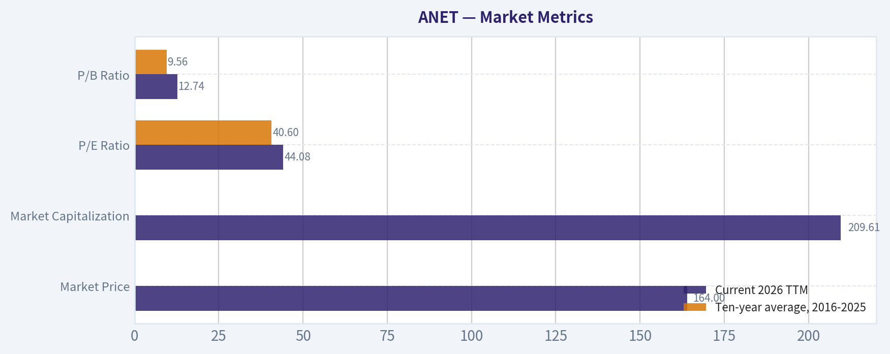

---

### Options Market Analysis

> *Reading options flow - put/call ratios, IV skew, and unusual activity - to gauge institutional positioning and event-driven risk.*

ANALYST STANCE: **NEUTRAL**

#### ANET Options-Flow Report

*Data date: November 27, 2026. The supplied chain appears incomplete: all reported open interest is zero, while options volume is nonzero. This materially limits confidence in the analysis.*

#### Put/Call Ratio Analysis

| Near-term expiry | Call volume | Put volume | Put/Call volume ratio | Put OI | Call OI | Put/Call OI ratio |
|---|---:|---:|---:|---:|---:|---:|
| Nov. 27, 2026 | 3,720 | 1,613 | 0.43 | 0 | 0 | N/A |
| Dec. 4, 2026 | 2,927 | 1,989 | 0.68 | 0 | 0 | N/A |
| Dec. 11, 2026 | 503 | 277 | 0.55 | 0 | 0 | N/A |
| **Aggregate** | **7,150** | **3,879** | **0.54** | **0** | **0** | **N/A** |

**Key Takeaways:** The aggregate put/call volume ratio of 0.54 is below the approximately 0.70 neutral reference, indicating more call trading than put trading across the reported near-term expirations. However, the put/call open-interest ratio cannot be calculated because both call and put OI are reported as zero. The volume pattern leans modestly bullish, but the absence of usable OI substantially reduces confidence.

#### Implied Volatility Assessment

| Expiry | Call ATM IV | Put ATM IV | IV interpretation |
|---|---:|---:|---|
| Nov. 27, 2026 | 4.7% | 7.3% | Put IV premium; downside protection appears relatively more expensive |
| Dec. 4, 2026 | 1.8% | 1.8% | Balanced |
| Dec. 11, 2026 | 1.3% | 0.8% | Call IV modestly higher |
| **Near-term assessment** | - | - | **Very low reported IV overall; inconsistent skew** |

**Key Takeaways:** Reported ATM IV is exceptionally low, particularly for the December expirations, and may reflect a data-quality or contract-quote issue rather than genuine market complacency. The nearest expiry shows a put-IV premium, which is a mild downside-risk signal, but that skew is not consistent across expirations. No catalyst calendar was supplied, so an earnings or event-related IV premium cannot be confirmed.

#### Unusual Options Activity

| Finding | Result |
|---|---|
| Contracts meeting the volume-over-five-times-OI threshold | None |
| Fresh directional bets identifiable from the supplied data | None |
| Current price and strike-level moneyness | Not supplied |
| Smart-money versus retail distinction | Not determinable |

**Key Takeaways:** No contract qualifies as unusual activity under the supplied screening rule. Because every contract's reported OI is zero, it is not possible to distinguish opening trades from closing trades or to identify institutional accumulation. Strike-level interpretation, including ITM, ATM, or OTM classification and days-to-expiry analysis for individual contracts, is also unavailable.

#### Open-Interest Concentration and Gamma Levels

| Metric | Observation |
|---|---|
| Highest call OI strikes | None reported |
| Highest put OI strikes | None reported |
| Expiration with greatest OI concentration | None identifiable |
| Gamma walls or pinning levels | Cannot be calculated |
| Max-pain analysis | Not available |

**Key Takeaways:** The reported zero OI prevents identification of gravitational strikes, gamma walls, or max-pain levels. Consequently, the options data provides no reliable evidence about likely price pinning or levels that could amplify near-term movement. This is a major limitation for any expiry-specific interpretation.

#### Overall Options Sentiment

| Signal component | Assessment | Implication |
|---|---|---|
| Put/call volume | 0.54 aggregate | Modest call-side bias |
| Put/call open interest | N/A | No usable inventory-based sentiment signal |
| ATM IV | Very low, with inconsistent readings | Low apparent event premium, but possible data-quality issue |
| IV skew | Slight put skew at the nearest expiry | Mild near-term downside-hedging demand |
| Unusual activity | None identified | No confirmed fresh institutional directional trade |
| OI concentration | Unavailable | No gamma or pinning signal |
| **Overall signal** | **NEUTRAL** | Volume leans bullish, but evidence is insufficiently reliable |

**Key Takeaways:** ANET's reported options flow has a modest bullish tilt because calls account for more near-term volume than puts. Nevertheless, the zero-OI readings, missing strike-level details, extremely low IV values, and lack of unusual activity prevent that tilt from qualifying as a strong directional signal. The evidence supports a neutral options-based read, with low confidence and a modest call-volume bias.

#### Summary

| Category | Conclusion |
|---|---|
| Put/Call Ratio | Volume ratio of 0.54, below the 0.70 neutral baseline; OI ratio unavailable |
| IV Level | Very low reported near-term IV; reliability is questionable |
| Skew Direction | Mild put skew only in the nearest expiry; otherwise inconsistent |
| Unusual Activity | No contracts exceeded the volume-over-five-times-OI threshold |
| Overall Signal | **NEUTRAL**, with a modest bullish volume bias and low confidence |

**Key Takeaways:** The most constructive feature is the 0.54 aggregate put/call volume ratio, showing greater call activity than put activity. The dominant issue is data integrity: zero open interest across all expirations eliminates the ability to validate directional conviction, institutional activity, or gamma concentration.

---

## Research Team Commentary

> *The Research Manager synthesizes the Bull vs Bear debate into action-free commentary. This is a pre-risk view, not the final stance.*

Core takeaway: Arista Networks appears to be a genuinely exceptional business, but the evidence does not establish that $164 offers the quality-adjusted margin of safety Buffett-style underwriting still requires. Its software-centered architecture, engineering credibility, net-cash balance sheet, 64.1% gross margin, and exposure to cloud and AI networking support a wide-moat compounder thesis. The constraint is a trailing P/E near 44, which appears to require sustained mid-to-high-teens earnings growth with limited margin deterioration. That outcome is plausible, but it is not conservative enough to warrant an Bullish stance.

The strongest bull argument is that Arista should not be analyzed as a commodity switch vendor. EOS is embedded in customer workflows, automation, training, and network architecture, creating meaningful switching costs. Mission-critical reliability, qualification requirements, and Arista's reputation among hyperscale customers reinforce the moat. AI clusters also require increasingly fast, low-latency connections among processors, storage, and servers, so networking intensity can rise even independently of unit growth in computing equipment. This provides a credible runway extending beyond a single product cycle.

The economics reinforce that assessment. Gross margin of 64.1%, ROE of 28.4%, ROA of 18.1%, and net cash indicate pricing power, capital efficiency, and financial resilience. The reported 195.8% ROIC should not be taken literally as a sustainable long-term rate because an asset-light business can have an unusually small invested-capital denominator. Nevertheless, even a heavily normalized figure would likely indicate excellent economics. Arista can invest in software, engineering, and customer support without requiring large amounts of physical capital.

The strongest bear argument is not that the franchise is weak; it is that the valuation already recognizes much of its strength. At $164 and 43.97 times trailing earnings, implied earnings are approximately $3.73 per share and the earnings yield is only about 2.3%. The debate's illustrative reverse DCF suggests that roughly 16%-17% annual growth over an extended period may be needed to support the current valuation under a 9% discount rate and 3% terminal growth assumption. Those assumptions are not excessively harsh, and the analysis is only illustrative because accounting earnings are not the same as free cash flow. Even so, it correctly identifies the central issue: Arista must deliver sustained exceptional performance rather than merely good performance.

That requirement leaves the valuation exposed to ordinary business variability. AI infrastructure spending may remain structurally strong while still passing through digestion periods. Hyperscalers can delay projects, negotiate harder, diversify suppliers, or develop custom systems. Cisco retains enterprise reach, while Nvidia can integrate networking more closely with accelerated computing. Arista does not need to lose its moat for investor economics to weaken; slower share gains, modest gross-margin compression, higher research spending, or a lower valuation multiple could be sufficient.

Customer concentration deserves particular attention. Switching costs protect platform continuity, but they do not eliminate budget cycles or procurement leverage. A hyperscaler can continue using EOS while delaying incremental deployments or negotiating lower hardware economics. The lack of customer-level concentration, contract-duration, and profitability data in the supplied record prevents this risk from being fully underwritten.

Management appears operationally disciplined, but the capital-allocation conclusion remains provisional. Net cash, high margins, and strong returns are favorable evidence. The debate does not provide enough detail on stock-based compensation, net share-count changes, repurchase economics, acquisitions, or cash deployment to confirm that operating success has translated consistently into per-share value. That distinction matters at a premium multiple.

The recent price swings-from roughly $121 to $178, back near $136, and later above $216-primarily reveal expectation sensitivity. They neither invalidate the business nor prove mispricing. They do show how quickly the market can revalue a company when its price depends on long-duration growth assumptions. The incomplete options data adds no useful signal and should be excluded from the conclusion.

From a Buffett perspective, Arista clears the business-quality test more convincingly than the valuation test. A company of this quality need not trade at a 30%-50% discount to estimated intrinsic value; a 10%-15% discount could be adequate if cash flows are predictable and the moat is widening. But no DeepValues intrinsic-value estimate was supplied, and the available reverse-DCF work does not demonstrate even that smaller discount. The evidence therefore supports "wonderful business, uncertain price cushion," not "wonderful business at a demonstrably fair price."

Over the next one to four quarters, the most important monitoring items are revenue growth relative to data-center and AI spending, together with management's evidence that growth is broadening beyond a small number of hyperscalers. Sustained growth accompanied by stable or improving customer diversification would strengthen the thesis; growth increasingly dependent on one or two customers would weaken it.

Gross margin should be tracked against the current 64.1% level. Modest quarterly movement may reflect product mix, but a persistent decline combined with slower revenue growth would suggest weakening pricing power or greater competitive intensity. Stable margins during rapid AI-networking expansion would support the claim that Arista is capturing economic value rather than merely participating in a growing market.

Free-cash-flow conversion should be compared with net income, with attention to working capital and stock-based compensation. Strong cash conversion and rising free cash flow per diluted share would provide better support than the headline ROIC figure. Increasing dilution or cash flow consistently lagging earnings would weaken the per-share compounding case.

Customer concentration, cloud-titan spending plans, and order visibility are also critical. Evidence of repeat deployments, broader enterprise adoption, and durable demand across multiple cloud customers would make the growth assumptions more credible. Project delays, inventory accumulation, shorter visibility, or signs of an AI spending digestion cycle would expose the valuation's limited tolerance for disappointment.

Finally, competitive developments in Ethernet-based AI fabrics, optics, custom silicon, and Nvidia's networking ecosystem should be evaluated for their effect on customer economics-not merely through product announcements. Arista's thesis strengthens if EOS adoption, interoperability, and win rates remain robust while research spending stays productive. It weakens if customers increasingly favor vertically integrated architectures or if Arista must sacrifice margin to preserve share.

The key discipline here is to avoid two opposite errors: dismissing a modern, asset-light compounder because its multiple looks high, or excusing any valuation because the company is excellent and associated with AI. Arista's moat and reinvestment runway deserve a premium. The current evidence does not yet show that the premium leaves an adequate margin of safety.

Final stance: Neutral

---

## Value Investing Team Commentary

> *The Investor translates the research view into an investment thesis before risk review. This is still not the final stance.*

Arista Networks appears to be an exceptional business whose principal risk is not franchise quality, but the expectations embedded in its valuation.

The company's economics are unusually strong for a hardware-oriented business. Gross margin near 64%, high returns on assets and equity, substantial net cash, and an asset-light operating model indicate meaningful pricing power and efficient reinvestment. The reported 195.8% ROIC should be normalized because the invested-capital denominator is unusually small, but it still points toward excellent underlying economics. More important than the precise ratio is that Arista can grow through engineering, software, and customer relationships without requiring proportionate physical capital.

Its moat is also more substantial than the label "switch vendor" implies. EOS becomes integrated into network automation, operating procedures, employee training, and architecture decisions. Reliability in mission-critical data centers further raises the cost of switching. Arista's opportunity is expanding as cloud traffic, AI clusters, storage demands, and east-west data-center communication require higher bandwidth and lower latency.

The selective contrarian insight is that the market may be underestimating networking intensity. AI spending is often framed primarily as a semiconductor or accelerator opportunity, yet the economic value of an AI cluster depends heavily on the network connecting processors, storage, and servers. If Ethernet-based architectures continue gaining acceptance in AI environments, Arista's addressable opportunity could expand beyond conventional cloud switching.

However, the opposing contrarian point is equally important: enthusiasm surrounding AI infrastructure can cause investors to extrapolate industry growth directly into company-specific earnings growth. Rising data-center expenditure does not guarantee proportional gains for Arista. Hyperscalers possess considerable negotiating power, may diversify suppliers, and can develop custom networking systems. Nvidia's increasingly integrated networking ecosystem and Cisco's broad enterprise presence remain credible competitive forces.

At $164 and approximately 44 times trailing earnings, the valuation implies an earnings yield of only about 2.3%. Under the illustrative reverse-DCF assumptions supplied-a 9% discount rate and 3% terminal growth-sustained growth in the mid-to-high teens appears necessary for the current valuation to be well supported. That outcome is plausible given Arista's runway, but plausibility is not the same as conservatism. A few years of slower cloud spending, AI infrastructure digestion, margin pressure, or reduced customer concentration benefits could materially affect the implied value.

The recent price movements reinforce this point. Large advances followed by sharp resets indicate that expectations, rather than business fundamentals alone, are driving valuation changes. Such volatility does not disprove the long-term thesis, but it demonstrates that the shares are sensitive to changes in perceived growth duration. The market may be right about Arista's quality while still being too optimistic about the persistence of exceptional growth.

Customer concentration is a central unresolved issue. Switching costs may protect existing deployments, but they do not prevent hyperscalers from delaying projects, renegotiating economics, or reallocating infrastructure budgets. The supplied information does not provide enough detail on customer-level revenue concentration, contract duration, or account profitability to determine how much of the growth forecast rests on a small number of buyers.

The reported operating metrics also require per-share scrutiny. Strong net income and free cash flow would be more persuasive if accompanied by durable free-cash-flow-per-diluted-share growth, disciplined stock-based compensation, and favorable share-count trends. Likewise, net cash is a meaningful strength, but its value depends on whether management deploys it in ways that enhance long-term per-share economics.

The most informative evidence over the next several quarters would be:

- Revenue growth relative to overall cloud and AI infrastructure spending.
- Stability of gross margin as AI networking scales.
- Evidence that growth is broadening across hyperscalers and enterprise customers.
- Free-cash-flow conversion relative to reported earnings.
- Diluted share-count trends and stock-based compensation.
- Win rates and customer economics in Ethernet-based AI fabrics.
- Signs that Nvidia's integrated networking strategy or custom hyperscaler systems are reducing Arista's opportunity.

The incomplete options report should be disregarded. With zero reported open interest for both calls and puts, the put/call ratio is not meaningful, and the nonzero volume cannot provide a reliable sentiment signal.

Overall, Arista clears the business-quality test decisively. Its moat, balance sheet, margins, and reinvestment runway justify a premium valuation. The unresolved question is whether the premium already discounts most of the likely success. Without a supplied DeepValues intrinsic-value estimate, the available reverse-DCF analysis does not establish a sufficient quality-adjusted discount. The evidence therefore describes a wonderful business with a demanding valuation, rather than a demonstrably mispriced compounder.

**ANALYST STANCE: Neutral** - Arista's long-term business outlook remains attractive, but the valuation appears to require sustained exceptional growth and limited execution setbacks. The evidence supports close monitoring of growth durability, customer diversification, margins, and per-share cash generation before concluding that the current price provides an adequate margin of safety.

---

## Deep Values Commentary

> *The Risk Management Team debates and the Risk Judge provides the final action-free verdict. This section determines the final Bullish / Neutral / Bearish stance.*

#### Final Stance Scorecard

This scorecard converts the final research view into a weighted decision frame. It does not replace the narrative judgement, but it makes the main drivers of the verdict easier to scan.

| Criterion | Score | Weight | Commentary |
| --- | ---: | ---: | --- |
| Business Quality | 4.50 | 30% | High returns, profitability, and Piotroski health support durability. |
| Valuation Support | 1.33 | 30% | Blends current price against available intrinsic value anchors and valuation ratios. |
| Financial Strength | 4.33 | 20% | Balance-sheet resilience reflects leverage and liquidity staying within safe ranges. |
| Growth Durability | 4.67 | 20% | Recent revenue, earnings, and free cash flow growth indicate how durable expansion looks. |
| TOTAL / FINAL STANCE | 3.55 | 100% | Neutral |

#### Key Takeaways

The weighted score lands at **3.55 / 5.0**, while the final stance remains **Neutral**. This is useful as a quick calibration aid rather than a mechanical signal.

#### Risk Summary

Higher scores indicate more risk pressure. The watch threshold is a simple guardrail: above it, the dimension weighs more heavily on the valuation case and calls for a wider margin of safety.

| Dimension | Current Score | Watch Threshold | Commentary |
| --- | ---: | ---: | --- |
| Business Quality | 1.50 | 3.00 | High returns, profitability, and Piotroski health support durability. |
| Valuation Support | 4.67 | 3.00 | Blends current price against available intrinsic value anchors and valuation ratios. |
| Financial Strength | 1.67 | 3.00 | Balance-sheet resilience reflects leverage and liquidity staying within safe ranges. |
| Growth Durability | 1.33 | 3.00 | Recent revenue, earnings, and free cash flow growth indicate how durable expansion looks. |

#### Key Takeaways

This view helps readers separate *where* the risk sits: valuation, business quality, balance sheet, or growth durability. It is especially useful when the final stance is close to the line between Neutral and Bearish.
